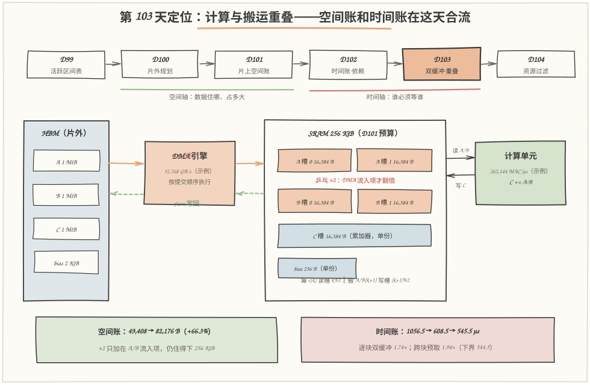
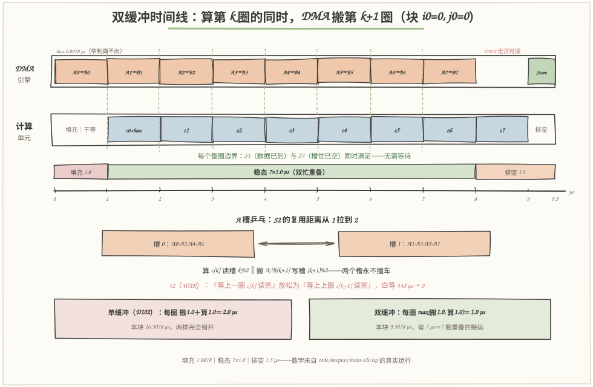
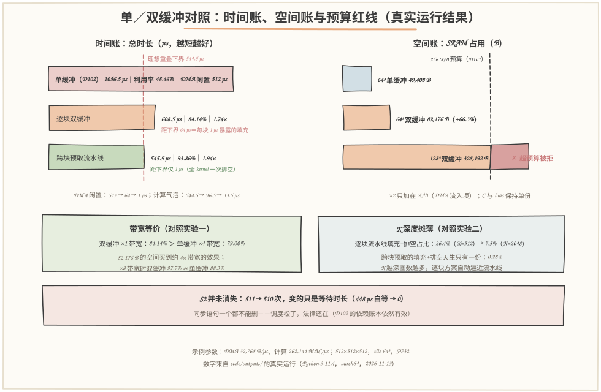

# 第 103 天：Double Buffering 与流水线——多花 66% 空间，买回一半等待

> **今日目标**：完成本教程后，你能做到四件事——说清**双缓冲（double buffering）**如何把 A/B 槽上的 WAR 复用距离从 1 拉到 2，让搬运和计算**重叠**（overlap）起来；画出双缓冲时间线的**填充（fill）／稳态／排空（drain）**三段，并用模拟器验证一个输出块从 16.5078 µs 压到 **9.5078 µs**；用真实运行量出收益——逐块双缓冲 **608.5 µs（1.74×）**、跨块预取流水线 **545.5 µs（1.94×，距理想下界只差 1 µs）**；算清代价——**×2 只加在 DMA 流入项**上，49,408 → 82,176 B（+66.3%），128³ 的 328,192 B 被 256 KiB 预算当场拒绝——空间否决时间方案，这正是 D104 资源过滤器的入口。
> **预计时间**：学习 35 分钟＋实践 45 分钟
> **前置准备**：D102 的三类操作（Load／Compute／Store 分属 DMA 引擎与计算单元）、三种依赖（RAW／WAR／WAW）与四个同步点（S1×512、S2×511、S3×64、S4×63）、单缓冲稳态节拍"搬 1.0＋算 1.0"零重叠、计算利用率 48.46%、理想重叠下界 544.5 µs；D101 的 SRAM 空间账本（64³ 单缓冲五项家当 49,408 B，预算 256 KiB）。工具只要 `python3`（本文环境：Python 3.11.4，aarch64 Linux，2026-11-13），零第三方依赖。
> **今日产出**：`code/pipeline.py`（三档调度模拟器：单缓冲／逐块双缓冲／跨块预取流水线，依赖 DAG＋24 项断言自检）＋`code/run_all.sh`（一键复现）＋`code/gen_images.py`（手绘图生成器）＋`code/outputs/` 下 9 份真实运行记录＋本文 3 张手绘图（定位图、双缓冲时间线机制图、单双缓冲对照图）。

## 1. 今天解决什么问题？

昨天（D102）收官时留下一笔刺眼的账：同一个 kernel——`C = A·B + bias`，A/B/C 都是 512×512 FP32，tile 取 64³——单缓冲跑完要 **1056.5 µs**，其中计算只忙 512 µs，**利用率 48.46%，一半时间计算单元在干等 DMA**。两组对照实验还证明了残酷的一面：把 DMA 带宽加到 ×8，利用率只爬到 88.27%；把 Tile 换成 128³，空间预算先拍桌子。病根昨天已经诊断清楚：**A/B 只有一个槽，第 k+1 圈的搬运必须等第 k 圈计算读完同一个槽才能开工（S2，WAR 依赖）**——Load 和 Compute 被迫轮流值班。

今天开出的药方朴素得近乎笨拙：**既然等的是槽位，那就再给一个槽**。A 和 B 各从 1 份加到 2 份（乒乓）：第 k 圈数据进"槽 0"、算第 k 圈的同时，第 k+1 圈往"槽 1"搬；算完换边。这样 WAR 还在（法律没变），但它要求的是"等**上上圈**算完"而不是"等上一圈算完"——距离从 1 拉到 2，等待恰好被流水线内部消化掉。

但天下没有免费的药：**空间要多花 66.3%**（49,408 → 82,176 B），而且"开了双缓冲"不等于"重叠自动发生"——预取指令必须在正确的时机提交，填充和排空的开销要么每块付一次、要么全 kernel 摊一次。今天全部内容就围绕这笔**空间换时间**的交易展开：买什么、花什么、怎么把账算到下界。

## 2. 先看全貌：今天的内容位于哪里？



**图 1**：看两块——下半是**数据通路**：左仓库 HBM（A/B/C/bias 四件行李）→ 中间的 DMA 引擎 → 右台面 SRAM。注意 SRAM 里 A、B 各画了**两个槽**（橙），C 和 bias 保持**单份**（蓝）——这是今天最重要的空间规则：**×2 只加在 DMA 流入项上**。上半是本周路线：D101 盘空间账、D102 盘时间账，**今天 D103 让计算与搬运重叠**，D104 把两本账合成资源过滤器。

把今天的主线串成 5 步：

1. **开槽**：A/B 各加一个槽（乒乓），空间账从 49,408 B 涨到 82,176 B——先确认住得下；
2. **拉距离**：WAR 复用距离 1 → 2，S2 的"必须等上一圈"放松为"等上上圈"；
3. **预取**：算第 k 圈的同时提交第 k+1 圈的搬运——重叠发生在提交时机里；
4. **管边界**：填充（开头搬首圈）与排空（末圈＋写回）是重叠买不到的残余；
5. **合账**：时间收益（608.5／545.5 µs）对照空间代价（+66.3%）——128³ 想要 1.32× 的加速，先被 256 KiB 预算拒绝。

一句话定位：**D102 问"谁必须等谁"，D103 问"怎么让谁都不用等"**——答案是给槽位翻倍加预取，而它能不能落地，得看 D101 的空间账答不答应。

## 3. 核心概念：先用直觉，再给准确定义

### 3.1 双缓冲：两个槽轮着来，等的事就消失了

一句通俗解释：**双缓冲（double buffering）就是给每条"DMA 流入"的数据流开两个轮换的槽**——搬运往一个槽里写的同时，计算从另一个槽里读，写完读完后角色互换，像乒乓球一样打对拍，所以也叫**乒乓缓冲（ping-pong buffer）**。

类比：两口锅炒菜。单缓冲是一口锅：等服务员把菜倒进锅里（Load），你才能炒（Compute）；炒完把锅腾空（下一圈 Load 又得等你）。两口锅呢？服务员往锅里倒下一道菜时，你正炒着另一锅。对应到技术上是：**k 圈的 Load 与 k−1 圈的 Compute 并行**，靠的是"写槽 (k+1)%2"与"读槽 k%2"永不相同——WAR 依赖还在，但被两个槽隔开了。类比边界：锅是同质的，槽却要**精确配对**——A[k] 必须落在与读者不同的那个 A 槽里，配错一次就是第 6 节错误二的"半新半旧"现场；另外菜可以随便倒，SRAM 槽必须按 32 B 对齐逐字节算账（D101 规则）。

最小例子还是 64³ 那道题：A 槽 16,384 B ×2，B 槽 16,384 B ×2，C、bias 单份——合计 **82,176 B**，占 256 KiB 预算的 31.36%。WAR 距离变化：单缓冲时 Load A[k+1] 必须等 c[k] 读完；双缓冲时 Load A[k+1] 写的是 (k+1)%2 槽，它只需等 **c[k−1]** 读完（上上圈）——S2 这条法律一条没删，只是约束松了。

### 3.2 流水线的填充与排空：重叠买不到的头和尾

一句通俗解释：流水线开工前得先把第一份数据搬进来（**填充，fill／prologue**），收工时最后一份计算没有下一圈可预取（**排空，drain／epilogue**）——这两段是"一个在干等"的残余，谁也重叠不掉。

类比：四个人接力传水桶，第一桶水从井到第一人手里的那段路，队伍空转；最后一桶到头后，后面三人也没活干。对应到技术上是：**填充＝首个计算开始前的搬运时间，排空＝末圈计算＋写回**；它们不能靠任何调度消失，只能靠**摊薄（amortize）**——把"每块付一次"变成"整个 kernel 付一次"。类比边界：接力的空转按"人数"计，流水线的空转按"流水线重启次数"计——今天 5.4 的 K 扫描会看到，k 块循环越深，逐块流水线的 2.5 µs 头尾占比从 45.5% 摊到 7.5%；而跨块预取干脆只重启一次。

最小例子：64³ 单块双缓冲时间线 = **填充 1.0078 µs（bias＋A0/B0）＋稳态 7×1.0 µs（算 c[k] 同时搬 A/B[k+1]）＋排空 1.5 µs（末圈 1.0 DMA 闲＋写回 0.5 计算闲）＝ 9.5078 µs**。对照单缓冲同块 16.5078 µs：省的 7 µs 恰好是 7 圈被重叠掉的搬运。

### 3.3 收益与代价怎么估：两条公式加一张预算表

估时间收益不用拍脑袋，D102 已经把下界量好了：总搬运量 544.5 µs、总计算量 512 µs 都是守恒量（跟调度无关），所以**理想重叠下界 = max(544.5, 512) = 544.5 µs，潜在加速比 1056.5/544.5 ≈ 1.94×**。双缓冲能逼近多少，取决于两个数：稳态每圈节拍从"搬＋算"压缩成 **max(搬, 算)**——本例两者相等（1.0 µs），所以 8 圈从 16 µs 压到 8 µs；剩下的是头尾——每块 2.5 µs 的填充排空 ×64 块。**逐块双缓冲 ≈ 稳态收益 − 每块头尾**（608.5 µs），**跨块预取 ≈ 稳态收益 − 全 kernel 一份头尾**（545.5 µs）。

估空间代价同理，规则一句话：**×2 只加在"DMA 流入项"上**。A/B 是纯流入流（DMA 写、计算读），才有乒乓的意义；C 是读-改-写的累加器，同一时刻只有一个活跃实例；bias 首圈就消费掉，256 B 不值得翻倍。于是 64³：3×16,384+256 = 49,408 → 5×16,384+256 = **82,176 B**。反过来用这张表还能过滤方案：128³ 双缓冲 328,192 B > 262,144 B，**时间上可行（本可赚 1.32×）、空间上非法**——这就是"空间否决时间"的第一现场。

一个常见误解要先拆掉：**双缓冲不是把 S2 删了**。今天的真实运行里 S1/S3/S4 一次没少，S2 从 511 变 510（最初两圈在距离 2 下没有前任读者）；变的是 S2 的**等待时长**——单缓冲让 DMA 白等 448 µs，双缓冲后为 0。依赖表一个都不能删，删的是等待本身。

## 4. 图解核心机制：双缓冲时间线与拉长的 S2



**图 2**：这是今天实践的主交付物——**单个输出块 (i0=0, j0=0) 的逐块双缓冲时间线**，所有时刻与 `code/outputs/main-tile.txt` 的真实运行逐段一致。上排 DMA 引擎、下排计算单元：bias（0.0078 µs，窄到画不出）→ **填充段**搬运 A0→B0（0.0078–1.0078，计算干等）→ 进入**稳态**：c[k] 与 A[k+1]→B[k+1] 逐段重叠 7 圈 → **排空段**末圈 c7 期间 DMA 无货可搬 1.0 µs、写回期间计算收工 0.5 µs。

按图中编号把机制走一遍：

1. **① 填充**：首个计算 c0 之前只有搬运在跑——流水线必须先"吃进"第一圈数据才能吐出计算；
2. **② 稳态重叠**：每圈 1.0 µs 里两个硬件同时忙——绿虚线是 S1（数据已到）与 S2（槽位已空）**同时满足**的边界，等待为 0；对照 D102 图 2 的"轮流值班"，这里两排终于并行；
3. **③ 乒乓槽位**：c[k] 读槽 k%2，A/B[k+1] 写槽 (k+1)%2——两个槽永不撞车，这就是 3.1 的两口锅；
4. **④ S2 距离拉长**：单缓冲里 Load A[k+1] 紧盯着 c[k]（距离 1）；双缓冲里只需 c[k−1] 读完（距离 2）——约束还在，约束的"等待预算"被流水线内部消化；
5. **⑤ 排空**：末圈 c7 没有下一圈可预取，DMA 闲 1.0 µs；写回 0.5 µs 期间计算闲——头尾合计 2.5 µs/块，是 3.2 的摊薄对象。

块合计 **9.5078 µs = 16.5078（单缓冲）− 7.0（重叠掉的 7 圈搬运）**。全 kernel 64 块把这条时间线复制 64 遍：**608.5 µs，利用率 84.14%**。注意图里稳态段 DMA 排得满满当当但每块之间仍有 1.5 µs 的空隙带——那是下一块的填充在"重新插管子"。想让块与块之间也无缝？把预取跨过块边界——5.3 末尾会看到流水线模式的真实边界事件。

## 5. 动手实践：排出你自己的双缓冲流水线

### 5.1 准备文件

```text
tutorials/day-103/
├── README.md                       ← 本文
├── images/                          ← 3 张手绘图（数字与 outputs/ 一致）
└── code/
    ├── pipeline.py                 ← 三档调度模拟器（约 670 行，零依赖）
    ├── gen_images.py               ← 手绘图生成器（固定随机种子，可复现）
    ├── run_all.sh                   ← 一键复现（重跑本文全部记录）
    └── outputs/
        ├── compare-modes.txt        ← 三种调度对照：今天的主交付物
        ├── main-tile.txt            ← 单块双缓冲时间线＋跨块边界事件
        ├── fill-drain.txt           ← 填充／排空账本与摊薄
        ├── space.txt                ← 空间账本：×2 只给流入项
        ├── sweep-bw.txt             ← 对照实验一：带宽 ×0.5～×8
        ├── sweep-k.txt              ← 对照实验二：K 深度摊薄
        ├── sweep-tile.txt           ← 对照实验三：Tile 与预算否决
        ├── test-all.txt             ← 断言式自检（24/24）
        └── env.txt                  ← 环境与口径
```

### 5.2 编写代码

`pipeline.py` 不再像 D102 那样按程序顺序逐事件排队，而是把整个 kernel 建成一张**依赖 DAG**：每个 Op 带数据依赖（deps）和同引擎前驱（chain_prev），一遍正向传播算出所有时刻。三档调度的差别全部落在两处——**WAR 复用距离 d** 和 **DMA 提交顺序**：

```python
def war_ab(n: int, k: int):
    """A/B 槽 k%d 的上一个读者：要覆盖它，先等这位读者算完（S2）。"""
    if k - d >= 0:                      # d=1 单缓冲；d=2 双缓冲
        return f"c[{n},{k - d}]"        # 同一块内：距离 d 的那圈计算
    if n > 0:
        kk = kt - 1 - ((kt - 1 - (k % d)) % d)
        return f"c[{n - 1},{kk}]"       # 跨块：上一块里用同一槽号的末圈
    return None

# 块尾。pipeline：先预取下一块 k=0（提交顺序在 store 之前！），再写回
if cfg.mode == "pipeline" and n < nt - 1:
    w0 = war_ab(n + 1, 0)
    emit(f"A[{n + 1},0]", "dma_load", cfg.load_t, ..., deps=(w0,))
    emit(f"B[{n + 1},0]", "dma_load", cfg.load_t, ..., deps=(w0,))
emit(f"store[{n}]", "dma_store", cfg.store_t, ...,
     deps=(f"c[{n},{kt - 1}]",))       # S3：末圈算完才许写回
```

三个值得停下来的设计点：**其一**，single 和 double 用**同一张 DAG**，只差 `d`——单缓冲 A[k+1] 依赖 c[k]，双缓冲依赖 c[k−1]，"开双缓冲"在代码里就是改一个数字，这让"依赖是法律、调度是执法"变得肉眼可见；**其二**，pipeline 与 double 用**同样的依赖边**，只差 DMA 提交顺序里"预取"与"写回"谁排前面——调度器挪的是队首，不是依赖；**其三**，每个计算 op 都显式带上 `store[n-1]` 这条 S4 边（写回完才许下一块 C←0），双缓冲下它几乎不约束（早已完工），但删掉它就是 6.3 的错误三。

### 5.3 运行与观察

一键复现（本文所有"实际输出"都来自这次运行，环境见 `outputs/env.txt`）：

```bash
cd tutorials/day-103/code && ./run_all.sh
```

真实运行的三种调度对照（`outputs/compare-modes.txt` 的关键行）：

```text
指标                     单缓冲(D102)     逐块双缓冲      跨块预取流水线
总时长 µs                    1056.5          608.5           545.5
DMA 闲置 µs                     512            64               1
计算气泡 µs                   544.5           96.5            33.5
计算利用率                    48.46%         84.14%          93.86%
加速比(vs 单缓冲)              1.00×          1.74×           1.94×
S1/S2/S3/S4 次数       512/511/64/63  512/510/64/63  512/510/64/63
S2 让 DMA 白等 µs               448              0               0
```



**图 3**：左右两本账。**左（时间账）**：三根时间条 1056.5 → 608.5 → 545.5 µs，红色虚线是 D102 量出的理想重叠下界 544.5 µs——逐块双缓冲距下界还差 64 µs（每块 1 µs 暴露的填充×64），跨块预取距下界**只差 1 µs**（全 kernel 唯一一次排空）；DMA 闲置从 512 压到 64 再压到 1。**右（空间账）**：49,408 → 82,176 B（+66.3%），预算红线 262,144 B 稳稳兜住；128³ 双缓冲的条子**越过红线**画出一段红色——328,192 B，超预算 25%，被当场拒绝。

再贴一段最值得盯着看的输出——跨块预取在块边界干了什么（`outputs/main-tile.txt` 的边界事件，8.0–10.6 µs）：

```text
8.0078–8.5078  Load   A[1,0]      ‖ 预取：填进空着的槽 0
8.0078–9.0078  计算   c[0,7]      ‖ 同时在预取块 1 的 A/B
9.0078–9.5078  Store  store[0]    写回让出队首给预取
9.5078–9.5156  Load   bias[1]
9.5156–10.0156 Load   A[1,1]
9.5156–10.5156 计算   c[1,0]      下一块计算无缝续上
```

看懂这段就看懂了 pipeline 模式：末圈 c[0,7] 跑的同时，DMA 把**下一块**的 A/B 搬进空着的槽 0（它的上一位读者 c[0,6] 早已完工）；写回排在预取**之后**提交——队首让给了预取。于是下一块计算只等了写回＋bias（0.5078 µs）就续上。整份 kernel 的 DMA 从此只闲 1 µs，545.5 µs 几乎贴着 544.5 的下界爬完。

### 5.4 修改一个参数再观察

**实验一：把 DMA 带宽翻倍再翻倍。** 修改 `Config(dma_bw=...)` 依次取 ×0.5～×8，单缓冲与双缓冲同跑（`outputs/sweep-bw.txt`）：

```text
×0.5   单缓冲 1601 µs / 31.98%    双缓冲 1153 µs / 44.41%   加速 1.39×
×1     单缓冲 1056.5 / 48.46%    双缓冲 608.5 / 84.14%    加速 1.74×
×2     单缓冲  784.25 / 65.29%   双缓冲 560.25 / 91.39%   加速 1.40×
×4     单缓冲  648.125 / 79.00%  双缓冲 536.125 / 95.50%  加速 1.21×
×8     单缓冲  580.0625 / 88.27% 双缓冲 524.0625 / 97.70% 加速 1.11×
```

观察点有二。**带宽越大，双缓冲加速比越小**（1.74× → 1.11×）——不是双缓冲贬值了，而是瓶颈换岗：×2 起每圈节拍 max(搬 0.5, 算 1.0)＝1.0，计算独挑大梁，搬运再快也省不出时间。**更值钱的对比**：双缓冲 ×1 带宽的 84.14% 已经**超过**单缓冲 ×4 带宽的 79.00%——82,176 B 的空间买到约 4× 带宽的效果，而且是免维护的：带宽要钱，槽位只要账本上多两行。

**实验二：把 k 块循环加深。** 修改 `Config(K=...)` 取 256→2048（M=N=512 不变），双缓冲与流水线同跑（`outputs/sweep-k.txt`）：

```text
K=256  (kt=4)   双缓冲 352.5 µs / 72.62% / 填充+排空占比 45.53%   流水线 289.5 / 88.43%
K=512  (kt=8)   双缓冲 608.5 µs / 84.14% / 填充+排空占比 26.38%   流水线 545.5 / 93.86%
K=2048 (kt=32)  双缓冲 2144.5 µs / 95.50% / 填充+排空占比 7.48%   流水线 2081.5 / 98.39%
```

观察点：逐块双缓冲每块的填充＋排空是**常数 2.5 µs**，圈数越深摊得越薄（45.53% → 7.48%），利用率一路逼近流水线；而流水线模式自己几乎不动——它的头尾**天生只有一份**（0.28%）。这就是 3.2 说的摊薄：**逐块方案赚"重叠"，深循环方案赚"摊薄"，跨块预取两者兼得**。反过来它也解释了什么时候不值得：循环太浅（比如 256³ 时 kt=2，见 `outputs/sweep-tile.txt` 的 1.11×）双缓冲基本白开槽。

## 6. 常见错误与排查

**错误一：开了双槽，却没动提交顺序——"每块还是白等一次"。**
现象：`simulate` 出来的总时长是 608.5 µs 而不是 545.5 µs，profile 里每块开头 DMA 空转 1 µs，利用率卡在 84%。原因：槽位翻倍只把 WAR 距离拉到 2，但下一块首圈的预取仍然排在上一块写回**之后**提交——填充还是每块暴露一次。定位：对照 `outputs/compare-modes.txt` 的"距下界还差 64 µs"那一行：64 µs ÷ 64 块＝每块正好 1 µs。修复：把预取的 DMA 描述符提前到 store 之前提交（本文 `pipeline` 模式 `emit` 顺序就是答案）——挪的是**队首**，不是依赖。

**错误二：预取写错槽——"结果时对时错"的 Heisenbug。**
现象：开跨块预取后结果偶尔错，加两行打印错误消失。原因：预取 A[n+1,0] 要写的是**槽 0**，它的前任读者是上一块的 c[n,kt−2]（距离 2 的 WAR 边）——如果实现成"上一块整体算完才许预取"以外的**任何更早时机**、或槽号算错奇偶，覆盖就会发生在读取完成之前，数据半新半旧。kt 小的时候最危险：kt=2 时 c[n,kt−2]＝c[n,0] 是同块首圈，边界极窄。定位：把预取 op 的 deps 打印出来与 `war_ab(n+1, 0)` 的公式对账；这类概率性错误几乎总是漏配/错配了 WAR 边。修复：预取依赖一律走 `war_ab`——**依赖是法律，一条都不能少**；想更宽裕就把距离加深（三缓冲，d=3），别靠删边。

**错误三：空间账漏乘 2——预算过滤器放走非法方案。**
现象：编译器生成了 128³ 双缓冲的代码，上板后 SRAM 溢出/性能雪崩，或单测全绿、真机崩。原因：空间账只算了单缓冲 197,120 B，忘了 ×2 只加在**流入项**上——正确值 328,192 B 超出 256 KiB 预算 25%；或者反向错：把 C/bias 也乘 2，算成 394,240 B，把本来住得下的 64³ 方案错杀。定位：对照 `outputs/space.txt` 的明细逐项核对——A×2、B×2、C、bias 四行，加错任何一行都过不了这张表。修复：空间检查用 `slots_double()` 的口径（×2 仅 DMA 流入项），并在生成代码**之前**拒绝非法配置——这正是明天 D104"资源约束过滤器"要做的事，今天的 `sweep-tile.txt` 里那两行"✗ 被拒绝"就是它的雏形。

## 7. 今日练习

### 必做练习

把 `Config` 改成 `T=32`（其余不动），**先手算再运行**：(a) kt 变成多少？每圈"搬"与"算"各多少 µs，稳态节拍 max(搬, 算) 是谁挑大梁？(b) 逐块双缓冲总时长和利用率是多少（提示：块数变了，kt 也变了，填充排空还是常数吗）？(c) 加速比为什么掉到 1.44×（对照 64³ 的 1.74×）？运行 `python3 pipeline.py` 前先把 `sweep_tile()` 的表格挡住，算完再对照 `outputs/sweep-tile.txt`。预期产出：手算值＋真实运行值＋对不上的地方找出漏记项（通常是"kt 变了导致块数×圈数此消彼长"）。

### 选做挑战

带宽减半再开三缓冲：`Config(mode=..., dma_bw=DMA_BW*0.5)` 时每圈搬 2.0、算 1.0，稳态被搬运拖着走——给 `build_program` 加一个 `d=3`（A/B 各三槽），预取提前两圈，总时长会变吗？先估算再改代码验证。预期观察：**不变**（×0.5 时双缓冲已是 1153 µs，三缓冲同样 1153 µs）——瓶颈是引擎带宽，不是复用距离；距离只够"不再互相等"，不够"干得更快"。想清楚这一点，就明白为什么真实编译器先看算术强度（D102 的 T/8 MAC/B）再决定开几级缓冲。

## 8. 今日验收

- [ ] 我能用自己的话说清双缓冲为什么能重叠（WAR 复用距离 1→2）、为什么 S2 没消失却不再白等（511→510 次、448 µs→0）；
- [ ] 我能独立运行 `./run_all.sh`，指出双缓冲单块 9.5078 µs 里填充／稳态／排空各是多少、分别谁在闲；
- [ ] 我能修改 `Config` 的 mode/bw/K/T 并预测结果（带宽 ×2 后瓶颈换岗、K 加深后头尾占比摊薄、T=32 搬运挑大梁）；
- [ ] 我能对照 `outputs/space.txt` 定位"漏乘 2／乘错项"的空间账错误，并说出 128³ 被拒绝的数字（328,192 > 262,144）；
- [ ] 我保存了 9 份真实运行记录、24/24 的自检结果，并能用 5.4 的实验解释"双缓冲×1 ≈ 单缓冲×4 带宽"这句话的账。

## 9. 一句话总结与明天预告

今天把 D102 诊断出的"单槽 WAR"用最笨的办法治了：**给 A/B 各开一个槽**（×2 只加在流入项，49,408 → 82,176 B），WAR 距离从 1 拉到 2，搬运与计算从轮流值班变成并行开工——单块 16.5078 → 9.5078 µs，全 kernel 1056.5 → 608.5 µs（84.14%，1.74×）；再让预取跨过块边界，填充排空摊成全 kernel 一份，545.5 µs（93.86%，1.94×）几乎贴住 D102 量出的 544.5 µs 下界，DMA 全程只闲 1 µs。但账本也翻到了另一页：**128³ 想要 1.32× 的加速，328,192 B 的空间先被 256 KiB 预算一票否决**——时间方案合不合法，要由空间账自动裁决。明天（D104）就做这个裁决者：把今天的空间估算和 D102 的时间账接进 Tiling 配置检查，在生成代码**之前**自动拒绝住不下的候选——资源约束过滤器上线，从此"能跑的方案"和"纸面上的最优"分道扬镳。
