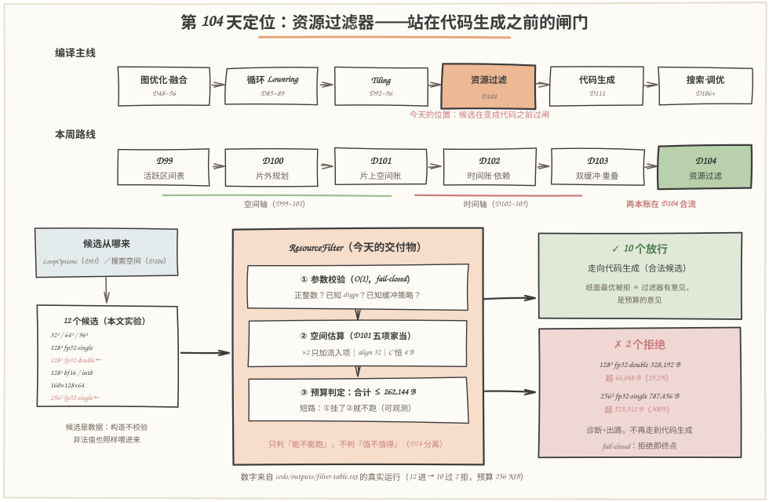
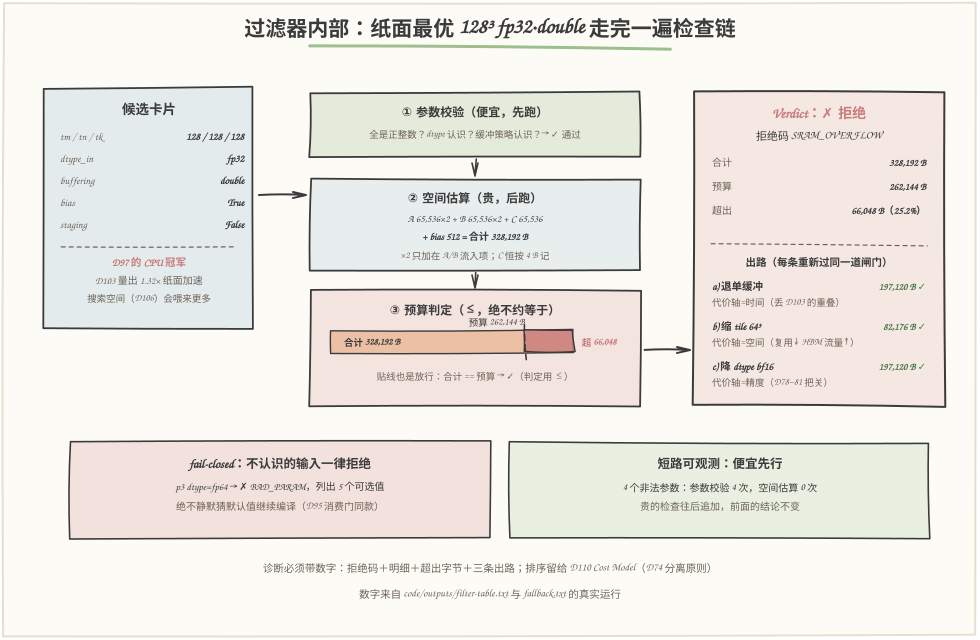
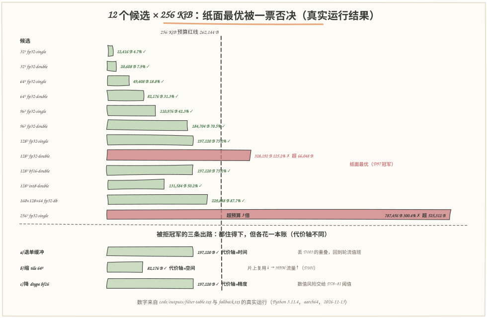

# 第 104 天：资源约束过滤——纸面最优的 Tile，先问一句"住得住吗"

> **今日目标**：完成本教程后，你能做到四件事——说清**资源约束过滤（resource-constraint filtering）**为什么必须站在代码生成之前；把 D101 的空间账本接进一道 **fail-closed** 检查链（参数校验 → 空间估算 → 预算判定），亲眼看着纸面最优 `128³ fp32·double` 被 256 KiB 预算当场拒绝（合计 328,192 B，超 66,048 B）；用计数器把**检查链的短路顺序**变成可断言的事实（参数校验 16 次、空间估算 12 次——非法输入永远走不到贵的那一步）；写出**自带数字与三条代价轴出路**的拒绝诊断，并用 58 项断言自检把全部行为钉死。
> **预计时间**：学习 30 分钟＋实践 40 分钟
> **前置准备**：D101 的五项家当记账（A/B/C/bias/staging；×2 只加在 DMA 流入项；C 恒按累加精度 4 B 记；逐项 `align_up` 到 32 B 网格），64³ 单缓冲 49,408 B／双缓冲 82,176 B；D103 的结论——128³ fp32·double 有 1.32× 纸面加速、但要 328,192 B；D95 的 fail-closed 消费门；D74 的合法性与收益性分离原则。工具只要 `python3`（本文环境：Python 3.11.4，aarch64 Linux，2026-11-13），零第三方依赖。
> **今日产出**：`code/resource_filter.py`（过滤器＋决策日志＋4 组实验＋58 项断言自检）＋`code/run_all.sh`（一键复现）＋`code/gen_images.py`（手绘图生成器）＋`code/outputs/` 下 6 份真实运行记录＋本文 3 张手绘图。

## 1. 今天解决什么问题？

昨天（D103）收官时留了一根刺：同一个 kernel——`C = A·B + bias`，tile 取 128³、fp32、双缓冲——时间账漂亮（量出 1.32× 的纸面加速），空间账一量却要 **328,192 B**，越过 256 KiB 预算红线 **66,048 B**。D103 做的事是"把账量出来摆在桌上"，但"越线了"这个结论当时是**人眼看出来的**。真实的编译器里没有人盯着：搜索空间（D106）会枚举出成百上千个候选，代码生成（D111）闷头往下走，错误的下场只有两种——要么编译到很晚的阶段才崩（离"tile 选大了"这个第一现场十万八千里），要么生成的代码在运行时第一块 DMA 就越界，写坏邻居的数据。两种都不可接受，所以学习计划给今天的任务只有一句话：**在生成代码之前，自动排除不可执行的候选**。

注意今天要做的不是"更聪明的选择"——不是在 128³ 和 64³ 之间挑一个更好的，而是先回答更原始的问题：**这个候选能不能跑**。挑选是 D110 Cost Model 的事（D74 分离原则今天要真正落地：合法性过滤只回答"能不能跑"，收益排序只回答"值不值得跑"，两件事永远分开）。同理，候选也不归过滤器管：LoopOptions（D93）和搜索空间（D106）负责"喂"，过滤器只负责"裁"。

贯穿全文的例子只有一个：D97 的 CPU 冠军、D103 的纸面最优——`128³ fp32·double +bias`，预算 262,144 B（256 KiB，示例值，不代表任何具体芯片），DMA 对齐 32 B。它会被拒吗？拒了以后给什么出路？这两个问题撑起今天的全部内容。

## 2. 先看全貌：今天的内容位于哪里？



**图 1**：看三块——**上排**是编译主线：Tiling（D92~96）产出候选之后、代码生成（D111）之前，今天插入一格橙色的"资源过滤"；**中排**是本周路线：D99~101 盘空间账、D102~103 盘时间账，**两本账今天在 D104 合流成一道闸门**；**下排**是闸门详图：左边候选是"数据"（构造不校验、非法值也照样喂进来），中间是今天的交付物 `ResourceFilter`——① 参数校验（便宜）→ ② 空间估算（D101 五项家当）→ ③ 预算判定，短路可观测；右边是两种结局：10 个放行走向代码生成，2 个拒绝（含纸面最优）带着诊断离开。

把今天的主线串成 5 步：

1. **喂**：12 个候选（沿用 D97/D101/D103 那道 512³ MatMul）进闸，外加 4 个非法参数负例——候选是数据，构造不做任何校验；
2. **先查便宜的**：参数校验 O(1)——正整数？dtype 认识？缓冲策略认识？不认识一律 `BAD_PARAM` 拒绝，绝不猜默认值；
3. **再查贵的**：空间估算把 D101 的五项家当逐项算出来，A 65,536×2 + B 65,536×2 + C 65,536 + bias 512 = 328,192 B；
4. **裁决**：合计 ≤ 262,144 B 放行，否则 `SRAM_OVERFLOW` 拒绝并给出超出字节数——纸面最优就此出局；
5. **善后**：拒绝诊断带三条出路（单缓冲／缩 tile／降 dtype），每条出路**重新过同一道闸门**——出路不是免检通行证。

一句话定位：**D101 量出预算红线，D103 撞上了它；今天把红线变成一道自动闸门**——从此"住不住得下"不再靠人眼盯表格。

## 3. 核心概念：先用直觉，再给准确定义

### 3.1 资源过滤器：只问"能不能跑"的安检口

一句通俗解释：**资源过滤器（resource filter）是一道编译期闸门**——每个 Tiling 候选在变成代码之前都要过一遍，任何一项硬资源（今天是片上 SRAM 容量，将来还有寄存器压力、并行度下限）装不下，就当场拒绝，不让它走到代码生成。

类比：机场安检口。旅客（候选）排着队过来，安检只查一件事——**能不能带上这架飞机**；至于"这趟旅行值不值"（飞三亚还是飞哈尔滨更好），那是值机柜台（D110 Cost Model）的事。对应到技术上是：过滤器做**合法性判定（feasibility）**——输出只有 ✓／✗ 两种；Cost Model 做**收益排序**——在所有 ✓ 里挑最好的。类比边界：安检员可以酌情通融，过滤器必须**确定性、可复现**——同一个候选喂一百次，一百次同一个结论，否则自检断言就没了意义；而且过滤器拒绝时必须给理由（拒绝码＋数字），不能只说"不行"。

最小例子：64³ fp32·double，合计 82,176 B ≤ 262,144 B → ✓ 放行；128³ fp32·double，合计 328,192 B > 262,144 B → ✗ `SRAM_OVERFLOW`。注意 64³ 放行时过滤器**没有说它"好"**——它只说"住得下"；今天真实运行里 32³ 和 96³ 也一样放行，过滤器不比较它们谁更快（自检最后一条断言钉死了这件事）。

### 3.2 fail-closed：不认识的输入，一律拒绝

一句通俗解释：**fail-closed（失效即关闭）**指过滤器遇到不认识的输入时，默认动作是"拒绝并说明原因"，而**不是**猜一个最接近的默认值继续编译。

类比：门禁刷到一张系统里查无此人的卡。fail-open 的门禁想"先放进来观察一下"——出了事再说；fail-closed 的门禁直接不开，并把卡号记进日志。对应到技术上是：`dtype_in="fp64"` 不在支持列表里 → 立刻返回 `BAD_PARAM`，消息里列出全部 5 个可选值（fp32/fp16/bf16/int8/int32）；`buffering="triple"` 同样拒绝。这和 D95 的消费门是同一个原则：**错误越早停下，离第一现场越近**。类比边界：这不是"保守主义审美"，而是正确性要求——猜默认值等于把错误悄悄送进更贵的下游（代码生成、甚至运行时），那时再查，代价和排查距离都会翻倍。

最小例子（今天真实运行）：4 个非法候选——`tm=0`、`tk=-8`、`dtype="fp64"`、`buffering="triple"`——全部被 `BAD_PARAM` 拦在第一关，没有一个走到空间估算。

### 3.3 检查链与短路：便宜的先跑，而且"先跑了"要能证明

一句通俗解释：过滤器的多道检查按**成本从低到高**排队，前面挂了后面就不跑——这就是**短路求值（short-circuit）**；今天的实现里多了两个计数器 `n_param_checks`／`n_space_checks`，把"顺序"从口头约定变成**可断言的事实**。

类比：体检流水线先量血压再拍 CT——血压不正常就先别往辐射室走。对应到技术上是：参数校验是 O(1) 的查表，空间估算是逐项乘加加对齐；非法候选在参数关就出局，估算一次都不跑。今天的运行记录：16 次参数校验（12 个合法候选＋4 个负例），**空间估算只跑了 12 次**——4 个负例全部短路。类比边界：短路只改变"什么时候失败、花了多少功夫失败"，**不改变失败本身**——就算把两条检查对调，该拒的候选还是会被拒（只是先做了无用功）；所以将来追加更贵的检查（寄存器压力、指令模拟）时只需往队尾接，前面的结论一个字不用改。

### 3.4 拒绝诊断：判决书要带数字，出路要重新过闸

一句通俗解释：拒绝一个候选时，过滤器输出的不是一句"不行"，而是一份**判决书**——拒绝码、空间明细、超出字节数（含占预算百分比）、以及三条**降级出路（fallback）**；每条出路本身也是一个候选，必须**重新过同一道闸门**验证。

类比：超载的货车被拦下，罚单上写着"核载 10 吨、实载 12.5 吨、超 25%"，同时给出三个方案：卸货（时间轴）、换小车（空间轴）、改成轻泡货（精度轴）——而且每个方案都要**再过一次磅**。对应到技术上是：三条出路各有**代价轴**——退单缓冲省空间但丢掉 D103 的计算/搬运重叠（时间）、缩 tile 到 64³ 复用变差 HBM 流量上升（空间，D101 的 reuse 账）、降 dtype 到 bf16 有数值风险（精度，交给 D78~81 的误差阈值把关）。类比边界：法官开的"出路"是建议不是保证——**换一个预算，出路自己也可能超载**（今天的实验四里，128 KiB 预算下"降 dtype 到 bf16"照样被拒），所以出路必须现场重算，不能缓存结论。

## 4. 图解核心机制：冠军候选走完一遍检查链



**图 2**：跟着纸面最优 `128³ fp32·double` 走一遍——**左边候选卡片**：tm/tn/tk = 128、fp32、double、bias=True——注意它就是 D97 选出的 CPU 冠军、D103 量出 1.32× 纸面加速的那位，**没有任何"作恶"，只是住不下**；**中间检查链**按编号走：

- **① 参数校验（便宜，先跑）**：三个 tile 维度都是正整数、dtype 认识、缓冲策略认识 → 通过。若这里是 `fp64`，链条到此为止，②根本不会跑；
- **② 空间估算（贵，后跑）**：D101 五项家当逐项算——A 65,536 B×2 + B 65,536 B×2 + C 65,536 B + bias 512 B = **328,192 B**。×2 只加在 A/B 流入项；C 是累加器，恒按 4 B 记；
- **③ 预算判定（≤，绝不"约等于"）**：橙色条是合计、红色段是超出部分，预算虚线画在 262,144 B——合计压线也放行（判定用 ≤），本例超 66,048 B；

**右边 Verdict 卡**：拒绝码 `SRAM_OVERFLOW`、合计／预算／超出三行数字、三条出路各带自己的合计和代价轴——a) 退单缓冲 197,120 B ✓（时间轴）、b) 缩 tile 64³ 82,176 B ✓（空间轴）、c) 降 dtype bf16 197,120 B ✓（精度轴）。**底部两个小框**：左是 fail-closed（p3 的 fp64 被拦下列出 5 个可选值），右是短路可观测（4 个非法参数：参数校验 4 次、空间估算 0 次）。

## 5. 动手实践：搭出你自己的资源过滤器

### 5.1 准备文件

```text
tutorials/day-104/
├── README.md                       ← 本文
├── images/                          ← 3 张手绘图（数字与 outputs/ 一致）
└── code/
    ├── resource_filter.py          ← 过滤器＋决策日志＋4 组实验＋58 项断言自检（约 600 行，零依赖）
    ├── gen_images.py               ← 手绘图生成器（固定随机种子，可复现）
    ├── run_all.sh                   ← 一键复现（重跑本文全部记录）
    └── outputs/
        ├── filter-table.txt         ← 主交付物：12 候选 × 预算判定＋参数负例＋诊断样例
        ├── budget-sweep.txt        ← 对照实验一：预算收紧时幸存者怎么变
        ├── align-sweep.txt         ← 对照实验二：对齐网格与贴线生死
        ├── fallback.txt            ← 出路账本：三条代价轴＋出路的出路
        ├── test-all.txt             ← 断言式自检（58/58）
        └── env.txt                  ← 环境与口径
```

### 5.2 编写代码

`resource_filter.py` 的骨架只有三件东西：一个**故意不校验**的候选、一条**会数数**的检查链、一份**递归过闸**的出路。先看候选——**注意它连构造期校验都刻意不做**：

```python
@dataclasses.dataclass(frozen=True)
class TileCandidate:
    """候选是外部输入（搜索空间/命令行/测试都可能喂非法值），
    设防的责任全部在 ResourceFilter——fail-closed 的前提是判定层
    全设防，而不是数据层碰巧干净。"""
    tm: int
    tn: int
    tk: int
    dtype_in: str = "fp32"
    buffering: str = "double"
    bias: bool = True
    staging: bool = False
```

然后是检查链的心脏 `check()`——两道检查、两个计数器、短路写在控制流里：

```python
def check(self, cand: TileCandidate) -> Verdict:
    self.n_param_checks += 1                    # 便宜的一步：先数数
    ok, msg = self._check_params(cand)          # O(1) 查表，fail-closed
    if not ok:
        return Verdict(cand, False, BAD_PARAM, msg, failed_check="params")
    self.n_space_checks += 1                    # 没挂才轮到贵的一步
    bd = estimate(cand, self.align)             # D101 五项家当
    total = bd.total
    if total <= self.budget:                    # ≤：贴线也放行
        return Verdict(cand, True, OK, total=total, breakdown=bd,
                       utilization=total / self.budget)
    return Verdict(cand, False, SRAM_OVERFLOW,
                   message=f"合计 {fmt_b(total)} 超出预算 {fmt_b(self.budget)}"
                           f" {fmt_b(total - self.budget)}",
                   total=total, overflow=total - self.budget,
                   breakdown=bd, failed_check="space",
                   suggestions=self._fallbacks(cand))
```

三个值得停下来的设计点：**其一**，`estimate()` 直接复用 D101 的记账规则（×2 只加流入项、C 恒 4 B、逐项 `align_up`），今天**一行记账逻辑都没有新写**——过滤器只是账本的"消费方"；直接拿非法 dtype 调 `estimate` 会抛 `ValueError`，自检里有对应断言，这正是"参数校验必须先行"的第一现场。**其二**，两个计数器让短路可断言——`n_space_checks` 在 4 个负例喂完后应当是 0，这不是注释里的承诺而是测试里的数字。**其三**，出路在 `_fallbacks()` 里只是**普通候选**：

```python
def _fallbacks(self, cand: TileCandidate) -> list:
    alts = []
    if cand.buffering == "double":
        alts.append((dataclasses.replace(cand, buffering="single"),
                     "时间", "退单缓冲", "丢掉 D103 的计算/搬运重叠，回到轮流值班"))
    if (cand.tm, cand.tn, cand.tk) != (64, 64, 64):
        alts.append((dataclasses.replace(cand, tm=64, tn=64, tk=64),
                     "空间", "缩 tile 到 64³", "片上复用变差 → HBM 流量上升（D101 的 reuse 账）"))
    down = DTYPE_DOWN.get(cand.dtype_in)
    if down:
        alts.append((dataclasses.replace(cand, dtype_in=down),
                     "精度", f"降 dtype 到 {down}", "数值风险交给 D78~81 的误差阈值把关"))
    out = []
    for alt, axis, label, note in alts:
        bd = estimate(alt, self.align)          # 出路自己也要过磅
        out.append(Suggestion(label=label, axis=axis, note=note,
                              total=bd.total, ok=bd.total <= self.budget))
    return out
```

三条出路分别是改 buffering、改 tile、改 dtype——正好各踩一条代价轴；`dataclasses.replace` 只换一个字段，"降级"在代码里干净得像改一个数字。

### 5.3 运行与观察

一键复现（本文所有"实际输出"都来自这次运行，环境见 `outputs/env.txt`）：

```bash
cd tutorials/day-104/code && ./run_all.sh
```

主交付物是 12 个候选的判定表（`outputs/filter-table.txt`，实际输出）：

```text
 预算 262,144 B（256 KiB）    DMA 对齐 32 B
 #  候选                        合计        利用率   判定
 1  32³ fp32·single +bias            12,416 B     4.7%   ✓
 4  64³ fp32·double +bias            82,176 B    31.3%   ✓
 7  128³ fp32·single +bias          197,120 B    75.2%   ✓
 8  128³ fp32·double +bias          328,192 B   125.2%   ✗ SRAM_OVERFLOW  超 66,048 B
 9  128³ bf16·double +bias          197,120 B    75.2%   ✓
10  128³ int8·double +bias          131,584 B    50.2%   ✓
12  256³ fp32·single +bias          787,456 B   300.4%   ✗ SRAM_OVERFLOW  超 525,312 B
 共 12 个候选：10 个放行，2 个拒绝
```

（表为真实输出的节选，完整 12 行见 `outputs/filter-table.txt`。）



**图 3**：12 根条子按合计排序画在统一标尺上，黑色虚线是 256 KiB 预算红线。看两处——**第 8 行**：纸面最优 `128³ fp32·double` 的红条越过红线一段，标注"超 66,048 B"，它正是 D97 的冠军候选；**第 12 行**：256³ 超 3 倍预算，属于"想都不用想"的拒绝。绿条里值得看的对比：同样 128³，bf16（第 9 行）197,120 B 住得下、int8（第 10 行）131,584 B 更宽裕——**dtype 就是空间**。图底部的三根短条是第 8 行的三条出路，长度都在红线内：退单缓冲 197,120、缩 tile 82,176、降 bf16 197,120——各住得下，但各花一本账（时间／空间／精度）。

再看参数负例和短路计数（同文件实际输出）：

```text
p1  0×128×128 fp32·double +bias             —        —   ✗ BAD_PARAM  tile.tm = 0 不是正整数
p2  128×128×-8 fp32·double +bias            —        —   ✗ BAD_PARAM  tile.tk = -8 不是正整数
p3  128³ fp64·double +bias                  —        —   ✗ BAD_PARAM  未知 dtype_in = 'fp64'（可选 fp32/fp16/bf16/int8/int32）
p4  128³ fp32·triple +bias                  —        —   ✗ BAD_PARAM  未知缓冲策略 = 'triple'（可选 single/double）
 检查链短路可观测：参数校验 16 次，空间估算 12 次（4 个非法参数没有走到估算）
```

以及纸面最优的完整判决书（`outputs/fallback.txt` 实际输出）：

```text
[✗ 拒绝] 128³ fp32·double +bias
  拒绝码   : SRAM_OVERFLOW
  空间明细 : A 65,536 B×2 + B 65,536 B×2 + C 65,536 B + bias 512 B = 328,192 B
  预算     : 262,144 B，对齐 32 B
  超出     : 66,048 B（预算的 25.2%）
  出路（每条都重新过同一道过滤器）:
    a) 退单缓冲       →  197,120 B  ✓  代价轴=时间（丢掉 D103 的计算/搬运重叠，回到轮流值班）
    b) 缩 tile 到 64³ →   82,176 B  ✓  代价轴=空间（片上复用变差 → HBM 流量上升（D101 的 reuse 账））
    c) 降 dtype 到 bf16 →  197,120 B  ✓  代价轴=精度（数值风险交给 D78~81 的误差阈值把关）
```

最后是自检：`./run_all.sh` 跑完打印 **58/58 项断言通过**（`outputs/test-all.txt`）——记账锚点、放行/拒绝判定、贴线行为、fail-closed 四类拦截、短路计数、出路合计、预算扫描幸存数、对齐翻案……全部钉死。

### 5.4 修改一个参数再观察

**实验一：把预算收紧。** `--budget 128K` 重跑，或直接看预算扫描（`outputs/budget-sweep.txt` 实际输出）：

```text
 预算        幸存/12  新增阵亡名单
    524,288 B    11      （无新增）
    262,144 B    10      128³ fp32·double +bias
    196,608 B     7      128³ bf16·double +bias、160×128×64 fp32·double +bias、128³ fp32·single +bias
    131,072 B     5      128³ int8·double +bias、96³ fp32·double +bias
     65,536 B     3      64³ fp32·double +bias、96³ fp32·single +bias
```

观察点有二。**幸存数 11→10→7→5→3，死的顺序跟直觉一致**：先死纸面最优，再死整组 128³，再死 96³·double——**预算决定 tile 上限，不是直觉**。**最戏剧的是 128 KiB 档**：int8 128³·double 合计 131,584 B，只超 512 B——恰好是 bias 的字节数，**bias 一票否决**（D101 见过的同款剧情）。零头真的能杀死候选。

**实验二：换对齐网格。** 候选 `33³ int8·single`（奇数 tile，三项都要 padding），对齐从 32 B 换到 64／128 B（`outputs/align-sweep.txt` 实际输出）：

```text
 候选                对齐 32 B   对齐 64 B   对齐 128 B
 33³ int8·single +bias    6,784 B      6,912 B      7,040 B
 64³ fp32·double +bias   82,176 B     82,176 B     82,176 B
 把 33³ int8·single 放上『恰好贴线』的预算 6,784 B（= 对齐 32 B 的合计）：
   对齐  32 B → ✓ 贴线放行（合计 == 预算）
   对齐  64 B → ✗ 拒绝，超 128 B
   对齐 128 B → ✗ 拒绝，超 256 B
```

观察点：2 幂 tile（64³）三项天然落在网格上，换对齐合计纹丝不动；奇数 tile 三项同时 padding，同一个候选在 6,784 B 的贴线预算下**对齐 32 就放行、对齐 64 就被 128 B 的零头翻案**——"住得住吗"的答案里，DMA 对齐是隐藏变量。这也是判定必须用 `≤` 而不是 `<` 的原因：贴线（合计 == 预算）是合法状态，真实运行里 128³ fp32·single 关 bias 开 staging 的合计恰好 262,144 B，自检断言它被放行、再加 512 B bias 就被拒。

## 6. 常见错误与排查

**错误一：fail-open——不认识的 dtype 猜成 fp32 继续编译。**
现象：喂进 `dtype_in="float32"`（PyTorch 习惯的拼写，不在支持表里）后过滤器返回 ✓，决策日志里它按 4 B/元素记账，错误要到很晚才以别的面目出现。原因：写检查的人顺手做了 `dtype = DTYPES.get(cand.dtype_in, 4)` 之类的"宽容默认值"。定位：给参数负例表加一行 `TileCandidate(128, 128, 128, dtype_in="float32")`，跑自检——如果它没被 `BAD_PARAM` 拦下而是走到了空间估算，`n_space_checks` 会比预期多 1。修复：查表必须 `if cand.dtype_in not in DTYPES: return False, ...`（本文 `_check_params` 的写法），消息里顺手列出全部可选值，让用户自己改——D95 消费门同款。

**错误二：判定写成 `total < self.budget`，贴线候选被冤杀。**
现象：`128³ fp32·single` 关 bias 开 staging 的候选，合计恰好 262,144 B == 预算，日志却打 ✗，且拒绝理由只超 0 B。原因：把"装得下"写成了"严格小于"——忽略了对齐记账本来就允许合计正好压线。定位：自检里"贴线候选合计 262,144 == 预算"那条断言变红，同时 `overflow` 字段为 0。修复：判定用 `total <= self.budget`；对齐世界里 0 字节的余量是真实存在的合法状态（5.4 实验二里 33³ int8 对齐 32 B 的贴线放行就是活例子）。

**错误三：检查链顺序反了——贵的估算跑在参数校验前面。**
现象：喂 4 个非法参数后程序直接抛 `ValueError: 未知 dtype_in: 'fp64'`，而不是返回 `BAD_PARAM` 判定；合法候选也要陪着多算一遍。原因：把 `estimate()` 当成了入口，忘了它是"信任调用方已校验"的库函数（D101 的接口约定）。定位：看崩溃栈停在 `estimate` 里；再看 `n_param_checks`/`n_space_checks`——顺序对了应该是"校验 16 次、估算 12 次"，反了则估算先于校验跑。修复：入口永远是 `ResourceFilter.check()`，它先 `_check_params` 再 `estimate`——这就是"便宜先行"不是口号而是控制流。

**错误四：出路建议不重新过闸——换个预算就翻车。**
现象：过滤器在 128 KiB 预算下拒绝 `128³ fp32·double` 时，照抄 256 KiB 时的诊断，推荐"降 dtype 到 bf16"——用户照做，bf16 版本合计 197,120 B，照样超 128 KiB 预算 66,048 B，白改一场。原因：出路的合法性写在缓存里而不是现场算——`_fallbacks()` 里如果只返回"改哪个字段"而不带 `estimate(alt)` 的合计与 ✓/✗，就把 256 KiB 语境下的结论带到了 128 KiB。定位：`outputs/fallback.txt` 末尾的对照段就是检查点——128 KiB 下 bf16 出路应当打 ✗。修复：每条出路现场 `estimate`＋现场比预算（本文实现），预算一变出路跟着变；这也是为什么诊断里每条出路都印着字节数。

## 7. 今日练习

### 必做练习

不改代码，只用 CLI 做两个预测再对答案。**预测一**：`python3 resource_filter.py --exp table --budget 192K` 会放行几个候选？先把数字写在纸上再运行（答案可对照 `budget-sweep.txt`：196,608 B 档幸存 7 个）。**预测二**：把 `TileCandidate(64, 64, 64, "fp32", "double")` 的 bias 关掉（构造时传 `bias=False`），合计变成多少？先按 D101 规则手算（提示：64³ 的 bias 是 `align_up(64×4, 32) = 256` B），再用一行 Python 验证：

```python
from resource_filter import TileCandidate, estimate
print(estimate(TileCandidate(64, 64, 64, "fp32", "double", bias=False)).total)   # 预期 82,176 − 256
```

### 选做挑战

给 `ResourceFilter` 追加**第 4 条检查**：`tm × tn ≤ 16,384`（输出块行数上限，模拟 Vector 单元的约束），并守住三条纪律——按"便宜先行"排在参数校验之后、空间估算之前；加一个自己的计数器（如 `n_shape_checks`）；给 `self_test()` 补至少 3 条断言（一个被新检查拒绝的、一个不受影响的、一个短路路径）。完成后跑 `python3 resource_filter.py --exp self-test`，确认全部通过且**原有 58 条断言一条不改**——这正是 3.3 说的"往队尾接检查，前面的结论不变"。

## 8. 今日验收

- [ ] 我能用自己的话解释资源过滤器"只判能不能跑、不判值不值得跑"，以及它和 D106 搜索空间、D110 Cost Model、D111 代码生成各自的分工
- [ ] 我能独立运行 `./run_all.sh`，复现 12 候选"10 放行 2 拒绝"的判定表和 58/58 自检
- [ ] 我能修改预算（`--budget 128K`）先预测幸存者数量，再与 `outputs/budget-sweep.txt` 核对
- [ ] 我能区分并定位两类拒绝——`BAD_PARAM`（fail-closed，参数校验期拦截）与 `SRAM_OVERFLOW`（预算判定期拦截）——并用短路计数（校验 16 次、估算 12 次）证明负例没走到贵检查
- [ ] 我保存了 `resource_filter.py`、`outputs/` 下 6 份运行记录和 3 张手绘图，能指出图中每个数字出自哪份记录

## 9. 一句话总结与明天预告

今天的闭环：**问题**——纸面最优的候选如果装不进 SRAM，必须有人在其变成代码之前说"不"，而且不能靠人眼盯表格；**机制**——一道 fail-closed 的检查链（参数校验 → 空间估算 → 预算判定），便宜先行、短路可观测，拒绝时输出带数字的判决书和三条代价轴出路，出路自己也要重新过闸；**实践**——`resource_filter.py` 让 12 个候选里 10 个过、2 个拒（含 D97/D103 的冠军 128³ fp32·double，超 66,048 B），预算扫描证明"预算决定 tile 上限"，对齐扫描证明"生死在零头里"；**验证**——58 项断言把记账、判定、贴线、拦截、短路、出路、扫描全部钉死。核心一句：**过滤器不生产答案，它只是把 D101 的空间账本执行成法律**——从此"纸面最优"必须先过"住得住吗"这一关。

明天（D105）是第 15 周复盘：把生命周期、内存复用、片上容量、搬运和流水线串成一条线，完整解释一个 Tile 从片外加载到结果写回的全过程——D99~104 这六天的账本和闸门，正好拼成那个故事的全部素材。
