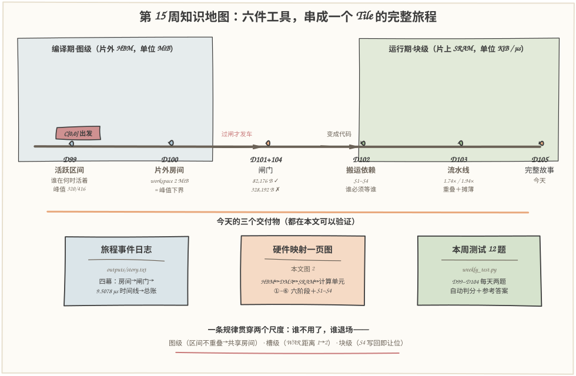
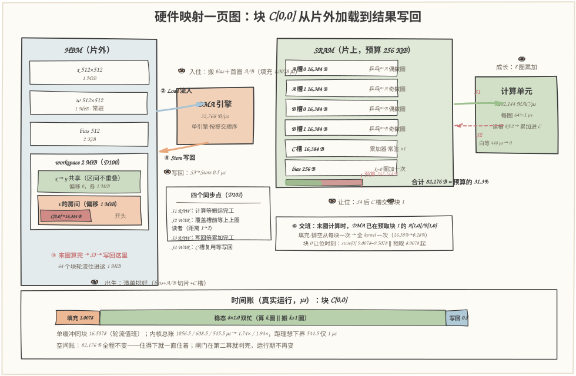
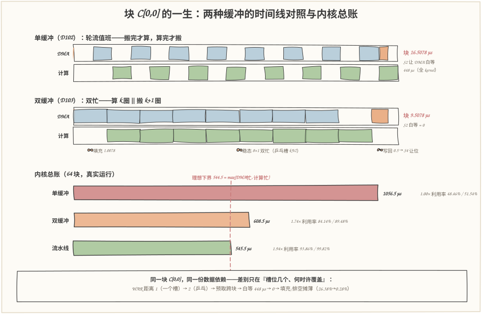

# 第 105 天：第 15 周复盘——一个 Tile 的一生，从片外加载到结果写回

> **今日目标**：完成本教程后，你能做到四件事——把第 15 周的六件工具（活跃区间、缓冲区复用、片上空间账、搬运依赖、双缓冲流水线、资源过滤）串成**一条线**，说清每个工具管旅程的哪一段；独立运行 `tile_story.py`，完整复现输出块 C[0,0] 的四幕旅程（2 MiB 片外房间 → 82,176 B 过闸 → 9.5078 µs 块级时间线 → 545.5 µs 内核总账，全部与 D102/D103 的已发布数字对账一致）；对照**硬件映射一页图**（图 2，计划点名的交付物）按 ①~⑥ 六个阶段把"一次 DMA、一圈计算、一次写回"讲成完整故事；完成 12 题自动判分的**本周测试**（样例答卷 10/12，参考答案带出处）。
> **预计时间**：学习 35 分钟＋实践 45 分钟
> **前置准备**：六天的关键结论——D99 活跃区间是闭区间 `[def, last_use]`，执行顺序改变峰值（320 对 416 元素）；D100 按最后使用点排序（早退房优先）把 workspace 摊到理论下界；D101 五项家当记账，×2 只加在 DMA 流入项；D102 四个同步点 S1(RAW)/S2(WAR)/S3(RAW)/S4(WAR)，单缓冲一个输出块 16.5078 µs；D103 双缓冲 1.74×、跨块预取 1.94×（608.5/545.5 µs）；D104 fail-closed 闸门拒绝 128³ fp32·double（328,192 B，超 66,048 B）。工具只要 `python3`（本文环境：Python 3.11.4，aarch64 Linux，2026-11-13），零第三方依赖。
> **今日产出**：`code/tile_story.py`（四幕旅程模拟器＋35 项断言自检）＋`code/weekly_test.py`（12 题本周测试，自动判分）＋`code/run_all.sh`（一键复现）＋`code/outputs/` 下 6 份真实运行记录＋3 张手绘图（图 2 即计划点名的"硬件映射一页图"）。

## 1. 今天解决什么问题？

第 15 周六天，每天都在修自己那一段路：D99 给张量画生死簿，D100 给片外排房间，D101 给片上记账，D102 标出搬运和计算之间必须等的四个同步点，D103 让两台引擎重叠跑，D104 在出发前设了一道闸门。**但六段路没有人从头到尾走过一遍。**这就是复盘日要补的课：计划今天只写了两句话——"串联生命周期、内存复用、片上容量、搬运和流水线"，"完整解释一个 Tile 从片外加载到结果写回的全过程"。

用一个具体问题检验串联是否真的通了：**从块 C[0,0] 开工，到它的 16,384 B 结果数据稳稳落进片外 t 张量的房间，这 9.5078 µs 里究竟依次发生了什么？**要回答它，六件工具一件都缺不得——不知道 t 的房间在哪（D99/D100），就说不清写回写到哪；不知道 SRAM 里住着谁、占多少（D101/D104），就说不清 DMA 往哪搬、凭什么搬得下；不知道 S1~S4（D102），就说不清哪个瞬间谁在等谁；不知道乒乓槽（D103），就说不清为什么搬运和计算能同时发生。反过来，任何一天单独看都只是局部账本；串起来，它们才是一台机器。

贯穿全文的主角只有一个：512³ fp32 的 `t = MatMul(x, w)`（bias 融合在 k=0 圈，同 D102/D103），tile 取 64³，输出块 **C[0,0]**——第一个开工、第一个写回、第一个把槽位让给后代的块。它的旅程分两幕：**编译期**（图级：房间和闸门）与**运行期**（块级：入住、成长、写回、让位、交班）。

## 2. 先看全貌：今天的内容位于哪里？



**图 1**：看一条"地铁线"——六件工具是六个站点，一个输出块的生命就是乘车走完全程。**左侧两站是编译期的图级世界（片外尺度）**：D99 画生死簿，D100 排房间（t 的 1 MiB 房间在 workspace 偏移 1 MiB 处）；**中间一站是闸门**（D101 记账＋D104 判决）：住得下才发车；**右侧两站是运行期的块级世界（片上尺度）**：D102 标出 S1~S4 四个同步点，D103 让双缓冲流水线跑起来；**终点站是今天**——把六站连成一条线讲成完整故事，并交付硬件映射一页图和本周测试。

把今天的主线串成 5 步：

1. **第一幕（图级·片外）**：迷你图 `t = MatMul(x,w) → y = ReLU(t)` 的活跃区间表——x [0,1]、t [1,2]、y [2,3]（闭区间），峰值动态 2 MiB；
2. **工作区规划**：按最后使用点排序＋首次适应——x 和 y 时间错开共享偏移 0 的 1 MiB，t 独占偏移 1 MiB 的 1 MiB；workspace 2 MiB 恰好等于峰值（达理论下界，比不复用省 33.3%）；
3. **第二幕（闸门）**：主角配置 64³ fp32·double 五项家当合计 82,176 B ≤ 256 KiB → 放行（利用率 31.3%）；对照组 128³ 328,192 B → 拒绝——**旅程没开始就结束**；
4. **第三幕（块级·片上）**：C[0,0] 的事件时间线——填充 1.0078 µs（② 入住）→ 8 圈乒乓累加（③ 成长）→ 写回 0.5 µs（④ 写回）→ S4 让位（⑤）→ 末圈预取下一块（⑥ 交班）；
5. **第四幕（总账）**：单缓冲 1056.5 / 双缓冲 608.5 / 跨块预取 545.5 µs，加速比 1.74×/1.94×——与 D103 的 `compare-modes.txt` 逐项对账一致。

一句话定位：**D99~D104 各自造好了零件，今天把零件装成一台能讲完整故事的机器**——从"t 在片外住哪"到"C[0,0] 最后一字节落地"，中间没有一环靠想象。

## 3. 核心概念：两个尺度、六个阶段、一条规律

### 3.1 两个时间尺度：图级的一天，块级的一微秒

一句通俗解释：编译器看内存要用**两把尺子**——**图级（graph level）**以算子为步、以整个张量为单位，问"这张量活多久、住片外哪里"；**块级（tile level）**以 k 圈为步、以 16 KiB 的切片为单位，问"这份数据什么时候进 SRAM、什么时候可以走"。

类比：城市规划（图级）安排每户人家（张量）住在哪条街、什么时候入住退房；工位管理（块级）安排每个工人（数据切片）今天几点到工位、几点让座。对应到技术上是：图级由**调度器**决定算子顺序，从而决定活跃区间（D99）与片外工作区布局（D100，单位 MiB）；块级由**Tiling**决定切片大小，从而决定 SRAM 家当（D101，单位 KiB）与搬运时间线（D102/D103，单位 µs）。类比边界：两个尺度不是"大小之分"而是"**谁规划谁**"——图级规划发生在编译早期，块级规划发生在 Lowering 之后；t 的房间（片外 1 MiB）先定，C[0,0] 的工位（片上 16 KiB）后定，而工位上算出的结果最终要搬回房间——**房间是家，工位是办公室**。

### 3.2 旅程的六个阶段：出生、入住、成长、写回、让位、交班

一句通俗解释：一个输出块的完整一生是六个阶段——**① 出生**（编译期排好数据清单：bias 256 B＋A/B 切片各 8×16,384 B＋C 槽 16,384 B，要算 2,097,152 MAC）；**② 入住**（DMA 把 bias 和首圈 A/B 搬进 SRAM，填充 1.0078 µs）；**③ 成长**（k=0..7 八圈累加，乒乓槽让搬运与计算重叠，稳态每圈 1 µs 双忙）；**④ 写回**（S3 之后 Store 把 C 槽数据搬回片外 t 的房间，0.5 µs）；**⑤ 让位**（S4 之后 C 槽交给下一个块，SRAM 的 82,176 B 全程不动）；**⑥ 交班**（跨块预取：末圈计算时 DMA 已在搬下一块的首圈，填充/排空从每块一次摊薄成全 kernel 一次）。

类比：外派员工的一天——拿出差清单（①）、到工位（②）、干活（③）、交报告（④）、把工位让给下一班（⑤）、交接时下一班已经在路上（⑥）。对应到技术上是：②对应 DMA 流入项（A/B 是唯一要 ×2 的家当，因为乒乓要两个槽）；③对应 S1/S2 交替（算 k 圈时搬 k+1 圈）；④对应 RAW 边 c[0,7]→store（写回必须等累加完）；⑤对应 WAR 边 store[0]→c[1,0] 的 C←0（覆盖前必须等写回完）；⑥对应 DMA 提交顺序里"A[1,0]/B[1,0] 排在 store[0] 前面"。类比边界：员工可以加班，块不能——每个阶段的时长都是参数的确定函数（0.5 µs 的搬运 = 16,384 B ÷ 32,768 B/µs），复盘不引入任何"也许"。

### 3.3 一条贯穿的规律：谁不用了，谁退场

一句通俗解释：本周六天其实在重复同一条规律——**一份内存，只要它的最后一个使用者完工，就可以立刻让给下一个人**，规划器的全部工作就是把"让"安排得又早又安全。

三个尺度上各现身一次：**图级**，x 的区间 [0,1] 与 y 的 [2,3] 不重叠，所以共享同一间 1 MiB 房间（D100 的"早退房优先"策略）；**槽级**，双缓冲把"覆盖 A 槽必须等上一圈算完"放松成"等上上圈算完"——复用距离 1→2，S2 的白等时间 448 µs→0（D103）；**块级**，store[0] 完工后 C 槽立刻让给块 1 的 C←0（S4）。对应到技术上是：判断"能不能让"永远是**区间是否重叠**（图级）或**依赖是否完工**（块级）的二值问题，判断"让给谁"是规划器的排序问题——D100 的 H3 策略和 DMA 的提交顺序是同一门手艺。类比边界：这条规律不等于"越省越好"——让得太勤（tile 缩小）会伤片上复用、推高 HBM 流量（D101 的 reuse 账）；**省和快之间隔着权衡，那是 D106+ 搜索空间的事**。

## 4. 图解核心机制：硬件映射一页图

复盘日的核心交付物是计划点名的**硬件映射一页图**——把 C[0,0] 的一生按硬件部件摆开：



**图 2**：按数据流向从左往右读。**左列 HBM（片外）**：上面是 x / w / bias 三个源张量；下面是 D100 规划出的 workspace 2 MiB——偏移 0 的 1 MiB 由 x 和 y 时间错开合租，偏移 1 MiB 的 1 MiB 是 **t 的房间**，红色小块标出 C[0,0] 要写的位置：**房间开头 16,384 B**；64 个输出块将轮流住进这 1 MiB。**中间橙色 DMA 引擎**（32,768 B/µs，单引擎按提交顺序执行）：蓝色箭头是②入住的 Load 流入，橙色箭头是④写回的 Store。**右上 SRAM（片上，预算 256 KiB）**：六个槽位——A 槽0/槽1、B 槽0/槽1（乒乓，×2 只加在这两项）、C 槽（累加器，恒 ×1）、bias（256 B）——合计条压在预算线的 **31.3%** 处（82,176 B）。**右侧绿色计算单元**（262,144 MAC/µs）：读槽 `k%2`、累加进 C；绿色实箭头是 S1（计算等搬运，RAW），红色虚箭头是 S2（覆盖槽前等上上圈读者，WAR）。**四个同步点的小抄框**列在 DMA 下方——S1/S3 是 RAW（读者等写者），S2/S4 是 WAR（新写者等旧读者）。**底部时间条**是块 C[0,0] 的 9.5078 µs 拆账：填充 1.0078 → 稳态 8×1.0 双忙 → 写回 0.5。

看图时要盯住一个反差：**空间账是静态的，时间账是动态的**——SRAM 里那 82,176 B 从过闸那刻起全程不变（"住得下就一直住着"），而同一块 SRAM 在 9.5 µs 里经历了 load/store/compute 三种流量轮番经过。①~⑥ 六个徽章就是下一节要跑出来的六个阶段。

## 5. 动手实践：把六件工具装成一台机器

### 5.1 准备文件

```text
tutorials/day-105/
├── README.md                       ← 本文
├── images/                          ← 3 张手绘图（数字与 outputs/ 一致）
└── code/
    ├── tile_story.py               ← 四幕旅程模拟器＋35 项断言自检（零依赖）
    ├── weekly_test.py              ← 本周测试：12 题，自动判分＋参考答案
    ├── gen_images.py               ← 手绘图生成器（固定随机种子，可复现）
    ├── run_all.sh                   ← 一键复现（重跑本文全部记录）
    └── outputs/
        ├── story.txt                ← 主交付物：四幕完整旅程（默认 64³ double）
        ├── gate-128.txt            ← 对照实验一：128³ 在闸门被拦下
        ├── buffering-single.txt    ← 对照实验二：单缓冲的轮流值班
        ├── weekly-test.txt         ← 样例答卷判分（10/12）＋参考答案
        ├── test-all.txt            ← 断言式自检（35/35）
        └── env.txt                  ← 环境与口径
```

### 5.2 编写代码

`tile_story.py` 把六件工具各写成一个函数，再用两幕"戏"串起来。第一幕的图级账本（D99/D100 的迷你版）：

```python
GRAPH_OPS = [
    ("t", "MatMul(x,w)", ["x", "w"]),   # 本周的主角 kernel
    ("y", "ReLU(t)", ["t"]),
]
```

对它算活跃区间（图输入的 def=0、图输出活到图后）得到 x [0,1]、t [1,2]、y [2,3]；再按 D100 的"最后使用点排序＋首次适应"排房间——t 与 x 在步骤 1 同时活着（闭区间在 1 相交），不能合租，于是独占偏移 1 MiB；x 和 y 从未同时活着，共享偏移 0。第二幕的闸门直接复用本周的记账规则（`estimate` 一行不改：×2 只加流入项、C 恒按累加精度、逐项 `align_up`），第三幕才是新东西——事件级模拟器。它的心脏是把整个 kernel 建成一张依赖 DAG：

```python
def build_ops(mode: str, t: int = 64, nblocks: int = None) -> list:
    ...
    for b in range(nblocks):
        for k in range(n_k):
            c = computes[(b, k)]
            a, bb = loads[(b, k)]
            c.deps += [a, bb]                     # S1 RAW：计算等搬运
            if k == 0:
                c.deps.append(biases[b])           # k=0 圈加 bias
            # S2 WAR：覆盖槽位前，等槽位上一批读者
            if mode == "single":
                reader = computes[(b, k - 1)] if k >= 1 else (
                    computes[(b - 1, n_k - 1)] if b >= 1 else None)
            else:                                  # double/pipeline：距离 2
                reader = computes[(b, k - 2)] if k >= 2 else (
                    computes[(b - 1, n_k - 2 + k)] if b >= 1 else None)
            if reader is not None:
                a.deps.append(reader)
                bb.deps.append(reader)
        stores[b].deps.append(computes[(b, n_k - 1)])   # S3 RAW
        if b + 1 < nblocks:                            # S4 WAR：C 槽复用
            computes[(b + 1, 0)].deps.append(stores[b])
    return dma + comp
```

三个设计点值得停下：**其一**，三种模式的差别全部浓缩在 S2 的 `reader` 选择上——单缓冲距离 1（等上一圈），双缓冲距离 2（等上上圈）；跨块预取只在 DMA 提交顺序里多做一件事：**把下一块的 A[1,0]/B[1,0] 排在本块 store 之前**，末圈计算时 DMA 就有货可搬。**其二**，`simulate()` 是两台串行引擎的事件循环——每个事件的开工时刻 = max(同引擎前驱完工, 全部依赖完工)，没有任何魔法；`start=max(...)` 这一行就是"时间账"的全部。**其三**，自检的最后一步是与 D103 已发布数字对账（545.5 µs、DMA 忙 544.5、闲置 1、气泡 33.5）——**复现别人的账，是复盘日最硬的验证**。

### 5.3 运行与观察

一键复现（本文所有"实际输出"都来自这次运行，环境见 `outputs/env.txt`）：

```bash
cd tutorials/day-105/code && ./run_all.sh
```

主交付物 `outputs/story.txt` 的四幕。第一幕——房间（实际输出节选）：

```text
-- 工作区规划（D100：按最后使用点排序＋首次适应，对齐 32 B）--
  偏移          0 B   大小  1,048,576 B   先后住客：x→y
  偏移  1,048,576 B   大小  1,048,576 B   先后住客：t

无复用（每张量独占）      3,145,728 B
共享工作区（本次规划）    2,097,152 B   省 1,048,576 B（33.3%）
峰值活跃集合（理论下界）  2,097,152 B   工作区已达下界：是
```

第二幕——闸门：主角 64³ fp32·double 合计 82,176 B（A 16,384×2 + B 16,384×2 + C 16,384 + bias 256）→ ✓ 放行，利用率 31.3%。第三幕——旅程（实际输出节选，完整事件表见 `story.txt`）：

```text
   1.0078–   2.0078 计算  c[0,0]                  262,144 MAC  ③ 成长（C←0＋bias）
   1.0078–   1.5078 DMA  A[0,1]→槽1                  16,384 B   ‖ 与计算重叠
   2.0078–   3.0078 计算  c[0,1]                  262,144 MAC  ③ 成长 ‖ 与搬运重叠
   ...
   8.0078–   9.0078 计算  c[0,7]                  262,144 MAC  ③ 成长（末圈）
   9.0078–   9.5078 DMA  store[0]                   16,384 B  ④ 写回
本块同步点：S1×8（每圈计算等搬运，RAW）   S2×6（覆盖槽前等上上圈读者，WAR 距离 2）

⑥ 交班——跨块预取流水线：块 0 → 块 1 边界事件（µs，真实运行）
   8.0078–   9.0078 计算  c[0,7]            262,144 MAC
   8.0078–   8.5078 DMA  A[1,0]→槽0            16,384 B  预取下一块，填空槽
   9.0078–   9.5078 DMA  store[0]             16,384 B  写回与预取并行
   9.5156–  10.5156 计算  c[1,0]            262,144 MAC  下一块计算无缝续上
```

第四幕的内核总账与 D103 的 `compare-modes.txt` 逐项对账一致：

```text
指标                          单缓冲(D102)        逐块双缓冲        跨块预取流水线
总时长 µs                         1056.5        608.5          545.5
计算利用率                          48.46%       84.14%         93.86%
加速比(vs单缓冲)                      1.00×        1.74×          1.94×
与 D103 compare-modes.txt 对账：1056.5 / 608.5 / 545.5 µs，1.74× / 1.94×——一致 ✓
```



**图 3**：上下两段时间线是同一块 C[0,0] 的两种命运。**上段单缓冲**：DMA 泳道和计算泳道完全错开——搬一对、算一圈，16.5078 µs 里两台引擎轮流值班；**下段双缓冲**：DMA 泳道连成一片，计算泳道连成一片，9.5078 µs 里大部分时间双忙（②填充 1.0078 → ③稳态 8×1.0 → ④写回 0.5）。**底部三根总账条**把 64 个块加起来：1056.5 / 608.5 / 545.5 µs，红色虚线是理想重叠下界 544.5——流水线距它只剩最后一块写回前那 1 µs 的排空。图 3 证明的一件事：**从 16.5 到 9.5 再到"差 1 µs 满"，靠的不是算得更快，而是等得更少**。

最后是本周测试（`outputs/weekly-test.txt`，样例答卷实际输出）：

```text
第  6 题 [D101]  64³ fp32·double +bias 的片上合计是多少（对齐 32 B，预算 256 KiB）？
    A) 49,408 B   B) 82,176 B   C) 65,792 B   D) 98,304 B
    你的答案：B   ✓ 正确
...
得分：10/12
评价：主线在手。错题翻对应日期的 outputs/ 复核一遍数字。
```

12 题覆盖六天（每天两题：一题概念、一题数字/排错），交互运行 `python3 weekly_test.py` 逐题作答；`--explain` 打印全部参考答案和讲解。样例答卷故意错两题，演示判分行为。

### 5.4 修改一个参数再观察

**实验一：把 tile 改成 128——旅程在闸门就结束。** `python3 tile_story.py --tile 128`（`outputs/gate-128.txt` 实际输出）：

```text
候选 128×128×128 fp32·double +bias
  空间明细 : A 65,536 B×2 + B 65,536 B×2 + C 65,536 B + bias 512 B = 328,192 B
  判定     : ✗ SRAM_OVERFLOW  合计 328,192 B 超出预算 262,144 B 66,048 B
  出路     : a) 退单缓冲（时间轴）  b) 缩 tile（空间轴）  c) 降 dtype（精度轴）——每条都要重新过闸
  ——旅程在出发前就被拦下，一次 DMA 都不会发生。
```

观察点：第三幕、第四幕**一行都不会输出**——128³ 的块时长、时间线、总账统统不存在，因为旅程没出发。这是 D104 在整个故事里的位置：闸门不是第六站，而是**第三站**；它排在所有时间账之前。纸面上它有 1.32× 的加速（D103），现实中它连一次 DMA 都得不到。

**实验二：退回单缓冲——S2 距离缩回 1。** `python3 tile_story.py --buffering single`（`outputs/buffering-single.txt` 实际输出）：

```text
②③④ 入住→成长→写回：single 缓冲下块 (0,0) 的完整时间线（µs，真实运行）
   2.0078–   2.5078 DMA  A[0,1]→槽0                  16,384 B   （等上一圈算完）
   3.0078–   4.0078 计算  c[0,1]                  262,144 MAC  ③ 成长 （等下一圈搬完）
块合计 16.5078 µs = 填充 1.0078（②） + 8×(搬 1＋算 1) 轮流值班（③） + 写回 0.5（④）
本块同步点：S1×8（每圈计算等搬运，RAW）   S2×7（覆盖槽前等上一圈读者，WAR 距离 1）
```

观察点有二。**同一个块，从 9.5078 变成 16.5078 µs**——变慢的原因写在每一行的注脚里：每对 load 都要"等上一圈算完"（S2 距离 1），每圈计算都要"等下一圈搬完"。**S1 还是 8 次、S3 还是 1 次**——同步点的"数量"没变，变的是"等了多久"：这正是 D103 的结论"双缓冲没有消灭 S2，消灭的是 S2 的白等"在单块账本上的样子。

## 6. 常见错误与排查

**错误一：把两个尺度的账混在一起——用 82,176 B 去扣 2 MiB。**
现象：有人看完第三幕问"SRAM 才 82 KB，t 的房间要 1 MiB，装不下啊"——把片上工位和片外房间当成了同一间房。原因：没分清图级账（D99/D100，单位 MiB，规划的是 HBM 里的 workspace）和块级账（D101，单位 KiB，规划的是 SRAM 里的槽位）。定位：问自己三个问题——这份数据放在哪颗存储上？谁规划它（调度器还是 Tiling）？什么时候确定（编译早期还是 Lowering 后）？三个答案不同就是两本账。修复：记住图 2 的左列（HBM）和右上（SRAM）是**两个部件**；C[0,0] 的结果从 SRAM 的 C 槽出发，经 DMA 写回 HBM 里 t 的房间——工位小、房间大，正因如此才需要"分块进出"。

**错误二：以为双缓冲消灭了同步点。**
现象：把 S2 从依赖图里删掉"反正双缓冲了，不用等"，模拟出的内核时长确实更短，但真实硬件上偶发算错——A 槽的数据有时是第 k+1 圈的。原因：双缓冲把复用距离从 1 拉到 2，只保证"上上圈的读者完工"，**依赖本身一条都没少**（本周真实运行：S2 有 510 条边）。定位：数 S2 的边数——`build_ops("double")` 里 `sync_in == "S2"` 的 load 对应该有 510 对，删边后少于这个数就是删多了。修复：距离 2 的 reader 规则是 `k≥2 等 c[b,k-2]，k<2 等上一块的对应圈`（本文 `build_ops` 的写法）；k=0 的 WAR 指向上一块的 c[b-1,6]、k=1 指向 c[b-1,7]——跨块的槽位复用同样要等。

**错误三：让 DMA 提前覆盖正在被读的槽——WAR 边建晚了一站。**
现象：为了更激进的重叠，把 A[0,3] 的提交排在 c[0,1] 之前（c[0,1] 还在读槽 1，A[0,3] 也要写槽 1），结果偶发数据错。原因：槽位只有一个"当前写者"，提交顺序不能绕过 WAR 边——**提交顺序自由的前提是依赖已建全**。定位：在 `simulate()` 之后检查每个 load 的 `start ≥ max(读者.end)`；或者直接跑 `--self-test`，依赖缺失会让块时长对不上 D102/D103 的锚点数字（16.5078 / 9.5078）。修复：依赖边在建 op 时一次性建全（本文的做法），提交顺序只决定"同引擎内的先后"，不承担正确性责任。

**错误四：把"住得下"当成"跑得快"。**
现象：闸门放行了 32³（12,416 B，利用率 4.7%），有人就选它——结果 kernel 比 64³ 慢一截。原因：过滤器只回答合法性（feasibility），不回答收益性（profit）——32³ 住得最宽裕，但片上复用最差、HBM 流量最大（D101 的 reuse 账）。定位：问"这个结论是谁的职责范围"——D104 的判决书里没有速度字段，速度是 D110 Cost Model 的事。修复：复盘时把两个问题分开问：先问"能不能跑"（过闸），再问"值不值得跑"（交给后续的搜索与 Cost Model）——这也是 D74 分离原则在周复盘层面的又一次出现。

## 7. 今日练习

### 必做练习

用 `tile_story.py` 回答一个"时刻表"问题，先笔算再验证：**单缓冲和双缓冲下，A[0,2]（要写进槽 0 的那次搬运）最早分别可以在什么时刻开工？**提示——单缓冲下所有圈共用槽 0，A[0,2] 必须等槽 0 的上一个读者 c[0,1] 完工（它结束于 4.0078 µs）；双缓冲下槽位乒乓，A[0,2] 写槽 0，上一个读者是 c[0,0]（结束于 2.0078 µs），而 DMA 链在那之前早就空出来了。把两个时刻写在纸上，再用一行命令对答案：

```bash
python3 tile_story.py --buffering single | grep "A\[0,2\]"
python3 tile_story.py                   | grep "A\[0,2\]"
```

（答案藏在 `outputs/story.txt` 与 `outputs/buffering-single.txt` 里：同一对搬运，单缓冲 4.0078 才开工、双缓冲 2.0078 就开工——差出的 2 µs 就是 WAR 距离 1→2 买回来的重叠。）

### 选做挑战

把 tile 改成 32（`python3 tile_story.py --tile 32`），先预测三件事再运行核对：闸门合计是多少 B（提示：32³ 的 A/B/C 各 4,096 B，双缓冲 ×2 只加 A/B，bias 128 B）？块时间线变成几圈、每圈多长（K=512 → 16 圈，每圈 32³=32,768 MAC → 0.125 µs）？填充时间变短了，但圈数和块数都变多——内核总时长比 64³ 的 608.5 µs 更快还是更慢？跑完对照本文 5.3 的数字，说清"住得更宽裕"（利用率从 31.3% 掉到 7.9%）和"跑得更久"为什么同时发生（答案方向：搬运总字节没变，但块数从 64 涨到 256，每块都要重新填充／排空，DMA 的碎片更细——这正是 D101 reuse 账里"缩 tile → 片上复用变差"的时间面）。

## 8. 今日验收

- [ ] 我能用自己的话讲出 C[0,0] 的六阶段旅程（出生→入住→成长→写回→让位→交班），并说出每个阶段对应哪一天的哪件工具
- [ ] 我能独立运行 `./run_all.sh`，复现四幕故事，并指出 82,176 B、9.5078 µs、545.5 µs 三个数字分别出自哪一幕
- [ ] 我能对着图 2 说出 S1~S4 各是什么依赖（RAW/WAR）、各卡在哪个部件之间，并解释"双缓冲消灭的是白等不是依赖"
- [ ] 我能运行 `python3 weekly_test.py` 完成本周测试并核对参考答案，12 题中概念题（第 1/3/5/7/10/11 题）至少答对 5 题
- [ ] 我保存了 `tile_story.py`、`weekly_test.py`、`outputs/` 下 6 份运行记录和 3 张手绘图，能指出图中每个数字出自哪份记录

## 9. 一句话总结与明天预告

今天的闭环：**问题**——六天各修了一段路，但没人从头到尾走一遍，"一个 Tile 从片外加载到结果写回"这句计划里的话需要全部六件工具才能兑现；**机制**——两个尺度（图级 MiB / 块级 µs）、六个阶段（出生→入住→成长→写回→让位→交班）、一条规律（谁不用了谁退场，在图级是区间复用、在槽级是 WAR 距离、在块级是 S4 让位）；**实践**——`tile_story.py` 用一张依赖 DAG 把六件工具串成四幕，C[0,0] 的 9.5078 µs 被逐事件排出，64 块总账 1056.5/608.5/545.5 µs 与 D103 对账一致，闸门实验证明 128³ 的旅程根本不会出发；**验证**——35 项断言＋12 题周测＋3 张图（图 2 就是计划点名的硬件映射一页图）。核心一句：**六天的账本不是六个知识点，而是一台机器的六张图纸**——拼起来，才看得见一个 Tile 的一生。

明天（D106）进入第 16 周：定义搜索空间——Tile、循环顺序、Unroll 等参数如何组成有限的候选集合，以及如何避免无意义爆炸。今天的闸门（D104）正是那个搜索空间的第一个过滤器：候选从哪来、怎么裁，明天正式开工。


