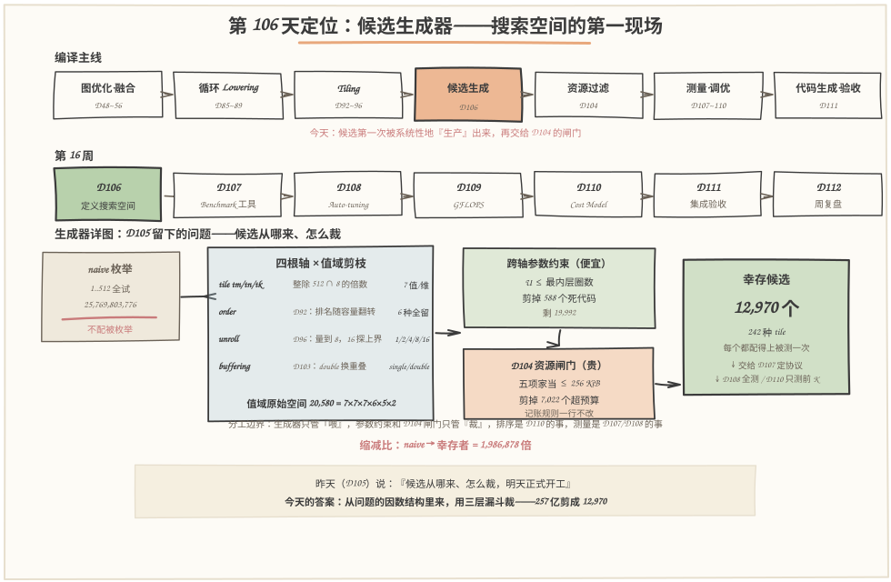
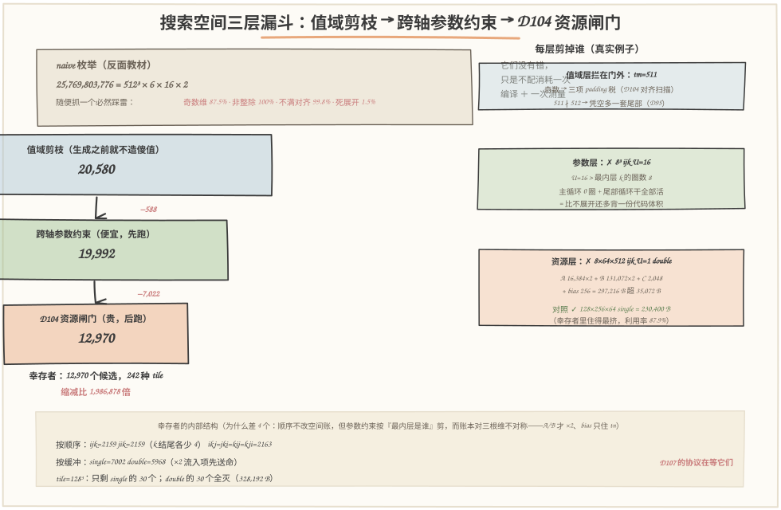
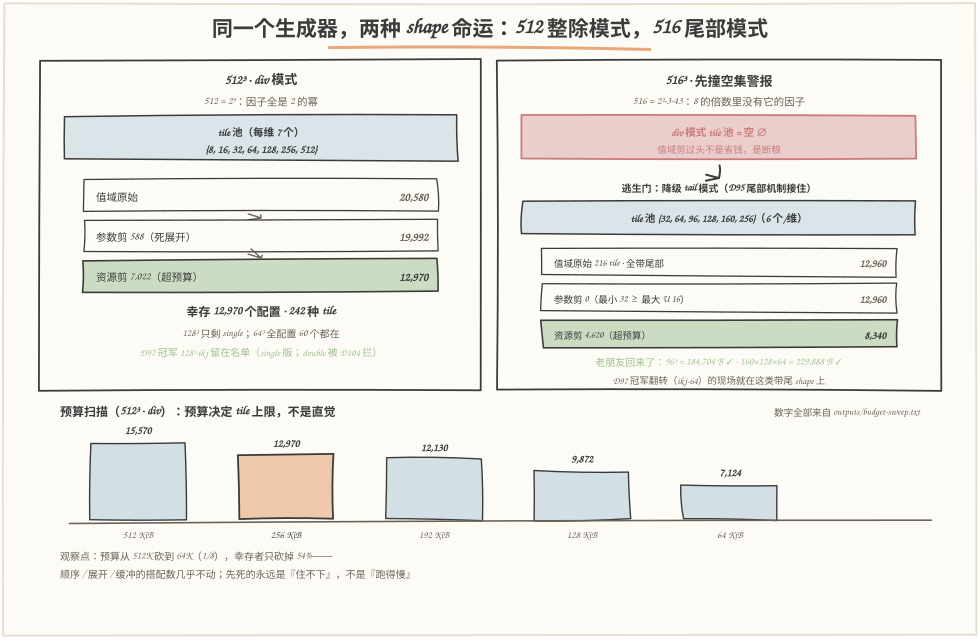

# 第 106 天：定义搜索空间——257 亿种搭配，怎么剪成一张测得完的清单

> **今日目标**：完成本教程后，你能做到四件事——说清**搜索空间（search space）**为什么必须"定义"而不能"枚举"：naive 笛卡尔积是 **25,769,803,776** 个候选（512³ tile × 6 顺序 × 16 展开份数 × 2 缓冲），其中 87.5% 含奇数维、100% 含非整除维、99.8% 不满 DMA 对齐、1.5% 是死展开——它们没有错，只是不配消耗一次编译＋一次测量；用**三层漏斗**把空间剪成 **12,970** 个幸存者：值域剪枝（20,580 个原始搭配，每个值都带出处）→ 跨轴参数约束（U ≤ 最内层圈数，剪掉 588 个死代码）→ D104 资源闸门（剪掉 7,022 个超预算，记账规则一行不改）；亲眼看着 **516 撞响空集警报**（整除模式下一个 tile 都不剩），再从尾部模式的逃生门里捡回 8,340 个候选；最后跑 53 项断言自检把全部行为钉死，并说清生成器与 D104／D107／D108／D110 的分工边界。
> **预计时间**：学习 30 分钟＋实践 40 分钟
> **前置准备**：D93 的 `LoopOptions`（order／tile／unroll 三字段，order 合法空间恰为 6 = 3!）；D92 的结论——6 种循环顺序的排名随缓存容量翻转（512B 时连续派赢、1KB 时寄存器派反超），这是"顺序不敢剪"的证据；D96 的展开结构（主循环 U 份＋尾部循环兜底，U=8 机器码已 3.2×）；D95 的尾部机制（非整除 tile 怎么兜底）；D101／D104 的五项家当记账与 256 KiB 闸门（×2 只加 DMA 流入项、C 恒按累加精度 4 B、逐项 `align_up` 到 32 B）；D97 的 512³ 配置竞赛（ikj-128 冠军）与 516 上的冠军翻转。工具只要 `python3`（本文环境：Python 3.11.4，aarch64 Linux，2026-11-13），零第三方依赖。
> **今日产出**：`code/search_space.py`（候选生成器＋三层漏斗＋过滤统计＋53 项断言自检）＋`code/run_all.sh`（一键复现）＋`code/gen_images.py`（手绘图生成器，固定随机种子）＋`code/outputs/` 下 6 份真实运行记录（含 12,970 行幸存者全表）＋本文 3 张手绘图。

## 1. 今天解决什么问题？

昨天（D105）复盘收官时留了一句话："候选从哪来、怎么裁，明天正式开工。"前两周攒下的家底其实都在等这一天：D92~96 把循环顺序、Tile、展开做成了可配置的自由度，D104 造好了闸门，D105 把一个 Tile 的一生讲成了完整故事——**但闸门是被动的，它只裁不喂**。D108 的 auto-tuning 要对一组 MatMul shape 自动搜索最优配置，搜索的前提是一张候选清单：清单从哪来、有多长、为什么是这些而不是别的，就是今天的全部内容。

先看不做任何定义、直接枚举会发生什么。还是那道老题：`C = A·B + bias`，512×512×512，fp32。最笨的生成器长这样：tm 从 1 试到 512，tn、tk 同理；循环顺序 6 种排列全试；展开份数从 1 试到 16 每个整数；缓冲 single／double 都试。乘起来：

```text
512 × 512 × 512 × 6 × 16 × 2 = 25,769,803,776 个候选
```

257 亿。按每个候选 1 秒（一次编译＋一轮测量）算要 **817 年**；乐观到每候选 1 毫秒也要 **298 天**。更糟的是这份清单里绝大部分是垃圾：87.5% 的 tile 组合含奇数维（相关项全要交 D104 见过的 padding 税）、100.0% 含非 2 幂维（在整除 shape 上凭空多出一套 D95 尾部代码）、99.8% 不满对齐（连 8 元素 = 32 B 的 DMA 网格都没对上）、还有 1.5% 的搭配是"展开 16 份、最内层只有 8 圈"的死代码——主循环一圈不跑，尾部循环干全部活，白背一份展开后的代码体积。它们没有错，只是不配消耗一次编译＋一次测量。

所以今天的任务不是"更聪明地挑"——挑选是 D110 Cost Model 的事（D74 分离原则今天继续生效）——而是回答更靠前的问题：**在爆炸发生之前，把"编译器可以调什么"写成一份数据：每根轴有哪些合法取值、为什么是这些值、组合起来多大、哪些搭配在生成时就不该出生。**计划给的产出也直白：候选生成器、候选数量和过滤统计。

## 2. 先看全貌：今天的内容位于哪里？



**图 1**：看三块——**上排**是编译主线：Tiling（D92~96）产出自由度之后、资源过滤（D104）之前，今天插入一格橙色的"候选生成"——候选第一次被系统性地生产出来，闸门终于有人喂；**中排**是第 16 周路线：今天开工，D107 定测量协议、D108 跑第一版 auto-tuning、D109 算 GFLOPS、D110 用 cost model 排序、D111 集成验收；**下排**是生成器详图：左边的 naive 枚举（257 亿）被划掉，四根轴的值域剪枝产出 20,580 个原始搭配，经跨轴参数约束（−588 个死代码）和 D104 闸门（−7,022 个超预算）后剩 12,970 个幸存者，排队等 D107 的计时协议。

把主线串成 5 步：

1. **定轴**：确认自由度清单——tile 三元组、循环顺序、展开份数、缓冲策略。bias 融合按 D102~105 的惯例固定开、staging 固定关——**不搜的轴也要写明为什么不搜**，否则将来没人知道那是决策还是遗忘；
2. **定值域**：每根轴的取值从问题本身推导——tile 维 = 整除 512 ∩ 8 的倍数；顺序 6 种全留（D92 的证据）；展开只留 2 的幂、上界 16（D96 的账）；缓冲两种（D103 的权衡）；
3. **跨轴约束**：单轴值域表达不了的搭配规则——展开份数不得超过最内层圈数；
4. **过闸门**：把 D104 的资源过滤器接在生成器后面，五项家当 ≤ 256 KiB，记账规则一行不改；
5. **交统计**：每一层剪掉多少、为什么、例子是谁——这就是计划点名的"候选数量和过滤统计"，也是明天 D107 估算测量成本的直接输入。

一句话定位：**D105 留下的问题是"候选从哪来、怎么裁"；今天的答案是"从问题的因数结构里来，用三层漏斗裁"**——257 亿到 12,970，缩减 1,986,878 倍，每一刀都留下数字。

## 3. 核心概念：先用直觉，再给准确定义

### 3.1 搜索空间与轴：把"可以调什么"写成数据

一句通俗解释：**搜索空间（search space）**是编译器全部可调参数各自取值的所有组合；每一根可调参数叫一根**轴（axis）**，一个候选就是各轴取值的一个组合点。今天的轴有四根半：tile 三元组（tm／tn／tk）、循环顺序（order）、展开份数（unroll）、缓冲策略（buffering）——"半根"是那些**固定不搜**的开关（bias 开、staging 关、dtype 固定 fp32）。

类比：拼乐高。零件库里每种零件只有几个官方尺寸（2×2、2×4、4×4 的板），你可以放心枚举"板×轴×轮子"的所有组合；naive 枚举则像是非要按毫米数从 1×1 到 512×512 逐个试——其中绝大多数尺寸根本不存在于任何一盒零件里。对应到技术上是：轴的取值必须**从问题的结构推导**——512 = 2⁹，它的因子全是 2 的幂，其中是 8 的倍数的只有 {8, 16, 32, 64, 128, 256, 512} 七个，这就是 tile 每根维的全部合法取值。类比边界：乐高的零件清单是厂家定的、不随你搭什么变；编译器的值域**随 shape 和 dtype 变**——同样的规则搬到 516 上会一个 tile 都推不出来（3.2 节的空集警报），搬到 int8 上每根维只剩 5 个值（对齐元素数从 8 涨到 32）。

最小例子（今天真实运行）：`tile_axis_pool(512, "fp32", 32, "div")` 返回 `(8, 16, 32, 64, 128, 256, 512)`；`tile_axis_pool(516, "fp32", 32, "div")` 返回 `()`——一个都没有。

### 3.2 值域剪枝：让每个值挣得自己的位置

一句通俗解释：**值域剪枝（domain pruning）**发生在枚举之前——不是"生成了再筛"，而是"生成器根本造不出傻值"。它的产出由三个问题决定：这个值**合法吗**（整除 shape，或者明确交给尾部模式）、**对齐吗**（8 元素 = 32 B 网格，四项家当天然免 padding 税）、**有证据吗**（顺序 6 种全留，因为 D92 实测排名随容量翻转；展开只留 2 的幂，因为 D96 只量过 2/4/8，且 2 的幂与向量宽度相乘不留零头）。

类比：招聘。把全城 800 万人都面试一遍是 naive 枚举；先按硬条件筛简历（学历、年限 = 整除、对齐）是值域剪枝。对应到技术上是：**每个值域规则都对应一类"测了也白测"的候选**——奇数 tile 交 padding 税（D104 对齐扫描：33³ 在贴线预算下被 128 B 零头翻案）、非整除 tile 在整除 shape 上多一套尾部代码（D95）、非 2 幂的展开份数和 4/8 lane 的向量宽度凑不出整数块（D96）。类比边界：简历筛选可能错杀人才，值域剪枝**只砍"不可能合法/不可能有账面收益"的值**——至于"合法但慢"的候选（比如 8³ 的小 tile），一个不剪，全部留给 D107 实测。这就是"避免无意义爆炸"和"避免错过最优"的分界线。

值域剪枝的账（今天真实运行）：257 亿 → **20,580**（= 7×7×7×6×5×2），砍掉约 125 万倍（25,769,803,776 ÷ 20,580 ≈ 1,252,177）——三层漏斗里绝对的大头。但值域也有**边界**：规则定得太紧，会把某些 shape 剪成空集。516 = 2²·3·43，"整除 516 且是 8 的倍数"的正整数一个都不存在——div 模式对 516 返回空池。**空集不是答案，是值域规则写错了的警报**：调优器会静默返回一张空清单，D108 拿到空表才发现断粮。所以生成器带逃生门：div 剪成空集时自动降级 **tail 模式**——改用精选手工池 {32, 64, 96, 128, 160, 256} ∩ ≤dim，非整除的值交给 D95 的尾部机制兜底。516 的老朋友 96³、160×128×64（D104 判定表里的常客）正是从这扇门回来的。

### 3.3 跨轴参数约束：单轴值域管不住的搭配

一句通俗解释：**跨轴参数约束（cross-axis constraint）**检查的是"每根轴各自合法、合在一起却不合法"的搭配。今天只有一条：**展开份数 U 不得超过最内层圈数**（U ≤ t_inner）。展开作用在最内层元素循环上（D96）；份数超过圈数时，主循环 `step U` 一圈都跑不起来，全部活掉进尾部循环——等于没展开，还多背一份展开后的代码体积，纯死代码。

类比：房间号。每层楼（每根轴）的房号都合法，但"9 层的 4 号房"能不能住，要看这栋楼有没有 9 层（另一根轴的取值）。对应到技术上是：`8³` 的 tile 配 `U=16`，tile 维本身完全合法、16 也在展开值域里，但 8³ ijk 的最内层 k 只有 8 圈——16 份展开是死代码；同一个 8³ 换成 `ikj`（最内层变成 j，这里 tn=8）照样死，但换一个 tile 维为 512 的就活了。**约束的对象是"最内层是谁"，而最内层由 order 决定**——这就是它必须跨轴的原因。

这条约束今天剪掉 **588** 个搭配（全部是 U=16 且某根维 = 8：294 个 tile×order 组合 × 2 种缓冲）。注意一个诚实的事实：**约束咬不咬人取决于值域**——同一套规则在 516 的 tail 模式下一个都剪不掉（池里最小值 32 ≥ 最大 U 16），参数剪为 0。这不是约束失效：约束的价值不在于今天剪了多少，而在于**换一个值域它立刻开始工作**（比如允许 tk=4 的空间），且它剪掉的每一个都是"编译完才知道白编"的浪费。

还有一类约束今天刻意**不做**：D104 式的 fail-closed 参数校验（不认识 的 dtype 一律拒绝）。原因不是不需要，而是**入口不同**：D104 防的是外部输入（命令行、用户手写候选，什么都可能喂进来）；生成器的候选来自合法值域的笛卡尔积，**从源头上就造不出非法值**。两层防线针对不同的门——生成器内部造不出的错，不代表外部喂不进来，所以 D104 的闸门一行不能拆。

### 3.4 分工边界与统计即交付物

一句通俗解释：今天的生成器在整条调优链里只干一件事——**喂**。D104 闸门裁"能不能跑"，D107 定"怎么测"，D108 全测一遍出第一版结果，D110 用 cost model 决定"哪些根本不用测"。生成器自己**不排序、不打分、不偏好**（自检里"生成器输出不含任何性能排序信息"那条断言钉死了这一点：`SearchSpace` 上不存在 `rank`／`score`）。

为什么"过滤统计"是正式产出而不是附带日志？因为**每层剪掉的数量直接决定下游的成本**：值域层砍掉 125 万倍，D108 才从"817 年"回到"一张能跑完的清单"；资源层剪掉 7,022 个，D107 要测的内核启动次数就从 19,992×24 降到 12,970×24。剪枝不是审美，是给下游开预算——这也是为什么每一刀都要留下"多少、为什么、例子"三件套。

## 4. 图解核心机制：三层漏斗怎么把 257 亿剪成 12,970



**图 2**：从上往下走一遍——**顶部灰色条**是 naive 反面教材：25,769,803,776 = 512³×6×16×2，附四类"必然踩雷"的占比（含奇数维 87.5%、含非整除维 100.0%、不满对齐 99.8%、死展开 1.5%）；**左列三层漏斗**按编号走：

- **① 值域剪枝（20,580，蓝色层）**：四根轴的取值全部从问题推导——tile 池 {8,16,32,64,128,256,512}（整除 512 ∩ 8 的倍数）、顺序 6 种全留（D92 证据）、展开 {1,2,4,8,16}（D96 的账）、缓冲两种。右上的例子卡提醒这一层拦在门外的是什么：tm=511 奇数（三项 padding 税）、非整除（凭空多一套尾部）；
- **② 跨轴参数约束（19,992，绿色层）**：U ≤ 最内层圈数，−588 个死代码。例子：✗ 8³ ijk U=16——U=16 > 最内层 k 的 8 圈，主循环 0 圈＋尾部循环干全部活；
- **③ D104 资源闸门（12,970，橙色层）**：五项家当 ≤ 262,144 B，−7,022 个超预算。例子：✗ 8×64×512 ijk U=1 double——A 16,384×2 + B 131,072×2 + C 2,048 + bias 256 = 297,216 B，超 35,072 B；对照 ✓ 128×256×64 single = 230,400 B，幸存者里住得最挤的一位（利用率 87.9%）；

**底部结构条**是幸存者的内部构成，藏着两个值得盯的细节：**其一**，按循环顺序数——ijk／jik 各 2,159，其余四种各 2,163，k 结尾的顺序各少 4 个。顺序本身不改空间账（`estimate` 里根本没有 order），差别来自参数约束按"最内层是谁"剪 U=16：tk=8 的 tile 比 tm=8 的 tile 多 4 个能过资源闸门的组合——因为 A／B（要 ×2 的流入项）随 tk·tn、tm·tk 增长，而 C 恒 ×1、bias 只住在 tn 上，**三根维在账本上的角色天生不对称**。其二，按缓冲数——single=7,002、double=5,968：×2 的流入项让 double 在闸门前先送命；tile=128³ 只剩 single 的 30 个配置，double 的 30 个全灭（328,192 B，正是 D104 拒绝书上的那位）。

## 5. 动手实践：搭出你自己的候选生成器

### 5.1 准备文件

```text
tutorials/day-106/
├── README.md                       ← 本文
├── images/                          ← 3 张手绘图（数字与 outputs/ 一致）
└── code/
    ├── search_space.py             ← 生成器＋三层漏斗＋统计＋53 项断言自检（约 730 行，零依赖）
    ├── gen_images.py               ← 手绘图生成器（固定随机种子，可复现）
    ├── run_all.sh                   ← 一键复现（重跑本文全部记录）
    └── outputs/
        ├── space-table.txt          ← 主交付物：轴表＋naive 反面教材＋漏斗＋幸存者统计
        ├── candidates.txt           ← 幸存者全表（12,970 行，每行带五项家当合计）
        ├── shape-516.txt            ← 对照实验一：512 整除模式 vs 516 尾部模式
        ├── budget-sweep.txt        ← 对照实验二：预算收紧时幸存者怎么变
        ├── test-all.txt             ← 断言式自检（53/53）
        └── env.txt                  ← 环境与口径
```

### 5.2 编写代码

`search_space.py` 的骨架只有三件东西：一份**会推导值域的说明书**（`SpaceSpec`）、一条**三层漏斗**（`generate`）、一本**每刀留数字的统计账**（`SpaceStats`）。先看值域是怎么"推导"出来的——这是今天和 naive 枚举的分水岭：

```python
def tile_axis_pool(dim: int, dtype_in: str, align: int, mode: str) -> tuple:
    """tile 一根轴的合法取值。
    div  模式：整除 dim 且是『对齐元素数』的倍数——不发尾部、不交 padding 税。
                对齐元素数 = align / dtype_size（fp32:8、bf16:16、int8:32），
                保证 A/B/C/bias 四项天然落在 DMA 对齐网格上（D104 对齐扫描的教训）。
    tail 模式：精选手工池 ∩ [1, dim]——D95 尾部机制接住非整除，给 516 这类
                『整除模式剪成空集』的 shape 留逃生门。
    """
    step = max(1, align // DTYPES[dtype_in])
    if mode == "div":
        return tuple(t for t in divisors(dim) if t % step == 0)
    if mode == "tail":
        return tuple(t for t in CURATED_TAIL_POOL if t <= dim)
    raise ValueError(f"未知 tile 模式：{mode!r}（可选 div/tail）")
```

然后是漏斗的心脏 `generate()`——值域由 `SpaceSpec` 完成，剩下两层写成控制流，便宜的参数约束在前、贵的资源估算在后（D104 的短路纪律原样保留；下面是节选，省略了"剪掉样例的采集"三行，完整实现见源文件）：

```python
def generate(self, stats=None) -> list:
    stats = stats if stats is not None else SpaceStats()
    stats.naive = naive_count(self.spec.M, self.spec.N, self.spec.K)
    stats.raw = self.spec.raw_count()
    survivors = []
    for tm in self.spec.tile_ms:
        for tn in self.spec.tile_ns:
            for tk in self.spec.tile_ks:
                for order in ORDERS:
                    for unroll in UNROLL_POOL:
                        for buffering in ("single", "double"):
                            cand = KernelConfig(tm, tn, tk, order, unroll, buffering,
                                                dtype_in=self.spec.dtype_in)
                            ok, why = self._check_params(cand)      # ① 跨轴约束：U ≤ 最内层圈数
                            if not ok:
                                stats.n_param_pruned += 1
                                continue
                            ok2, total, over = self._check_resource(cand)  # ② D104 闸门
                            if not ok2:
                                stats.n_resource_pruned += 1
                                continue
                            survivors.append(cand)
    stats.survivors = len(survivors)
    return survivors
```

三个值得停下来的设计点。**其一**，`_check_params` 只有一条规则（`unroll > inner_trip` 则拒），但它**按 order 的末位字母定位最内层维**——`KernelConfig.inner_trip` 把 `("i","k","j")` 映射到 `tn`，这就是 3.3 说的"约束对象由另一根轴决定"。**其二**，`_check_resource` 里调用的 `estimate()` 从 D104 逐行复制，一行没改——今天自检的记账锚点（64³ double = 82,176、128³ double = 328,192……）与 D104 的 58 项断言逐数字一致，生成器只是闸门的又一个消费方。**其三**，统计对象 `SpaceStats` 和生成并行走——`n_param_pruned`／`n_resource_pruned` 不是事后数出来的，是漏斗每刀的实时记账，自检里"参数约束 20,580 次、资源估算 19,992 次"两条断言把短路顺序也钉死了。

### 5.3 运行与观察

一键复现（本文所有"实际输出"都来自这次运行，环境见 `outputs/env.txt`）：

```bash
cd tutorials/day-106/code && ./run_all.sh
```

主交付物是轴表＋漏斗（`outputs/space-table.txt`，实际输出的节选）：

```text
 轴          取值                                             数量   出处（为什么是这些值）
------------------------------------------------------------------------------
 tm         [8,16,32,64,128,256,512]                        7   div 模式：整除 512 且是 8 的倍数
 order      [ijk,ikj,jik,jki,kij,kji]                       6   D92：6 种排列排名随缓存容量翻转，没有普适坏顺序——不敢剪
 unroll     [1,2,4,8,16]                                    5   D96：U=8 机器码 3.2×；16 是过界探针；素数份数无向量宽度可对齐
 buffering  [single,double]                                 2   D103：double 换重叠、付 ×2 流入项空间
 值域剪枝后的原始空间：20,580 = 7×7×7×6×5×2
------------------------------------------------------------------------------
 层                  数量   说明
 naive   25,769,803,776   1..512 全枚举 × 6 顺序 × U∈1..16 × 2 缓冲
 值域              20,580   整除+对齐倍数（tile）／2 幂（U）／证据留 6 顺序
 参数              19,992   U ≤ 最内层圈数：剪掉 588 个死代码
 资源              12,970   D104 闸门：剪掉 7,022 个超预算
------------------------------------------------------------------------------
 缩减比：naive → 幸存者 = 1,986,878 倍
```

再对照 D104 的判定表——同一套记账，同一个结论（同文件实际输出）：

```text
   32³ ijk U=1 fp32·single +bias                  12,416 B  ✓              与 D104 一致
   64³ ikj U=4 fp32·double +bias                  82,176 B  ✓              与 D104 一致
   128³ ikj U=8 fp32·double +bias                328,192 B  ✗ 超预算 66,048 B 与 D104 一致
   256³ jki U=1 fp32·single +bias                787,456 B  ✗ 超预算 525,312 B 与 D104 一致
```



**图 3**：左右两板讲同一个生成器的两种 shape 命运（`outputs/shape-516.txt` 实际输出）——**左板 512·div**：512 = 2⁹，因子全是 2 的幂，tile 池每维 7 个值，20,580 → 12,970；**右板 516**：div 模式的 tile 池是**空集 ∅**（516 = 2²·3·43，8 的倍数里没有它的因子）——红色警报框就是"值域剪过头不是省钱，是断粮"；逃生门降级 tail 模式后，池子换成 {32, 64, 96, 128, 160, 256}，216 个 tile 组合**全部带尾部**（516 的因数里没有 32~256 的值——它就是 D97 冠军翻转现场那种"天然的尾部 shape"），12,960 → 8,340 幸存。老朋友 96³（184,704 B ✓）、160×128×64（229,888 B ✓）从这扇门回来，参数约束在这边剪 0 个（池里最小 32 ≥ 最大 U 16——3.3 说的"约束咬不咬取决于值域"的活例子）。**底部条形图**是预算扫描（`outputs/budget-sweep.txt` 实际输出）：预算从 512K 砍到 64K（1/8），幸存者只从 15,570 降到 7,124（砍 54%）——**先死的永远是"住不下"的大 tile，不是"跑得慢"的搭配**，D104 的结论在生成空间上原样复现。

### 5.4 修改一个参数再观察

**把预算收紧。**先笔算再对答案：192 KiB 预算下幸存多少个配置？思路——192 KiB = 196,608 B，128³ single（197,120 B）越线出局——只超 **512 B，恰好是 bias 的字节数**（D104 的 128 KiB 档见过的一票否决剧情重演），它带着 30 个配置（6 顺序 × 5 展开全 single）一起走；再算 128×256×64 single（230,400 B）这类中号 tile 的死伤。写下一个数，再运行：

```bash
python3 search_space.py --exp sweep   # 192 KiB 档：12,130 个（含 128³ 的 30 个阵亡）
```

**换个 shape 再观察。**把 `SpaceSpec` 的 M／N／K 换成 516、mode 保持 div，先预测 `raw_count()` 是多少（提示：tile 池是空集，0×0×0×6×5×2 = 0），再换成 tail 模式验证 12,960。空集→逃生门这条路径的完整日志就是 `outputs/shape-516.txt` 的前半段。

最后是一笔**估算**（明确标注：以下不是实测）：12,970 个幸存者每个都要过 D107 的计时协议——按 3 次预热＋21 次计时共 24 次启动算，约 31.1 万次 kernel 启动；512³ fp32 单次按 D97 量级约 20 ms 估，纯 kernel 时间约 1.7 小时，再加上每个配置一次编译（真实工具链按 1 秒／配置估）约 3.6 小时。一夜能跑完一遍，但**每换一个 shape、每改一次轴值域就要重跑**——"配得上被测"和"测得完、测得起"之间，还隔着 D107 的协议和 D110 的 cost model 两道关。

## 6. 常见错误与排查

**错误一：值域剪过头——516 上拿到一张空清单还以为没活干。**
现象：用 div 模式生成 516 的候选，返回空列表；D108 的 auto-tuning 拿到空表，"最优配置"一栏是空的，或者干脆静默跳过这个 shape。原因：值域规则"整除 dim ∩ 8 的倍数"对 516 = 2²·3·43 推不出任何值——规则本身没错，错在没给"推不出"设计行为。定位：打印轴表（`SpaceSpec.axis_table()`）——任何一根轴数量为 0 都是红灯；自检里 `tile_axis_pool(516, "fp32", 32, "div") == ()` 这条断言就是把空集钉成已知行为。修复：空集检测＋tail 模式逃生门（本文实现）；**空集不是答案，是值域规则写错了的警报**。

**错误二：跨轴约束写成了轴内约束——`U ≤ tk` 写死。**
现象：候选 `8×512×512 ikj U=16` 出现在幸存者名单里，但它的最内层是 j、圈数 tn = 512——这条其实合法；真正会出事的是 `512×8×512 ikj U=16`：最内层 j 只有 8 圈，展开 16 份是死代码，却因为 `U ≤ tk`（512 ≥ 16）被放行。原因：把"展开作用在最内层"简化成了"展开作用在 k"——D96 展开的是内层循环，而内层是谁由 order 决定。定位：自检里 `inner_dim`／`inner_trip` 的映射断言（jki 的最内层是 i、ikj 的最内层是 j），加上"全量幸存者都过参数约束"那条全量断言。修复：`inner_trip` 按 `order[-1]` 映射到对应 tile 维（本文实现），约束跟着 order 走。

**错误三：生成器里偷偷排序——把 D110 的活提前干了。**
现象：生成器返回的幸存者"恰好"按 tile 从大到小排，或者顺手把 `tm×tn < 64×64` 的"明显不好"的候选裁掉了。用户看到的清单看似干净，搜索却在看不见的地方被偏好污染：D110 的 cost model 还没出生，排序依据只能是直觉，而 D92 教过的教训是——排名会随容量翻转，直觉在这件事上不可靠。原因：把"合法"和"值得"又搅回了一起，D74 的分离原则失守。定位：检查生成器输出顺序是否等于确定性枚举序（`tm→tn→tk→order→U→buffering` 六层循环的 Natural order）；本文自检"两次生成逐项相等"＋"不存在 rank／score 属性"两条断言就是防这个的。修复：排序、打分、裁"看起来不好"的候选，全部留给 D110；生成器的输出顺序就是枚举顺序。

**错误四：值域里混进没有出处的值——96 混进 512 的 div 池。**
现象：div 模式的 tile 池里出现 96（不整除 512），生成的候选悄悄带上了尾部循环；到 D111 代码生成时，没被声明的尾部路径让编译崩在很远的地方。原因：抄了 D104 判定表里 96³ 的"老朋友"进池子，却忘了那份判定表本来就是混合 dtype／混合整除性的手工清单，不是值域规则。定位：轴表的"出处"列——每个值都必须能回答"你凭什么在这里"；96 的合法住址是 tail 模式的手工池。修复：值域规则只有两种来源——从问题推导（div）或明示的手工池＋机制背书（tail＋D95）；D104 的 12 候选继续当判定素材用，不当值域用。

## 7. 今日练习

### 必做练习

两个"先笔算再验证"的预测。**预测一**：把展开值域里的 16 摘掉（只留 {1,2,4,8}），新的原始空间是多少、参数约束还剪得动吗？（笔算：7×7×7×6×4×2 = 16,464；参数约束剪 0——死代码全是 U=16 造的，值域一收紧约束就失业，3.3 的"约束产出取决于值域"再来一次。）**预测二**：`SpaceSpec(dtype_in="bf16")` 的 tile 池有几个值、原始空间多大？（提示：对齐元素数 = 32 B ÷ 2 B = 16，整除 512 且是 16 的倍数的值只有 6 个；6×6×6×6×5×2 = 12,960。）用一行 Python 对答案：

```python
from search_space import SpaceSpec, SearchSpace, SpaceStats
print(SpaceSpec(dtype_in="bf16").tile_ms)                 # (16, 32, 64, 128, 256, 512)
st = SpaceStats(); SearchSpace(SpaceSpec(dtype_in="bf16")).generate(st)
print(st.raw, st.n_param_pruned, st.survivors)            # 笔算 raw 对不对，一眼见分晓
```

### 选做挑战

给 CLI 加一个 `--dtype` 轴（`SpaceSpec` 已有 `dtype_in` 字段，只差 argparse 一行和透传）。跑 bf16 和 int8 各一遍，回答两个问题：**幸存者是变多还是变少？**先想再验——直觉会说"int8 空间小（每维只剩 5 个值）所以幸存者少"，但 int8 每个候选只占 fp32 四分之一的家当，资源闸门大量放行……两个方向的力谁赢？跑完把两个数和你的预测写在一起。这正是 D104 说的"**dtype 就是空间**"在搜索空间维度的展开。

## 8. 今日验收

- [ ] 我能用自己的话解释三层漏斗各管什么、各剪多少——值域剪枝（257 亿 → 20,580，砍 125 万倍，每个值都带出处）、跨轴参数约束（−588 个死代码）、D104 资源闸门（−7,022 个超预算）——以及为什么"顺序不改空间账，k 结尾的顺序却各少 4 个幸存者"
- [ ] 我能独立运行 `./run_all.sh`，复现轴表、漏斗、516 空集警报→尾部逃生门（8,340 个幸存）和 53/53 自检
- [ ] 我能修改预算先预测幸存数再对答案（192 KiB → 12,130；128³ 的 30 个 single 配置阵亡），并解释"先死的永远是住不下，不是跑得慢"
- [ ] 我能定位并修复四类错误：空集静默、约束写成轴内、生成器偷排序、值域混入无出处的值
- [ ] 我保存了 `search_space.py`、`outputs/` 下 6 份记录（含 12,970 行幸存者全表）和 3 张手绘图，能指出图中每个数字出自哪份记录

## 9. 一句话总结与明天预告

今天的闭环：**问题**——auto-tuning 需要一张候选清单，naive 枚举给出 257 亿个候选、817 年的搜索成本，其中九成以上是奇数、非整除、不满对齐的死重量；**机制**——三层漏斗：值域剪枝让每个值从问题的因数结构里推导出来（tile 整除 ∩ 对齐倍数、顺序 6 种全留、展开 2 的幂、缓冲两种），跨轴参数约束剪掉"展开份数超过最内层圈数"的死代码，D104 资源闸门原样把关；**实践**——`search_space.py` 把 512³ fp32 的空间剪成 12,970 个幸存者（缩减 1,986,878 倍），516 撞响空集警报后从尾部模式捡回 8,340 个；**验证**——53 项断言钉死记账锚点（与 D104 逐数字一致）、值域推导、漏斗数字、确定性、与 D104 判定的对账。核心一句：**生成器不生产答案，它只生产"配得上被测一次"的候选**——每个都合法、每个都有出处、每个都过得了闸门。

明天（D107）做统一 Benchmark 工具：预热、重复次数、中位数、异常值——12,970 个幸存者每个都要过这套计时协议，"配得上被测"到"测得完、测得起"，明天先解决"测得诚实"。
