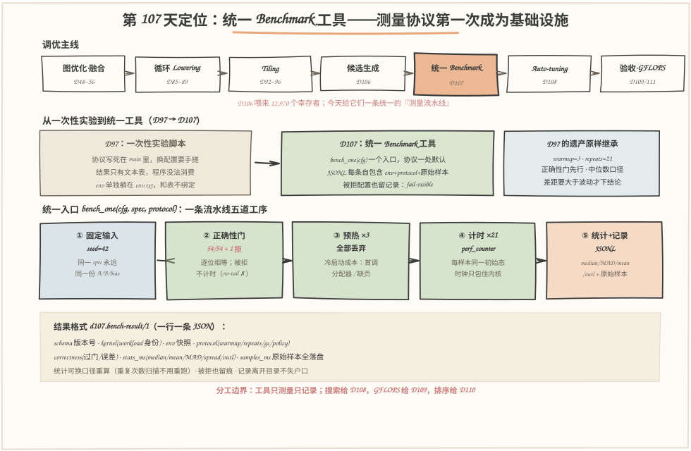
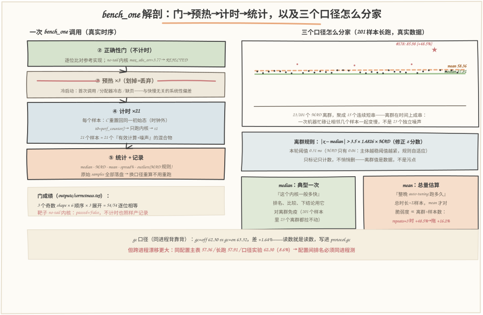
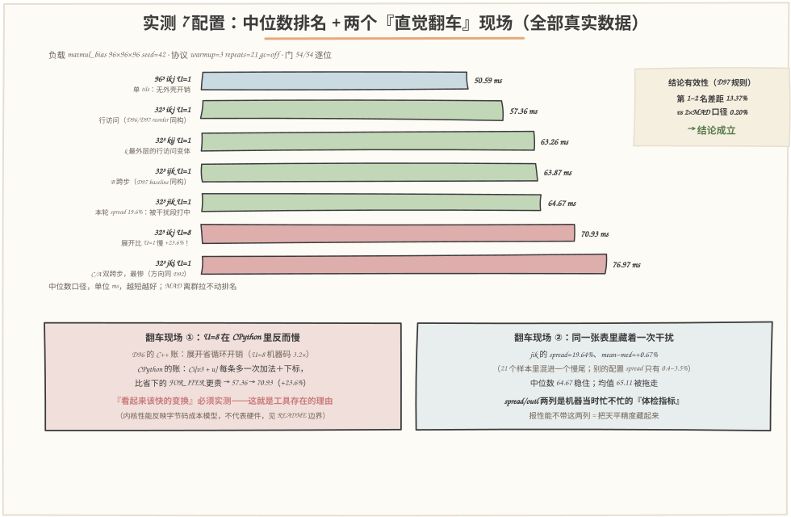

# 第 107 天：统一 Benchmark 工具——12,970 个候选排队等着被测，先回答"怎么测才算数"

> **今日目标**：完成本教程后，你能做到五件事——把 D97 手搓的一次性测量协议立成一个**统一 Benchmark 入口**（`bench_one(cfg) → 一条自包含记录`），任何候选过同一条流水线：固定输入（seed=42）→ 正确性门（今天实测 **54/54 逐位相等**，no-tail 内核 `max_abs_err=3.77` 被拒且**不计时**）→ 预热 ×3（丢弃）→ 计时 ×21 → 统计；说清**中位数和均值不是好与坏、是两种问题**——"典型一次多快"用中位数（排名），"整晚搜索跑多久"用均值（总量），并用真实数据算出均值的脆弱度 ∝ 离群幅度 ÷ 样本数（201 样本里 23 个离群只把均值拖 +0.78%，但同一离群落在 repeats=3 里能拖 +16.2%）；用 **MAD 修正 z 分数**（|x−median| > 3.5×1.4826×MAD）在 201 个真实样本里抓出 **23 个离群、15 个连续短串**（离群在时间上成串，不是独立噪声），只标记不删除；回答"重复次数怎么定"——同一批落盘样本上做前缀中位数扫描（本轮 k≤7 最坏摆 0.11%、k≥21 后 0.03%，成本 0.1s→11.6s），repeats=21 买的是对忙时段的保险；最后交出**结果格式**：`d107.bench-result/1` JSONL，每条自带 env＋protocol＋原始样本——记录离开目录也不失户口。
> **预计时间**：学习 30 分钟＋实践 45 分钟
> **前置准备**：D106 的候选生成器（12,970 个幸存者排队等计时协议，按 3+21 次启动估约 31.1 万次 kernel 调用）；D97 的测量纪律（预热＋重复×21＋中位数/MAD、正确性门先行、环境三件套、"差距要大于波动"）；D92/D96/D97 的循环顺序、展开、min 钳制概念（今天内核工厂直接复用）。工具只要 `python3`（本文环境：Python 3.11.4 CPython，Linux aarch64，32 逻辑核，2026-11-13），零第三方依赖。
> **今日产出**：`code/bench.py`（统一入口＋协议＋统计＋JSONL＋CLI＋47 项断言自检）＋`code/kernel_gen.py`（配置→源码→函数的迷你 Lowering 内核工厂）＋`code/run_all.sh`（一键复现，约 40～60 秒）＋`outputs/` 下 12 份真实运行记录＋本文 3 张手绘图（数字全部出自 outputs/）。

## 1. 今天解决什么问题？

D106 收尾时留了一句："12,970 个幸存者排队等 D107 的计时协议。"但真要给它们计时，第一个撞上的问题不是"测哪个"，而是"拿什么测"。

D97 其实已经把"怎么测才算数"趟过一遍：预热 3 次、计时 21 次取中位数、正确性门先行、环境三件套随表交付。问题是**那是一次性实验脚本**——协议写死在 `run_bench` 里，6 个配置跑完，结果躺进 `perf-512.txt` 的文本表格，`env.txt` 单独放一边。D108 的 auto-tuning 是另一种用法：对一组 shape 自动搜索候选，**每个候选都要无条件过同一套测量**，还要把"谁被拒、谁多快、当时机器什么状态"机器可读地存下来。拿一次性脚本的办法硬扛，会烂在三个地方：

- **协议漂移**：今天测 6 个配置手搓一遍 warmup=3，明天补一个配置手搓成 warmup=1——表内 7 个配置就不可比了，而且没人会发现；
- **结果无法消费**：文本表人能读，D108 的搜索循环读不了；想事后换统计口径（比如从"中位数"换"去尾均值"），原始样本早没存，只能整夜重跑；
- **环境与数据分家**：记录被复制、汇总、放进报告之后，没人能回答"这行 13.59 是哪台机器、gc 开没开、几次重复测出来的"——D97 错误四的剧情重演。

所以今天的任务不是"再测一遍性能"，而是把测量本身**立成基础设施**：一个入口（`bench_one`）、一套协议（一处默认，想改必须显式改）、一种结果格式（JSONL，每条自包含）。计划点名要学的统计概念——**预热、重复次数、中位数、均值、异常值**——全都长在这个入口里，而不是散落在各处脚本里。

还有两个 D97 没正面回答、今天必须回答的统计问题：**均值到底是什么定位**（D97 把均值划进了"常见误解"——"取平均最科学"确实不成立，但反过来"均值没用"也不成立："auto-tuning 整晚要跑多久"这个问题，均值才是对的统计量——今天要给均值划清边界，而不是一边倒）；**重复次数怎么定**（D97 说了 21 次，没说为什么是 21 不是 201——今天用落盘样本的前缀扫描实算给你看）。

贯穿全文的例子：`C = A·B + bias`，96×96×96，fp32，seed=42；7 个真实配置（6 种循环顺序里的 5 种 × 展开 U∈{1,8} × 单 tile 对照）全部过同一个 `bench_one`。先剧透两个"直觉翻车"现场：**U=8 展开在 CPython 里比 U=1 慢 23.6%**（D96 在 C++ 里量到的方向在这里反了）；**21 个样本里混进一个慢尾，中位数纹丝不动、均值被拖走 0.67%**（jik 的 spread 19.6% 那一行）——工具的价值就是把这两件事如实量出来，而不是顺着直觉写进报告。

## 2. 先看全貌：今天的内容位于哪里？



**图 1**：看三块——**上排**是调优主线：D106 喂来 12,970 个幸存者，今天的橙色格子"统一 Benchmark"插在候选生成与 D108 auto-tuning 之间——候选第一次有了统一的"体检流水线"；**中排**是今天真正的动机：左边 D97 的一次性脚本（协议散落、文本表、env 分家）被右边 D107 的统一工具替代（一个入口、JSONL 自包含、fail-visible），而 D97 的四件遗产（3/21 协议、门先行、中位数、差距大于波动）原样继承——今天不是推翻 D97，是把它工程化；**下排**是流水线详图：固定输入 → 正确性门 → 预热 → 计时 → 统计＋记录五道工序，底部是结果格式的字段清单——每条记录都是"身份＋环境＋协议＋门＋统计＋原始样本"的自包含证据。

把主线串成 5 步：

1. **定身份**：`BenchSpec`（shape、seed）定"被测的是谁"，`KernelConfig`（tile、order、unroll）定"怎么算"——固定输入从 seed 推导，同一 spec 永远同一份 A/B/bias；
2. **门先行**：先过正确性（逐位相等），被拒的配置照样产记录但不计时——错误版本往往更快，快也不许进表（今天 no-tail 内核实测被拒）；
3. **烧冷启动**：预热 3 次全部丢弃，把首次调用、分配器冷态这类与快慢无关的系统性偏差烧在计分之外；
4. **计分**：21 个样本、每样本同一初始状态、时钟只包住内核——统计口径是中位数（成绩单）＋MAD（误差棒）＋均值（总量口径）＋离群标记（体检指标）；
5. **落盘**：一条 JSONL 记录自包含全部上下文，原始样本全存——统计口径可以事后换，不用重跑。

一句话定位：**D106 留下的问题是"12,970 个候选配得上被测"；今天的答案是"给它们一条统一的、诚实的、可机器消费的测量流水线"**——测得诚实，D108 才敢放它整夜无人值守地跑。

## 3. 核心概念：先用直觉，再给准确定义

### 3.1 统一入口与固定输入：让"测量"变成一种服务

一句通俗解释：**统一入口（unified entry）**就是把测量做成一个函数——喂进去一个配置，还回来一条自包含的记录；所有候选走同一条流水线，协议没有第二份拷贝。**固定输入（fixed input）**指被测数据由 `seed` 决定：同一个 `(M, N, K, seed)` 永远生成同一份 A/B/bias（今天 `seed=42`，`make_inputs` 里 `random.Random(42)` 独立实例化）。

类比：体检中心。不管你是谁、为什么来，都走同一套流程：登记（身份）→ 入门检查（有没有传染病先筛掉）→ 测量（同一台仪器、同一个时段、同样的姿势）→ 出报告（报告单上带着仪器编号和测量条件）。对应到技术上是：`bench_one(cfg, spec, protocol)` 内部依次做门→预热→计时→统计，**协议对象 `Protocol` 是唯一一份默认**（warmup=3、repeats=21、perf_counter、gc=off、bitwise），想改口径必须显式传新对象——"改协议"从此是一个看得见的动作，而不是散落各处的手搓差异。类比边界：体检中心可以为你定制项目，统一入口**不为任何候选定制流程**——定制恰恰是今天要消灭的东西；真要换口径（比如 D108 想用 tolerance 门），换成一个新的 `Protocol` 值，全体候选一起换。

最小例子（今天真实运行）：`bench_one(KernelConfig(32,32,32,"ikj",1), BenchSpec(), Protocol())` 返回一个 dict——`correctness.passed=True`、`stats_ms.median≈57~63ms`（随机器时段漂移，见 5.3）、21 个原始样本全在 `samples_ms` 里。

一个容易被忽略的设计：**被拒的配置也返回记录**。`correctness.passed=False`、`max_abs_err=3.77`、`stats_ms=None`——D108 的搜索循环需要知道"谁死在了门上、为什么"，静默跳过等于把死因埋掉（fail-visible，不 fail-silent）。

### 3.2 预热：把"第一次"的成本烧在计分之外

一句通俗解释：**预热（warmup）**是在正式计时前先把内核跑几遍，把"第一次"特有的额外成本花掉，这些样本全部丢弃、不进任何统计。

类比：游泳比赛前的试游——泳池的水温、出发台的脚感、自己的节奏都适应一遍，试游的成绩和正式成绩分开记。对应到技术上是：第一次执行要额外支付**冷启动成本**——Python 里是首次调用压栈、`range` 对象与行提升变量第一次进各自缓存、分配器第一次给出热页、内核算出的临时浮点对象第一次走分配路径（D97 的 C++ 版对应 C 矩阵 256 页的首次写入缺页）；这些和内核快慢无关，混进成绩就是系统性偏差。类比边界：试游消耗体力，预热几乎不消耗什么——它的唯一代价是**多跑 warmup 次**：3 次预热占总启动次数的 3/24 = **12.5%**，换来的保险是"成绩里没有冷启动成分"。内核越短，冷成本占比越大（D97 的账：105 次 MAC 的内核里冷启动能盖过全部有效计算）——所以预热是协议的常量项，不随内核大小开关。

### 3.3 重复次数与中位数：21 次是账，不是迷信

一句通俗解释：**重复次数（repeats）**决定你为"性能是随机变量"这个事实付多少保险；**中位数（median）**是把 21 个样本排序后取正中间的那个——成绩单口径，对离群值免疫。

类比：考试看"典型水平"不看"超常发挥"。对应到技术上是：每个计时样本 = 有效计算＋噪声（调度、邻居负载、解释器后台活），21 个样本的中位数让两三个坏样本改变不了成绩（D97 实测：单样本口径 4/6 排名翻车）。类比边界：中位数回答"典型一次"，**回答不了"总共多久"**——那是均值的地盘（3.4）。

为什么是 21 而不是 201？今天的落盘样本直接回答（前 k 个样本的中位数 vs 全体 201 个样本的中位数，同一批数据换口径不重跑）：

```text
  k   median_of_k   drift%      成本(k×单次)
  1        57.95     +0.07          0.1s      ← 本轮 k=1 运气好（outliers.txt ③ 有解读）
  3        57.85     -0.11          0.2s
  7        57.85     -0.11          0.4s
 21        57.92     +0.02          1.2s      ← 协议默认：k≤7 最坏摆 0.11%，此后收益趋零
101        57.89     -0.03          5.8s
201        57.91     +0.00         11.6s
```

这一轮机器安静，k=1 都只偏 +0.07%——**但这是运气不是规律**（D97 的 4/6 翻车发生在忙时段；今天长跑实验里 23 个离群、最远 +48.5%，单样本落在离群段就是另一副长相）。repeats=21 买的是对忙时段的保险；收敛之后的样本只花时间，不再买保险。这笔账接到 D106 的预算上：12,970 个候选 × (3+21) 次启动 ≈ 31.1 万次；如果 repeats 拍脑袋定成 201，同一轮搜索的计时预算直接 ×8——"测得起"就不是工具能替你扛的了。

### 3.4 均值：给 D97 没说完的半句话补上

一句通俗解释：**均值（mean）**是全部样本的算术平均——回答"总量"问题的正确统计量：整晚 auto-tuning 要跑多久，总时长 = Σ样本 ≈ n×mean，**这时候用中位数反而是错的**（离群值的时间是真实花掉的时间，不该被"稳健"掉）。

类比：报告"这趟搬家总耗时"要把堵车那 40 分钟算进去；报告"平时通勤多快"则把堵车天剔掉更诚实。对应到技术上是：**同一个数据集、两种问题、两个口径**——排名用中位数，总量估算用均值，谁也不比谁"科学"，只是回答的问题不同。类比边界：均值的代价是**脆弱性随样本数放大缩小**：一个离群值把均值拖走多少 ≈ 离群幅度 ÷ 样本数。今天的真实数据：201 样本里 23 个离群（最大 +48.5%）也只把均值拖到 +0.78%（被 201 个样本稀释）；但同一离群落在 repeats=3 的测量里会拖走约 +16.2%——**样本越少，越要中位数**。折中口径是**去尾均值（trimmed mean，两端各去 10%）**：比均值稳健、比中位数利用更多样本，今天的表把它作为一列一起交付（57.93，几乎贴着中位数）。

### 3.5 异常值：标记它，理解它，别删它

一句通俗解释：**异常值（outlier）**是显著偏离样本主体的计时样本。检测规则今天用 **MAD 修正 z 分数**：`|x − median| > 3.5 × 1.4826 × MAD`（MAD = median(|x − median|)，中位绝对偏差；1.4826 把 MAD 校准到正态的 σ 口径）。

类比：全班平均身高 170cm，有个同学 210cm——你不能把他开除出班，得先弄清他是"篮球队员"（正常但稀有）还是"尺子坏了"（测量错误）。对应到技术上是：性能离群值的三大来源——**调度/邻居负载**（内核被换下 CPU）、**解释器后台**（gc 回收、JIT 类预热）、**系统事件**（中断、页错误）；它们是环境的一部分，不是数据错误。类比边界：异常值**不是污点，是情报**——今天 201 样本里 23 个离群聚成 15 个连续短串（最长的 6 个样本）：机器忙碌让相邻几个样本一起变慢，**离群在时间上成串**，这说明干扰是"一阵一阵"的，不是 23 个独立噪声。处置纪律只有一条：**标记、计数、原样保留**——删除必须显式声明在协议里；悄悄删等于把天平精度藏起来。

一个反直觉的细节：**阈值不是常数，是 3.5×1.4826×MAD**——分布主体越稳，MAD 越小，阈值越紧，规则自动变敏感。今天长跑那批样本 MAD 只有 0.06ms，阈值收紧到 0.31ms：+0.7% 的样本也会被点名。这不是规则过敏，是"相对主体而言确实异常"；自检里 `MAD=0 时规则退化为不报离群` 那条断言把边界行为也钉死了。

## 4. 图解核心机制



**图 2**：左半是一次 `bench_one` 调用的真实时序，右半是三个统计口径在同一批 201 个真实样本上怎么分家。按编号走：

1. **门（不计时）**：内核跑一遍，与参考实现**逐位**比对（`==`，不是误差阈值）——所有循环排列、tile、展开下每个 C[i][j] 都按 k 升序做同一串 IEEE 双精度加法，累加序列逐位相同，这是 D97 `-ffp-contract=off` 论据的纯 Python 版。no-tail 内核 `max_abs_err=3.77` → REJECTED，**不计时**；
2. **预热 ×3（划掉=丢弃）**：冷启动成本烧掉，不进任何统计——占了 3/24 = 12.5% 的启动预算，买"成绩里没有系统性冷偏差"的保险；
3. **计时 ×21**：每个样本先把 C 重置回同一初始状态（在时钟外），`perf_counter` 只包住内核本身——控制变量落在协议里，不靠自觉；
4. **统计＋记录**：median（成绩单）/ MAD（误差棒）/ mean（总量口径）/ spread%（天平精度）/ outliers（体检指标）一起进表，原始样本全部落盘；
5. **右上的样本图**：201 个真实样本的主体贴着 median=57.91 的绿线，橙虚线（mean=58.36）被 23 个离群值（红点、红星）拖到上方；最远的 **#178: 85.98ms（+48.5%）**——注意它**没有**把中位数拉动一个像素，这是 3.3"排名用中位数"的全部理由。右下两张卡把分工写死：median 回答"典型一次"，mean 回答"整晚多久"，并给出稀释账（repeats=3 时那个 +48.5% 会把均值拖走约 +16.2%）；
6. **底部一行是今天最重的教训**：gc 口径差（同进程背靠背 62.30 vs 63.32，+1.64%）**小于**跨进程漂移（同配置在主表/长跑/口径实验三个进程里 57.36 / 57.91 / 62.30，最远差 8.6%）——所以"配置间排名必须同进程依次测"，跨进程只有数值、没有排名。

## 5. 动手实践：完成一个最小可运行例子

### 5.1 准备文件

```text
tutorials/day-107/
├── README.md                        ← 本文
├── images/                          ← 3 张手绘图（数字与 outputs/ 一致）
└── code/
    ├── bench.py                     ← 统一工具：入口＋协议＋统计＋JSONL＋CLI（739 行，零依赖）
    ├── kernel_gen.py                ← 内核工厂：配置→源码→函数（228 行，迷你 Lowering）
    ├── gen_images.py                ← 手绘图生成器（固定随机种子，可复现）
    ├── run_all.sh                   ← 一键复现（约 40～60 秒）
    └── outputs/
        ├── bench-table.txt          ← 主交付物：7 配置统一入口的表
        ├── results.jsonl            ← 结果格式：7 条自包含记录（主交付物）
        ├── samples.csv              ← 147 个原始样本（config,sample_idx,ms）
        ├── outliers.txt             ← 长跑 201 样本：离群/口径/重复次数扫描
        ├── outliers-samples.json    ← 长跑原始样本＋统计
        ├── gc.txt / gc-records.jsonl← gc 口径对照（含口径不同的两条记录）
        ├── correctness.txt / gate-records.jsonl  ← 门套件 54/54＋被拒记录
        ├── src-ikj-u4.txt           ← 配置生成的真实内核源码
        ├── test-all.txt             ← 47/47 断言自检
        └── env.txt                  ← 环境与口径
```

### 5.2 编写代码

`bench.py` 的骨架是四个角色：**统计纯函数**（可手算、可断言）、**身份对象**（`BenchSpec`/`Protocol`，frozen dataclass）、**统一入口**（`bench_one`）、**格式**（`record_from`＋JSONL）。先看入口的心脏——四道工序怎么排（节选，完整实现见 `bench.py:201`）：

```python
def bench_one(cfg, spec=None, protocol=None, env=None, kernel=None) -> dict:
    spec = spec or BenchSpec()
    protocol = protocol or Protocol()          # 协议唯一默认：3/21/perf_counter/gc=off/bitwise
    kernel = kernel if kernel is not None else make_kernel(cfg)

    # ① 固定输入：同一 spec 永远同一份 A/B/bias
    A, B, bias = make_inputs(spec.M, spec.N, spec.K, spec.seed)
    C0 = alloc_c(bias, spec.M, spec.N)
    Cref = ref_matmul(A, B, bias, spec.M, spec.N, spec.K)

    # ② 正确性门：先于一切计时。不正确就没有参赛资格（D97 错误三）
    C = [row[:] for row in C0]
    kernel(A, B, C, spec.M, spec.N, spec.K)
    err = max_abs_err(C, Cref)
    passed = (C == Cref) if protocol.policy == "bitwise" else (err <= protocol.tol)

    samples = None
    if passed:                                  # 被拒配置根本走不到计时
        gc_state = _gc.isenabled()
        if not protocol.gc_enabled:
            _gc.disable()                       # 口径开关：排除 or 包含解释器后台
        try:
            for _ in range(protocol.warmup):    # ③ 预热：全部丢弃
                C = [row[:] for row in C0]
                kernel(A, B, C, spec.M, spec.N, spec.K)
            samples = []
            for _ in range(protocol.repeats):   # ④ 计时：每样本同一初始态
                C = [row[:] for row in C0]      #    重置在时钟外（控制变量）
                t0 = time.perf_counter()
                kernel(A, B, C, spec.M, spec.N, spec.K)
                t1 = time.perf_counter()
                samples.append((t1 - t0) * 1000.0)
            stats = summarize_ms(samples)       # ⑤ 统计：median/MAD/mean/outl...
        finally:
            if not protocol.gc_enabled and gc_state:
                _gc.enable()
    return record_from(BenchResult(...), env)   # 一条自包含记录
```

统计口径都是纯函数，手算可验（自检的锚点断言就是这么写的）：

```python
def mad(xs: list) -> float:
    m = median(xs)
    return _median([abs(x - m) for x in xs])          # MAD = median(|x − median|)

def outlier_indices(xs: list) -> list:
    m = median(xs)
    d = mad(xs)
    if d == 0:
        return []                                     # 样本全等：规则退化，只看 spread
    return [i for i, x in enumerate(xs) if abs(x - m) > MAD_K * d]   # MAD_K = 3.5 × 1.4826
```

**被测对象**来自 `kernel_gen.py`——一个迷你 Lowering：`KernelConfig(tm, tn, tk, order, unroll)` 生成专用内核源码再 `exec` 成函数。和 D85~96 同构：tile 三维＋min 钳制（D94/D95）、6 种循环顺序（D92）、最内层展开＋尾部循环（D96）；行提升按"最内层是谁"分三套（j 内层全行访问、k 内层标量累加器＋B 跨步、i 内层双跨步——和 D92 的访问模式分析一一对应）。`outputs/src-ikj-u4.txt` 是 `32³ ikj U=4` 的真实产物：

```python
def _kernel(A, B, C, M, N, K, TM, TN, TK):
    for i0 in range(0, M, TM):
        for j0 in range(0, N, TN):
            for k0 in range(0, K, TK):
                ihi = min(i0 + TM, M); jhi = min(j0 + TN, N); khi = min(k0 + TK, K)
                for v1 in range(i0, ihi):
                    Ci = C[v1]; Ai = A[v1]              # 行提升（code motion）
                    for v2 in range(k0, khi):
                        a = Ai[v2]; Bv = B[v2]
                        n = (jhi - j0) - (jhi - j0) % 4
                        for v3 in range(j0, j0 + n, 4):  # 主循环：步长 4、4 条语句（D96 展开）
                            Ci[v3] += a * Bv[v3]
                            Ci[v3 + 1] += a * Bv[v3 + 1]
                            Ci[v3 + 2] += a * Bv[v3 + 2]
                            Ci[v3 + 3] += a * Bv[v3 + 3]
                        for v3 in range(j0 + n, jhi):    # 尾部循环兜底（D95/D96）
                            Ci[v3] += a * Bv[v3]
```

这里必须交代一段**真实的开发记录**：本教程的生成器模板第一次跑通时，6 个配置在门上全数 FAIL——原因是我把元素循环的缩进写错，`for v1` 掉到了 `k0` 循环外面，等于每个 tile 块只用最后一个 k 段算了一遍。**第一时间拦住它的是正确性门，不是肉眼读代码**——在 50 行生成的源码里找一个缩进位，远不如一条 `passed=False` 加 `max_abs_err` 的量级诊断来得快。这正好是"门先行"的价值的现场证明，所以它进了 `kernel_source` 的文档字符串，也进了常见错误的第一条素材库。

**结果格式**是今天的正式交付物。`results.jsonl` 一行一条记录，每条长这样（`32³ ikj U=1` 的真实记录，样本字段略）：

```json
{"schema": "d107.bench-result/1",
 "kernel": {"name": "tiled-matmul/32³ ikj U=1", "tm": 32, "tn": 32, "tk": 32,
            "order": "ikj", "unroll": 1},
 "workload": {"op": "matmul_bias", "M": 96, "N": 96, "K": 96, "seed": 42,
              "flops_nominal": 1769472},
 "env": {"python": "3.11.4", "implementation": "CPython", "system": "Linux",
         "machine": "aarch64", "cpu_count": 32, "cpu_model": "n/a",
         "clock": "time.perf_counter", "clock_res_us": 0.001},
 "protocol": {"warmup": 3, "repeats": 21, "clock": "perf_counter",
              "gc": "off", "policy": "bitwise", "tol": 1e-09},
 "correctness": {"passed": true, "max_abs_err": 0.0, "rejected": false},
 "stats_ms": {"n": 21, "median": 57.359, "mean": 57.4, "trimmed_mean": 57.385,
              "min": 57.3, "max": 57.66, "mad": 0.05, "spread_pct": 0.63,
              "cv_pct": 0.17, "outliers": 1, "outlier_idx": [10],
              "mean_minus_median_pct": 0.07},
 "samples_ms": [57.303, 57.403, "...×21 个原始样本全在..."],
 "wall_ms": 1496.9, "timestamp": "2026-11-13T10:55:42+0800"}
```

四个设计决定值得停一下：**schema 版本号**（将来改字段先改版本，不静默破坏读旧记录的代码——D108/D109/D110 都要消费它）；**env 随每条记录走**（记录被复制进报告也不失户口；不收主机名/用户名——性能要户口，不要隐私）；**原始样本全落盘**（重复次数扫描、换统计口径、事后查离群，都不用重跑——5.4 会现场用）；**flops_nominal 是 workload 身份不是测量**（2·M·N·K 每表统一，D109 算 GFLOPS 时直接取用）。

### 5.3 运行与观察

一键复现（本文所有"实际输出"都来自这次运行，环境见 `outputs/env.txt`；约 40～60 秒）：

```bash
cd tutorials/day-107/code && ./run_all.sh
```

**记录一：主表**（`outputs/bench-table.txt`，实际输出的核心）：

```text
 config                  median      mean   trimmed      min     MAD  spread%  outl  mean−med%  gate
------------------------------------------------------------------------------
 96³ ikj U=1              50.59     50.61     50.60    50.49   0.038     0.51     0       0.03  PASS ←BEST
 32³ ikj U=1              57.36     57.40     57.38    57.30   0.050     0.63     1       0.07  PASS
 32³ kij U=1              63.26     63.34     63.28    62.69   0.408     3.49     0       0.12  PASS
 32³ ijk U=1              63.87     63.89     63.88    63.68   0.106     0.88     0       0.03  PASS
 32³ jik U=1              64.67     65.11     64.58    63.68   0.417    19.64     1       0.67  PASS
 32³ ikj U=8              70.93     70.93     70.93    70.82   0.039     0.37     0       0.01  PASS
 32³ jki U=1              76.97     77.03     77.01    76.71   0.170     1.00     0       0.07  PASS
 第 1～2 名差距 13.37% vs 2×MAD 口径 0.20% → 结论：成立
```



**图 3**：解释这张表怎么读出三个故事。**故事一（排名的骨架）**：`jki`（i 最内层 → C、A 双跨步）76.97 最慢、`ikj` 家族（j 最内层 → 全行访问）领先——**方向与 D92 的访问模式分析一致**；单 tile `96³ ikj` 50.59 拿第一，因为它只有 1 次 tile 外壳迭代（27 次 → 1 次，省掉的是纯 Python 的循环与钳制开销）。第 1～2 名差距 13.37% 远大于 2×MAD（0.20%）——D97 的结论有效性规则在这里自动判"成立"。**故事二（翻车现场①）**：`ikj U=8` 比 `U=1` 慢 **+23.6%**——D96 在 C++ 里量到"展开省循环开销"，但 CPython 里 `Ci[v3 + u]` 每条语句多付一次加法＋下标，比省下的 `FOR_ITER` 更贵。这不是实验失败，是实验**工作正常**：工具的职责就是把"看起来该快的变换"如实量成数字——直觉不跨运行时，实测才跨。**故事三（翻车现场②）**：`jik` 的 spread=19.64%、mean−med=+0.67%——21 个样本里混进了一个慢尾（同一轮别的配置 spread 只有 0.4~3.5%），中位数 64.67 稳住、均值 65.11 被拖走。spread/outl 两列就是"当时机器忙不忙"的体检指标，报性能不带它们等于把天平精度藏起来。

**先划一条诚实的边界**：被测内核是纯 Python——它的性能反映 **CPython 字节码成本**（下标次数、临时对象、循环开销），**不反映硬件缓存/向量化的收益**（那是 D97 的 C++ 内核和 D109 的 Roofline 的事）。所以这张表的正确用法不是"得出 tile 顺序的硬件结论"，而是让统一工具在真实测量里跑通全链路：门、协议、统计、格式，全部在真实数字上工作。

**记录二：门**（`outputs/correctness.txt`，实际输出节选）：

```text
 shape   5×  7×  3: 18/18 ✓✓✓…全 PASS
 shape  13× 17× 19: 18/18 ✓✓✓…全 PASS
 shape  31× 29× 23: 18/18 ✓✓✓…全 PASS
 门成绩：54/54 逐位相等

 靶子：no-tail 内核（尾部循环整段不生成——D96『跑得飞快、结果全错』的 Python 版）
   tiled-matmul/32³ ikj U=4: passed=False max_abs_err=3.77
   stats=None、samples=None——被拒配置不计时：错误版本往往更快，快也不许进表
```

小奇数 shape 专门踩尾部路径（5、7、13、19 都不整除 4/8），所以 54 项检查同时覆盖了主循环、尾部、min 钳制三条路径；no-tail 内核死在门上，`gate-records.jsonl` 里它的记录 `stats_ms=null`——死因留痕。

**记录三：长跑**（`outputs/outliers.txt`，201 样本、gc=on 包含口径，实际输出节选）：

```text
 ① 离群值（MAD 修正 z 分数：|x−median| > 3.5×1.4826×MAD）
   阈值 = 3.5×1.4826×MAD = 0.31 ms（MAD 只有 0.06：分布主体极稳时阈值自动收紧，规则变敏感）
   共 23 个离群样本，最大者 #178: 85.98 ms（+48.47%）
   23 个离群聚成 15 个连续短串（最长的 6 个样本）——离群在时间上成串出现：
   一次机器忙碌/后台回收让相邻几个样本一起变慢，不是一个个独立噪声。
 ② 三个统计口径在同一批样本上的分歧
   median        57.91 ms   ← 典型一次（离群值拉不动）
   mean          58.36 ms   ← 被慢尾拖着走（搜索总时长估算用）
   trimmed_mean  57.93 ms   ← 两端各去 10% 的折中
   mean − median = +0.78%   spread 48.7%   MAD 0.06   CV 4.5%
   23/201 个离群也只把均值拖了 +0.78%：最大离群 +48.5% 被 201 个样本稀释。
   均值的脆弱度 ∝ 离群幅度 ÷ 样本数——repeats=3 时同一个 +48.5% 的离群
   能把均值拖走约 +16.2%；中位数对哪种样本量都免疫。样本少，更要中位数。
```

这就是 3.4/3.5 的全部证据链：23 个离群聚成 15 串（时间相关）、最大 +48.5%、均值只被拖 +0.78%（稀释效应）、换算到 repeats=3 就是 +16.2%（脆弱性反比于样本数）。同一批样本的重复次数扫描见 3.3 的表——**注意那不是重跑，是同一份 `samples_ms` 上换个 k 重新取前缀中位数**。

**记录四：口径对照**（`outputs/gc.txt`，同进程背靠背，实际输出）：

```text
 口径            median      mean     MAD  spread%  outl  mean−med%
------------------------------------------------------------------------------
 gc=off         62.30     63.59   0.289    13.82     4       2.07
 gc=on          63.32     63.56   0.078     4.63     3       0.37
------------------------------------------------------------------------------
 中位数差 +1.64%——读数就是读数：工具负责量出差别并写进 protocol.gc，
 选哪种口径由『要回答什么问题』决定，而不是哪种数字好看。
```

读数要和"跨进程漂移"放在一起才完整：同一配置 `32³ ikj U=1` 在三个进程里的中位数分别是 57.36（主表）、57.91（长跑）、62.30（本实验）——**跨进程漂移 8.6%，比 gc 口径差（+1.64%）大一个量级**。两条纪律由此而来：配置间排名必须同进程依次测（主表 7 个配置正是同进程）；跨进程的数据只报数值、不报排名。

### 5.4 修改一个参数再观察

**对照 A：把 repeats 从 21 砍到 3。**先笔算再验证：`32³ ikj U=1` 本轮 21 样本的 mean−med% 是 +0.07%、spread 0.63%——3 个样本时中位数就是"中间那个样本"，一个离群就能让 mean 偏多少？预测之后跑统一入口的单配置模式：

```bash
python3 bench.py --exp bench --config "32,32,32,ikj,1" --repeats 3
```

看输出里的 `stats_ms`：`n=3`、`spread_pct`、`outliers`，和主表同配置的 21 样本版对答案。规律预测：n=3 时 median 的"免疫"变弱（第 2 大的样本就是中位数）、mean 对任何单离群的敏感度放大 7 倍（21→3）。

**对照 B：换口径不重跑。**打开 `outputs/samples.csv`，找到 `jik_U=1` 那 21 个样本，用几行 Python 手工算 `mean` 和 `median`（不 import bench.py，就用 `statistics` 模块）：

```python
import csv, statistics
xs = [float(r["ms"]) for r in csv.DictReader(open("outputs/samples.csv"))
      if r["config"] == "32³_jik_U=1"]
print(statistics.median(xs), statistics.mean(xs))   # 对答案：中位数 64.67，均值≈65.11
```

均值比中位数慢 0.44ms——那一个慢尾样本就是 spread 19.64% 的来源。**你已经完成了"换口径重算"，而内核一次都没重跑**——这就是原始样本落盘的全部意义，也是 D108 一夜搜索结果可以反复重新分析的地基。

**对照 C：给门换个策略。**`Protocol(policy="tolerance", tol=1e-6)`（或 `--gc-on` 换包含口径）再跑一次 bench 模式，对照记录里 `protocol` 字段的变化——口径改动必须落到记录里，否则读数无法解释。

## 6. 常见错误与排查

**错误一：协议漂移——每个测量手搓自己的 warmup/repeats/时钟。**
现象：周一测的 6 个配置 warmup=3、repeats=21；周三补测的 1 个配置忘了预热、只跑 3 次——8 个配置出现在同一张表里，第 8 名的"慢"里混着 30% 的口径差，没人看得出来。原因：协议散落在各处代码里，"改"和"忘"都不可见。定位：查每条记录的 `protocol` 字段——今天每个结果自带 warmup/repeats/clock/gc/policy，口径不一致一眼现形；主表 7 条记录的 protocol 逐字段相同。修复：只允许 `Protocol` 一份默认，所有测量过 `bench_one` 统一入口；要换口径，显式传新 Protocol 并让它随记录落盘。顺带一句：本教程开发时生成器模板的缩进 bug（元素循环掉出 k0 循环）就是被门的 6/6 FAIL 第一时间按住的——协议不统一的年代，这种 bug 会变成"快了 3 倍"的假性能直接进表。

**错误二：先计时、后验证（甚至不验证）。**
现象：no-tail 内核（尾部循环整段不生成）比正确内核"快"——少干的活照样省时间，纯计时表里它是黑马；今天它死在门上：`passed=False, max_abs_err=3.77`，`stats_ms=null`，一毫秒都没被计时。原因：GFLOPS/耗时的分子是名义工作量，偷工减料只让分母变小——错误版本在纯性能表里必然虚高（D96/D97 的老教训）。定位：门输出 `max_abs_err` 与逐位比对结果；被拒记录在 `gate-records.jsonl` 里带死因。修复："不正确就没有参赛资格"写进协议（`bench_one` 第一步过门，被拒不计时）；被拒也产记录，fail-visible 不 fail-silent。

**错误三：只存统计量，不存原始样本。**
现象：一周后想把排名口径从"中位数"换成"去尾均值"（或想查某个 spread 15% 的可疑行），发现只有 median/MAD 两列数字——只能整夜重跑；而重跑又赶上机器忙，数字对不上，调查线索全断。原因：把"原始样本"当成了过程数据，没当成证据。定位：打开 `results.jsonl` 看 `samples_ms` 是否为 null；今天 7 条主表记录各带 21 个样本、长跑记录带 201 个。修复：原始样本全部落盘（今天的格式字段）；重复次数扫描、换口径、离群复核都改成"读样本重算"，一分钱测量都不用再花。

**错误四：环境只在 env.txt 里，不随记录走。**
现象：把 3 条结果拷进汇报，有人问"57.36ms 是哪个 Python、gc 开没开、几次重复"——env.txt 留在原目录，记录自己答不上来。原因：环境记录和结果数据是两个文件，复制时天然分家（D97 错误四的 Python 版）。定位：检查单条 JSONL 是否自包含 `env`＋`protocol`；今天自检里"环境快照在记录里""协议在记录里"两条断言把这事钉死。修复：每条记录内嵌 env 快照（python 版本、平台、核数、时钟分辨率）＋完整协议；env.txt 只做汇总，不做唯一出处。

**错误五：跨进程/跨时段给配置排排名。**
现象：拿主表里的 `32³ ikj U=1`（57.36ms）和一小时后另起进程测的 `jik`（比如 61ms）比，得出"jik 只慢 6%"——今天实测同一配置跨进程漂移 8.6%（57.36/57.91/62.30），这个排名随时可以是噪声翻转的。原因：run 级波动（进程落在哪个核、邻居负载、频率状态）锁不掉，样本内 MAD 看不见它（D97 对照 B 的 5.9% 在纯 Python 上放大到 ~8%）。定位：同配置在不同进程里的中位数是否一致——不一致就只报数值不报排名。修复：配置间比较在同一次进程里依次完成（主表 7 个配置正是同进程）；跨进程数据只进"数值库"，不进"排名库"。

## 7. 今日练习

### 必做练习

两个"先笔算再对答案"。**练习一（离群值的威力账）**：长跑样本里最大离群是 85.98ms、中位数 57.91ms。笔算：如果 repeats=3 的测量恰好把这个样本抓进三个样本之一，均值会比"三个干净样本"多出 (85.98−57.91)/3 ≈ 9.4ms——除以 57.91 得多少？（再对照 outputs/outliers.txt 里"能把均值拖走约 +16.2%"那句，两个数应该吻合。）**练习二（口径自证）**：用 5.4 对照 B 的三行 Python，把 `32³_ikj_U=8` 的 21 个样本读出来，手算 median 与 mean，和主表的 70.93/70.93 对答案；再回答：为什么这一行的 mean−med% 只有 +0.01%，而 jik 是 +0.67%？（看样本极值：U=8 的样本挤在 70.82～71.09ms（spread 0.37%），jik 有一发 76.38ms 的慢尾——谁被离群打过、谁没有。）

### 选做挑战

给记录加一个新统计字段（比如 P90 分位数：`sorted(xs)[ceil(0.9*n)-1]`），走完整流程：改 `summarize_ms` → 跑 `--exp self-test` 给它加断言（构造手算样例）→ 重跑 `--exp table` → 打开 `results.jsonl` 确认新字段落盘。全程不重跑任何内核？不——表会重跑（计时是新的），但**长跑实验不用重跑**：`outputs/outliers-samples.json` 里 201 个原始样本直接读进来算 P90——这就是"样本落盘"买到的东西。做完顺手把 D106 的账升级：12,970 个候选全测，用今天的 mean 口径估总搜索时长（中位数 × 启动次数估的是"典型"，总时长要 Σ——想想为什么）。

## 8. 今日验收

- [ ] 我能用自己的话解释统一入口的五道工序（固定输入→门→预热→计时→统计）各自挡住什么：门挡"错误版本更快"（no-tail 实测 max_abs_err=3.77 被拒不计时）、预热挡冷启动偏差（3/24=12.5% 的保险费）、固定输入挡"数据不同还比性能"
- [ ] 我能说清 median 和 mean 的分工不是好与坏而是两种问题：排名用中位数（23 个离群拉不动 57.91）、总量估算用均值（总时长=Σ样本），并用"脆弱度 ∝ 离群幅度÷样本数"解释为什么 repeats=3 时同一离群从 +0.78% 变 +16.2%
- [ ] 我能独立运行 `./run_all.sh`，在 `outputs/` 里找到表、JSONL、样本、门记录、环境五类交付物，并指出记录里哪个字段回答"当时 gc 开没开、测了几次"
- [ ] 我能用 `--exp bench --config ... --repeats 3` 修改重复次数并预测 spread%/outl 的变化方向，再用 samples.csv 手算某行 median/mean 对答案（不用重跑内核）
- [ ] 我能定位五类错误：协议漂移、先计时后验证、不存原始样本、环境不随记录走、跨进程排排名——并说出各自的"定位指纹"（protocol 字段不一致 / max_abs_err / samples_ms=null / 记录缺 env / 同配置跨进程中位数对不上）
- [ ] 我保存了 `bench.py`＋`kernel_gen.py`＋12 份真实运行记录＋3 张手绘图，能指出图中每个数字出自哪份记录（#178: 85.98 出自 outliers-samples.json、50.59 出自 bench-table.txt……）

## 9. 一句话总结与明天预告

今天的闭环：**问题**——D106 的 12,970 个候选排队等测量，而 D97 的协议是一次性脚本：会漂移、没法消费、环境分家，撑不起 D108 的无人值守搜索；**机制**——统一入口 `bench_one` 五道工序（固定输入 seed=42 → 逐位门 54/54 → 预热 ×3 丢弃 → 计时 ×21 → 统计），统计口径各就各位：median 是成绩单（23 个离群纹丝不动）、mean 是总量账（稀释效应与 +16.2% 的反例都实算了）、MAD 离群规则只标记不删除（15 个连续短串=时间相关干扰的指纹）；**实践**——7 个真实配置过入口出主表，两个"直觉翻车现场"如实入表：U=8 在 CPython 反而慢 23.6%、jik 被一个慢尾打出 spread 19.6%；**验证**——47/47 断言钉死统计手算锚点、门行为（被拒不计时）、格式自包含（JSON 往返逐字段相等、不收主机名）。核心一句：**性能是随机变量，中位数是成绩单，均值是账本，原始样本是证据，环境是户口——五样东西每一条记录都要带齐**。

明天（D108）跑第一版 Auto-tuning：把 D106 的候选生成器和今天的 `bench_one` 接成一个循环——枚举候选 → 过门 → 计时 → 存记录。今天埋的三颗钉子明天全部派上用场：被拒候选的记录（死因台账）、JSONL 边测边写（断点续跑的地基）、还有 mean 口径——"这次搜索总共跑了多久"这个问题，明天要用今天的均值来回答。
