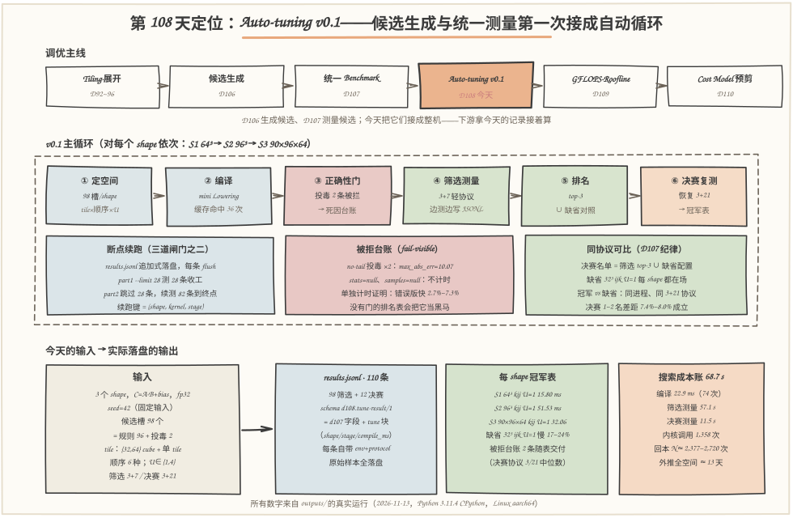
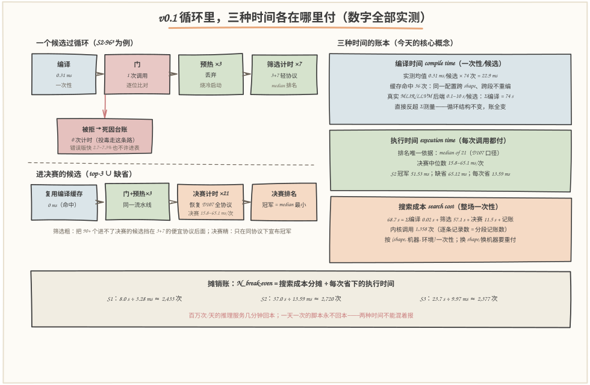
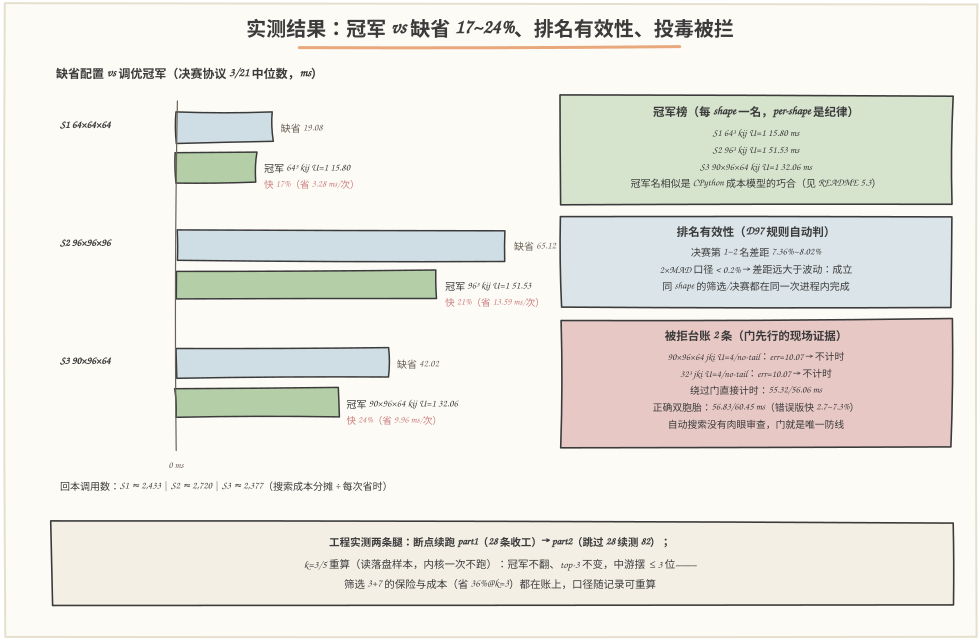

# 第 108 天：运行第一版 Auto-tuning——把"生成候选"和"测量候选"接成一个自动循环，先算清三种时间的账

> **今日目标**：完成本教程后，你能做到五件事——把 D106 的候选空间和 D107 的 `bench_one` 接成**全自动调优循环**（枚举 → 编译 → 正确性门 → 筛选测量 → 排名 → 决赛复测 → 冠军表），对 **3 个 MatMul shape**（64³、96³、90×96×64）跑完 **98 个规则候选 + 2 个投毒探针**，一键产出今天实际落盘的 **110 条自包含记录**（98 筛选 + 12 决赛）；说清**三种时间的区别**——编译时间（一次性/候选，实测均值 **0.31 ms**）、执行时间（每次调用都付，决赛中位数 **15.8~65.1 ms**）、搜索成本（整场一次性，实测 **68.7 s**），并用摊销公式 `N_break-even = 搜索成本 ÷ 每次省下的执行时间` 算出**每 shape 约 2,377~2,720 次调用回本**；给搜索成本装上**三道闸门**——空间精选（98 槽小空间）、两段式协议（筛选 3+7 → 决赛恢复 3+21）、**断点续跑**（边测边写 JSONL + 按键跳过，实测 part1 测 28 条收工、part2 跳过 28 条续测 82 条）；最后用**投毒探针**验证门在自动搜索里依然先行——两个 no-tail 内核被拦（`max_abs_err=10.07`，不计时），而单独给它们计时证明**错误版比正确双胞胎快 2.7%~7.3%**：没有门的纯计时排名表会把它们当黑马供起来。
> **预计时间**：学习 35 分钟＋实践 45 分钟
> **前置准备**：D107 的 `bench_one`／协议／JSONL 格式（今天逐字复用，测量纪律血统不变）；D106 的搜索空间思想（值域剪枝、候选是数据判定在闸门层）；D92/D96 的循环顺序与展开概念（今天空间里的两根轴）。工具只要 `python3`（本文环境：Python 3.11.4 CPython，Linux aarch64，32 逻辑核，2026-11-13），零第三方依赖。
> **今日产出**：`code/tune.py`（Auto-tuning v0.1：主循环＋编译缓存＋断点续跑＋三种时间记账＋CLI＋33 项断言自检）＋`code/run_all.sh`（一键复现，约 2~3 分钟）＋`outputs/` 下 11 个文件（**10 份真实运行记录＋1 份复现日志**）＋本文 3 张手绘图（数字全部出自 outputs/）。

## 1. 今天解决什么问题？

D107 收尾时留了三颗钉子："被拒候选的记录（死因台账）、JSONL 边测边写（断点续跑的地基）、还有 mean 口径——明天全部派上用场。"今天就是把它们钉进去的日子：D106 会生成候选（12,970 个幸存者）、D107 会测量候选（`bench_one` 一条流水线），但从"一个候选"到"一组 shape 的冠军"中间还缺一个**循环**——枚举、编译、过门、测量、排名、落盘，全部无人值守地转起来。

为什么必须是循环、不能手工？三个 shape 的 98 个候选手工点 98 次命令已经是折磨；D106 的全空间 12,970 个候选手工测一遍是灾难。但真正的新问题不是"自动"，是**自动之后账怎么算**——循环跑得越自动，三个问题越尖锐：

- **三种时间混账**："调优花了一晚上"这句话里其实混着三种时间：编译每个候选花的时间（一次性）、内核每次执行花的时间（每次都付）、整场搜索的总开销（一次性投资）。混在一起的后果是无法回答唯一重要的问题——**这次调优值不值**。今天用真实数字回答：搜索 68.7 s，每 shape 换来 17%~24% 的执行加速，2,377~2,720 次调用回本；
- **一夜搜索的中途死亡**：无人值守跑 12,970 个候选，进程被杀、机器重启、断电——如果结果只在内存里、最后一次性写盘，前面几个小时全部白花。D107 埋的"边测边写"钉子就是为此；
- **错误版本更快，而且没人看着了**：手工时代还能肉眼发现"这个内核好像不太对"；自动循环里候选排队过门，没有门就没有任何防线。今天实测：no-tail 内核（尾部循环不生成）比正确双胞胎**快 2.7%~7.3%**——纯计时的排名表会把它当黑马。

贯穿全文的例子：`C = A·B + bias`，fp32，seed=42，**三个 shape**——S1 `64×64×64`（整除、小）、S2 `96×96×96`（D97~107 的主力）、S3 `90×96×64`（M=90 不被 4 整除：尾部路径现场 + 投毒现场）。搜索空间按 shape 生成：cube tile {32, 64} ∩ 放得下 + 单 tile（tm=M,tn=N,tk=K 的无外壳对照）× 6 种循环顺序 × U∈{1,4}，共 96 个规则候选；S3 另投 2 个 no-tail 探针，总槽位 98。先剧透两个结果：**三个 shape 的冠军全是"单 tile kij U=1"**（缺省配置 32³ ijk U=1 慢 17%~24%）；**两个投毒探针死在门上**（`max_abs_err=10.07`，一毫秒都没被计时）——这两件事一个是循环的产出，一个是循环的护栏。

## 2. 先看全貌：今天的内容位于哪里？



**图 1**：看三块——**上排**是调优主线：D106 的候选生成器和 D107 的统一 Benchmark 都是"零件"，今天橙色的"Auto-tuning v0.1"把它们接成整机，下游是 D109 的 GFLOPS 分析和 D110 的 cost model；**中排**是 v0.1 的主循环：每个 shape 依次走"枚举候选 → 编译（带缓存）→ 门 → 筛选测量（3+7）→ 排名 → 决赛复测（3+21）"，右侧标着循环的三道保险——断点续跑（按键跳过已完成）、被拒台账（fail-visible）、决赛∪缺省对照（同协议可比）；**下排**是今天的输入输出账：输入 3 个 shape 的 98 个候选槽 + 2 个投毒探针，输出 110 条自包含 JSONL 记录、3 张每 shape 冠军表、1 份三种时间的搜索成本账——所有数字都是今天实际落盘的。

把主线串成 5 步：

1. **定空间**：按 shape 生成候选槽（tile × 顺序 × 展开是三根轴），空间大小就是搜索成本的第一道闸门——D106 的 12,970 全空间按今天的环境外推要 ~13 天，v0.1 用 98 槽的精选空间先把闭环跑通；
2. **编译**：每个候选过一次迷你 Lowering（配置 → 专用源码 → `exec` 成函数），计时单独记账（`tune.compile_ms`）——编译时间是一次性成本，不进任何性能排名；编译缓存按 `(cfg, no-tail)` 键去重，跨 shape、跨段复用；
3. **门 + 筛选测量**：每个候选无条件过 `bench_one`（D107 流水线：固定输入 → 逐位门 → 预热 ×3 → 计时），筛选段用轻协议 **3+7**（D107 前缀扫描：k≥7 中位数最坏只摆 0.11%），结果**边测边写**进 JSONL；
4. **排名 + 决赛**：按筛选中位数取 top-3，**并入缺省配置 32³ ijk U=1** 组成决赛名单——冠军和缺省必须在同一次进程、同一套 3+21 协议下碰面（D107 的跨口径纪律）；
5. **冠军表 + 成本账**：从落盘记录产出每 shape 排名表（含被拒台账）和三种时间的搜索成本账（含摊销账）——记录是证据，报告只是证据的视图。

一句话定位：**D106 回答"候选从哪来"，D107 回答"怎么测才算数"，今天回答"怎么把它们自动地、诚实地、断点可续地串成一整场搜索，并且算清这场搜索花掉的三种时间"**。

## 3. 核心概念：先用直觉，再给准确定义

今天的三个概念是**三种时间**。它们听起来像同一件事（"时间"），回答的却是三个完全不同的问题——分不清它们，"调优值不值"这笔账就永远算不平。

### 3.1 编译时间：造出这个内核的一次性成本

一句通俗解释：**编译时间（compile time）**是把一个配置变成"能跑的内核"要花的时间——v0.1 里就是 `make_kernel(cfg)` 这一步：生成专用源码、`compile`、`exec` 成函数。

类比：请厨师把一份新菜谱变成"手上功夫"——读谱、备料、试刀，这一趟只做一次，之后每道菜直接开炒。对应到技术上是：`tune.py` 里编译被单独计时（`tune.compile_ms`，今天实测**均值 0.31 ms/候选**，全部 74 次编译加起来 **22.9 ms**），记在每条记录的 `tune` 块里；**编译缓存**按 `(cfg, no-tail)` 键去重，跨 shape、跨段复用（今天命中 36 次——`32³ ijk U=1` 这种公共配置三个 shape 都要用，只编一次）。类比边界：菜谱研读完就永远在手，技术上**缓存不跨进程**——断点续跑的第二段要重新编译它新测的候选（今天 part2 编了 50 次，其中一部分 part1 编过），这是续跑的真实代价之一，账上如实记着。

一个容易被忽略的口径问题：**编译时间不进任何性能排名**。它证明"这个候选被造出来了"，不证明"它跑得快"。反过来也成立：今天 `0.31 ms` 的编译几乎白送，是**迷你 Lowering 的特权**——真实 MLIR/LLVM 管线编译一个候选是 0.1~10 s 量级，74 个候选的 Σ编译就是 74 s，直接反超今天的全部测量成本。循环结构一行不用改，账本的重心就整个翻转：真实调优器拼命缓存编译产物、限制编译次数，原因就在这一格里。

### 3.2 执行时间：每次调用都在付的钱

一句通俗解释：**执行时间（execution time）**是内核每被调用一次跑多久——生产环境里每天要付一万次的那个数。

类比：菜谱变成菜品之后，"每道菜炒多久"。对应到技术上是：D107 的 `stats_ms.median`（21 样本中位数），今天决赛口径的实测范围 **15.8~65.1 ms/次**。它是**排名的唯一依据**——冠军表上唯一的排序键就是它。与编译时间的关系一句话说清：**编译时间付一次，执行时间付到内核退役为止**。S2 的冠军 `96³ kij U=1` 每次执行 51.53 ms，缺省配置 65.12 ms——**每次调用省 13.59 ms**，这个"每次"就是 3.3 摊销账的分母来源。

类比边界：菜炒得快慢只看厨师，内核执行时间还看**运行时环境**——今天的纯 Python 内核量的是 CPython 字节码成本（下标次数、临时对象、循环开销），**不反映硬件缓存/向量化的收益**（D97 的 C++ 内核和 D109 的 Roofline 才是那条线）。所以"冠军"只对它实测的成本模型诚实。

### 3.3 搜索成本：整场调优的总账，要靠摊销收回

一句通俗解释：**搜索成本（search cost）**是把整场调优跑完的总开销——所有候选的编译、门、预热、计时，加上记账。今天实测 **68.7 s** = Σ编译 0.02 s + 筛选测量 57.1 s + 决赛测量 11.5 s + 循环记账 0.1 s，烧掉 **1,358 次内核调用**。

类比：为了选出"最快的那道菜"，把整本菜谱每道都试做了一遍的总耗时——厨房总的关店时间。对应到技术上是：`N_break-even = 搜索成本分摊 ÷ 每次省下的执行时间`。今天的真实数字：S1 分摊 8.0 s ÷ 每次省 3.28 ms ≈ **2,433 次回本**；S2 37.0 s ÷ 13.59 ms ≈ **2,720**；S3 23.7 s ÷ 9.97 ms ≈ **2,377**。百万次/天的推理服务几分钟回本；一天跑一次的脚本**永远回不了本**——搜索成本是"一次性投资"，执行时间是"每次都付"，这笔账就是 3.1/3.2 两种时间不能混报的最终理由。

类比边界：试菜的总时间随菜谱页数**线性涨**，但搜索成本随空间大小是**乘法爆炸**——把今天的循环原样放大到 D106 的 12,970 个候选（512³ 生成），按本场成本模型外推（96³ 冠军 51.5 ms × (512/96)³ ≈ 7.8 s/次）≈ 12,970 × 11 次 × 7.8 s ≈ **13 天，而且这只是下界**（tile 外壳和慢顺序让多数候选更慢）。循环立起来只是让搜索**可能**，"测得起"要靠 D110 的 cost model 预剪和分层搜索——D106 的老警告今天有了数字版。

### 3.4 两段式协议与断点续跑：给搜索成本装的两道闸门

一句通俗解释：既然搜索成本是总账，就有两个工程手段把它压住——**两段式**（大多数人走便宜协议，少数候选走贵协议）和**断点续跑**（死了能从断点接着跑，不推倒重来）。

**两段式的账**：筛选段用轻协议 **3+7**——依据是 D107 的前缀扫描（k≥7 中位数最坏只摆 0.11%）；决赛段恢复 D107 全协议 **3+21**。98 个候选里只有 12 个进决赛（top-3 ∪ 缺省，每 shape 4 个）：**90+ 个注定进不了决赛的候选只烧 11 次调用，而不是 25 次**。缺省配置 `32³ ijk U=1` 被强制拉进每个 shape 的决赛名单，保证"冠军 vs 缺省"在同一进程、同一套 3/21 协议下碰面——D107 的跨口径纪律不能因为自动化就丢。

**断点续跑的账**：每条记录**追加式落盘**（写完立刻 `flush`），续跑键 = `(shape, kernel 名含 /no-tail 后缀, stage)`。今天实测：part1 用 `--limit 28` 跑到预算就收工（28 条 = S1 一个 shape 的 24 筛选 + 4 决赛），part2 同一目录同一命令**跳过 28 条、续测 82 条**到终点。切断点故意选在 shape 边界——D107 实测过跨进程漂移约 8.6%，**同一张排名表不许混两个进程的读数**；把预算切在 shape 中间，排名就悄悄带了口径杂质。代价也如实记着：编译缓存不跨进程，part2 要重新编译它新测的候选。

## 4. 图解核心机制



**图 2**：左半是一个候选过循环的真实时间线，右半是三种时间的账本。按编号走：

1. **编译（蓝，0.31 ms）**：一次性成本，单独记账、进缓存——它不是性能证据，进不了排名；投毒候选与正确双胞胎的编译键不同（`no-tail` 后缀），台账才分得清谁是谁；
2. **门（红，1 次调用）**：先于一切计时。走错路的候选（今天两个 no-tail，`max_abs_err=10.07`）**0 次计时**直接进死因台账——单独给它们计时证明它们比正确双胞胎快 2.7%~7.3%，纯计时排名表会把它们当黑马；
3. **预热 ×3（丢弃）+ 筛选计时 ×7（绿）**：这就是"便宜协议"的全部——每候选 11 次内核调用；中位数进排名，原始样本落盘；
4. **决赛（橙，复用缓存 → 门+预热×3+计时×21）**：只有 top-3 ∪ 缺省（每 shape 4 个）享受 3+21 的贵协议——**筛选粗、决赛精**，搜索成本的大头因此被压在便宜的那一段；
5. **右三张账本卡**：编译时间 0.31 ms/候选（一次性，真实后端会翻几千倍）、执行时间 15.8~65.1 ms/次（每次都付，排名唯一依据）、搜索成本 68.7 s（整场一次性 = Σ编译 0.02 s + 筛选 57.1 s + 决赛 11.5 s）；
6. **底部摊销卡**：`N_break-even = 搜索成本分摊 ÷ 每次省时`——S1/S2/S3 分别 ≈ 2,433 / 2,720 / 2,377 次调用。三种时间的分工到此闭环：**编译管"造"，执行管"跑"，搜索成本管"值不值"**。

## 5. 动手实践：完成一个最小可运行例子

### 5.1 准备文件

```text
tutorials/day-108/
├── README.md                        ← 本文
├── images/                          ← 3 张手绘图（数字与 outputs/ 一致）
└── code/
    ├── tune.py                      ← Auto-tuning v0.1：循环+缓存+续跑+记账+CLI+自检（约 700 行）
    ├── kernel_gen.py                ← 内核工厂：逐字复用 D107（血统不变的依赖）
    ├── bench.py                     ← 统一测量工具：逐字复用 D107（bench_one/协议/JSONL）
    ├── gen_images.py                ← 手绘图生成器（固定随机种子，可复现）
    ├── run_all.sh                   ← 一键复现（约 2~3 分钟）
    └── outputs/                     ← 11 个文件：10 份运行记录＋1 份复现日志
        ├── results.jsonl            ← 主交付物①：110 条自包含记录（原始结果表）
        ├── tune-summary.json        ← 分段记账摘要（wall/编译/调用数/续跑标记）
        ├── resume-part1.txt         ← 断点续跑 part1：--limit 28 收工的现场
        ├── tune-run.txt             ← part2：跳过 28 续测 82 的完整日志
        ├── tune-table.txt           ← 主交付物②：每 shape 排名 + 被拒台账
        ├── search-cost.txt          ← 主交付物③：三种时间账 + 摊销 + 外推
        ├── stability.txt            ← k=3/5 换口径重算（内核一次不跑）
        ├── poison-timing.txt        ← 绕过门直接给投毒内核计时（好奇心实验）
        ├── self-test.txt            ← 33/33 断言自检
        ├── run-all-log.txt          ← 一键复现的完整 stdout
        └── env.txt                  ← 环境与口径
```

### 5.2 编写代码

`tune.py` 的四个角色：**空间说明书**（`build_space`：shape → 候选槽）、**编译缓存与记账**（`compile_step`）、**主循环**（`tune_run`）、**报告**（`table/cost/stability`）。先看空间怎么生成——今天只扫 cube tile + 单 tile，矩形 tile 留给后续版本，空间大小就是搜索成本的第一道闸门：

```python
def build_space(shape_id, M, N, K, poisons=POISON):
    tiles = [t for t in CUBE_TILES if t <= min(M, N, K)]   # {32, 64} ∩ 放得下
    if (M, N, K) not in [(t, t, t) for t in tiles]:
        tiles.append((M, N, K))                            # 单 tile：无外壳对照
    cands = []
    for t in tiles:
        tm, tn, tk = (t, t, t) if isinstance(t, int) else t
        for order in ORDERS:                               # 6 种顺序
            for u in UNROLLS:                              # U ∈ {1, 4}
                cands.append((KernelConfig(tm, tn, tk, order, u), False))
    for sid, cfg, tag in poisons:                          # 投毒探针（只投 S3）
        if sid == shape_id:
            cands.append((cfg, True))
    ...
    return cands
```

编译单独计时、进缓存——**编译时间从这一步开始就与执行时间分账**：

```python
def compile_step(cfg, poisoned, cache, st):
    k = (cfg, poisoned)                    # 缓存键：no-tail 与正确双胞胎分开
    if k in cache:
        st.compile_hits += 1
        return cache[k], 0.0, True          # 命中：0 ms，不重编
    t0 = time.perf_counter()
    kernel = make_kernel(cfg, drop_tail=poisoned)
    cms = (time.perf_counter() - t0) * 1000.0
    st.compile_misses += 1                   # 今天全部 74 次 miss，均值 0.31 ms
    st.compile_ms += cms
    cache[k] = kernel
    return kernel, cms, False
```

主循环的心脏——每个 shape 依次"筛选 → 排名 → 决赛"，**边测边写**让每一条记录都立刻成为断点的地基（节选，完整实现见 `tune.py`）：

```python
for sid, M, N, K in shapes:
    spec = BenchSpec(M=M, N=N, K=K, seed=42)         # 固定输入：D107 遗产
    cands = build_space(sid, M, N, K, poisons)
    for idx, (cfg, poisoned) in enumerate(cands):
        key = (sid, kernel_name(cfg, poisoned), "screen")
        if key in done:
            st.skipped += 1                          # 断点续跑：已完成的直接跳过
            continue
        if limit is not None and st.measured >= limit:
            st.budget_hit = True                     # 预算到站，落盘收工
            break
        kernel, cms, cached = compile_step(cfg, poisoned, cache, st)
        rec = bench_one(cfg, spec, screen_proto, env, kernel=kernel)   # 门+预热+计时
        rec = decorate(rec, sid, "screen", idx, cms, cached, kernel_name(cfg, poisoned))
        append_jsonl(results_path, rec)              # 追加式落盘，立刻 flush
    # 决赛段：top-3 ∪ 缺省，恢复 3/21（缺省保证冠军 vs 缺省同协议同进程可比）
```

两个工程细节值得停一下：**续跑键里的 kernel 名带 `/no-tail` 后缀**——`bench.record_from` 用 `cfg.describe()` 起名，投毒内核会和正确双胞胎同名，台账就分不清谁是谁了（`decorate` 里用真实内核名覆盖）；**决赛强制并入缺省 `32³ ijk U=1`**——每个 shape 的空间里都刻意保留它，因为"调优值不值"要拿冠军和一个诚实的参照物比，而这个比较必须同进程同协议。

**记录格式**是今天的正式交付物之一：`d108.tune-result/1` = D107 的全部字段 **只增不改** + 一个 `tune` 块。S3 冠军的真实决赛记录长这样（样本字段略）：

```json
{"schema": "d108.tune-result/1",
 "kernel": {"name": "tiled-matmul/90×96×64 kij U=1",
            "tm": 90, "tn": 96, "tk": 64, "order": "kij", "unroll": 1},
 "workload": {"op": "matmul_bias", "M": 90, "N": 96, "K": 64, "seed": 42,
              "flops_nominal": 1105920},
 "env": {"python": "3.11.4", "implementation": "CPython", "system": "Linux",
         "machine": "aarch64", "cpu_count": 32, "clock": "time.perf_counter"},
 "protocol": {"warmup": 3, "repeats": 21, "clock": "perf_counter",
              "gc": "off", "policy": "bitwise", "tol": 1e-09},
 "correctness": {"passed": true, "max_abs_err": 0.0, "rejected": false},
 "stats_ms": {"n": 21, "median": 32.057, "mean": 32.056, "mad": 0.013,
              "spread_pct": 0.34, "outliers": 0, "mean_minus_median_pct": -0.0},
 "samples_ms": [32.035, "...×21 个原始样本全在..."],
 "wall_ms": 843.1, "timestamp": "2026-11-13T11:22:02+0800",
 "tune": {"shape_id": "S3", "stage": "final", "cand_idx": -1,
          "compile_ms": 0.0, "compile_cached": true}}
```

三个设计决定：**schema 版本号升级**（加字段也是改格式，先升版本不静默破坏——D107 的纪律）；**`flops_nominal` 随记录走**（D109 算 GFLOPS 时直接取用，不用重推）；**`tune.compile_ms` 把编译时间钉进每条记录**（三种时间从数据结构层面分账，而不是靠报告排版）。

### 5.3 运行与观察

一键复现（本文所有"实际输出"都来自这次运行，环境见 `outputs/env.txt`；约 2~3 分钟）：

```bash
cd tutorials/day-108/code && ./run_all.sh
```

**记录一：断点续跑**（`outputs/resume-part1.txt` 与 `tune-run.txt` 的尾部，实际输出）：

```text
# part1：--limit 28，正好跑完 S1 一个 shape 就收工
 预算到站：新测 28 条已全部落盘，本次收工——重启后同一命令从断点继续（已有记录全部有效）
 本段小结：新测 28 条 / 跳过已完成 0 条；编译 24 次（缓存命中 4 次，Σcompile=7.3 ms）
 本段墙钟 8.0 s（bench_one 的 wall 合计 8.0 s，内核调用 364 次）

# part2：同一目录、同一命令，接着跑到终点
 断点续跑：results.jsonl 已有 28 条记录，按键跳过
 [S1] 64×64×64：24 个候选进入筛选段      ← 24 条全部跳过，一条不重测
 本段小结：新测 82 条 / 跳过已完成 28 条；编译 50 次（缓存命中 32 次，Σcompile=15.6 ms）
 本段墙钟 60.7 s（bench_one 的 wall 合计 60.6 s，内核调用 994 次）
```

两段合计：110 条记录、68.7 s 墙钟、1,358 次内核调用——**part2 没有为 part1 已完成的任何一条记录多花一次测量**。这就是"边测边写 + 按键跳过"买到的东西：一夜搜索中途死掉，损失最多是"当时正在测的那一个候选"。

**记录二：每 shape 排名**（`outputs/tune-table.txt`，S2 节选 + 冠军汇总，实际输出）：

```text
 [S2] C=A·B+bias，96×96×96，seed=42：36 个候选筛选 / 4 个决赛
 名次   配置                         screen    final     MAD  spread%  gate
------------------------------------------------------------------------------
 1    96³ kij U=1                 51.41    51.53   0.064     1.08  PASS ←冠军
 2    64³ kij U=1                 55.18    55.33   0.042     1.36  PASS
 3    96³ ikj U=1                 56.22    55.66   0.015     0.18  PASS
 4    96³ jik U=1                 57.80        —   0.123     0.75  PASS
 ...
 14   32³ ijk U=1                 64.21    65.12   0.041     0.59  PASS ←缺省
 ...
 决赛第 1～2 名差距 7.36%（同进程同协议 3/21，D107 纪律）

 冠军汇总（决赛协议 3/21，中位数口径）
   S1 64×64×64     64³ kij U=1                   15.80 ms
   S2 96×96×96     96³ kij U=1                   51.53 ms
   S3 90×96×64     90×96×64 kij U=1              32.06 ms

 被拒台账（fail-visible，D107 门纪律在自动搜索里继续生效）：2 条
   S3 90×96×64 jki U=4/no-tail       passed=False max_abs_err=10.1 → 不计时
   S3 32³ jki U=4/no-tail            passed=False max_abs_err=10.1 → 不计时

 记录数：110 条 = screen 98 + final 12（schema d108.tune-result/1，原始样本全在 samples_ms）
```



**图 3**：解释三块。**左边的条形对比**：三个 shape 上冠军都把缺省甩开 17%~24%（S1 19.08→15.80、S2 65.12→51.53、S3 42.02→32.06 ms）——这就是摊销账的"每次省时"；按各 shape 的搜索成本分摊算，2,377~2,720 次调用回本。**右上的冠军榜**：三个冠军名字相似（都是"单 tile kij U=1"）——这是 CPython 成本模型的巧合，不是普适规律：纯 Python 里循环开销主导，砍掉 tile 外壳几乎总赚、`kij/ikj`（内层 j 的行访问家族）领先，与 D92 的访问模式分析方向一致；换到真实硬件上 tile 选择与缓存容量强相关（D92 实验里排名随容量翻转），冠军表必须 per-shape，且只能对实测的成本模型诚实。**右下的被拒台账**：两个 no-tail 投毒死在门上（`max_abs_err=10.07`）；好奇心实验（`outputs/poison-timing.txt`）绕过门直接计时：错误版 55.32/56.06 ms，正确双胞胎 56.83/60.45 ms——**错误版快 2.7%~7.3%**，自动搜索里没有肉眼审查，门就是唯一防线。

**记录三：搜索成本账**（`outputs/search-cost.txt`，实际输出核心）：

```text
 一、总账（本次真实运行，含断点续跑各段）
   候选槽 98 个（筛选段）+ 决赛 12 个；调优分 2 段执行，进程墙钟合计 68.7 s
   编译：74 次 / 缓存命中 36 次 / Σcompile = 22.9 ms
   筛选段 bench Σwall = 57.1 s；决赛段 bench Σwall = 11.5 s
   内核调用：按记录逐条数 1,358 次（分段记账合计 1,358 次，两者应一致）

 二、三种时间（今天的核心概念，数字全部实测）
   编译时间：平均 0.31 ms/候选
   执行时间：决赛中位数 15.8~65.1 ms/次
   搜索成本：68.7 s（本场一次性）
   本环境 编译:测量 ≈ 1 : 2,990——纯 Python 里编译几乎白送；
   换成 1 s/候选的真实后端，Σ编译 = 74 s 直接反超 Σ测量：循环结构不变，账全变

 三、摊销账：搜索成本什么时候回本
   shape      缺省 ms     冠军 ms     每次省 ms       搜索成本分摊 s      回本调用数 N
   S1         19.08     15.80       3.28            8.0        2,433
   S2         65.12     51.53      13.59           37.0        2,720
   S3         42.02     32.06       9.97           23.7        2,377

 四、把循环放大到 D106 全空间会怎样（外推估算，非实测）
   96³ 冠军 52 ms × (512/96)³ ≈ 7.8 s/次 → 12,970×11×7.8 s ≈ 13 天（下界）
```

注意总账里"两种数法应一致"那行——内核调用数按**逐条记录数**（每个候选 1 门 + 3 预热 + 7 计时，被拒只算门）和按**分段记账累计**（part1 的 364 + part2 的 994）是两条独立路径，对上了才说明记账没丢没重。这和 D107 的"样本落盘 vs 表内统计对账"是同一种洁癖。

### 5.4 修改一个参数再观察

**对照 A：把筛选样本从 7 砍到 3，排名付什么代价？**先笔算：成本上 k=3 每候选 7 次调用 vs 11 次，**省 36%**；代价是中位数只剩 3 个样本的第 2 个，单离群更致命。再验证——不用重跑任何内核，读 `results.jsonl` 里已落盘的 `samples_ms` 重新取前 k 个算中位数（D107"换口径不重跑"的遗产）：

```bash
python3 tune.py --exp stability        # 读落盘样本重算，零测量成本
```

今天的真实结果（`outputs/stability.txt`）：k=3 时三个 shape 的**冠军都不翻、top-3 名单都不变**，中游名次摆动最多 3 位；k=5 时摆动缩小。结论落在账上：**省 36% 的筛选成本，换来的只是中游排名的模糊**——因为决赛会用 3+21 重测 top-3，筛选段只需要"别把真冠军筛掉"。想自己动手推翻它？给 `exp_stability` 加 k=2 试试——样本少到中位数就是两个样本的平均时，观察哪个 shape 先翻车。

**对照 B：预算切断点挪到 shape 中间会怎样？**把 `--limit 28` 改成 `--limit 40` 重跑一遍（先把 `outputs/results.jsonl` 换个目录，别污染本轮记录），观察 part2 跳过 40 条后 S2 的筛选表——**同一张排名表里混进了两个进程的读数**。这正是 run_all.sh 把切断点钉在 shape 边界（28 = S1 全部）的原因：D107 实测跨进程漂移约 8.6%，混进来的口径杂质没人能从表里看出来。

**对照 C：给投毒内核单独计时**（已完成，`outputs/poison-timing.txt`）：绕过门直接给 no-tail 计时，证明"错误版更快"不是口号——单 tile jki U=4：56.83→55.32 ms（−2.7%）；32³ jki U=4：60.45→56.06 ms（−7.3%）。这两条记录**永远不进任何排名表**：它们只解释门为什么必须存在。

## 6. 常见错误与排查

**错误一：三种时间混账——报告只写"调优花了一晚上"。**
现象：汇报里"auto-tuning 跑了 8 小时"一句话带过，没人知道其中编译占几成、测量占几成、重测（断点/口径变更）占几成——下一步想优化搜索流程，找不到下手的地方。原因：编译时间、执行时间、搜索成本三个口径长在同一个"时间"字上，报告层面天然混账。定位：打开今天的 `search-cost.txt`——编译 22.9 ms、测量 68.6 s、总墙钟 68.7 s，三种时间逐项分列；每条记录的 `tune.compile_ms` 让编译成本可以精确到候选。修复：记账在数据结构层面分账（`tune` 块钉进每条记录），报告只做视图；读旧记录的代码靠 schema 版本号识别新字段（`d108.tune-result/1` 只增不改）。

**错误二：结果攒在内存，最后一次性写盘。**
现象：一夜搜索在第 9,000 个候选时进程被杀/机器重启——第二天 results 文件只有 0 行，8 个小时全白花。原因：把"落盘"当成了收尾动作，不是断点地基。定位：看 `results.jsonl` 的行数和最后一条的 `timestamp`——行数为 0 或远小于已测数，就是攒内存了。修复：每条记录**追加式落盘并立刻 flush**（`append_jsonl`），续跑按 `(shape, kernel, stage)` 键跳过已完成——今天实测 part1（28 条）+ part2（跳过 28 续测 82）两段拼成完整一轮；顺带记住代价：编译缓存不跨进程，续跑段要重编它新测的候选。

**错误三：被拒候选静默跳过。**
现象：结果表从 98 行变成 96 行，没人发现少了 2 个；更糟的场景：投毒内核（错误但更快）下次混进决赛——纯计时的排名表里它是黑马。原因：`try/except` 吞掉失败、或 `if not passed: continue`——把"死因"当成了"噪音"。定位：对账——空间里的候选槽数 vs 落盘记录数，差多少、差在谁。今天 98 槽 = 98 条筛选记录（含 2 条 `passed=false`），一个不缺。修复：被拒照样产记录（`correctness.passed=false`、`max_abs_err=10.07`、`stats=null`），死因台账随表交付；命名带 `/no-tail` 后缀让双胞胎在台账里分得清（D107 的 fail-visible 纪律）。

**错误四：拿一个 shape 的冠军去打天下，或跨进程排排名。**
现象：把 S2 的冠军配置 `96³ kij U=1` 原样用到 516 这类 shape 上（正确性可能侥幸——min 钳制和尾部循环接得住——但性能故事完全换了：D97 里 516 的冠军在 tile 选择上翻转过）；或者拿今天进程里测的 `96³ ikj U=1`（55.66 ms）去和昨天 D107 进程里的同配置（50.59 ms）比快慢。原因：把"per-(shape, 机器, 环境) 的一次性搜索"当成了"全局真理"。定位：冠军表是不是 per-shape 的；比较双方的 `env`+`protocol`+进程是否同一场。修复：冠军按 shape 逐个产出（今天的冠军汇总就是三行）；跨进程/跨天的数据只报数值不报排名——D107 实测跨进程漂移约 8.6%，今天预算切断点钉在 shape 边界就是这条纪律的工程化。

**错误五：只盯着循环，不算外推账。**
现象：v0.1 在 98 个候选上 68.7 秒跑得很爽，直接把同一循环怼到 12,970 个候选的 512³ 全空间上线过夜——第二天早上发现连 1% 都没跑完。原因：搜索成本随空间线性累积，而单次成本在真实 shape 上还会爆（512³ 单次 ≈ 7.8 s）；循环"能跑"和"跑得起"是两回事。定位：用本场成本模型外推（`search-cost.txt` 第四节：≈13 天，还是下界）。修复：先算账再放大——空间精选（D106 值域剪枝）、两段式协议、cost model 预剪（D110）都是为"测得起"准备的；今天的循环保证每一条测量都诚实，但一条也不便宜。

## 7. 今日练习

### 必做练习

两个"先笔算再对答案"。**练习一（摊销账的边界）**：S2 的搜索成本分摊 37.0 s、每次省 13.59 ms。笔算：(a) 回本调用数；(b) 如果这个内核每天只被调用 1,000 次，多少天回本？(c) 如果换成每天 100 万次的推理服务呢？（对照 `search-cost.txt` 的 N=2,720 验证；再想想：哪个量变了会让答案从"永不回本"翻到"几分钟回本"——是调用频率，不是冠军快慢。）**练习二（台账自证）**：读 `outputs/results.jsonl`，用几行 Python 统计：每个 shape 各有多少条筛选记录、几条被拒、被拒的 `max_abs_err` 是多少、它们的 `stats_ms` 是不是 `null`——把结果和 `tune-table.txt` 尾部的"记录数：110 条 = screen 98 + final 12"与被拒台账对账。再回答：为什么两条被拒记录的 `wall_ms` 不是 0（提示：门要跑一次内核，参考实现也要跑一次——诚实不是免费的）。

### 选做挑战

三选一，都不引入大量新知识：**挑战 A（续跑边界）**：把 `--limit` 改成 40 在一个新目录重跑 part1/part2，对比 S2 的筛选表——找出哪些行的读数来自不同进程，解释为什么这不会发生在 `outputs/` 的正式记录里。**挑战 B（编译缓存账）**：给 `compile_step` 加一个"无缓存模式"开关，在两个新目录各跑一轮完整搜索（不设 `--limit`，约 1~2 分钟），对比 `tune-summary.json` 里的 `compile_misses`——预测：无缓存接近 110 次（98 个筛选槽 + 12 个决赛每个都重编），有缓存只有 74 次左右（跨 shape 的公共配置和决赛复用只编一次），实测验证差额是不是正好等于缓存命中数。**挑战 C（提前出局）**：在决赛段前加一条规则"筛选中位数比当前 best 慢 2 倍的候选直接标记 eliminated（不进决赛）"，重跑后检查它有没有误伤任何 shape 的 top-3——这是 cost model 预剪（D110）的最粗糙的雏形。

## 8. 今日验收

- [ ] 我能用自己的话解释三种时间的分工并各举一个今天的实测数：编译时间（0.31 ms/候选，一次性，不进排名）、执行时间（15.8~65.1 ms/次，每次都付，排名唯一依据）、搜索成本（68.7 s，整场一次性，靠摊销收回）
- [ ] 我能推导 `N_break-even = 搜索成本分摊 ÷ 每次省下的执行时间`，并算出 S2 的回本调用数（37.0 s ÷ 13.59 ms ≈ 2,720 次），说清"调用频率"如何决定调优值不值
- [ ] 我能独立运行 `./run_all.sh`，在 `outputs/` 里找到 110 条记录、断点续跑的两次现场（28 → 跳 28 续 82）、每 shape 冠军表和被拒台账，并指出哪条记录的哪个字段回答"这个候选编译花了多久、有没有命中缓存"
- [ ] 我能用 `--exp stability` 在不重跑任何内核的情况下重算 k=3/5 的筛选排名，说出省下的搜索成本（36%/18%）和付出的代价（中游名次摆动 ≤3 位，冠军/决赛名单不变）
- [ ] 我能定位五类错误：三种时间混账、攒内存不落盘、被拒静默跳过、跨 shape/跨进程排排名、不算外推账——并各自说出定位指纹（报告不分项 / jsonl 行数对不上 / 记录数与槽数对不上 / env+protocol 不同 / 外推估算缺席）
- [ ] 我保存了 `tune.py`＋`run_all.sh`＋10 份真实运行记录＋3 张手绘图，能指出图中每个数字出自哪份记录（15.80 出自 tune-table.txt 决赛行、68.7 s 出自 search-cost.txt 总账、err=10.07 出自 results.jsonl 被拒记录……）

## 9. 一句话总结与明天预告

今天的闭环：**问题**——D106 会生成候选、D107 会测量候选，但从候选到冠军还缺一个无人值守的循环，而且循环越自动，三种时间的账、中途死亡、错误版本混进排名这三个问题就越尖锐；**机制**——Auto-tuning v0.1 把"生成＋测量"接成"枚举 → 编译（缓存，0.31 ms/候选单独记账）→ 门（投毒 2 条被拦，err=10.07）→ 筛选测量（3+7，边测边写）→ 排名（top-3 ∪ 缺省）→ 决赛复测（3+21）→ 冠军表"，三种时间从数据结构层面分账：编译管"造"、执行管"跑"、搜索成本管"值不值"（68.7 s ÷ 每次省 3.28~13.59 ms → 2,377~2,720 次回本）；**实践**——3 个 shape、98 槽 + 2 投毒、110 条记录全部落盘，断点续跑实测两段拼一整轮（28 → 跳 28 续 82），稳定性实验零成本换口径（冠军不翻、top-3 不变）；**验证**——33/33 断言钉死空间/协议/键/缓存/摊销公式/微型端到端，总账两种数法对上（1,358 = 1,358），冠军对缺省 17%~24% 且决赛 1~2 名差距（7.4%~8.0%）远大于 2×MAD（<0.2%）。

明天（D109）算 GFLOPS 与算术强度：今天的每条记录都带着 `flops_nominal`（2·M·N·K，workload 身份字段）——它从第一天就在等这一刻。把今天的冠军表换算成有效 GFLOPS、给每组结果算算术强度、标出带宽还是算力受限，再画第一张 Roofline 图。今天的三种时间账还顺手留了个钩子：纯 Python 冠军的 GFLOPS 会低得可怜——那是"执行时间"口径换算后的另一面镜子。
