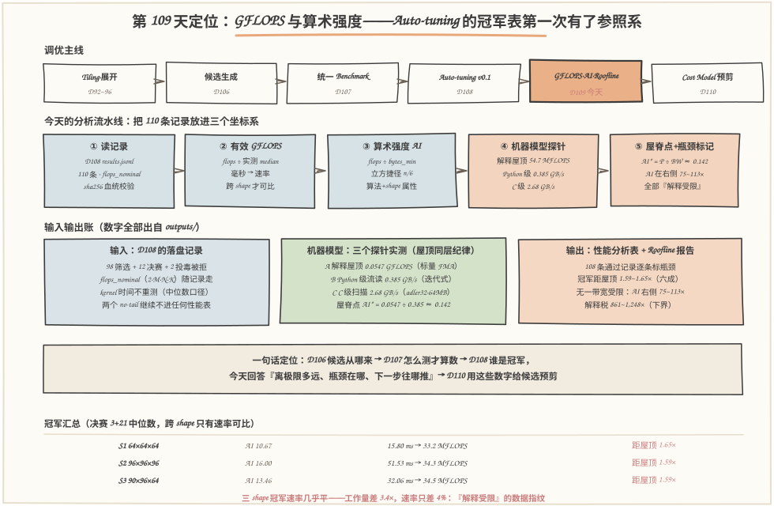
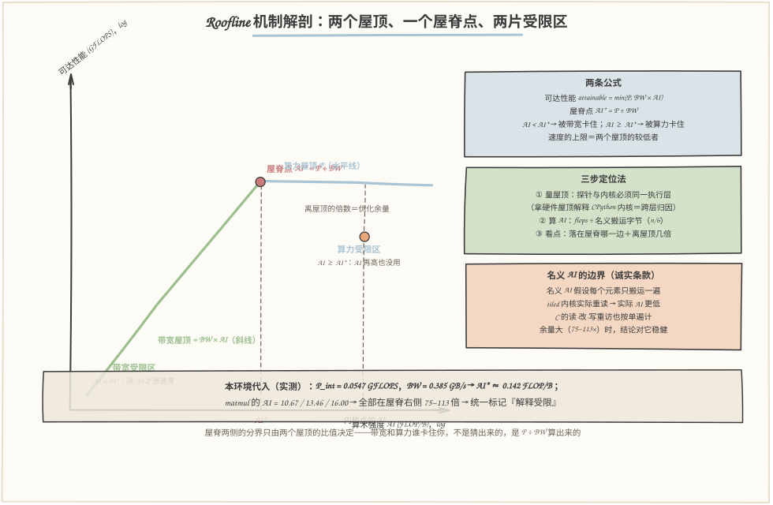
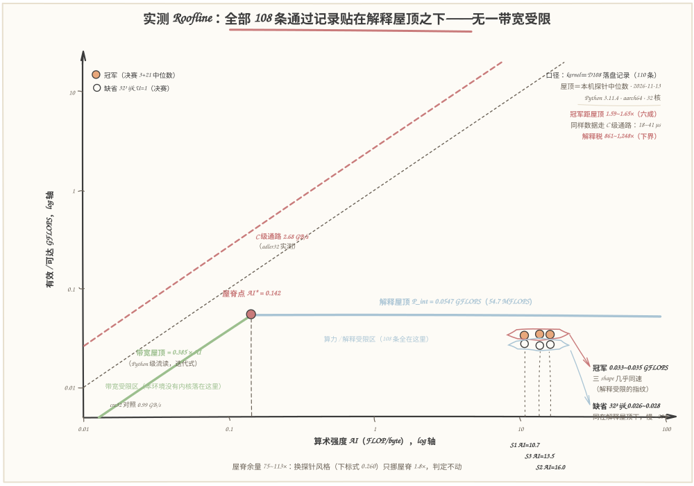

# 第 109 天：GFLOPS 与算术强度——把毫秒换算成"离极限多远"，用 Roofline 给冠军表装上参照系

> **今日目标**：完成本教程后，你能做到五件事——把 D108 落盘的 **110 条记录**逐字节读进今天的分析器（sha256 校验钉住血统），用每条记录自带的 `flops_nominal`（= 2·M·N·K）换算出**有效 GFLOPS**：三个 shape 的冠军 15.80/51.53/32.06 ms 完全没法横向比较，换算后 **33.2/34.3/34.5 MFLOPS 几乎相同**——这就是"毫秒不可比、GFLOPS 才可比"的直接证据；算出**算术强度**（Arithmetic Intensity，AI）：名义单遍搬运 2MNK FLOPs ÷ 4(MN+NK+MK) 字节，立方 shape 是 n/6——S1 10.67、S2 16.0、S3 13.46 FLOP/B；用**三个探针**实测本环境的机器模型——解释屋顶 **54.7 MFLOPS**（纯 Python 标量 FMA）、Python 级流读 **0.385 GB/s**（迭代式；下标式 0.210 GB/s 作敏感性对照）、C 级缓冲区扫描 **2.68 GB/s**（zlib.adler32，64 MB），屋脊点 AI\* = 0.0547 ÷ 0.385 ≈ **0.142 FLOP/B**；给每条记录标上**瓶颈**：全部 108 条通过记录的 AI 都在屋脊点右侧 75~113 倍、实测 GFLOPS 全部贴在解释屋顶之下——**无一带宽受限，全部解释受限**，冠军距屋顶只有 1.59~1.65×，而 C 级通路搬完同样数据只要 18~41 µs（**解释税 861~1,248 倍**，还是按理想单遍算的下界）；最后画出第一张 **log-log Roofline 图**：双屋顶、屋脊点、六个真实内核点（三 shape 冠军＋缺省）＋C 级屋顶参照线，并用"冠军 GFLOPS 跨 shape 几乎平"这个数据指纹交叉验证解释受限的判定。
> **预计时间**：学习 35 分钟＋实践 40 分钟
> **前置准备**：D108 的 `outputs/results.jsonl`（今天逐字节复制为 `code/inputs/results-d108.jsonl`，sha256 = `e8c8da…037f` 校验通过才分析）；D108 记录里的 `flops_nominal` 字段（它从 D107 起就在每条记录里等今天）；D71~72 的计算量/访存量思想（今天从手工公式变成逐条记录的批量计算）；D92 的循环顺序概念（今天解释冠军为何是它）。工具只要 `python3`（本文环境：Python 3.11.4 CPython，Linux aarch64，32 逻辑核，与 D108 同机同日 2026-11-13），零第三方依赖。
> **今日产出**：`code/analyze.py`（性能分析器：三探针＋GFLOPS/AI 换算＋屋脊点＋瓶颈标记＋自检）＋`code/run_all.sh`（一键复现，约 10 秒）＋`outputs/` 下 8 个文件（**7 份运行记录与屋顶缓存＋1 份复现日志**）＋本文 3 张手绘图（数字全部出自 outputs/）。

## 1. 今天解决什么问题？

D108 收官时我们有了一张诚实的冠军表：S1 冠军 15.80 ms、S2 冠军 51.53 ms、S3 冠军 32.06 ms。但这张表只回答了"**谁更快**"，它回答不了另外三个马上要撞上的问题：

- **毫秒没法跨 shape 比**：S1 的 15.80 ms 和 S2 的 51.53 ms，谁"更好"？工作量差 3.4 倍（S2 是 1,769,472 FLOPs，S1 是 524,288），直接比毫秒就像"跑了 3 公里 18 分钟"和"跑了 10 公里 51 分钟"比谁跑得快——单位不对，结论必然错。需要的是**速率**：单位时间完成多少计算量；
- **不知道离极限多远**：51.53 ms 是好是坏？没有参照系。冠军比缺省快 21% 只说明"比同伴强"，不说明"还有多少油水"。如果天花板就在 50 ms 附近，继续调 tile 是白费劲；如果天花板远在 5 ms，说明这个实现浪费了 10 倍——两种答案对应完全不同的下一步；
- **瓶颈是什么**：下一步优化方向由瓶颈决定。带宽受限就要减少搬运、换 Layout、做融合；算力受限就要扩并行、上向量化。猜错瓶颈，所有优化都在推一扇不存在的门。

这三个问题的公共解法就是今天的标题：**把毫秒换算成有效 GFLOPS（速率），把工作量除以搬运量得到算术强度（强度），把两者放进 Roofline 坐标系（参照系）**。D108 结尾已经剧透过今天的钩子："纯 Python 冠军的 GFLOPS 会低得可怜——那是'执行时间'口径换算后的另一面镜子。"今天照这面镜子，会照出一个 D108 里若隐若现、今天才说清的事实：**在 CPython 里，所有这些内核既不受带宽限制、也摸不到硬件算力，它们全部压在'解释执行'这第三种屋顶之下**——而这恰好解释了为什么冠军是"单 tile kij U=1"（每 FLOP 付的字节码最少的那种）。

贯穿全文的例子：**S2 = 96×96×96，fp32，seed=42**。每条 D108 记录的 `workload` 块里自带 `flops_nominal = 1,769,472`（= 2·96³，乘法和加法各 96³ 次）；名义单遍搬运量 `bytes_min = 4×(96²+96²+96²) = 110,592` 字节（A、B 各读一遍、C 写一遍，fp32）；于是 **AI = 16.0 FLOP/B**（立方 shape 的捷径 n/6 = 96/6）。冠军 51.53 ms 换算：1,769,472 ÷ 51.53 ms = **34.3 MFLOPS = 0.0343 GFLOPS**。三个数今天就靠这一个例子贯穿：GFLOPS 是**速率**、AI 是**强度**、Roofline 是**坐标系**。

## 2. 先看全貌：今天的内容位于哪里？



**图 1**：看三块——**上排**是调优主线：D108 的 Auto-tuning v0.1 今天升级为"测量＋分析"两件套，下游 D110 的 Cost Model 直接消费今天产出的 GFLOPS/AI/屋顶数字；**中排**是今天的五步分析流水线：D108 落盘的 110 条记录（每条自带 `flops_nominal`）先换算成有效 GFLOPS，再除以名义搬运量得到 AI，机器模型由三个探针实测（解释屋顶 54.7 MFLOPS、Python 级流读 0.385 GB/s、C 级扫描 2.68 GB/s），最后用屋脊点 AI\* ≈ 0.142 给每条记录标瓶颈；**下排**是输入输出账：108 条通过记录全部标记为"解释受限"，冠军距屋顶 1.59~1.65×，两个投毒记录继续不进任何性能表（D107 门纪律）。

把主线串成 5 步：

1. **工作量**：`flops_nominal` 不用重推——D107 起它就是每条记录的身份字段（2MNK），bias 的 MN 次加法占比 <0.6% 两边口径一致地忽略，今天的第一个自检就是逐条验证这 110 个值；
2. **有效 GFLOPS**：`GFLOPS_eff = flops_nominal ÷ stats_ms.median`，把毫秒表变成速率表——跨 shape 可比的第一个坐标系；
3. **算术强度**：`AI = flops_nominal ÷ bytes_min`，bytes_min = 4(MN+NK+MK) 是"每个元素只搬运一次"的名义下界——AI 是**算法＋shape 的属性，与内核好坏无关**；
4. **机器模型**：屋顶必须与被分析的数据**同一执行层**（D108"冠军只对实测成本模型诚实"的纪律在屋顶上的延续）——三个探针各量一层，屋脊点 AI\* = 算力屋顶 ÷ 带宽屋顶；
5. **定位＋标记**：每条记录落进 Roofline：AI 在屋脊点左侧是带宽受限、右侧是算力（本环境是解释）受限；距屋顶倍数 = 屋顶 ÷ 实测，它就是"还有多少油水"的第一个数字答案——明天的 Cost Model（D110）从这里接棒。

一句话定位：**D106 回答"候选从哪来"，D107 回答"怎么测才算数"，D108 回答"怎么自动选出冠军"，今天回答"冠军离极限多远、瓶颈在哪、下一步该往哪推"**。

## 3. 核心概念：先用直觉，再给准确定义

今天的四个概念是一根链条上的四环：**工作量 → 速率 → 强度 → 坐标系**。每环都拿贯穿全文的 S2 = 96×96×96 当例子。

### 3.1 理论计算量（nominal FLOPs）：这份工作最少要做多少次运算

一句通俗解释：**理论计算量**是完成一个计算在语义上必须做的浮点运算次数——跟你怎么写循环、用什么 tile、哪台机器都无关。

类比：搬家的"家当件数"——不管你分几趟搬、用什么车、路线怎么绕，要搬的东西就那么多。对应到技术上是：`C = A·B + bias` 的名义计算量 = **2·M·N·K**——每个输出元素要做 K 次乘法和 K 次加法，共 M·N 个输出元素。bias 的 M·N 次加法（S2 占 0.52%）与 D108 记录里 `flops_nominal` 的口径**一致地忽略**——工作量字段必须与记录对齐，否则算出来的 GFLOPS 就是另一个量的速率。S2：2·96³ = **1,769,472**。

类比边界：家当件数是"最少要搬的"，实际搬家还有打包、拆装、空跑——对应到技术上是：名义 FLOPs 是**下界**，内核实际执行的指令远多于此（tile 外壳、索引计算、临时对象），这些多出来的开销不会体现在分子里，而是全部体现在分母（时间）里——这正是"有效"GFLOPS 里"有效"二字的含义。今天自检的第 3 条断言就是逐条验证全部 110 条记录的 `flops_nominal == 2·M·N·K`：**换算前先对账工作量字段**，这是速率表的地基。

### 3.2 有效 GFLOPS：把毫秒换算成速率，跨 shape 才可比

一句通俗解释：**有效 GFLOPS**（effective GFLOPS）= 名义工作量 ÷ 实测时间——单位时间完成了多少名义工作。

类比：不是"搬了 3 小时"而是"每小时搬了多少件"。对应到技术上是：`GFLOPS_eff = flops_nominal ÷ stats_ms.median`。S2 冠军：1,769,472 ÷ 51.535 ms = **34.3 MFLOPS = 0.0343 GFLOPS**。

为什么必须换算？看三个冠军的毫秒：15.80 / 51.53 / 32.06 ms——直接比会得出"S1 最好"的结论，但三个 shape 的工作量差 3.4 倍（524,288 / 1,769,472 / 1,105,920），比毫秒就像比"跑了 3 公里 18 分钟"和"跑了 10 公里 51 分钟"谁快。换算成速率：**33.2 / 34.3 / 34.5 MFLOPS——工作量差 3.4 倍，速率几乎相同**，S2 甚至略快。这个"平坦"不是巧合，它在 3.4 节会变成判定瓶颈的关键证据。

类比边界：速率高不等于"已经接近极限"——GFLOPS 只是"有多快"，"离天花板多远"需要屋顶参照（3.4）；GFLOPS 也不能跨机器、跨实现比较——D108 的纪律"冠军只对实测成本模型诚实"在速率视角下原样成立：0.034 GFLOPS 是**这台机器的 CPython 解释层**上的速率，拿到 numpy/BLAS 或别的机器上毫无意义。

### 3.3 算术强度（AI）：每搬 1 字节能做多少 FLOP

一句通俗解释：**算术强度**（Arithmetic Intensity）= 名义计算量 ÷ 名义搬运量——每移动 1 字节数据，能摊到多少次浮点运算。

类比：一趟采购的"出菜率"——同样一趟车（带宽固定），拉回来的食材能做几道菜。对应到技术上是：`AI = flops_nominal ÷ bytes_min`，其中 `bytes_min = 4·(MN + NK + MK)`（fp32 下 A 读一遍、B 读一遍、C 写一遍；bias 的 4N 字节与 flops 侧对称忽略）。立方 shape 有个闭式捷径：**AI = 2n³ ÷ 12n² = n/6**——S1 是 64/6 = 10.67、S2 是 96/6 = 16.0（精确值，自检钉死）、S3 是 1440/107 ≈ 13.46。

三个关键认知：**第一**，AI 是"算法＋shape"的属性，与内核好坏、机器快慢都无关——所以它才能当 Roofline 的横轴坐标；**第二**，名义 AI 假设每个元素只搬运一次，是**理想单遍**的强度——真实 tiled 内核会重读数据（64³ tile 沿 k 重读 B 列），实际搬运量更大、实际 AI 更低，今天的判定靠 75~113 倍的余量吃掉这个近似；**第三**，AI 随矩阵变大而**线性增长**（n/6）——矩阵越大越"算得起"，这就是为什么大模型训练里 GEMM（通用矩阵乘）是 compute-bound 算子，而 elementwise 和归约（AI ≈ 0.1~0.5）是 memory-bound 算子，也是 D72 融合收益的根源：让低强度算子搭高强度算子的便车。

### 3.4 Roofline：两个屋顶、一个屋脊点，以及本环境的第三种屋顶

一句通俗解释：**Roofline 模型**说，一个内核能达到的速率被两块天花板压住：`attainable = min(P, BW × AI)`——P 是算力屋顶（GFLOPS），BW×AI 是带宽屋顶在当前 AI 处的允许值。两线相交的横坐标叫**屋脊点** `AI* = P ÷ BW`：AI 小于它，你被带宽卡住（搬不动）；大于它，你被算力卡住（算不动）。

类比：水管工的"工时 vs 材料"——提速要么换更快的工人（算力），要么让材料一次运更多（带宽＋复用）。对应到技术上是**三步定位法**：①用探针量出两个屋顶；②算出内核的 AI；③看点落在屋脊哪一侧、离屋顶几倍——"离屋顶几倍"就是优化余量的第一个数字答案。

**本环境的特殊性——第三种屋顶**：纯 Python 里，"算力屋顶"不是 CPU 的 ALU（那是以 GFLOPS 计的硬件世界），而是**解释器的字节码分发吞吐**。今天用三个探针实测（数字见 outputs/probes.txt 与 probes.json）：

| 探针 | 量什么 | 实测 | 说明 |
|---|---|---|---|
| A 标量 FMA 循环 | 解释屋顶 P_int | **54.7 MFLOPS** | 函数局部变量，镜像内核内层写法 |
| B 迭代式流读 | Python 级逐元素吞吐 | **0.385 GB/s** | 名义 8 B/元素；下标式 0.210 GB/s |
| C zlib.adler32 扫描 | C 级内存通路 | **2.68 GB/s** | 64 MB 缓冲区纯 C 读 |

屋脊点 AI\* = 0.0547 ÷ 0.385 ≈ **0.142 FLOP/B**——而 matmul 的 AI 是 10.67~16.0，在屋脊右侧 **75~113 倍**：全部落在"算力受限"区，只是这里的"算力"是**解释执行**。同时探针 B 的"带宽"要说清边界：它的物理来源是解释器逐元素成本（约 21 ns/元素），不是 DRAM——但在"Python 层"这个执行层内部，它就是逐字节计价的有效屋顶，判定逻辑自洽。这也是 D108 冠军为什么是"单 tile kij U=1"的最终解释：**解释受限的世界里，赢家是每个有用 FLOP 付字节码最少的配置**——砍 tile 外壳、行提升内层、不展开。

还有一个不依赖探针的**独立证据**（数据指纹）：三个冠军的 GFLOPS 几乎平（33.2/34.3/34.5，工作量差 3.4×，速率只差 4%）。若带宽受限，AI 更高的 S2 应显著更快——没有；若真硬件算力受限，速率不该低到 0.03 GFLOPS 量级——差了两三个数量级。**平坦＋贴解释屋顶**，与屋脊点判定互相印证。

## 4. 图解核心机制



**图 2**：左半是不按比例的 Roofline 示意图，右半是三张工作卡。按编号走：

1. **绿色斜线（带宽屋顶 = BW×AI）**：AI 越大，带宽允许的速率越高——左边这条线是低速区的天花板；提升手段是减少搬运、提高复用（D72 融合、D94 tiling 的初衷）；
2. **蓝色水平线（算力屋顶 P）**：无论 AI 多大，速率不能再高——右边这片的天花板；提升手段是扩并行、向量化、换执行层；
3. **红色屋脊点 AI\* = P ÷ BW**：两区的分界，**只由两个屋顶的比值决定**——带宽和算力谁卡住你不是猜的，是除出来的。虚线下垂到横轴就是"内核点的 AI"该比的位置；
4. **内核点（橙点）**：定位 = 看它在屋脊哪一侧（瓶颈类型）＋ 离屋顶的距离（优化余量）；本环境代入实测：P_int = 0.0547 GFLOPS、BW = 0.385 GB/s → AI\* ≈ 0.142，matmul 的 AI 全在右侧 75~113 倍；
5. **右下卡（名义 AI 的边界）**：名义 AI 假设单遍搬运，tiled 内核实际重读——判定必须靠数量级余量（75~113 倍）吃掉这个近似，屋脊边缘的判定不能只靠名义 AI。

## 5. 动手实践：完成一个最小可运行例子

### 5.1 准备文件

```text
tutorials/day-109/
├── README.md                        ← 本文
├── images/                          ← 3 张手绘图（数字与 outputs/ 一致）
└── code/
    ├── analyze.py                   ← 性能分析器：三探针＋GFLOPS/AI 换算＋屋脊点＋瓶颈标记＋自检（约 560 行）
    ├── gen_images.py                ← 手绘图生成器（固定随机种子，可复现）
    ├── run_all.sh                   ← 一键复现（约 10 秒）
    ├── inputs/
    │   └── results-d108.jsonl       ← D108 outputs/results.jsonl 的逐字节副本（110 条）
    └── outputs/                     ← 8 个文件：7 份运行记录与屋顶缓存＋1 份复现日志
        ├── perf-table.txt           ← 主交付物①：性能分析表（GFLOPS/AI/距屋顶）
        ├── roofline.txt             ← 主交付物②：机器模型/屋脊点/内核点定位/解释税
        ├── probes.txt               ← 三个探针的原始读数（含敏感性对照）
        ├── probes.json              ← 屋顶缓存（一次复现内三个报告共享同一组读数）
        ├── mean-vs-median.txt       ← 对照 A：换口径重算 GFLOPS（零重跑）
        ├── self-test.txt            ← 35 项断言自检
        ├── env.txt                  ← 环境与口径
        └── run-all-log.txt          ← 一键复现的完整 stdout
```

输入的血统纪律：`inputs/results-d108.jsonl` 是 D108 主交付物的逐字节副本（`sha256 = e8c8da…037f`），`analyze.py` 里把这个哈希**钉死**——校验不过就拒绝分析。分析器绝不重测任何内核时间（时间全部取自 D108 记录的 `stats_ms.median`），只实测"屋顶"：**记录是冻结的证据，屋顶是本机的量尺**，两者职责分开。

### 5.2 编写代码

`analyze.py` 的四个角色：**公式层**（flops/AI/GFLOPS/屋脊）、**探针层**（机器模型）、**报告层**（性能表＋Roofline）、**自检层**。公式层一共四行，但每一行都对应一个口径决定：

```python
def flops_matmul_bias(M, N, K):        # 名义工作量：与 D108 记录的 flops_nominal 同口径
    return 2 * M * N * K               # bias 的 MN 次加法（<0.6%）两边一致地忽略

def bytes_min_fp32(M, N, K):           # 名义单遍搬运量：A+B 各读一遍、C 写一遍
    return 4 * (M * N + N * K + M * K) # bias 的 4N 字节与 flops 侧对称忽略

def gflops(flops, ms):                 # 有效 GFLOPS：名义工作量 ÷ 实测中位数
    return flops / (ms * 1e-3) / 1e9

def ridge_ai(peak_gflops, bw_gbps):    # 屋脊点：两屋顶之比；左边带宽区，右边算力区
    return peak_gflops / bw_gbps
```

探针层是今天真正的新功课。**探针 A（解释屋顶）有一个踩过的真坑**：第一版把 FMA 循环写在模块顶层，全局变量的 `LOAD_GLOBAL` 比内核内层的 `LOAD_FAST` 慢得多——量出来 17 MFLOPS，比内核实测的 33 MFLOPS 还低。**屋顶低于内核点，这本身就让探针露馅**（自检第 30 条断言"屋顶 > 全部内核点"就是为它设的防线）。修正版镜像内核内层的写法，全部用函数局部变量：

```python
def probe_interp_roof():
    def fma(n, a=1.0000001, b=1.0):    # 局部变量 = LOAD_FAST，与内核内层同款
        acc = 0.0
        for _ in range(n):
            acc = acc * a + b          # 每迭代 2 FLOPs，无下标/存储开销
        return acc
    rates = []
    for _ in range(FMA_REPS):          # 5 次重复取中位数（D107 纪律）
        t0 = time.perf_counter()
        fma(FMA_ITERS)
        rates.append(2 * FMA_ITERS / (time.perf_counter() - t0) / 1e9)
    return {"value_gflops": statistics.median(rates), ...}
```

探针 C 也踩过两个坑，都值得记录：`sum(array('d'))` 看似 C 级，实际每个元素都要**装箱成 PyFloat 对象**，量出 0.95 GB/s——是装箱吞吐不是内存；`hash(bytes)` 更隐蔽，bytes 对象**缓存哈希值**，第二次调用微秒级返回——速率读数直接上天。最后用 `zlib.adler32`（纯 C 读通道、无对象开销、无缓存）量到 2.68 GB/s。教训浓缩成一句：**探针读数违反物理直觉时，先怀疑探针，再怀疑机器**。

报告层有一个口径决定要说清：**冠军取决赛协议（3+21）中位数最小的一条**，不取全局 GFLOPS 第一——因为筛选（3+7）和决赛（3+21）是两种协议，混进同一张名次表就是 D107/D108 反复立规的跨口径违规（S2 的筛选读数 51.41 ms 和决赛读数 51.535 ms 分属两套样本）。另外 `run_all.sh` 先跑 `--exp probes` 把屋顶读数落盘成 `probes.json`，table/roofline/env 三个报告**读同一份缓存**——否则每个报告各自实测一次，文件之间就会出现 54.0 vs 54.9 这类互相打架的读数（D107 实测跨进程漂移 ~8.6%，今天开发时真出现过：同一次会话里 FMA 探针两次给出 49.0 和 54.9）。

### 5.3 运行与观察

一键复现（本文所有"实际输出"都来自这次运行，环境见 `outputs/env.txt`；约 10 秒）：

```bash
cd tutorials/day-109/code && ./run_all.sh 2>&1 | tee outputs/run-all-log.txt
```

**记录一：探针原始读数**（`outputs/probes.txt`，实际输出）：

```text
机器模型探针（实测，反复取中位数；本环境与 D108 同机同日）
  A A 解释屋顶（纯 Python 标量 FMA）: 0.0547 GFLOPS = 54.7 MFLOPS（5 次: 54.7, 54.7, 54.6, 54.8, 54.7 MF）
  B B Python 级流读（名义 8 B/元素）: 迭代式 0.385 GB/s（5 次: 0.383, 0.386, 0.382, 0.385, 0.387）
    敏感性对照·下标式: 0.210 GB/s（5 次: 0.211, 0.204, 0.216, 0.210, 0.208）
  C C C 级缓冲区扫描（zlib.adler32，64 MB）: 2.68 GB/s（5 次: 2.69, 2.68, 2.68, 2.67, 2.68）
    敏感性对照·crc32: 0.99 GB/s（另一个 C 级探针，多项式计算更慢）
（探针读数已落盘 probes.json，供 table/roofline/env 复用）
```

**记录二：性能分析表**（`outputs/perf-table.txt`，S2 节选＋全局，实际输出）：

```text
[S2] C=A·B+bias，96×96×96，seed=42，fp32
  flops_nominal = 2·96·96·96 = 1,769,472
  bytes_min     = 4·(MN+NK+MK) = 110,592 B（立方捷径 n/6）
  名义 AI       = 1,769,472 ÷ 110,592 = 16.0000 FLOP/B（屋脊点 0.142 右侧 113 倍 → 解释受限区）

  决赛（3+21 协议）——冠军与缺省同协议同进程可比（D108 纪律）
  名次  配置                        median ms   GFLOPS    MFLOPS  距屋顶×  屋顶利用率
  --------------------------------------------------------------------------------------
    1  tiled-matmul/96³ kij U=1          51.53   0.0343     34.3    1.59    62.8% ←冠军
    2  tiled-matmul/64³ kij U=1          55.33   0.0320     32.0    1.71    58.2%
    3  tiled-matmul/96³ ikj U=1          55.66   0.0318     31.8    1.72    57.9%
    4  tiled-matmul/32³ ijk U=1          65.12   0.0272     27.2    2.01    49.4% ←缺省

  筛选段（3+7 协议，36 条；GFLOPS 降序，只列极值——完整名单见 results-d108.jsonl）
   最快 tiled-matmul/96³ kij U=1          51.41   0.0344     34.4    1.60    62.6%
   最慢 tiled-matmul/32³ jki U=4          94.26   0.0188     18.8    2.93    34.2%
  筛选段 GFLOPS 范围：18.8 ~ 34.4 MFLOPS（跨度 1.83×）
...
 全局（决赛口径）：有效 GFLOPS 范围 0.0263 ~ 0.0345 GFLOPS
 三 shape 冠军：S1 33.2 / S2 34.3 / S3 34.5 MFLOPS——工作量差 3.4×，速率几乎平（解释受限的指纹，详见 roofline.txt）
 记录数：110 条 = 通过 108（screen 96 + final 12）+ 被拒 2；被拒记录 stats_ms=null，天然进不了任何速率表
 口径：roof=0.0547 GFLOPS（探针 A 中位数）；BW=0.385 GB/s（探针 B 迭代式中位数）；屋脊 AI*=0.142 FLOP/B
```

值得停一下的观察：**同一 shape 内 GFLOPS 排名与毫秒排名完全反序对应**（自检逐 shape 断言），所以 D108 的名次一个没变——换算的意义不在 shape 内部，在**跨 shape 可比**和**对屋顶定位**这两件事上。S3 的两个被拒投毒记录带着 `stats_ms=null` 出现在表尾：没有时间就没有速率，门纪律在速率表里自动生效。



**图 3**：这是全部数据的坐标系视图，解释四块——**绿斜线**是 Python 级带宽屋顶（0.385×AI），**蓝水平线**是解释屋顶（0.0547 GFLOPS），两者交在红色屋脊点（AI\* = 0.142）；**红虚线**是 C 级通路（adler32 实测 2.68 GB/s），灰虚线是 crc32 对照（0.99 GB/s）——它们高耸在所有内核点上方两个数量级，直观呈现"带宽根本不是约束"；**橙点/圈点**是六个真实内核点（三 shape 冠军＋缺省，决赛协议），全部挤在解释屋顶下方 1.59~2.08 倍处，红圈标注"冠军 0.033~0.035 GFLOPS 三 shape 几乎同速"——解释受限的两种证据（屋脊余量 75~113 倍＋平坦指纹）在同一张图上互相咬合。注意横轴是 log 轴：屋脊点 0.142 和内核点 10.67~16.0 之间隔着两个数量级——这正是"判定对探针风格和名义 AI 近似都稳健"的几何原因。

**记录三：Roofline 报告**（`outputs/roofline.txt`，关键节选，实际输出）：

```text
 二、屋脊点 AI* = P ÷ BW（FLOP/B）：左边带宽区，右边算力区
   Python 层：AI* = 0.0547 ÷ 0.385 = 0.142 FLOP/B
   敏感性：换成下标式流读 AI* = 0.0547 ÷ 0.210 = 0.260 FLOP/B
           ——探针风格挪动屋脊 1.8×，但 matmul 的 AI 仍在右侧 41 倍以上，判定不动

 三、内核点定位（决赛 12 条；allowed = BW×AI，attainable = min(P, allowed)）
   shape  AI(F/B)  allowed(GF)  P_int   attainable  实测GFLOPS  距屋顶×  瓶颈判定
   S1    10.67      4.110  0.0547   0.0547    0.0332      1.65   解释受限 ←冠军
   ...
   S2    16.00      6.166  0.0547   0.0547    0.0343      1.59   解释受限 ←冠军
   ...
   S3    13.46      5.186  0.0547   0.0547    0.0345      1.59   解释受限 ←冠军

 四、解释税：同样的名义搬运量，走 C 级通路要多久 vs 冠军内核实测多久（@2.68 GB/s）
   shape  bytes_min(B)   C 级搬运耗时    冠军实测     解释税（倍）
   S1       49,152        18.36 µs       15799 µs        861×
   S2      110,592        41.30 µs       51535 µs      1,248×
   S3       82,176        30.69 µs       32057 µs      1,045×

 五、C 层 what-if（带宽用实测 BW_C；算力屋顶 P_hw 是假设参数——本环境无 BLAS，测不到）
   屋脊随假设移动：P_hw ∈ {1, 5, 20} GFLOPS → AI* ∈ {0.37, 1.87, 7.47} FLOP/B
   matmul AI 10.67~16.00 在三种假设下都高于屋脊 → C 层上 matmul 是算力受限（compute-bound 算子的由来）
   S1 要翻成带宽受限需要 P_hw > BW_C×AI = 29 GFLOPS——屋脊判定只由两个屋顶的比值决定
```

第四节值得算一遍感受量级：S2 的全部数据只有 **108 KB**（连 L2 都装不满），走 C 级通路搬完只要 41.3 µs，冠军内核却跑了 51.5 ms——**慢的不是搬运，是逐条字节码的解释**，而且这还是按理想单遍算的下界（真实重读只会让分母更惨）。第五节是给 D110 的备料：同样这套判定搬到 C 层，matmul 依然算力受限、elementwise（AI ≈ 0.125）变成带宽受限——融合的收益方向（D72）在这里有了坐标系的解释。

**记录四：对照 A——换口径重算 GFLOPS**（`outputs/mean-vs-median.txt`，S3 节选，实际输出）：

```text
 [S3] 决赛 4 条：
   tiled-matmul/90×96×64 kij U=1  median=  34.5 MF  mean=  34.5 MF  Δ=+0.00%
   tiled-matmul/64³ kij U=1       median=  32.1 MF  mean=  32.0 MF  Δ=-0.02%
   tiled-matmul/90×96×64 ikj U=1  median=  31.7 MF  mean=  31.7 MF  Δ=-0.00%
   tiled-matmul/32³ ijk U=1       median=  26.3 MF  mean=  26.2 MF  Δ=-0.29%
   排名按 median 与按 mean 一致：True
```

三个 shape 的结论相同：GFLOPS 排名对 mean/median 口径稳健（|Δ| ≤ 0.29%），D107"换口径不重跑"的遗产在速率视角下继续成立——读记录里现成的两个统计量，一次内核都不用跑。

### 5.4 修改一个参数再观察

**对照 B：换探针风格，屋脊挪多少、判定动不动？** `roofline.txt` 第二节已给出：迭代式流读 0.385 GB/s → 屋脊 0.142；下标式 0.210 GB/s → 屋脊 0.260——**探针风格挪动屋脊 1.8×**，但 matmul 的 AI（≥10.67）仍在右侧 41 倍以上，判定纹丝不动。C 级探针同理：adler32 量 2.68 GB/s、crc32 量 0.99 GB/s（同一台机器！），差 2.7×——**探针量的是"这种扫描方式的吞吐"，不是机器的物理常数**。想亲手验证：把 `probe_py_stream` 里的迭代式改成 `enumerate` 或 `zip` 风格重跑 `--exp probes`（先删 probes.json），观察屋脊挪动；结论应该在余量里纹丝不动——这就是"判定靠数量级余量"的含义。

**对照 C：算力屋顶要多高，S1 才会翻成带宽受限？** 纯计算，不用跑：S1 翻转门槛 = BW_C × AI = 2.68 × 10.67 ≈ **29 GFLOPS**——假设的硬件算力屋顶超过它，S1（AI 最低的 shape）先翻；S3、S2 的门槛分别是 36 和 43 GFLOPS。这给了 what-if 段一个敏感度读法：**屋脊判定完全由两个屋顶的比值决定**，AI 最小的 shape 最先暴露在带宽约束下——大 shape（AI 高）天然更"算力侧"，小 shape 反而可能被带宽卡住。

## 6. 常见错误与排查

**错误一：拿毫秒跨 shape 排名，或拿 GFLOPS 当绝对分数。**
现象：汇报里写"S1 的内核最快（15.8 ms），建议全场景用它"——工作量差 3.4 倍的比较毫无意义；或者反过来"我们做到了 34 MFLOPS"——没有屋顶参照的速率分数同样毫无意义，34 MF 在解释屋顶下是 62%，在硬件算力屋顶下是 0.1%。原因：把"时间"和"速率"都当成了可通约的绝对量。定位：检查任何跨 shape/跨机器的对比有没有经过 `flops` 归一；检查任何 GFLOPS 结论有没有伴随屋顶和屋脊位置。修复：跨 shape 比速率（GFLOPS），对机器比位置（离屋顶几倍、在屋脊哪侧）——两个坐标系各管一摊，缺一不可。

**错误二：FLOPs 数错或口径对不上。**
现象：手算 GFLOPS 和表里对不上，差恰好 2 倍（把 MNK 当成总 FLOPs，忘了乘法和加法各一次）；或者差一截（把 U=4 展开后的指令数当 FLOPs——展开不产生新工作，只是把工作提前摊开）。原因：名义工作量是"语义要求的最少工作"，不是"实现执行的指令数"。定位：用公式 `2·M·N·K` 逐条对账记录里的 `flops_nominal`（今天自检第 3 条断言就是干这个的，110 条全对）。修复：工作量字段随记录走、换算前先对账；bias 这类 <1% 的项要么两边都忽略要么两边都计入，但口径必须写进表头。

**错误三：AI 的分母用错。**
现象：AI 算出来和 n/6 对不上——忘了 C 的写回（只算 A+B 的读）、用错了元素宽度（fp32 按 8 字节算）、或者中途又把"实际重读量"混进名义口径。原因：bytes_min 是一个**约定**——理想单遍、fp32、bias 忽略——它必须是"算法＋shape"的确定函数，才能当横轴坐标。定位：立方 shape 用 n/6 自检（64/6 = 10.67、96/6 = 16.0 精确命中）；非立方用 1440/107 这类分数对账。修复：口径钉死在公式里、写进报告表头；"实际搬运量"是另一个口径（它含 tile 重读），两套数不能混用——混用的屋脊判定会悄悄失真。

**错误四：屋顶跨层——拿硬件标称去解释解释层的数据。**
现象：用 CPU 的标称 GFLOPS 或 C 级带宽当屋顶，去定位纯 Python 内核的点，得出"内核只达到硬件的 0.1%，优化空间巨大"——方向性误导：这 0.1% 里 99% 是解释层税，调 tile 永远收不回来。原因：屋顶和被分析的内核不在同一执行层，比值失去意义。定位：看报告里每个屋顶的"层"标注（今天的报告里 A/B 是 Python 层、C 是 CPython C 层、what-if 的 P_hw 明确标注假设）；跨层结论一律标 what-if。修复：同层探针（探针 A 镜像内核内层写法就是这个用意）；跨层只讲故事不做判定。

**错误五：探针有 bug，读数离谱却没人对账。**
现象（今天真踩过的三个）：模块级全局变量探针量出 17 MFLOPS，**比内核点还低**；`sum(array('d'))` 量"带宽"只有 0.95 GB/s（实际在量装箱吞吐）；`hash(bytes)` 第二次调用秒回（bytes 缓存哈希值）。共同点：读数违反物理直觉，但没有断言拦它。定位：任何探针先过两条 sanity——**屋顶必须高于已知最快内核点**、**重复读数应该稳定**（同量级波动，不是天文数字或 0）。修复：把 sanity 写进自检（今天的第 30~32 条断言：屋顶 > 内核最高点、C 级 > Python 级、下标式 < 迭代式方向正确）；探针读数落盘（probes.json）并在报告间共享，别让每个报告各量各的。

## 7. 今日练习

### 必做练习

**练习一（笔算 128³，两个坐标系各算一次）**：笔算 (a) 名义 FLOPs；(b) bytes_min 与名义 AI（先用 n/6 验算再展开算）；(c) 若某内核跑出 128.0 ms，有效 GFLOPS 是多少？对照今天的冠军速率（33.2~34.5 MF），它应该被标记什么瓶颈？(d) 128³ 的数据集（≈192 KB）放在 L2 里通常没问题——这提示"物理带宽"在这个尺寸上是什么角色？（参考答案：4,194,304；196,608 B，AI = 21.33 = 128/6；32.8 MFLOPS，与三 shape 冠军几乎同速 → 解释受限的指纹继续成立；数据不出缓存，物理带宽从头到尾没被碰到。）

**练习二（读数据找极值）**：读 `inputs/results-d108.jsonl`，用几行 Python 找出每个 shape **筛选段有效 GFLOPS 最低**的通过候选，算出它们的距屋顶倍数，和冠军对比。回答两个问题：(a) D108 里"冠军 vs 最慢"是 1.8~1.9×，在 GFLOPS 视角下这个数字是多少？为什么同 shape 内毫秒比和速率比互为倒数？(b) 最慢候选 `32³ jki U=4`（内层是 i 的双跨步访问家族）只有解释屋顶的 ~34%——结合 D92 的访问模式分析，它比冠军多付的"解释税"花在哪里？（提示：内核内层每 FLOP 的下标与循环开销。）

### 选做挑战

三选一，都不引入大量新知识：**挑战 A（探针风格扫描）**：给 `probe_py_stream` 加第三种风格（`enumerate` 索引或 `zip` 逐元素），删掉 probes.json 后重跑 `--exp probes`，把三种风格的屋脊点排成一行——预测判定全部不动，验证"余量消化探针噪声"。**挑战 B（what-if 扫描表）**：写一个十几行的脚本，对 P_hw 从 1 到 100 GFLOPS 扫描，输出 S1/S3/S2 各自翻成"带宽受限"的门槛（29/36/43 GFLOPS 附近），画在手账上——这就是屋脊判定对假设参数的敏感度曲线。**挑战 C（如果有 numpy）**：用 `A @ B` 实测同 shape 的 BLAS 速率，算它的 GFLOPS，在图 3 的坐标系里给它定位——预测：AI 不变（16.0），GFLOPS 高出 2~3 个数量级，但仍压在 C 级带宽屋顶（2.68×16 ≈ 43 GFLOPS 的允许值）之下还是之上？这个点的位置会告诉你这台机器的 BLAS 是算力受限还是带宽受限。（本环境无 numpy，答案允许"预期＋论证"替代实测，但必须标注未运行。）

## 8. 今日验收

- [ ] 我能用自己的话解释四个量的分工并各举一个实测数：名义 FLOPs（1,769,472，语义下界，与内核无关）、有效 GFLOPS（34.3 MFLOPS，速率，跨 shape 才可比）、算术强度（16.0 FLOP/B，算法＋shape 属性）、屋顶（54.7 MFLOPS 解释屋顶，机器＋执行层属性）
- [ ] 我能推导 `attainable = min(P, BW×AI)` 和 `AI* = P ÷ BW`，代入今天的实测算出屋脊点 0.142，并解释为什么 108 条记录全部标记"解释受限"（AI 在屋脊右侧 75~113 倍）
- [ ] 我能独立运行 `./run_all.sh`，在 outputs/ 里找到性能分析表和 Roofline 报告，指出"冠军距屋顶 1.59 倍"和"解释税 1,248×"这两个数各出自哪份报告的哪一节，并说出它们的口径（决赛中位数、理想单遍下界）
- [ ] 我能用"冠军 GFLOPS 跨 shape 几乎平"这个数据指纹独立论证解释受限，不依赖任何探针（工作量差 3.4×、速率只差 4%；带宽受限或硬件算力受限都解释不了这个平坦）
- [ ] 我能定位五类错误：毫秒跨 shape 排名／GFLOPS 无参照、FLOPs 数错或口径不齐、AI 分母口径漂移、屋顶跨层归因、探针离谱读数没人对账——并说出各自的定位指纹（归一化缺失／恰好差 2 倍／对不上 n/6／缺"层"标注／屋顶低于内核点）
- [ ] 我保存了 `analyze.py`＋`run_all.sh`＋7 份真实运行记录＋3 张手绘图，能指出图中每个数字出自哪份记录（54.7 出自 probes.txt、1.59×出自 roofline.txt 第三节、861~1,248×出自第四节、33.2/34.3/34.5 出自 perf-table.txt 决赛行……）

## 9. 一句话总结与明天预告

今天的闭环：**问题**——D108 的冠军表只回答"谁更快"，15.80/51.53/32.06 ms 跨 shape 不可比，也不知道离极限多远、瓶颈在哪；**机制**——把毫秒换算成有效 GFLOPS（名义工作量 ÷ 实测中位数），把工作量除以名义搬运量得到算术强度（立方 n/6），用三个同层探针量出机器模型（解释屋顶 54.7 MFLOPS、Python 级流读 0.385 GB/s、C 级扫描 2.68 GB/s），屋脊点 AI\* = 0.142 把坐标系切成两区：108 条通过记录的 AI 全部在右侧 75~113 倍——**无一带宽受限，全部解释受限**；**实践**——110 条记录逐字节校验血统后逐条换算、标记、定位，冠军距屋顶 1.59~1.65×（解释层内的油水），解释税 861~1,248×（换执行层的油水），两个投毒记录继续死在门里；**验证**——35 项断言钉死公式、口径、血统、屋顶合理性（屋顶必须高于内核点）和判定余量，"冠军速率平坦"的数据指纹与探针判定互相咬合，mean/median 换口径零重跑且排名不变。

明天（D110）做简单 Cost Model 排序：今天产出的坐标系正好是 cost model 的物理下界素材——`attainable = min(P, BW×AI)` 不用跑一个内核就能算出任何候选的速度上界，屋脊判定告诉哪些候选"无论怎么调都不可能超过目标"。明天把这些数字接进候选排序，只对前几名实测——D106"测不起 13 天"的老账，从明天开始有得还了。


