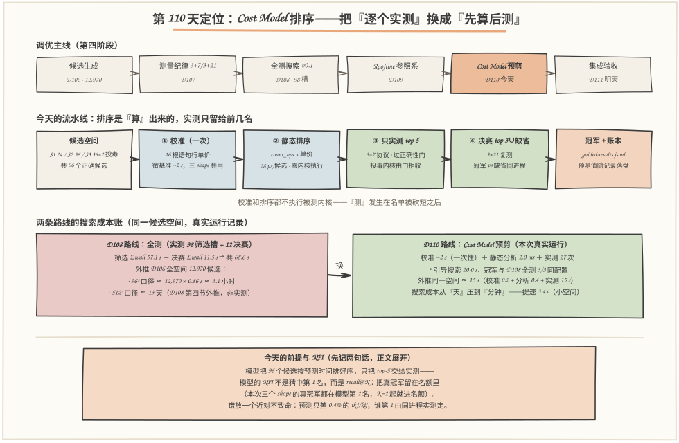
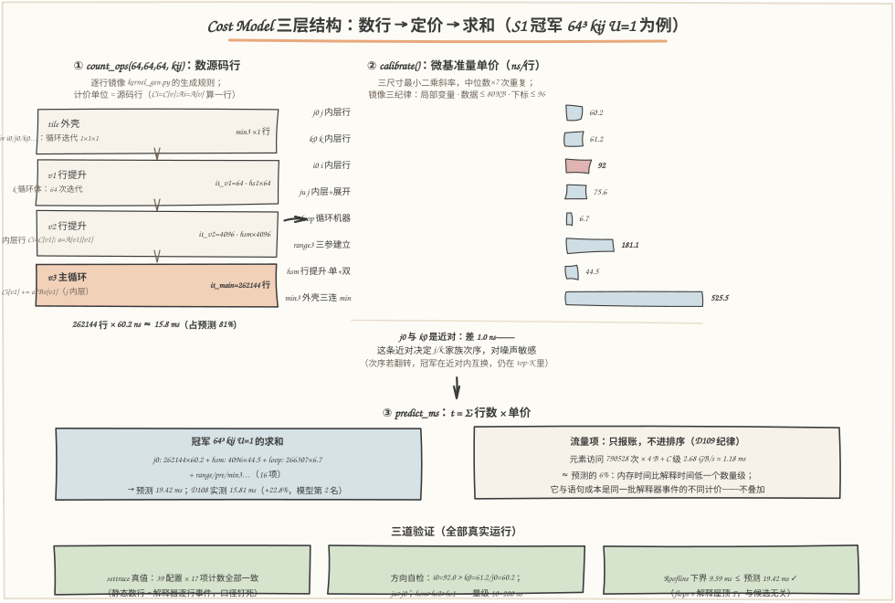
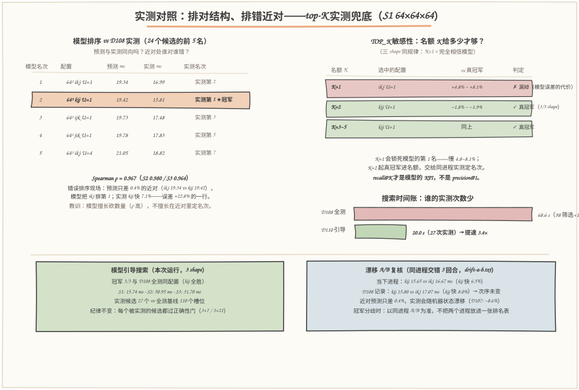

# 第 110 天：简单 Cost Model 排序——不跑内核，先把 96 个候选"算"到只剩 5 个

> **今日目标**：完成本教程后，你能做到五件事——把 kernel_gen.py 生成的循环结构**静态读成一张语句执行次数表**（count_ops：tile 外壳 → v1/v2 行提升 → v3 主循环＋尾部，一行不漏），用 **16 根微基准单价**（j0=60.2、k0=61.2、i0=92.0 ns/行……）给它定价，零内核执行得到每个候选的预测毫秒；用 **sys.settrace 逐行计数**验证静态计数器（39 配置 × 17 项计数全部一致——计数器若数错，单价再准也白搭）；对照 D108 实测算出**模型精度账**：Spearman ρ = 0.967 / 0.980 / 0.964，但三个 shape 的真冠军都只在**模型第 2 名**（近对 ikj/kij 的预测只差 0.4%）——所以模型的 KPI 是 **recall@K**（把真冠军留在名额里），不是 precision@1（猜中第 1 名）；跑通**模型引导搜索**：只实测模型 top-5（27 次实测 vs D108 全测的 110 个槽位），冠军 **3/3 与全测同配置**，搜索时间 **20.0 s vs 68.6 s（提速 3.4×）**，外推 D106 全空间 12,970 候选从"3.1 小时～13 天"压到"**~15 s 量级**"；最后用 **TOP_K 扫描**和**同进程漂移 A/B** 划清"模型误差"与"环境漂移"的边界——K=1 完全相信模型要付 +4.8~8.1% 的代价，跨进程的冠军对比只能当参考。
> **预计时间**：学习 35 分钟＋实践 45 分钟
> **前置准备**：D108 的 `outputs/results.jsonl`（今天逐字节复制为 `code/inputs/results-d108.jsonl`，sha256 = `e8c8da…037f` 钉死，不过就拒绝分析）；D109 的屋顶缓存 `code/inputs/probes-d109.json`（探针 A 的解释屋顶 54.7 MFLOPS 做 Roofline 下界、探针 C 的 2.68 GB/s 做流量账，同样 sha256 钉死）；`kernel_gen.py` 与 `bench.py`（从 D108 **逐字节复制，今天零改动**——模型读的就是它们生成的内核，改了它们模型就失真）；概念上需要 D92 的循环顺序家族（j/k/i 内层）、D106 的候选空间（tile × order × unroll 的组合）、D107 的测量纪律（3+7/3+21、正确性门、跨进程漂移 ~8.6%）、D109 的结论（全部解释受限——今天模型成立的物理基础）。工具只要 `python3`（本文环境：Python 3.11.4 CPython，Linux aarch64，32 逻辑核，与 D108/D109 同机同日 2026-11-13），零第三方依赖。
> **今日产出**：`code/cost_model.py`（静态计数器＋16 根校准＋预测＋5 个实验入口）＋`code/tune_guided.py`（模型引导搜索＋TOP_K 扫描＋漂移 A/B＋外推账）＋`code/run_all.sh`（一键复现，约 40 秒）＋`outputs/` 下 13 个文件（10 份实验记录＋`calibration.json` 校准缓存＋`guided-results.jsonl` 27 条带模型预测值的 bench 记录＋复现日志）＋本文 3 张手绘图（数字全部出自 outputs/）。

## 1. 今天解决什么问题？

D108 收官时留下了一笔不舒服的账：三个 shape 全测（98 个筛选槽＋12 个决赛），Σwall 共 **68.6 s**；D108 第四节外推过，把同样的协议搬到 D106 的全空间（**12,970 个候选**），96³ 口径要 **3.1 小时**，512³ 口径要 **13 天**。测量是理解候选最诚实的方式，但也是最贵的：每个候选都要真跑预热＋重复计时＋过正确性门，而搜索空间随 tile × 顺序 × 展开乘法式膨胀——真实编译器（TVM Ansor、Triton autotune、Ascend 的算子调优）面对的都是几千到几十万个候选。**全测验证了"测完能找到冠军"，工程上等不起"测完"。**

今天的突破口来自 D109 的结论：这些内核**全部解释受限**——时间不是花在搬运数据或浮点运算上，而是花在解释器逐条执行语句上，"解释世界的带宽就是解释器本身"。既然时间 ≈ 语句行数 × 每行单价，那这个时间就可以**算**出来，不必**测**出来。这就是 Cost Model（成本模型）：把候选的循环结构读成语句次数表，乘上校准过的单价，求和得到预测毫秒。流水线变成：

```text
校准（一次 ~2 s，16 根单价落盘共享）→ 静态排序（28 µs/候选，零内核执行）
→ 只实测模型 top-5（3+7，过门）→ 决赛 top-3 ∪ 缺省（3+21）→ 冠军
```

贯穿全文的例子：**S1 = 64×64×64，冠军候选 64³ kij U=1**。count_ops 数出它的"工程量清单"：内层语句（j 内层，最便宜家族）262,144 行、行提升行 4,096＋64 行、循环机器 266,307 次迭代，加上 range／前奏／min 共 16 项；乘上单价求和 → **预测 19.42 ms**；D108 实测 15.81 ms——**误差 +22.8%，但名次几乎全对**：它在模型排第 2（第 1 是它的近对 ikj，预测只差 0.4%），引导搜索把 top-5 交给实测后，冠军还是它。这就是今天的核心论点：**模型的职责不是把毫秒猜准，而是在把 96 个候选砍到 5 个的过程中，不把真冠军砍掉。**

计划里说"基于复用、流量和资源估算"——今天的落点：**复用**体现在行提升语句比下标访问便宜（hs1 = 17.0 ns vs j0 = 60.2 ns，"把 A[v] 提出来"在模型里就是一行 17 ns 的语句，而不是 262,144 次双下标）；**流量**是元素访问次数 × 4B ÷ 带宽的报账项（最大约占总预测 6%，量级太小，只报账不进排序）；**资源**是循环机器、range 建立、展开前奏的单独计价。三者都在，但权重由 D109 的物理结论排定：语句行数是主项。

## 2. 先看全貌：今天的内容位于哪里？



**图 1**：看三块——**上排**是调优主线：D106 生成候选、D107 立测量纪律、D108 全测选出冠军、D109 装上 Roofline 参照系，今天 D110 用 Cost Model 把"测"换成"算＋少量测"，下游 D111 把整条链集成验收；**中排**是今天的六步流水线：候选空间（96 个正确候选＋2 个投毒）→ ① 校准（一次付清）→ ② 静态排序（28 µs/候选）→ ③ 只实测 top-5 → ④ 决赛 → 冠军＋账本，注意"校准和排序都不执行被测内核"；**下排**是两条路线的成本账：D108 全测 68.6 s／外推 3.1 小时～13 天，D110 引导 20.0 s／外推 ~15 s，前提只有一个——真冠军得留在模型 top-K 里。

把主线串成 5 步：

1. **数行**：`count_ops(M, N, K, cfg)` 逐行镜像 kernel_gen.py 的生成规则——tile 外壳、v1/v2 行提升、v3 主循环＋尾部，产出 16 项语句执行次数（计价用）＋7 项迭代数（对账用）；
2. **定价**：`calibrate()` 用微基准量出 16 根语句行单价（ns/行），镜像内核内层写法，一次 ~2 s，落盘 `calibration.json` 供全部报告共享；
3. **求和**：`predict_ms() = Σ 次数 × 单价`，36 个候选毫秒级排完；流量项和 Roofline 下界另算，只做报账和合理性检查，不进排序；
4. **对账**：三层验证——sys.settrace 逐行计数对账静态计数器（39 配置 × 17 项）、单价方向自检（i0 最贵、展开有税）、预测 ≥ Roofline 下界；
5. **预筛**：只把模型 top-5 交给 D107 纪律的实测（3+7 过门、决赛 3+21），冠军与 D108 全测对照，搜索时间记账对比——模型的 KPI 是 recall@K，由精度报告逐 shape 验收。

一句话定位：**D106 回答"候选从哪来"，D107 回答"怎么测才算数"，D108 回答"测完谁最快"，D109 回答"离极限多远"，今天回答"怎么不测就排好序，以及模型排错时谁来兜底"**。

## 3. 核心概念：先用直觉，再给准确定义

今天的四个概念是一根链条：**模型（报价单）→ 单位（源码行）→ 单价（校准）→ 误差与 KPI（recall@K）**。每环都拿贯穿全文的 S1 冠军 64³ kij U=1 当例子。

### 3.1 Cost Model（成本模型）：不执行代码的报价单

一句通俗解释：**Cost Model** 是一个"不真跑代码"的函数——输入候选的配置，输出预测的执行时间，用来给候选排序、砍掉大概率慢的。

类比：装修报价单。工头不会先把墙砌了再报价，而是按"工程量清单（砌多少平方米）× 单价（每平方米多少錢）"估出来。对应到技术上是：`predict = Σ（每类语句的执行次数 × 该类语句的单价）`——工程量清单是 count_ops 数出来的，单价是微基准量出来的。类比边界（报价单估不出的部分）：装修单价表覆盖了砌墙的全部成本，但 CPython 这位"工人"的当日状态会变——同一条语句在不同上下文里因自适应特化（3.11 的 inline cache、类型反馈）单价略有漂移，报价单看不见上下文，**这就是模型误差的来源**，也是 3.4 节"模型只砍数量、不定名次"的根源。

最小例子：冠军 64³ kij U=1 的最大单项是 262,144 行 j 内层语句 × 60.2 ns/行 ≈ **15.8 ms，一项就占预测 19.42 ms 的 81%**——报价单里最贵的一行，恰好就是 D92 发现的"最便宜家族"（全行访问、下标最少）。

### 3.2 计价单位：源码行，不是 FLOP 也不是指令

一句通俗解释：模型的"米"是**源码行**——count_ops 数每类行执行多少次，calibrate 量每类行多少钱，predict 把它们乘起来。

为什么不用更"标准"的单位？**FLOP 不行**：所有候选的名义计算量都是 2MNK，人人一样，排序信息为零。**指令不行**：指令是解释器把源码编译成字节码之后的产物，静态看不见；就算看见了，解释执行的时间也不由指令数决定（还有分发循环、栈操作、内联缓存命中与否）。**源码行恰好是 CPython 的天然粒度**：`sys.settrace` 的 line 事件就是逐行计数器（今天的真值校验正是用它），一行是计数的单位、校准的单位、也是预测的单位——**三个环节必须同单位，否则对不上账**。

两个容易踩的细节：

- **一行 ≠ 一条语句**：kernel_gen 把成对的行提升写在同一行（`Ci = C[v1]; a = A[v1][v1]`），一次执行、一个单价——计数器和校准探针必须用同样的"行"口径（cost_model.py 的 `f_hsm` 探针就是一行两句的镜像）；
- **同样的语义、不同的价**：展开版的 `Ci[v+1] += a*Bv[v+1]` 比朴素版 `Ci[v] += a*Bv[v]` 多两次下标加法，单价 75.6 vs 60.2 ns——"展开省循环但加下标税"这个 D92 的结论，在模型里就是两个不同的价格，**FLOP 模型永远看不见这种差别**。

### 3.3 校准（calibration）：给 16 根单价立"镜像纪律"

一句通俗解释：**校准**就是写一小段和内核内层**长得一模一样**的循环，单独跑它，量出这条语句行的单价（ns/行）。

对应到技术上是 `calibrate()`：16 根单价一次量完——11 种语句行（j0/ju、k0/ku、i0/iu 六种内层＋hs1/hs2/hsm/hd1 四种行提升＋s2 尾部写回）和 5 种机器行（loop 迭代、range2/range3 建立、展开前奏 pre、tile 外壳 min3），全部来自微基准，墙钟 ~2 s 一次付清，三 shape 共用并落盘缓存。三条**镜像纪律**，每一条都是真踩过坑的：

1. **函数局部变量**：全局变量走 LOAD_GLOBAL 字节码，比 LOAD_FAST 贵一截，单价直接量歪（D109 探针 A 的教训，当时差出 ~20%）；
2. **数据集 ≤ 80 KB**：内核真实工作集就这么大——探针每个双下标堆的指针骨架正好 80 KB（100×100×8 B），与内核 S2 单矩阵的 ~73 KB（96×96×8 B）同量级，数据留在 L2 里；数据集一大，量进来的是 cache miss，不是语句本身；
3. **下标 ≤ 96**：CPython 只缓存 −5..256 的小整数，下标超了 256，量进来的是整数对象分配。

**近对问题**是校准的固有软肋：j0 = 60.2 与 k0 = 61.2 只差 **1.0 ns**——这条近对决定 j 内层与 k 内层两个家族的次序，而它俩的真实差距就在噪声量级（今天开发中真实翻过车，见第 6 节错误 ②）。所以今天的探针用**三尺寸（32/64/96）最小二乘斜率**＋多次重复取中位数来稳住读数，而不是两点相减。

### 3.4 模型误差与错误排序：模型的 KPI 是 recall@K

模型不是水晶球，今天的精度账（accuracy.txt，对照 D108 全部 96 个正确候选的实测）长这样：

- **系统性高估**：误差（预测−实测）/实测 中位数 +9.9%~+13.4%，几乎全为正——探针量的是"独唱"的语句，内核里的语句在热循环上下文中被自适应特化得略快；分家族看，j 内层 U=1 家族高估最多（均值 +18.4%），k 内层 U=1 最少（+10.3%）；
- **排序大体不乱**：Spearman ρ（预测序 vs 实测序）= **0.967 / 0.980 / 0.964**（S1/S2/S3）——砍数量这件事模型做得很稳；
- **错误排序的现场**：①近对——预测只差 0.4% 的 ikj/kij，实测差 7~8%，模型把 ikj 排第 1，真冠军 kij 屈居第 2；②个别候选跳档——32³ kij U=1 实测第 4 名 ↔ 模型第 8 名（误差 +21.7%）。

由此得出今天最重要的工程结论：**模型的 KPI 是 recall@K（真冠军在模型前 K 名里的概率），不是 precision@1（模型第 1 名是不是真冠军）**。本次运行三个 shape 的真冠军全部在模型第 2 名——K=2 就全部命中，K=5 绰绰有余；反过来说 K=1（完全相信模型）的代价是选中的配置比真冠军慢 **+4.8% / +6.6% / +8.1%**。**模型负责砍数量，同进程实测负责定名次**——这句话就是今天的分工表。

## 4. 图解核心机制



**图 2**：从左到右是模型的三层结构，拿冠军 64³ kij U=1 走一遍——**① 数行**（左）：count_ops 逐层镜像 kernel_gen 的生成规则，从 tile 外壳到 v3 主循环数出 16 项次数，最大单项是 v3 主循环的 262,144 行；**② 定价**（中）：16 根单价的高低条形图，注意 j0/k0 近对只差 1.0 ns、i0 最贵（92.0 ns，双跨步家族）、min3 一行 525.5 ns（每个 tile 才付一次）；**③ 求和**（右下）：`t = Σ 行数 × 单价` → 19.42 ms，旁边是流量项（1.18 ms ≈ 6%，只报账不进排序）和三道验证卡。按编号逐步讲：

1. **数行（count_ops）**：候选配置 (64,64,64, kij, U=1) 展开成四层结构——tile 外壳（单 tile，min3 行 ×1）、v1 行提升（k 循环体，`Bv = B[v1]` 执行 64 次）、v2 行提升（`Ci = C[v2]; a = A[v2][v1]` 执行 4,096 次）、v3 主循环（j 内层语句 262,144 行）。每一行归入 16 类之一，计数单位与校准单位严格相同；
2. **定价（calibrate）**：每类行一个微基准单价。冠军的最大成本 262,144 × 60.2 ns ≈ 15.8 ms（占预测 81%）；行提升 4,096 × 44.5 ns ≈ 0.18 ms；循环机器 266,307 × 6.7 ns ≈ 1.8 ms；三参 range 建立 4,099 × 181.1 ns ≈ 0.74 ms——**第二梯队全部加起来也不到 20%**，但正是这些小项决定了近对之间的次序；
3. **求和（predict_ms）**：16 项相加 → 预测 **19.42 ms**。对照 D108 实测 15.81 ms，误差 +22.8%（3.4 节的系统性高估），模型第 2 名；
4. **流量项只报账**：元素访问 790,528 次 × 4 B ÷ C 级带宽 2.68 GB/s = **1.18 ms ≈ 预测的 6%**——内存时间比解释时间低一个数量级（D109 结论），而且它与语句成本是**同一批解释器事件的不同计价**，加起来是把一笔账记两遍。有意思的反例：冠军 kij 的元素访问（790,528 次）比缺省 32³ ijk（540,672 次）**多**，实测却快 3.04 ms（15.81 vs 18.85，缺省慢 19%）——按流量排序会把冠军排错，按语句行排序不会；
5. **三道验证**（右下三张绿卡，全部真实运行）：**settrace 真值**——小 shape 上用 `sys.settrace` 逐行数执行次数，39 个配置 × 17 项计数与静态计数器全部一致；**方向自检**——i0 最贵、展开有税（ju > j0）、hsm > hs2 > hs1，量级 10~200 ns；**Roofline 下界**——预测 19.42 ms ≥ flops ÷ 解释屋顶 = 9.59 ms ✓（模型若给出低于物理下界的预测，一定是数漏了行）。

## 5. 动手实践：完成一个最小可运行例子

### 5.1 准备文件

```text
tutorials/day-110/
├── README.md            ← 本文
├── images/              ← 3 张手绘图（数字出自 outputs/）
└── code/
    ├── inputs/
    │   ├── results-d108.jsonl   # D108 全部 110 条 bench 记录（sha256 钉死）
    │   └── probes-d109.json     # D109 屋顶缓存（sha256 钉死）
    ├── kernel_gen.py     # D108 逐字节副本：KernelConfig + 内核生成
    ├── bench.py          # D108 逐字节副本：BenchSpec/Protocol/bench_one/正确性门
    ├── cost_model.py     # 今天主角①：计数器 + 校准 + 预测 + 5 个实验
    ├── tune_guided.py    # 今天主角②：引导搜索 + TOP_K + 漂移 A/B + 外推
    ├── gen_images.py     # 生成 3 张图（固定随机种子，可复现）
    ├── run_all.sh        # 一键复现（约 40 秒）
    └── outputs/          # 13 个文件：10 份实验记录 + calibration.json
                         #   + guided-results.jsonl + run-all-log.txt
```

零第三方依赖；输入血统 sha256 校验不过就 `SystemExit` 拒绝分析（D109 立的规矩）。一键复现：

```bash
cd tutorials/day-110/code && ./run_all.sh          # 约 40 秒（本次实测 41.5 s）
```

run_all.sh 的顺序有讲究：**先跑 `--exp calibrate` 把单价落盘**，后面的自检、排序表、精度报告、引导搜索全部读同一份 `calibration.json` 缓存——否则每个子命令各自现场校准，跨进程漂移（D107 实测 ~8.6%）会让文件之间互相打架。

### 5.2 编写代码

**① 静态计数器 count_ops**（cost_model.py，完整实现见源文件，这里展示计价主逻辑）：关键是 `HOISTS` 表——六种 (最内层, 最外层) 组合各自需要哪些行提升行，与 kernel_gen 的生成分支一一对应；内层语句按最内层变量分家族计价，展开版多出的 U−1 条"带 +u 下标"语句单独计数（单价不同）：

```python
HOISTS = {                       # 键 = (最内层, 最外层)；值 = (v1 体行, v2 体行)
    ("j", "i"): ("hs2", "hs2"),   # ikj: Ci=C[v1];Ai=A[v1] / a=Ai[v2];Bv=B[v2]
    ("j", "k"): ("hs1", "hsm"),   # kij: Bv=B[v1] / Ci=C[v2];a=A[v2][v1]
    ("k", "i"): ("hs1", "hd1"),   # ijk: Ai=A[v1] / c=C[v1][v2] ＋ 尾部写回 s2
    ("k", "j"): (None, "hsm"),    # jik: （无 v1 行）/ Ai=A[v2];c=C[v2][v1] ＋ s2
    ("i", "j"): (None, "hd1"),    # jki: （无）/ b=B[v2][v1]
    ("i", "k"): (None, "hd1"),    # kji: （无）/ b=B[v1][v2]
}

def count_ops(M, N, K, cfg) -> OpCounts:
    c = OpCounts()
    TM, TN, TK, U = cfg.tm, cfg.tn, cfg.tk, cfg.unroll
    d1, d2, d3 = cfg.order                     # d3 = 最内层变量
    c.it_i0 = (M + TM - 1) // TM                # tile 三重循环的迭代数
    c.it_j0 = c.it_i0 * ((N + TN - 1) // TN)
    c.it_k0 = c.it_j0 * ((K + TK - 1) // TK)
    c.min3 = c.it_k0                            # 每 tile 一行三连 min
    v1_line, v2_line = HOISTS[(d3, d1)]
    for mi, njt, kk in _tile_extents(M, N, K, TM, TN, TK):   # 边界 tile 被 min 钳制
        e = {"i": mi, "j": njt, "k": kk}
        it1, it2, it3 = e[d1], e[d2], e[d3]
        c.it_v1 += it1                          # v1 循环迭代数
        c.it_v2 += it1 * it2                    # v2 体执行数
        if v1_line:
            setattr(c, v1_line, getattr(c, v1_line) + it1)
        setattr(c, v2_line, getattr(c, v2_line) + it1 * it2)
        if d3 == "k":                           # k 内层家族：尾部写回累加器
            c.s2 += it1 * it2
        n_main = it3 // U                       # v3 主循环组数 / 尾部条数
        n_tail = it3 - n_main * U
        c.pre += it1 * it2                      # 展开前奏行
        c.it_main += n_main * it1 * it2
        c.it_tail += n_tail * it1 * it2
        plain = (n_main + n_tail) * it1 * it2   # 朴素语句（含尾部）
        plus = (U - 1) * n_main * it1 * it2     # 展开多出的 +u 下标语句
        if d3 == "j":   c.j0 += plain; c.ju += plus
        elif d3 == "k": c.k0 += plain; c.ku += plus
        else:           c.i0 += plain; c.iu += plus
    c.loop = c.it_i0 + c.it_j0 + c.it_k0 + c.it_v1 + c.it_v2 + c.it_main + c.it_tail
    c.range3 = 1 + c.it_i0 + c.it_j0 + c.it_v2  # 三参 range 的建立次数
    c.range2 = c.it_k0 + c.it_v1 + c.it_v2      # 二参 range 的建立次数
    c.elem_access = 3*(c.j0+c.ju) + 2*(c.k0+c.ku) + 3*(c.i0+c.iu) \
        + c.hsm + c.hd1 + c.s2                  # 流量项（不进时间模型）
    return c
```

（源文件里另有 7 个 `it_*`/`inner0_*` 校验字段，专供 settrace 对账，不进预测。）

**② 校准探针与斜率**（cost_model.py）：每根单价是一个"长得和内核一样"的微基准，用三尺寸最小二乘斜率把循环建立成本减掉：

```python
_SLOPE_SIZES = (32, 64, 96)     # 三尺寸：j0/k0 近对的读数稳定性靠它

def _slope_ns(f, n, reps=7):
    """语句行单价 = 三个内层尺寸的最小二乘耗时斜率（ns/行）。"""
    ts = [_t_med(lambda k: f(k, s), n, reps) for s in _SLOPE_SIZES]
    xs = _SLOPE_SIZES
    mx, mt = sum(xs)/len(xs), sum(ts)/len(ts)
    num = sum((x-mx)*(t-mt) for x, t in zip(xs, ts))
    den = sum((x-mx)**2 for x in xs)
    return num / den / n * 1e9

def f_j0(n, rhi):                      # j 内层语句行的镜像（函数局部变量！）
    for _ in range(n):
        for v in range(rhi):
            rowC[v] += a * rowB[v]     # 与内核 v3 主循环同一写法
```

**③ 预测**（cost_model.py，完整无删减）：

```python
def predict_ms(cnt: OpCounts, costs: Costs) -> float:
    """t_pred = Σ 行数 × 行单价（毫秒）。流量项另算——见 traffic_ms()。"""
    ns = (cnt.j0 * costs.j0 + cnt.ju * costs.ju
          + cnt.k0 * costs.k0 + cnt.ku * costs.ku
          + cnt.i0 * costs.i0 + cnt.iu * costs.iu
          + cnt.hs1 * costs.hs1 + cnt.hs2 * costs.hs2
          + cnt.hsm * costs.hsm + cnt.hd1 * costs.hd1 + cnt.s2 * costs.s2
          + cnt.loop * costs.loop + cnt.range2 * costs.range2
          + cnt.range3 * costs.range3 + cnt.pre * costs.pre
          + cnt.min3 * costs.min3)
    return ns / 1e6
```

**④ 模型引导搜索**（tune_guided.py 的核心三步，协议与 D108 全同）：

```python
# ① 静态排序：零内核执行
ranked = sorted(((cm.predict_ms(cm.count_ops(M, N, K, cfg), costs), cfg)
                 for cfg in cands), key=lambda t: t[0])
# ② 只实测模型 top-K（3+7，过门；投毒内核不在模型空间，由门守着）
for pred, cfg in ranked[:TOP_K]:
    rec = bench_one(cfg, spec, SCREEN_PROTO, env)
    if rec["correctness"]["passed"]:
        screen.append((cfg, rec["stats_ms"]["median"]))
# ③ 决赛：实测 top-3 ∪ 缺省（3+21），冠军由同进程实测定
want = [cfg for cfg, _ in screen[:N_FINALISTS]]
if cm.DEFAULT_CFG not in want and cm.DEFAULT_CFG in cands:
    want.append(cm.DEFAULT_CFG)
```

### 5.3 运行与观察

以下全部是 `./run_all.sh` 的真实输出摘录（2026-11-13 12:32 本机运行，outputs/ 下有完整记录）。

**校准**（calibration.txt）：16 根单价＋结构自检——

```text
 D110 Cost Model 校准：16 根语句行单价（微基准中位数，ns/行）
 校准墙钟：1996 ms（一次付清，三 shape 共用）
       j0  j 内层行  Ci[v] += a*Bv[v]                 60.2 ns
       k0  k 内层行  c += Ai[v]*B[v][v2]              61.2 ns
       i0  i 内层行  C[v][v2] += A[v][v2]*b           92.0 ns   ← 双跨步最贵
      hs1  行提升·单下标  Bv = B[v]                      17.0 ns   ← 复用的化身
     range3  三参 range 建立＋迭代器                        181.1 ns
      min3  tile 外壳三连 min 行                        525.5 ns
 单价结构自检：
  i0 最贵（下标 4 次家族）：True（i0=92.0 > k0=61.2 / j0=60.2 ns，方向必须对）
  j0 与 k0 是近对：差 1.0 ns（k0 略贵）——家族次序由这条近对决定
```

**真值校验**（verify.txt）：`校验 39 个配置 × 17 项计数：全部一致`——静态数行 = 解释器逐行事件，口径钉死。

**模型排序 vs 实测**（model-table.txt，S1 前 5 名；实测 = D108 筛选中位数，不重测）：

```text
 [S1] 64×64×64：24 个候选；Roofline 下界 = flops ÷ P = 9.59 ms（与候选无关）
   模型名次  配置                        预测 ms   实测 ms   误差%   实测名次
       1    64³ ikj U=1                   19.34     16.99   +13.9     2
       2    64³ kij U=1                   19.42     15.81   +22.8     1   ← 真冠军
       3    64³ ijk U=1                   19.73     17.48   +12.9     3
       4    64³ jik U=1                   19.78     17.83   +11.0     5
       5    64³ ikj U=4                   21.05     18.82   +11.8     7
```

**精度账**（accuracy.txt，S1）：`Spearman ρ = 0.967`；真冠军 kij 实测 15.81 / 预测 19.42（+22.8%，模型第 2 名）；`recall@1 漏掉，recall@2 命中`；误差中位 +13.4%，MAE 13.2%，范围 +6.8% ~ +22.8%；名次跳变最大：`32³ kij U=1 实测第 4 ↔ 模型第 8（+21.7%）`。S2/S3 同构：ρ = 0.980 / 0.964，真冠军都在模型第 2 名。

**模型引导搜索**（guided-search.txt，S1 段＋总账）：

```text
 [S1] 64×64×64：空间 24 个候选
   模型 top-5（静态排序，0.4 ms 总计，15 µs/候选）：
     1. 64³ ikj U=1   2. 64³ kij U=1   3. 64³ ijk U=1
     4. 64³ jik U=1   5. 64³ ikj U=4
   实测（3+7 过门）：kij=15.70  ikj=16.59  jik=16.88  ijk=17.44  ikj U=4=18.80
   决赛（3+21）：kij=15.74  ikj=16.67  jik=16.99  32³ ijk（缺省）=18.47
   冠军：64³ kij U=1 = 15.74 ms（D108 全测冠军：64³ kij U=1 = 15.80 ms，同一配置）
   搜索时间：引导 3498 ms（校准摊 665 + 分析 0.4 + 实测 Σwall 2833）
            基线 D108 全测 Σwall = 7966 ms（筛选 6142 + 决赛 1825）
   提速 2.3×；实测候选 9 个 vs D108 全测的基线名额

 总账：引导搜索 20.0 s vs D108 全测基线 68.6 s → 提速 3.4×
 （基线含 D108 全部 98 个筛选槽 + 12 个决赛的 Σwall；引导只实测 27 个）
 冠军一致性：3/3 个 shape 与 D108 全测冠军同配置
```



**图 3**：四个区块回答四个问题——**左上**"排得对不对"：模型前 5 名里预测与实测大体同向（ρ = 0.967），但近对处模型把 ikj 排在 kij 前面（预测只差 0.4%，实测差 7.1%）——**模型擅长砍数量，不擅长在近对里定名次**；**右上**"名额给多少"：TOP_K 扫描显示 K=1（完全相信模型）慢 4.8~8.1%，K=2 起真冠军全部进名额——recall@K 才是模型的 KPI；**右中**"省了多少"：20.0 s vs 68.6 s 的实测账（27 次 vs 110 个槽位）；**底部**"冠军一致性与漂移边界"：3/3 冠军同配置，且漂移 A/B（同进程交错 3 回合）显示 kij 在当下进程快 6.5%、D108 记录里快 8.0%——次序未变，但如果哪天翻转了，那是环境漂移不是模型误差，以同进程 A/B 为准。

**外推账**（extrapolation.txt，明确标注估算）：每候选静态分析 28 µs → 12,970 个候选全分析 0.4 s；每候选实测成本 0.86 s（D108 S2 平均 wall）→ 引导只测 top-5 筛选＋4 决赛 ≈ 15 s，全测要 3.1 小时（96³ 口径）～13 天（512³ 口径）。**搜索成本从"天"压到"分钟"，前提只有一个：真冠军得留在模型 top-K 里。**

### 5.4 修改一个参数再观察：TOP_K = 3

TOP_K 是"给模型多大信任"的旋钮。把它从 5 拧到 3（不落盘、只做对照，与正式运行共用同一份校准缓存）：

```bash
cd code && python3 - <<'EOF'
import tune_guided as tg
tg.TOP_K = 3
runs, note = tg.guided_search(verbose=False, results_path=None)
for r in runs:
    print(f"[{r.shape_id}] 冠军 {r.champion} = {r.champion_ms:.2f} ms（agree={r.agree}）")
EOF
```

真实运行结果（2026-11-13T12:39）：三 shape 冠军仍是 kij（**3/3 agree=True**，15.55 / 51.29 / 31.80 ms），实测候选从 27 个降到 **21 个**，guided_search 墙钟 **15.3 s**（对照 TOP_K=5 的 20.0 s）。对照第 6 节的 K=1：名额从 1 → 2 冠军就全对了，2 → 3 → 5 只是多花实测时间买保险——**K 的合理值由 recall@K 曲线（topk-sensitivity.txt）决定，不是越大越好**。

## 6. 常见错误与排查

四个错误全部来自今天的真实开发过程（错误 ② 就发生在本文写作当天的第一轮复现里）。

**错误 ① 校准单价量歪：全局变量的隐性加价**
现象：校准出的 j0 单价比 D109 探针的口径贵 ~20%，且每次运行波动大。原因：探针写成了模块级函数，语句里的变量是全局变量，走的是 LOAD_GLOBAL 字节码（比 LOAD_FAST 贵），量出来的不是"内核语句"的单价而是"全局语句"的单价。定位：把探针语句和内核 v3 主循环并排比对字节码（`dis`），发现 LOAD_GLOBAL vs LOAD_FAST。修复：探针一律用函数局部变量＋真实 float 列表（calibrate 的镜像纪律 ①）。这继承自 D109 探针 A 的教训——**校准数据必须长成被测代码的样子**。

**错误 ② 两点斜率的噪声翻转了近对，模型 top-5 家族洗牌**
现象：第一轮复现（12:22）里引导搜索的冠军与 D108 只有 0/3 一致，且自检通过、报告却"另有一套单价"——两个进程各自现场校准，一个量出 k0−j0 = +1.5 ns、另一个 −1.2 ns，j/k 家族次序随进程翻转，模型第 1 名在 ikj/ijk 之间跳动。原因：j0/k0 是近对（真差 ~1 ns），两点斜率（两个尺寸相减）被一次 1~2 ns 的计时噪声拉动就能翻转符号。定位：把两个进程的 calibration 缓存逐项对比，锁定位移只在近对上。修复：三尺寸（32/64/96）最小二乘斜率＋7 次重复取中位数；`run_all.sh` 先跑 `--exp calibrate` 落盘，**全部报告共享同一份缓存**；自检加一条"近对 |k0−j0| < 8 ns"的观察项，明示这条翻转风险。教训：**模型对近对的分辨率就是它自己的误差棒**——翻转不致命（top-K 兜底），但必须知道它存在。

**错误 ③ K=1：完全相信模型**
现象：把 TOP_K 设成 1"最省时间"，选中的却是三个 shape 全错——慢 4.8% / 6.6% / 8.1%。原因：模型的第 1 名不是真冠军（近对误差 +22.8% 的一行），而 K=1 等于宣布"模型负责定名次"。定位：topk-sensitivity.txt 的名额扫描一眼可见（K=1 全部 ✗，K=2 起全部 ✓）。修复：K ≥ 2（本环境真冠军都在模型第 2 名）；工程上 K 按 recall@K 曲线选，并留出重校机制——换机器、换 Python 版本，单价和 recall 都要重新对账。

**错误 ④ 跨进程的读数进了同一张排名表**
现象：引导搜索（本进程）量出 ikj 15.70 / kij 16.59，D108 记录里 kij 15.80 / ikj 17.07——同协议同门，两个进程对近对的结论相反，直接同表比较会得出"模型把冠军排错了"或"内核变慢了"的错误结论。原因：跨进程环境漂移 ~8.6%（D107 实测），而近对实测差只有 6~8%——漂移幅度大于被测差异。定位：drift-a-b.txt 的同进程交错 A/B（3 回合 × 3+21）：当下进程 kij 快 6.5%，次序与 D108 记录一致 → 判定"次序未变"；若翻转，判定"环境漂移，非模型误差、非内核变化"。修复：**冠军分歧时以同进程交错 A/B 为准**；跨进程对比只能当参考，且必须在报告里标注（guided-search.txt 的冠军一致性行自带这条提示）。

## 7. 今日练习

### 必做练习

拿贯穿例子旁边的**缺省候选**练一遍模型的用法：S1（64×64×64）的 `32³ ijk U=1`。①先笔算主项：内层语句（k 内层家族）执行次数 = 64×64×64 = 262,144 行 × k0 单价 61.2 ns ≈ 16.0 ms；②再用一行命令对账全部 16 项和预测值：

```bash
cd code && python3 -c "
import sys; sys.path.insert(0, '.')
import cost_model as cm
from kernel_gen import KernelConfig
c, _ = cm.get_costs()
cnt = cm.count_ops(64, 64, 64, KernelConfig(32, 32, 32, 'ijk', 1))
print(cm.dataclasses.asdict(cnt))
print('predict =', round(cm.predict_ms(cnt, c), 2), 'ms')"
```

预期：`k0=262144, hd1=8192, s2=8192, pre=8192, min3=8, …`，`predict ≈ 21.7 ms`；再到 model-table.txt 里找到它（模型第 9 名），核对误差列。做完你应当能回答：它为什么比冠军慢——多付了哪些行？

### 选做挑战

给模型打一个"家族补丁"：对 j 内层 U=1 家族的预测乘 (1 − 15%)（3.4 节的分家族误差表说这个家族被高估最多），重新排序 S1 的 24 个候选。观察：ρ 和 recall@5 变了没有？近对的次序呢？再想一想：这种用**同一份实测数据**拟合出来的修正系数，拿去预测**下一轮**搜索时有什么风险？（提示：过拟合；这正是 D112"性能反例"复盘的入场券。）

## 8. 今日验收

- [ ] 我能用自己的话解释 Cost Model 的三层结构（数行 → 定价 → 求和），以及为什么计价单位必须是"源码行"而不是 FLOP 或指令；
- [ ] 我能独立运行 `./run_all.sh`，并指出 11 份输出里哪份是计数器真值校验、哪份是模型精度账、哪份是搜索时间对比；
- [ ] 我能解释 recall@K 与 precision@1 的区别，并用 topk-sensitivity.txt 的真实数据说明为什么 K=1 在本环境要付 +4.8~8.1% 的代价；
- [ ] 我能定位"引导冠军与 D108 冠军不一致"的两种可能原因（模型误差 vs 环境漂移），并说出用哪个实验（同进程交错 A/B）裁决；
- [ ] 我保存了 cost_model.py / tune_guided.py、27 条带模型预测值的 guided-results.jsonl 和 3 张图，能复现 ρ ≥ 0.96 和 3/3 冠军一致。

## 9. 一句话总结与明天预告

今天把 D108"测一切"的搜索换成了"先算后测"：**静态数行**（count_ops 镜像 kernel_gen，settrace 验证 39×17 全对）× **校准单价**（16 根微基准，三尺寸最小二乘稳住近对）= **预测毫秒**（零内核执行，28 µs/候选）；模型 ρ = 0.96~0.98 但真冠军都只在第 2 名，于是**模型的 KPI 定为 recall@K**，top-5 实测兜底——27 次实测（vs 110 个槽位）拿到 3/3 同款冠军，搜索时间 20.0 s vs 68.6 s，外推全空间从"天"压到"分钟"；错误排序的账（近对 +22.8%、跳档 +21.7%）和漂移 A/B 划清了模型误差与环境漂移的边界。明天 D111 第四阶段集成验收：从 `mini.matmul` 出发，把循环生成、候选过滤、编译、验证、Benchmark 和今天的 Cost Model 预剪串成**一条可重复运行的调优命令**——今天的三层结构就是那条流水线的最后一块拼图。


