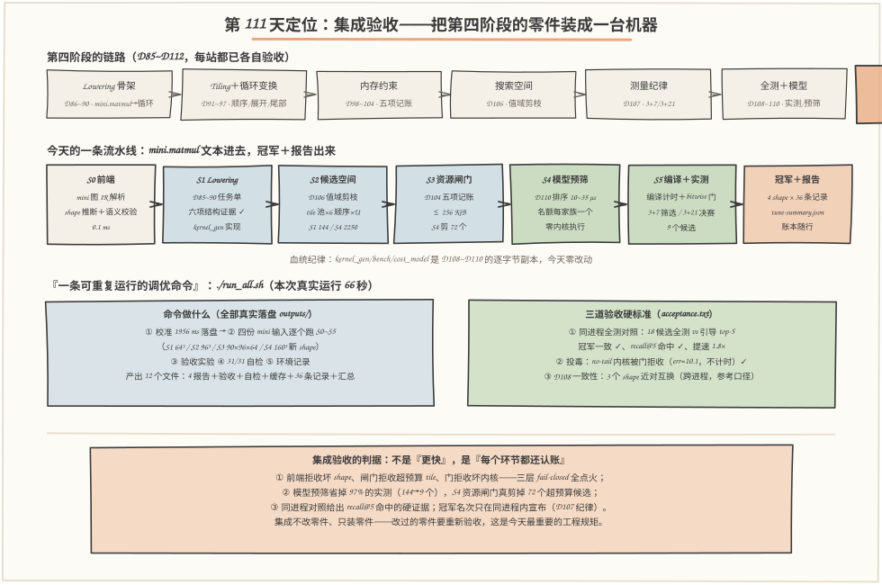
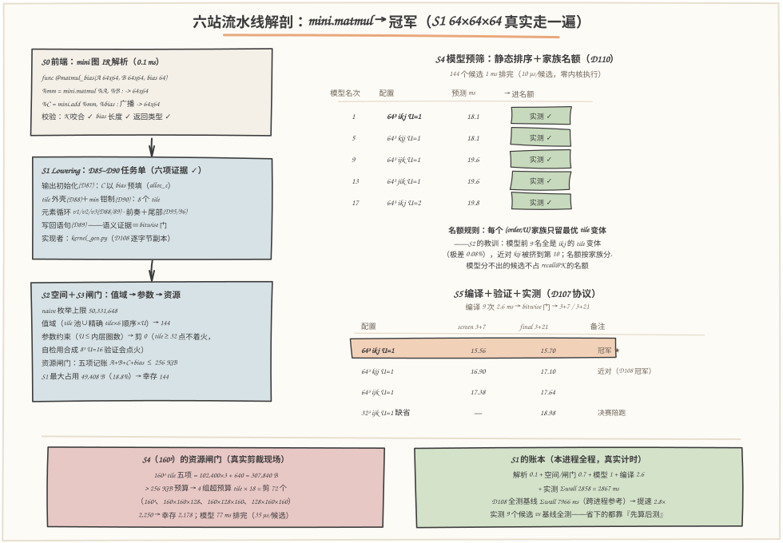
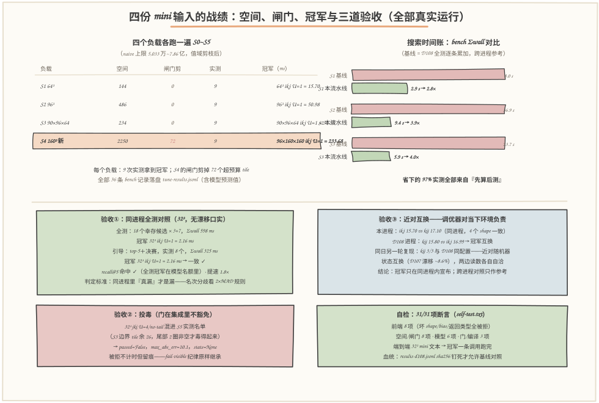

# 第 111 天：第四阶段集成验收——一条命令把四周的零件装成一台机器

> **今日目标**：完成本教程后，你能做到五件事——把第四阶段四周造好的零件（D85~D90 的 Lowering 任务单、D88~D96 的 Tiling 与展开、D104 的五项记账闸门、D106~D110 的剪枝/纪律/Cost Model）**原样装进一条流水线** `pipeline.py`：S0 前端解析 → S1 循环生成计划 → S2 值域剪枝 → S3 资源闸门 → S4 模型预筛 → S5 编译/验证/实测，从 mini.matmul 文本到「冠军＋账本」一条命令跑完（自检里的端到端：32³ 一条调用出冠军 **ikj U=1 = 2.17 ms**）；用 4 份真实输入各验收一遍——候选空间 **144 / 486 / 234 / 2250**（naive 枚举上限 5,033 万~7.86 亿，值域剪枝后只剩 **0.0002%~0.0003%**），资源闸门在 160³ 上真剪掉 **72 个**超预算 tile（五项记账 307,840 B > 256 KiB 预算），模型以 **10~35 µs/候选**排完最多 2,178 个幸存者、每个 shape 只实测 **9 个**；记下冠军与对照——S1 **15.70**、S2 **50.98**、S3 **31.56** ms（都是 ikj U=1；D108 全测记录的冠军是 kij U=1：15.80/51.53/32.06 ms）＋新 shape 160³ 首测 **233.68 ms**，三笔「不同配置」**挂账**给明天结清；跑三道验收——同进程全测对照（18 候选全测 vs 引导 top-5：**冠军一致 ✓、recall@5 ✓、提速 1.8×**）、投毒 no-tail 内核被 bitwise 门拒收（**max_abs_err=10.1、被拒不计时**）、D108 一致性（跨进程参考口径）；最后守住血统纪律——`kernel_gen.py/bench.py/cost_model.py` 是 D110 逐字节副本**零改动**、`results-d108.jsonl` sha256 钉死、**31/31 自检**全过，交出「一条可重复运行的调优命令」`./run_all.sh`（本次真实运行 **66 秒**，`outputs/` 落盘 **12 个文件**）。
> **预计时间**：学习 40 分钟＋实践 50 分钟
> **前置准备**：D85~D87（循环生成任务单、bias 预填初始化）、D88/D90（tile 外壳＋min 边界钳制）、D92/D95/D96（顺序六家族、尾部循环、展开 U）、D104（五项记账 ≤ 256 KiB，fail-closed）、D106（值域剪枝与 naive 上限公式）、D107（测量纪律：screen 3+7 / final 3+21、bitwise 门先于计时、跨进程漂移 ~8.6%）、D108（全测基线 18/24/36 候选与冠军记录）、D109（探针与 Roofline 下界）、D110（Cost Model 三层：count_ops × 校准单价、名额规则 recall@K、校准缓存纪律）。工具只要 `python3`（本文环境：Python 3.11.4 CPython，Linux aarch64，32 逻辑核，2026-11-13 与 D108~D110 同机同日），零第三方依赖。
> **今日产出**：`code/pipeline.py`（966 行：六站流水线＋验收实验＋31 项自检＋CLI）＋`code/run_all.sh`（一键复现，约 1.5~2 分钟，本次实测 66 秒）＋`outputs/` 12 个文件（4 份调优报告＋acceptance.txt＋self-test.txt＋校准缓存 calibration.json/.txt＋36 条 `tune-results.jsonl` 记录＋`tune-summary.json` 汇总＋环境记录＋真实运行总日志）＋本文 3 张手绘图（数字全部出自 2026-11-13 13:12~13:13 的冻结运行）。

## 1. 今天解决什么问题？

四周以来零件都造好了，而且每件都单独验收过：D85~D90 的循环生成器能把 mini.matmul 变成正确的三重循环（D96 还留下了 no-tail 反例当门禁教材）；D104 的资源闸门会拒收超预算 tile；D106 的值域剪枝能把上亿的 naive 枚举砍到几百；D107/D110 给了测量纪律（3+7/3+21、bitwise 门）和 Cost Model（数行 × 校准单价）。**但零件不是机器**。把六站串成一条命令，「装配」本身是新的失败面：接口对不对（S0 解析出的 `MiniProgram` 能不能喂给 S1 的 `kernel_gen`）、纪律还作数吗（fail-closed 的门会不会因为「集成」被豁免）、零件动过没有（改一行 `kernel_gen`，D110 校准的 16 根单价对应的就不再是这些内核——模型分不清「代码变了」和「机器变了」）。

所以今天的实践问题只有一句话：**给一份 mini.matmul 的 IR 文本，能不能敲一条命令，自动完成「解析 → 生成循环计划 → 列候选 → 剪空间 → 过闸门 → 模型预筛 → 编译 → 验证 → 实测 → 报冠军」，并且每一站的账都对得上原始记录？** 验收判据不是「更快」——D108 全测基线本来就慢（S1 的 Σwall 7,966 ms），快是应该的；判据是**每个环节都还认账**：前端拒收坏 shape、闸门拒收超预算 tile、门拒收坏内核，三层 fail-closed 在集成后必须照常点火；模型预筛省下的实测（9 个 vs 幸存 144~2,178 个）要写成账本；冠军名次只在同进程内宣布，跨进程对照只作参考。

贯穿全文的例子仍是 S1 = 64×64×64。一条流水线跑完 2,867 ms（D108 全测要 7,966 ms，提速 2.8×），冠军 64³ ikj U=1 = 15.70 ms；同一条流水线里 D108 的冠军 kij U=1 也被实测了（决赛 17.10 ms）——**同进程里输了**。但模型前 5 名的预测极差只有 0.2%，而 D107 量过跨进程漂移 ~8.6%：「谁真快」在两个进程里本来就是两个答案。今天把这笔账**挂起来**（写进 acceptance.txt ③，标注「跨进程参考」），明天 D112 用同进程实验当面结清。集成验收不仅要验「跑得通」，还要把「验不了什么」如实写清楚——这是今天最重要的工程规矩。

## 2. 先看全貌：今天的内容位于哪里？



**图 1**：看三排——**上排**是第四阶段的链路，六张卡每张都已在各自当天验收过：Lowering 骨架（D86~90，mini.matmul→循环）、Tiling＋循环变换（D91~97，顺序/展开/尾部）、内存约束（D98~104，五项记账）、搜索空间（D106，值域剪枝）、测量纪律（D107，3+7/3+21）、全测＋模型（D108~110，实测/预筛）；最右橙色卡是今天：**集成验收，一条命令收口**。**中排**是今天造的流水线本体，七站依次：S0 前端（解析 0.1 ms）→ S1 Lowering（D85~90 任务单六项结构证据 ✓，kernel_gen 实现）→ S2 候选空间（值域剪枝后 S1 144 / S4 2250）→ S3 资源闸门（≤ 256 KiB，S4 剪 72）→ S4 模型预筛（10~35 µs/候选，名额每家族一个、零内核执行）→ S5 编译＋实测（bitwise 门、3+7 筛选 / 3+21 决赛，9 个候选）→ 冠军＋报告（4 shape × 36 条记录、tune-summary.json、账本随行）；下面一行小字是血统纪律：kernel_gen/bench/cost_model 是 D108~D110 的逐字节副本，今天零改动。**下排**左边是这条命令真实做的事（校准 1956 ms 落盘 → 四份输入逐个跑 → 验收 → 31/31 自检 → 环境记录，产出 12 个文件），右边是三道验收硬标准；底部橙色横条给出全天的核心论点：**集成验收的判据不是「更快」，是「每个环节都还认账」**——三层 fail-closed 全点火、模型只砍数量、名次只在同进程内宣布、集成不改零件只装零件。

把今天的工作串成 5 步：

1. **校准落盘**：16 根语句行单价，墙钟 1,956 ms → `calibration.json`，后续全部实验（tune/accept/self-test）共享同一份缓存，跨文件口径一致；
2. **四份输入各跑一遍 S0~S5**：S1 64³ / S2 96³ / S3 90×96×64 / S4 160³（新 shape 首测）——空间 144/486/234/2250，闸门在 S4 剪 72，每份只实测 9 个；
3. **三道验收**：同进程全测对照（recall 的硬标准）、投毒内核（门不被集成豁免）、D108 一致性（血统＋跨进程参考口径）；
4. **31 项自检**：前端 8 / Lowering 2 / 空间 8 / 闸门 3 / 模型 4 / 名额 2 / 实测·编译·端到端 3 / 血统 1；
5. **收口**：一条命令 `run_all.sh`（真实运行 66 秒）＋逐站账本＋挂账清单（三笔「不同配置」留给 D112）。

一句话定位：**D85~D105 回答「怎么把图算子变成正确的循环和内存计划」，D106~D110 回答「怎么在测得起的预算里找到好候选」，今天回答「装成一台机器之后，每个零件还认不认账」**。

## 3. 核心概念：先用直觉，再给准确定义

今天的三个概念一根链条：**装配的判据 → 名额规则 → 三道验收**。每个概念都拿贯穿例子（S1 64³ 与 S4 160³）配上真实数字。

### 3.1 装配是新的失败面：集成验收查的是接口与纪律，不是零件

一句通俗解释：**零件单独合格 ≠ 机器合格**。集成验收查的不是每个零件（它们已各自验收过），而是零件之间的**接口**和贯穿全程的**纪律**——数据从一站流到下一站时字段还在吗？fail-closed 的门在流水线里还点得着火吗？零件动过一行没有？

类比：乐队合排。每位乐手单独考试都过了，合起来仍可能崩——崩点通常不在任何一人身上，而在「指挥手势与各声部的接口」：进拍、换段、收束。对应到技术上是：S0 解析出的 `MiniProgram` 喂给 S1 的 `kernel_gen`（`KernelConfig(32,32,32,"ijk",1)` 是接口）、S2 的候选流进 S3 闸门与 S4 模型、S5 的每条实测落成 `d111.tune-result/1` schema 的记录——接口错一个字段，整条链断；纪律上，31 项自检里「前端拒坏 shape」「闸门拒超预算 tile」「门拒坏内核」要在流水线语境下重新点火。类比边界（合排覆盖不了的）：乐队可以靠耳朵当场兜底、糊弄过去；流水线不行——接口是显式契约（schema、sha256、断言），要么过、要么退出非零，没有「差不多」。还有一条合排没有的规矩：**集成不改零件**——`kernel_gen.py/bench.py/cost_model.py` 必须是 D110 的逐字节副本，今天的证据是 env.txt 明文「为 D110 逐字节副本」＋血统自检项通过＋三个模块一天的 `git diff` 为空。

### 3.2 名额规则：模型排序的正确用法是「家族代表制」

一句通俗解释：模型排完序，别拿「前 K 个候选」去实测，拿「前 K 个**家族**的代表」。**家族 =（循环顺序, 展开份数）**——它决定内层语句家族与展开税，是语句行模型真正分辨得了的对象；同家族不同 tile 的预测挤成一撮，差别埋在模型自己的误差棒里。

类比：评奖「每个单位一个代表」。同单位的并列者不占名额，把机会让给别的单位——否则一个单位的并列扎堆能把整个获奖名单占满。对应到技术上是：`select_topk()` 按家族去重；今天集成的真实发现——S2（96³）的模型前 9 名**全是 ikj U=1 的 tile 变体**（极差 0.08%），近对 kij 被挤到第 10 名进不了 top-5，而 kij 正是 D108 冠军的家族；名额规则实施后，自检钉死两条断言：top-5 家族不重复 `[ikjU1 × kijU1 × ijkU1 × jikU1 × ikjU2]`、近对 kij 进了 top-5。类比边界：评奖可以由评委主观裁量；名额规则只认**模型的分辨率**——同家族 tile 变体预测差 0.08%，而 D110 量过模型误差棒有 +10~23%，分不出的候选不占名额，这是「知道自己在多精确的仪器上工作」，不是偏好。今天的数字佐证：四份报告的模型前 5 名预测极差全部只有 0.0~0.2%（S1 0.2%、S2 0.0%、S3 0.1%、S4 0.0%），全在并列地带——**模型在这个地带没有分辨率，名次只能由同进程实测定**（报告的 ⚠ 行原样打印这句话）。

### 3.3 三道验收：怎么给一条会「自动报冠军」的流水线发合格证

一句通俗解释：流水线声称「我自动找到了冠军」——怎么证明它没偷工减料？三道：①**对照**——小负载上全测 vs 引导搜索，同进程比较，冠军必须一致或至少在名单里（recall 的硬标准；同进程没有跨进程漂移的口实，**真漏才是漏**）；②**投毒**——故意把坏内核混进实测名单，门必须拒收且不计时；③**血统**——基线记录 sha256 钉死、零件零改动、冠军对照逐条留痕。

类比：新车下线的三项检验。碰撞测试（投毒——不能因为总装线是新的就跳过安全测试）、油耗复检（全测对照——宣称的油耗要和实测对得上）、零件编号核对（血统——发动机号必须对上出厂记录）。对应到技术上是：acceptance.txt 的三节、`cm.load_d108()` 的 sha256 校验、投毒前先验「毒真的有毒」的 `assert has_tail`（32³ 的边界全被 U 整除时，no-tail 内核与好内核逐位相同——毒白投，所以换成 S3 的边界 tile 余 26、26 % 4 = 2 圈尾部真实存在）。类比边界：汽车抽检是抽样，这里更狠——①是全检（18 个候选全测）、②是主动攻击、③是逐字节核对，因为编译器的失败是**静默**的：错误答案看起来和正确答案一模一样，唯一的防线是把「拒收」也变成被验证的行为。结果数字：①全测冠军 32³ ikj U=1 = 2.16 ms，引导冠军同名同值 → 冠军一致 ✓、recall@5 ✓、提速 1.8×（598 → 325 ms）；②no-tail 内核 passed=False、max_abs_err=10.1、stats=None（被拒不计时）；③三个有基线的 shape 全部「不同配置」——**注意这不是失败**，是跨进程参考口径的诚实记录，挂账给 D112。

## 4. 图解核心机制



**图 2**：拿 S1 64³ 真实解剖六站。**左列三张卡**自上而下：S0 前端（0.1 ms：func @matmul_bias、K 咬合 ✓ bias 长度 ✓ 返回类型 ✓）→ S1 Lowering 任务单（D87 bias 预填、D88 外壳 8 个 tile、D90 min 钳制、D95/96 前奏＋尾部、D89 写回——六项结构证据全 ✓，实现者是 kernel_gen.py 的 D108 逐字节副本）→ S2＋S3 漏斗（naive 枚举上限 50,331,648 → 值域剪枝 144 → 参数约束剪 0——tile≥32 的候选点不着火，自检用合成 8³ U=16 验证它**会**点火 → 资源闸门：最大占用 49,408 B 只占预算 18.8% → 幸存 144）。**右上**是 S4 名额表：模型名次 1/5/9/13/17 的五个家族代表（预测 18.1/18.1/19.6/19.6/19.8 ms），右侧绿框标「实测 ✓」，下面三行小字讲名额规则的动机——S2 的教训（前 9 名全是 ikj、极差 0.08%、kij 被挤到第 10）。**右中**是 S5 表：screen 3+7 与 final 3+21 两列读数，冠军行高亮（15.56 → 15.70 ms），近对 kij 标注「D108 冠军」，缺省 32³ ijk U=1 决赛陪跑（18.98 ms）。**底部两张卡**：左边是 160³ 的资源闸门真剪裁现场——160³ tile 五项 = 102,400×3 + 640 = 307,840 B > 256 KiB，4 组超预算 tile × 18 = 剪 72 个，2,250 → 幸存 2,178，模型 77 ms 排完（35 µs/候选）；右边是 S1 的账本——解析 0.1 + 空间/闸门 0.7 + 模型 1 + 编译 2.6 + 实测 Σwall 2,858 = 2,867 ms，对照 D108 全测基线 Σwall 7,966 ms（跨进程参考）提速 2.8×，实测 9 个 vs 基线全测。

## 5. 动手实践：一条命令跑完 S0~S5

### 5.1 准备文件

```text
tutorials/day-111/
├── README.md                 ← 本文
├── images/                   ← 3 张手绘图（数字出自 outputs/ 冻结运行）
└── code/
    ├── kernel_gen.py         # D110 逐字节副本（今天零改动）
    ├── bench.py              # D110 逐字节副本
    ├── cost_model.py         # D110 逐字节副本（sha256 钉死 D108 记录与 D109 探针）
    ├── pipeline.py           # 966 行：S0~S5 六站流水线＋验收实验＋31 项自检＋CLI
    ├── gen_images.py         # 生成 3 张图（固定数字，全部来自真实运行）
    ├── run_all.sh            # 一键复现（约 1.5~2 分钟，实测 66 秒）
    ├── inputs/               # 5 份 mini 图 IR（4 份调优＋1 份 32³ 验收小负载）
    │                         # ＋ results-d108.jsonl / probes-d109.json（sha256 钉死）
    └── outputs/              # 12 个文件：4 报告＋验收＋自检＋校准×2＋
                              #   36 条 JSONL＋JSON 汇总＋环境＋总日志
```

三个基础模块今天零改动——D110 校准的 16 根单价量的就是它们生成的内核，改了它们模型就失真（D110 立的规矩）。校准一次落盘 `calibration.json`，后续全部实验共享同一份缓存。一键复现：

```bash
cd tutorials/day-111/code && ./run_all.sh          # 约 1.5~2 分钟（冻结运行实测 66 秒）
```

**诚实声明**：本文所有数字来自 2026-11-13 13:12~13:13 的一次完整运行（outputs/run-all-log.txt 是它的逐行日志，本文环境：Python 3.11.4 CPython、Linux aarch64、32 逻辑核）。你重跑会得到**同量级但略有差异**的数字——冠军毫秒会漂（D107 量过跨进程漂移 ~8.6%），近对 ikj/kij 谁快甚至可能互换。这不是缺陷；今天的验收判据是结构性结论——三层 fail-closed 点不点火、recall@5 命不命中、账本逐站对不对——而不是个别的毫秒数。

### 5.2 编写代码

**① 六站主流程：逐站计时记账**（pipeline.py 的 `run_tune()`，节选）：

```python
def run_tune(path, top_k=TOP_K, verbose=True, results_path=None, costs=None, calib_note=""):
    """一条命令的完整流水线：mini 文本 → 冠军＋账本。返回 (report, summary)。"""
    t_wall0 = time.perf_counter()
    # ---- S0 前端：shape 推断＋语义校验（fail-closed，D43 纪律）
    prog = parse_mini(path)
    op, M, N, K, dtype = prog.workload()
    sid, has_base = shape_id_of(M, N, K)          # 对照 D108 的 shape 表
    # ---- S1 Lowering 证据（拿缺省配置当样本）
    items, n_tiles, clamps_bind, _src = lowering_check(DEFAULT_CFG, M, N, K)
    # ---- S2+S3 空间与闸门：值域剪枝 → 参数约束 → 资源闸门
    cands, st = build_space(M, N, K)
    # ---- S4 模型预筛：count_ops × 校准单价，零内核执行
    ranked, model_ms = rank_by_model(M, N, K, cands, costs)
    # ---- S5 编译＋验证＋实测（见 ④）→ 冠军＋逐站账本
```

每一站都单独掐表（`parse_ms / space_ms / model_ms / compile_ms_sum / bench_wall`），最后拼成报告末尾的账本行——「每站花掉的时间」是流水线自己的产出物，不是事后估算。

**② S2＋S3：空间漏斗的三道闸**（`build_space()`，节选）：

```python
def build_space(M, N, K, budget=BUDGET):
    """S2 值域剪枝 + 跨轴参数约束 + S3 资源闸门 → 幸存候选＋漏斗账本。"""
    pools = {d: [t for t in CURATED_TAIL_POOL if t <= dim]
             for d, dim in (("m", M), ("n", N), ("k", K))}   # 池 = (32,64,96,128,160,256)
    combos = set(itertools.product(pools["m"], pools["n"], pools["k"]))
    combos.add((M, N, K))                      # 精确 tile（D108：单 tile 无外壳开销）
    st.naive = M * N * K * len(ORDERS) * 16 * 2      # D106 naive_count 同式
    st.raw = len(combos) * len(ORDERS) * len(UNROLLS)   # × 6 顺序 × 3 展开
    for (tm, tn, tk) in combos:
        total, _parts = tile_bytes(tm, tn, tk)     # D104 五项：A+B+C+bias，align 到 32B
        for order in ORDERS:
            for u in UNROLLS:
                cfg = KernelConfig(tm, tn, tk, order, u)
                why = param_violation(cfg)          # U > 最内层圈数 = 死代码（D106）
                if why:
                    st.n_param_pruned += 1; continue
                if total > budget:                  # 资源闸门（D104，fail-closed）
                    st.n_resource_pruned += 1; continue
                survivors.append(cfg)
```

剪了多少、为什么剪，全部记进 `SpaceStats`——漏斗的每一层都留得住证据（S4 报告里那三个 ✗ 行就是 `resource_examples` 的原文）。

**③ S4 名额规则：家族代表制**（`select_topk()`，节选）：

```python
def select_topk(ranked, top_k):
    """top-K 名额：每个 (order,U) 家族只留预测最优的一个 tile 变体。

    动机（今天集成的真实发现）：tile 外壳开销摊薄后，同家族不同 tile 的预测趋同
    ——S2 的模型前 9 名全是 ikj U=1 的 tile 变体（极差 0.08%），近对 kij 被挤到
    第 10 名进不了名额。D110 的账说模型对近对的分辨率就是它自己的误差棒
    （+10~23%），同家族 tile 变体的差别更埋在误差棒里——模型分不出的差别，
    不该占用 recall@K 的名额。
    """
    picked = []
    for rank, (pred, cfg) in enumerate(ranked, 1):
        if len(picked) >= top_k:
            break
        if not any(cfg.order == p.order and cfg.unroll == p.unroll
                   for _, _, p in picked):
            picked.append((rank, pred, cfg))
    return picked
```

**④ 验收② 投毒：门在集成里不豁免**（`exp_accept()`，节选）：

```python
# 投毒要点：尾循环必须非空才毒得起来——32³ 的边界全被 U 整除，no-tail 与
# 正常内核逐位相同（毒白投）。S3（90×96×64）的边界 tile（M 余 26）＋jki
# 顺序（i 最内层）＋U=4 → 26 % 4 = 2，尾部真实存在。
poison_cfg = KernelConfig(32, 32, 32, "jki", 4)
has_tail = any(e % poison_cfg.unroll
               for e in (M3 % 32 or 32, N3 % 32 or 32, K3 % 32 or 32))
assert has_tail, "投毒配置的尾循环为空——毒白投"
kernel = make_kernel(poison_cfg, drop_tail=True)     # D96 的 no-tail 反例内核
rec = bench_one(poison_cfg, spec3, SCREEN_PROTO, env, kernel=kernel)
assert rec["correctness"]["passed"] is False and rec["stats_ms"] is None
```

### 5.3 运行与观察：账本逐站对

`./run_all.sh` 按固定顺序跑五步：① `--exp calibrate` 落盘单价（1,956 ms → `calibration.json`，16 根语句行单价：内层三家族 j0=55.1 / k0=60.5 / i0=83.0 ns，展开税 ju=75.6（+20.5），loop=7.1、range3=178.5、min3=525.3 ns）；② 四份 mini 输入逐个 `--exp tune`（报告 tee 落盘）；③ `--exp accept`；④ `--exp self-test`；⑤ `--exp env`。开工前先 `rm` 掉旧的 `tune-results.jsonl / tune-summary.json`——每轮全量复现从头记账。

**观察一：账本逐站对得上（S1 报告节选）**：

```text
 [S5 编译＋验证＋实测] D107 协议（门先于计时）
    编译（exec 生成源码）：9 次，合计 2.6 ms
    screen（3+7 过门）：64³ ikj U=1=15.56  64³ kij U=1=16.90  64³ ijk U=1=17.38  64³ jik U=1=17.60  64³ ikj U=2=17.64
    final（3+21）：64³ ikj U=1=15.70  64³ kij U=1=17.10  64³ ijk U=1=17.64  32³ ijk U=1=18.98

    冠军：64³ ikj U=1 = 15.70 ms（缺省 32³ ijk U=1 见决赛行）
    基线对照：D108 全测冠军 64³ kij U=1 = 15.80 ms → 不同配置：D108 冠军也实测了、
    同进程输了——近对次序随机器状态互换（D107 漂移 ~8.6%，D110 同款现象）

 [账本] 解析 0.1 + 空间/闸门 0.7 + 模型 1 + 编译 2.6 + 实测 Σwall 2858 = 2867 ms（本进程全程）
        D108 全测基线 Σwall = 7966 ms（跨进程参考）→ 提速 2.8×；实测 9 个 vs 基线全测
```

读法：预测第 1 的 ikj 决赛也是第 1（15.70 ms）；预测并列的 kij 实测慢 8.9%（17.10 ms）——**并列地带的名次由同进程实测定**，这正是 S4 的 ⚠ 行预告的事。

**观察二：闸门真的在剪（S4 160³ 报告节选）**：

```text
 [S3 资源闸门] D104 五项记账 ≤ 262,144 B（fp32·single·无 staging；9.5 ms）
    参数约束剪 0；资源剪 72；幸存 2178
    最大占用 tile (160, 160, 160) = 307,840 B（占预算 117.4%）
      ✗ 128×160×160 ijk U=1：五项合计 266,880 B 超预算 4,736 B
      ✗ 128×160×160 ijk U=2：五项合计 266,880 B 超预算 4,736 B
      ✗ 128×160×160 ijk U=4：五项合计 266,880 B 超预算 4,736 B
```

160³ 是今天唯一让闸门点火的 shape：4 组超预算 tile（160³、160×160×128、160×128×160、128×160×160）× 6 顺序 × 3 展开 = 72 个候选在**生成计划之前**就被砍掉，2,250 → 2,178。维度再往上走闸门只会剪得更狠——256³ 的 tile 五项合计 787,456 B（262,144×3＋1,024），是 256 KiB 预算的整整 3 倍。fail-closed 在集成里原样继承。

**观察三：四份输入的战绩**（详见 03-results.svg）：

```text
 负载            空间   闸门剪  实测  冠军
 S1 64³          144     0      9    64³ ikj U=1 = 15.70 ms（D108: kij U=1 15.80 → 不同配置）
 S2 96³          486     0      9    96³ ikj U=1 = 50.98 ms（D108: kij U=1 51.53 → 不同配置）
 S3 90×96×64     234     0      9    90×96×64 ikj U=1 = 31.56 ms（D108: kij U=1 32.06 → 不同配置）
 S4 160³ 新     2250    72      9    96×160×160 ikj U=1 = 233.68 ms（新 shape 首测）
```



**图 3**：四块各回答一个问题——**左上战绩表**：四个负载各跑一遍 S0~S5（naive 上限 5,033 万~7.86 亿，值域剪枝后 144~2,250），每个负载 9 次实测拿到冠军，36 条 bench 记录（含模型预测值）落盘 `tune-results.jsonl`；**右上提速账**：S1/S2/S3 的 bench Σwall 对照 D108 全测基线（基线 7,966~36,941 ms，提速 2.8~4.0×），省下的 ~97% 实测全部来自「先算后测」；**左下验收①**：32³ 同进程全测 18 候选（Σwall 598 ms）与引导搜索（实测 8 个、325 ms）冠军一致（2.16 ms）＋recall@5 命中——真漏才是漏，名次分歧看 2×MAD 规则；**右下验收③**：本进程 ikj 15.70 vs kij 17.10 四个 shape 一致，D108 进程 kij 15.80 vs ikj 16.99 冠军互换，同日另一轮复现曾拿到 kij 3/3 与 D108 同配置——近对随机器状态互换，两边读数各自自洽，所以冠军只在同进程内宣布；**底部两卡**：投毒（32³ jki U=4/no-tail，S3 边界余 26、尾部 2 圈非空，passed=False、err=10.1、不计时但留痕）＋31/31 自检（前端 8 项坏 shape/bias/返回类型全被拒……血统 sha256 钉死才允许基线对照）。

**观察四：31 项自检（self-test.txt 节选）**：

```text
 D111 自检：31/31 项通过
 ✓ 前端：声明输出与推导不符被拒（64x96 ≠ 64x64）
 ✓ 前端：matmul 形状不咬合（K=3 vs 4）被拒
 ✓ Lowering：缺省配置六项结构证据齐  [tiles=18 clamps=True]
 ✓ 空间：160×160×160 全部幸存者 U ≤ 内层圈数且 ≤ 预算  [2178 个幸存]
 ✓ 闸门：160³ tile 五项 = 102400×3 + 640 = 307,840 B > 256 KiB  [307,840 B]
 ✓ 模型：64×64×64 全部预测 ≥ Roofline 下界×0.9  [下界 9.6 ms，最小预测 18.1 ms]
 ✓ 名额：S2 top-5 家族不重复（并列 tile 变体只留代表）  [ikjU1 × kijU1 × ijkU1 × jikU1 × ikjU2]
 ✓ 端到端：32³ mini 文本 → 冠军（一条调用内跑完 S0~S5）  [冠军 32³ ikj U=1 = 2.17 ms]
 ✓ 血统：results-d108.jsonl sha256 钉死（D108 基线可比）
```

31 项按站分组：前端 8 / Lowering 2 / 空间 8 / 闸门 3 / 模型 4 / 名额 2 / 实测·编译·端到端 3 / 血统 1。注意端到端那条的 2.17 ms 与 acceptance.txt ① 的 2.16 ms 是**两次独立运行**——同一条流水线、同一负载、冠军配置相同、读数差 0.5%，这就是测量纪律允许的窗口内波动。

### 5.4 修改一个参数再观察：把 top-k 拧到 1

名额规则（3.2 节）的分量，把 `--top-k` 拧到 1 就看得最清楚——完全相信模型排序：

```bash
cd code && python3 pipeline.py --exp tune --ir inputs/matmul-bias-s1-64x64x64.mini --top-k 1
```

只看名单结构怎么塌，不宣布新的毫秒（那是明天 D112 复盘的正式实验）：

1. **S4 的名额规则整段失效**：`select_topk` 只能拿到一个家族——64³ ikj U=1 独占名单，近对 kij 连被实测的资格都没有；
2. **S5 的名单从 9 个塌到 3 个**：screen 只编译实测 1 个（top-5 → top-1），决赛只剩它自己加缺省陪跑 32³ ijk U=1（编译 9 次 → 3 次、bench 记录 9 条 → 3 条）；
3. **D108 对照行换台词**：从「D108 冠军也实测了、同进程输了」变成「D108 冠军没进模型 top-5 名额（并列扎堆挤掉了近对，见 S4 提示行）——recall@K 的多样性缺口，D112 复盘的素材」——kij 从「输了」变成「根本没上场」，这两种失败完全不是一回事。

为什么今天敢挂账、明天必须结账：D110 的 K=1 记录是三个 shape 全错（+4.8% / +6.6% / +8.1%），而四份报告的模型前 5 名预测极差只有 0.0~0.2%——模型对近对的分辨率比它要预测的现象的稳定度低一个数量级。拧回 5 再跑一遍，名额规则立刻回来：kij 回到名单里、对照行回到「同进程输了」。**这个参数就是「模型只砍数量、实测定名次」整条规矩的旋钮。**

## 6. 常见错误与排查

四个错误全部来自今天和 D107~D110 的真实记录。

**错误 ① 忘了先校准：四份报告各用一套单价**
现象：调优报告头部的「单价来源」行时间戳不一致（或标着现场校准），S1 和 S2 的预测不在同一个价格体系里，跨文件没法比。原因：`cm.get_costs()` 找不到缓存就现场 `calibrate()`——多花 1,956 ms 事小，四套单价事大（模型毫秒失去共同口径，D108 对照的 verdict 也跟着失真）。定位：报告头部的「单价来源」行（如「缓存 calibration.json（2026-11-13T13:12:04校准）」）——四份必须同时间戳。修复：像 run_all.sh 第 16 行那样先跑 `--exp calibrate` 落盘，后续 tune/accept/self-test 全部吃同一份缓存。

**错误 ② K=1：把模型 top-1 当冠军宣布**
现象：`--top-k 1` 之后报告里只剩一个实测候选，看起来「省时间」，实际是把 0.2% 的模型差当决策依据。原因：模型前 5 名预测极差只有 0.0~0.2%，D107 量过跨进程漂移 ~8.6%、D110 量过 K=1 三连错（+4.8/6.6/8.1%）——预测差比世界稳定度小一个量级，top-1 在近对上是掷硬币。定位：报告的 ⚠ 并列地带行；D108 对照行换成「没进名额」的 verdict（5.4 节观察 3）。修复：**模型只砍数量**——top-5 家族代表全部进同进程 screen，3+21 决赛定名次；今天 acceptance ① 的「冠军一致 ✓」就是这条规矩的实测背书。

**错误 ③ 把「不同配置」当失败去修：跨进程对照当真值宣布**
现象：看到 S1/S2/S3 三个 shape 全部 `agree=false`（本流水线冠军 ikj vs D108 记录 kij），直觉反应是「选错了，把冠军改回 kij」。原因：D107 量过跨进程漂移 ~8.6%，而 ikj/kij 的预测差不到 1%、同进程实测差也只有百分之几且随窗口互换——D108 的毫秒是另一个进程的真值，拿它当本进程的裁判是口径错误。定位：acceptance.txt ③ 每行都标注「（跨进程参考）」；报告基线对照行写明「近对次序随机器状态互换」。修复：名次只在同进程内宣布（D107 纪律），跨进程对照只作参考并**挂账**——D112 用同进程实验当面结清，今天不动手。

**错误 ④ 集成期手痒改零件：血统破坏**
现象：为了让某个断言过、或让冠军「更像」D108，顺手改了 kernel_gen.py 的钳制或 cost_model.py 的单价——自检可能照样全绿，但预测从此悄悄失真。原因：模型数的是 kernel_gen 生成的内核、单价是 bench 量的语句行——零件一改，「代码变了」和「机器变了」模型就分不清了；这种失真不报错，只会让排序变得没道理（D112 会专门解剖这件事）。定位：env.txt「kernel_gen.py/bench.py/cost_model.py 为 D110 逐字节副本」；血统自检项（results-d108.jsonl sha256 钉死）；三个模块的 `git diff` 应为空。修复：**集成不改零件、只装零件**——零件确实要改，就必须重新走零件当天乃至整条链的验收并重新校准，不许静默。

## 7. 今日练习

**必做**：

1. **手写一份 48×48×48 的 mini 输入**（照 inputs/ 的记法：matmul＋bias 广播），先笔算再上机：48 不在池 (32,64,96,128,160,256) 里，所以 tile 组合是 {32³, 精确 48³} 共 2 组 × 6 顺序 × 3 展开 = **36 个候选**、闸门一个都剪不动（48³ tile 五项合计 27,840 B = 9,216×3＋192，远小于 256 KiB 预算）；跑 `--exp tune` 对照报告的 S2/S3 行验证你的三个预判。
2. **验算 S4 的闸门账**：手算 `tile_bytes(128,160,160)`——A = 128×160×4 = 81,920 B、B = 160×160×4 = 102,400 B、C = 81,920 B、bias = 640 B，合计 266,880 B，超预算恰好 4,736 B（对上报告的 ✗ 行）；再数一遍为什么恰好剪 72（4 组超预算 tile × 6 顺序 × 3 展开）。
3. **把 `--top-k` 拧到 1 再拧回 5**（5.4 节的实验），只记录两件事：实测名单里的家族数（1 → 5），D108 对照行的 verdict 换成了哪一句——并用一句话解释为什么这两种失败不是一回事。

**选做**：

1. 给 pipeline.py 加一个 `--budget` 参数（默认 262,144 B），拧到 40 KiB 跑 S2（96³）——先笔算哪些 tile 活下来（96³ 五项 110,976 B 会被剪），对照幸存数与最大占用行的变化；
2. 读 `tune-results.jsonl` 的 36 条记录（schema `d111.tune-result/1`）：按 stage 分组数出 screen 20 条 / final 16 条；挑出 S1 的 9 条，验证「模型名次与决赛名次」在近对地带确实乱序（kij 模型名次 5，决赛第 2）；
3. 打开 inputs/results-d108.jsonl，对照 cost_model.py 里 `stage_truth / screen_wall_ms / final_wall_ms` 的实现，把 S1 基线 Σwall 7,966 ms（screen＋final 两段累加）自己算一遍——解释为什么这个对照只能标「跨进程参考」。

## 8. 今日验收

- [ ] `./run_all.sh` 一路全绿，`outputs/` 落盘 12 个文件（4 份调优报告＋验收＋自检＋校准缓存×2＋36 条记录＋汇总＋环境＋总日志）；
- [ ] 四份报告的冠军说得出来：15.70 / 50.98 / 31.56 / 233.68 ms，全部 ikj U=1（S4 是新 shape 首测、无基线），且能解释 S1~S3 的「不同配置」为什么不判失败（0.0~0.2% vs ~8.6%）；
- [ ] acceptance.txt 三道全过：① 冠军一致 ✓ ＋ recall@5 ✓ ＋ 提速 1.8×；② 投毒 passed=False、max_abs_err=10.1、被拒不计时；③ 三行不同配置＋一行首测，全部带「跨进程参考」标注；
- [ ] self-test.txt 31/31，八个分组的分布背得出来（前端 8 / Lowering 2 / 空间 8 / 闸门 3 / 模型 4 / 名额 2 / 实测·编译·端到端 3 / 血统 1）；
- [ ] 能用自己的话讲清名额规则：为什么同家族 tile 变体不占名额（S2 极差 0.08% vs 误差棒 +10~23%），它保住的是 recall@K 的哪一块；
- [ ] 血统干净：kernel_gen.py / bench.py / cost_model.py 的 `git diff` 为空，四份报告的单价来源是同一份 calibration.json（同时间戳）。

## 9. 一句话总结与明天预告

今天把第四阶段四周的零件装成了一台机器，并给它发了合格证：**集成不改零件、只装零件**——六站流水线一条命令跑完（66 秒：校准 1,956 ms ＋ 四份输入 S0~S5 ＋ 三道验收 ＋ 31 项自检），三层 fail-closed 照常点火（前端拒坏 shape、闸门剪 72 个超预算 tile、门把投毒内核连成绩一起拒掉），模型以 10~35 µs/候选砍掉 93.8~99.6% 的实测、名次只在同进程内宣布（近对 kij 同进程输了而不是没上场），验不了的东西（跨进程冠军对照）如实挂账。**「可重复的调优命令」的全部含义不是『能跑』，是『每站都认账、验不了的地方也写清楚』。**

明天 D112 第 16 周复盘，主题「Cost Model 为什么会选错」——恰好是今天挂在 acceptance.txt ③ 的那笔账：本流水线冠军 ikj U=1，D108 记录 kij U=1，三个 shape 全部 `agree=false`。复盘将用**同进程全测**当面结账（D110 的 K=1 记录 +4.8/6.6/8.1% 是前科），拆开「生成正确代码」和「生成高性能代码」需要的两种信息——一种写在程序语义里可以推理，一种写在环境里只能测量——并给近对漂移、系统性偏差、regime 外推各配一层兜底。今天挂的账，明天必须结清。
