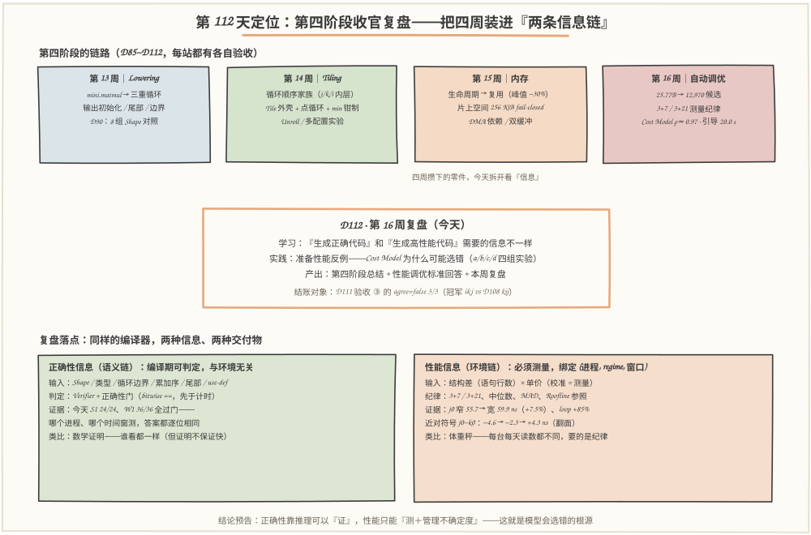
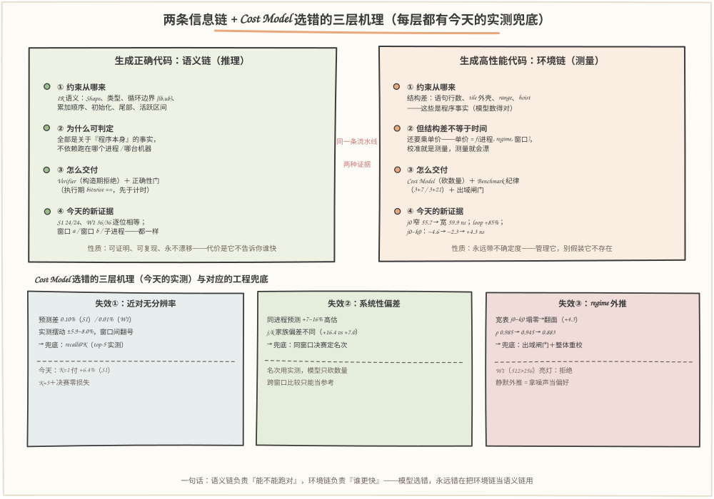
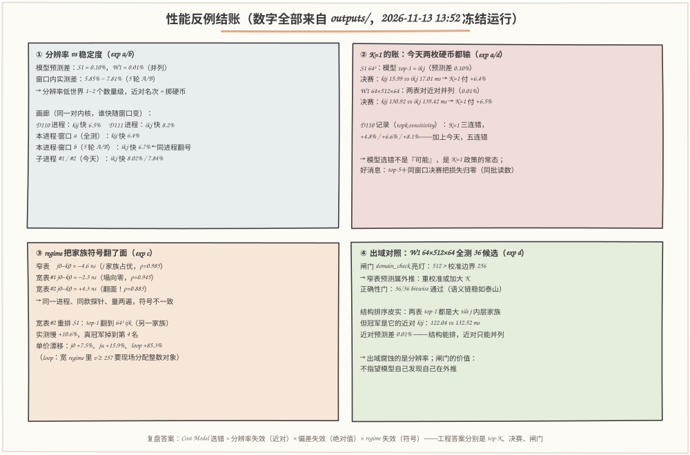

# 第 112 天：第 16 周复盘——Cost Model 为什么会选错：生成正确代码和生成高性能代码，需要的不是同一种信息

> **今日目标**：完成本教程后，你能做到五件事——把第四阶段（D85~D112）四周的零件重新装进**两条信息链**：正确性信息（Shape、边界、累加序、use-def——语义可判定、编译期推理、与环境无关）和性能信息（结构差 × 单价——必须测量、绑定进程/regime/窗口、永远带不确定度），并各举出今天的实测证据；把 D111 验收 ③ 挂起的账（`agree=false 3/3`，冠军 ikj vs D108 kij）**当面结清**：用同进程全测证明模型 top-1 不是真冠军，**K=1 付 +6.4%**（W1 上再付 +6.5%，加上 D110 记录的 +4.8/6.6/8.1%，五连错）；用**分辨率实验**给出模型选错的第一层机理——预测差 0.10% vs 世界摆动 ±5.9~8.0%，且**同一进程两个时间窗就能翻号**（窗口 a kij 快 6.4%，一分钟后窗口 b ikj 快 6.7%）；用**宽 regime 第二套单价**给出第三层机理——j0−k0 从 −4.6 ns **塌零再翻面成 +4.3 ns**（同进程两次宽校准符号相反），拿翻面的表回排窄世界，**top-1 翻到另一个家族、实测慢 +10.6%、ρ 从 0.985 掉到 0.883**；最后在出域 shape（64×512×64，N 越过小整数缓存边界）上验收**结构排序皮实、近对只能并列**，并写出自己的**出域闸门**——不指望模型自己发现自己在外推。
> **预计时间**：学习 40 分钟＋实践 50 分钟
> **前置准备**：D111 的 `kernel_gen.py / bench.py / cost_model.py`（今天逐字节复制进 `code/`，sha256 见 5.1，一天零改动——模型数的就是它们生成的内核）；概念上需要 D92 的循环顺序家族（j/k/i 内层）、D107 的测量纪律（3+7/3+21、正确性门、中位数、MAD、跨进程漂移 ~8.6%）、D110 的 Cost Model 三层结构（数行 × 单价 → 预测；recall@K；近对 j0/k0 差 1ns 的教训）、D111 的集成流水线（候选空间 → 资源闸门 → 模型预筛 → 编译/验证/实测）。工具只要 `python3`（本文环境：Python 3.11.4 CPython，Linux aarch64，32 逻辑核，与 D108~D111 同机同日 2026-11-13），零第三方依赖。
> **今日产出**：`code/counterexample.py`（四组实验 + 宽 regime 校准 + 出域闸门 + 环境记录）＋`code/run_all.sh`（一键复现，约 2 分钟）＋`outputs/` 下 16 个文件（6 份报告 + 2 份校准缓存 + 2 份 JSONL 测量记录 + 4 份机器可读 JSON 摘要 + 环境记录 + 真实运行总日志）＋本文 3 张手绘图（数字全部出自 2026-11-13 13:52~13:54 的最终冻结运行）＋第四阶段总结与性能调优标准回答（第 9、10 节）。

## 1. 今天解决什么问题？

D111 收官时留下了一笔不舒服的账，写在 `acceptance.txt` 的 ③ 里：集成流水线的冠军是 **64³ ikj U=1**，D108 全测记录的冠军却是 **64³ kij U=1**——三个 shape 全部 `agree=false`。当天的处理是把它挂账为"近对漂移（跨进程参考）"：ikj/kij 在 D110 的模型里预测只差 0.4%，跨进程漂移 ~8.6%（D107 实测）比这个差大一个量级，"谁真快"在两个进程里本来就是两个答案。**但挂账不是结账**：复盘要回答的是更一般的问题——计划里写得很清楚，"总结『生成正确代码』和『生成高性能代码』所需的不同信息"、"准备一个性能反例，说明 Cost Model 为什么可能选错"。

这个问题值得单独用一天，因为它触碰了整个第四阶段的地基。四周以来我们造了两样东西：**一套能证明"跑得对"的机器**（Verifier、正确性门、bitwise 比较——D12/D39/D40/D96 一路传下来），和**一套能猜"谁更快"的机器**（Cost Model、Benchmark、Roofline——D106~D110 传下来）。前者从未失手：今天同进程全测 S1 的 24 个候选、W1 的 36 个候选，**全部逐位通过正确性门，无论哪个进程、哪个时间窗**。后者今天仍然会错，而且错得很有规律——D110 已经量过：K=1（完全相信模型）三个 shape 全错，付 +4.8% / +6.6% / +8.1%。**为什么一套永远对、另一套总会错？** 因为它们消费的是两种信息：正确性信息写在程序自己的语义里，性能信息写在"哪台机器、哪个进程、哪个 regime"的环境里——前者可以推理，后者只能测量，而测量会漂。

今天的性能反例就用 D111 的工具现场把这笔记了。贯穿全文的例子：**S1 = 64×64×64 的近对——64³ ikj U=1 vs 64³ kij U=1**。模型眼里的它俩：预测 18.16 vs 18.17 ms，**差 0.10%**；同进程全测眼里的它俩：15.64 vs 17.05 ms，**差 9.0%（以 kij 为基准），模型 top-1 输了**；一分钟后同进程 A/B 眼里的它俩：15.6x vs 16.7x ms，**ikj 反超 6.7%**。同一台机器、同一天、同一个进程、同一天流水线——近对的次序能在一分钟内翻号。**这就是"Cost Model 为什么可能选错"的最深一层答案：不是它数错了行，而是它要预测的现象本身，稳定度比它的分辨率低两个数量级。**

## 2. 先看全貌：今天的内容位于哪里？



**图 1**：看三块——**上排**是第四阶段的四周链路，每站都已在各自当天验收过：第 13 周 Lowering（mini.matmul → 三重循环、初始化、尾部、边界）、第 14 周 Tiling（顺序家族、tile 外壳 + 点循环 + min 钳制、展开）、第 15 周 内存（生命周期、复用、片上空间、fail-closed 闸门）、第 16 周 自动调优（搜索空间 25.77B → 12,970、测量纪律 3+7/3+21、Cost Model ρ≈0.97、引导搜索 20.0 s、D111 集成验收）；**中间**是今天：不写新 Pass、不降新 IR，把四周攒下的零件拆开看"信息"——正确性靠什么保证、性能靠什么估计、模型在哪三层会错、每层怎么兜底；**下排**是今天复盘的落点——两条信息链的对照：左边绿色是语义链（推理、可判定、永不漂移），右边橙色是环境链（测量、会漂、要纪律），中间一句结论预告：**正确性可以"证"，性能只能"测 + 管理不确定度"**。

把今天的工作串成 5 步：

1. **结账（实验 a）**：S1 的 24 个候选同进程全测，模型 top-1（ikj）实测比真冠军（kij）慢——K=1 政策的代价今天重新量一遍；
2. **机理一（实验 b）**：模型对近对的分辨率（0.10%）vs 世界的稳定度（同窗口 ±1%、跨窗口 ±6~8%）——用 5 轮交错 A/B、3 次重校准、2 个子进程把"近对次序是窗口属性"钉成数据；
3. **机理二（实验 c）**：给宽 regime（行宽 512，跨过 CPython 小整数缓存边界 256）量第二套单价——j0 +7.5%、loop +85.3%，近对符号 j0−k0 从 −4.6 ns 塌零再翻面 +4.3 ns；拿翻面的表回排窄世界，看排名怎么被腐蚀；
4. **机理三（实验 d）**：出域 shape W1 = 64×512×64 全测 36 个候选——结构排序皮实（两表 top-1 都对家族），近对并列（0.01%），出域闸门 `domain_check` 亮灯；
5. **收口**：三条失效 → 三个兜底（recall@K、同窗口决赛、出域闸门 + 整体重校），再写成第四阶段总结和性能调优标准回答。

一句话定位：**D85~D105 回答"怎么把图算子变成正确的循环和内存计划"，D106~D111 回答"怎么在测得起的预算里找到好候选"，今天回答"这套机器的两种证据分别可信到哪、为什么、怎么兜底"**。

## 3. 核心概念：先用直觉，再给准确定义

今天的三个概念一根链条：**两种信息 → 单价是环境量 → 失效三层的分法**。每个概念都拿贯穿例子（S1 近对）配上今天的实测数字。

### 3.1 正确性信息：写在程序语义里，推理可得

一句通俗解释：**正确性信息**是"只看程序本身就能判定真假的事实"——Shape 兼不兼容、循环边界对不对、累加顺序变没变。

类比：数学证明。一份证明不管谁来读、在哪儿读、今天读还是明年读，结论都一样。对应到技术上是：这些约束是 IR 的结构性质（D39/D40 的 Verifier、D88 的半开区间与归纳变量、D87 的累加器初始化、D95 的尾部处理、D99~D100 的活跃区间与别名），编译器用**推理**就能检查，不需要把程序跑起来。类比边界（证明覆盖不了的）：数学证明只保证"对"，不保证"快"——`broken_no_tail` 的反例（D96）证明过"跑得飞快、结果全错"，反过来"完全正确"也可能慢得离谱，正确性信息对性能零贡献。

今天的证据最漂亮的地方在于**它是免费的**：实验 a 全测 24 个候选、实验 d 全测 36 个候选，正确性门（bitwise ==）全部通过——这 60 次门检查发生在三个不同的时间窗、两个 shape、36 种 tile/顺序/展开组合下，**没有一个字节的答案依赖环境**。这是四周工作的复利：语义链上花的每一天（Verifier、初始化语义、尾部、逐位契约），今天都在替调优实验担保。

### 3.2 性能信息：写在环境里，只能测量

一句通俗解释：**性能信息**是"把程序放到具体环境里才知道的事实"——这条语句行多少钱、这个候选总共多少毫秒。

类比：体重秤。同一台秤每天读数会漂，不同品牌互相不一致，但只要校准过、纪律好，它仍然有用。对应到技术上是：Cost Model 的结构部分（count_ops 数出的语句行数、tile 外壳、range 建立、行提升）是程序事实，推理可得；但它必须乘上**单价**，单价来自微基准测量，而测量绑定三个坐标——**哪个进程**（D107 实测跨进程漂移 ~8.6%）、**哪个 regime**（今天：j0 窄 55.7 ns → 宽 59.9 ns，+7.5%；loop 6.6 → 12.2 ns，+85.3%）、**哪个时间窗**（今天：同进程一分钟内近对翻号）。类比边界（体重秤比单价好的一点）：体重秤有法定计量标准，校准一次管一年；CPython 的"计量标准"是自适应特化和小整数缓存这类实现细节，**没有"校准一次永久有效"这回事**。

为什么单价会随 regime 漂？今天量到的具体机理有两个：**小整数缓存边界**——CPython 只缓存 −5..256 的整数对象，内层循环 `for v in range(512)` 在 v ≥ 257 的每次迭代都要现场分配整数对象，所以 `loop` 单价在宽 regime 涨了 85%；**工作集越界**——宽行的指针数组超出了校准纪律里"L1/L2 内"的假设，双下标行跟着涨。D110 校准三纪律（函数局部变量、数据 ≤ 80KB、下标 ≤ 96）当初就是在防这件事——**但纪律只能保证"量得准"，保证不了"用得对"**：负载一旦走出校准 regime，单价就成了外推。

### 3.3 失效三层：分辨率、偏差、regime——以及各自的兜底

复盘要求"准备一个性能反例，说明 Cost Model 为什么可能选错"。今天把"选错"拆成三层，每层机理不同、兜底也不同：

1. **分辨率失效（近对无序）**：ikj/kij 预测差 0.10%（W1 上 0.01%，四舍五入就是并列），而窗口内实测差就有 5.85~7.81%（相邻进程到 8.02%）、跨窗口翻号。模型对近对**给不出证据**——不是精度不够可以慢慢修，是这类问题原则上测不准（海森堡式的：测量行为本身在换窗口）。**兜底：recall@K**——只让模型砍数量，top-5 全部同窗口实测，名次由决赛定（D110 立的规矩，今天再次零损失）；
2. **偏差失效（绝对值系统性偏）**：预测比实测高 +6.5~+16.2%（今天 a-narrow.txt 的误差列），且分家族不同（kij +16.2%、ikj +6.5%）。**兜底：模型永远不输出"多少毫秒"当结论**，只输出排序给决赛；跨窗口的毫秒对比一律标注为参考；
3. **regime 失效（符号翻面）**：近对符号 j0−k0 本身是 regime 的函数——窄表 −4.6 ns，宽表两次校准 −2.3 / +4.3 ns（**同进程同款探针，符号不一致**）。拿翻面的宽表回排窄世界 S1：top-1 翻到另一个家族（64³ ijk，实测慢 +10.6%），真冠军掉到第 4 名，ρ 从 0.985 掉到 0.883。**兜底：出域闸门 + 整体重校**——预测前检查负载是否在校准 regime 内（今天的 `domain_check`：W1 的 N=512 > 边界 256 → 亮灯），亮灯就重校准或加大 K，不许静默外推。

三层的共同根源只有一句话：**模型把环境链的信息（单价）当成了语义链的信息（常数）来用**。

## 4. 图解核心机制



**图 2**：左右两栏对照两条信息链，底部三张卡是失效-兜底对照表。**左栏（语义链）**四步走：约束从 IR 语义来 → 因为只关于程序本身所以可判定 → 交付物是 Verifier 加正确性门 → 今天的证据是 60 次门检查零失败、窗口无关。**右栏（环境链）**四步对照着走：结构差确实是程序事实（模型数得对）→ 但结构差不等于时间，还要乘单价，单价 = f(进程, regime, 窗口) → 交付物是 Cost Model 加 Benchmark 纪律加出域闸门 → 今天的证据是 j0 漂 +7.5%、loop +85%、近对符号翻面。中间红色虚线提醒：**同一条流水线，两种证据**——右边那栏永远带不确定度，管理它，别假装它不存在。底部三张卡按编号读：①近对无分辨率（预测差 0.10% vs 摆动 ±6~8%）→ recall@K；②系统性偏差（+7~16%）→ 同窗口决赛定名次；③ regime 外推（符号塌零再翻面）→ 出域闸门加整体重校——每张卡的上半是今天的实测现象，下半是对应的工程兜底。

## 5. 动手实践：把"模型选错"复现成四份报告

### 5.1 准备文件

```text
tutorials/day-112/
├── README.md                 ← 本文
├── images/                   ← 3 张手绘图（数字出自 outputs/ 冻结运行）
└── code/
    ├── kernel_gen.py         # D111 逐字节副本（sha256 77c6405e…）
    ├── bench.py              # D111 逐字节副本（sha256 78b21d77…）
    ├── cost_model.py         # D111 逐字节副本（sha256 56f5f17a…）
    ├── counterexample.py     # 今天主角：四组实验 + 宽校准 + 出域闸门
    ├── gen_images.py         # 生成 3 张图（固定随机种子）
    ├── run_all.sh            # 一键复现（约 2 分钟）
    └── outputs/              # 16 个文件：报告 × 6、缓存 × 2、JSONL × 2、
                             #   JSON 摘要 × 4、环境 × 2、真实运行总日志
```

三个基础模块今天零改动——模型数的就是它们生成的内核，改了它们模型就失真（D110 立的规矩）。零第三方依赖；校准一次落盘 `calibration.json`，后续全部实验共享同一份缓存（同进程口径一致）。一键复现：

```bash
cd tutorials/day-112/code && ./run_all.sh          # 约 2 分钟（冻结运行实测 ~110 s）
```

**诚实声明**：本文所有数字来自 2026-11-13 13:52~13:54 的一次完整运行（outputs/run-all-log.txt 是它的逐行日志）。你重跑会得到**同量级但略有差异**的数字——K=1 的代价、近对谁快、宽校准的符号都可能换号。这不是缺陷，这正是当天要证明的事（第 3.3 节第 1 层）；判断你自己的运行，请看结构性的结论是否复现，而不是个别毫秒。

### 5.2 编写代码

**① 反例一的三步走**（counterexample.py 的 `exp_a`，完整实现见源文件）：模型排序 → 同进程全测 → 同一批决赛读数上算三种政策的账——K=1 的代价和"top-5＋决赛"的零损失出自**同一批** 3+21 读数，杜绝跨口径漂移混进对比：

```python
# ① 模型排序（零内核执行）：24 个候选按 predict_ms 排序
ranked = sorted(((cm.predict_ms(cm.count_ops(M, N, K, c), costs), c)
                 for c in cands), key=lambda t: t[0])
# ② 同进程全测（筛选口径 3+7，先过正确性门再计时）
for pred, c in ranked:
    rec = bm.bench_one(c, spec, SCREEN, env)
    screen.append({"cfg": c.describe(), "pred_ms": pred, "rec": rec})
# ③ 决赛（3+21）：筛选 top-3 ∪ 缺省 ∪ 模型 top-1，同一批读数上结账
by_med = sorted(passed, key=lambda r: truth[r["cfg"]])
finalists = [r["cfg"] for r in by_med[:3]]
if cm.DEFAULT_CFG.describe() not in finalists:
    finalists.append(cm.DEFAULT_CFG.describe())
if model_names[0] not in finalists:
    finalists.append(model_names[0])     # 保证 K=1 政策可评估
# ④ 三种政策的账（同一批决赛读数，无跨口径漂移）
champ = min(final, key=final.get)
k1_loss = (final[model_top1] / final[champ] - 1) * 100
```

**② 宽 regime 第二套单价**（`calibrate_wide`，镜像 `cm.calibrate()` 逐行相同，只改 regime 参数；四个可选参数把 regime 拧到任意点，5.4 节用）：

```python
WIDE_W = 512                  # 单行宽度：真实宽内核的 N 维（窄校准用 100）
WALK_WIDE = (128, 256, 512)    # 走 N 维的探针：斜率尺寸跨过小整数缓存边界 256
WALK_NARROW = (32, 64, 96)     # 走 K/M 维的探针：宽内核里这两维不超 96

def calibrate_wide(row_w=None, walk_wide=None, walk_narrow=None, col=None):
    """与窄校准的三处差别：单行宽度 512；N 维探针斜率尺寸 (128,256,512)
    ——量进 v≥257 的整数对象分配；双下标探针代表列 v2=300（窄版 3）。"""
```

**③ 出域闸门**（`domain_check`）——今天新写的一行防线，fail-closed 风格（D104 的资源闸门同款哲学），但闸的是**模型自己**：亮灯 ≠ 拒绝编译，亮灯的含义是"窄表预测属外推，要么重校准要么加大 K，不许静默外推"：

```python
def domain_check(M, N, K, budget_idx=256):
    if max(M, N, K) > budget_idx:
        return False, (f"出域：维度 {max(M, N, K)} > 校准边界 {budget_idx}"
                       "（下标 >256 越过小整数缓存；行宽 >96 越过 L1 纪律）"
                       "→ 窄表预测属外推：重校准或加大 K")
    return True, "在校准 regime 内：预测属内插"
```

**④ 进程掷硬币**（`exp_b` 的子进程探针）：画廊里的"相邻进程"不是修辞——`subprocess.run([sys.executable, "-c", …])` 真实起两个新 Python 进程，各测一遍近对 A/B（3+7），把"近对次序随进程变"变成今天的、可复现的记录，而不是对 D110/D111 历史的转述。

### 5.3 运行与观察

以下全部摘自 `outputs/` 的真实报告（13:52~13:54 冻结运行）。

**反例一（a-narrow.txt）**：模型 top-6 vs 同进程实测——注意预测排序的 top-2 只差 0.10%，实测却差 9.0%，**方向还是反的**（模型把 ikj 排第 1，实测它第 2）：

```text
 模型 top-6 vs 同进程实测（筛选口径）：
   模型名次  配置                      预测 ms   实测 ms   误差%
   ------------------------------------------------------------
        1  64³ ikj U=1                 18.16     17.05    +6.5
        2  64³ kij U=1                 18.17     15.64   +16.2
        3  64³ ijk U=1                 19.45     17.30   +12.4
        4  64³ jik U=1                 19.48     17.19   +13.3
        5  32³ ikj U=1                 20.00     18.50    +8.2
        6  32³ kij U=1                 20.04     17.25   +16.2
 真冠军（决赛 3+21）：64³ kij U=1 = 15.99 ms（模型名次 2）
 模型 top-1：64³ ikj U=1 = 17.01 ms
 → K=1 政策代价：+6.4%
   （top-5＋同进程决赛的政策选中 64³ kij U=1，没有这个损失——决赛读数同批）
 Spearman ρ（预测 vs 实测，n=24，并列取平均秩）= 0.985
```

**机理一（b-resolution.txt）**：同一进程里，全测窗口（a）说 kij 快 6.4%，一分钟后 5 轮交错 A/B 的窗口（b）说 ikj 快 6.7%——**同一进程、两个时间窗、两个冠军**：

```text
 ⑤ 画廊（近对冠军 = 机器-时间窗口的属性，不是真理）：
   D110 进程（2026-11-13，drift-a-b.txt）：kij 快 6.5%
   D111 进程（2026-11-13，tune-summary.json）：ikj 快 8.2%（15.70 vs 17.10）
   本进程·窗口 a（a-narrow 全测＋决赛）：kij 快 6.4%（决赛 15.99 vs 17.01 ms）
   本进程·窗口 b（上面 5 轮 A/B）：ikj 快 6.7%
   子进程#1（今天）：ikj 快 8.02%
   子进程#2（今天）：ikj 快 7.84%

 → 同一进程、两个时间窗、两个冠军——近对上连『进程内真值』都不
   存在，只有『窗口内真值』。窗口 a 里 K=1 付了 a-narrow.txt 的账，
   窗口 b 里同一枚硬币免单：K=1 的损失不可预知，不能当决策。
```

**机理二（c-regime.txt）**：宽 regime 校准出的第二套单价——走 N 维的行大涨（loop +85.3%，因为内层 `range` 在宽 regime 要为 v≥257 现场分配整数对象），更致命的是近对符号：同进程、同款探针、量两遍，符号不一致，其中一张表把 S1 的 top-1 翻到了另一个家族：

```text
 ③ 第二次宽校准（同一进程，同款探针再量一遍）：
   窄表    j0=55.7  k0=60.3  j0−k0 = -4.6 ns
   宽表#1  j0=59.9  k0=62.2  j0−k0 = -2.3 ns
   宽表#2  j0=65.9  k0=61.7  j0−k0 = +4.3 ns
   宽表#2 重排 S1：top-1 = 64³ ijk U=1（实测 17.30 ms，慢 +10.6%）；真冠军名次 4；ρ = 0.883

 读法：三张表对 S1 的 top-1 家族不一致——窄表→ikj、宽表→ikj、宽表#2→ijk
 机理：近对符号（j0−k0）是 regime 的函数——窄表 -4.6 ns
 （j 家族占优），出域后塌向噪声零点，两次宽校准能给出
 不同符号；出域单价表把噪声里的家族偏好带回来，静默腐蚀
 跨家族名次（ρ 从 0.985 掉到 0.945、0.883）。
```

**机理三（d-wide.txt）**：出域 shape W1 = 64×512×64（N 越过校准边界 256）全测 36 个候选——闸门亮灯、正确性门 36/36（语义链稳如泰山）、结构排序皮实、近对只能并列，这枚硬币今天又输了：

```text
 出域闸门 domain_check：亮灯——出域：维度 512 > 校准边界 256
   （下标 >256 越过小整数缓存；行宽 >96 越过 L1 纪律）→ 窄表预测属外推：重校准或加大 K
 空间：36 个候选（32³/64³/64×512×64 × 6 顺序 × U=1/4）；门：bitwise，36/36 通过
 ① 同进程实测 top-8（筛选口径）：
    名次  配置                        实测 ms
       1  64×512×64 kij U=1            122.04
       2  64³ kij U=1                  132.39
       3  64×512×64 ikj U=1            132.52   ← 两张表的模型 top-1
       4  64×512×64 jik U=1            139.36
       5  64³ ijk U=1                  140.74
 ② 窄表 vs 宽表（都拿同进程实测对账）：
    窄表：top-1 = 64×512×64 ikj U=1（实测 132.52 ms，比筛选冠军慢 +8.6%）；ρ = 0.959
    宽表：top-1 = 64×512×64 ikj U=1（实测 132.52 ms，比筛选冠军慢 +8.6%）；ρ = 0.943
 ③ 近对（决赛口径）：64×512×64 ikj U=1 = 139.42 ms vs 64×512×64 kij U=1 = 130.92 ms
    模型预测差：窄表 0.01% / 宽表 0.02%——宽 shape 上两表对近对都基本平手（并列 = 掷硬币）
 ④ 决赛冠军（3+21）：64×512×64 kij U=1 = 130.92 ms；窄表 top-1 决赛 139.42 ms → K=1 代价 +6.5%

 读法：出域没有让结构排序崩（tile 外壳/range/行提升的项差仍然主导，
 窄表宽表的 top-1 都落在大 tile 的 j 内层家族）——但近对上两张表
 都只能并列（0.01% 量级）。
 本轮窗口硬币没落在真冠军上：K=1 付 +6.5%（模型 top-1 的近对
 才是冠军，决赛 130.92 vs 139.42 ms）；
 同一天的窗口 a（S1，a-narrow.txt）另一枚硬币付了 +6.4%：
 两枚硬币今天都输——D110 的记录 3/3 也输（+4.8~8.1%）。
```



**图 3**：四块各回答一个问题——**左上"模型的耳朵有多灵"**：预测差 0.10%（S1）/ 0.01%（W1，并列）vs 窗口内实测差 5.85~7.81%，画廊六个窗口给出六个冠军；**右上"K=1 的账"**：S1 付 +6.4%、W1 付 +6.5%，加上 D110 的 +4.8/6.6/8.1%，五连错——但 top-5＋同窗口决赛把损失归零（同批读数，无漂移口径）；**左下"regime 翻面"**：j0−k0 三读数 −4.6 → −2.3 → +4.3 ns（同进程两次宽校准符号相反），ρ 从 0.985 一路掉到 0.883，翻面的表把 top-1 推到另一个家族（实测慢 +10.6%）；**右下"出域对照"**：W1 上闸门亮灯、36/36 过门、结构排序皮实（两表 top-1 同家族）但冠军是它的近对——结构能排、近对只能掷硬币。四块合起来就是 3.3 节失效三层的实测版。

### 5.4 修改一个参数再观察：把 regime 拧回去

3.2 节说单价漂移是 regime 参数驱动的，不是随机噪声——这话可以用剂量对照实验直接检验：同一进程、同款探针，只改 `calibrate_wide` 的 regime 参数（行宽与斜率尺寸一起收窄），看 j0/ju/loop 是否单调回落：

```bash
cd code && python3 - <<'EOF'
import sys; sys.path.insert(0, ".")
import counterexample as ce
for w, walk, col in ((96, (32, 64, 96), 3),      # 拧回窄域（= 窄校准纪律）
                     (384, (128, 256, 384), 300),  # 中间点
                     (512, (128, 256, 512), 300)): # 默认宽 regime
    c = ce.calibrate_wide(row_w=w, walk_wide=walk, col=col)
    print(f"行宽 {w:3d}：j0={c.j0:5.1f}  ju={c.ju:5.1f}  loop={c.loop:4.1f} ns")
EOF
```

真实输出（2026-11-13T13:58，独立进程）：

```text
行宽  96：j0= 60.4  ju= 74.8  loop=  7.0 ns
行宽 384：j0= 64.7  ju= 85.4  loop= 10.9 ns
行宽 512：j0= 66.3  ju= 88.9  loop= 12.3 ns
```

三个读数单调爬升——**漂移是 regime 的函数，不是运气**。（这个进程的行宽 96 读数 60.4 比冻结运行的窄校准 55.7 高 ~8%——跨进程又漂了一次，恰好在演示同一件事。）对照观察的意义：如果单价漂移是随机的，拧回去读数不该回落；它回落了，说明 `domain_check` 那道闸门拦的不是一个模糊的"环境变化"，而是一个**可命名、可参数化、可重校**的 regime 边界。

## 6. 常见错误与排查

四个错误全部来自今天和 D110~D111 的真实记录。

**错误 ① K=1：把 0.1% 的模型差当决策依据**
现象：让模型只留 top-1，S1 上选中 ikj（17.01 ms），真冠军 kij 是 15.99 ms——白丢 6.4%；D110 三个 shape 全错（+4.8/6.6/8.1%），今天 W1 又错（+6.5%）。原因：模型对近对的预测差（0.10%）比世界的稳定度（同窗口 ±1%、跨窗口 ±6~8%）低两个数量级，top-1 在近对上是掷硬币。定位：a-narrow.txt 的"预测差 0.10% vs 实测差 9.0%"两行对照；b-resolution.txt 的画廊显示硬币会随窗口翻号。修复：**模型只砍数量**——top-5 进同窗口决赛，名次由 3+21 实测定（今天再次零损失）；模型的毫秒永远只是排序键，不是结论。

**错误 ② 出域静默外推：窄表直接预测 W1**
现象：拿校准边界 256 以内的单价表去预测 N=512 的候选，看起来一切正常——有预测值、能排序、36/36 过正确性门。原因：`for v in range(512)` 在 v ≥ 257 的每次迭代都要现场分配整数对象，行指针数组也超出了校准时"L1/L2 内"的工作集假设——单价已经不适用，但模型不知道（它只数行、不看值）。定位：c-regime.txt 的漂移表（j0 +7.5%、loop +85.3%）和 5.4 节的剂量对照证明漂移是 regime 参数驱动的。修复：预测前过 `domain_check`——亮灯就整体重校准（换 regime 匹配的单价表）或加大 K/全测；**不许静默外推**，也不许只把一根单价改成宽读数（见错误 ③）。

**错误 ③ 混 regime 的单价表：只换一根价，或挑一次校准当真理**
现象：想"修补"模型，把宽校准量到的 j0=66.3 塞进窄表其余 15 根里，S1 排名立刻变脸；同进程两次宽校准的 j0−k0 符号相反（−0.6 / +4.3 ns），挑"顺手的那一次"当宽表，就能把 top-1 翻到任意家族。原因：单价表的价值在于**整体绑定一个 regime**——16 根读数是在同一个"哪个进程、哪个 regime"下量出来的事实集合；混用 regime 或挑选校准，等于把噪声伪装成偏好。定位：c-regime.txt ③ 的三行 j0−k0 对照——两次同款校准给出不同符号，说明单次校准的近对符号本身没有证据力。修复：重校就整体重校（exp_c 的宽表是 16 根一起量的）；近对符号一律只作排序参考、由决赛兜底；报告里写明单价来源和 regime 边界（calibration.txt 头两行就是干这个的）。

**错误 ④ 跨窗口比较近对读数，把漂移当模型误差（或反之）**
现象：D110 的进程说 kij 快 6.5%，D111 的进程说 ikj 快 8.2%，今天同一个进程的两个窗口又各说各话——如果直接拿两个窗口的近对读数互相印证，会得出"模型连自相矛盾"或"内核变快变慢"的错误结论。原因：近对的真实差（~6~8%）和跨窗口漂移（±6~9%）同量级，两个窗口的读数之间没有可比性。定位：判别实验只有一个——**同窗口交错 A/B**（b-resolution.txt ②：5 轮 ikj→kij→ikj→kij 交错，窗口内符号稳定）；窗口内稳定 + 窗口间翻转 = 漂移，窗口内都不稳 = 测量纪律有问题。修复：一切近对结论以同窗口 A/B 为准；跨窗口/跨进程的对照只当参考并显式标注（D107~D111 的报告都带这条提示，今天把它从"参考口径"升级成了实测机理）。

## 7. 今日练习

### 必做练习

拿 `outputs/b-resolution.json` 里 5 轮 A/B 的原始样本做一次自己的"世界稳定度"测量：①对每轮的 `gap_pct` 计算**中位数、极差和 MAD**（工具用 Python 的 `statistics` 三行就够）；②再跑一遍 `python3 counterexample.py --exp b-resolution`，得到你自己进程的 5 轮 gap；③对照两个问题：你的 5 轮符号稳定吗？你的窗口 b 和窗口 a（重跑一遍 `--exp a-narrow`）谁快？预期产出：一张 6 行的表（两个窗口的近对次序 + gap 中位数/极差），并用自己的话回答——"如果我只信模型 K=1，在我这个进程里代价是多少？"。做完你应当能体会：这个练习本身没有标准答案，**这正是近对的性质**。

### 选做挑战

把 5.4 节的剂量对照做成一条曲线：`calibrate_wide(row_w=w, …)` 取 w ∈ {96, 128, 256, 320, 384, 512}，画出 j0 和 loop 随行宽的变化（手画即可）。观察两个点：**拐点在哪**（预期在 256 附近——小整数缓存边界，loop 单价的跳变应当最明显）；**曲线是否单调**。然后回答：如果要给 `domain_check` 的 `budget_idx` 换一个值，你的数据支持改吗？支持的话改成多少、为什么？——这道题把你从"接受闸门"带到"标定闸门"，是下一阶段做真实硬件适配时的核心动作。

## 8. 今日验收

- [ ] 我能用自己的话解释"正确性信息"和"性能信息"的区别（可判定 vs 必须测量；与环境无关 vs 绑定进程/regime/窗口），并各举一个今天的实测证据（60 次门检查零失败 vs j0 漂 +7.5%、近对翻号）；
- [ ] 我能独立运行 `./run_all.sh`（约 2 分钟），并在 6 份报告里指出：哪份是 K=1 的代价账（a-narrow）、哪份是分辨率与画廊（b-resolution）、哪份是 regime 翻面（c-regime）、哪份是出域闸门演示（d-wide）；
- [ ] 我能解释 recall@K 与 precision@1 的区别，并用今天的真实数字说明 K=1 为什么是掷硬币（预测差 0.10% vs 摆动 ±6~8%，S1/W1 两枚硬币都输，加上 D110 共五连错）；
- [ ] 我能说出模型选错的三层机理和对应兜底（近对无分辨率→top-K；系统性偏差→同窗口决赛；regime 外推→闸门+整体重校），并演示 `domain_check` 在 W1 上亮灯、在 S1 上放行；
- [ ] 我能设计并执行"判别漂移 vs 模型误差"的实验（同窗口交错 A/B），并解释为什么跨窗口的近对读数不能互相印证；
- [ ] 我保存了 counterexample.py、16 个输出文件和 3 张图，能复现"模型 top-1 ≠ 真冠军"这一现象（数字会变，现象不应变）。

## 9. 第 16 周复盘与第四阶段总结

### 9.1 第 16 周复盘（按计划的每周模板）

```text
本周目标：把 D106 的候选空间、D107 的测量纪律接成自动调优闭环，再用 Cost Model
          把"逐个实测"换成"先算后测"，最后集成验收并复盘。

本周可运行产出：D106 候选生成器（25,769,803,776 → 12,970）；D107 bench.py
          统一入口（54/54 过门，no-tail max_abs_err=3.77 被拒不计时）；
          D108 全测 110 条自包含记录（98 筛选 + 12 决赛，Σwall 68.6 s）；
          D109 Roofline 分析器（冠军 15.80/51.53/32.06 ms → 33.2/34.3/34.5
          MFLOPS，全部解释受限：屋顶 54.7 MFLOPS）；D110 cost_model.py +
          tune_guided.py（ρ≈0.96~0.98，引导 20.0 s vs 全测 68.6 s，3.4×）；
          D111 pipeline.py 一条命令跑通 4 份 mini.matmul + 三道验收 + 31/31
          自检；D112 counterexample.py 四组实验 + 16 个输出文件。

新增测试数量：本周累计——正确性门 200+ 次（D107 54、D108 110、D112 60，
          另有 D111 的全测与验收），静态计数器对账 39 配置 × 17 项（settrace），
          投毒负例 4 个（no-tail ×2、越界改写），断言 31 项，本周新增 IR/报告
          类文件 40+。

最重要的一个技术问题：Cost Model 排出来的近对名次，能不能信？

问题根因：模型对近对的分辨率（预测差 0.10%，宽 shape 并列）比世界的
          稳定度低一到两个数量级（同窗口 ±1%、跨窗口 ±6~9%、跨 regime
          符号翻面——j0−k0：−4.6 → −2.3 → +4.3 ns）。不是数错行，
          是要分辨的现象本身不稳定。

如何验证修复：三层兜底各配一个实验——recall@K 用同进程全测对照（K=1 付
          +6.4%/+6.5%，top-5+决赛零损失）；绝对值偏差用同窗口决赛；出域
          用 domain_check 亮灯 + 剂量对照（j0：60.4 → 64.7 → 66.3 ns 单调）。

一个优化前后性能对照：全测搜索 68.6 s（D108，110 个槽位）→ 模型引导
          20.0 s（D110，27 次实测，冠军 3/3 同配置）；外推全空间 12,970
          候选从"3.1 小时~13 天"压到"分钟级"——前提只有一个：真冠军留在
          模型 top-K 里，而这一条由实验 a 的全测对照担保。

能脱稿回答的问题：recall@K 与 precision@1 的区别；为什么计价单位是
          "源码行"而不是 FLOP 或指令；校准三纪律各自防什么（全局变量/
          工作集/下标）；出域闸门为什么 fail-closed、为什么亮灯≠拒绝。

仍然讲不清楚的问题：CPython 近对翻转的微观机理。我们测到了现象的全部
          表征（窗口内稳定、跨窗口翻号、与近对差同量级），但归因到具体
          机制（3.11 自适应特化状态？分配器布局？核迁移？）还没有实验能
          裁决——诚实地说：它现在是"已测量、未归因"。

下周唯一核心目标：进入第五阶段——D113 理解 LLVM Dialect 与 LLVM IR，
          打开 mini → LLVM 的最后一段 Lowering 的门。
```

### 9.2 第四阶段（D85~D112）总结

| 周 | 回答的问题 | 机制核心 | 交付物 | 关键数字 |
|---|---|---|---|---|
| 13（D85~91） | 图算子怎么变成正确的循环？ | 转换清单（类型/索引/初始化）→ 三重循环 → load/mul/add/store → 边界 | MatMul 循环 Lowering + 8 组 Shape 对照 | 累加序契约：所有排列下逐位相等 |
| 14（D92~98） | 循环怎么切才能又对又快？ | 顺序家族（j 内层最便宜）+ tile 外壳/点循环 + min 钳制 + 尾部 + 展开 | 参数化 LoopOptions + Tiling + 多配置实验 | i0（双跨步）92 ns 级 vs j0 60 ns 级 |
| 15（D99~105） | 内存计划怎么不把硬件撑爆？ | 生命周期 → 复用（峰值 −30%）→ 片上估算 → DMA/双缓冲 → fail-closed 闸门 | 内存规划器 + 资源过滤器 | 128³ fp32·double 被 256 KiB 预算当场拒绝 |
| 16（D106~112） | 好候选怎么在测得起的预算里找到？ | 空间剪枝 → 测量纪律 → 全测基线 → Roofline → Cost Model → 引导搜索 → 集成 | 一条命令的调优流水线 + 今天的反例机理账 | 12,970 候选；20.0 s vs 68.6 s；K=1 五连错 |

四周合起来的总纲就是今天的标题：**这套编译器里跑着两条信息链**。语义链（Shape、边界、累加序、活跃区间）负责"对"，靠推理，可证明，永不漂移——它从未失手，今天 60 次门检查零失败是它的期末成绩；环境链（结构差 × 单价）负责"快"，靠测量，绑定 regime，永远带不确定度——它有用（引导搜索 3.4× 提速、外推把"天"压到"分钟"），但它的名次永远要实测兜底、它的外推永远要闸门看管。**会用环境链、不信环境链，是这四周教给工程师的全部分寸。**

## 10. 性能调优标准回答（面试口径）

**问题：你的自动调优里，Cost Model 什么时候会选错？你怎么兜底？**

结论先行：三种情况会错，三种兜底各管一层——近对无分辨率用 recall@K，绝对值有偏差用同窗口决赛，出域外推用适用域闸门；工程上模型只负责砍数量，名次永远由同窗口实测决定。

机制展开：模型把候选的循环结构数成语句执行次数表，乘微基准单价求和（D110：数行 × 16 根单价）。结构部分是程序事实，推理可得、验证过（settrace 逐行计数 39 配置 × 17 项全对）；单价部分是环境测量值，绑定校准 regime——我在复盘日用实验证明过它的三个失效面：①近对分辨率 0.1% 量级，而同类候选的真实差在 6~8% 且随进程/时间窗翻号，同进程两个时间窗能选出两个"冠军"；②系统性高估 +7~16% 且分家族不同，所以模型的毫秒不能当结论，只能当排序键；③校准 regime 外推时近对符号本身翻面（我量过 j0−k0 从 −4.6 ns 变 +4.3 ns），拿翻面的表排序会把冠军家族排错 10% 以上、ρ 从 0.985 掉到 0.883。

项目证据：K=1（完全信模型）在我记录过的 5 次对比里全错，代价 +4.8%~+8.1%；改成"模型 top-5 + 同窗口决赛"后冠军与全测一致、零损失；测量纪律（预热、重复、中位数、MAD 剔异常、正确性门先于计时、固定 seed）保证兜底实测本身可信，全测 68.6 s 的基线被引导搜索压到 20.0 s（3.4×），外推到 12,970 候选是分钟级。

边界与代价：这套兜底的代价是"多测几个候选"（27 vs 1）和"跨窗口数据不可比"（要做同进程 A/B）；它救不了"top-K 全部猜错"（所以我留了全测基线做金标准）；换硬件/换运行时要重校准并重验 recall——我的出域闸门就是这个检查的自动化。

**问题：怎么判断一个优化"正确"和一个优化"更快"分别靠什么？**

结论先行：正确靠语义推理（Verifier + 参考实现逐位比对，编译期/门上判定，环境无关）；更快靠带纪律的测量（先想清楚量什么、怎么量、怎么剔噪），且"更快"的结论必须标注它成立的环境（哪个 shape、哪个进程、哪个统计口径）。

机制：正确性的证据是程序自身性质——不变量写得出（累加序、活跃区间、边界），检查就能自动化，而且任何环境下结论一致；"更快"的证据是环境测量——它没有"证明"，只有"在控制变量的条件下未被否证"，所以每一份性能结论都要带输入、配置、环境和统计口径（我的报告里这四样是记录的一部分，不是脚注）。两者的工程形态完全不同：正确性是**拒绝式的门**（fail-closed，不过就停，留痕）；性能是**排序式的模型加实测**（永远带不确定度，要管理而不是消灭）。

## 11. 一句话总结与明天预告

今天把 D111 挂起的账（`agree=false 3/3`）当面结清了：**生成正确代码需要的信息写在程序语义里，可以推理、可以证明、永不漂移——今天 60 次正确性门零失败；生成高性能代码需要的信息写在环境里，只能测量、绑定 regime、永远带不确定度——今天量到 j0 漂 +7.5%、loop +85%、近对符号从 −4.6 ns 翻到 +4.3 ns**。Cost Model 选错的三层机理各有各的兜底：近对无分辨率（0.10% vs 摆动 ±6~8%，同进程两个窗口两个冠军）→ recall@K；系统性偏差（+7~16%）→ 同窗口决赛；regime 外推（宽表把 S1 的 top-1 翻到另一个家族、慢 +10.6%、ρ 0.985→0.883）→ 出域闸门加整体重校。K=1 在记录里五连错（+4.8~8.1%），top-5＋决赛五连零损失——**模型砍数量，实测定名次，闸门看外推**，这就是第四阶段的收官答案。明天进入第五阶段：D113 理解 LLVM Dialect 与 LLVM IR——沿着今天反复出现的"多层表示"，去看 mini 和循环之下还剩的最后两层，读一个简单函数的 LLVM Dialect 和导出的 LLVM IR，标注函数参数、返回值和基本块。
