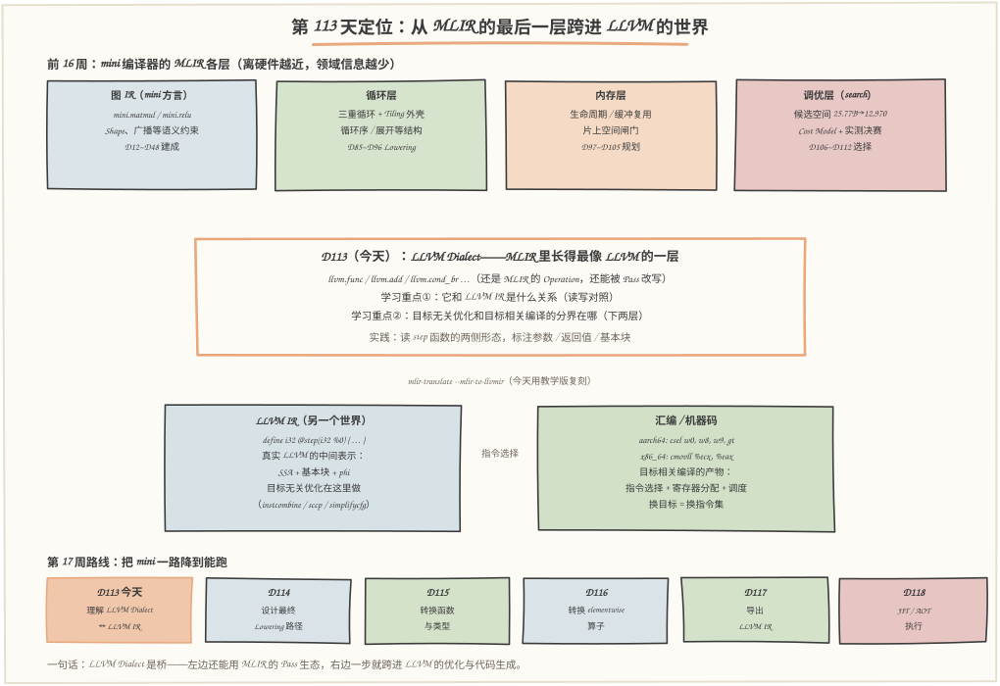
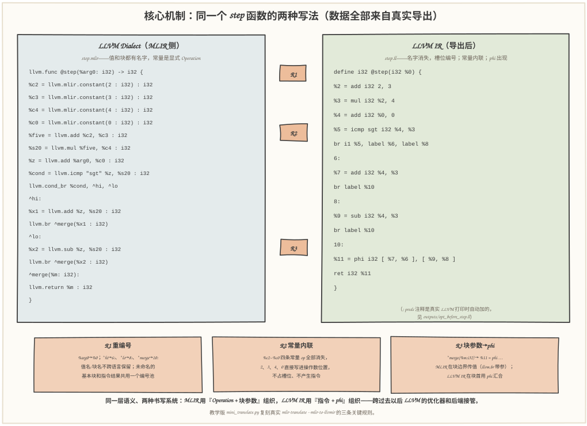
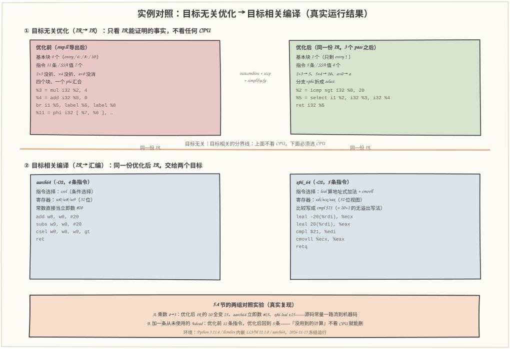

# 第 113 天：理解 LLVM Dialect 与 LLVM IR——从带名字的 Operation 到编号的 SSA，跨过 mlir-translate 这扇门

> **今日目标**：完成本教程后，你能做到五件事——用自己的话讲清 **LLVM Dialect 和 LLVM IR 的关系**（同一语义的两种载体：前者还是 MLIR 的 Operation、能被 Pass 改写、能与其他 Dialect 混居；后者是真 LLVM 的 SSA 世界），并默写导出的三条规则：R1 重编号（%arg0→%0、^hi→6:，未命名的块和指令结果共用同一个编号池——入口块也占槽位却从不显示，所以第一条指令是 %2）、R2 常量内联（4 条 llvm.mlir.constant 全部消失、不占槽位）、R3 块参数变 phi（^merge(%m: i32) → %11 = phi i32 [ %7, %6 ], [ %9, %8 ]）；**标注** @step 的参数/返回值/基本块——1 个参数、4 个基本块（entry/hi/lo/merge）、1 处返回点、1 个块参数→1 个 phi，全部由 annotate.py 遍历真实 LLVM 结构生成，注释版重新 parse＋verify 通过；说出**目标无关优化与目标相关编译的分界线**并报出两层的数字——优化前 4 块 / 11 条指令 / 7 个 SSA 值 → 优化后 1 块 / 5 条 / 4 个（instcombine＋sccp＋simplifycfg，不看任何 CPU），同一份优化后 IR 发给两个目标 aarch64 4 条（一条 csel）vs x86_64 5 条（两条 leal＋cmpl＋cmovll）——差异来自指令集表达力，不是优化好坏；解释优化后 IR 里三处新东西的来历——select（菱形折叠）、range(i32 41, 1)（sccp 值域：真侧 a+20≥41、假侧 a−20≤0，并集回绕成 [41, 1)）、add nuw（真分支条件下推出的无溢出标志）；独立运行 `./run_all.sh`（约 10 秒）复现 21 个产出文件，并用两组对照实验各证明一件事——乘数 4→5 时 range 变 (i32 51, 1)、汇编立即数一路变 #25 / cmpl $26（源码常量流到机器码），加一条从未使用的 %dead 后优化前 12 条 / 8 个 SSA、优化后与 @step 完全相同（死代码不看 CPU 就能删）。
> **预计时间**：学习 40 分钟＋实践 50 分钟
> **前置准备**：Python 3.11＋llvmlite（本文环境：aarch64 Linux，Python 3.11.4，llvmlite 0.50.0 内嵌 LLVM 22.1.0，与 D112 复盘同机同日，2026-11-13 冻结运行）。本机没有 MLIR 工具链——与 D57~D115 一致：`mini_translate.py` 是 mlir-translate --mlir-to-llvmir 的**教学仿真**（只覆盖今天例子的 9 个 op），但它吐出的 LLVM IR 文本交给**真 LLVM 22.1.0** parse、verify、优化、发汇编，标注遍历的也是真实 LLVM 解析出的模块结构——仿真的是"导出器"，运行的是"真 LLVM"。概念上需要：D112 的收官（两条信息链——今天看到的一切"化简"都发生在"语义可推理"的那条链上）、D39/D40 的 Verifier 与 SSA 课（单次定值、use-def）、以及 D85~D112 反复出现的"多层表示"直觉（Lowering 是换表示不是优化——今天把这句话推到 MLIR 的最后一层）。
> **今日产出**：`code/mini_translate.py`（教学版 mlir-translate：9 op 正则解析＋SSA 检查＋R1/R2/R3 三规则发射）、`code/annotate.py`（遍历真实 LLVM 结构：自动标注＋概念对照表）、`code/pipeline.py`（真 LLVM parse/verify＋3 个目标无关 pass＋两个 TargetMachine 发汇编）、`code/step.mlir`＋`code/variants/{step_const5,step_dead}.mlir`（贯穿例子与两个对照变体）、`code/run_all.sh`（一键复现，本机实测约 10 秒）、`outputs/` 21 个文件——计划要求的两个产出都在其中：**`outputs/step_annotated.ll`（带注释的 LLVM IR：参数/返回值/基本块/前驱后继/phi 来源）与 `outputs/concept_table.md`（概念对照表 10 行）**，外加优化前后 IR×3 组、两目标汇编×3 组、stats JSON×3、真实运行总日志，以及本文 3 张手绘图。

## 1. 今天解决什么问题？

D112 收官第四阶段：一周复盘把四周工作装进两条信息链——正确性信息靠推理、性能信息靠测量，结尾预告了第五阶段的第一步："读一个简单函数的 LLVM Dialect 和导出的 LLVM IR，标注函数参数、返回值和基本块"。今天（D113，第五阶段 D113~D140"端到端编译与 Runtime"的第一天、第 17 周第一天）就是这个动作。它看起来很小——一个函数、9 种 op、4 个基本块——但要回答的问题不小：**D85~D112 的全部工作（循环、Tiling、内存计划、调优）都发生在 MLIR 的世界里，而世界上绝大多数 CPU 不读 MLIR**。从 MLIR 到机器码，中间必须经过 LLVM；今天要看清这道门的两侧到底差什么，以及门后那个叫"优化"的词该怎么拆。

具体拆成三问：① **LLVM Dialect（llvm.\* 一族 op）和 LLVM IR 是什么关系**——为什么 MLIR 要专门造一个"长得像 LLVM"的方言？导出时哪些东西保留（函数名）、哪些变形（值名、块名、常量、块参数）、哪些消失（4 条 constant op）？② **目标无关优化和目标相关编译的分界在哪**——计划条目原话是"学习 LLVM Dialect、LLVM IR、目标无关优化和目标相关编译的关系"；同一份 IR，为什么有的化简不需要知道 CPU、有的决定必须知道？③ **块参数和 phi 这对"同一件事的两种写法"怎么互相翻译**？贯穿例子 `step.mlir` 的语义是 `s20=(2+3)*4=20; z=a+0; cond=z>s20; return cond ? z+s20 : z-s20`，故意埋了三处可优化点——常量折叠 (2+3)×4、加零 a+0、分支菱形（^hi/^lo/^merge）——让三问都有实测证据。输入：`code/step.mlir`；输出：带注释的 LLVM IR、概念对照表、优化前后 IR、两个目标的汇编。

## 2. 先看全貌：今天的内容位于哪里？



**图 1**：看三处——**左列**是前 16 周在 MLIR 里搭起的四层（图 IR D12~D48、循环层 D85~D96、内存层 D97~D105、调优层 D106~D112——"离硬件越近，领域信息越少"），每一层都还在 MLIR 的 Operation 世界里；**中间**是今天的位置：LLVM Dialect——MLIR 里长得最像 LLVM 的一层（llvm.func / llvm.add / llvm.cond_br… 还是 MLIR 的 Operation，还能被 Pass 改写），配两个学习重点：①它和 LLVM IR 是什么关系（读写对照）、②目标无关优化和目标相关编译的分界在哪（下两层）；**右列**是门后的世界：LLVM IR（`define i32 @step`…；SSA＋基本块＋phi；目标无关优化在这里做——instcombine/sccp/simplifycfg）和汇编/机器码（aarch64 的 csel、x86_64 的 cmovll；指令选择＋寄存器分配＋调度；换目标＝换指令集）；**底部**标出那扇门——mlir-translate --mlir-to-llvmir（今天用教学版复刻），以及第 17 周路线：把 mini 一路降到能跑。

把今天的工作串成 5 步：

1. **读**：`step.mlir` 的 LLVM Dialect 形态——9 种 op、4 个基本块、1 个块参数，三处故意埋的可优化点（(2+3)×4 常量折叠、a+0 加零、hi/lo/merge 分支菱形）；
2. **导出**：`mini_translate.py` 复刻 mlir-translate 的 R1/R2/R3，把 14 条 op 翻成 11 条指令的 `step.ll`（4 条常量内联消失、1 个 phi 新生），真 LLVM parse＋verify 通过；
3. **标注**：`annotate.py` 遍历真实 LLVM 结构生成 `step_annotated.ll`（每个基本块的前驱/后继、phi 的两条来源记录、返回点）和 `concept_table.md` 十行对照表——注释版重新 parse＋verify 通过，证明注释没有破坏 IR；
4. **优化与编译**：`pipeline.py` 在 O0 基线上跑 3 个目标无关 pass（4 块→1 块、11→5 条、7→4 个 SSA，`range(i32 41, 1)` 出现），再把**同一份**优化后 IR 交给 aarch64 与 x86_64 两个 TargetMachine（-O2：4 条 vs 5 条）；
5. **对照**：两组变体实验——乘数 4→5（值域与立即数一路联动到 cmpl $26）、加一条从未使用的 %dead（优化前 12 条/8 SSA，优化后与 @step 逐指令相同）。

一句话定位：**D85~D112 回答"怎么在 MLIR 各层把 mini 变成最好的循环和内存计划"，今天跨过 mlir-translate 这扇门——看清门两侧两种语言的逐条对应，以及门后"优化"这个词拆成的两半：不看 CPU 的 IR→IR，和必须选 CPU 的 IR→汇编。**

## 3. 核心概念：先用直觉，再给准确定义

今天三个概念一根链条：**载体（Dialect↔IR 是什么关系）→ 分层（优化发生在哪一层）→ 接缝（块参数怎么变 phi）**。

### 3.1 LLVM Dialect vs LLVM IR：同构的两种语言，中间一扇单向门

一句通俗解释：**LLVM Dialect 是住在 MLIR 里的"LLVM 影子"——词汇表刻意对齐 LLVM，但它仍是 MLIR 的 Operation**；LLVM IR 是真 LLVM 世界的唯一官方语言。同一个 @step 在两边语义逐条等价、形态规则完全两套；跨过去的动作叫导出（mlir-translate --mlir-to-llvmir）。

类比：**方言拼音与规范汉字**——一篇拼音拼写的中文和它的汉字转写表达同一件事：拼音文本还能用中文编辑工具处理、可以夹排英文术语；转成汉字后进入另一个排版系统，正字法全换。对应到技术上是：`llvm.add %c2, %c3 : i32` 逐词对应 `add i32 2, 3`，但左侧的 %c2 是一条**带名字的 Operation**（能被任何 MLIR Pass 匹配改写，能和 arith/scf/memref 的 op 混居一个 module——接下来 D114 起的最终 Lowering 全靠这一点），右侧的 2 是**立即数字面量**（无名、不占槽位）；左侧的块参数 ^merge(%m: i32) 是块签名的一部分，右侧必须换成汇合块块首的 phi。类比边界：拼音转汉字有大量歧义（多音字），而 LLVM Dialect 是**刻意设计成与 LLVM IR 同构的**——今天的 14 条 op 导出成 11 条指令，每一条都对得上号，差额恰好可解释（−4 常量内联＋1 phi 新生），导出是**机械翻译不是意译**；但"两个世界"这一点是真的：门是单向的——LLVM IR 变不回通用 MLIR，因为信息在导出时被扔掉了（比如那些名字）。当天实测证据：`concept_table.md` 十行——函数名保留（@step→@step）而参数重编号（%arg0→%0）、值名与块名全部消失改槽位（%five→%2、^hi→6:）、4 条常量内联（2/3/4/0 直接进操作数位）、块参数变 phi、br 里的传值移进 phi、module↔编译单元。

### 3.2 目标无关优化 vs 目标相关编译：一条信息分界线

一句通俗解释：**目标无关优化是"只看 IR 本身就能证明的化简"**——2+3=5、a+0=a、没人用的计算可删、小菱形可合成 select；**目标相关编译是"必须知道目标指令集才能做的决定"**——这条条件选择用 csel 还是 leal×2＋cmovll、常量放立即数还是寄存器。分界线不是组织线，是信息线：**IR→IR 不看 CPU；IR→汇编必须选 CPU**。

类比：**图纸化简与进场施工**——图纸阶段能做的化简（这堵非承重墙可以拆、这条死走廊可以抹掉）对任何施工队都成立；进场之后用哪种工艺、买哪家的砖，取决于具体工地。对应到技术上是：instcombine 在 IR 上证明 (2+3)×4=20 和 a+0=a（代数事实，与 CPU 无关）；simplifycfg 证明 hi/lo/merge 菱形等价于一条 select（控制流事实，与 CPU 无关）；而"a>20 怎么表达"没有统一答案——aarch64 一条 csel，x86_64 得用两条 leal 先把 a±20 都算出来、再 cmpl＋cmovll。类比边界：装修里图纸和施工是两拨人，编译器里两层都在 LLVM 内部、甚至共用同一个 PassBuilder——今天 `pipeline.py` 把 PassBuilder 挂在 aarch64 的 TargetMachine 上，但那 3 个 pass 只读 IR 本身，**换一个 TargetMachine 挂着，跑出的优化后 IR 一模一样**——这正是"目标无关"的可操作定义（不依赖，而不是碰巧相同）。另一处边界：图纸化简不产生新信息，IR 优化却会**长出新的注记**——`range(i32 41, 1)` 这种值域信息是优化器推理出来的新知识；而汇编层的形态受指令集表达力硬约束（x86_64 想一条指令做条件选择也做不到，所以是 5 条不是 4 条）。当天实测证据：4 块/11 条/7 SSA → 1 块/5 条/4 SSA（一份 IR，任何目标都这个结果）；同一份优化后 IR → aarch64 4 条 vs x86_64 5 条（两个目标，两份汇编）。

### 3.3 块参数 vs phi 节点：同一份对账单，两种记法

一句通俗解释：**两个前驱要给汇合块递一个值——MLIR 把值记在"每个前驱的跳转里"（块参数在块门口收，跳转时顺手塞进去），LLVM 把值记在"汇合块块首的对账单里"（phi 逐条声明每个前驱递来什么）**；写的位置从边上挪到中间，检查责任也跟着换边。

类比：**婚礼收礼**——MLIR 的做法：每位宾客（前驱）随礼时在红包上写清用途（`llvm.br ^merge(%x1 : i32)`），新人在门口设一个收礼口（^merge(%m: i32)）直接收齐；LLVM 的做法：红包不写字，新人在门口贴一张对账单（`%11 = phi i32 [ %7, %6 ], [ %9, %8 ]`）——"从 6 号来的红包是 %7、从 8 号来的是 %9"。对应到技术上是：块参数是汇合块**签名**的一部分（和函数参数同构——都是"进门的值"），phi 是汇合块的**第一条指令**（和普通指令同构——都是"算出一个值"）。类比边界：红包类比里两种记法只是习惯差异；技术上有一个真实的差别——**检查责任的分布**：MLIR 的 Verifier 检查"每个前驱都必须传值"，责任分散在每个跳转上（漏传当场拒绝，见常见错误 1）；LLVM 的 Verifier 检查"phi 的来源列表恰好覆盖每个前驱各一条"，责任集中在一条指令上——漏没漏，看 phi 一眼便知。还有一处能力差异：MLIR 块参数天然多值（^merge(%a: i32, %b: i32) 一个签名收两个），LLVM 要写两条 phi。当天实测证据：1 个块参数→1 个 phi；导出后 br 里不带值（`br label %10`），值出现在 phi 里；这就是 14−4＋1=11 里那个"+1"的来源。

## 4. 图解核心机制



**图 2**：左右两栏是**同一个 @step 的完整两种写法**（数据全部来自真实导出）——**左栏 step.mlir**（LLVM Dialect）：值和块都有名字（%five、^hi、^merge），常量是显式 Operation（4 条 llvm.mlir.constant 各占一行），块参数写在块门口（^merge(%m: i32)）、传值写在跳转里（llvm.br ^merge(%x1 : i32)）；**右栏 step.ll**（LLVM IR）：名字消失、按槽位编号（%2、6:、10:），常量内联成立即数（2、3、4、0 直接进操作数位），phi 出现在汇合块首（%11 = phi i32 [ %7, %6 ], [ %9, %8 ]），传值从 br 里消失。

按图走一遍核心问题——"同一个函数，两种写法到底差在哪三处"：

1. **R2 常量内联**（左 4 行 → 右 0 行）：%c2/%c3/%c4/%c0 四条 constant op 在右侧找不到任何对应行——它们的结果直接写成操作数位置的立即数（`add i32 2, 3`）。常量在 MLIR 里是 Operation（能被 Pass 匹配、能挂属性），在 LLVM IR 里只是字面量：不占槽位、不产生指令。这是 14 条 op 变 11 条指令的第一笔账（−4）；
2. **R1 重编号**（名字 → 槽位）：%arg0→%0（参数从 0 编起）；入口块占 %1 但从不显示，于是第一条指令结果是 %2；%five→%2、%s20→%3、%z→%4、%cond→%5；^hi 在其后拿到 6、^lo 拿到 8、^merge 拿到 10——**未命名的块和指令结果共用同一个编号池**，名字不跨语言保留（常见错误 2 专门讲这个读法）；
3. **R3 块参数变 phi**（边上 → 中间）：左栏 ^merge(%m: i32) 与两条带传值的 br；右栏 `br label %10` 不带值，%m 变成汇合块块首的 %11 = phi，两条来源记录 [ %7, %6 ]、[ %9, %8 ] 恰好对应两个前驱各塞进来的那个值——这一条是**新生的指令**（+1），MLIR 侧没有对应 op；
4. **收尾对账**：14 − 4 ＋ 1 = 11——两侧语义逐条等价，差额全部来自三处机械变形。注意导出**没有变聪明**：step.ll 和 step.mlir 一样"笨"（2+3 还没折、a+0 还在）——**导出是换载体，不是优化**；优化是下一步（pipeline.py）的事，发生在门的那一侧。

## 5. 动手实践：把 @step 送过导出、标注、优化、汇编四程

### 5.1 准备文件

```text
tutorials/day-113/
├── README.md                 ← 本文
├── images/                   ← 3 张手绘图（数字出自 outputs/ 冻结运行）
└── code/
    ├── step.mlir             # 贯穿例子：@step 的 LLVM Dialect（9 种 op、4 个块）
    ├── mini_translate.py     # 教学版 mlir-translate：9 op 解析＋SSA 检查＋R1/R2/R3 导出
    ├── annotate.py           # 遍历真实 LLVM 结构：自动标注＋概念对照表
    ├── pipeline.py           # 真 LLVM parse/verify＋目标无关优化＋两目标发汇编
    ├── run_all.sh            # 一键复现（5 个步骤，本机实测约 10 秒）
    ├── gen_images.py         # 生成 3 张图
    ├── variants/
    │   ├── step_const5.mlir  # 对照 A：乘数 4→5
    │   └── step_dead.mlir    # 对照 B：加一条从未使用的 %dead
    └── outputs/              # 21 个文件（2026-11-13 冻结运行）
        ├── step.ll / step_annotated.ll / concept_table.md    # 今日主产出
        ├── opt_before_step.ll / opt_after_step.ll            # 优化前后 IR
        ├── step_aarch64.s / step_x86_64.s                    # 两目标汇编
        ├── const5 / dead 两组对应产物（IR×4＋汇编×4）         # 对照实验
        ├── stats_{step,const5,dead}.json                     # 机器可读摘要
        └── run-all-log.txt                                   # 真实运行总日志
```

环境：aarch64 Linux，Python 3.11.4，llvmlite 0.50.0（内嵌 LLVM 22.1.0）。一键复现：

```bash
cd tutorials/day-113/code && ./run_all.sh     # 约 10 秒
```

**诚实声明**：本机没有 MLIR 工具链（与 D57~D115 一致）。`mini_translate.py` 是 mlir-translate --mlir-to-llvmir 的**教学仿真**——只覆盖今天例子的 9 个 op，但刻意复刻真实导出的三条关键规则；它输出的 LLVM IR 文本随后交给**真 LLVM 22.1.0**（llvmlite 内嵌）parse、verify、优化、发汇编；`annotate.py` 的标注遍历的也是真实 LLVM 解析出的模块结构，注释版生成后重新 parse＋verify 兜底。仿真的是"导出器"，运行的是"真 LLVM"。

### 5.2 编写代码

**① 教学版"翻译"其实是什么**——`mini_translate.py` 不是简化版编译器，是对 mlir-translate **一条已定义行为**的复刻：输入是 9 个 op 的 LLVM Dialect 文本（9 条正则逐行解析成 Func/Block/Op 对象），输出是逐条对应的 LLVM IR 文本。它做且只做三件事：`check_ssa`（教学版静态检查：单次定值＋块序近似支配性＋块参数传值完整——真实工具链里这是 MLIR Verifier 的职责，这里做成导出前的门，见常见错误 1）；`allocate`（槽位分配——R1/R2 的实现核心）；`translate`（按 R1/R2/R3 逐 op 发射）。刻意**不做**任何"聪明"的事：不优化、不改写、不合并——导出是换载体不是优化。槽位分配的完整实现只有 20 来行：

```python
def allocate(func):
    slot = -1
    names = {}
    for a, _ty in func.args:              # 参数：0..n-1
        slot += 1
        names[a] = f"%{slot}"
    for b in func.blocks:
        slot += 1                          # 每个块占一个槽位（入口块也占，从不显示）
        b.slot = slot
        for op in b.ops:
            if op.kind == "constant":
                names[op.res] = op.lit     # R2：常量内联，不占槽位
            elif op.has_result:
                slot += 1
                names[op.res] = f"%{slot}"
    for b in func.blocks:                  # 块参数 → phi 结果，占槽位
        if b.arg:
            slot += 1
            names[b.arg] = f"%{slot}"
    return names
```

**② 为什么 9 个 op 就够**——这 9 个 op（llvm.func / llvm.mlir.constant / llvm.add / llvm.mul / llvm.sub / llvm.icmp / llvm.cond_br / llvm.br / llvm.return）不是随手挑的，是"讲清两门语言差异"的**最小充分集**：llvm.func＋llvm.return 划定函数边界（参数重编号 %arg0→%0 与返回值标注——今天实践动作的两个对象）；llvm.mlir.constant 单独成 op（R2 的证据来源——别的 op 的操作数在 IR 里也是立即数，但只有 constant 能让你看见"MLIR 里常量是一条指令"）；llvm.add/mul/sub 三条整数运算足够埋下三个可优化点，还能让优化器长出 nuw 标志；llvm.icmp＋llvm.cond_br＋llvm.br 构成**最小分支菱形**（entry→hi/lo→merge）——菱形是关键：有汇合点才逼出块参数，有块参数才能讲 phi。缺任何一个维度，三规则里就有一条没着落：去掉两种跳转就没有多基本块（R1 的块编号、R3 整体用不上）；去掉 constant 就看不见 R2；去掉 func/return 就没有参数对照。真实 mlir-translate 覆盖几百个 op，但今天的全部概念恰好被这 9 个撑满。

**③ llvmlite 三步：parse/verify → 目标无关优化 → 目标相关发汇编**——`pipeline.py` 的 `run()` 把导出文本送进真 LLVM：

```python
mod = llvm.parse_assembly(src)          # ① 真 LLVM：文本 → 模块（结构统计数的是它，不是数字符）
mod.verify()
before = stats(mod)                     #    优化前：4 块 / 11 条指令 / 7 个 SSA 值

tm_arm = llvm.Target.from_triple(TARGETS[0][0]).create_target_machine(opt=2)
pto = llvm.create_pipeline_tuning_options(speed_level=0)   # O0 基线
pb = llvm.create_pass_builder(tm_arm, pto)
npm = pb.getModulePassManager()
npm.add_instruction_combine_pass()      # ② 目标无关：常量折叠 / 加零消除 / 分支变 select
npm.add_sccp_pass()                     #    稀疏条件常量传播（range 属性的来源）
npm.add_simplify_cfg_pass()             #    控制流化简（4 块并 1 块）
npm.run(mod, pb)
mod.verify()
after = stats(mod)                      #    优化后：1 块 / 5 条指令 / 4 个 SSA 值

for triple, fname in TARGETS:           # ③ 目标相关：同一份 mod，两个 TargetMachine
    tm = llvm.Target.from_triple(triple).create_target_machine(opt=2)
    asm = tm.emit_assembly(mod)         #    aarch64 4 条 / x86_64 5 条
```

两个设计决定值得注意：**PassBuilder 挂在 aarch64 的 TargetMachine 上**——但那 3 个 pass 只读 IR 不看目标，所以挂在哪个目标上结果都一样（这正是"目标无关"的可操作定义，也是 3.2 类比边界的出处）；**O0 基线（speed_level=0）之上显式加 3 个 pass**——不跑完整 -O2 管线，让"哪些化简是哪条 pass 做的"可归因：常量折叠与加零消除来自 instcombine，range 来自 sccp，4 块并 1 块来自 simplifycfg。

### 5.3 运行与观察

```bash
cd tutorials/day-113/code && ./run_all.sh
```

真实输出节选（`outputs/run-all-log.txt`，2026-11-13 冻结运行）：

```text
== 步骤 1：LLVM Dialect → LLVM IR（教学版 mlir-translate）==
已导出 LLVM IR：outputs/step.ll
  @step: 参数 1 个；基本块 4 个；MLIR 指令 14 条（其中常量 4 条内联消失）；块参数 1 个 → phi 1 个

== 步骤 2：标注函数参数 / 返回值 / 基本块 + 概念对照表 ==
已生成 outputs/step_annotated.ll
已生成 outputs/concept_table.md
注释版重新 parse+verify 通过（注释没有破坏 IR）
  @step：1 参数 / 4 基本块

== 步骤 3：目标无关优化（IR→IR）+ 目标相关编译（IR→两个目标的汇编）==
[step] 输入：outputs/step.ll
  优化前 @step：4 块 / 11 条指令 / 7 个 SSA 值
  优化后 @step：1 块 / 5 条指令 / 4 个 SSA 值（instcombine + sccp + simplifycfg，目标无关）
  aarch64-unknown-linux-gnu（-O2，目标相关）：4 条指令行
  x86_64-unknown-linux-gnu（-O2，目标相关）：5 条指令行
```

今日主产出之一是带注释的 LLVM IR（`outputs/step_annotated.ll` 节选——注释由 `annotate.py` 遍历真实 LLVM 结构生成，前驱/后继都是从解析后的模块里算出来的，不是手写的）：

```llvm
; ▼ 函数 @step：参数 1 个、基本块 4 个、返回类型 i32
;   参数对照：%0 ← MLIR %arg0
;   返回点：1 处
define i32 @step(i32 %0) {
; ── 基本块 1/4：entry（MLIR 隐式入口块）
;    前驱 0 个（入口块）
;    后继 2 个：%6、%8
  %2 = add i32 2, 3
  %3 = mul i32 %2, 4
  %4 = add i32 %0, 0
  %5 = icmp sgt i32 %4, %3
  br i1 %5, label %6, label %8   ; ← 条件跳转（llvm.cond_br）：真/假各走一个后继
; ── 基本块 4/4：10（MLIR ^merge）
;    前驱 2 个：6、8
;    后继 0 个（出口块，含 ret）
10:
  %11 = phi i32 [ %7, %6 ], [ %9, %8 ]   ; ← phi：本块的块参数（MLIR ^merge 的 %m）；前驱各送一个值：%7 来自 %6；%9 来自 %8
  ret i32 %11   ; ← 返回值：%11
}
```

（完整文件 36 行，含 ^hi、^lo 两个块的注释；生成后重新 parse＋verify 通过。）三个 pass 之后，同一个函数塌成一条直线（`outputs/opt_after_step.ll`）：

```llvm
define range(i32 41, 1) i32 @step(i32 %0) {
  %2 = icmp sgt i32 %0, 20
  %3 = add nuw i32 %0, 20
  %4 = add i32 %0, -20
  %5 = select i1 %2, i32 %3, i32 %4
  ret i32 %5
}
```

同一份优化后 IR 交给两个目标（`outputs/step_aarch64.s` / `outputs/step_x86_64.s`，-O2）：

```asm
# aarch64-unknown-linux-gnu：4 条指令行
    add   w8, w0, #20
    subs  w9, w0, #20        // 顺带按 a-20 置位标志，比较免费搭车
    csel  w0, w8, w9, gt
    ret
# x86_64-unknown-linux-gnu：5 条指令行
    leal   -20(%rdi), %ecx
    leal   20(%rdi), %eax
    cmpl   $21, %edi         // x>20 写成无溢出的 x≥21
    cmovll %ecx, %eax
    retq
```

今日主产出之二是概念对照表（`outputs/concept_table.md`，10 行全录）：

| 概念 | LLVM Dialect（MLIR 侧） | LLVM IR（导出后） | 本例实例 |
|---|---|---|---|
| 函数 | llvm.func @step(%arg0: i32) -> i32 | define i32 @step(i32 %0) | 函数名保留；参数重编号为 %0 |
| 函数参数 | %arg0: i32（带名字） | %0（无名，按槽位编号） | %arg0 → %0 |
| 常量 | llvm.mlir.constant(2 : i32) : i32（共 4 条） | 立即数字面量 2（不占槽位、不产生指令） | 2/3/4/0 全部内联进操作数位置 |
| SSA 值 | %five / %s20 / %z / %cond（结果带名字） | %2 / %3 / %4 / %5 | 名字不跨语言保留，改为槽位编号 |
| 基本块 | ^entry（隐式） / ^hi / ^lo / ^merge（块标签带名字） | 入口块无标签 / 6: / 8: / 10: | 块名不保留，改为槽位编号；入口块编号从不显示 |
| 块间传值 | ^merge(%m: i32)——块参数 | %11 = phi i32 [ %7, %6 ], [ %9, %8 ] | MLIR 的块参数 = LLVM IR 的 phi 节点 |
| 无条件跳转 | llvm.br ^merge(%m : i32)（带传值） | br label %10 | 传值不出现在 br 里，而在 ^merge 块首的 phi 中 |
| 条件跳转 | llvm.cond_br %cond, ^hi, ^lo | br i1 %5, label %6, label %8 | i1 条件值 + 两个后继块 |
| 返回 | llvm.return %m : i32 | ret i32 %11 | 返回 phi 结果 %11 |
| 模块容器 | module { … } | ; ModuleID = 'LLVMDialectModule' + 顶层定义 | MLIR module ↔ LLVM 编译单元 |

三个值得驻足的真实数字：

- **14 − 4 ＋ 1 ＝ 11**：MLIR 侧 14 条 op，4 条常量被 R2 内联消失，phi 是导出时新生的（块参数 %m 不是 op）——两个"指令数"口径差的完整解释（常见错误 3 专门讲）；
- **1 块 / 5 条 / 4 个 SSA**：菱形整个塌掉——分支＋phi 折成 select、(2+3)×4 折成 20、a+0 消成 a。`range(i32 41, 1)` 是 sccp 的值域标注：真分支 a+20 ≥ 41（a=21 时取最小）、假分支 a−20 ≤ 0（a=20 时取最大 0），并集 [41, +∞)∪(−∞, 0] 在有符号数环上写成回绕区间 [41, 1)——**1..40 之间的任何整数都不可能是返回值**。注意不对称：%3 带 nuw（a>20 时 a+20 不无符号回绕，由支配条件保证），%4 不带（a 接近 INT_MIN 时 a−20 会回绕）；
- **4 条 vs 5 条**：两个目标吃的是**同一份**优化后 IR（emit_assembly 之前 mod 不再变）。aarch64 的 `subs` 把"算 a−20"和"比较 a 与 20"合成一条（减法顺带置位标志），csel 一条完成条件选择；x86_64 的 leal 不置位标志，比较必须单独一条 cmpl——**多出的那一条就是"比较不能搭车"的代价**，与优化好坏无关。



**图 3**：上下两半正是 3.2 的分界线两侧——**上半（目标无关，IR→IR）**：优化前 4 个基本块（entry / 6: / 8: / 10:）、11 条指令、7 个 SSA 值——2+3 没折、×4 没折、a+0 没消、四个块一个 phi 汇合；三个 pass 之后 1 个基本块、5 条指令、4 个 SSA 值——2+3→5、5×4→20、a+0→a、分支＋phi 折成 select。**下半（目标相关，IR→汇编）**：同一份优化后 IR 交给两个目标——aarch64（-O2，4 条）：csel 一条完成条件选择、常数直接当立即数 #20；x86_64（-O2，5 条）：两条 leal 先把 a±20 都算出来、cmpl $21（x>20 的无溢出写法）再 cmovll。底部还画了 5.4 的两组对照：A 乘数 4→5（20 全变 25、立即数一路流到机器码）、B 加 %dead（12 条优化后回到 5 条）。环境注记：Python 3.11.4 / llvmlite 内嵌 LLVM 22.1.0 / aarch64，2026-11-13 冻结运行。

### 5.4 修改一个参数再观察

两组低成本对照（输入在 `code/variants/`，一条命令一个实验，输出都进 `outputs/`）：

1. **对照 A：乘数 4→5**（`variants/step_const5.mlir`，函数改名 @step5，其余逐字不变）——先预测再运行，四个观察全部命中：导出后结构纹丝不动（4 块/11 条指令/1 个 phi，只有立即数 4→5）；优化后（`opt_after_const5.ll`）**值域随常量联动**——`range(i32 41, 1)`→`range(i32 51, 1)`（真侧 a+25≥51：a=26；假侧 a−25≤0：a=25）、`icmp sgt %0, 20`→`25`、`add nuw %0, 20`→`25`、`add %0, -20`→`-25`——sccp 的传播一路追到函数签名；汇编立即数跟着走：aarch64 `#20`→`#25`，x86_64 `leal ±20`→`±25`、`cmpl $21`→`$26`（x>25 的无溢出写法）。**源码常量一路流到机器码，每一层都能对上账**；
2. **对照 B：加一条从未使用的 %dead**（`variants/step_dead.mlir`，在 %z 之后插入 `%dead = llvm.add %z, %c3 : i32`）——优化前死代码真实存在：MLIR 指令 14→15 条、IR 指令 11→12 条、SSA 值 7→8 个（`opt_before_dead.ll` 里它是 `%5 = add i32 %4, 3`，还把后续编号整体推后一位）；优化后与 @step **完全相同**——1 块/5 条指令/4 个 SSA、连 range 都是 (i32 41, 1)，两个目标的汇编除函数名外逐行相同（diff 只剩 `.globl`/`.type`/`.size` 的名字）。**"没人用的计算"不需要任何 CPU 信息就能判定可删**——这是"目标无关"的定义性例子。

真实输出节选（`outputs/run-all-log.txt` 步骤 5，对照 B）：

```text
== 步骤 5：对照实验 B：加一条从未使用的 %dead ==
已导出 LLVM IR：outputs/step_dead.ll
  @step_dead: 参数 1 个；基本块 4 个；MLIR 指令 15 条（其中常量 4 条内联消失）；块参数 1 个 → phi 1 个
[dead] 输入：outputs/step_dead.ll
  优化前 @step_dead：4 块 / 12 条指令 / 8 个 SSA 值
  优化后 @step_dead：1 块 / 5 条指令 / 4 个 SSA 值（instcombine + sccp + simplifycfg，目标无关）
```

## 6. 常见错误与排查

以下四条全部来自今天阅读与改造这条管线时的真实踩坑/误读，每条都有现象、原因、定位和修复。

- **现象**：把 ^lo 分支的 `llvm.br ^merge(%x2 : i32)` 改成 `llvm.br ^merge`（忘传值），翻译器当场拒绝：`ValueError: 块 ^merge 有块参数 %m，但前驱 ^lo 的跳转没有传值`——导出根本不发生。
  **原因**：块参数是汇合块与**所有**前驱的合同——^merge(%m: i32) 声明"进门必须带一个 i32"，两个前驱各有一条传值记录，少一条 %m 就没有定义。真实工具链里这由 MLIR Verifier 拒绝；LLVM 侧的镜像检查是 phi 的"每个前驱恰好一条来源"。
  **定位**：`check_ssa` 的第三段——先用 `_pred_ops` 找齐所有跳向 ^merge 的 terminator，再核对每个前驱是否都传了值。
  **修复**：补上传值 `llvm.br ^merge(%x2 : i32)`。教训：块参数的完整性责任分布在**每个前驱**上——这正好解释了 3.3 的对比：MLIR 把传值写在跳转里（责任就地明确），LLVM 把 phi 写在汇合块里（对账单集中一处，谁漏了一目了然）。

- **现象**：读 `step.ll`，参数是 %0，第一条指令结果却是 %2——%1 像是丢了；块标签从 6: 蹦出来，5、6 之间还有空隙。
  **原因**：R1 槽位规则——LLVM IR 里**未命名的块和未命名的指令结果共用同一个编号池**：参数 0..n-1；随后按块序每个块占一个槽位（入口块也占——%1，只是从不显示）；块内每条有结果的指令再各占一个。所以 %0=参数、%1=入口块（隐形）、%2=第一条指令；入口块（%1）＋四条指令（%2~%5）之后，^hi 才拿到 6。
  **定位**：`allocate()` 的分配循环（代码注释"入口块也占，只是从不显示"）；最硬的证据是 round-trip——`outputs/opt_before_step.ll` 就是把 step.ll 交给真 LLVM parse 后的官方排版（str(mod)，含 `; preds` 注释），编号纹丝不动：6:、8:、10:、%2..%11 与 step.ll 完全一致。
  **修复**：不是 bug，是读法——读 .ll 时按编号池规则倒推。教训：**LLVM IR 的编号是"槽位"不是"名字"**，它不承载语义、只保证唯一；这正是"名字不跨语言保留"的深层原因。

- **现象**：`run-all-log.txt` 里步骤 1 说"@step: MLIR 指令 14 条"，步骤 3 说"优化前：11 条指令"——同一段代码两个数，而且 14−4（常量内联）=10≠11。
  **原因**：三个口径——14 是 **MLIR 侧 op 数**（含 4 条 llvm.mlir.constant 和全部 terminator）；导出时 4 条常量内联消失（R2）剩 10 条；但 phi 是 **LLVM IR 侧新生**的指令（MLIR 的块参数 %m 不是 op、不在这 14 条里），10＋1=11。
  **定位**：逐行对照 `step.mlir` 与 `step.ll`：14 条 op 里 4 条 constant 找不到对应行；step.ll 的 `%11 = phi` 在 step.mlir 里找不到 op——一多一少正好相抵。
  **修复**：记住换算式 14 − 4 ＋ 1 = 11（一般式：IR 指令数 = MLIR op 数 − 常量数 ＋ 块参数数）。教训：跨语言对账时先问"这个数是在哪个世界数的、口径里含不含常量和块参数"——两个世界各有各的计数器，谁也不能直接当谁用。

- **现象**：看到 aarch64 只有 4 条、x86_64 有 5 条，得出"x86 后端优化差"或"aarch64 优化更好"的结论。
  **原因**：两个目标吃的是**同一份**优化后 IR（`pipeline.py` 里 emit_assembly 之前 mod 不再变）——5−4 的差额全部来自指令集表达力：aarch64 的 `subs` 把"算 a−20"和"比较 a 与 20"合成一条（减法顺带置位标志，csel 直接连用）；x86_64 的 leal 是地址式算术、**不置位标志**，比较必须单独一条 cmpl。
  **定位**：看 `pipeline.py` 的循环——两个 TargetMachine 从同一份 mod 出发；再并排读两份汇编：多出的那条恰好就是 cmpl（比较不能搭车的代价）。
  **修复**：把分界线画在 emit_assembly 之前——IR 层的数字（4 块→1 块、11→5 条）才是"优化"的账；汇编层的数字（4 vs 5）是"指令集"的账。教训：**比较两个目标的代码量之前，先确认它们拿到的是不是同一份 IR**。

## 7. 今日练习

### 必做练习

拿今天的产物做两件事（输入输出写清楚，不提供完整答案）：

1. **手算与值域对账**：用优化后的 select 形式手算 @step 在 a=21、20、25、10 四个输入下的返回值；再回答两个问题——(a) `range(i32 41, 1)` 的左端 41 对应哪个输入（提示：真分支 a+20 的最小值）？右端 1 是开区间端——它右边那个 0 对应哪个输入？(b) 为什么 1..40 之间的任何整数都不可能是返回值？最后用一行 python 验证四个手算值。
2. **预测再验证（乘数 4→6）**：复制 step.mlir 为 `variants/step_const6.mlir`（%c4→%c6、函数改名 @step6），先写下四个预测——(a) 导出后的块数/IR 指令数/phi 数变不变？(b) 优化后 icmp 与两条 add 的立即数各是多少？(c) range 的两个端点（提示：真分支最小值来自 a=31，假分支最大值来自 a=30）？(d) 两个目标的汇编立即数（cmpl 的常数按"x>30 的无溢出写法"算）？再仿照 run_all.sh 步骤 4 的两条命令运行对答案，错的每条写一句"我漏了哪个机制"。

### 选做挑战

两题任选（都做更好）：**① 给 mini_translate.py 加第 10 个 op**——llvm.select（`%r = llvm.select %c, %a, %b : i1, i32` → `select i1 %c, i32 %a, i32 %b`；今天优化后 IR 里的 %5 就是它的产物，现在把它的方言形态做进导出器）：需要动三处（SELECT_RE 正则、has_result、translate 的发射分支），做完写一个单块函数导出，交真 LLVM verify 收尾。**② 编号池实验**：手写一个 .ll——参数 2 个、3 个块、每块 2 条有结果指令（块用无名编号），先笔算每个槽位号，再用 llvmlite parse＋str() 打印对答案；然后删掉中间一个块，观察后续块的编号整体前移几位——用实验亲手证明"块和指令共用编号池、入口块也占槽位"。

## 8. 今日验收

- [ ] 我能用自己的话讲清 LLVM Dialect 和 LLVM IR 的关系（同一语义的两种载体：前者还是 MLIR 的 Operation、能被 Pass 改写、能与其他 Dialect 混居；后者是真 LLVM 的 SSA 世界），并默写三条导出规则 R1/R2/R3
- [ ] 我能解释 %1 为什么"消失"（入口块也占槽位、从不显示——块和指令结果共用编号池），并算出 14−4＋1=11 的换算（常量内联消失、phi 新生）
- [ ] 我能指出目标无关优化与目标相关编译的分界线，并报出两层的数字：4 块/11 条/7 SSA → 1 块/5 条/4 SSA（不看 CPU）；同一份 IR 发给两个目标 4 条 vs 5 条（必须选 CPU，差额来自指令集表达力——subs 置位标志、leal 不置位）
- [ ] 我能解释优化后 IR 里三处新东西的来历：select（菱形折叠）、range(i32 41, 1)（sccp 值域：真侧 ≥41、假侧 ≤0 的回绕并集）、add nuw（真分支条件下推出的无符号不回绕标志——假侧 a−20 会回绕所以没有）
- [ ] 我能独立运行 `./run_all.sh`（约 10 秒）复现 21 个产出文件，并在 step_annotated.ll 里指出：1 个参数、4 个基本块各自的前驱/后继、1 处返回点、phi 的两条来源记录
- [ ] 我能复述两组对照实验的结论：乘数 4→5 时 range 变 (i32 51, 1)、立即数一路联动到 #25 / cmpl $26（常量流到机器码）；加 %dead 后优化前 12 条/8 SSA、优化后与 @step 完全相同（死代码不看 CPU 就能删）

## 9. 一句话总结与明天预告

今天的闭环：**问题**——第五阶段开篇，mini 之下的最后两层（LLVM Dialect 与 LLVM IR）第一次同时摆在眼前：它们是什么关系、"优化"发生在哪一层；**机制**——R1 重编号（名字不跨语言保留，块和指令共用槽位池，入口块占 %1 却从不显示）、R2 常量内联（4 条 constant 消失、不占槽位）、R3 块参数变 phi（^merge(%m) → %11 = phi i32 [ %7, %6 ], [ %9, %8 ]），导出是换载体不是优化；**实践**——@step 的 14 条 op 导出成 11 条指令，annotate.py 遍历真实 LLVM 结构标注参数/返回值/基本块并生成十行概念对照表，注释版重新 parse＋verify 通过；**验证**——目标无关一层（4 块→1 块、11→5 条、7→4 SSA，select/range/nuw 三处新东西全部可解释）、目标相关一层（同一份 IR：aarch64 4 条 csel、x86_64 5 条 leal×2＋cmpl＋cmovll）、外加两组对照（乘数 4→5 值域与立即数一路联动、%dead 死代码全灭）和四个常见误读的定位修复。明天 D114 设计最终 Lowering 路径：TypeConverter（memref/index 这些类型怎么换成 LLVM 类型）、目标 Dialect 合法性清单（什么算"降完了"——今天 9 个 op 的全 llvm.\* 就是合法形态的样子）、部分转换（一次降不完怎么办）——今天的三条导出规则，就是那条路径终点上的验收标准。
