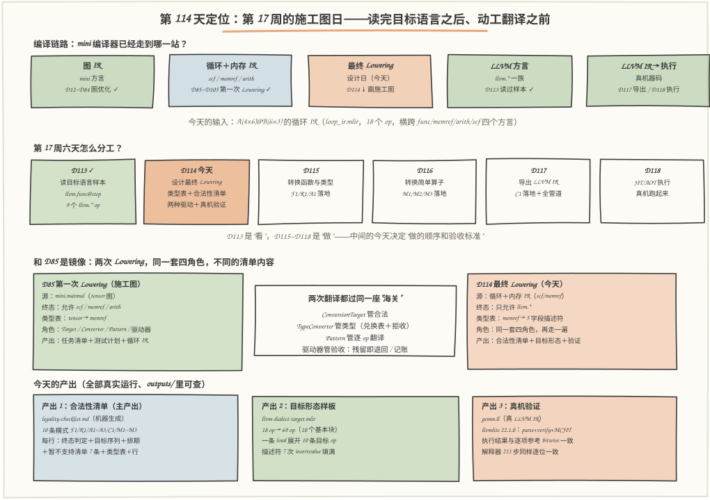
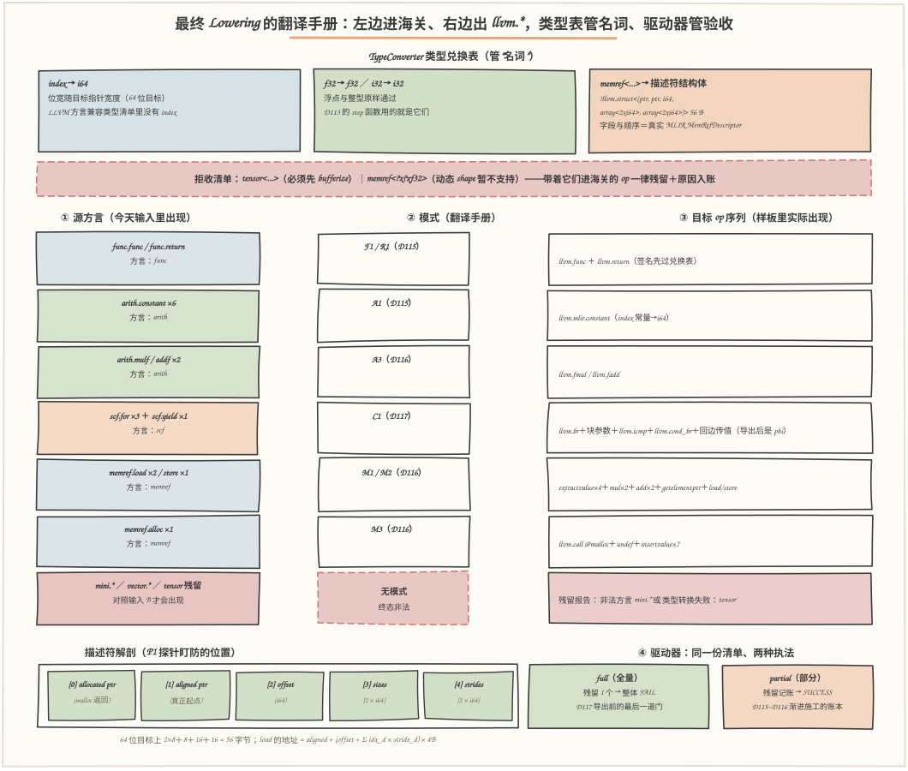
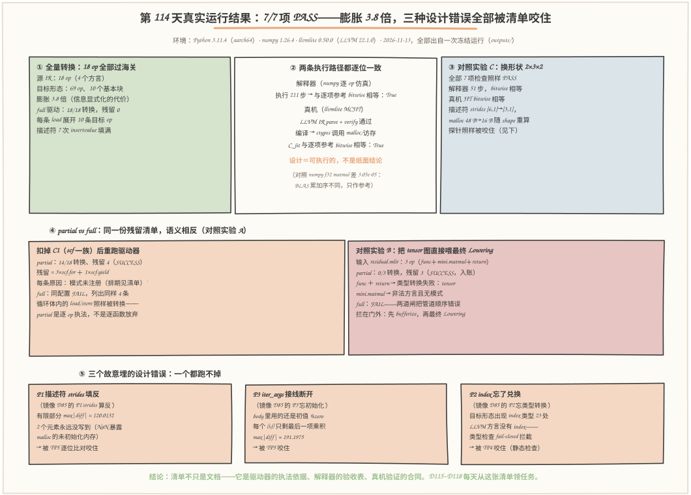

# 第 114 天：设计最终 Lowering 路径——循环 IR 进海关前，先把"翻译手册"写成可执行的清单

> **今日目标**：完成本教程后，你能做到五件事——用自己的话讲清 TypeConverter 在最终 Lowering 里管什么（把 `index` 换成 `i64`、把 `memref` 换成 5 字段描述符结构体、把不认识的类型挡在门外）、ConversionTarget 的"终态合法性"和"本 Pass 合法性"差在哪（终态：终图只允许 `llvm.*`）；独立填出 `mini`／循环／内存三类 Operation 的转换目标清单，并说清每一行"目标 op 序列"和"暂不支持"的理由；用同一段 Pattern 注册表分别跑 **全量转换** 和 **部分转换**，预测并解释两种模式下残留 op 的差别（缺 `scf.for` 模式时残留几个、缺 `memref` 模式时又如何），读懂残留报告；独立运行 `final_lowering.py` 复现类型表、合法性清单、目标形态与真机验证（llvmlite 22.1.0 JIT 执行 GEMM 与参考逐位一致），以及三个探针的真实失败数字。
> **预计时间**：学习 40 分钟＋实践 50 分钟
> **前置准备**：Python 3.11＋numpy＋llvmlite（本文环境：aarch64 Linux，Python 3.11.4，numpy 1.26.4，llvmlite 0.50.0 内嵌 LLVM 22.1.0，与 D113 同机）。本机没有安装 MLIR——与 D57~D113 一致，用 Python 复刻 MLIR DialectConversion 的角色分工（TypeConverter／ConversionTarget／ConversionPattern／驱动器），但**目标形态本身用真 LLVM（llvmlite）验证**。内容上需要：D85 的"四角色"结论（第一次 Lowering 的施工图）、D86~D105 的循环与内存表示（今天的输入就是它们的产物）、D113 的 LLVM Dialect 语法与三条导出规则（R1 重编号、R2 常量内联、R3 块参数变 phi）。
> **今日产出**：`code/final_lowering.py`（类型表＋合法性清单＋模式注册表＋两种驱动＋测试与探针，全部可运行）、`code/loop_ir.mlir`（输入源 IR）、`code/variants/residual.mlir`（残留对照输入）、`code/outputs/design-doc.md`（最终 Lowering 设计文档）、`code/outputs/legality-checklist.md`（合法性清单——今日主产出）、`code/outputs/llvm-dialect-target.mlir`（目标形态样板）、`code/outputs/gemm.ll`（真机验证用 LLVM IR）、`code/outputs/conversion-report.txt`（检查＋对照实验报告）＋本文 3 张手绘图。

## 1. 今天解决什么问题？

D113 结束时，你读过了"目标语言"的样本：一个 `llvm.func @step`，9 个 `llvm.*` Operation，知道它和 LLVM IR 是什么关系。但那是一份**别人写好的样本**。第 17 周的真正任务是让 `mini` 编译器自己的产出走到那里——D118 的终点是"能执行"，倒推一步：D117 导出 LLVM IR，再倒推一步：D115~D116 把函数、类型、算子转成 LLVM 方言。**那第 114 天做什么？**

和 D85 面对完全相同的处境：动工写 Pass 之前，先把翻译手册写成清单。D85 当时要翻译的是 `mini.matmul` → 三重循环＋内存，那是**第一次 Lowering**；今天要翻译的是循环 IR（`scf.for`＋`memref`＋`arith`）→ LLVM 方言，这是**最终 Lowering**。两次翻译用的是同一套 MLIR 框架（DialectConversion 的四个角色），要回答的是同样四个问题：**终图什么算合法（ConversionTarget）？类型怎么换（TypeConverter）？每条 op 翻译成什么（ConversionPattern）？翻不完的怎么办（驱动器）**。区别只在答案的具体内容——第一次 Lowering 把 `tensor` 换成 `memref`，最终 Lowering 把 `memref` 换成 5 字段描述符结构体；第一次的终态允许 `scf`/`memref`，最终 Lowering 的终态**只允许 `llvm.*`**。

为什么不能直接开始写代码？因为最终 Lowering 的四个答案比第一次更"卡脖子"：**类型上**，`index` 在 LLVM 方言里根本不存在（LLVM 方言只认内置兼容类型），`memref` 必须变成 `(allocated_ptr, aligned_ptr, offset, sizes[], strides[])` 五字段结构体——字段顺序记错一个，所有地址全错；**合法性上**，"合法"分两层——每个 Pass 自己的合法集（比如只转 `scf` 的 Pass 允许 `memref` 留着）和整条管道的终态合法集，混为一谈就会在 D117 导出时才发现漏了一个模式；**失败模式上**，MLIR 给了三种驱动模式（full／partial／greedy），"残留 op"在 full 模式下是整批退回，在 partial 模式下是留着＋打报告——选哪种、残留报告给谁看，是今天要定的事。任何一处含糊，D115 写函数转换、D116 写算子转换时就会返工。

今天的贯穿例子沿用整条流水线的老朋友：`A(4,6) @ B(6,3) → C(4,3)`，行主序，f32，静态 shape。它的循环形态就是 D85 设计、D86~D105 实现、D111 验收过的那份 IR（今天正式化为 `loop_ir.mlir`）：

```text
func @gemm(%a: memref<4x6xf32, strided<[6, 1]>>,
           %b: memref<6x3xf32, strided<[3, 1]>>) -> memref<4x3xf32, strided<[3, 1]>> {
  %c = memref.alloc() : memref<4x3xf32, strided<[3, 1]>>
  ...六个 arith.constant... 三重 scf.for（k 循环带 iter_args）...
  ...memref.load ×2 / arith.mulf / arith.addf / scf.yield / memref.store...
  return %c : memref<4x3xf32, strided<[3, 1]>>
}
```

**输入：18 个 Operation，横跨 4 个方言（func／memref／arith／scf）；输出：一份机器生成的合法性清单、一份目标形态样板（一个 `llvm.func`，全部由 `llvm.*` 组成），外加一个敢宣称"这套翻译真的能跑"的证据——样板结构在真 LLVM 上 JIT 执行，与逐项参考结果一致。**

## 2. 先看全貌：今天的内容位于哪里？



**图 1**：看三处——**上排**是整条编译链路：图 IR（mini 方言）→［D85~D105 第一次 Lowering，已完成］→ 循环＋内存 IR（scf／memref／arith）→**今天：设计最终 Lowering**→ LLVM 方言 →（D117）LLVM IR →（D118）执行；**中排**是今天和第 17 周其他天的关系：D113 是"读目标语言的样本"（输入侧），D115~D117 是"动工翻译"（实现侧），今天夹在中间画施工图；**下排**是 D85 与今天的镜像关系：两次 Lowering 用同一套四角色框架，只是清单内容不同——D85 把 `tensor` 换成 `memref`、终态允许循环和内存；今天把 `memref` 换成描述符、终态只允许 `llvm.*`。

把今天的工作串成 5 步：

1. **定类型表**：TypeConverter 写清每个源类型的去向——`index` → `i64`、`f32` 原样、`memref<4x6xf32, strided<[6,1]>>` → `!llvm.struct<(ptr, ptr, i64, array<2 x i64>, array<2 x i64>)>` 五字段描述符；`tensor` 和动态 shape 类型一律**转换失败**；
2. **定合法性**：ConversionTarget 声明终态——`llvm.*` 合法，`mini`／`scf`／`memref`／`arith`／`func` 五个方言整个非法，并给每个非法 op 挂"必须有模式，否则残留"；
3. **写翻译手册**：9 条 Pattern（F1／R1／A1~A3／C1／M1~M3）列清每类源 op 的目标 op 序列——例如一条 `memref.load` 翻成 10 条目标 op（4 次 extractvalue＋2 乘 2 加＋getelementptr＋load）；
4. **定驱动策略**：同一段模式注册表跑两种驱动——full（残留＝整批失败，D117 导出前的门）和 partial（残留＝打报告挂账，D115~D116 每天渐进的账本），并设计残留报告的格式；
5. **验收**：7 项检查（类型表／清单完整性／全量驱动／部分对照／目标形态合法性／语义仿真／真机 JIT）＋3 个故意埋的探针＋2 组对照实验（缺模式、含 `mini`＋`tensor` 的残留输入），全部真实执行。

一句话定位：**D85 回答"怎么把图算子翻译成循环和内存"，今天回答"怎么把循环和内存翻译成机器的母语——并且把翻译规则写成一份可执行、可验证、可挂账的清单"**。

## 3. 核心概念：先用直觉，再给准确定义

今天的三个概念一根链条：**类型兑换表 → 终态合法性 → 部分转换**。每个概念都拿贯穿例子（GEMM 的循环 IR）说话。

### 3.1 TypeConverter：把"类型"也列入翻译

一句通俗解释：**TypeConverter 是类型兑换表**——Operation 的翻译规则只管"动词"（`memref.load` 变 `llvm.load`），但每个操作数、每个结果还带着"名词"（类型），名词也得有官方汇率。

类比：翻译菜谱时不仅要译"翻炒"，还得译"毫升"和"克"——单位不换，读者照着做必炸。对应到技术上是：源 IR 的 `index`、`f32`、`memref<...>` 三种类型里，LLVM 方言只认识 `f32` 一种原样；`index` 必须换成固定位宽的整数（64 位目标上换 `i64`），`memref<4x6xf32, strided<[6,1]>>` 必须换成结构体 `!llvm.struct<(ptr, ptr, i64, array<2 x i64>, array<2 x i64>)>`——它就是一块内存的"五字段描述符"：分配指针（malloc 返回的原始指针）、对齐指针（偏移对齐后真正开始读的位置）、元素偏移、每维长度 sizes、每维步长 strides。真实 MLIR 的 `MemRefDescriptor` 正是这五个字段、这个顺序（`MemRefBuilder.h` 里 `pack` 的注释逐字写明：allocated pointer、aligned pointer、offset、sizes、strides）。类比边界：兑换表比菜谱单位狠的一点是——**它还有"拒收清单"**：`tensor` 类型在最终 Lowering 的兑换表里没有汇率，谁带着 `tensor` 进海关，谁的函数签名转换当场失败，这不是疏忽，是"必须先完成 bufferize"这条管道纪律的机器化。

今天的类型表一共 6 行，其中 2 行是"拒收"（`tensor`、动态 shape 的 `memref`）。最小例子：GEMM 的函数签名转换后变成——

```text
llvm.func @gemm(%a: !llvm.struct<(ptr, ptr, i64, array<2 x i64>, array<2 x i64>)>,
                %b: !llvm.struct<(ptr, ptr, i64, array<2 x i64>, array<2 x i64>)>)
             -> !llvm.struct<(ptr, ptr, i64, array<2 x i64>, array<2 x i64>)>
```

两个 `memref` 参数各换成一个 5 字段结构体**按值传参**——这决定了 D115 要实现的 ABI：每个 memref 参数在调用约定上就是一个 56 字节的聚合值（2×8B 指针＋8B 偏移＋2×8B sizes＋2×8B strides）。

### 3.2 ConversionTarget：终态合法性与"本 Pass 合法性"不是一张清单

一句通俗解释：**ConversionTarget 是终图的准入清单**——降级结束时允许出现哪些 Operation，其余一律非法。

类比：装修验收单。整屋验收（终态）写的是"只允许实木地板＋白墙"；但水电阶段（中间 Pass）的验收单允许裸露线管——**每张验收单都合法，但不能拿水电的单子当整屋的单子用**。对应到技术上是：真实 MLIR 的最终管道是多个 Pass 串成的（`convert-scf-to-cf` → `convert-arith-to-llvm` → `convert-memref-to-llvm` → `convert-cf-to-llvm` → `convert-func-to-llvm`），每个 Pass 有自己的 ConversionTarget（`scf→cf` 那个 Pass 允许 `memref`/`arith` 原地不动），而**终态目标**只有一份：终图里只允许 `llvm.*`。今天的清单把两层分开写：模式级（每条 Pattern 覆盖哪些源 op）＋终态级（18 个源 op 每一个在终图里的身份）。类比边界：验收单比 MLIR 宽松的一点是——装修漏一项可以补，MLIR 的 full 转换是**原子的**：终态非法 op 只要剩一个，整批退回，没有"先收 90% 房款"。

今天的终态声明一句话就能写完：**`llvm.*` 一族合法；`mini`／`scf`／`memref`／`arith`／`func` 五个方言整个非法**。但清单的功夫在细节——每个非法 op 都要挂三样东西：翻成什么（目标 op 序列）、谁来翻（模式名）、翻不了时怎么说（残留原因）。这就是 `legality-checklist.md` 的行结构，也是"列出 mini、循环和内存相关 Operation 的转换目标"这句实践要求的落点。

### 3.3 部分转换：残留不是失败，是账本

一句通俗解释：**partial conversion（部分转换）允许翻不完**——翻不动的 op 留在原地，驱动器给它打一份"残留报告"，整体算成功；**full conversion（全量转换）不许翻不完**——只要剩一个非法 op 就整体失败。

类比：搬家清单。full 模式是"一件没搬完不发车"——发车前逐项核对，缺一件就取消整趟；partial 模式是"先搬能搬的，剩下的记在账上下次搬"。对应到技术上是 MLIR 驱动器的两种入口：`applyFullConversion` 用于"这个阶段必须降干净"的场合（D117 导出 LLVM IR 前，终图必须只剩 `llvm.*`——否则 mlir-translate 直接报错）；`applyPartialConversion` 用于"渐进式施工"的场合（D115 只实现函数转换，`scf`/`memref` 的模式还没写，partial 让今天的工作可交付，同时把没翻的 op 记录在案）。真实 MLIR 还有一个细节要在今天就立好规矩：转换中途新旧类型交界处，TypeConverter 会插入 `unrealized_conversion_cast` 当临时胶水，管道最后由 `reconcile-unrealized-casts` 统一清理——所以残留清单里除了"没模式的 op"，还会出现"转换胶水"，两种都要入账。类比边界：搬家账本比残留报告宽容的一点是——搬家晚一天没人管；残留 op 挂账不销账，D117 导出时它还是会在门口炸——所以 partial 的成功定义必须配一条纪律：**残留清单要么清零、要么逐项写明归属**。

最小例子（今天实验 A 的真实结果，5.3 节有完整报告）：同一份 18 op 的源 IR、同一段模式注册表，**扣掉 `scf` 一族模式**再跑——partial 模式：14/18 转换成功，残留 4 个（3×`scf.for`＋1×`scf.yield`），每个残留带原因"模式未注册（排期见清单：C1 尚未实现）"，整体 SUCCESS；full 模式：同一个配置，FAIL，原因栏列出同样 4 个 op，一个不多。**残留清单一字不差，语义完全相反——这就是今天要建立的直觉。**


## 4. 图解核心机制



**图 2**：自上而下四层看——**最上层是类型兑换表**：`index`→`i64`（位宽随目标指针宽度）、`f32`/`i32` 原样、`memref`→五字段描述符结构体，红色虚线框是**拒收清单**（`tensor` 和动态 shape 的 `memref`）；**中间是翻译手册主体**：左列今天输入里实际出现的源 op（带出现次数），经中间的模式列（F1/R1/A1~A3/C1/M1~M3，各标实现排期），到右列的目标 op 序列——最下面一行红色的是"无模式"通道：`mini.*` 残留和 `tensor` 残留从这里进残留报告；**左下是描述符解剖**：五个字段按 `[0]`～`[4]` 编号排开，共 56 字节，旁边是 load 的地址公式——注意 `[4]` 是 strides、`[3]` 是 sizes，P1 探针盯的就是这两个位置会不会填反；**右下是两种执法模式**：同一份残留清单，full 拿它当"退运单"，partial 拿它当"账本"。

按图走一遍关键机制，重点回答"一个 `memref.load` 到底怎么变成 `llvm.*`"：

1. **类型先动**（上层）：`%a` 的类型从 `memref<4x6xf32, strided<[6,1]>>` 变成 `!llvm.struct<(ptr, ptr, i64, array<2 x i64>, array<2 x i64>)>`——从此 `%a` 不再是"一块内存的抽象读法"，而是一个**值**：五个字段排好的聚合体，可以 extractvalue 逐字段取用；
2. **M1 发射地址计算**（中层）：`memref.load %a[%i, %k]` 展开成 10 条——`extractvalue[1]` 取 aligned 指针、`extractvalue[2]` 取 offset、`extractvalue[4,0]/[4,1]` 取两条 strides，然后 2 乘 2 加算出**元素偏移** `offset + i×stride0 + k×stride1`，`getelementptr` 把元素偏移换成字节地址，最后 `llvm.load` 读 f32。为什么乘加发生在**元素**单位？因为 getelementptr 天生按元素步进——这也是 P1 探针"填反 strides"会写错位置的原因；
3. **C1 发射循环骨架**：`scf.for` 拆成四个块——前置块 `br` 传初值；头块带**块参数**（归纳变量＋iter_args，导出后就是 phi，D113 规则 R3）；体块放 body；回边把 `scf.yield` 的值传回头块。**每个循环贡献的"新东西"是控制流和 phi，数值计算一条不少地来自 body**；
4. **驱动器验收**（下层）：全部 18 个 op 过完海关后，驱动器用合法集扫一遍终图——任何残留，full 模式整体退回，partial 模式记入账本。今天的两条真实账目：扣掉 C1 重跑（实验 A），partial 的账本上是 4 条 scf 残留；喂 tensor 图（实验 B），账本上是 3 条"类型转换失败＋非法方言"。

## 5. 动手实践：把清单跑成一份可验证的报告

### 5.1 准备文件

```text
tutorials/day-114/
├── README.md                    ← 本文
├── images/                      ← 3 张手绘图（数字出自 outputs/ 冻结运行）
└── code/
    ├── final_lowering.py        # 今天主角：类型表＋清单＋模式注册表＋两种驱动＋检查
    ├── loop_ir.mlir             # 输入源 IR（18 op，脚本可按 --shape 重新生成）
    ├── gen_images.py            # 生成 3 张图（固定随机种子）
    ├── run_all.sh               # 一键复现（约 10 秒，本机实测）
    ├── variants/
    │   └── residual.mlir        # 对照输入 B：mini＋tensor 残留图
    └── outputs/
        ├── conversion-report.txt      # 检查＋探针＋实验 A/B 报告（7/7 PASS）
        ├── conversion-report-s233.txt # 对照实验 C（2×3×2）
        ├── legality-checklist.md      # 合法性清单（主产出，机器生成）
        ├── design-doc.md              # 设计文档（决策记录＋排期）
        ├── llvm-dialect-target.mlir   # 目标形态样板（69 op / 10 块）
        ├── gemm.ll                    # 真机验证用 LLVM IR
        └── run-all-log.txt            # 真实运行总日志
```

环境：Python 3.11.4（aarch64 Linux）、numpy 1.26.4、llvmlite 0.50.0（内嵌 LLVM 22.1.0），与 D113 同机同日。一键复现：

```bash
cd tutorials/day-114/code && ./run_all.sh        # 约 10 秒
```

**诚实声明**：本机没有 MLIR 工具链（与 D57~D113 一致）。`final_lowering.py` 是对 MLIR DialectConversion 的**教学仿真**——四角色、full/partial 语义、描述符字段都对照真实 MLIR 的文档与行为建模；但目标形态样板不是真实 `mlir-opt` 的输出。作为补偿，样板结构被**真 LLVM**（llvmlite）验证：parse＋verify＋MCJIT 编译＋执行，结果逐位正确——设计本身经过了真机，只是产出它的机器是教学版。

### 5.2 编写代码

`final_lowering.py` 里四角色各是一块紧凑的实现。**类型兑换表**的核心不到 20 行——注意拒收是靠**异常**实现的，不是返回 None（让调用方没法假装没看见）：

```python
def conv_type(self, ty: str) -> dict:
    if ty == "index":
        return {"kind": "int", "llvm": f"i{self.index_bitwidth}"}   # 64 位目标 -> i64
    if ty in ("f32", "f64", "f16", "i32", "i64"):
        return {"kind": "scalar", "llvm": ty}
    if ty.startswith("tensor<"):
        raise TypeConversionError(          # 拒收①：管道纪律（先 bufferize）
            f"{ty}：tensor 是值语义类型，最终 Lowering 的兑换表里没有目标类型——"
            "必须先经过第一段 Lowering（bufferize，D85~D105）")
    if ty.startswith("memref<"):
        return parse_memref(ty)             # 拒收②在 parse_memref 里：动态 shape 抛错
    raise TypeConversionError(f"{ty}：未知类型，兑换表拒收")
```

**驱动器**是今天概念的核心实现——full 和 partial 共用同一段逐 op 记账逻辑，唯一区别是最后那行 `ok` 的判定（`final_lowering.py` 的 `drive`）：

```python
def drive(root, patterns, conv, mode):
    converted, residuals = [], []
    for op in flat_ops(root):                       # 深度优先逐 op 过海关
        pid = pattern_id_of(op)                     # 查模式注册表
        if is_legal(op.name):
            converted.append(...)                   # 已是 llvm.*，直接放行
            continue
        if pid is None or pid not in patterns:
            residuals.append((op.brief(), residual_reason(op, pid)))
            continue
        try:
            for ty in op.types():
                conv.conv_type(ty)                  # 类型兑换也在这里试探
            converted.append((op.brief(), pid))
        except TypeConversionError as e:
            residuals.append((op.brief(), f"类型转换失败：{e}"))
    return {"mode": mode, "total": len(flat_ops(root)),
            "converted": converted, "residuals": residuals,
            "ok": (mode == "partial") or len(residuals) == 0}   # ← 唯一的区别
```

**M1 模式**的发射（一条 load 的 10 条目标 op），字段编号直接写在 extractvalue 的 position 里——P1 探针就是改这里相邻的 `[4,0]/[4,1]` 的填充顺序：

```python
def emit_mem_access(self, op, alias, is_store):
    mt = self.conv.conv_type(op.ty)                 # memref -> 描述符（5 字段）
    dty = self.conv.desc_ty(len(mt["sizes"]))
    stem = op.mem[1:] if not is_store else f"{op.mem[1:]}_st"
    idx = [self.resolve(x, alias) for x in op.idx]
    self.op(op="extract", res=f"%{stem}_al",  src=op.mem, pos=[1],    ...)  # aligned
    self.op(op="extract", res=f"%{stem}_off", src=op.mem, pos=[2],    ...)  # offset
    self.op(op="extract", res=f"%{stem}_s0",  src=op.mem, pos=[4, 0], ...)  # strides[0]
    self.op(op="extract", res=f"%{stem}_s1",  src=op.mem, pos=[4, 1], ...)  # strides[1]
    self.op(op="ibin", opc="mul", res=f"%{stem}_m0", a=idx[0], b=f"%{stem}_s0", ...)
    self.op(op="ibin", opc="mul", res=f"%{stem}_m1", a=idx[1], b=f"%{stem}_s1", ...)
    self.op(op="ibin", opc="add", res=f"%{stem}_lin", ...)                  # i*s0 + k*s1
    self.op(op="ibin", opc="add", res=f"%{stem}_ix",  ..., b=f"%{stem}_off")  # ＋ offset
    self.op(op="gep",   res=f"%{stem}_ptr", base=f"%{stem}_al", idx=f"%{stem}_ix", elem="f32")
    if is_store:
        self.op(op="store", val=self.resolve(op.val, alias), ptr=f"%{stem}_ptr", ty="f32")
    else:
        self.op(op="load", res=op.res, ptr=f"%{stem}_ptr", ty="f32")
```

省略说明：`emit_for`（C1 的四块循环骨架）与 `emit_alloc`（M3 的 malloc＋7 次 insertvalue）完整实现在源文件里，逻辑同图 2 的讲解；探针 P1/P2/P3 分别是 `Emitter(probe=...)` 的三个开关，各改一处——P1 反转 strides 填充、P2 让 index 原样通过、P3 把 body 里的 `%acc` 别名到初值 `%zero`。

### 5.3 运行与观察

```bash
python3 final_lowering.py            # 或 ./run_all.sh
```

真实输出节选（`outputs/conversion-report.txt`，2026-11-13 一次冻结运行）：

```text
[PASS] TP1 类型兑换表
       memref<4x6xf32, strided<[6,1]>> -> !llvm.struct<(ptr, ptr, i64, array<2 x i64>, array<2 x i64>)>
       描述符体积（64 位目标，rank 2）：56 字节
       tensor<4x6xf32> -> 拒收；memref<?x?xf32> -> 拒收（动态 shape 暂不支持）
[PASS] TP3 全量驱动（full）
       18/18 转换，残留 0，结论 SUCCESS
[PASS] TP5 目标形态语义仿真
       解释器执行 211 步，C_sim 与逐项参考 bitwise 相等：True；与 numpy f32 matmul 的最大差 3.052e-05
[PASS] TP6 真机 JIT（LLVM parse→verify→MCJIT→ctypes）
       LLVM IR parse+verify 通过，MCJIT 编译执行；C_jit 与逐项参考 bitwise 相等：True
[PASS] TP7 partial/full 对照（扣掉 C1 一族）
       partial：14/18 转换、残留 4（3×scf.for + 1×scf.yield），SUCCESS；full：同配置 FAIL
```

三个值得驻足的真实数字：

- **18 → 69，膨胀 3.8 倍**：18 个源 op 变成 69 条目标 op（10 个基本块）。其中 12 条是常量（在 LLVM IR 文本里按 R2 内联，不占槽位）、7 条是描述符填充的 insertvalue、30 条是三次访存的地址计算与 load/store。**Lowering 不增加信息，它把隐式的信息（strides、对齐、循环控制）摊开成显式的 op**——这就是"信息显式化的代价"，也是 D119 复盘要反过来问"每层丢了什么"的伏笔；
- **211 步解释器＝真机一次调用**：numpy 逐 op 仿真走 211 步、llvmlite MCJIT 编译后一次调用，两者与逐项参考（每步 f32 舍入、k 序累加）**都逐位一致**——说明描述符字段、地址公式、phi 接线的设计全对。与 BLAS 的 3.05e-05 差距是累加序不同，只作参考（D107/D112 的纪律：不同口径不硬比）；
- **残留清单一字不差，语义相反**：实验 A 里 partial 和 full 列出的残留完全相同（3×`scf.for`＋1×`scf.yield`，原因都是"模式未注册（排期见清单：C1 尚未实现）"），一个 SUCCESS 一个 FAIL——§3.3 的直觉现在有了可复现的证据。



**图 3**：三个面板各讲一件事——**面板①②**：全量转换的膨胀账（18→69、10 块）和两条执行路径的逐位一致（解释器 211 步、真机 JIT，均 `bitwise True`），右上是换形状 2×3×2 的对照（同样全绿，strides 与 malloc 字节数随 shape 自动重算）；**面板④**：两种驱动的对照实验 A（partial 14/18 SUCCESS / full 同配置 FAIL）和对照实验 B（tensor 图 0/3，三种残留原因：两条"类型转换失败"＋一条"非法方言"）；**面板⑤**：三个探针的真实失败数字——P1 填反 strides：有限部分 max|diff|=120.0132，另有 **2 个元素根本没被写**（malloc 的未初始化内存在仿真里是 NaN，直接暴露）；P3 iter_args 断线：max|diff|=191.1975（每个 (i,j) 只剩最后一项乘积）；P2 index 残留：目标形态 23 处 index 类型，被静态类型检查拦截。**注意 P1 的 NaN**：它把 D87/D96 的老教训带到了新层面——描述符错误不只是"值错"，还会让某些元素永远不被写，而未初始化内存不会自己报告自己。

### 5.4 修改一个参数再观察

三组低成本对照（都只要一条命令，输出在 `outputs/`）：

1. **扣掉一个模式**（机制观察）：`drive()` 的模式集少一个 `C1` 会怎样？运行已内置（实验 A）：partial 给你一份**可交付的半成品＋4 条账目**，full 给你**整批退回＋同样 4 条**。再想象扣 `M1`（load）——残留会变成 2 条 `memref.load`，而循环照转——**模式按 op 生效，不按函数整体生效**，这是 partial 能支撑渐进施工的原因；
2. **换形状**（数字追踪）：`python3 final_lowering.py --shape 2 3 2 --tag s233`——预测哪些数字会变：A 描述符的 strides 从 `[6,1]` 变 `[3,1]`、C 的 malloc 字节数从 48 B 变 **16 B**（C 是 2×2，4 个元素 ×4B）、解释器步数从 211 降到 **51**，探针数字也变：P1 的 NaN 数从 2 变 **0**——小形状下填反的 strides（2×2 的 [1,2]）恰好仍覆盖所有槽位，只剩值错（有限部分 max|diff|=4.1181，见 `conversion-report-s233.txt`）。**同一个 bug，不同形状暴露成不同症状**，这正是 P1 类错误难缠的原因；
3. **把管道顺序倒过来**（纪律观察）：直接喂 `variants/residual.mlir`（实验 B）：**0/3 转换**。把这份输入想象成"忘了先跑 D85~D105"——两道闸（TypeConverter 拒收 tensor、ConversionTarget 拒收 mini）不给你任何"部分正确"的幻觉。

## 6. 常见错误与排查

- **现象**：partial 转换 SUCCESS，结果到 D117 导出 LLVM IR 时（或真机 mlir-translate）才炸，报"op 不合法"。
  **原因**：把 partial 的 SUCCESS 当成了"完成"——残留 op 还躺在 IR 里，只是记了账。
  **定位**：看残留清单（partial 的账本）是不是空的；今天实验 A 的账本里就有 4 条 scf。
  **修复**：立 D117 的门——导出前必须用 **full** 驱动重跑一遍（残留即整体失败）；开发期用 partial，交付前用 full，两者共用同一份清单。

- **现象**：目标形态里 `llvm.mul %i, %a_s0 : index` 被验证器拒绝（或教学版 TP4 报"仍使用 index 类型"）。
  **原因**：以为 LLVM 方言认识 `index`——它不认识；LLVM 方言兼容类型只有 iN、浮点、一维向量和 token（官方文档清单）。
  **定位**：P2 探针复现：`Emitter(probe="P2")` 发射后扫描类型，23 处 index 一目了然。
  **修复**：TypeConverter 里 index 兑换成 `i64`（位宽随目标指针宽度）；循环归纳变量、下标运算、描述符的 sizes/strides 全部跟着换。

- **现象**：GEMM 结果"差不多对"：大部分元素对，少数元素是随机大数或 NaN（今天 P1 探针：2 个 NaN＋有限部分 max|diff|=120）。
  **原因**：描述符 sizes/strides 两个字段填反，或两个 stride 分量顺序颠倒——地址公式没错，**数据**错了：写入位置错乱导致部分元素漏写。
  **定位**：TP5 的逐位比对＋NaN 计数；漏写元素必然暴露 malloc 的未初始化内存。
  **修复**：对照图 2 的字段编号重查 `[3]=sizes / [4]=strides`；单测里放一个**非对称形状**（如 4×6 的 A），让两个 stride 分量不相等——对称形状会掩盖这个 bug。

- **现象**：循环体执行了，但每个 (i,j) 的结果是"最后一项"（今天 P3 探针：max|diff|=191.1975）。
  **原因**：iter_args 接线断开——body 里用了初值（`%zero`）而不是头块参数（`%acc_h`），phi 还在转，但没人消费。
  **定位**：在目标形态里搜 `fadd` 的第一个操作数：正确是 `%acc_h`，断线是 `%zero`。
  **修复**：C1 模式里 body 引用统一走别名表 `%acc → %acc_h`；导出后核对头块 phi 的两条入边（初值来自前置块，回边来自尾块）——D113 规则 R3 的正反两面。

## 7. 今日练习

### 必做练习

拿 `final_lowering.py` 做两件事（输入输出都写清楚，不提供完整答案）：

1. **补一行清单**：`memref.dealloc` 在今天的源 IR 里没出现（D105 的计划式内存不生成逐点释放）。请在 `PATTERNS` 里给它补一行：模式号 M4、目标序列（提示：对称于 M3——`llvm.call @free`，但**不需要**构造描述符）、排期"本周不做"。然后回答：如果源 IR 里真出现 dealloc，驱动器会把它记成残留还是转换？（验证方法：在 `loop_ir.mlir` 副本的 `return` 前加一行 `memref.dealloc %c : memref<4x3xf32, strided<[3, 1]>>`，然后想想驱动器会怎么处置它——`PATTERN_FOR_KIND` 里没有它的映射，答案就在残留报告里；真想让它转换，就给它登记一个模式再跑对照。）
2. **预测再验证**：先笔算 `--shape 3 4 2` 时三个数字——C 的 malloc 字节数、A 描述符的 strides、解释器步数（提示：步数 ≈ 10×(M×N×K) 量级再加每层循环的固定开销）——再运行 `python3 final_lowering.py --shape 3 4 2 --tag s342` 对答案。步数对不上没关系，说明你的量级模型里缺了哪一项，把它找出来。

### 选做挑战

给兑换表加第 7 行：`memref<4x6xf16, strided<[6,1]>>`。f16 在 LLVM 方言里兼容（half），所以类型本身能过；但 JIT 真机上 aarch64 的 f16 算术需要目标特性支持。请只做类型表与清单层面的扩展（`parse_memref` 已经认 f16），并回答两个问题：M1 的地址公式里"×4B"要变成什么？P1 探针在 f16 下 NaN 暴露行为还一样吗？——不需要真的跑通 f16 JIT（那是 D118 之后的事）。

## 8. 今日验收

- [ ] 我能用自己的话讲清 TypeConverter 在最终 Lowering 里管什么，并说出 `memref` 的五个描述符字段及顺序（allocated／aligned／offset／sizes／strides，共 56 字节）
- [ ] 我能解释"终态合法集"和"本 Pass 合法集"的区别，并说出今天终态只允许哪个方言（llvm.*）
- [ ] 我能独立运行 `./run_all.sh`，指出 18→69 的膨胀主要来自哪里（访存地址计算 30 条＋描述符填充 7 条＋常量 12 条）
- [ ] 我能预测"扣掉 C1 模式"后 partial 和 full 的行为差异（14/18＋4 条账 vs 整体 FAIL），并用残留报告验证
- [ ] 我能说出三个探针分别被哪项检查咬住（P1/P3 → TP5 逐位比对；P2 → TP4 类型检查），以及 P1 的 NaN 说明了什么
- [ ] 我保存了合法性清单（`outputs/legality-checklist.md`）、目标形态样板和真机验证报告，它们是 D115~D118 的开工依据

## 9. 一句话总结与明天预告

今天的闭环：**问题**——D113 读完了目标语言，但"怎么翻"还没定案；**机制**——同一个 DialectConversion 四角色再走一遍：类型兑换表（index→i64、memref→五字段描述符、tensor 拒收）、终态合法集（只允许 llvm.*）、9 条模式的翻译手册、full/partial 两种执法；**实践**——18 op 的 GEMM 循环 IR 全量转换成 69 op 的目标形态（膨胀 3.8 倍），numpy 解释器 211 步与 llvmlite 真机 JIT 双双与参考逐位一致，三个探针（strides 填反、index 漏兑换、iter_args 断线）全部被检查咬住，两个对照实验（扣模式、喂 tensor 图）把 partial 的账本和管道顺序纪律变成了可复现的证据；**验证**——7/7 PASS，产出清单、样板、报告三类文件。明天 D115 进入实现：把清单第一段的 F1/R1/A1（函数签名与类型转换）落成真代码——对照实验 B 的"两道闸"就是它的验收标准，DataLayout 与 ABI 的细节（今天 56 字节按值传参的伏笔）届时展开。
