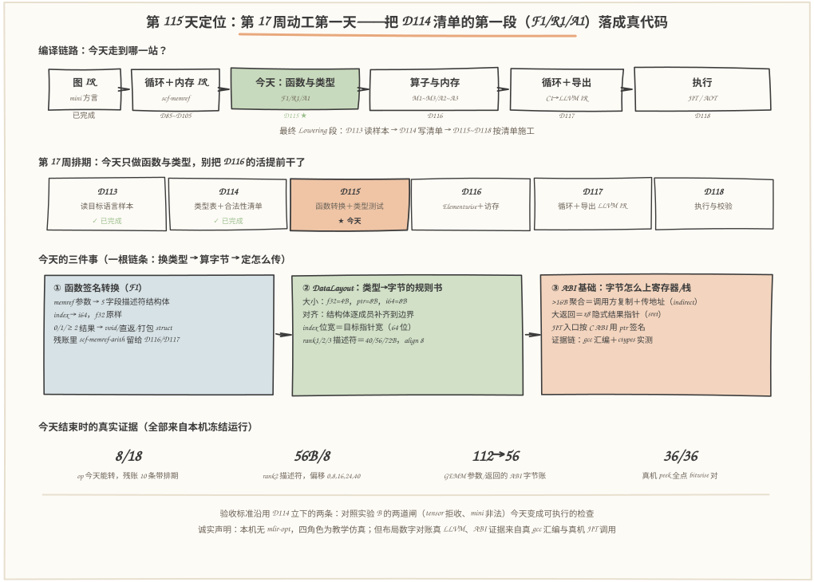
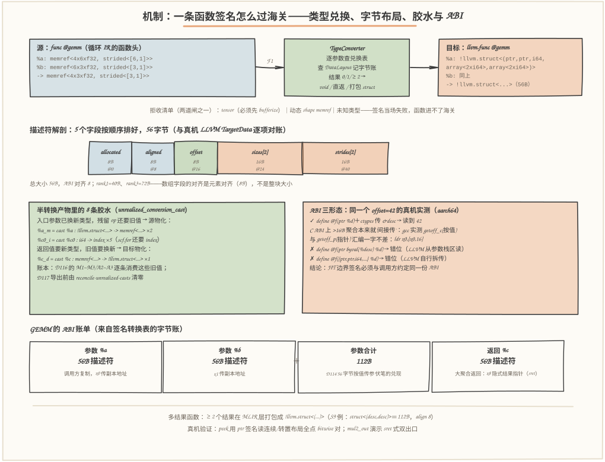
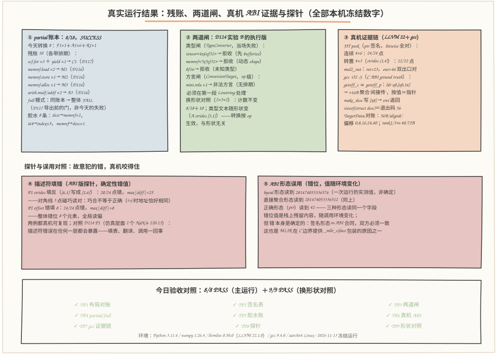

# 第 115 天：转换函数与类型——把 D114 清单第一段（F1/R1/A1）落成真代码，兑现"56 字节按值传参"的伏笔

> **今日目标**：完成本教程后，你能做到五件事——用自己的话讲清函数签名转换在最终 Lowering 里做哪三件事（参数逐个兑换、结果按 0/1/≥2 打包、入口块参数换新类型），并说出多结果为什么打包成 `!llvm.struct<(...)>`；独立解释 DataLayout 是"类型→字节的规则书"，并背出 rank2 描述符的字节账（56B、对齐 8、字段偏移 0/8/16/24/40——不是背的，是真机 LLVM TargetData 对账的）；解释 ABI 为什么是"合同"：>16B 聚合在 aarch64 C ABI 上"间接传"（gcc 实测按值与指针的汇编一字不差）、大返回走 x8 隐式结果指针，以及 JIT 边界为什么用 `ptr` 签名；独立运行 `./run_all.sh` 复现 8/8 PASS（主运行）＋9/9 PASS（换形状对照），指出 partial 账本 8/18＋残账 10 条＋胶水 8 条各自的归属排期；说出三种 ABI 形态（ptr／byval／直接聚合）在真机上的实测差异、两个填表探针（P1 strides 填反、P2 offset 错填）的确定性表现，以及 4 个今天真实踩过的坑（numpy strides 是字节、MCJIT 引擎被回收、数组对齐不是整块大小、ABI 形态误用）是怎么被发现和修复的。
> **预计时间**：学习 40 分钟＋实践 50 分钟
> **前置准备**：Python 3.11＋numpy＋llvmlite＋gcc（本文环境：aarch64 Linux，Python 3.11.4，numpy 1.26.4，llvmlite 0.50.0 内嵌 LLVM 22.1.0，gcc 9.4.0，与 D113/D114 同机）。本机没有安装 MLIR——与 D57~D114 一致，用 Python 复刻 DialectConversion 的角色分工，但**布局数字对账真 LLVM（TargetData）、C ABI 证据链交给真 gcc 的汇编**。内容上需要：D114 的四角色与合法性清单（今天实现它的第一段 F1/R1/A1）、D113 的 LLVM Dialect 语法（今天的目标签名直接用它的类型文本）、D85~D105 的循环与内存产物（今天的输入 `loop_ir.mlir`）。
> **今日产出**：`code/func_lowering.py`（类型兑换表＋DataLayout＋签名转换＋胶水发射＋partial/full 驱动＋真机 ABI 验证，全部可运行）、`code/loop_ir.mlir`（输入源 IR）、`code/run_all.sh`（一键复现，本机实测 1 秒内跑完主运行＋对照）、`code/outputs/func-report.txt`（8/8 PASS 真机报告——今日主产出）、`code/outputs/signature-table.md`（签名转换表：10 组类型测试样例）、`code/outputs/partial-ir.mlir`（半转换产物，8 条胶水）、`code/outputs/abi-verify.ll`（真机 JIT 用 LLVM IR）、`code/outputs/abi-ground-truth.s`（gcc 汇编证据）、`code/outputs/func-report-s232.txt`（换形状对照 9/9 PASS）＋本文 3 张手绘图。

## 1. 今天解决什么问题？

D114 结束时立了三条约定：**实现排期**——D115 做 F1/R1/A1（函数签名与类型转换），对照实验 B 的"两道闸"就是验收标准；**伏笔**——"描述符按值传参：默认 ABI 下每个 memref 参数是 56 字节的聚合值……DataLayout 与 ABI 的细节届时展开"；**纪律**——开发期用 partial 转换挂账，交付前（D117 导出）用 full 转换清零。今天的任务是兑现这三条：把"翻译手册"里最靠前的三行写成真代码，让**函数能进门、类型能落账、字节能上机器**。

为什么函数和类型排在最前面？因为它们是"海关"本身：签名转换是每个后续模式的前置——`llvm.func` 的新签名决定了 `%a` 从此是五字段描述符结构体（一个**值**，可以 extractvalue 逐字段取用），后续 M1 的地址计算、M3 的 malloc 封装全都站在这个新类型上；而类型一换，**字节账**和**调用合同**立刻变成必须回答的问题：这个结构体多大、对齐多少（DataLayout），调用方和被调方怎么把它放上寄存器和栈（ABI）。D114 说"56 字节按值传参"时是引用真实 MLIR 的结论；今天我们让它变成自己机器上可验证的三层事实：**MLIR 层**（签名里是描述符结构体）→ **字节层**（TargetData 算出 56B/对齐 8）→ **机器层**（gcc 汇编显示"按值"＝"间接传副本地址"）。

贯穿例子仍是老朋友：`A(4,6) @ B(6,3) → C(4,3)`，行主序 f32，静态 shape，它的循环 IR（D85~D105 的产物、D114 的输入）今天是第 115 天的输入 `loop_ir.mlir`——18 个 op，横跨 func/memref/arith/scf 四个方言。**输入：一份签名还没换、类型还是 memref/index 的循环 IR；输出：一个签名已换成描述符、常量已换成 `llvm.mlir.constant`、残账 10 条各带排期、类型交界处 8 条胶水明明白白的半转换函数——外加一张 10 组样例的签名转换表和一条到真机汇编的 ABI 证据链。**

## 2. 先看全貌：今天的内容位于哪里？



**图 1**：看三处——**上排**把今天放回编译链路：图 IR →（D85~D105 已完成）→ 循环＋内存 IR →**今天：函数与类型**→ 算子与内存（D116）→ 循环＋导出（D117）→ 执行（D118），今天不动算子、不碰循环，只把"海关"修好；**中排**是第 17 周的排期条，D113/D114 已完成、D116/D117/D118 排在后面——今天只做函数转换＋类型测试，别把 D116 的活提前干了；**下排**是今天三个概念的一根链条：①函数签名转换（F1，换类型）→ ②DataLayout（算字节）→ ③ABI 基础（定字节怎么传），底部四个数字（8/18、56B/8、112→56、36/36）是今天结束时拿到的真实证据。

把今天的工作串成 5 步：

1. **定兑换表**：TypeConverter 在 D114 六行表的基础上，给每个兑换结果加上 DataLayout 字节账——`index`→`i64`（8B）、`f32` 原样（4B）、`memref<R>`→描述符结构体（rank1/2/3 ＝ 40/56/72B，对齐 8）；拒收清单照旧：`tensor`、动态 shape、未知类型；
2. **转签名**：F1 把 `func @gemm` 的参数逐个兑换、结果按 0/1/≥2 三档处理（void／直返／打包成 `!llvm.struct<(...)>`），`llvm.func` 的新签名就此定形；两道闸（tensor 拒收、动态拒收）在签名层当场执法；
3. **打胶水**：入口块参数换成新类型后，残留 op 还要旧值——发射 8 条 `unrealized_conversion_cast`（2 条 desc→memref、5 条 i64→index、1 条 memref→desc），账本 D116 逐条消费、D117 reconcile 清零；
4. **验类型**：10 组签名样例（GEMM、Relu、void、index、rank1/rank3、双结果打包、混合标量）机器生成转换表；每个字节数字与真机 LLVM TargetData 对账；探针故意填错描述符（P1/P2），看真机怎么咬住；
5. **验 ABI**：JIT 出 `peek`/`mul2_out` 用 ctypes 按合同调用，连续 24/24 点、转置 12/12 点逐位一致；gcc 编译"按值 vs 指针"两个 C 函数——汇编一字不差，56 字节按值传参的伏笔就此兑现。

一句话定位：**D114 回答"清单怎么写"，今天回答"清单第一段怎么落地"——函数进门靠兑换表，字节落账靠 DataLayout，调用成立靠 ABI 合同，三件事全部拿到真机证据。**

## 3. 核心概念：先用直觉，再给准确定义

今天四个概念两两咬合：**签名转换（F1）管"换"，DataLayout 管"量"，ABI 管"运"，胶水管"缝"**。每个概念都拿 GEMM 的签名说话。

### 3.1 函数签名转换（F1）：海关的第一道窗口

一句通俗解释：**F1 把函数头从源方言语言翻译成 LLVM 方言语言**——名字可能要改名（加包装），但真正要紧的是每个参数和结果的**类型**都得过一遍兑换表。

类比：出国海关不换人，换的是证件——你的护照（memref 类型）要换成目的国认可的签证格式（描述符结构体）。对应到技术上是：`func @gemm(%a: memref<4x6xf32, strided<[6,1]>>, ...)` 变成 `llvm.func @gemm(%a: !llvm.struct<(ptr, ptr, i64, array<2 x i64>, array<2 x i64>)>, ...)`——`%a` 这个"人"没变，但它从"一块内存的抽象读法"变成了"五个字段排好的聚合**值**"，后续 op 可以像拆快递一样 extractvalue 逐字段取用。类比边界：海关比 F1 宽松的一点是——旅客证件不符还能退回补办；F1 的签名转换是**原子的**：任何一个参数兑换失败（比如带 `tensor`），整条签名当场失败，没有"先转换前两个参数"这种部分成果。

结果侧有一个必须今天定的规则——**打包**：LLVM 函数只能有 0 个或 1 个结果，所以 0 结果→`void`，1 结果→兑换后的类型，**≥2 结果→打包进一个字面结构体** `!llvm.struct<(t1, t2, ...)>`（真实 MLIR 的 FuncToLLVM 对多结果同样打包，`packFunctionResults` 的行为）。今天签名表的 S8 样例：`(memref<4x3xf32>, f32) -> (f32, f32)` 变成 `(desc, f32) -> !llvm.struct<(f32, f32)>`（8B）；S9 更狠：双 memref 结果打包成 `struct<(desc, desc)>`——112B 的返回值，这个数字马上会把我们引向 ABI 的 sret 问题。

### 3.2 DataLayout：类型→字节的规则书

一句通俗解释：**DataLayout 回答"这个类型在机器上占几格、要怎么摆"**——每个类型的大小、对齐，结构体怎么排字段，指针多宽，端序如何。真实 LLVM 用一串布局字符串描述它（本机 aarch64 是 `e-m:e-...-i64:64-...`：小端、指针 64 位、i64 八字节）；真实 MLIR 有对应的 DataLayout 系统（ModuleOp 可携带 datalayout 属性），`index` 的位宽正是从目标指针宽度推出来的——64 位目标上 `index` 兑换成 `i64`，这就是 D114 类型表第一条的"官方理由"。

类比：搬家时给每个箱子写"长宽高＋哪面朝上"，仓库按这个单子分配货架、保证箱子不叠歪。对应到技术上是：描述符结构体的五个字段按顺序摆放，每个字段对齐到自己的 ABI 对齐值，总大小补齐到最大成员对齐——allocated(8B)@0、aligned(8B)@8、offset(8B)@16、sizes[2](16B)@24、strides[2](16B)@40，合计 **56B、对齐 8**；rank1 是 40B，rank3 是 72B。类比边界：搬家单是给人看的，DataLayout 是给编译器用的——它的每个数字都会变成地址计算的常数，**错一个字节，所有访存全错**（今天 P1/P2 探针实测：偏 8 个元素，24/24 点全错）。还有一条今天开发时真踩过的坑值得写进直觉：**数组的对齐是元素的对齐（8B），不是整块大小**——初版布局算法把 `sizes[2]` 的 16B 整块当对齐，算出 64B/对齐 16，被真机 TargetData 的 56B/8 当场咬住（TP1 的对账价值就在这里：布局不是"大概对"，是逐字节对）。

最小例子（TP1 的真实对账）：教学版布局计算器算出 rank2 描述符 56B/对齐 8/偏移 [0,8,16,24,40]，同一组数字问真机 LLVM 的 TargetData——`56/8/[0,8,16,24,40]`，逐项一致；rank1、rank3、f32/i64/i1/ptr 的每个大小与对齐也全对上。**这组数字不是从教材背的，是两条独立路径算出来再对表的。**

### 3.3 ABI：字节怎么上寄存器和栈的"合同"

一句通俗解释：**ABI（Application Binary Interface，应用二进制接口）是调用方和被调方关于"参数放哪、返回值放哪"的合同**——LLVM IR 的类型只说"是什么"，不说"放哪里"；放哪里由调用约定（calling convention）决定，而"怎么放大聚合"恰恰是合同里最容易翻页的一章。

类比：两个公司交接货，只说"56 箱"没用，得约定交接方式——小件直接搬上手（寄存器），大件走托盘放指定库位（栈），超大件送**副本**只交接提货单（间接传）。对应到技术上是今天拿三条独立证据钉死的事实链：**①本机 gcc 实测**，C 函数 `long getoff_c(struct desc d)`（56B 按值传）与 `long getoff_p(struct desc *d)`（指针传）编译出的汇编**一字不差**：`ldr x0, [x0, 16]`——aarch64 的 C ABI（AAPCS64）对超过 16 字节的聚合按"**间接**"传：调用方复制一份，把副本地址放进 x0；**②真机 JIT 实测**，用 ctypes（libffi 实现）调 JIT 函数，x0 里收到的是副本地址而非原对象地址；**③LLVM IR 形态实测**，同一个 `offset=42` 字段，`ptr` 签名读到 42，`ptr byval(%desc)` 签名和直接聚合参数签名都读到错位值——LLVM 的 byval 在本机后端从**参数栈区**读，直接聚合由 LLVM 自行拆传，两者都不等于 C ABI 的"间接传"（错位值随环境变化，但"错"是确定的）。合同不匹配不是"慢一点"，是**读错地方**。类比边界：托盘类比里交接错了顶多丢货；ABI 合同错在编译器里意味着**静默数据错乱**——所以真实 MLIR 在 C 边界提供 `_mlir_ciface` 一类的包装入口，让两侧由同一套包装约定粘合；我们的 mini 管道今天把对外 ABI 定为"`ptr` 签名＋描述符结构体"，与 D114 真机验证用的形式一致。返回方向同理：gcc 实测 `make_desc`（返回 56B struct）通过 **x8 隐式结果指针**写回（`stp x2, x3, [x8]`）——大于 16B 的返回值在 aarch64 上就是 sret 式的"调用方给地址、被调方往里写"，这也是多结果打包（S9 的 112B struct 返回）最终在机器上的落点。

### 3.4 胶水（unrealized_conversion_cast）：类型交界的临时通道

一句通俗解释：**类型换了，旧 op 还没跟上，中间就得有"尚未兑现的转换"通道**——`unrealized_conversion_cast` 把值在新旧两个类型之间来回搬运，等所有模式到位后统一清零。

类比：旧城改造时，新城电网（llvm.* 新类型）和旧城线路（memref/index 旧类型）之间搭临时变电箱，等旧城全部迁完，变电箱拆除。对应到技术上是：F1 把入口块参数换成新类型后，**签名新了、函数体还是旧的**——`memref.load` 还要 `memref<4x6xf32>`，`scf.for` 还要 `index`；转换框架在新旧交界处"物化"出胶水：**源物化**（新→旧，给残留 op 用）：`%a_m = cast %a : !llvm.struct<...> -> memref<...>`（×2）、`%c0_i = cast %c0 : i64 -> index`（×5）；**目标物化**（旧→新，给 `llvm.return` 用）：`%c_d = cast %c : memref<...> -> !llvm.struct<...>`（×1）。今天共 8 条，D116 的 M1~M3/A2~A3 会逐条消费旧值，D117 导出前 `reconcile-unrealized-casts` 把它们清零。类比边界：变电箱可以一直留着凑合；**胶水不行**——D114 立的纪律是残账要么清零、要么写明归属，胶水同账：留到导出那天它会让 mlir-translate 直接报错。这 8 条胶水就是"今天的工作可交付、后续工作有接口"的物理形态。

## 4. 图解核心机制



**图 2**：自上而下三层看——**最上层是签名转换流水线**：左源签名（两个 memref 参数、一个 memref 结果）→中间 TypeConverter（逐参数查兑换表、查 DataLayout 记字节账、结果按 0/1/≥2 三档处理）→右目标签名（`llvm.func`，两个 56B 描述符参数、一个 56B 描述符返回）；流水线下方红字是拒收清单——tensor、动态 shape、未知类型在签名层当场失败，这是 D114"两道闸"中的第一道。**中层是描述符解剖**：五字段条带按 56 字节铺开（allocated@0、aligned@8、offset@16、sizes[2]@24、strides[2]@40），每个数字与真机 TargetData 对过账；注意底部那行注释——**数组字段的对齐是元素对齐（8B）**，这是今天开发中真实踩过又修正的坑。**下层左右两块**：左是 8 条胶水的三个方向（源物化 desc→memref×2、i64→index×5；目标物化 memref→desc×1），右是 ABI 三形态真机对照（ptr ✓ / byval ✗ / 直接聚合 ✗，配 gcc 汇编证据）。**底部是 ABI 账单**：GEMM 参数合计 112B（两份 56B 描述符，机器上按"间接传"——调用方复制、寄存器放副本地址），返回 56B（x8 隐式结果指针，sret）。

按图走一遍今天机制的核心问题——"函数头那一行是怎么变成 `llvm.func` 的"：

1. **逐参数兑换**：`%a` 的 `memref<4x6xf32, strided<[6,1]>>` 先过解析（shape [4,6]、elem f32、strides [6,1]），再组装描述符类型文本 `!llvm.struct<(ptr, ptr, i64, array<2 x i64>, array<2 x i64>)>`，顺手用 DataLayout 记下它的字节账（56B/对齐 8）——**每个兑换结果都带着大小和对齐**，这是与 D114 兑换表的唯一差别，也是签名表能算出"参数 112B"的原因；
2. **结果打包**：0 结果→`void`；1 结果→兑换类型；≥2→打包结构体并**递归**算布局（S9：`struct<(desc, desc)>` 两个 56B 成员、对齐 8 → 112B——真机 TargetData 同样报 112B/8）；
3. **发射新签名＋胶水**：`llvm.func` 的新头写下新类型，紧随其后的是 8 条 cast——注意胶水的**方向**：入口参数是"新→旧"（残留 op 要旧值），返回值是"旧→新"（`llvm.return` 要新类型），常量是"新→旧"（A1 已把 `arith.constant 0 : index` 换成 `llvm.mlir.constant 0 : i64`，但 `scf.for` 还要 index）；
4. **驱动器记账**：18 个 op 过完海关，partial 账本记 8 转换＋10 残账（每条带排期），full 模式同账本整体 FAIL——账本一字不差，语义完全相反（D114 建立的直觉，今天在自己代码里复现）。

## 5. 动手实践：把签名转换跑成一份可验证的报告

### 5.1 准备文件

```text
tutorials/day-115/
├── README.md                    ← 本文
├── images/                      ← 3 张手绘图（数字出自 outputs/ 冻结运行）
└── code/
    ├── func_lowering.py        # 今天主角：兑换表＋DataLayout＋签名转换＋胶水＋驱动＋真机 ABI
    ├── loop_ir.mlir            # 输入源 IR（18 op，与 D114 同构）
    ├── gen_images.py           # 生成 3 张图（固定随机种子）
    ├── run_all.sh              # 一键复现（主运行＋对照，本机实测 1 秒内）
    └── outputs/
        ├── func-report.txt           # 真机报告：TP1~TP8，8/8 PASS（今日主产出）
        ├── func-report-s232.txt      # 换形状对照：TP1~TP9，9/9 PASS
        ├── signature-table.md       # 签名转换表（10 组类型测试样例）
        ├── partial-ir.mlir           # 半转换产物（8 条胶水＋残账标注）
        ├── partial-ir-s232.mlir      # 换形状对照的半转换产物（计数不变、文本随形状变）
        ├── abi-verify.ll             # 真机 JIT 用的 LLVM IR（peek / mul2_out / echo / 三形态对照）
        ├── abi-ground-truth.s        # gcc -O2 -S 的汇编证据链
        └── run-all-log*.txt          # 一键复现总日志
```

环境：Python 3.11.4（aarch64 Linux）、numpy 1.26.4、llvmlite 0.50.0（内嵌 LLVM 22.1.0）、gcc 9.4.0，与 D113/D114 同机同日。一键复现：

```bash
cd tutorials/day-115/code && ./run_all.sh     # 主运行＋对照，本机实测 1 秒内
```

**诚实声明**：本机没有 MLIR 工具链（与 D57~D114 一致）。`func_lowering.py` 是对 MLIR DialectConversion 的**教学仿真**——四角色、兑换表、胶水、full/partial 语义都对照真实 MLIR 的行为建模；但今天的每类数字都有真机兜底：**布局数字**对账 llvmlite 的 TargetData（真 LLVM 22.1.0 的布局引擎）；**C ABI 行为**对账本机 gcc 的真实汇编与 ctypes/libffi 的真实调用；**JIT 执行**是真代码真内存真结果。仿真的是"框架"，验证的是"事实"。

### 5.2 编写代码

`func_lowering.py` 里今天的三块核心。**兑换表＋DataLayout**——比 D114 多了字节账，拒收仍然靠异常（`func_lowering.py` 的 `conv_type`）：

```python
def conv_type(ty: str) -> dict:
    ty = ty.strip()
    if ty == "index":
        return {"llvm": DL.index_llvm(), "size": 8, "align": 8}   # 位宽随目标指针
    if ty in DL.SCALAR and ty != "ptr":
        s, a = DL.SCALAR[ty]
        return {"llvm": ty, "size": s, "align": a}                # f32: 4/4 …
    if TENSOR_RE.match(ty):
        raise TypeConversionError(                                # 闸①：管道纪律
            f"{ty}：tensor 是值语义类型，兑换表里没有目标类型——"
            "必须先经过第一段 Lowering（bufferize，D85~D105）")
    if ty.startswith("memref<"):
        mr = parse_memref(ty)                                     # 闸②：动态 shape 在此拒收
        lay = desc_layout(mr["rank"])                            # 字节账：rank2 -> 56B/8
        return {"llvm": desc_type_text(mr["rank"]), "size": lay["size"],
                "align": lay["align"], "memref": mr, "layout": lay}
    raise TypeConversionError(f"{ty}：未知类型，兑换表拒收")
```

**签名转换**——参数逐个兑换、结果三档打包（`convert_signature`/`pack_results`）：

```python
def pack_results(result_types: list[str]) -> dict:
    convs = [conv_type(t) for t in result_types]
    if not convs:
        return {"llvm": "void", "size": 0, "align": 0, "packed": False}
    if len(convs) == 1:
        return {"llvm": convs[0]["llvm"], "size": convs[0]["size"], ...}
    lay = DL.struct_layout([(c["llvm"], c["size"], c["align"]) for c in convs])
    inner = ", ".join(c["llvm"] for c in convs)
    return {"llvm": f"!llvm.struct<({inner})>", "size": lay["size"],
            "align": lay["align"], "packed": True}    # ≥2 结果打包成字面结构体
```

**胶水发射**——签名换新后，在三个交界处"物化"旧值/新值（`emit_partial_ir` 的关键三段）：

```python
# ① 入口参数：新类型 -> 旧类型（残留 op 还要旧值）
out.append(f"%{n}_m = builtin.unrealized_conversion_cast %{n} : {new} -> {old}")
rename[f"%{n}"] = f"%{n}_m"                     # 残留行里的旧名改指向胶水产物
# ② index 常量：A1 已换成 i64，scf.for 还要 index
out.append(f"%{res}_i = builtin.unrealized_conversion_cast %{res} : i64 -> index")
# ③ 返回值：旧类型 -> 新类型（llvm.return 要新类型）
out.append(f"%{val}_d = builtin.unrealized_conversion_cast {val} : {old_ty} -> {new_ty}")
```

省略说明：`TeachingDataLayout.struct_layout`（顺序布局算法，成员对齐补齐）、`census`/`drive`（D114 驱动器的今天版）、`tp1~tp9` 九个测试函数的完整实现在源文件里；`abi-verify.ll` 是手写 LLVM IR 文本（`PEEK_LL` 常量），peek 的字段提取＋地址公式与 D114 清单里 M1 的目标序列逐行对应——今天的 ABI 验证就是 M1 的"真机预演"。

### 5.3 运行与观察

```bash
python3 func_lowering.py            # 或 ./run_all.sh
```

真实输出节选（`outputs/func-report.txt`，2026-11-13 一次冻结运行）：

```text
[PASS] TP1 DataLayout 对账
       rank2 描述符: 教学 56B/align8 offsets[0, 8, 16, 24, 40]
                     真机 56B offsets[0, 8, 16, 24, 40]  OK
[PASS] TP2 签名转换表
       S1 GEMM: 参数 112B，结果 56B；S9 双 memref 结果: 56B -> 112B（打包 struct）
       S9 struct<(desc,desc)>: 教学 112B/align8  真机 112B/align8  OK
[PASS] TP4 partial 驱动：8/18 转换，残账 10 条，结论 SUCCESS
       full 驱动：同配置残账 10 条 -> FAIL（整批退回，D117 导出前的门）
[PASS] TP6 真机 ABI
       peek 连续布局 4×6（strides [6,1]）：24/24 点 bitwise 一致
       peek 转置视图 4×3（元素 strides (1, 4)；numpy .strides=(4, 16) 是字节）：12/12 点
       mul2_out（sret 式双出口）：ret=23.0 out=46.0 bitwise OK
[PASS] TP7 C ABI 证据链（本机 gcc -O2 -S）
       getoff_c（56B 按值）汇编体：ldr x0, [x0, 16] ; ret
       getoff_p（指针）与按值版一致——>16B 聚合在 C ABI 上按'间接'传
       sizeof(struct desc)：程序退出码 56（期望 56）OK
```

三个值得驻足的真实数字：

- **8/18＋10＋8**：今天能转的 8 个 op（F1×1、A1×6、R1×1）、残账 10 条（C1×4、M1×2、M2/M3 各 1、A3×2，各带 D116/D117 排期）、胶水 8 条（2+5+1 三个方向）——**partial 的账本把"今天完成了什么、明天该干什么"写成了同一份文件**，`partial-ir.mlir` 里每行残留 op 都带着自己的排期注释；
- **56/112/8**：一个 rank2 描述符 56B（五字段、对齐 8），GEMM 签名参数合计 112B，数组字段的对齐是 8B 而不是整块 16B——这三个数字串起了"类型→字节→合同"整条链，且全部有真机对账（TargetData 逐项一致、gcc 汇编给出"按值＝指针"的机器事实）；
- **24/24＋12/12**：peek 用 `ptr` 签名读连续布局 24 点、转置视图 12 点全 bitwise 对——转置那组还有个真实踩坑：numpy 的 `.strides` 是**字节**（(4,16)），描述符要的是**元素步长**（(1,4)），初版直接填进去只对了 1/12 点，除以 `itemsize` 后 12/12（见常见错误 1）。



**图 3**：五个面板各讲一件事——**面板①**：partial 账本全貌（8 转换＋10 残账各带排期＋8 条胶水），full 模式同账本整体 FAIL——账本一致、语义相反；**面板②**：两道闸的执行版——类型闸三个拒收（tensor／动态 shape／未知类型）都在**签名层**当场失败，方言闸（mini op）在残账里命中 1 条"无排期"；换形状对照（2×3×2）计数不变 8/18＋10，类型文本随形状变——转换按 op 生效；**面板③**：真机证据链——JIT peek 连续/转置全点 bitwise 对，gcc 汇编里 `getoff_c ≡ getoff_p`（56B 按值＝间接传）、`make_desc` 写 `[x8]`（sret）、sizeof 退出码 56；**面板④**：填表探针——P1 strides 填反 20/24 点错（对角线 3 点碰巧读对，**巧合不等于正确**），P2 offset 错填 24/24 全错，都是确定性可复现；**面板⑤**：ABI 形态误用——byval／直接聚合读到错位值（随环境变化），`ptr` 读到 42，签名形态就是 ABI 合同。

### 5.4 修改一个参数再观察

三组低成本对照（每条一个命令，输出都进 `outputs/`）：

1. **换形状**（数字追踪）：`python3 func_lowering.py --shape 2 3 2 --tag s232`——预测哪些变、哪些不变再运行对答案：**变**的是类型文本（A 的 strides 从 [6,1] 变 [3,1]、C 从 4×3 变 2×2、partial-ir 的文本随之变）；**不变**的是所有计数（8/18＋10 残账＋8 胶水）和所有字节账（参数仍 112B——rank2 描述符只与秩有关，与形状无关）。9/9 PASS，报告存 `func-report-s232.txt`；
2. **故意填反描述符**（机制观察）：把 P1 探针的 strides 改成 (1,6) 再跑 `tp8`——连续布局下只有对角线 3 点碰巧读对（i+6j=6i+j ⇔ i=j），20/24 点错、max|diff|=25；对照 D114 的仿真层 P1（2 个 NaN＋120.13）：**同一个 bug 在不同层暴露成不同症状**，但"描述符填错必被咬住"这条不变——填表、翻译、调用是同一件事；
3. **换 ABI 形态**（合同观察）：`abi-verify.ll` 里三个 `getoff*` 读同一个 offset 字段——`ptr` 读到 42，`byval` 与直接聚合读到错位值。改一下 ctypes 的调用方式（POINTER vs 按值 struct）都不会让 byval 变对——**合同错配在调用侧修不好，必须在签名侧修**，这是"JIT 边界签名必须与调用方同一份 ABI"的实验版。

## 6. 常见错误与排查

以下四条全部来自今天开发 `func_lowering.py` 时的真实踩坑，每条都有现象、原因、定位和修复——它们本身就是"类型、字节、合同"三个概念的反面教材。

- **现象**：peek 验证转置视图时只有 1/12 点正确，连续布局却 24/24 全对。
  **原因**：numpy 的 `.strides` 是**字节**（转置后 (4, 16)），描述符的 strides 字段要的是**元素步长**（(1, 4)）——getelementptr 按元素步进，字节填进去所有地址放大 4 倍。
  **定位**：连续布局 [6,1] 恰好两种口径一致（6×4B=24B 行距 vs 6 元素），所以只有非连续布局暴露；打印 `.strides` 与 `.itemsize` 一比就知道单位错了。
  **修复**：填表前除以 `itemsize`：`tuple(s // Bv.itemsize for s in Bv.strides)`——修完 12/12 点 bitwise 对。教训：**单位是类型系统的一部分**，D57 的 stride 一课在 ABI 层又交了一次学费。

- **现象**：布局对账时 rank1/rank3 都过，唯独 rank2 报 MISMATCH：教学 64B/对齐 16，真机 56B/对齐 8。
  **原因**：顺序布局算法把 `array<2 x i64>`（16B 整块）的**对齐**当成了 16——而数组的 ABI 对齐是**元素**的对齐（8B），16B 只是大小。
  **定位**：真机 TargetData 的 `get_abi_size`/`get_element_offset` 给出 56/[0,8,16,24,40]，与教学版逐项对比，第一个分歧就在 sizes 字段的偏移（32 vs 24）。
  **修复**：`struct_layout` 的成员改成 (名字, 大小, 对齐) 三元组，数组成员对齐传 8——修复后三个秩全部对上。教训：**对账不是为了好看，是为了咬出这种"差不多对"的错**。

- **现象**：同一份 LLVM IR、同一个描述符（offset=42），`ptr` 签名的函数读到 42，`ptr byval(%desc)` 签名的函数读到 281474053336576 这种明显是指针的值，换成直接聚合参数签名照样错。
  **原因**：三种签名形态对应三份不同的"放参合同"——C ABI（libffi/ctypes 实现）对 >16B 聚合按间接传（x0=副本地址）；LLVM 的 byval 在本机后端从参数栈区读；直接聚合由 LLVM 自行拆传。**合同不匹配就是读错地方**，错位值是栈/寄存器残留，随环境变化。
  **定位**：写 echo 函数回传收到的指针（`ptrtoint`），对照传入地址——间接传能看到"副本地址 ≠ 原地址"；再看 gcc 侧 ground truth：`getoff_c`（按值）与 `getoff_p`（指针）汇编一字不差，证明 C 语义的"按值"在机器上就是"传副本地址"。
  **修复**：JIT 边界签名统一用 `ptr`＋调用方传 `&desc`（与 D114 真机验证同款）；MLIR 层面的描述符按值语义留给 `llvm.func` 签名（那是 D117 导出时由后端处理的事）。教训：**"按值传参"在 IR 层、C 层、机器层是三个不同的句子**，翻译时要带上单位。

- **现象**：JIT 出的函数第一次调用偶尔返回奇怪的值，某次重构后干脆段错误（core dumped），而函数逻辑完全没变。
  **原因**：`create_mcjit_compiler` 返回的 engine 对象被 Python 垃圾回收——MCJIT 引擎拥有代码内存，引擎一死，函数地址指向已释放的页。
  **定位**：把 engine 存进模块级列表后再不崩——回收时机决定"偶尔错值"（内存尚未复用）还是"段错误"（已复用/解除映射），这类与 GC 时序相关的间歇性崩溃首先要怀疑**对象生命周期**。
  **修复**：`_ENGINES.append(eng)` 保活，注释写明"必须保活，否则代码内存被回收"。教训：**JIT 产物也是资源**，所有权和 D2/D3 的 Buffer 一课同源——RAII 的思想在 Python 边界同样成立。

## 7. 今日练习

### 必做练习

拿 `func_lowering.py` 做两件事（输入输出写清楚，不提供完整答案）：

1. **补一行签名表**：给 `SIG_CASES` 加 S11——向量点积 `(memref<3xf32, strided<[1]>>, memref<3xf32, strided<[1]>>) -> f32`。先笔算三个数字：两个参数各占多少字节（提示：rank1 描述符）、参数合计、目标签名里 `array<1 x i64>` 出现几次；再运行 `python3 func_lowering.py` 打开 `outputs/signature-table.md` 对答案。如果合计不是 80B，回 §3.2 重推一遍布局。
2. **预测再验证**：先写下 `--shape 3 4 2` 时四个判断——partial 计数变不变、A 的 strides 文本、参数字节数、胶水条数——再运行 `python3 func_lowering.py --shape 3 4 2 --tag s342` 对答案。错的每一条都值得写一句"我漏了哪个机制"。

### 选做挑战

把 sret 真正跑一遍：`abi-verify.ll` 里的 `mul2_out` 是"手工出参"版的多结果。请在副本里新增一个 LLVM IR 函数 `define %desc @clone_desc(ptr %d)`——读入描述符、原样返回（LLVM 允许按值返回聚合类型）；ctypes 侧把 `restype` 设成 `Desc` 结构体接住返回值，核对五个字段回读一致。然后回答：这个"按值返回 56B"在机器上走的哪条路？（提示：gcc 实验里 `make_desc` 写的是 `[x8]`；你可以再写一个 `echo` 版把收到的 x8 回传出来验证。）不需要真的给 mini 管道接上它——那是 D118 执行入口的事。

## 8. 今日验收

- [ ] 我能用自己的话讲清 F1 做的三件事（参数逐个兑换、结果 0/1/≥2 三档打包、入口块参数换新类型），并说出多结果打包成 `!llvm.struct<(...)>` 后 S9 的返回值大小（112B，对齐 8）
- [ ] 我能不看资料说出 rank2 描述符的字节账（56B、对齐 8、偏移 0/8/16/24/40）以及它的证据来源（真机 LLVM TargetData 逐项对账，不是背的）
- [ ] 我能解释 aarch64 上"56 字节按值传参"的机器事实（>16B 聚合间接传：gcc 实测按值与指针的汇编一致），以及 JIT 边界为什么用 `ptr` 签名（与 ctypes/libffi 的合同一致；byval 与直接聚合实测错位）
- [ ] 我能独立运行 `./run_all.sh` 并指出账本三件套：8/18 转换、10 条残账各带排期（C1×4→D117，M1/M2/M3/A3→D116）、8 条胶水的三个方向（2+5+1）
- [ ] 我能说出四个真实踩坑的修复方式：numpy strides 除以 itemsize、数组对齐取元素对齐、ABI 形态必须在签名侧对齐、MCJIT 引擎保活
- [ ] 我保存了签名转换表（`signature-table.md`）、半转换产物（`partial-ir.mlir`）和真机报告（`func-report.txt`）——它们分别是 D116 的类型依据、胶水消费清单和回归基线

## 9. 一句话总结与明天预告

今天的闭环：**问题**——D114 的清单和"56 字节按值传参"的伏笔需要落成可执行的代码；**机制**——函数签名过海关三步走：兑换表换类型（memref→描述符、index→i64、结果打包）、DataLayout 算字节（56B/对齐 8/偏移 0-8-16-24-40，数组对齐取元素）、ABI 定合同（>16B 聚合间接传、大返回 x8 sret、JIT 边界用 ptr 签名），类型交界用 8 条胶水缝合；**实践**——18 op 的循环 IR 跑出 partial 账本（8 转换＋10 残账带排期），10 组签名样例生成转换表，JIT 的 peek/mul2_out 按合同被 ctypes 调用，连续 24/24、转置 12/12 点 bitwise 一致，gcc 汇编给出"按值＝指针"的 ground truth；**验证**——8/8 PASS（主运行）＋9/9 PASS（换形状对照），四个真实踩坑全部定位修复并写进常见错误。明天 D116 进入算子层：实现 M1/M2/M3 与 A2/A3，先把 Relu 或 Add 降到可执行形式建立参考验证——今天 `partial-ir.mlir` 里的 10 条残账和 8 条胶水，就是明天要逐条消费的工单。
