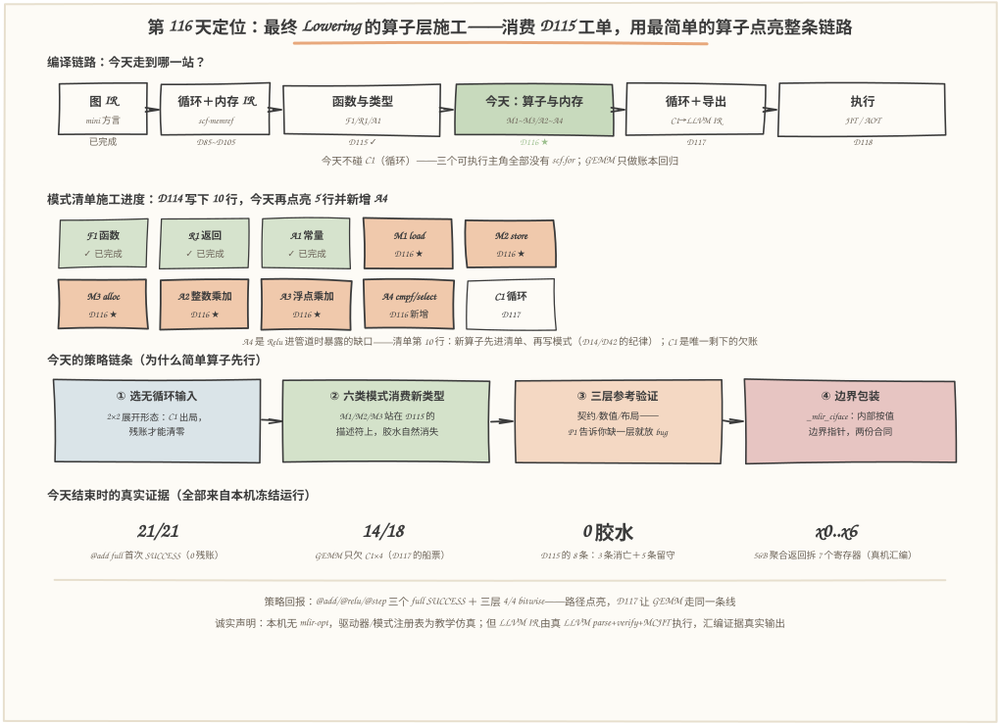
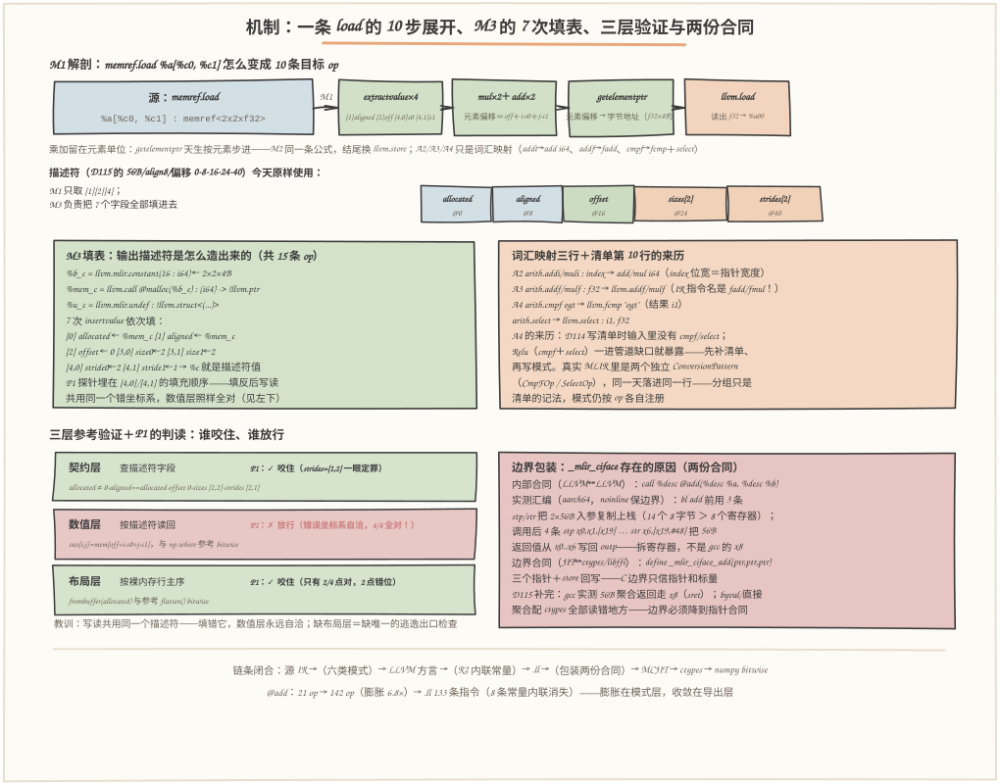

# 第 116 天：转换简单 Elementwise 算子——消费 D115 的 6 条工单，拿到第一个端到端可执行算子

> **今日目标**：完成本教程后，你能做到五件事——用自己的话讲清"为什么先用 Relu/Add 验证完整路径、再碰 MatMul"（三条理由：C1 依赖未清、嫌疑人集合最小、参考可逐位对齐），并说出今天每个新输入的账本（@add 21/21、@relu 22/22、@step 5/5，full 全 SUCCESS；GEMM 14/18、残账 C1×4）；默写三类访存模式的目标序列——M1 的一条 load 是"4 次 extractvalue＋2 乘 2 加＋getelementptr＋llvm.load"共 10 条、M2 同一条地址公式换成 store、M3 是"malloc＋7 次 insertvalue 填描述符"，并说出 A2/A3/A4 只是词汇映射（index 乘加→i64、f32 乘加→fadd/fmul、cmpf/select→fcmp/select）；解释参考验证为什么必须**三层**（契约层抓描述符字段、数值层按描述符读回、布局层按裸内存行主序），并复述 P1 探针的狡猾之处（strides 填反在 2×2 上是缓冲区上的双射——数值层 4/4 全对照样放走 bug，布局层 2/4 咬住）；独立运行 `./run_all.sh` 复现 9/9 PASS（主运行）＋10/10 PASS（2×3 对照），指出 D115 的 8 条胶水今天的去向（desc↔memref 的 3 条死于 M1/M2/M3 直接消费新类型，i64→index 的 5 条留给 C1）；说出边界包装 `_mlir_ciface` 为什么存在——今天在汇编里亲眼看到的两份合同（LLVM 内部按值聚合拆 x0..x6，C 边界只说指针），以及 4 个真实踩过的坑（np.maximum 当参考、命名结构体与字面结构体是两个类型、方言名与 IR 指令名不同、函数属性放错位置）是怎么被发现和修复的。
> **预计时间**：学习 40 分钟＋实践 50 分钟
> **前置准备**：Python 3.11＋numpy＋llvmlite（本文环境：aarch64 Linux，Python 3.11.4，numpy 1.26.4，llvmlite 0.50.0 内嵌 LLVM 22.1.0，与 D113~D115 同机）。本机没有 MLIR 工具链——与 D57~D115 一致：模式注册表与驱动器是 MLIR DialectConversion 的**教学仿真**，但发射出的 LLVM IR 文本交给**真 LLVM** parse、verify、MCJIT 编译执行，结果与 numpy 参考逐点 bitwise 对照，汇编证据来自同一台真机。内容上需要：D115 的兑换表/描述符/胶水（今天的模式全部站在它定义的新类型上）、D114 的模式清单与目标序列（今天实现它的 M1/M2/M3/A2~A4 段）、D113 的 LLVM 方言语法与导出三规则（今天的翻译器直接复刻 R1/R2，R3 今天刻意用不到）。
> **今日产出**：`code/op_lowering.py`（模式注册表＋六类模式发射器＋翻译器＋边界包装＋三层验证＋探针，全部可运行）、四份源 IR（`add_ir.mlir`、`relu_ir.mlir`、`step_ir.mlir`、`gemm_ir.mlir`）、`code/run_all.sh`（一键复现，本机实测 1 秒内主运行＋对照）、`code/outputs/op-report.txt`（9/9 PASS 真机报告——今日主产出）、`code/outputs/op-report-s23.txt`（2×3 对照 10/10 PASS）、`code/outputs/{add,relu,step}-target.mlir`＋`.ll`（LLVM 方言与 LLVM IR 三组对照文件）、`code/outputs/ciface-disasm.s`（边界包装的真实汇编证据）＋本文 3 张手绘图。

## 1. 今天解决什么问题？

D115 结束时留了一张工单：**残账 10 条**——M1×2（memref.load）、M2×1（store）、M3×1（alloc）、A3×2（mulf/addf）排期 D116，C1×4（scf.for×3＋scf.yield×1）排期 D117；**胶水 8 条**——desc→memref×2、i64→index×5、memref→desc×1，等后续模式来逐条消费。今天的任务分两层：**工单层**——按 D114 的排期把 M1/M2/M3/A2/A3 五类模式写成真代码（外加一列 D114 清单上没有、被 Relu 逼出来的 A4，合计六类）；**验证层**——按计划的纪律，**先让一个最简单的算子走完从源 IR 到真机执行的完整路径**，建立参考结果验证，而不是直接调试 GEMM。

为什么要"简单算子先行"？设想另一种做法：把 GEMM 的全部 Lowering 写完再第一次上真机。出错时，嫌疑人名单是——F1 签名、M1 地址公式、M2 写回、M3 填表、A3 浮点、C1 循环骨架、phi 接线、描述符 ABI、malloc 解析……九类模式×两层合同，任何一个都可能错，而且 GEMM 的参考实现要按 k 序累加才能逐位对齐（D78~D80 的浮点课、D114 的 `ref_seq` 都交过学费）。换一个 2×2 的 elementwise 算子，情况完全不同：**没有循环**（C1 排期未到，干脆不让它进调试现场）、**访存模式直来直去**（每条 load/store 就是常量下标）、**参考一行写完且严格对齐语义**（`A+B` 就是 IEEE 单次舍入；Relu 是 `where(x>0, x, 0)`）。出错时嫌疑人只有今天新写的模式。

贯穿例子是 2×2 的两个老朋友：`@add`——`A=[[1.5,-2.5],[0.0,-0.0]]` 加 `B=[[10.25,-0.5],[3.0,7.75]]`，期望 `[[11.75,-3.0],[3.0,7.75]]`，四个数全部可以手算；`@relu`——同一个 A 过 `cmpf ogt + select`，期望 `[[1.5,0.0],[0.0,0.0]]`（注意 `-0.0` 变 `+0.0`，符号位被 select 的 else 分支规整）。外加标量 `@step(i,k)=(i+k)×2` 单测 A2，以及 D115 的 GEMM IR 做账本回归。**输入：四份源 IR；输出：第一个由 D115→D118 管道自己转换、导出、编译、执行并通过参考验证的算子——外加一张"账本清到什么程度"的进度表和一份边界包装的真实汇编证据。**

一句话说清"第一个"的准确含义：D113 执行过 `step`，但那是**手写**的 LLVM 方言（不需要转换）；D114 JIT 过 GEMM，但那是**设计仿真**的发射器（一次成型、没有账本和胶水）；D115 执行过 `peek`/`mul2_out`，但那是**手写**的 .ll（只验证 ABI）。今天第一次，输入是 mini 管道自己的 IR 形态，转换由模式注册表逐 op 完成、full 模式账本清零、翻译规则真的执行（R2 内联、R1 沿用）、包装真的生成——**每个环节都是管道自己的**。

## 2. 先看全貌：今天的内容位于哪里？



**图 1**：看三处——**上排**把今天放回编译链路：图 IR →（D85~D105）→ 循环＋内存 IR → 函数与类型（D115）→**今天：算子与内存**→ 循环＋导出（D117）→ 执行（D118），今天不碰 C1（循环），所以三个可执行主角都不含 `scf.for`；**中排**是模式清单的施工进度条：D114 写下 9 行，D115 实现 3 行（F1/R1/A1），今天再实现 5 行（M1/M2/M3/A2/A3）并新增第 10 行（A4，cmpf/select——Relu 进管道时清单暴露的第一个缺口），C1 是唯一剩下的欠账；**下排**是今天的策略链条：①选无循环输入（C1 出局）→ ②六类模式消费新类型（描述符是唯一读法）→ ③三层参考验证（契约/数值/布局）→ ④边界包装让 JIT 能按 C 合同调用，底部四个数字（21/21、14/18、0 条胶水、x0..x6）是今天结束时拿到的真实证据。

把今天的工作串成 5 步：

1. **记账**：三份新输入（@add 2×2 展开、@relu 2×2 展开、@step 标量）过驱动器——模式注册表齐全时残账为 0，**full 转换第一次 SUCCESS**；D115 的 GEMM IR 重跑账本：14/18，残账恰好只剩 C1×4——D114 实验 A 的预测今天成为现实；
2. **发射**：六类模式把源 op 逐条翻成目标序列——M1/M2 各 10 条（4 次 extractvalue 取字段、2 乘 2 加算元素偏移、getelementptr 换地址、load/store），M3 共 15 条（字节常量＋malloc＋undef＋7 次 insertvalue），A2/A3/A4 是词汇映射；@add 从 21 op 膨胀到 142 op；
3. **导出**：翻译器把 LLVM 方言文本变成 LLVM IR 文本——R2 常量内联（8 条常量消失）、R1 沿用目标形态值名（D114 先例；真 mlir-translate 会重编号，D113 已真做过）、R3 今天没有用武之地（无控制流）；真 LLVM parse＋verify 全部通过；
4. **包装与执行**：给 memref 签名的函数发 `_mlir_ciface_add(ptr, ptr, ptr)`——函数本体保持按值描述符签名（LLVM 内部合同），包装只说指针（C 合同）；MCJIT 编译执行，ctypes 按指针调用，numpy 参考逐点 bitwise 对照；
5. **探针**：故意埋三个 bug（M3 填反 strides、包装漏回写、参考写成 np.maximum），看三层验证和字段检查谁咬得住——P1 的"自洽错误坐标系"是今天最深的一课：数值层 4/4 全对照样放行，布局层 2/4 咬住。

一句话定位：**D115 修好了海关（函数与类型），今天让第一批货物（简单算子）真正通关——通关线上跑的每个环节都是管道自己的，GEMM 还欠一张 C1 的船票（D117）。**

## 3. 核心概念：先用直觉，再给准确定义

今天四个概念一根链条：**策略管"先做什么"，模式管"怎么翻"，验证管"怎么信"，包装管"怎么跨边界"**。

### 3.1 简单算子先行：一条调试论，不是偷懒

一句通俗解释：**先用最小的完整路径点亮整条链路，再往链路上加复杂度**——路径没验证过之前，复杂度只会放大搜索空间。

类比：装修队验收电路，不会先把全屋电器插满再开总闸，而是先用一盏灯确认火线零线没接反，再逐路通电。对应到技术上是：先用一个 **2×2、无循环、常量下标、参考可手算**的 elementwise 算子把"源 IR → 模式发射 → 导出 → JIT → 参考对照"整条链点亮，再让 GEMM（三重循环、归纳变量、累加序敏感）上链。三条具体理由，每条都能在今天的账本里找到证据：

- **依赖未清**：GEMM 的循环 IR 需要 C1（D117 排期），full 转换今天必然 FAIL（账本：14/18，残账 C1×4）——**它根本到不了导出这扇门**；而展开形态的 @add 残账为 0，full SUCCESS，才能被导出、被执行；
- **嫌疑人集合最小**：@add 的执行结果若错，嫌疑人只有今天的六类模式＋D115 的三类＋两层合同；换成 GEMM 还要加上 C1 的四块骨架和 phi 接线——**每多一类模式，调试时的二维排查表就多一行一列**；
- **参考严格可对齐**：`A+B` 是 IEEE 单次舍入，numpy f32 加法逐位相同；Relu 的 `cmpf ogt + select` 与 `np.where(x>0, x, 0)` 逐位相同（连 `-0.0→+0.0`、`NaN→0` 都对得上）；而 GEMM 的参考必须按 k 从 0 到 K-1 顺序累加才逐位对齐（D114 的 `ref_seq` 就是这么写的）——参考本身越简单，"错在编译器还是错在参考"这个二分就越干净。

类比边界：一盏灯能验证的是"火线零线接对了"，验证不了"空调专线带得动 16A"——对应到技术上是：@add 验证不了 C1 的 phi、循环边界和累加序，**这些维度今天仍然是零覆盖，D117 补上 C1 后 GEMM 第一次运行仍然可能错**——先行不等于免检，只是把"必错在已有模式"的部分先清零。

### 3.2 三类访存模式：描述符是唯一读法

一句通俗解释：**M1/M2/M3 做的事，是把"memref 的抽象读法"兑现成"描述符字段＋地址算术"的机器步骤**——memref 世界的下标 `[i, j]`，在 LLVM 世界里必须变成 `aligned_ptr + (offset + i×stride0 + j×stride1) × 4B`。

类比：memref 像酒店的"房号"（302 是 3 楼 02 房），描述符像前台的登记册（楼层起址、每层步长、房号偏移）；M1/M2 就是每次查房都要按登记册把"302"翻译成"从大堂走到 3 楼再走 2 间"的具体路线。对应到技术上是 M1 的一条 `memref.load %a[%c0, %c1]` 精确展开成 10 条目标 op：`extractvalue[1]` 取 aligned 指针、`extractvalue[2]` 取 offset、`extractvalue[4,0]/[4,1]` 取两条 strides（4 次）；`mul×2＋add×2` 算出**元素单位**的线性偏移（2 乘 2 加）；`getelementptr` 把元素偏移换成字节地址（它天生按元素步进，所以乘加留在元素单位——D115 P1 探针"strides 填反会读错"的原因）；最后 `llvm.load` 读出 f32。M2 是同一条地址公式，把结尾换成 `llvm.store`；M3 反过来"填表"——`malloc(R×C×4)` 拿到裸内存，用 7 次 insertvalue 把两个指针、offset、sizes×2、strides×2 填进描述符。

A2/A3/A4 相形之下只是**词汇映射**：`arith.addi/muli : index` → `add/mul i64`（A2）；`arith.addf/mulf : f32` → `fadd/fmul float`（A3，注意方言印刷名是 `llvm.addf`，LLVM IR 指令名是 `fadd`——两个词汇表，见常见错误 3）；`arith.cmpf ogt` → `fcmp ogt float` 得 i1、`arith.select` → `select i1`（A4）。A4 是**今天新增的清单第 10 行**：D114 写清单时输入里没有 cmpf/select，Relu 一进来缺口就暴露——"新算子进管道，先补清单再写模式"，和 D14/D42 加算子时的纪律同一条。类比边界：登记册类比里"每次查房都翻一遍册子"听起来很笨——对应到技术上是：这 10 条里 LLVM 后端会自己消掉一部分（常量下标的乘加在优化中被折叠），真实编译器的 MemRefToLLVM 也是这么"啰嗦"地发射，再把化简交给后端——**模式负责语义正确，化简负责让它不慢，两层分工**。

### 3.3 参考验证的三层：契约、数值、布局

一句通俗解释：**执行结果不是"一个数组"，而是"一个描述符＋一块内存"**——验证必须拆成三层，每层盯住不同的合同。

类比：验收快递，要查三样——面单（收件人、件数对不对）、打开看内容（东西对不对）、箱子摆放顺序（易碎品朝上没压坏）。对应到技术上是：**契约层**查描述符字段（allocated 非空、aligned==allocated、offset==0、sizes==[2,2]、strides==[2,1]——这是 IR 类型里白纸黑字的 `strided<[2,1]>`）；**数值层**按描述符读回（`out[i,j] = mem[offset + i×s0 + j×s1]`，与 numpy 参考 bitwise 对照——这是算子语义）；**布局层**按裸内存行主序读回（`frombuffer(allocated)` 与参考的 `flatten()` bitwise 对照——这是输出缓冲区的物理摆放）。类比边界：日常快递查两样就够；编译器的输出多出一层的原因是**读和写共用同一个描述符**——如果写侧把 strides 填错而读侧也用错的 strides 读，数值层照样全对（P1 探针实测：4/4 全对！），只有布局层和契约层能咬住。**"按描述符读回"验证的是坐标系内部的自洽，"按裸内存读"验证的是坐标系本身**——这就是为什么参考验证要三层，缺一层就有 bug 逃逸通道。

参考的语义对齐同样是一层合同：Relu 的参考必须写 `np.where(x>0, x, 0)` 而不是 `np.maximum(x, 0)`——后者在 NaN 上返回 NaN（numpy 的 maximum 传播 NaN），而 `cmpf ogt` 对 NaN 为 false、select 走 else 得 0。今天实测：边界输入 `[[inf,-inf],[nan,3.25]]` 下 where 版 4/4 bitwise 对、maximum 版只有 3/4——**参考写错和编译器写错在现象上无法区分**，所以参考实现也是被验证对象（见常见错误 1）。

### 3.4 边界包装 _mlir_ciface：两份合同，一个边界

一句通俗解释：**函数本体说 LLVM 内部合同（按值描述符），JIT 入口说 C 合同（指针）**——两边各说各的母语，中间需要一个翻译，这就是 `_mlir_ciface_add(ptr, ptr, ptr)` 包装。

类比：跨国公司内部用母语开会（快、默契、随便用行话），对外签约必须用双方都认的公文体（慢、啰嗦、但零歧义）。对应到技术上是今天在真机汇编里亲眼看到的两份合同：**内部**——`call %desc @add(%desc %a, %desc %b)` 把两个 56B 聚合按值传给 `@add`，返回 56B 聚合；实测（`outputs/ciface-disasm.s`，aarch64）`bl add` 之前包装用 3 条 stp/str 把入参复制上栈（2×56B＝14 个 8 字节，8 个可用寄存器装不下），`bl add` 之后用 4 条 `stp x0,x1,[x19] … str x6,[x19,#48]` 把**拆在 x0..x6 里的返回值**写进 outp；**边界**——ctypes（libffi 实现 C ABI）只认指针和标量，所以包装签名是三个 `ptr`，返回的描述符由包装 `store %desc %r, ptr %outp` 写回。真实 MLIR 在函数带 `llvm.emit_c_interface` 时同样生成 `_mlir_ciface_*` 包装，原因完全相同。类比边界：公文体类比里"内部行话随便用"是安全的；技术上这依赖一个前提——**调用双方由同一个后端编译**。今天还观察到一个有趣的事实补完 D115 的 ABI 课：D115 的 gcc 证据里 56B 聚合**返回**走 x8（sret，C 合同），而今天 LLVM 内部调用走 x0..x6——同是"56 字节按值"，两份合同的机器形态不同；**跨边界时哪份都不算数，必须降到指针**（D115 的 TP8 已实测：byval/直接聚合配 ctypes 全部读错地方）。

## 4. 图解核心机制



**图 2**：自上而下三层看——**最上层是 M1 的解剖**：左边一条 `memref.load %a[%c0, %c1]`，右边 10 条目标 op 排成流水线——4 次 extractvalue 从描述符取字段（[1] aligned、[2] offset、[4,0]/[4,1] strides），2 乘 2 加在**元素单位**上算线性偏移，getelementptr 换成字节地址，llvm.load 读出 f32；流水线下方是地址公式和描述符五字段的小图（D115 的 56B/偏移 0-8-16-24-40 今天原样使用）。**中层左边是 M3 的填表**：malloc 16B → undef → 7 次 insertvalue 依次填 [0][1][2][3,0][3,1][4,0][4,1]，结果 %c 就是一个 56B 描述符值——**返回值从此站在新类型上，D115 的 memref→desc 胶水自然死亡**；右边是词汇映射三行（A2/A3/A4）和 A4 的来源（Relu 带来的清单第 10 行）。**下层左边是三层验证**：契约层（字段）、数值层（按描述符读回）、布局层（按裸内存行主序），P1 探针的箭头标出每层的判定——数值层"放行"、布局层"咬住"；右边是边界包装：@add（按值描述符，LLVM 内部合同，实测栈副本＋x0..x6）↔ _mlir_ciface_add（三指针，C 合同）↔ ctypes。

按图走一遍今天机制的核心问题——"一条 load 是怎么变成 10 条的，以及为什么必须这样"：

1. **取字段**（4 条 extractvalue）：`%a` 在 D115 之后就是描述符**值**——extractvalue 逐字段拆开，拿到 aligned 指针、offset、两条 strides。为什么取 [1] 不取 [0]？aligned 是对齐后的起始指针，偏移语义以它为基准（D114 清单定下的序列）；
2. **算偏移**（2 乘 2 加）：`offset + i×stride0 + j×stride1`，全部是 i64 上的整数运算——单位是**元素**不是字节，因为下一步的 getelementptr 按元素步进（f32 × 4B 由它内部完成）。今天的下标是常量（%c0/%c1），乘加会在后端优化中折叠——但模式照样发全序列，语义正确优先；
3. **换地址＋访存**（getelementptr＋load/store）：元素偏移 → 字节地址 → `load float` 或 `store float`。M2 与 M1 的唯一差别就在最后一条；
4. **填表**（M3）：输出描述符不是天上掉下来的——malloc 拿裸内存，7 次 insertvalue 把指针/0/sizes/strides 填进去。**P1 探针改的就是这一步的 [4,0]/[4,1] 填充顺序**——填反之后写和读共用同一个错坐标系，数值层自洽（4/4 对），布局层错位（2/4 对），契约层直接报 `strides = [1,2]`；
5. **收尾**：return 站在新类型上（desc），导出时 R2 把常量内联成字面量、包装把两份合同缝起来——链条到此闭合，@add 可以被 ctypes 调用了。

## 5. 动手实践：把第一个算子送过完整管道

### 5.1 准备文件

```text
tutorials/day-116/
├── README.md                    ← 本文
├── images/                      ← 3 张手绘图（数字出自 outputs/ 冻结运行）
└── code/
    ├── op_lowering.py           # 今天主角：模式注册表＋发射器＋翻译器＋包装＋三层验证＋探针
    ├── add_ir.mlir              # 输入①：elementwise Add 2×2（展开形态，21 op）
    ├── relu_ir.mlir             # 输入②：elementwise Relu 2×2（cmpf+select，22 op）
    ├── step_ir.mlir             # 输入③：标量 (i+k)×2（5 op，单测 A2）
    ├── gemm_ir.mlir             # 输入④：D115 同款 GEMM（账本回归，不执行）
    ├── gen_images.py            # 生成 3 张图（固定随机种子 116）
    ├── run_all.sh               # 一键复现（主运行＋2×3 对照，本机实测 1 秒内）
    └── outputs/
        ├── op-report.txt            # 真机报告：TP1~TP8＋汇编证据，9/9 PASS（今日主产出）
        ├── op-report-s23.txt        # 形状对照：含 TP9，10/10 PASS
        ├── add-target.mlir / .ll    # @add 的 LLVM 方言与 LLVM IR 对照
        ├── relu-target.mlir / .ll   # @relu 同上
        ├── step-target.mlir / .ll   # @step 同上（3 条指令）
        ├── ciface-disasm.s          # @add＋包装的真实汇编（aarch64）
        ├── add-s23.ll 等            # 2×3 对照的对应产物（--tag 后缀）
        └── run-all-log*.txt         # 一键复现总日志
```

环境与 D115 同机同日：Python 3.11.4（aarch64 Linux）、numpy 1.26.4、llvmlite 0.50.0（内嵌 LLVM 22.1.0）。一键复现：

```bash
cd tutorials/day-116/code && ./run_all.sh     # 源 IR 一致性校验＋主运行＋2×3 对照
```

**诚实声明**：本机没有 MLIR 工具链（与 D57~D115 一致）。模式注册表、驱动器、发射器是对 MLIR DialectConversion/MemRefToLLVM 的**教学仿真**——但今天的产出链是真的：发射的 LLVM 方言文本与 LLVM IR 文本由**真 LLVM 22.1.0** parse＋verify，MCJIT 编译成真机器码，ctypes 按 C 合同调用，numpy 参考逐点 bitwise 对照，汇编证据来自 `TargetMachine.emit_assembly` 的真实输出。仿真的是"框架"，运行的是"事实"。

### 5.2 编写代码

`op_lowering.py` 的四块核心。**模式注册表**——D114 的 9 行＋今天新增 A4（`PATTERNS` 表）：

```python
PATTERNS = [
    {"id": "F1", "src": "func.func",       "plan": "D115", "done": True, ...},
    {"id": "A2", "src": "arith.addi/muli", "plan": "D116", "done": True,
     "doc": "index 整数乘加 -> i64 的 llvm.add/llvm.mul"},
    {"id": "A3", "src": "arith.addf/mulf", "plan": "D116", "done": True, ...},
    {"id": "A4", "src": "arith.cmpf/select", "plan": "D116", "done": True,
     "doc": "今天新增的清单第 10 行：cmpf -> llvm.fcmp，select -> llvm.select"},
    {"id": "C1", "src": "scf.for/scf.yield", "plan": "D117", "done": False, ...},
    {"id": "M1", "src": "memref.load",  "plan": "D116", "done": True, ...},
    ...
]
TODAY = {"F1", "R1", "A1", "A2", "A3", "A4", "M1", "M2", "M3"}   # C1 留给 D117
```

**M1/M2 发射**——地址公式的直接翻译（`Emitter._emit_mem`）：

```python
def _emit_mem(self, res, mem, idx, mty, is_store, val=None):
    dty = desc_type_text(rank)
    self._op("extract", res=f"%{stem}_al", src=mem, pos=[1], ...)   # aligned 指针
    self._op("extract", res=f"%{stem}_off", src=mem, pos=[2], ...)  # offset
    for d in range(rank):
        self._op("extract", res=f"%{stem}_s{d}", src=mem, pos=[4, d], ...)
    acc = f"%{stem}_off"
    for d in range(rank):            # 元素单位的 2 乘 2 加（gep 按元素步进）
        self._op("ibin", opc="mul", res=f"%{stem}_m{d}", a=idx[d], b=f"%{stem}_s{d}")
        self._op("ibin", opc="add", res=f"%{stem}_a{d}", a=acc, b=f"%{stem}_m{d}")
        acc = f"%{stem}_a{d}"
    self._op("gep", res=f"%{stem}_p", base=f"%{stem}_al", idx=acc, elem="f32")
    if is_store:
        self._op("store", val=val, ptr=f"%{stem}_p", ty="f32")
    else:
        self._op("load", res=res, ptr=f"%{stem}_p", ty="f32")
```

**M3 发射**——malloc＋7 次填表，P1 探针就埋在 strides 的填充顺序里（`_emit_alloc`）：

```python
strides = list(mr["strides"])
if self.probe == "P1":        # 探针 P1：strides 分量填反
    strides = strides[::-1]
fields = [(mem, "ptr", [0]), (mem, "ptr", [1]), (off, "i64", [2])]   # 指针×2＋offset
fields += [(s, "i64", [3, d]) for d, s in enumerate(shape)]           # sizes
fields += [(t, "i64", [4, d]) for d, t in enumerate(strides)]         # strides
prev = undef
for n, (v, vty, pos) in enumerate(fields):
    r = res if n == len(fields) - 1 else f"%i{n}_{stem}"
    self._op("insert", res=r, val=v, src=prev, pos=pos, ...)
```

**边界包装**——导出时给 memref 签名的函数追加 `_mlir_ciface`（`to_llvm_text` 尾部）：

```python
lines += [f"define void @_mlir_ciface_{name}(ptr %a_p, ptr %b_p, ptr %outp) {{",
          "entry:", "  %a = load %desc, ptr %a_p", "  %b = load %desc, ptr %b_p",
          f"  %r = call %desc @{name}(%desc %a, %desc %b)",   # 内部：按值聚合
          "  store %desc %r, ptr %outp",                        # P2 探针删掉这行
          "  ret void", "}"]
```

省略说明：源 IR 生成器（`make_add_ir/make_relu_ir`——按形状展开成无循环 IR）、`census/drive`（D115 驱动器的今天版）、`check_dialect`（TP2 的静态检查：全 llvm.\*、无 index/memref、填表 7 字段齐全、gep 数＝访存数）、三层验证的 `check_contract/desc_view/flat_view` 完整实现在源文件里；探针 P2 是包装里 `store %desc %r` 一行的开关。

### 5.3 运行与观察

```bash
python3 op_lowering.py            # 或 ./run_all.sh
```

真实输出节选（`outputs/op-report.txt`，2026-11-13 一次冻结运行）：

```text
[TP1] 账本四联：三个新输入 full 必须清零；GEMM 只做回归（C1 在 D117）
      @add: 21/21 转换，残账 0 条；full SUCCESS
      @relu: 22/22 转换，残账 0 条；full SUCCESS
      @step: 5/5 转换，残账 0 条；full SUCCESS
      @gemm: 14/18 转换，残账 4 条（scf.for, scf.yield -> C1，D117）；full FAIL（导出前的门，非今天的失败）
[TP2] @add 目标图静态检查（LLVM 方言文本）
      源 21 op -> 目标 142 op（膨胀 6.8 倍）；胶水（unrealized_conversion_cast）0 条
[TP3] @add 导出与 verify：LLVM IR parse+verify 通过（真 LLVM 22.1.0）
      R2 常量内联：8 条 llvm.mlir.constant 全部消失，.ll 指令 133 条
[TP4] 真机执行 @add——第一个端到端可执行算子（源 IR -> 模式 -> 导出 -> JIT -> 参考对照）
      契约层：allocated!=0，aligned==allocated，offset 0，sizes [2, 2]，strides [2, 1] OK
      数值层（描述符读回）：4/4 点 bitwise 一致
      布局层（裸内存行主序）：4/4 点 bitwise 一致——契约里的 strided<[2,1]> 兑现
      汇编证据（真机 aarch64，27 条指令）：`bl add` 前用 3 条 stp/str 把按值入参复制上栈/寄存器
        调用后 4 条把 56B 结果写进 outp：stp x0, x1, [x19] … str x6, [x19, #48]
[TP8] 探针三连：故意埋错，看哪一层咬得住（全部真实执行）
      P1 M3 strides 填反：契约层咬住（strides = [1, 2]，期望 [2, 1]）
        数值层（描述符读回）4/4 点对——错误坐标系自洽，读回照样全对！
        布局层（裸内存）只有 2/4 点对、2 点错位——两层检查各抓各的
汇总：9/9 PASS
```

三个值得驻足的真实数字：

- **21/21＋22/22＋5/5＝0 残账**：三个新输入 full 转换全部 SUCCESS——这是管道开工以来 full 第一次放行；同一时刻 GEMM 是 14/18＋C1×4，**残账里只剩 D117 的欠账**——D114 实验 A 的预测（扣掉 C1 时 14/18）今天从"模拟"变成"实测"；
- **142＝21×6.8**：@add 从 21 op 膨胀到 142 op（8 load＋4 store 各带 10 条序列、M3 15 条、A3 4 条、常量 8 条）；导出时 R2 再把 8 条常量内联，.ll 收敛到 133 条指令——**膨胀发生在模式层、收敛发生在导出层**，和真实编译器的分工一致；
- **4/4 却是错的**：P1 探针下数值层 4/4 全对——因为写和读共用同一个错误坐标系（2×2 上 strides 反序恰好是缓冲区上的双射：i×1+j×2 把 4 个位置映到 4 个位置）；布局层 2/4 咬住、契约层一眼咬住。**"全对"和"正确"之间隔着一层布局合同**——这是今天最值得记住的一条。


**图 3**：五个面板各讲一件事——**面板①**：账本对比——@add/@relu/@step 残账 0、full SUCCESS（第一个可执行算子的账面），GEMM 14/18、残账恰好 C1×4（进度条只差最后一格）；**面板②**：@add 的三层验证数字（契约 5 项、数值 4/4、布局 4/4）＋手算对照四个值；**面板③**：真机执行全家福——@relu 主输入/边界输入（含 `-0.0→+0.0`、`NaN→0` 的语义注）、@step 的 5 组值（含 2⁴⁰）、转置视图 4/4；**面板④**：汇编证据——包装 27 条指令的真实形态（bl add 前 3 条复制、后 4 条写回 x0..x6），与 D115 gcc 证据（x8/sret）并排成"两份合同"对照；**面板⑤**：探针判读表——P1 谁咬谁放（契约✓数值✗布局✓）、P2 契约✓、P3 参考陷阱（maximum 3/4 vs where 4/4），外加 2×3 对照里 P1 不跑的原因注记（非方形反序会越界写坏堆）。

### 5.4 修改一个参数再观察

三组低成本对照（每条一个命令，输出都进 `outputs/`）：

1. **换形状**（数字追踪）：`python3 op_lowering.py --shape 2 3 --tag s23`——先预测再运行对答案：**变**的是 @add 源 op 数（21→30：12 load＋6 store＋6 addf＋3 个下标常量）、malloc 字节数（16→24B）、类型文本（strides [3,1]）、TP5 的点数（4/4→6/6）；**不变**的是正确性（随机输入下 add/relu 全部 bitwise 对）和 GEMM 账本（14/18＋C1×4——形状与 C1 欠账无关）。10/10 PASS，报告存 `op-report-s23.txt`；
2. **换输入布局**（机制观察，已内置 TP7）：把 @add 的 %a 换成转置视图——描述符 strides 填 (1,2)（元素单位；numpy 的 `.strides=(4,8)` 是字节，要除以 itemsize——D115 常见错误 1 的正面应用）。**同一个 JIT 引擎、同一段代码，换个描述符就能读转置布局**——M1 的地址公式对任意合法 strides 成立，这就是"描述符是通用读法"；
3. **开关探针**（对照实验）：P1 让 M3 填反 strides——观察三层判读（数值层放行、布局层咬住）；注意形状改成 2×3 时 P1 被跳过并注明原因：**非方形上反序不再是双射，store 会线性越界写坏 malloc 堆**——探针本身也要做安全分析，这也是"错误如何暴露"取决于形状的一个真实例子。P2 删掉包装里的一行 `store %desc %r`——契约层立即报 allocated 为空（D115 的 sret 责任在这里兑现）。

## 6. 常见错误与排查

以下四条全部来自今天开发 `op_lowering.py` 时的真实踩坑，每条都有现象、原因、定位和修复。

- **现象**：@relu 的验证里，`np.maximum(x, 0)` 当参考，边界输入 `[[inf,-inf],[nan,3.25]]` 只对 3/4 点；换成 `np.where(x>0, x, 0)` 后 4/4 bitwise 全对。
  **原因**：numpy 的 `maximum` 传播 NaN（NaN 与 0 比较返回 NaN），而 IR 的 `cmpf ogt` 对 NaN 为 false、`select` 走 else 得 0——**参考实现的语义和 IR 不一致**。
  **定位**：逐元素打印两边结果，发现分歧恰好只在 NaN 位置；再读 `arith.cmpf` 的谓词语义（ordered 大于）确认 NaN 行为。
  **修复**：参考改用 `np.where(X > np.float32(0), X, np.float32(0))`——它是 `ogt+select` 的逐位等价；并把"参考也必须被验证语义"做成探针 P3 固化下来。教训：**bitwise 对照的可信度上限是参考实现的语义质量**——D114 写 `ref_seq` 按 k 序累加，今天写 where 版 Relu，都是同一件事：参考对齐 IR，而不是对齐"直觉上等价的库函数"。

- **现象**：P1 探针（M3 填反输出 strides）下，按描述符读回的数值层 4/4 全对——探针"逃过"了最像验证的那一层。
  **原因**：写侧（store 按 [1,2] 写）和读侧（desc_view 按 [1,2] 读）共用同一个错误坐标系；2×2 上 strides 反序恰好是缓冲区内的双射（i×1+j×2 把 4 个位置映满 4 个位置），错得自洽。
  **定位**：改用裸内存行主序读（布局层）——只有 2/4 点对；再看契约层字段检查——strides 直接是 [1,2]，一眼定罪。
  **修复**：三层验证全部保留（谁都不能代表谁），并在探针日志里写明各层判定；形状改 2×3 时干脆跳过 P1——非方形上反序让 store 越界写坏堆，探针要先做安全分析。教训：**验证"结果数组"和验证"返回内存"是两件事**——缺了布局层，描述符自洽的错误就永远检查不出来。

- **现象**：导出的 .ll 被 LLVM 拒收：`error: '%a' defined with type '%desc = type { ptr, ptr, i64, [2 x i64], [2 x i64] }' but expected '{ ptr, ptr, i64, [2 x i64], [2 x i64] }'`——肉眼看类型一模一样。
  **原因**：LLVM 里**命名结构体（%desc）和字面结构体（{ ... }）是两个不同的类型**：`%desc = type {...}` 定义的是"identified struct"，不是别名；`extractvalue { ... } %a` 操作的是另一个类型。
  **定位**：报错行是第一条 `extractvalue`；对比函数签名（%desc）和指令里的类型文本（字面），发现混用了两套写法——初版翻译器在签名里用 %desc、在指令里用字面文本。
  **修复**：模块里定义一次 `%desc = type {...}`，之后所有签名、extractvalue、insertvalue、load/store、call 统一写 `%desc`。教训：**"结构相同的两个类型"在类型系统里仍是两个类型**——这与 D10 站在 memref 上说的"Shape 相同不等于同一布局"是同一族问题：类型相等靠的是身份，不是长得像。

- **现象**：导出 @add 时 LLVM 报 `error: expected instruction opcode`，指向 `%s00 = addf float %a00, %b00`；修掉后又在 `define internal noinline %desc @add(...)` 报 `this attribute does not apply to return values`。
  **原因**：两处词汇表/语法错位——`addf/mulf` 是 MLIR LLVM 方言的印刷名，LLVM IR 的指令叫 `fadd/fmul`；而 `noinline` 是**函数属性**，在 LLVM IR 里要放在参数表**之后**，放在返回类型前会被当成返回值属性拒收。
  **定位**：两个报错都指向同一行；对照 D113 step 的真实导出文本（`fadd`/`fmul` 未见但 `add`/`mul`/`icmp` 同族）和 LangRef 的 define 语法（`define [linkage] [ret attrs] RetType @f(args) [fn attrs] {`）。
  **修复**：翻译器里做方言名→IR 指令名的映射表（`{"addf": "fadd", "mulf": "fmul"}`）；`noinline` 移到参数表后。教训：**LLVM 方言和 LLVM IR 是两门语言**——D113 已经讲过它们的结构差异（块参数 vs phi），今天再补一条词汇与语法差异；教学翻译器每多翻一种形态，就多一次真实踩坑的机会，这本身就是导出层存在的理由（D117 的主题）。

## 7. 今日练习

### 必做练习

拿 `op_lowering.py` 做两件事（输入输出写清楚，不提供完整答案）：

1. **新增 @sub（减法）**：写一份 `func @sub(%a: memref<2x2xf32,...>, %b: ...) -> ...` 的源 IR（仿照 `add_ir.mlir`，把 `arith.addf` 换成 `arith.subf`），先笔答两个问题——(a) 驱动器会怎么处置它（提示：`OP_KINDS` 里 `arith\.(addf|mulf)` 这一行能匹配 `arith.subf` 吗？没登记的 op 在账本里是什么下场）？(b) 要让 @sub 跑通并验证，最少要改几处（提示：模式注册表要不要动？发射器的 `FBIN_RE` 与 `to_llvm_text` 的 opc 映射呢？）。改完运行，期望三层验证 4/4，并顺手检查一个 bitwise 细节：`-0.0 - 0.0` 和 `0.0 - 0.0` 的符号位各是什么？
2. **预测再验证（3×3）**：先写下 `--shape 3 3 --tag s33` 时四个判断——@add 的源 op 数（提示：3 个下标常量＋9 组 load×2/addf/store）、malloc 字节数、TP7 转置视图的元素 strides、P1 探针是否仍然"数值层全对"（提示：3×3 的反序还是双射吗？算一算最大线性地址 i×1+j×3）——再运行对答案。错的每一条都写一句"我漏了哪个机制"。

### 选做挑战

把 Relu 的谓词从 `ogt`（ordered 大于）换成 `ugt`（unordered 大于）：先回答三个问题——`relu(NaN)` 变成什么？`relu(-0.0)` 变不变？参考实现要怎么改才能保持逐位对齐（提示：`np.where` 的条件需要照顾 isnan）？然后在 `CMPF_RE`/生成器/参考三处同步修改并运行验证。这组实验的终点是一个结论：**谓词是语义的一部分，改 IR 必须同步改参考，否则 bitwise 对照会告诉你一个"编译器错了"的假消息**。不需要处理更多谓词——ugt/ogt 的对照已经足够看清机制。

## 8. 今日验收

- [ ] 我能用自己的话讲清"简单算子先行"的三条理由（C1 依赖未清、嫌疑人集合最小、参考可逐位对齐），并说出它验证不了什么（phi/循环边界/累加序——D117 的地盘）
- [ ] 我能不看资料默写 M1 的一条 load 展开成 10 条目标 op（4 次 extractvalue＋2 乘 2 加＋getelementptr＋llvm.load），并解释乘加为什么留在**元素单位**（getelementptr 按元素步进）
- [ ] 我能说出三层验证各抓什么（契约层抓描述符字段、数值层按描述符读回抓语义、布局层按裸内存行主序抓物理摆放），并举 P1 为例说明"谁咬住、谁放行、为什么"（2×2 上写读共用错误坐标系——双射自洽）
- [ ] 我能独立运行 `./run_all.sh` 并复述账本：@add 21/21、@relu 22/22、@step 5/5（full 首次 SUCCESS）、GEMM 14/18＋残账 C1×4（full FAIL 是 D117 的门），以及 D115 的 8 条胶水今天的去向（desc↔memref 的 3 条死于新类型被直接消费，i64→index 的 5 条留给 C1）
- [ ] 我能解释 `_mlir_ciface` 为什么存在，并说出今天在汇编里看到的合同分层（LLVM 内部按值聚合：入参栈副本＋返回拆 x0..x6；C 边界：三指针＋store 回写——对照 D115 的 gcc 证据 x8/sret）
- [ ] 我能复述四个真实踩坑的修复：参考用 where 不用 maximum、三层验证缺一不可、%desc 与字面 struct 是两个类型、方言名（addf）与 IR 指令名（fadd）不同且函数属性在参数表后
- [ ] 我保存了第一个端到端算子的全部产物：`add-target.mlir`（LLVM 方言）、`add.ll`（LLVM IR）、`ciface-disasm.s`（汇编证据）、`op-report.txt`（9/9 冻结报告）——它们是 D117 让 GEMM 走同一条管道时的回归基线

## 9. 一句话总结与明天预告

今天的闭环：**问题**——D115 的工单上有 6 条算子层残账和 8 条胶水，而 GEMM 还欠 C1 的船票，验证完整路径不能靠它；**机制**——M1/M2 把下标翻译成"extractvalue×4＋元素单位乘加＋getelementptr＋load/store"，M3 用 malloc＋7 次 insertvalue 填描述符，A2/A3/A4 做词汇映射（Relu 还逼出了清单第 10 行 A4），新输入残账清零、胶水自然消失（3 条被新类型直接消费、5 条随 C1 留守）；**实践**——@add/@relu/@step 三个简单输入第一次 full SUCCESS，导出成 .ll（R2 内联 8 条常量），包装成 `_mlir_ciface`（两份合同缝在边界），MCJIT 编译执行，三层验证 4/4＋4/4 bitwise 全对，转置视图复用同一引擎也 4/4；**验证**——9/9 PASS（主运行）＋10/10 PASS（2×3 对照），三个探针全部被指定层咬住（P1 数值层放行但布局/契约层咬住——2×2 双射自洽是最深的一课），四个真实踩坑全部定位修复。明天 D117 导出 LLVM IR：C1 落地（循环拆四块、块参数变 phi——R3 规则终于登场），GEMM 的 18/18 补齐最后一块账本，剩余 5 条 i64→index 胶水由 reconcile 清零，真 mlir-translate 的完整导出管线接管今天这条手工翻译线——今天的 `add.ll`/`ciface-disasm.s` 就是那一步的对照基线。
