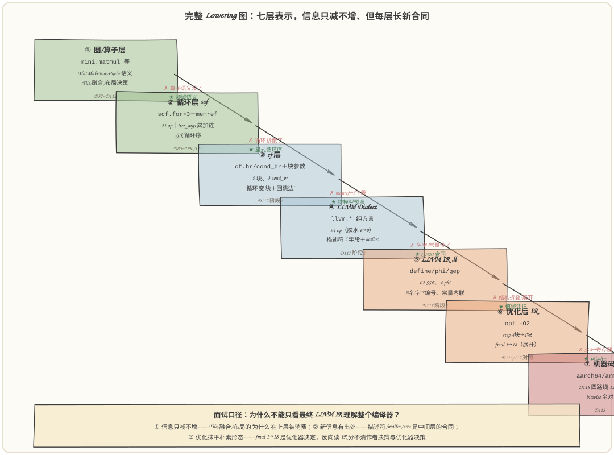
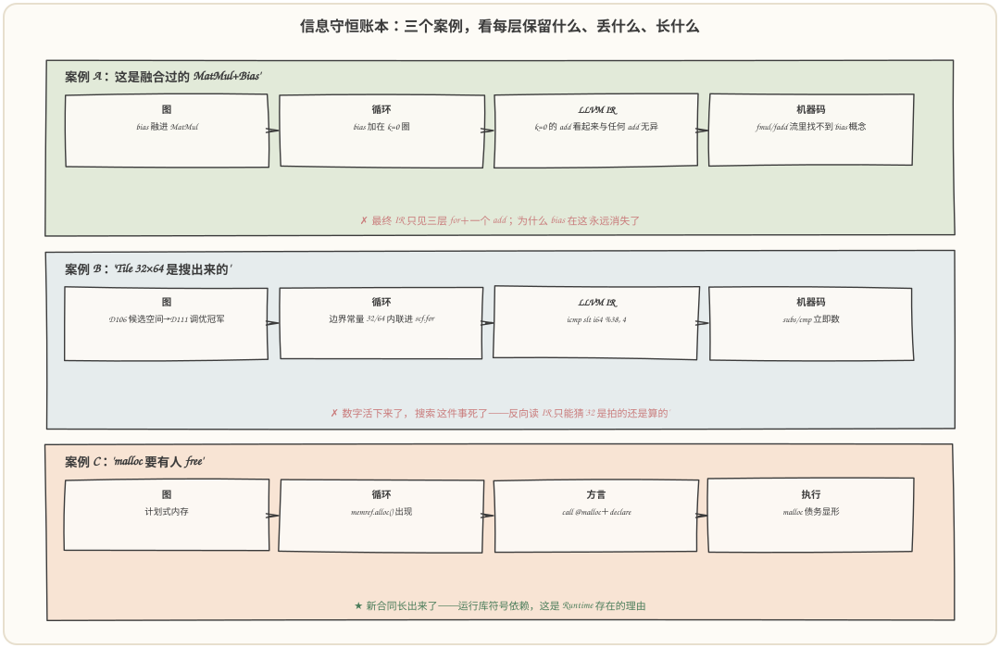

# 第 119 天：第 17 周复盘——七层表示的信息对账：为什么不能只看最终 LLVM IR 理解整个编译器

> **今日目标**：完成本教程后，你能做到五件事——把第 17 周（D113~D118）六天的成果串成**一条完整 Lowering 链**（图/算子层 → 循环层 scf → cf 层 → LLVM Dialect → LLVM IR → 优化后 IR → 机器码，七层），逐层说出**每层保留什么、丢失什么、新增什么**——比如算子语义在循环层消费（"三层 for 不再'是'MatMul"）、memref 在方言层换成 5 字段描述符、名字与常量在 .ll 层消失（D113 的 R1/R2）、SSA 在机器码层被寄存器复用抹掉；用自己的话回答计划点名的核心问题——**"为什么不能只看最终 LLVM IR 理解整个编译器？"**（三条论据：信息只减不增——Tile/融合/布局的"为什么"在上层被消费；新信息有出处——描述符/malloc/sret 是中间层长出的合同；优化抹平朴素形态——fmul 1→18 是优化器决定，反向读 IR 分不清作者决策与优化器决策）；独立运行 `./run_all.sh` 复现**七层信息对账表**（`map_layers.py` 逐层生成，每条记录挂文件证据与实测数字）＋**跨版本对账**（本机 LLVM 23 重跑 D117 管道：97 op vs 冻结的 94 op、胶水均 0、`llvm.mlir.undef`→`poison` 改名——结构语义跨 5 个大版本一致）；完成 **12 题周测**（样例答卷 10/12，第 5、10 题故意答错——描述符大小与结果位置是最常见误区）；按每周复盘模板给出**第 17 周总账**（六天 63 项 PASS 判定、双环境验证、跨天账本全程可追）并说出下周唯一核心目标（`minic` 统一编译入口）。
> **预计时间**：学习 35 分钟＋实践 45 分钟
> **前置准备**：本周六天的关键结论——D113 导出三规则 R1（重编号）R2（常量内联）R3（块参数→phi）、step 优化 4块/11指令→1块/5指令；D114 合法性清单 10 行＋暂不支持 7 条＋类型兑换表（index→i64、memref→5字段描述符、tensor 拒收）；D115 56B 契约（字段偏移 0/8/16/24/40）＋10 组签名＋两道闸（tensor/动态 memref 拒收）；D116 三层验证法＋账本（@add 21/21、@relu 22/22、GEMM 14/18 残账 C1×4）；D117 七 pass 管道（21→18 op、胶水 6→0、62 SSA/4 phi/21 insertvalue、22 PASS）；D118 四条执行路线（AOT 静态/共享库、JIT lli/MCJIT）×12 点 bitwise 全对、malloc 债务挂账 D131。工具只要 `python3`（census.py 口径对齐 D114~D117）；本机若有 mlir-opt（本文环境：macOS arm64，Homebrew LLVM 23.1.5）会加跑跨版本对账。
> **今日产出**：`code/map_layers.py`（七层信息对账表生成器＋12 题周测＋8 项自检断言）、`code/census.py`（D117 同款 op 计数器，复用）、`code/gemm.mlir`（贯穿输入，D117 同款）、`code/run_all.sh`（一键复现：对账表＋周测＋跨版本结构对账）、`code/outputs/lowering-map.txt`（**今日主产出：七层×保留/丢失/新增对账表＋面试口径**）、`code/outputs/layer-census.txt`（各层机器计数实测）、`code/outputs/information-test.txt`（12 题周测，样例 10/12＋参考答案）、`code/outputs/llvm23-2-llvm-dialect.mlir`（LLVM 23 现场重跑的方言层产物）、`code/outputs/self-check.txt`（8/8 自检）、`code/outputs/run-all-log.txt`（真机日志含跨版本 diff）＋本文 3 张手绘图（图 1 即计划点名的"完整 Lowering 图"交付物）。

## 1. 今天解决什么问题？

第 17 周六天，每天都在修自己那一段路：D113 认识门两侧的两个世界，D114 写翻译手册（清单），D115 换签名与类型，D116 点亮第一个算子，D117 打通完整管道导出 .ll，D118 让 .ll 真的跑起来。**但六段路没有人从头到尾连起来看过一遍。**计划今天只写了三句话——"回顾从图 IR 到可执行代码的每层表示"、"画出完整 Lowering 图，指出每层仍保留和已经丢失的信息"、"能回答'为什么不能只看最终 LLVM IR 理解整个编译器'"。

复盘日的检验方法与 D105/D112 相同：用一个具体问题逼着六天的知识串起来。今天的问题是——**从 `mini.matmul` 出发的每一个决策，走到机器码时还剩什么？**一个 Tile 大小的选择、一次融合的决定、一个描述符布局的设计，经过七层表示之后，哪些变成了机器码里看得见的东西（立即数、指令选择），哪些彻底消失（"这是融合过的 bias"、"32 是搜索出来的"），哪些半路杀出来（malloc 依赖、sret 包装）？把这笔账算清，"为什么不能只看最终 IR"就不再是背书，而是亲眼所见。

**输入：本周六天的冻结产物与两个真实文件（gemm.mlir 及其各层形态）；输出：一张七层信息对账表（每层保留/丢失/新增三栏、每条挂证据）、一张跨版本对账（LLVM 18 vs 23）、12 题周测、第 17 周总账，以及"下周唯一核心目标"。**

## 2. 先看全貌：今天的内容位于哪里？



**图 1**（计划点名的交付物）：看一条**下行阶梯**——七张卡片从左上到右下依次是①图/算子层（mini.matmul、Tile/融合/布局决策，绿）→②循环层 scf（21 op、iter_args 累加链，绿）→③cf 层（9 块、3 cond_br，蓝）→④LLVM Dialect（94 op、胶水 6→0、描述符 5 字段，蓝）→⑤LLVM IR（62 SSA、4 phi、名字消失常量内联，橙）→⑥优化后 IR（step 4块→1块、gemm fmul 1→18，橙）→⑦机器码（D118 四路线 12/12，红）。每条转换边挂两个标签：**红 ✗ 是该层丢失的**（算子语义没了→"循环"拆散了→memref→5字段→名字/常量没了→结构折叠/展开→SSA→寄存器），**绿 ★ 是该层新增的**（领域语义→显式循环序→块模型预演→C ABI 合同→值域注记→可运行）。底部金框是面试口径三条论据。**读图要点：丢失项全部不可逆——没有一条箭头指回去；新增项全部有出处——每一项都能指到具体某天的具体决策。**

把今天的主线串成 5 步：

1. **分层**：把 D113~D118 走过的路切成七层（map_layers.py 的 `LAYERS` 表——每层五栏：形态/证据/实测/保留/丢失/新增）；
2. **对账**：每层三条记录逐条挂证据——不是讲义，`layer-census.txt` 用 census.py 现场数（源层 21 op、方言层 94 op、.ll 层 62 SSA/4 phi/21 insertvalue）；
3. **跨版本**：本机 LLVM 23 重跑 D117 管道，与冻结的 LLVM 18 产物做结构对账——97 vs 94 op（+3 全部是 extractvalue）、胶水均 0、undef→poison 改名；
4. **周测**：12 题覆盖六天核心概念，样例答卷故意错 2 题（描述符大小、结果位置——本周最高频的两个误区）；
5. **总账**：按每周复盘模板出第 17 周账本（63 项判定、双环境、跨天账本），并立下周唯一核心目标。

## 3. 核心概念：信息只减不增，但每层长新合同

### 3.1 丢失：每层 Lowering 都在消费上层语义

**一句话**：Lowering 的本质是**消费语义换执行性**——每往下一层，上层"为什么这样设计"的理由就被消费掉一分，只留下"这样算"的指令。

**类比**：菜谱翻译成自动炒菜机的控制程序。菜谱写"小火慢炖让胶质释放"（语义＋理由），控制程序只有"加热功率 300W 持续 40 分钟"（指令）。拿到控制程序的人能复现这道菜，但永远不知道为什么是 300W 不是 500W——理由在翻译时被消费了。**类比边界**：菜谱是给人看的、程序给机器执行，而编译器的每层 IR 其实都能执行（D118 证明 .ll 能跑）——问题是**解释力**：看 .ll 能知道"算什么"，不能知道"为什么恰好这样算"。**技术对应**：三个实例——①算子语义在循环层消费：`mini.matmul` 是"矩阵乘"，三层 scf.for 只是"三层计数循环"，bias 加在 k=0 圈的融合决策（D78~D81）在任务单里写死后，循环层再也看不出 bias 与普通 add 的区别；②Tile 决策在循环层消费：D106 搜索空间 → D111 冠军 tile=32 的决策，到 scf.for 变成边界常量，到 .ll 变成 `icmp slt i64 %38, 4`——**数字活下来了，"搜索"这件事死了**；③SSA 在机器码层消费：寄存器复用抹掉值的历史，`%47 = phi float` 变成 `s1` 寄存器，"这个值有两个来源"的信息只剩跳转指令的拓扑。

**当天实测证据**：`lowering-map.txt` 逐层的"丢失 ✗"栏——层 2 起每层都有（源层无丢失）；`02-information-ledger.svg` 案例A/B 各追踪一条到底。

### 3.2 新增：每层都在长出下一层依赖的合同

**一句话**：Lowering 不只是做减法——每层都**长出新合同**（结构约定、ABI 约定、符号依赖），下一层把它们当空气一样依赖着，但它们在源层根本不存在。

**类比**：接力赛每一棒递出去的不只是接力棒，还有"下一棒从哪个位置起跑"的约定——这个约定是交接那一刻才产生的，看最终成绩单看不到它，但它决定了交接是否成功。**类比边界**：接力约定只在交接瞬间存在，编译器的新合同会**一路带到底**——D115 的 56B 描述符布局从函数签名一直带到 D118 机器码的内存布局。**技术对应**：本周长出的三份大合同——①**描述符合同**（D115）：`memref<4x6xf32,strided<[6,1]>>` 换成 `{ptr, ptr, i64, [2xi64], [2xi64]}`，56B、偏移 0/8/16/24/40——D116 的模式、D117 的导出、D118 的四条调用路线全部依赖它；②**ABI 合同**（D117）：`llvm.emit_c_interface` 生成 `_mlir_ciface_gemm` 的 sret 三指针包装——这是 MLIR 世界与 C 世界的边界文件；③**符号合同**（D117/D118）：`declare ptr @malloc` ——kernel 从自给自足变成依赖运行环境，Runtime 的第一项职责由此产生（D131）。

**当天实测证据**：`lowering-map.txt` 的"新增 ★"栏七层全有；层 4 的两条新增（C ABI 合同、运行库符号依赖）在 D118 四条路线里被四种语言独立消费（C/Python/LLVM IR/C++）。

### 3.3 面试口径：三层论据回答"为什么不能只看最终 LLVM IR"

**一句话**：只看最终 IR＝只看账本最后一页——你能知道每一笔交易（指令）的数额，却不知道预算是怎么定的（决策）。

**三条论据**（`lowering-map.txt` 尾部原文）：**①信息只减不增**——最终 IR 里没有"这是融合过的 MatMul+Bias"（融合决策在图层做出、在循环层消费），没有"Tile 32×64 是搜索出来的"（搜索在 D106~D111，消费在边界常量内联）——看 IR 只见"三层 for"，不见"为什么恰好这三层"；**②新信息有出处**——描述符 5 字段来自 D115 的 ABI 决策、malloc 依赖来自 D117 的 M3 转换、sret 包装来自 C ABI 合同，不看中间层，这些结构"凭空出现"且无法 debug（D118 的 malloc 债务如果没读过 D117，根本不知道该找谁）；**③优化会抹平朴素形态**——O2 把 gemm 的 fmul 1→18 条（循环展开，D117 实测），step 的 4 块菱形折叠成 1 块 select（D113 实测）——反向从 IR 推"编译器做了什么"会同时看到**作者决策＋优化器决策**两层混在一起，无法区分。**类比边界**：这不等于"最终 IR 没用"——它是**执行层的唯一裁判**（D118 的 12/12 bitwise）；准确说法是"每层 IR 都是带上下文的决策记录，缺了上下文就只剩指令"。这条结论直接引出 D123（IR Dump 可观测性）存在的理由。

## 4. 图解核心机制：信息守恒账本



**图 2**：三条泳道各追踪一个案例到底——**泳道 A（绿）"这是融合过的 MatMul+Bias"**：图层的融合决策（D78~D81）→ 循环层 bias 加在 k=0 圈（任务单写死）→ .ll 层 k=0 的 add 与任何 add 无异 → 机器码 fmul/fadd 流里找不到"bias"概念；裁决（红）：最终 IR 只见三层 for＋一个 add，"为什么 bias 在这"永远消失。**泳道 B（蓝）"Tile 32×64 是搜出来的"**：图层 D106 候选空间→D111 调优冠军 → 循环层边界常量 32/64 内联 → .ll 层 `icmp slt i64 %38, 4`（数字在、来历没了）→ 机器码 subs 立即数；裁决（红）：**数字活下来了，"搜索"这件事死了**——反向读 IR 只能猜"32 是拍的还是算的"。**泳道 C（橙）"malloc 要有人 free"**：图层计划式内存（D105）没有 alloc 概念 → 循环层 memref.alloc() 出现 → 方言层 call @malloc＋declare（D117 M3）→ 执行层 malloc 债务显形（D118 挂账 D131）；裁决（绿 ★）：**新合同长出来了**——运行库符号依赖，这是 Runtime 存在的理由。**读图要点：A/B 的裁决是红的（不可逆丢失），C 的裁决是绿的（新增合同）——一张图同时看到信息流的两个方向。**

## 5. 动手实践：把六天的路连成一张对账表

### 5.1 准备文件

```text
tutorials/day-119/
├── README.md                        ← 本文
├── images/                           ← 3 张手绘图
│   ├── 01-lowering-map.svg           # 完整 Lowering 图（计划点名交付物）
│   ├── 02-information-ledger.svg     # 信息守恒账本（三案例）
│   └── 03-week-report.svg            # 周成绩单＋下周路线
└── code/
    ├── map_layers.py                 # 七层对账表生成器＋周测＋自检
    ├── census.py                     # op 计数器（D117 同款复用）
    ├── gemm.mlir                     # 贯穿输入（D117 同款）
    ├── gen_images.py                 # 3 张 SVG 生成脚本
    ├── run_all.sh                    # 一键复现
    └── outputs/
        ├── lowering-map.txt          # 主产出：七层×三栏对账表＋面试口径
        ├── layer-census.txt          # 各层机器计数实测
        ├── information-test.txt      # 12 题周测（样例 10/12）
        ├── llvm23-2-llvm-dialect.mlir# LLVM 23 现场重跑产物
        ├── self-check.txt            # 8/8 自检
        └── run-all-log.txt           # 真机日志（含跨版本 diff）
```

环境：Python 3.9.6（零第三方依赖）＋可选 mlir-opt（本文环境：macOS arm64，Homebrew LLVM 23.1.5）。一键复现：

```bash
cd tutorials/day-119/code && ./run_all.sh    # 对账表＋周测＋跨版本对账，约 5 秒
```

**诚实声明**：`map_layers.py` 的 `LAYERS` 表是**人工整理的对账框架**，但每条记录的数字全部来自机器实测——`layer-census.txt` 是 census.py 现场数出的（源层 21 op、方言层 94 op、.ll 层 62 SSA），跨版本段是 mlir-opt 现场重跑的（97 op）。本周六天的 outputs 冻结自两台机器（aarch64 Linux/LLVM 18 与 macOS arm64/LLVM 23）——复盘的判据是**结构结论**（胶水均 0、残账清零、bitwise 全对），不是毫秒数。

### 5.2 编写代码

`map_layers.py` 的核心是 `LAYERS` 数据表——每层七个字段，把"保留/丢失/新增"写成**带证据的数据**而不是散文：

```python
LAYERS = [
    {
        "name": "循环层（scf）", "day": "D85~D90 / D117 源",
        "form": "scf.for 嵌套＋arith＋memref",
        "evidence": "gemm.mlir（21 op：scf.for×3＋scf.yield×1）",
        "has": ["循环边界/步长（静态可算）", "累加初值（iter_args）", ...],
        "lost": ["算子语义——三层 for 不再'是'MatMul",
                 "融合边界——bias 加在 k=0 圈还是逐元素，图上才知道"],
        "gain": ["显式循环序（i/j/k 顺序＝性能决策的落点）"],
        "numbers": "census：21 op（func 1、arith 10、scf 4、memref 4...）",
    },
    ...  # 共 7 层
]
```

三个设计点：**其一**，`machine_census()` 现场跑 census.py 数出源层/优化层/cf 层/方言层的 op 数、用文本统计数出 .ll 层的 SSA/phi/insertvalue——**表格里的每个数字都有一次程序运行背书**；其二，`run_quiz()` 的样例答卷故意错第 5、10 两题（描述符大小选成 40B、结果位置选成"调用方 C 数组"）——这两个是本周真实踩过的坑（D115 TP8 的 P1、D118 TP5 的误区），错题附出处；其三，`run_all.sh` 的跨版本段是**复盘日特有的验证动作**：用本机 LLVM 23 重跑 D117 的七 pass 管道，与冻结的 LLVM 18 产物做结构 diff——本周结论若只在一台机器成立，复盘就不算数。

### 5.3 运行与观察

`./run_all.sh` 的真机输出（outputs/run-all-log.txt）：

```text
第 119 天：第 17 周复盘——真机报告 2026-11-14 20:22
环境：Python 3.9.6｜Darwin arm64

[1] map_layers.py：七层信息对账表
layer-census.txt: 5 层实测
lowering-map.txt: 7 层对账表
information-test.txt: 样例 10/12
self-check: 8/8

[2] 跨版本对账：本机 LLVM 23 重跑 D117 管道（gemm.mlir → LLVM 方言）
  本机 LLVM 23：total 97 op（胶水 0 条，llvm.* 97，非 llvm 残账 0）｜胶水 0 条
  D117 冻结（LLVM 18）：total 94 op（胶水 0 条，llvm.* 94，非 llvm 残账 0）｜胶水 0 条
  [PASS] 胶水均为 0——reconcile 语义跨 5 个大版本一致

[附] 跨版本 op 分布差异（LLVM 23 vs 18，census 逐行 diff）：
  llvm.extractvalue x14 → x17（+3：LLVM 23 重建描述符多 3 次字段提取）
  llvm.mlir.undef x3 → llvm.mlir.poison x3（LLVM 15+ 起 undef 全面让位 poison）
  其余 op 逐行相同——结构语义跨 5 个大版本一致（判据：胶水均 0、非 llvm 残账均 0）

汇总：  合计：8/8
```

三组观察：**①主产出**（`lowering-map.txt` 摘录层 2、层 5）：

```text
层 2｜循环层（scf）（D85~D90 / D117 源）
  实测：census：21 op（func 1、arith 10、scf 4、memref 4、return 1...）
  保留 → 循环边界/步长（静态可算）；累加初值（iter_args）；迭代依赖（yield 链）...
  丢失 ✗ 算子语义——三层 for 不再'是'MatMul；融合边界——bias 加在 k=0 圈还是逐元素...
  新增 ★ 显式循环序（i/j/k 顺序＝性能决策的落点）

层 5｜LLVM IR（.ll）（D117 阶段 3 / D113 对照）
  实测：gemm-3.ll：62 SSA / 4 phi / malloc×1 / insertvalue×21
  丢失 ✗ MLIR 的名字——%c1a 变 %14、^merge 变 10:（D113 R1 重编号）...
  新增 ★ 寄存器级别的直线 SSA（优化器的输入形态）；值域注记（range）...
```

**②跨版本差异的成色**：97 vs 94 的 3 个 op 差全部是 `llvm.extractvalue`（LLVM 23 的 finalize-memref-to-llvm 重建描述符时多提取 3 次字段）＋`undef`→`poison` 的改名（LLVM 15 起 poison 全面替代 undef）——**这是"语义跨版本稳定、文本形态随版本漂移"的活案例**，与 D118 实验 A 的观察（poison 替代、malloc 折叠、gep 加 inbounds nuw）互相印证。**③周测错题**（information-test.txt）：

```text
Q5. D115：rank2 memref 描述符的大小与字段偏移是？
    样例答卷选：B. 40B；0/8/16/24/32  [✗]
    正确答案：A. 56B；0/8/16/24/40
    出处：D115 TP1：真机 LLVM TargetData 与教学计算逐字段一致
Q10. D118：@gemm 的结果数据在哪里？
    样例答卷选：C. 栈上的返回值  [✗]
    正确答案：A. kernel 内部 malloc 的新缓冲区（描述符经 sret 写回）
    出处：D118 TP5：错误示范里 C 数组全 0——kernel 从未写它
```

### 5.4 修改一个参数再观察

两个便宜的实验：**实验 A（加一层）**：往 `LAYERS` 表里插入"bufferize 层"（D85~D105 的 tensor→memref 阶段）——你会立刻发现它填不满：`has`/`lost`/`gain` 三栏都要重新想（tensor 的值语义丢了什么？memref 的别名语义新增了什么？）——**这张表是检验"是否真懂某层"的试金石**，填不出来说明那层还没吃透。**实验 B（反向走）**：拿着 `gemm-3.ll` 的 `icmp slt i64 %38, 4` 反问"4 从哪来"——沿 lowering-map.txt 层 5→2 反向找：4 是 ubN 常量（gemm.mlir `%ubN = arith.addi %c3, %lb`，其中 `%lb = %c6 - %c6 = 0` 的朴素冗余被 canonicalize 折叠）→ 它是 N=3 的矩阵宽度——**数字追到头是 shape，shape 背后的"为什么 3×4"在图外**。这正是 3.3 论据①的亲手版。

## 6. 常见错误与排查

**错误 1：把"信息丢失"理解成"编译器有 bug"**。现象：读最终 IR 发现"bias 融合、Tile 决策都看不见了"，认为 Lowering 弄丢了信息。原因：丢失是 Lowering 的**设计本性**——每层的职责就是把上层语义"编译"成下层指令，语义被消费是完成工作而不是事故；真正的事故是**语义丢失后无法验证执行正确**，这由各层的验证补（D116 三层验证、D118 bitwise）。定位：问自己"丢的这个信息，执行时还需要吗"——不需要就是正常消费，需要就是 bug。修复：区分两类丢失——**良性**（决策已内化为指令形态）与**恶性**（验证依赖的证据没了，例如 D123 要解决的"中间层 IR 不留档就没法 debug"）。

**错误 2：复盘变成"列目录"——只数文件不问联系**。现象：周报写成"D113 做了 X、D114 做了 Y……"六天流水账，复了等于没复。原因：没有用一个**贯穿问题**逼着知识串联（D105 用"一个 Tile 的一生"、D112 用"模型为什么选错"、今天用"每个决策走到机器码还剩什么"）。定位：自检方法——合上文档能否讲出**至少一条跨三天的因果链**（例：D114 清单 C1 排期 D117 → D115 GEMM 账本 14/18 残账恰好 C1×4 → D117 convert-scf-to-cf 清账 18/18）；讲不出就是列目录。修复：每周复盘先找贯穿问题再动笔——计划文档的"每周固定复盘模板"第一行就是为此设计。

**错误 3：跨版本对账时把文本差异当语义差异**。现象：LLVM 23 重跑得到 97 op（vs 冻结 94），看到数字不同就紧张"结论不成立了"。原因：混淆**文本形态**（op 数量、名字、立即数形态——随版本漂移）与**结构语义**（胶水是否清零、残账是否存在、bitwise 是否一致——跨版本稳定）。定位：用三个稳定判据——`unrealized_conversion_cast` 计数（均 0）、非 llvm 残账计数（均 0）、导出 .ll 后执行结果（D118 已验 12/12）。修复：对账报告里两个口径并列呈现（本文 run-all-log.txt 的做法：op 分布 diff 列差异、判据行写 PASS）。

**错误 4：七层表填成"每层都一样重要"**。现象：对账表七层平铺，看不出哪层是本周**新**走的（③④⑤⑦）、哪层是前 16 周的老路（①②）。原因：复盘没有时间轴视角。定位：看 `LAYERS` 的 `day` 字段——层 1/2 标的是 D57~D112（第四阶段成果的下游）、层 3~7 标 D117/D118（本周新走）。修复：复盘图（图 1）用颜色区分：绿＝本周之前已通、蓝/橙/红＝本周新通——**第 17 周的增量是"把已有四层接到 LLVM 三层"**，这个定位决定下周方向（统一入口把七层装进一个命令）。

## 7. 今日练习

**必做**：

1. 不看文档，手画七层 Lowering 链（图 1 的阶梯），每层标注一条"丢失"＋一条"新增"——对答案（lowering-map.txt），漏了哪层重读哪天。
2. 把 `map_layers.py` 的 `LAYERS` 复制一份，删掉全部 `lost` 字段，凭记忆重填七层——填完 diff 原表；填不出的层就是你的薄弱层。
3. 完成周测 12 题（information-test.txt 的题目部分遮住答案），目标 ≥10 分；错题按出处回读对应天。

**选做（挑战）**：

4. 实验 A 的进阶：把"bufferize 层"真正补进 `LAYERS` 并让 `machine_census()` 数出该层产物（需要构造 D85 时代的中间 IR 文件）——填满三栏就算真懂 tensor→memref。
5. 用 `lowering-map.txt` 的面试口径录一段 3 分钟语音回答"为什么不能只看最终 LLVM IR 理解整个编译器"——脱稿、带本周具体数字（fmul 1→18、56B、malloc 债务）。

## 8. 今日验收

- [ ] 我能默画七层 Lowering 链，每层说出至少一条保留、一条丢失、一条新增，并挂出证据（哪天的哪个文件）
- [ ] 我能脱稿用三条论据回答"为什么不能只看最终 LLVM IR 理解整个编译器"（信息只减不增／新信息有出处／优化抹平朴素形态），每条带一个本周实测数字
- [ ] 我独立运行 `./run_all.sh` 复现七层对账表＋12 题周测＋跨版本对账（LLVM 23 vs 18：97 vs 94 op、胶水均 0、undef→poison），并说清"文本形态漂移但结构语义稳定"的判据
- [ ] 我能讲出至少一条跨三天的因果链（例：D114 排期 C1→D117 → D115 账本 14/18 残账 C1×4 → D117 清账 18/18 → D118 执行）
- [ ] 我按每周复盘模板完成第 17 周总账：63 项（5+7+8+9+22+12）、双环境验证、三笔跨天账（残账、胶水、malloc 债务）各有去向
- [ ] 我能说出下周唯一核心目标及其理由（`minic` 统一编译入口——第 18 周把七层装进一条命令，为第 19~20 周的 Runtime 与回归体系打地基）

## 9. 第 17 周复盘（按计划的每周模板）

```text
本周目标：把 mini 的世界一路降到可执行机器码——认识 LLVM Dialect 与 LLVM IR
          的关系（D113）、设计最终 Lowering 路径（D114）、转换函数与类型
          （D115）、点亮第一个端到端算子（D116）、导出 LLVM IR（D117）、
          JIT/AOT 真实执行（D118）。

本周可运行产出：D113 教学版 mlir-translate（21 个产出文件：带注释 .ll、
          概念对照表 10 行、双目标汇编、两组对照）；D114 合法性清单 10 行＋
          类型兑换表＋暂不支持 7 条（design-doc.md）；D115 函数转换骨架
          （TP1~TP8 全过：56B 契约逐字段对账、10 组签名、两道闸、真机 ABI
          证据链）；D116 六类模式发射器（9/9＋10/10 PASS：@add 21/21、
          @relu 22/22、GEMM 14/18 残账 C1×4、ciface 汇编证据）；D117 完整
          管道＋导出（22 PASS：21→18 op、胶水 6→0、62 SSA/4 phi、tight
          18/18、四错误存档）；D118 四条执行路线（12 PASS：AOT 静态 50248B、
          AOT 共享库 ctypes、JIT lli、JIT MCJIT，×12 点 bitwise 全对）。

新增测试数量：本周累计 63 项判定（5+7+8+9+22+12：D113 5 步、D114 7/7、D115 TP1~8、D116 9/9、D117 22/22、D118 12/12）——含正确性门
          （bitwise 对照 12 点×4 路线）、负例（tensor/动态 memref 拒收、
          四种 Lowering 错误复现、malloc 误区示范）、结构对账（census 跨
          4 层、跨版本 97 vs 94 op）、周测 12 题（样例 10/12）。

最重要的一个技术问题：每层 Lowering 到底保留什么、丢失什么——最终 IR
          为什么不足以理解整个编译器？

问题根因：Lowering 的本质是"消费语义换执行性"——上层的设计理由（Tile
          为什么 32、bias 为什么融合在 k=0）被消费成指令形态后不可逆；
          同时每层长出的新合同（56B 描述符、sret 包装、malloc 依赖）在
          源层不存在、在下层是空气——两头加起来，最终 IR 只是账本最后
          一页。

如何验证修复：七层对账表逐层挂证据（lowering-map.txt：每条保留/丢失/
          新增都有文件＋实测数字）；跨版本对账（LLVM 18 vs 23 结构语义
          稳定）；三个案例追踪到底（02-information-ledger.svg：融合语义、
          Tile 决策、malloc 合同各一条）。

一个优化前后对照：step（D113）4 块/11 指令 → 1 块/5 指令（菱形折叠＋
          常量折叠）；gemm（D117）O2 后 fmul 1→18（循环展开）——同一份
          IR 在优化器手里结构重排，作者意图与优化器决策在最终形态里
          不可区分。

能脱稿回答的问题：LLVM Dialect 和 LLVM IR 什么关系（R1/R2/R3）；描述符
          56B 为什么（D115 ABI 推导）；结果为什么在 kernel 的 malloc
          缓冲区（sret 语义）；JIT 与 AOT 分歧点（编译时机）；本周每个
          PASS 数字背后验的是什么。

仍然讲不清楚的问题：Conversion 失败时诊断如何保留（D122 主题）；优化
          开关组合的边界效应（D121）；IR Dump 的粒度选择（D123）；融合
          算子到循环的通用映射法则（D124）。

下周唯一核心目标：统一端到端编译入口 `minic`——输入 mini 图 IR、输出
          可执行与全部阶段 IR Dump；四个优化开关（图优化/Tiling/Lowering
          优化/代码生成）可独立控制；任何失败带诊断与退出码。它是第 19
          周 Runtime（D127~D133）与第 20 周回归体系（D134~D140）的地基。
```

## 10. 一句话总结与明天预告

今天的闭环：**问题**——第 17 周六天各修一段路，没人从头连起来看过，计划点名"画出完整 Lowering 图、回答为什么不能只看最终 IR"；**机制**——七层表示的信息对账（每层保留/丢失/新增三栏挂证据）：丢失不可逆（算子语义、Tile 决策、"为什么"被消费成"这样算"），新增有出处（56B 描述符、sret 包装、malloc 合同是中间层长出的、下层当空气依赖着）；**实践**——map_layers.py 生成七层对账表（census 现场数 5 层）、LLVM 23 重跑 D117 管道做跨版本对账（97 vs 94 op、胶水均 0、undef→poison）、12 题周测（样例 10/12，两个高频误区点名）；**验证**——8/8 自检＋63 项周判定总账＋三条跨天因果链可复述。**第 17 周收官：从 `mini.matmul` 到机器码的七层链路全部走通，且每层的账都能对着文件查。**明天进入第 18 周：D120 设计命令行接口——`minic` 的输入/输出/选项/诊断/退出码，把今天七层的零件装进一条命令的骨架里。

> **第 17 周积分卡**：D113 认识两个世界（4块→1块）→ D114 写翻译手册（10 行清单）→ D115 换签名（56B 契约）→ D116 点亮第一个算子（21/21）→ D117 打通管道（胶水 6→0）→ D118 真实执行（四路线 12/12）→ **D119 七层对账（信息只减不增、每层长新合同）**。下一站：`minic`。
