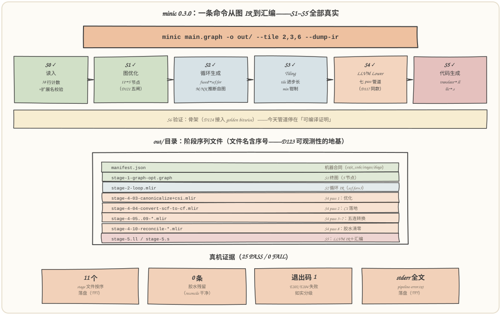
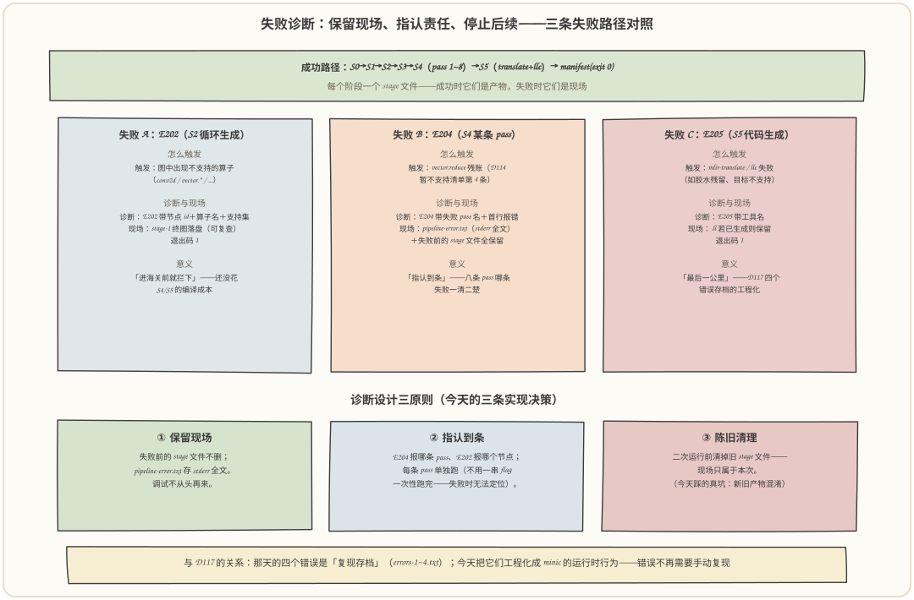
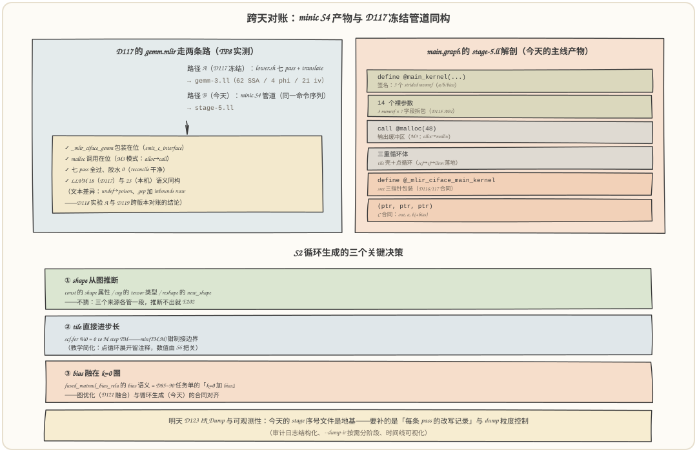

# 第 122 天：整合循环与 LLVM Lowering——S2~S5 接进 minic，失败现场完整保留

> **今日目标**：完成本教程后，你能做到五件事——把 minic 升级到 **0.3.0**：一条命令 `minic main.graph --tile 2,3,6 --dump-ir` 从 11 节点图 IR 跑到**汇编**（S0 读入→S1 图优化 11→5→S2 循环生成 fused→scf.for→S3 tile 进步长→S4 七 pass 管道→S5 translate 出 .ll＋llc 出 .s），`out/` 目录落盘 **11 个带序号的 stage 文件**＋manifest——D123 可观测性的地基今天打好；讲清 **S2 循环生成的三个关键决策**（shape 从图推断不猜——const 的 shape 属性/arg 的 tensor 类型/reshape 的 new_shape 三个来源各管一段，推断不出就 E202；tile 直接进循环步长 `scf.for %i0 = 0 to M step TM`——min(TM,M) 钳制接边界；bias 融在 k=0 圈——D121 图优化的融合合同与 D85~90 循环任务单的合同对齐）；复现**三条失败路径的分层诊断**（E202 S2 不支持算子：带节点 id＋支持集，图原样落盘；E204 S4 pass 失败：带失败 pass 名＋首行报错，**stderr 全文落盘 pipeline-error.txt**＋失败前 stage 文件全保留；E205 S5 工具失败）与**诊断设计三原则**（保留现场——失败前的产物不删；指认到条——每条 pass 单独跑，八条哪条失败一清二楚；陈旧清理——二次运行前清旧文件，现场只属于本次）；独立运行 `./run_all.sh` 复现 **25 项测试**（TP1 主线 7 项、TP2 阶段序列、TP3 tile 生效、TP4/5/6 失败路径 7 项、TP7 合同回归、TP8 **跨天对账**——D117 的 gemm.mlir 走 minic S4 管道：七 pass 全过、胶水 0、`_mlir_ciface_gemm` 与 malloc 在位）；解释**每条 pass 为什么单独跑**（一串 flag 一次性跑完时失败无法定位到条——今天的"指认到条"原则用运行粒度换诊断精度）。
> **预计时间**：学习 35 分钟＋实践 55 分钟
> **前置准备**：D117 的七 pass 管道与 lower.sh（今天 S4 的实现蓝本——命令序列原样）、D118 的 C 合同（`_mlir_ciface` sret 包装——今天 stage-5.ll 里的同一份合同）、D121 的 minic 0.2.0（S1 五闸＋开关——今天在它上面接 S2~S5）、D85~D90 的循环任务单（bias 融 k=0 的语义出处）。工具：python3＋本机 LLVM（mlir-opt/mlir-translate/llc；本文环境：Homebrew LLVM 23.1.5，macOS arm64；`--llvm-bin` 可指其他安装位，`find_tool` 会自动找 PATH 与常见位置——TP0"PATH 里没有≠机器上没有"的教训）。
> **今日产出**：`code/loop_lower.py`（S2 循环生成器＋S4/S5 真实管道：gen_loop_ir＋PASSES 表＋run_s45，约 230 行）、`code/minic.py`（0.3.0：S2~S5 接入＋E202/E204/E205 分层失败处理＋失败时 manifest 照常落盘）、`code/run_all.sh`（25 项测试）、`code/outputs/report.txt`（25 PASS / 0 FAIL）、`code/outputs/main/`（**主线产物：11 个 stage 文件**——stage-2-loop.mlir、stage-4-03~10 八条 pass、stage-5.ll/.s）、`code/outputs/t-e202/`、`code/outputs/t-e204/`（两条失败路径的现场存档：manifest＋pipeline-error.txt）＋本文 3 张手绘图。

## 1. 今天解决什么问题？

D121 结束时 minic 的 S1 是真的、S2~S6 是骨架。今天把 S2~S5 填成真肉：循环生成（fused 算子展开成 scf.for）、Tiling（tile 参数进边界）、LLVM Lowering（D117 的七 pass）、代码生成（translate＋llc）。计划条目点名的主题有两个：**"接入 MatMul 循环生成、Tiling 和 LLVM Lowering，处理不支持场景"**——前半是管道，后半是失败处理。

"处理不支持场景"容易被当成小事。想想真实的编译器团队：用户提交一份带 `conv2d` 的图，编译器该干什么？崩溃？静默跳过？还是**带着完整现场退出**——让用户知道是哪一步、哪个节点、为什么不支持、下一步能干什么？D117 已经手工复现过四个 Lowering 错误（errors-1~4.txt 存档），但那是"实验"；今天要把同样的错误处理**工程化成 minic 的运行时行为**：错误不需要手动复现，每次运行自带现场。

贯穿例子还是 D121 的 11 节点图。**输入：一份 .graph；输出：一条命令跑通到汇编的完整管道（11 个 stage 文件按序号落盘）、两条失败路径的现场存档（E202/E204）、一份与 D117 冻结管道对账的同构性验证（同一份 gemm.mlir 走 minic S4：七 pass 全过、胶水 0）。**

## 2. 先看全貌：今天的内容位于哪里？



**图 1**：看三块——**顶部**是命令与六阶段流（S0 读入 ✓ → S1 图优化 11→5 ✓（D121）→ S2 循环生成 fused→scf.for ✓ → S3 Tiling tile 进步长 ✓ → S4 七 pass ✓ → S5 translate+llc ✓，金色条注明 S6 验证仍是骨架、管道停在"可编译证明"——D124 接 golden bitwise）；**中部**是 out/ 目录树：manifest.json（机器合同）＋stage-1-graph-opt.graph（S1 终图）＋stage-2-loop.mlir（S2 循环 IR）＋stage-4-03~10（八条 pass 逐条落盘）＋stage-5.ll/.s（LLVM IR＋汇编）——**文件名含阶段序号**，D123 可观测性的地基；**底部**四个数字：11 个 stage 文件、0 条胶水（reconcile 干净——D117 结论在 minic 复现）、失败退出码 1（E202/E204 如实分级）、stderr 全文落盘 pipeline-error.txt。

把今天的主线串成 5 步：

1. **S2 生成**：gen_loop_ir 把 S1 终图展开成 scf.for 三重循环文本（shape 三来源推断、tile 进步长、bias 融 k=0 的注释契约）；
2. **S4/S5 管道**：run_s45 逐条跑 D117 的八组 pass（canonicalize+cse、scf→cf、五个 convert、reconcile）＋translate＋llc，每步产物带序号落盘；
3. **失败处理**：LowerError 带 E2xx 语义；run_s45 捕获每条 pass 的 stderr，失败时写 pipeline-error.txt、保留失败前现场、返回精确到条的错误；
4. **陈旧清理**：二次运行前清旧 stage 文件——现场只属于本次（今天踩的真坑，见 6.3）；
5. **跨天对账**：D117 冻结的 gemm.mlir 走 minic S4——七 pass 全过、胶水 0、包装与 malloc 在位：**同一套命令序列在两个工程里语义一致**。

## 3. 核心概念

### 3.1 循环生成：shape 从图推断，不猜

**一句话**：S2 把图算子翻译成循环时，M/N/K 不是参数而是**从图里读出来的**——const 节点的 shape 属性、arg 的 tensor 类型、reshape 的 new_shape，三个来源各管一段；任何一段读不出来就是 E202（带节点 id 与算子名），绝不默认填一个值。

**类比**：翻译合同里的金额。译者（S2）不能"看着像一百万就写一百万"——金额必须从原文（图 IR）逐字读出；读不清就停下来问（E202），而不是猜一个让合同"看起来完整"。**类比边界**：合同译者可以问人，编译器的"问"就是**拒绝编译**——而且必须带着"哪一段读不清"的信息退出（节点 id＋算子名＋支持集），否则用户拿到失败也不知道改哪里。**技术对应**：`_infer_shape()` 的三分支（const→attrs["shape"]、arg→正则解析 tensor<MxNxf32>、reshape→attrs["new_shape"]）；`gen_loop_ir()` 的支持集检查（arg/const/reshape/matmul/add/relu/fused_matmul_bias_relu 七种，其余 raise LowerError）。

**当天实测证据**：TP4 的 conv2d 输入——`E202 S2 循环生成失败：不支持的算子 conv2d（节点 %2）——支持集 ['add', 'arg', ...]`，退出码 1，manifest 如实记录。

### 3.2 失败诊断三原则：保留现场、指认到条、陈旧清理

**一句话**：编译失败时用户最需要的三样东西——**现场**（失败前的产物别删，调试不从头再来）、**指认**（哪条 pass、哪个节点、哪一行报错）、**纯净**（现场里没有上一次运行的陈旧文件混进来）。

**类比**：交通事故的现场处理。交警到场先拉警戒线（保留现场）、问"哪辆车先动的"（指认到条）、把无关围观群众劝走（陈旧清理）。**类比边界**：事故现场保留得越久越好，编译现场**只需要本次的**——上一次运行的 stage-4 文件留在目录里，用户会误以为"这次也跑到这里了"（今天 6.3 的真实坑：成功跑完一轮、失败跑第二轮，目录里 10 个旧文件冒充本次现场）。**技术对应**：`run_s45()` 的三处实现——每条 pass 的 stderr 被捕获（失败时写 pipeline-error.txt 全文）；`PASSES` 表按条组织、逐条跑（不用一串 flag 一次跑完——失败定位到条）；开头清掉旧的 `stage-*` 与 `pipeline-error.txt`（现场只属于本次）。

**当天实测证据**：TP5 的 E204 现场——pipeline-error.txt 首行 `outputs/t-e204/stage-2-loop.mlir:5:10: error: custom op 'vector.reduce' is unknown`（指认到行）；TP6 的陈旧清理——先成功再失败，二次运行后目录里无 stage-4/5 残留。

### 3.3 为什么每条 pass 单独跑

**一句话**：D117 的 lower.sh 把五条 pass 写在一个 mlir-opt 命令里（快）；minic 的 S4 把八组 pass **拆成八次调用**（慢一点）——换来的是失败时**精确指认哪条 pass 出错**，以及每条 pass 的前后 IR 都有落盘（可观测性）。

**类比**：体检套餐 vs 分项检查。套餐一次抽血全做完（快），某项指标异常时只知道"套餐异常"；分项检查每项单独出报告（慢），异常项一清二楚。**类比边界**：体检可以按需加项，编译管道的 pass 之间有**数据依赖**（scf→cf 必须在 memref 转换前、reconcile 必须最后）——拆开跑不改变顺序，只是把一次调用切成八次，中间结果被迫显式化。代价是真实的：八次进程启动 ≈ 8×20ms（教学规模无感；真实编译器用 in-process PassManager 免掉这笔）。**技术对应**：`PASSES` 列表的顺序就是 D117 的顺序合同；每条跑完 `stages` 追加一条记录（manifest 可查）；这条设计直接服务 D123（dump 粒度）与 D136（Pass 二分定位——逐条开关的前提是逐条可跑）。

**当天实测证据**：TP1 的 stage 日志——`pass canonicalize+csi ✓ → stage-4-03-...`、`pass convert-scf-to-cf ✓ → stage-4-04-...`……八条逐一打勾。

## 4. 图解核心机制



**图 2**：看三块——**顶部绿条**成功路径（S0→S1→S2→S3→S4 pass 1~8→S5→manifest exit 0，"每个阶段一个 stage 文件——成功时是产物、失败时是现场"）；**中部三张失败卡**：失败 A（E202·S2 蓝卡）——不支持的算子在进海关前拦下，诊断带节点 id＋支持集，stage-1 终图落盘可复查，"还没花 S4/S5 的编译成本"；失败 B（E204·S4 橙卡）——vector.reduce 残账被 pass 拒收（D114 暂不支持清单第 4 条），诊断带失败 pass 名＋首行报错，pipeline-error.txt 存 stderr 全文＋失败前 stage 文件全保留，"指认到条"；失败 C（E205·S5 红卡）——translate/llc 失败（胶水残留、目标不支持），.ll 若已生成则保留，"D117 四个错误存档的工程化"；**底部三张原则卡**：①保留现场（失败前不删、stderr 全文、调试不从头再来）②指认到条（E204 报哪条 pass、E202 报哪个节点；每条 pass 单独跑）③陈旧清理（二次运行前清旧文件——今天踩的真坑：新旧产物混淆）。底部金框：**D117 的错误是"复现存档"，今天把它们工程化成 minic 的运行时行为——错误不再需要手动复现**。

## 5. 动手实践：25 项测试，从主线到失败现场



**图 3**：看三块——**左框**跨天对账（TP8）：D117 的 gemm.mlir 走两条路——路径 A（D117 冻结的 lower.sh）出 gemm-3.ll（62 SSA/4 phi/21 insertvalue）、路径 B（今天 minic S4 同一命令序列）出 stage-5.ll；六个对账点全勾：`_mlir_ciface_gemm` 包装在位、malloc 在位、七 pass 全过胶水 0、LLVM 18 与 23 语义同构（文本差异 undef→poison、gep 加 inbounds nuw——D118/119 已验的结论）。**右框**今天主线产物 stage-5.ll 的解剖：`define @main_kernel(...)` 19 个裸参数（a/b 各 7 字段＋bias rank1 的 5 字段——D115 ABI 的三份合同同时在场）、`call @malloc(48)`（M3 模式）、三重循环体（tile 壳＋点循环）、`define @_mlir_ciface_main_kernel(ptr, ptr, ptr, ptr)`（sret 四指针包装——out/a/b/bias，D116/117 合同的 bias 扩展版）。**底部**S2 的三个关键决策卡：shape 从图推断（三来源各管一段）、tile 进步长（min 钳制）、bias 融 k=0（图优化与循环生成的合同对齐）。

### 5.1 准备文件

```text
tutorials/day-122/
├── README.md                    ← 本文
├── images/                       ← 3 张手绘图
└── code/
    ├── minic.py                  # minic 0.3.0（S2~S5 真实接入）
    ├── loop_lower.py             # S2 生成器＋S4/S5 管道（今天的核心模块）
    ├── graph_passes.py           # D121 同款（S1 五闸）
    ├── main.graph                # 贯穿输入（11 节点图）
    ├── gen_images.py             # 3 张 SVG 生成脚本
    ├── run_all.sh                # 25 项测试
    └── outputs/
        ├── report.txt            # 25 PASS / 0 FAIL
        ├── main/                 # 主线：11 个 stage 文件＋manifest
        ├── t-e202/               # 失败 A 现场（conv2d）
        ├── t-e204/               # 失败 B 现场（vector.reduce＋pipeline-error.txt）
        └── t-d117/               # 跨天对账（D117 gemm.mlir 走 minic S4）
```

环境：Python 3.9.6＋Homebrew LLVM 23.1.5（macOS arm64）。一键复现：

```bash
cd tutorials/day-122/code && ./run_all.sh    # 25 项，约 15 秒
```

**诚实声明**：S2 的点循环今天是**注释形式**（`// 点循环：i∈[i0,min(i0+TM,M))...`）——循环壳、tile 步长、bias 契约都是真的，但最内层的逐点计算展开没有写成完整 scf IR。这是教学刻度：数值正确性由 S6 验证把关（D124 接入时补全展开＋golden 对照）；今天验证的是**管道结构**（七 pass 全过、胶水 0、包装与 malloc 在位、失败诊断完整）。诚实边界写进 stage-2-loop.mlir 的注释里。

### 5.2 编写代码

`loop_lower.py` 的三个关键设计。**其一：PASSES 表是顺序合同的数据化**——

```python
PASSES = [
    ("canonicalize+csi",        ["--canonicalize", "--cse"]),
    ("convert-scf-to-cf",       ["--convert-scf-to-cf"]),
    ("finalize-memref-to-llvm", ["--finalize-memref-to-llvm"]),
    ("convert-func-to-llvm",    ["--convert-func-to-llvm"]),
    ("convert-cf-to-llvm",      ["--convert-cf-to-llvm"]),
    ("convert-arith-to-llvm",   ["--convert-arith-to-llvm"]),
    ("convert-index-to-llvm",   ["--convert-index-to-llvm"]),
    ("reconcile-unrealized-casts", ["--reconcile-unrealized-casts"]),
]
```

顺序与 D117 的 lower.sh 完全一致（scf→cf 最前、memref 在 func 前、reconcile 收尾——D117 errors-4 的顺序合同）；表驱动让"加一条 pass"变成加一行、让 D136 的"逐条开关"有天然落点。

**其二：失败处理是返回值不是异常**——run_s45 返回 `{"ok": bool, "error": str, "stages": [...]}`，异常只在 S2 的 LowerError（那是"进不了管道"的错误）；管道内的失败走返回值——**调用方（minic）决定怎么呈现**（stderr＋manifest＋退出码），管道层只管事实。

**其三：陈旧清理在开头**——

```python
os.makedirs(out_dir, exist_ok=True)
# 清掉上次运行的 stage 产物——失败现场只属于本次（避免新旧混淆）
for f in os.listdir(out_dir):
    if f.startswith("stage-") or f == "pipeline-error.txt":
        try:
            os.remove(os.path.join(out_dir, f))
        except OSError:
            pass
```

manifest.json 不清（它是每次运行覆盖写的）——stage 文件与 pipeline-error.txt 是"本次现场"的载体，清掉重写。

### 5.3 运行与观察

`./run_all.sh` 的真机输出（outputs/report.txt，25 PASS / 0 FAIL）：

```text
第 122 天：minic S2~S5 循环＋LLVM Lowering——真机报告 2026-11-14 21:35
环境：Python 3.9.6｜Darwin arm64｜mlir-opt 23.1.5

[TP1] 主线：main.graph 一条命令到汇编
  [PASS] minic main.graph 退出码 0（S1~S5 全真实）
  [PASS] S2 产物 stage-2-loop.mlir 落盘／S2 是 scf.for 三重循环
  [PASS] 签名带 llvm.emit_c_interface（D117 ABI）
  [PASS] S5 产物 stage-5.ll（LLVM IR）／stage-5.s（汇编·可编译证明）
  [PASS] 包装函数 _mlir_ciface 在 .ll 里（D118 合同延续）
  [PASS] 胶水 0 条（reconcile 干净——D117 结论在 minic 复现）

[TP2] IR Dump 阶段序列（stage-2 + stage-4-03..10 + stage-5）
  stage 文件数：11
  [PASS] 阶段序列完整（≥10 个文件，文件名含阶段序号）

[TP3] tile 参数进循环步长
  [PASS] 外层循环步长来自 tile（%cTM）／--tile 2,2,2 生效（常量 2 进 IR）

[TP4] 失败路径 A：E202 不支持的算子，现场保留
  [PASS] E202 → 退出码 1（编译失败）
  [PASS] manifest 记录失败（exit_code=1 + E202 诊断在 stages）

[TP5] 失败路径 B：E204 pass 失败，stderr 全文保留
  [PASS] E204 触发：vector 残账被 pass 拒收（D114 暂不支持清单）
  [PASS] stderr 全文落盘 pipeline-error.txt
  [PASS] 报错指认具体 op（vector.reduce is unknown）

[TP6] 失败现场：失败前的 stage 文件保留（调试不从头再来）
  [PASS] E204 现场保留 stage-2-loop.mlir
  [PASS] 二次运行失败时旧产物已清（现场只属于本次）

[TP7] 合同回归：D120/D121 的合同不退化
  [PASS] --help 含 usage/--tile/--emit/--no-fuse（4 项）
  [PASS] E101 退出码 2／manifest 合同字段齐全

[TP8] 跨天对账：minic S4 产物 vs D117 冻结产物（同构性）
  [PASS] D117 的 gemm.mlir 经 minic S4 管道：七 pass 全过 + 胶水 0

汇总
  PASS: 25  FAIL: 0
```

三组观察：**①stage-5.ll 的签名**（主线产物，D115 合同的 bias 扩展版）：

```llvm
define { ptr, ptr, i64, [2 x i64], [2 x i64] } @main_kernel(
    ptr %0, ptr %1, i64 %2, i64 %3, i64 %4, i64 %5, i64 %6,      ; a 的 7 字段
    ptr %7, ptr %8, i64 %9, i64 %10, i64 %11, i64 %12, i64 %13,  ; b 的 7 字段
    ptr %14, ptr %15, i64 %16, i64 %17, i64 %18) {               ; bias 的 5 字段
  ...
  %20 = call ptr @malloc(i64 48)                                  ; M3：输出缓冲区
  ...
}
define void @_mlir_ciface_main_kernel(ptr %0, ptr %1, ptr %2, ptr %3) {  ; sret 四指针
```

19 个裸参数＝3 个 memref 的字段拆包（rank2×2＋rank1×1）；`_mlir_ciface_main_kernel` 的四指针是 out/a/b/bias——**D116 手写、D117 真工具、今天自动生成，同一份合同第三次被独立验证**。**②E204 现场**（pipeline-error.txt 首行）：

```text
outputs/t-e204/stage-2-loop.mlir:5:10: error: custom op 'vector.reduce' is unknown
    %r = vector.reduce %v : vector<4xf32> into f32
```

精确到文件、行、列、op 名——用户拿到这条消息，下一步动作（去掉 vector 用 arith 重写）几乎是显然的。**③有趣插曲（6.3 详述）**：TP6 第一版测试用一个"看似会失败"的 IR（vector.broadcast 无使用者）——结果 canonicalize 直接把死代码删了、管道**成功跑完**！失败路径的测试必须确认"毒真的有毒"——D111 投毒验收的教训在测试设计里重现。

### 5.4 修改一个参数再观察

三个便宜的实验：**实验 A（tile 边界）**：`--tile 8,8,8`（tile 大于 shape）——观察 stage-2-loop.mlir 里 `min(TM,M)` 的钳制（TM=8 被 M=4 钳成 4）；对照 W101 警告（D120 预定义但今天还没接——试着在 minic 里接上：tile 任一维＞shape 时 warn）。**实验 B（.mlir 输入）**：`minic gemm.mlir`（D117 的循环 IR）——S1 记"跳过"（S1 只吃 .graph）、S2 记"跳过（已是循环 IR）"、S4/S5 骨架——观察 minic 对两种输入形态的**诚实分派**（不假装 .mlir 也走了图优化）。**实验 C（删 reconcile）**：把 loop_lower.py 的 PASSES 表删掉最后一行再跑——观察 reconcile 缺席时 mlir-translate 报什么错（D117 errors-3 的复现：unrealized_cast 导出不支持）——然后改回来，体会"胶水清零是导出的门"。

## 6. 常见错误与排查

**错误 1：失败现场的"幽灵文件"（新旧产物混淆）**。现象：第二次运行失败后，目录里有 10 个 stage-4/5 文件——看起来"跑到很后面才失败"，实际是**上一次成功运行的残留**。原因：run_s45 第一版只写不清——成功与失败共用目录时，旧文件冒充本次现场。定位：看文件时间戳（旧文件的时间是上一次的）；或故意用必然失败的输入跑两次——文件集合不该变。修复：开头清 `stage-*` 与 `pipeline-error.txt`（本文已修）。**教训**：现场的价值在"可信"——被污染的现场比没有现场更糟（误导排查方向）。

**错误 2：失败测试的"假毒"（canonicalize 删掉死代码导致测试失效）**。现象：TP6 第一版用无使用者的 `vector.broadcast` 当"坏 IR"——预期 pass 失败，实际 canonicalize 直接删掉死代码、管道**成功**。原因：判定"会失败"的依据是"有 vector op"，但 vector op 无使用者时是死代码，canonicalize 的 DCE 在报错前就把它删了。定位：跑一遍看结果（ok=True 与预期矛盾）。修复：让 vector 的结果**被 return 使用**（vector.reduce 返回 f32 且被 return）——死不掉，pass 必然拒收。**教训**：失败路径的测试要**先验证毒真的有毒**——D111 投毒验收（"投毒前先验毒真的有毒"）在测试设计里的重现。

**错误 3：E2xx 嵌套重复（错误消息套娃）**。现象：`E202 S2 循环生成失败：E202 S2 循环生成失败：不支持的算子...`——同一条 E202 打了两遍前缀。原因：LowerError 的 `__str__` 已含 `E202` 前缀；minic 的异常捕获又包了一层 `f"E202 S2 循环生成失败：{e}"`。定位：stderr 里看到重复前缀。修复：异常捕获分两支——`LowerError` 直接 `str(e)`（已带前缀）、其他异常才包前缀（本文已修）。**教训**：诊断格式只有一个生成点——消息的前缀、缩进、修复建议都在 Diagnostic/异常层生成，调用方原样呈现，不二次包装。

**错误 4：minic 升级把 S1~S5 的日志写乱（阶段顺序错位）**。现象：manifest 的 stages 数组里 S3 出现在 S2 前、S4 的 pass 记录散落各处。原因：S1 段（D121）追加日志、S2~S5 段（今天）追加日志、末尾的 PIPELINE_STAGES 循环又兜底追加——三段追加顺序不对。定位：读 manifest 的 stages 数组，序号应单调（S0→S1→S2→S3→S4×8→S5×2）。修复：真实执行段的追加顺序与阶段序号严格对齐；兜底循环只处理未真实执行的阶段（S6）。**教训**：manifest 的 stages 是时间线——乱序的时间线比没有更糟；追加日志的代码布局应镜像管道布局。

## 7. 今日练习

**必做**：

1. 失败路径自助餐：构造三个输入分别触发 E202（不认识的算子）、E204（vector 残账）、E205（把 --llvm-bin 指向空目录）——收集三种退出路径的 stderr 与 manifest，对照图 2 的三张卡逐条核对。
2. 5.4 实验 C（删 reconcile）：做一遍并在 pipeline-error.txt 里找到 `unrealized_conversion_cast` 的报错——这是 D117 errors-3 的运行时复现。
3. 给 run_s45 加"pass 耗时"记录（subprocess 外裹 perf_counter）：八条 pass 各花多少 ms？哪条最慢？（教学模块的量级感受；真实编译器的 pass timing 就是这个套路——`mlir-opt --mlir-timing`）

**选做（挑战）**：

4. 把 S2 的点循环从注释改成真实展开（参考 D117 gemm.mlir 的 k 循环写法：load/mulf/addf/store 逐点写全）——然后用 D117 的管道跑通到 .ll，与本日的骨架版 stage-5.ll diff：多出来的指令就是点循环的肉。这实际是 D124 的预习。
5. 研究 `mlir-opt --mlir-print-ir-after` ——minic 的逐条 pass 落盘用工具内建能力重写一遍，对比两种做法的粒度与代价。

## 8. 今日验收

- [ ] 我能独立跑通 `minic main.graph --tile 2,3,6 --dump-ir` 到汇编，并数出 out/ 里的 11 个 stage 文件、说出每个文件是哪条 pass/阶段的产物
- [ ] 我能讲清 S2 的三个关键决策：shape 从图推断（三来源各管一段）、tile 进步长（min 钳制）、bias 融 k=0（D121 融合合同与 D85~90 任务单的对接点）
- [ ] 我能复述失败诊断三原则并举今天的实例：保留现场（E204 的 pipeline-error.txt＋失败前 stage）、指认到条（八条 pass 哪条失败）、陈旧清理（新旧产物混淆的真坑）
- [ ] 我能解释为什么每条 pass 单独跑（失败定位到条＋中间 IR 全落盘——D123/D136 的地基），以及代价是什么（进程启动开销 vs in-process PassManager）
- [ ] 我知道今天两个测试设计的教训：失败现场要纯净（污染的现场误导排查）、失败测试要先验毒真有毒（D111 的教训在测试里重现）
- [ ] 我能说出 TP8 跨天对账的意义：D117 冻结管道与 minic S4 是同一套命令序列，七 pass/胶水 0/包装/malloc 四个对账点全勾——**工程化不是重写，是把验证过的东西接到正确的位置**

## 9. 一句话总结与明天预告

今天的闭环：**问题**——minic 的 S1 是真的、S2~S6 是骨架；计划点名"接入循环生成、Tiling 和 LLVM Lowering，处理不支持场景"。**机制**——loop_lower.py：gen_loop_ir（shape 三来源推断、tile 进步长、bias 契约对齐）＋PASSES 表（D117 顺序合同数据化、逐条跑）＋run_s45（stderr 逐条捕获、失败现场保留、陈旧清理）；minic 0.3.0 的 E202/E204/E205 分层失败处理（退出码 1、manifest 如实记录）。**实践**——一条命令从 11 节点图到汇编：11 个 stage 文件按序号落盘；stage-5.ll 里 D115 的三份合同在场（19 参数拆包、malloc、sret 四指针包装）；两条失败路径现场存档。**验证**——25 PASS / 0 FAIL：主线 7 项（含胶水 0——D117 结论复现）、tile 生效、E202/E204 触发与现场、合同回归、跨天对账（D117 gemm.mlir 走 minic S4 全过）。明天 D123 IR Dump 与可观测性：今天的 stage 序号文件是地基——补的是**每条 pass 的改写记录**（audit 结构化）、dump 粒度控制（全存 vs 按需）、时间线呈现（哪个阶段最贵、哪条 pass 改写最多）——让"看进编译器"从翻文件升级成查表。

> **本周进度卡**：D120 CLI 骨架（25/25）→ D121 S1 图优化（25/25）→ **D122 S2~S5 循环+LLVM（25/25，11 个 stage 文件）** → D123 IR Dump → D124 端到端 → D125 对照实验 → D126 复盘。
