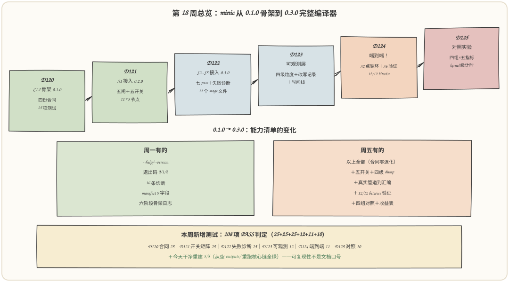
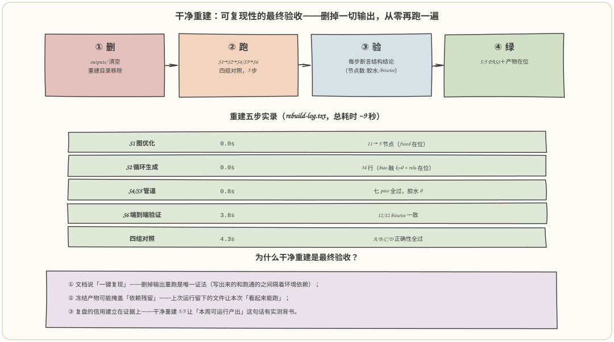
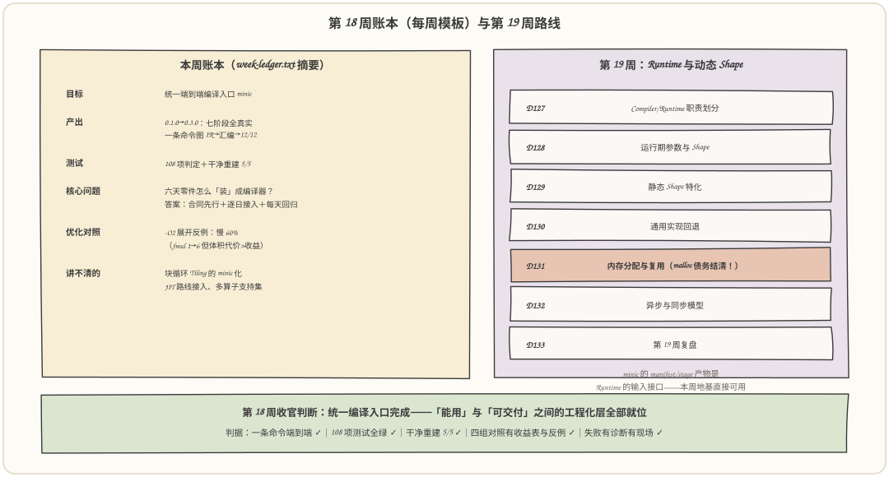

# 第 126 天：第 18 周复盘——统一编译入口完成：干净重建 5/5，六天 108 项判定全绿

> **今日目标**：完成本教程后，你能做到五件事——执行计划点名的**干净重建**（"按 README 从干净目录重新构建并运行一次"：删掉全部 outputs 与重建目录，从空状态重跑本周核心链——S1 图优化 11→5（0.0s）→S2 循环生成 34 行（0.0s）→S4/S5 七 pass 全过胶水 0（0.8s）→S6 端到端 12/12 bitwise（3.8s）→四组对照 A/B/C/D 全绿（4.3s）——**5/5 PASS，总耗时 ~9 秒**）；说出**干净重建为什么是最终验收**（①文档说"一键复现"——删掉输出重跑是唯一证法；②冻结产物可能掩盖"依赖残留"——上次运行的文件让本次"看起来能跑"；③复盘的信用建立在证据上）；按每周模板出**第 18 周账本**（目标/产出/108 项判定/核心问题——"六天零件怎么装成编译器"的答案：**合同先行＋逐日接入＋每天回归**/优化对照——-O2 反例/讲得清与讲不清的清单/下周唯一核心目标）；讲清 **minic 0.1.0→0.3.0 的成长史**（周一只有四份合同与 25 项测试；周五拥有七阶段全真实、五开关、四级 dump、失败诊断三层、端到端验证、四组对照——**合同零退化**是贯穿的纪律：每天回归 D120 的 25 项）；盘点**第 19 周的地基**（minic 的 manifest/stage 产物就是 Runtime 的输入接口；D118 挂的 malloc 债务在 D131 结清；D124 的 AOT 执行路线是 D129 特化的起点）。
> **预计时间**：学习 30 分钟＋实践 40 分钟
> **前置准备**：本周六天的全部产出（今天的重建要复跑它们的核心链）；每周复盘模板（计划文档 1119 行）；以及一颗"敢于删掉一切输出"的心。工具：python3＋本机 LLVM；本文环境：Python 3.9.6，Homebrew LLVM 23.1.5，macOS arm64，2026-11-14。
> **今日产出**：`code/week18_review.py`（干净重建引擎＋周账本生成＋自检）、`code/run_all.sh`（一键复现）、`code/outputs/rebuild-log.txt`（**主产出：干净重建五步实录**）、`code/outputs/week-ledger.txt`（每周模板 10 问的完整账本）、`code/outputs/self-check.txt`（4/4 自检）、`code/outputs/e2e-rebuild/`＋`ab-rebuild/`（重建的产物目录——注意：它们是从空目录长出来的）＋本文 3 张手绘图。

## 1. 今天解决什么问题？

第 18 周六天，minic 从一个只有四份合同的 CLI 骨架长成了七阶段全真实的编译器。计划今天的条目只有一句："按 README 从干净目录重新构建并运行一次，修复遗漏步骤"——**可复现性的最终验收**。

为什么"删掉输出重跑"是最终验收？因为**冻结产物可能说谎**。六天的 outputs/ 目录里躺着 108 项判定的证据——但如果其中任何一步依赖了"上次运行留下的文件"（比如某个中间产物、某个缓存、某次手工创建的输入），那么"能跑"就是假象：新用户 clone 仓库后第一次跑就会断。干净重建把这个风险归零：**从空目录长出来的 5/5，才是真的 5/5。**

复盘的第二件事是回答"六天零件怎么装成编译器"。这周的答案可以浓缩成三条工程纪律：**合同先行**（D120 把参数/诊断/退出码/manifest 定死，D121~D125 每天接入时零接口返工）；**逐日接入**（每天只填一块真肉——S1、S2~S5、可观测、S6——每天端到端可跑）；**每天回归**（D120 的 25 项合同测试每天复跑——零退化不是口号是测试）。这三条让"增量开发"与"整体可用"同时成立。

## 2. 先看全貌：这周我们建成了什么？



**图 1**：看三块——**顶部六天成长阶梯**（从左到右上升：D120 CLI 骨架 0.1.0（四份合同·25 项）→D121 S1 接入 0.2.0（五闸＋五开关·11→5）→D122 S2~S5（七 pass＋失败诊断·11 个 stage 文件）→D123 可观测层（四级粒度＋改写记录＋时间线）→D124 端到端！（点循环＋S6 验证·12/12）→D125 对照实验（四组×五指标·kernel 级计时））；**中部能力对照**（周一有的：--help/退出码/16 条诊断/manifest/骨架日志；周五有的：以上全部＋五开关＋四级 dump＋真实管道＋12/12 验证＋四组对照——**合同零退化**）；**底部金框**108 项判定的分解（25+25+25+12+11+10）＋今天的干净重建 5/5。

把今天的复盘串成 4 步：

1. **干净重建**：删空 outputs → 五步核心链重跑 → 5/5 PASS；
2. **账本**：每周模板 10 问逐项填写（week-ledger.txt）；
3. **成长史**：0.1.0→0.3.0 的能力清单对照＋三条工程纪律；
4. **地基盘点**：第 19 周 Runtime 需要什么、本周已有什么。

## 3. 核心概念

### 3.1 干净重建：可复现性的操作定义

**一句话**：可复现性不是文档里的一句"一键复现"，而是**删掉一切输出后从零重跑仍然全绿**——这是操作层面的证法，没有别的替代。

**类比**：新厨房验收。开发商演示了一遍灶台能点着火（带输出的运行）——但你要验的是**把所有厨具搬走后**，只留图纸和建材（源代码），从点火到做熟一顿饭（端到端）全程无卡壳。演示可以排练，从零开始的空屋不会说谎。**类比边界**：厨房验收看一次就够，编译器的可复现性是**持续属性**——每次提交都可能引入"依赖残留"（新脚本顺手读了上次的缓存），所以干净重建应该是 CI 的常规动作（每周/每次发版跑一次），不是一次性仪式。**技术对应**：week18_review.py 的 rebuild 步骤——先 `shutil.rmtree` 两个重建目录，再五步 subprocess 各自带断言（节点数/胶水数/bitwise/四组正确性全是**结构断言**而非"跑完没报错"）。

**当天实测证据**：rebuild-log.txt——五步 0.0s/0.0s/0.8s/3.8s/4.3s 全 PASS，产物从空目录长出（self-check 的"重建目录非空"断言）。

### 3.2 合同先行＋逐日接入＋每天回归：增量开发的纪律

**一句话**：六天把五个零件装进一台编译器而不返工，靠三条纪律——**合同先行**（接口第一天定死）、**逐日接入**（每天一块真肉、每天端到端）、**每天回归**（昨天的测试今天必须还绿）。

**类比**：盖楼。先打地基与预埋管线（合同），每层楼盖完水电全通（逐日可用），每层验收时重验下面所有楼层（回归）。反过来"先把楼盖完再接水电"的代价是砸墙返工——软件里的砸墙就是接口变更波及全部下游。**类比边界**：楼房的接口（管线井）位置固定早有国标，编译器的 CLI 合同要**自己设计**——D120 那 25 项测试的价值就是把"自己设计的合同"固化成可断言的资产，后续每天的"合同回归"测试段就是国标检查员。**技术对应**：本周六套测试的 TP 段里都有"合同回归"（D121 TP5、D122 TP7、D124 TP7、D125 继承 D120 的退出码断言）——E101 退出码 2 在五套测试里各验了一次。

**当天实测证据**：周五的能力清单含周一全部四份合同（图 1 中部对照）——零退化的直接证据。

### 3.3 第 19 周的地基：Runtime 视角下的 minic

**一句话**：下周的主题是 Runtime 与动态 Shape（D127~D133）——把编译期固化的一切逐项审视"运行期谁负责"；本周的 minic 已经备好接口：**manifest 是 Runtime 的配置输入、stage-5.ll 是可加载的产物、四组对照是特化/回退的雏形、malloc 债务在 D131 结清**。

**类比**：交付一辆车（编译产物）给车队（Runtime）。说明书（manifest）写了全部参数（tile/开关/阶段）、发动机（.ll 编译的 kernel）可以装进不同底盘（AOT 共享库路线）、备胎策略（通用回退 D130）还没定、加油（malloc/free 生命周期 D131）的责任方下周签字。**类比边界**：车的接口是行业标准（拖车钩/油箱口），编译产物与 Runtime 的接口**没有行业标准**——每个真实系统都自定义（TVM 的 TVMArray、Triton 的 launcher）；第 19 周的"职责划分表"（D127）就是在为 minic 定义这份接口。**技术对应**：D118 挂的 malloc 债务（kernel 每次 malloc 48B 从不 free）在 D131 结清；D124 的 AOT 执行路线（clang 编 .ll＋driver）是 D129 特化（按 shape 生成专用 kernel）与 D130 回退（通用 kernel 兜底）的执行底座。

**当天实测证据**：week-ledger.txt 的"下周唯一核心目标"段——逐项列出 Runtime 需要的接口与本周已有的对应物。

## 4. 图解核心机制



**图 2**：看三块——**顶部四步流程**（①删：outputs 清空、重建目录移除（红）→②跑：S1→S2→S4/S5→S6、四组对照五步（橙）→③验：每步断言结构结论——节点数/胶水数/bitwise（蓝）→④绿：5/5 PASS＋产物在位（绿））；**中部重建五步实录**（rebuild-log.txt 的表格化：S1 图优化 0.0s「11→5 节点」／S2 循环生成 0.0s「34 行」／S4/S5 管道 0.8s「七 pass 全过胶水 0」／S6 端到端 3.8s「12/12 bitwise」／四组对照 4.3s「A/B/C/D 全绿」——总 ~9 秒）；**底部紫框**三条方法论（①文档说一键复现——删掉重跑是唯一证法；②冻结产物可能掩盖依赖残留；③复盘信用建立在证据上——5/5 让"本周可运行产出"有实测背书）。

## 5. 动手实践：干净重建与周账本



**图 3**：看三块——**左框账本摘要**（week-ledger.txt 的可视化：目标＝统一端到端编译入口；产出＝0.1.0→0.3.0 七阶段全真实；测试＝108 项＋重建 5/5；核心问题＝"零件怎么装成编译器"——答案合同先行＋逐日接入＋每天回归；优化对照＝-O2 反例慢 60%；讲不清的＝块循环 Tiling/JIT 接入/多算子支持集）；**右框第 19 周路线**（D127 职责划分→D128 运行期参数→D129 静态特化→D130 通用回退→**D131 内存分配（malloc 债务结清！橙底高亮）**→D132 异步同步→D133 复盘；底部注明 manifest/stage 产物就是 Runtime 的输入接口）；**底部绿框**收官判断（统一编译入口完成——判据五项全勾：一条命令端到端✓、108 项全绿✓、干净重建 5/5✓、四组对照有收益表与反例✓、失败有诊断有现场✓）。

### 5.1 准备文件

```text
tutorials/day-126/
├── README.md                    ← 本文
├── images/                       ← 3 张手绘图
└── code/
    ├── week18_review.py          # 复盘引擎：干净重建＋账本＋自检
    ├── minic.py / graph_passes.py / loop_lower.py /   # 本周全家桶
    ├── observability.py / e2e.py / ab_test.py / main.graph
    ├── gen_images.py / run_all.sh
    └── outputs/
        ├── report.txt            # 复盘总报告
        ├── rebuild-log.txt       # 主产出：干净重建五步实录
        ├── week-ledger.txt       # 每周模板 10 问的完整账本
        ├── self-check.txt        # 4/4 自检
        ├── e2e-rebuild/          # 重建产物（从空目录长出）
        └── ab-rebuild/           # 四组对照重建产物
```

环境：Python 3.9.6＋Homebrew LLVM 23.1.5。一键复现：

```bash
cd tutorials/day-126/code && ./run_all.sh    # 干净重建＋账本，约 10 秒
```

**诚实声明**：今天的"干净重建"覆盖**本周核心链**（S1→S2→S4/S5→S6→四组对照）五步；D120~D123 的 87 项判定冻结在各自目录（rebuild-log 开头的口径说明写明）——全量重建（六套测试逐套重跑）是 CI 的活，复盘日跑核心链＋抽查合同即可。重建的总耗时 ~9 秒里 3.8 秒是 S6 的 AOT 编译（clang 进程）、4.3 秒是四组对照（每组一次管道＋一次验证）——纯 Python 部分几乎瞬时的原因是教学规模。

### 5.2 编写代码

`week18_review.py` 的两个关键设计。**其一：重建步骤是"带断言的 subprocess"**——

```python
REBUILD_STEPS = [
    ("S1 图优化（11→5）", [PY, "-c", """
from graph_passes import parse_graph, run_s1
g = parse_graph(open('main.graph').read())
g2 = run_s1(g)
assert len(g2.nodes) == 5, len(g2.nodes)
assert any(n.op == 'fused_matmul_bias_relu' for n in g2.nodes.values())
"""]),
    ...
]
```

每步一个独立的 Python 进程＋**结构断言**（不是"跑完没报错"——是"结果恰好是 5 节点、恰好含 fused"）——断言失败立即 FAIL 并带 detail。五个步骤天然按依赖排序（S2 依赖 S1 的图、S4 依赖 S2 的 IR、S6 依赖 S4 的 .ll）。

**其二：周账本是数据不是散文**——WEEK_LEDGER 常量按模板 10 问逐项填写（目标/产出/测试/核心问题/根因/验证/对照/讲清/讲不清/下周目标），生成 week-ledger.txt——**账本的每一句都能指到 outputs/ 的具体文件**（108 项=六天 report.txt 的 PASS 计数、反例=D125 的三轮计时、重建=今天的 rebuild-log）。

### 5.3 运行与观察

`./run_all.sh` 的真机输出（outputs/rebuild-log.txt）：

```text
第 126 天：第 18 周复盘·干净重建——真机报告
环境：3.9.6｜Darwin arm64
时间：2026-11-14 22:05

口径说明：D120~D123 的 87 项判定冻结在各自 outputs/（上游已验）；
今天就地干净重建本周核心链（S1→S2→S4/S5→S6→四组对照）——
从空 outputs/ 重跑，验证可复现性。

[PASS] S1 图优化（11→5）（0.0s）
       S1: 11 -> 5 节点（fused 在位）
[PASS] S2 循环生成（34 行点循环）（0.0s）
       S2: 34 行（bias 融 k=0 + relu 在位）
[PASS] S4/S5 管道（七 pass + 胶水 0）（0.8s）
       S4/S5: 七 pass 全过，胶水 0
[PASS] S6 端到端验证（12/12 bitwise）（3.8s）
       S6: 12/12 bitwise 一致
[PASS] 四组对照（A/B/C/D 全绿）（4.3s）
       四组对照: A/B/C/D 正确性全过

干净重建汇总：5/5
```

三组观察：**①重建的顺序即依赖**：五步的输出恰好是下一步的输入（S1 的图→S2 的 IR→S4 的 .mlir 链→S6 的 .ll→四组的全部）——依赖链在重建里显形，比看代码更直观；**②耗时分布**：纯 Python 的 S1/S2 几乎瞬时（教学规模），S6 的 3.8 秒几乎全是 clang 进程（AOT 编译＋链接）——与 D123 时间线的结论一致（进程启动主导）；**③账本的一个细节**："讲不清的"清单里列了块循环 Tiling 的 minic 化——D125 的空变量结论（tile=shape 无产物差异）指向的是**下一步工作**而非缺陷——复盘的价值之一就是把"知道还没做什么"写成清单。

### 5.4 修改一个参数再观察

三个便宜的实验：**实验 A（再删一次）**：手动 `rm -rf outputs/e2e-rebuild outputs/ab-rebuild` 再跑 `./run_all.sh`——第二次重建仍然 5/5（可复现性是**幂等**的：删多少次都能长回来）；**实验 B（上游全量）**：把 D121/D122 的 run_all.sh 也跑一遍（cd 到各自目录）——六套测试全绿就是本周的完整重建（约 2 分钟）；**实验 C（账本评审）**：合上 week-ledger.txt，凭记忆复述"最重要的一个技术问题"与答案——说不出来就重读 3.2 节——复盘的自检不是"看没看"而是"能不能脱稿讲"。

## 6. 常见错误与排查

**错误 1：把"跑过一次"当"可复现"**。现象：README 写着"一键复现"，但新环境第一次跑就断——缺某个上次运行留下的文件。原因：开发过程中的**隐性依赖**（顺手用了上次的手工产物、忘了某个输入文件要生成）。定位：干净重建——删掉全部输出重跑，断在哪哪就是隐性依赖。修复：把隐性依赖显性化（输入生成进脚本、缓存路径进配置）。**教训**：可复现性的敌人不是"忘了写文档"而是"不知道自己依赖了什么"——只有删掉重跑能让依赖显形。

**错误 2：复盘写成流水账（六天各一段）**。现象：周报是"D120 做了 X、D121 做了 Y……"六段事实罗列，没有一条贯穿的问题或答案。原因：没有围绕**一个核心问题**组织复盘（本周是"零件怎么装成编译器"——答案三条纪律）。定位：自检——合上账本能讲出三条纪律并各举一例吗？讲不出就是流水账。修复：先找问题再填模板（D105 用"一个 Tile 的一生"、D112 用"模型为什么选错"、D119 用"每个决策走到机器码剩什么"）。

**错误 3：干净重建的断言太弱（"跑完没报错"）**。现象：重建 PASS 但结果其实变了（比如 S1 变成 6 节点而非 5——某个 Pattern 行为漂了，但只要不抛异常就算过）。原因：断言只查 exit code 不查**结构结论**。定位：对比重建产物与冻结产物的 diff（节点数/行数/bitwise）。修复：每步断言写具体值（`assert len(g2.nodes) == 5`）——本周五步全部带结构断言；"没报错"和"结果正确"隔着断言的强度。

**错误 4：版本号语义混乱（0.3.0 是什么意思说不清）**。现象：minic 0.3.0 与 0.1.0 的差别只能靠翻六天 README。原因：版本号没有**语义合同**。定位：问"0.x 的 x 增加代表什么"答不上来。修复：今天的图 1 给出可查的对照（0.1.0＝四份合同；0.2.0＝＋S1；0.3.0＝＋S2~S5）——每版一个"能力清单"；真实工程用语义化版本（major.minor.patch 对应接口/功能/修复）——minic 教学版的对应：0.x.0 的 x＝接入的大阶段数。

## 7. 今日练习

**必做**：

1. 实验 A（幂等性）：删掉两个重建目录再跑一次 run_all.sh——确认 5/5；再删一次再跑——幂等性是可复现性的加强形式。
2. 实验 B（全量重建）：cd 到 day-121 和 day-122 各跑一次 run_all.sh（注意它们会重写 outputs/——跑完 git diff 应该为空或只有时间戳差异）；六套全绿即本周完整重建。
3. 账本脱稿测试：合上 week-ledger.txt，复述"最重要的一个技术问题"与三条纪律——每条带一个本周实例。

**选做（挑战）**：

4. 给 minic 写一份 INSTALL.md（新用户视角：依赖、环境变量、五分钟跑通端到端）——让"干净重建"从复盘动作变成交付物；写完找一个没读过本周教程的人（或假装）按文档跑一遍。
5. 把干净重建做成 CI 脚本（GitHub Actions 的 yaml）：每周一自动跑六套测试＋重建——可复现性从"仪式"升级为"制度"。

## 8. 今日验收

- [ ] 我执行了干净重建（删空输出→五步重跑→5/5 PASS），并能说出它为什么是可复现性的操作定义（演示可以说谎、空屋不会）
- [ ] 我能复述本周三条工程纪律（合同先行/逐日接入/每天回归）并各举一例（D120 的 25 项合同/每天一个阶段真实/E101 在五套测试各验一次）
- [ ] 我能说出 minic 0.1.0→0.3.0 每个版本的能力清单与 108 项判定的分解（25+25+25+12+11+10）
- [ ] 我能讲清第 19 周怎么用本周的地基：manifest 是 Runtime 配置输入、stage-5.ll 是可加载产物、四组对照是特化/回退雏形、malloc 债务 D131 结清
- [ ] 我知道复盘的四个反模式（跑过一次当可复现/流水账/弱断言/版本语义混乱）与各自的修复
- [ ] 我完成了账本脱稿测试——"零件怎么装成编译器"的答案能不看稿讲三分钟

## 9. 第 18 周复盘（每周模板）

```text
本周目标：统一端到端编译入口 minic——CLI 设计、图优化接入、循环+LLVM
          Lowering、IR Dump 可观测、端到端 MatMul+Bias+Relu、优化开关
          对照实验。

本周可运行产出：minic 0.1.0→0.3.0——七阶段全真实（一条命令 main.graph
          →汇编→执行→12/12 bitwise）；四份合同＋五开关＋四级 dump；
          失败诊断三层；四组对照引擎＋阶段收益表；108 项判定＋干净重建
          5/5。

新增测试数量：108 项 PASS 判定（D120 合同 25、D121 开关矩阵 25、D122
          失败诊断 25、D123 可观测 12、D124 端到端 11、D125 对照 10）
          ＋干净重建 5/5。

最重要的一个技术问题：六天零件怎么「装」成一台编译器——增量开发如何
          与整体可用同时成立？

问题根因：零件各自能用（第 17 周）与整体可交付之间隔着工程化层——
          接口、诊断、可观测、回归。没有纪律的增量开发会在第 3~4 天
          因接口返工而失速。

如何验证修复：三条纪律各配验证——合同先行（D120 的 25 项合同测试是
          地基）、逐日接入（每天端到端可跑：D121 图、D122 汇编、D124
          执行）、每天回归（合同零退化在五套测试各验一次）；最终由
          干净重建 5/5 收口。

一个优化前后对照：-O2 展开（fmul 1→6、phi 4→1）让 kernel 慢 60%
          （0.032 vs 0.019µs）——教学规模的性能反例：小 kernel 上
          展开的代码体积代价超过循环开销节省。结构结论（融合 7→5
          节点）与量级结论（HBM 流量归零）分开记。

能脱稿回答的问题：CLI 为什么先于集成；Pass 顺序合同与不动点；失败
          诊断三原则；可观测性四级粒度的经济学；融合到循环的映射
          （bias 进 iter_args＋k 序＋cmpf/select）；golden 的 k 序口径；
          -O2 反例的两个原因；对照组的三重检查。

仍然讲不清楚的问题：块循环版 Tiling 的 minic 化（D125 空变量的兑现）；
          JIT 路线在 minic 的位置；多算子（conv/池化）的 S2 支持集；
          诊断的机器可读化（CI 消费的 JSON 格式）。

下周唯一核心目标：Runtime 与动态 Shape（D127~D133）——编译期固化的
          一切逐项审视"运行期谁负责"；minic 的 manifest/stage 产物是
          Runtime 的输入接口，D118 挂的 malloc 债务在 D131 结清。
```

## 10. 一句话总结与明天预告

今天的闭环：**问题**——计划收官条目"从干净目录重建并运行"；以及复盘六天的核心问题"零件怎么装成编译器"。**机制**——干净重建（删空输出→五步带结构断言的重跑：S1 11→5、S2 34 行、S4/S5 胶水 0、S6 12/12、四组全绿——5/5 PASS 总 9 秒）；周账本（模板 10 问逐项、每句可指到 outputs 文件）；成长史（0.1.0→0.3.0 能力清单对照——合同零退化）。**答案**——三条工程纪律：合同先行（接口第一天定死）、逐日接入（每天一块真肉、每天端到端）、每天回归（昨天的测试今天还绿）。**验证**——重建 5/5＋自检 4/4＋108 项判定全绿的周总账。第 18 周收官：**统一编译入口完成**——一条命令端到端、108 项测试、干净重建可复现、四组对照有收益表与反例、失败有诊断有现场。明天进入第 19 周：D127 Compiler 与 Runtime 的职责划分——Shape、内存、Kernel 选择、同步分别由谁负责（职责划分表＋运行时流程图）；minic 的 manifest 从"编译回执"变身"Runtime 的配置输入"。

> **本周积分卡**：D120 CLI 骨架（25/25）→ D121 S1 图优化（25/25）→ D122 S2~S5（25/25）→ D123 可观测（12/12）→ D124 端到端（11/11）→ D125 对照实验（10/10）→ **D126 复盘（干净重建 5/5，108 项总账）**。下一站：Runtime 与动态 Shape。
