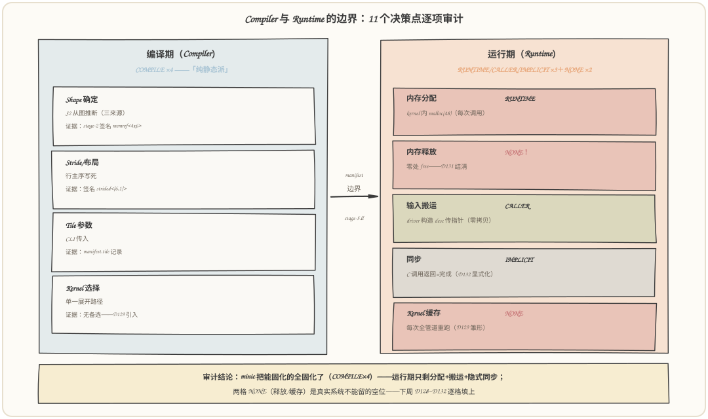
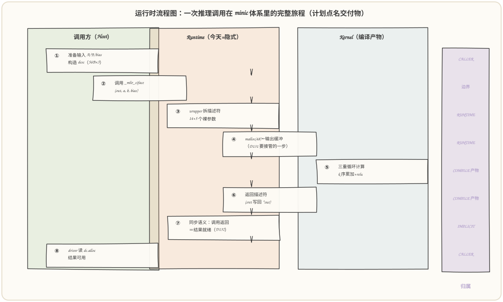
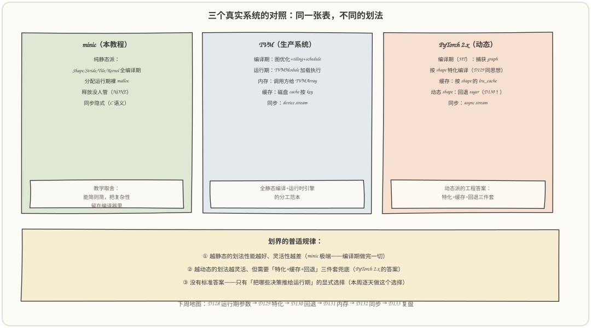

# 第 127 天：Compiler 与 Runtime 的职责——11 个决策点的逐项审计：minic 是纯静态派

> **今日目标**：完成本教程后，你能做到五件事——对 minic 管道的 **11 个决策点**逐项审计"谁负责"（Shape 确定／Stride 布局／Tile 参数／Kernel 选择／**内存分配**／**内存释放**／输入搬运／同步／验证／Kernel 缓存／错误恢复），每个决策点带**三重证据**：minic 的实现证据（哪个文件哪行）、真实系统对照（TVM/PyTorch 2.x/cuDNN 怎么划）、教学评注；说出 **minic 的审计结论**——它是"纯静态派"：COMPILE×4（Shape/Stride/Tile/Kernel 选择全编译期固化——`stage-2-loop.mlir` 的签名 `memref<4x6xf32, strided<[6,1]>>` 是铁证）、RUNTIME×1（内存分配——kernel 内 `call ptr @malloc(48)` 每次调用都发生）、CALLER×1（输入搬运——driver 构造描述符传指针，CPU 天然零拷贝）、IMPLICIT×1（同步——C 调用返回＝完成）、**NONE×2（内存释放与 Kernel 缓存——"没人负责"也是一种划分，真实系统不能留的空位）**；用实测证据支撑审计（TP2/TP3：stage-5.ll 含 1 处 malloc、**零处 free**——"释放=NONE"的铁证；shape 在 S2 签名固化、在 .ll 里内联成循环边界常量 `icmp slt i64 %38, 4`）；画出**运行时流程图**（计划点名的交付物：一次推理调用在 minic 体系里的八步旅程——①driver 准备输入构造 desc→②调用 ciface→③wrapper 拆描述符→④malloc 输出缓冲（D131 要接管的一步）→⑤三重循环计算→⑥sret 返回描述符→⑦隐式同步→⑧读 dc.alloc，每步标注归属泳道）；对比**三个真实系统的划法**（minic 纯静态派／TVM 编译期做完全静态+运行时引擎加载／PyTorch 2.x 动态派——JIT 按 shape 特化编译＋lru_cache＋回退 eager——**D129/D130 的思想源头**），并说出划界的三条规律（越静态性能越好灵活性越差／动态派需要"特化＋缓存＋回退"三件套兜底／没有标准答案只有显式选择）。
> **预计时间**：学习 35 分钟＋实践 45 分钟
> **前置准备**：第 18 周的 minic 全家桶（今天的审计对象——特别是 manifest 的字段与 stage-5.ll 的结构）、D118 的 C 合同与 malloc 债务（"分配在运行期"的第一手证据）、D115~D117 的 ABI 细节（wrapper 拆描述符的③步）。工具：python3＋git 里的冻结产物（今天的审计大量引用上游 outputs/）；本文环境：Python 3.9.6，macOS arm64，2026-11-14。
> **今日产出**：`code/responsibility.py`（11 决策点的审计表生成器＋JSON 版＋5 项自检）、`code/run_all.sh`（9 项测试：职责表＋运行期行为实测＋编译期证据＋排期对应）、`code/outputs/responsibility-table.txt`（**今日主产出：职责划分表**——每决策点带 minic 证据/真实对照/评注）、`code/outputs/responsibility-table.json`（机器可读版）、`code/outputs/report.txt`（9 PASS / 0 FAIL）、`code/outputs/self-check.txt`（5/5）＋本文 3 张手绘图（图 2 即计划点名的"运行时流程图"交付物）。

## 1. 今天解决什么问题？

第 18 周结束时 minic 是一台"编译期做完一切"的机器：图进来、汇编出去、执行验证全通。但计划第 19 周的第一天要回答一个更根本的问题——**Compiler 与 Runtime 的边界在哪里？**计划条目原话："列出当前项目中 Shape、内存、Kernel 选择和同步分别由谁负责"。

这张表为什么值得一天？因为它是第 19 周全部六天的地图：D128 运行期参数（Shape 从"编译期属性"变"运行期输入"）、D129 静态特化（Kernel 选择从单一变多版本）、D130 通用回退（错误恢复从 NONE 变 RUNTIME）、D131 内存（分配从裸 malloc 变池化＋释放从 NONE 变 RUNTIME——**D118 挂的 malloc 债务结清日**）、D132 同步（从隐式变显式）——**每一格"归属"就是一天的工作量**。先审计、后动工：知道现状才能规划变更。

审计的方法论值得说明：每个决策点的归属不是"想出来的"是**查出来的**——minic 侧找代码证据（哪个文件哪个结构）、运行期行为找产物证据（stage-5.ll 的 malloc/free 计数）、真实系统找公开文档的对照。**"归属"的三重锚定**（代码/产物/对照）让这张表不是观点而是事实。

## 2. 先看全貌：边界两侧各有什么？



**图 1**：看两栏——**左栏编译期（蓝）**："纯静态派"四项：Shape 确定（S2 从图推断——三来源各管一段，证据 `stage-2-loop.mlir` 签名 `memref<4x6xf32>`）、Stride/布局（行主序写死——签名 `strided<[6,1]>`）、Tile 参数（CLI 传入——manifest.tile 记录、但 D125 证明教学版不消费）、Kernel 选择（单一展开路径——无备选，D129 将引入）；**右栏运行期（橙）**：内存分配 RUNTIME（kernel 内 malloc(48) 每次调用）、**内存释放 NONE！**（零处 free——红底警示，D131 结清）、输入搬运 CALLER（driver 构造 desc 传指针——CPU 天然零拷贝）、同步 IMPLICIT（C 调用返回＝完成——D132 显式化）、**Kernel 缓存 NONE**（每次全管道重跑——D129 雏形）。**中缝**两个箭头标注接口：manifest（编译回执→Runtime 配置输入）与 stage-5.ll（可加载产物）。**底部金框**审计结论：能固化的全固化了，两格 NONE 是真实系统不能留的空位——下周逐格填上。

把今天的审计串成 4 步：

1. **列表**：11 个决策点从"一次推理调用要做的所有决定"里穷举（Shape/内存/Kernel/同步四大类＋验证/缓存/恢复三个工程项）；
2. **查证**：每个决策点找 minic 代码证据＋产物证据（TP2/TP3 的 grep 实测）；
3. **对照**：TVM/PyTorch 2.x 的公开做法各写一行——划法的多样性；
4. **规划**：每格归属对应下周一天的工作量（TP4 断言五个主题与决策点一一对应）。

## 3. 核心概念

### 3.1 职责划分：不是二分法而是光谱

**一句话**：Compiler/Runtime 的划分不是"编译期/运行期"的简单二分——每个决策点都在光谱上（COMPILE 固化／SPLIT 协作／RUNTIME 动态），甚至"没人负责"（NONE）与"调用方负责"（CALLER）也是合法的归属。

**类比**：餐厅的前厅与后厨。菜品定价（编译期固定菜单）还是时价（运行期按市价）？食材采购是后厨备菜（编译期）还是现点现买（运行期）？洗碗谁负责——后厨（RUNTIME）、顾客自助（CALLER）、还是没人管（NONE——碗越堆越多）？**类比边界**：餐厅的划分由商业模型决定，编译器的划分由**性能/灵活性权衡**决定——越靠编译期性能越好（一切静态可知）但灵活性越差（换个 shape 要重编译）；越靠运行期越灵活但要做更多运行期工作（分发/检查/缓存）。**技术对应**：审计表的"归属"枚举七种（COMPILE/RUNTIME/SPLIT/CALLER/IMPLICIT/NONE/TEST）——minic 的实际分布是 COMPILE×4、RUNTIME×1、CALLER×1、IMPLICIT×1、NONE×2、TEST×1（验证是开发期职责不进运行期热路径）。

**当天实测证据**：responsibility-table.txt 的 11 行归属＋底部的统计段。

### 3.2 证据的三个层次：代码、产物、对照

**一句话**：归属判定要有三重锚定——**代码证据**（哪个文件哪个结构实现的）、**产物证据**（编译输出里看得见的）、**系统对照**（至少一个真实系统的公开做法）——三重齐备的表格才经得起"凭什么这么说"的追问。

**类比**：法庭证据链。动机（代码——设计意图）、物证（产物——行为痕迹）、旁证（对照——同类案例）。只有动机没有物证是推测，只有物证没有对照是孤例。**类比边界**：法庭要求排除合理怀疑，工程审计要求**可复核**——每个读者都能按表里的文件路径自己 grep 一遍（TP2/TP3 就是把"复核"自动化成测试：malloc 计数 1、free 计数 0、stride 在 S2 签名——三个断言钉死三个归属）。**技术对应**：审计表的四列结构（决策点/归属/证据/对照）＋TP2/TP3 的 grep 实测——`grep -c "call ptr @malloc" stage-5.ll` 返回 1（分配在运行期）、`grep -c "call void @free"` 返回 0（释放是 NONE）——**两个数字就是两条归属的铁证**。

**当天实测证据**：TP2 的两个 PASS（malloc 1 处、free 0 处）＋TP3 的三个 PASS（stride 在签名、shape 在签名、shape 内联成 `icmp slt i64 %38, 4`）。

### 3.3 划界的普适规律：静态换性能、动态要三件套

**一句话**：三个系统的对照揭示规律——**越静态的划法性能越好、灵活性越差**（minic 极端：编译期做完一切）；**动态派需要"特化＋缓存＋回退"三件套兜底**（PyTorch 2.x：JIT 按 shape 特化编译＋lru_cache 按 shape 缓存＋回退 eager 解释器）；**没有标准答案，只有显式选择**（每个系统把不同的决策推给运行期）。

**类比**：预制菜 vs 现炒 vs 中央厨房。预制菜（静态编译）：口感稳定、上菜最快、菜单改不了；现炒（纯动态解释）：什么都能点、每桌现做、慢；中央厨房＋门店复热（JIT 特化）：按销量数据提前备热门菜（特化）、备好的菜冷藏复用（缓存）、没人点的菜现场做（回退）。**类比边界**：餐饮的"中央厨房"是位置固定的，编译器的 JIT 发生在**每个进程内部**（首次调用触发、进程退出即失）——所以缓存还要考虑**持久化**（TVM 的磁盘 cache、Triton 的 cache dir）——这是下周 D129 特化的设计维度之一。**技术对应**：图 3 的三系统对照——TVM 的"全静态编译＋运行时引擎"（TVMModule 加载执行、调用方给 TVMArray、磁盘 cache 按 key）；PyTorch 2.x 的"动态派工程答案"（torch.compile 捕获 graph、按 shape 特化、缓存命中直接跑、miss 回退 eager——**D130 通用回退的思想源头**）。

**当天实测证据**：responsibility-table.txt 每行的"真实系统"列——11 个决策点在三个系统里的不同归属。

## 4. 图解核心机制：运行时流程图



**图 2**（计划点名的交付物）：看**三条泳道＋八步流程**——**调用方泳道（绿）**：①准备输入 A/B/bias、构造三份 56B 描述符（CALLER 职责——搬运在 CPU 上是零拷贝）→⑧从 dc.alloc 读结果（CALLER）；**Runtime 泳道（橙，今天＝隐式）**：③wrapper 拆描述符成 14+5 个裸参数（COMPILE 产物在执行）→④**malloc(48) 分配输出缓冲**（RUNTIME 职责——D131 要接管的一步，图上特意标红）→⑦同步语义：调用返回＝结果就绪（IMPLICIT——D132 的显式化对象）；**Kernel 泳道（蓝）**：⑤三重循环计算（k 序累加＋relu——COMPILE 的产物本体）→⑥sret 返回描述符。**右侧紫条**是每步的归属标注（CALLER/边界/RUNTIME/COMPILE 产物/IMPLICIT）——八步里只有④发生在"真正的运行期决策"（分配），其余都是编译期产物的执行或调用方准备。**读图要点**：这张图与 D118 图 3 的数据流图同源，但视角变了——D118 看"数据怎么流"，今天看"**每步谁负责**"——同一张调用，两张审计图。

## 5. 动手实践：9 项测试，从审计表到铁证



**图 3**：看三栏——**minic（绿）**：纯静态派（Shape/Stride/Tile/Kernel 全编译期；分配运行期裸 malloc；释放没人管 NONE；同步隐式）——教学取舍：能简则简，复杂性留在编译器里；**TVM（蓝）**：全静态编译＋运行时引擎（编译期图优化+tiling+schedule；运行期 TVMModule 加载执行；内存调用方给 TVMArray；缓存磁盘 cache 按 key；同步 device stream）——生产系统的分工范本；**PyTorch 2.x（橙）**：动态派（编译期 JIT 捕获 graph；按 shape 特化编译——D129 同思想；lru_cache 按 shape；动态 shape 回退 eager——D130！；async stream）——动态派的工程答案：特化+缓存+回退三件套。**底部金框**三条规律（静态换性能/动态要三件套/没有标准答案只有显式选择）＋下周六天地图（D128→D133）。

### 5.1 准备文件

```text
tutorials/day-127/
├── README.md                    ← 本文
├── images/                       ← 3 张手绘图（图 2＝运行时流程图交付物）
└── code/
    ├── responsibility.py        # 11 决策点审计表生成器
    ├── gen_images.py / run_all.sh
    └── outputs/
        ├── report.txt            # 9 PASS / 0 FAIL
        ├── responsibility-table.txt   # 主产出：职责划分表
        ├── responsibility-table.json  # 机器可读版
        └── self-check.txt        # 5/5
```

环境：Python 3.9.6（审计本身零依赖；TP2/TP3 引用上游冻结产物）。一键复现：

```bash
cd tutorials/day-127/code && ./run_all.sh    # 9 项，约 3 秒
```

**诚实声明**：审计表的"真实系统"列来自公开文档的常识性总结（TVM 的 TVMArray/磁盘缓存、PyTorch 2.x 的 torch.compile 行为）——**不是源码考证**；教学审计的深度止于"对照参考"，真实工程做这个表要读系统源码。minic 侧的三重证据（代码/产物/对照）则是实测的（TP2/TP3 的 grep 断言）。

### 5.2 编写代码

`responsibility.py` 的关键设计：**审计表是数据不是散文**——

```python
TABLE = [
    ("内存分配（输出缓冲区）", "RUNTIME",
     "kernel 内 memref.alloc → malloc(48)，每次调用都分配（stage-5.ll: %20 = call @malloc）",
     "TVM: 运行时 TVMArray 从 allocators 拿；CUDA: cudaMalloc 或池",
     "D118 挂账的 malloc 债务——D131 结清（分配器/池）"),
    ("内存释放", "NONE",
     "kernel 不 free——泄漏（教学规模无所谓，D118 诚实声明）",
     "真实 Runtime 必须管生命周期（引用计数/arena/池）",
     "『没人负责』也是一种划分——真实系统不能这么选"),
    ...
]
```

四元组（决策点/归属/证据/对照）＋评注——render_table 渲染文本版、json 版给 CI 消费。**设计立场**：归属的七枚枚举（COMPILE/RUNTIME/SPLIT/CALLER/IMPLICIT/NONE/TEST）先于填表定义——枚举不完备会逼你在表格里发明新类别，那通常是划分维度混乱的信号。

### 5.3 运行与观察

`./run_all.sh` 的真机输出（outputs/report.txt，9 PASS / 0 FAIL）：

```text
第 127 天：Compiler/Runtime 职责——真机报告 2026-11-14 22:15
环境：Python 3.9.6｜Darwin arm64

[TP1] 职责划分表：11 个决策点
  [PASS] 职责表生成＋自检 5/5
  [PASS] 表含 COMPILE 归属
  [PASS] malloc 债务条目在表

[TP2] 运行期行为实测：malloc 的证据（分配真在运行期发生）
  [PASS] stage-5.ll 含 1 处 malloc（分配发生在 kernel 运行时）
  [PASS] 零处 free——「释放=NONE」的铁证

[TP3] 编译期证据：shape 固化在签名里（S2 的 MLIR 签名）
  [PASS] stride 编译期固化（S2 签名 strided<[6,1]>）
  [PASS] 输出 shape 编译期固化（memref<4x3>）
  [PASS] shape 内联成 .ll 的循环边界常量（icmp slt）

[TP4] 决策点与下周排期的对应
  五个下周主题与决策点一一对应
  [PASS] 下周排期对应完整

汇总
  PASS: 9  FAIL: 0
```

三组观察：**①归属的铁证**（TP2）——malloc 计数 1、free 计数 0：两个 grep 就是两条归属的判决书；不需要读代码，产物自己说话。**②shape 的两段旅程**（TP3）——S2 签名里它是类型（`memref<4x6xf32, strided<[6,1]>>`）、.ll 里它变成常量（`icmp slt i64 %38, 4` 的 4 就是 M）——**同一份信息在 Lowering 中换了形态但没换归属**（始终编译期），这是"固化"的完整含义。**③审计的规划价值**（TP4）——表里每一格"非理想归属"（NONE×2、裸 malloc、隐式同步）都精确对应下周一天（D131/D129/D132）——审计表就是排期表。

### 5.4 修改一个参数再观察

三个便宜的实验：**实验 A（加决策点）**：往 TABLE 里加"数据类型确定"（dtype）——归属是什么？（COMPILE——签名里的 f32；但 PyTorch 2.x 的混合精度是运行期决策……你能找到 minic 的证据吗：gen_loop_ir_full 硬编码 f32）；**实验 B（归属翻转思想实验）**：如果把"Shape 确定"从 COMPILE 翻成 RUNTIME，哪些东西必须动？（签名从 `memref<4x6>` 变 `memref<?x?>`→描述符的 sizes 字段从常量变参数→循环边界从 icmp 常量变 load 描述符——**D128 的完整工作量预演**）；**实验 C（对照深挖）**：选 TVM 的一个决策点（比如"内存分配"）读它的文档/源码——验证审计表"真实系统"列的那一行是否准确——教学审计升级为源码考证的第一步。

## 6. 常见错误与排查

**错误 1：把"二分法"当划分框架**。现象：审计表只有"编译期/运行期"两列，遇到"输入搬运"（调用方负责）和"没人负责"（释放）无处安放。原因：划分维度不完备——真实的归属空间比二分大。定位：填表时发现"这一格说不清"就是维度缺失的信号。修复：扩展枚举（CALLER/NONE/IMPLICIT/TEST 各有案例）——**维度先于填表**。

**错误 2：归属写成观点没有证据**。现象：表里写"内存分配是运行期职责"但说不出 .ll 里哪一行是 malloc。原因：跳过了查证直接下结论。定位：每行自问"这个归属能被一条 grep 验证吗"。修复：三重锚定（代码/产物/对照）——TP2/TP3 把锚定自动化。

**错误 3：拿教学取舍当设计缺陷批判**。现象：审计完下结论"minic 连 free 都没有，设计太差"。原因：混淆**教学刻度**（教学规模泄漏无感、D118 已诚实声明）与**生产缺陷**（真实服务泄漏致命）。定位：看评注列——每一格 NONE 都标注了"真实系统不能这么选"与结清日期。修复：审计表的价值是**标记差异**不是**评判优劣**——知道差距在哪、什么时候补，就是好审计。

**错误 4：流程图只画 happy path**。现象：运行时流程图八步全是成功路径——没有 malloc 失败（OOM）怎么办、没有 kernel 崩溃怎么办。原因：第一版只画了"一次成功调用"。定位：问"第④步 malloc 返回 NULL 会怎样"（教学 kernel 不检查——真实系统必须）。修复：图 2 的④步标注"D131 要接管的一步"——把**已知缺口显式画进图里**比假装完备诚实；完整错误路径是 D130（回退）与 D132（同步异常）的主题。

## 7. 今日练习

**必做**：

1. 实验 A（加决策点）：给 TABLE 加"数据类型确定（dtype）"行——minic 的证据（gen_loop_ir_full 硬编码 f32）、真实对照（PyTorch 2.x 的混合精度 autocast 是运行期）、归属（COMPILE）。
2. 实验 B（翻转预演）：在纸上写出"Shape 从 COMPILE 翻成 RUNTIME"要动的五件事（签名/描述符/循环边界/验证/S2 推断）——对照 D128 的实际实现查漏。
3. 流程图补错误路径：给图 2 的④步画一条 malloc=NULL 的分支（教学版没有——画出来就是 D130 回退的雏形）。

**选做（挑战）**：

4. 实验 C（源码考证）：TVM 的 TVMArray 结构（GitHub tvm repo 的 include/tvm/runtime/ndarray.h）——验证审计表"调用方给 TVMArray"那一行的准确性；写 5 行考证笔记。
5. 三系统对照表升级：把图 3 的三栏扩展成 11 行×3 系统的完整矩阵（每个系统填 11 个归属）——哪些格三个系统一致（如"验证=TEST"）？哪些格三种划法（如"Kernel 选择"）？

## 8. 今日验收

- [ ] 我能背出 11 个决策点与 minic 的归属分布（COMPILE×4／RUNTIME×1／CALLER×1／IMPLICIT×1／NONE×2／TEST×1），并说出两个 NONE 分别是什么、哪天结清
- [ ] 我能用三重锚定（代码/产物/对照）解释任意一个归属——例如"释放=NONE"的产物证据是 stage-5.ll 零处 free
- [ ] 我能讲清 shape 的两段旅程：S2 签名的类型（memref<4x6>）→.ll 的循环边界常量（icmp slt）——固化不改归属
- [ ] 我能对照三个系统的划法说出三条规律（静态换性能/动态要三件套/显式选择）
- [ ] 我能指出运行时流程图的八步中哪步是"真正的运行期决策"（④malloc）与其余步骤的归属
- [ ] 我知道审计的四个反模式（二分法框架/观点无证据/批判教学取舍/只画 happy path）与各自修复

## 9. 一句话总结与明天预告

今天的闭环：**问题**——Compiler 与 Runtime 的边界在哪里；计划条目"Shape、内存、Kernel 选择和同步分别由谁负责"。**机制**——11 决策点逐项审计：每行四元组（决策点/归属/证据/对照）＋七枚归属枚举先于填表；三重锚定让表格经得起追问（代码/产物/对照）。**结论**——minic 是纯静态派：COMPILE×4（Shape/Stride/Tile/Kernel 全固化）、RUNTIME×1（分配——malloc 每次 48B）、NONE×2（释放/缓存——真实系统不能留的空位）；两个 grep 铁证（malloc 1 处、free 0 处）。**交付**——运行时流程图（八步旅程×三泳道×归属标注，计划点名交付物）＋三系统对照（静态换性能、动态要三件套）。**验证**——9 PASS / 0 FAIL：审计表＋行为实测＋编译期证据＋排期对应。明天 D128 运行期参数与 Shape：把"Shape 确定"从 COMPILE 翻成 RUNTIME 的完整实现——签名 `memref<?x?x?>` 怎么写、描述符 sizes 字段怎么用、循环边界从常量变 load——今天实验 B 的预演落地成代码。

> **第 19 周积分卡**：**D127 职责审计（9/9，11 决策点）** → D128 运行期参数 → D129 静态特化 → D130 通用回退 → D131 内存（malloc 债务结清）→ D132 异步同步 → D133 复盘。
