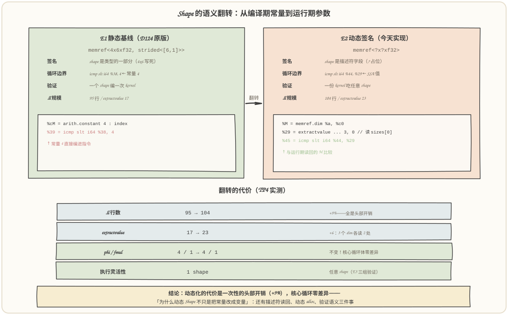
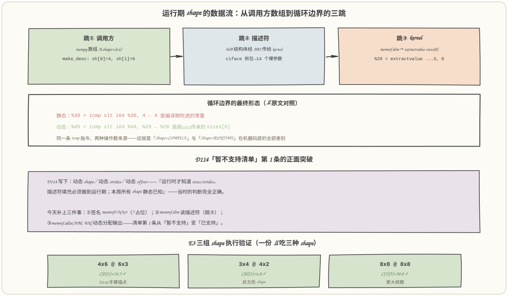
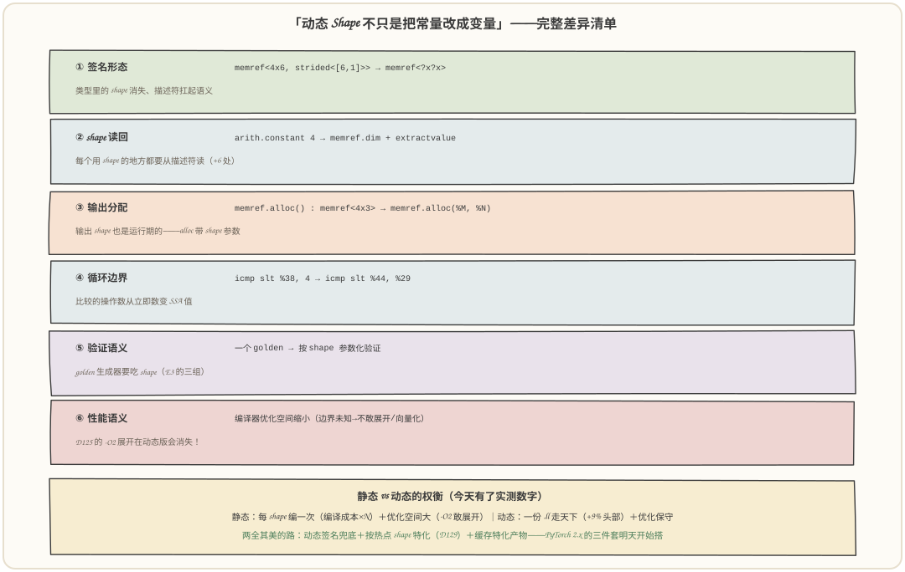

# 第 128 天：运行期参数与 Shape——把「Shape=COMPILE」翻成 RUNTIME：一份 .ll 吃三种 shape

> **今日目标**：完成本教程后，你能做到五件事——实现 **shape 的语义翻转**（D127 审计表里"Shape 确定=COMPILE"的那一格）：签名从 `memref<4x6xf32, strided<[6,1]>>` 改成 `memref<?x?xf32>`、循环边界从 `arith.constant 4` 改成 `memref.dim %a, %c0`＋`extractvalue ... 3, 0`——**.ll 里同一条 `icmp slt` 指令、操作数从常量 4 翻成 SSA 值 %29**（从描述符 sizes[0] 读回），这就是两种归属在机器码层的全部差别；量化**动态化的代价**（TP4 实测：.ll 95→104 行＋9%、extractvalue 17→23＋6 处——**全是头部开销**；phi/fmul 4/1 不变——**核心循环体零差异**）；用 **E3 三组验证**证明"一份 .ll 吃任意 shape"（4×6@6×3（D118 锚点 C[0][1]=24.5）／3×4@4×2（非方形）／8×8@8×8（更大规模）——三组全部 bitwise 一致，golden 按 shape 参数化生成）；列出**「动态 Shape 不只是把常量改成变量」的六件事**（①签名形态 ?占位→②shape 读回 dim+extractvalue→③输出分配 `memref.alloc(%M, %N)` 带参数→④循环边界 icmp 操作数换源→⑤验证语义参数化→⑥**性能语义收缩**——静态版 -O2 敢展开（fmul 1→6）、动态版不敢（边界未知，fmul 1→2 只部分展开、phi 4→10 反而变多）；实测证据：动态版 O2 后 fmul=2 vs 静态版 6）；说出 **D114「暂不支持清单」第 1 条的突破过程**（当时的判断"描述符填充必须搬到运行期"完全正确——今天补上三件事：? 签名、dim 读回、动态 alloc，清单从"暂不支持"变"已支持"）；理解**静态/动态的权衡与两全路**（静态：每 shape 编一次＋优化空间大；动态：一份走天下＋优化保守——两全：动态兜底＋按热点 shape 特化（D129）＋缓存产物——PyTorch 2.x 三件套的搭建从明天开始）。
> **预计时间**：学习 35 分钟＋实践 50 分钟
> **前置准备**：D127 的职责审计表（今天翻转的就是其中"Shape 确定=COMPILE"那格）、D114 的暂不支持清单第 1 条（今天正面突破的对象）、D115 的描述符结构（sizes 字段是今天 shape 的载体）、D124 的静态管道（E1 基线的出处）。工具：python3＋numpy＋本机 LLVM；本文环境：Python 3.9.6＋numpy 1.26.4＋Homebrew LLVM 23.1.5，macOS arm64，2026-11-14。
> **今日产出**：`code/dyn_shape.py`（三子实验引擎：STATIC_IR/DYNAMIC_IR 双模板＋run_pipeline＋指标采集）、`code/e3_verify.py`（动态 kernel 的多 shape 执行验证：ctypes 描述符构造＋三组 golden）、`code/run_all.sh`（5 项测试）、`code/outputs/report.txt`（5 PASS / 0 FAIL）、`code/outputs/e1-static/`＋`e2-dynamic/`（两版完整管道产物）、`code/outputs/e3/`（动态共享库）＋本文 3 张手绘图。

## 1. 今天解决什么问题？

D127 的审计给 minic 贴了"纯静态派"标签：Shape/Stride/Tile/Kernel 四项全在编译期固化。计划第 19 周第二天的任务是"整理当前函数接口，明确哪些 Shape 已固化、哪些可作为参数传入"——**把"Shape 确定"从 COMPILE 翻成 RUNTIME**。

为什么这一格最值得先翻？因为它是**其余翻转的地基**：D129 特化（按 shape 编译专用 kernel）要先有动态签名才能做分发；D130 回退（通用版兜底）兜的就是动态版；运行期 Shape 是真实推理服务的常态（batch size 变、序列长度变）——今天的实验是"真实世界"的第一块砖。

翻转的入口很小（签名里 `4x6` 换 `?x?`），但**涟漪有六层**——签名、读回、分配、边界、验证、性能语义（图 3 的六件事清单）。今天全部趟过一遍，其中两处实测数据特别有价值：**代价的形状**（+9% 全在头部、核心循环零差异——动态化并不"污染"计算主体）与**优化空间的收缩**（静态版 -O2 敢把 k=6 全展开 fmul 1→6；动态版不敢——O2 后 fmul 只到 2、phi 反而从 4 涨到 10：编译器不知道边界、只好保守）——**这两组数字是 D129 特化的动机证明**：动态兜底＋热点特化，两头的好处都要。

## 2. 先看全貌：翻转前后对照



**图 1**：看两栏＋一表——**左栏 E1 静态基线**（绿）：签名 `memref<4x6xf32, strided<[6,1]>>`（shape 是类型的一部分）、循环边界 `icmp slt i64 %38, 4`（常量 4 直接编进指令——代码框红字标注）、一个 shape 编一次 kernel、.ll 95 行/extractvalue 17；**右栏 E2 动态签名**（橙）：签名 `memref<?x?xf32>`（shape 是描述符字段）、`%M = memref.dim %a, %c0` 读回＋`%29 = extractvalue ... 3, 0`（跳到 sizes[0]）＋`%45 = icmp slt i64 %44, %29`（与运行期值比较——代码框绿字标注）、一份 kernel 吃任意 shape、.ll 104 行/extractvalue 23；中缝大箭头标"翻转"。**底部代价表**四行：.ll 行数 +9%（全是头部开销）、extractvalue +6（3 个 dim 各读 2 处）、**phi/fmul 不变（核心循环体零差异——绿行强调）**、执行灵活性 1 shape→任意 shape（E3 三组验证——绿行）。金框结论：动态化代价是一次性头部开销；「为什么动态 Shape 不只是把常量改成变量」——还有描述符读回、动态 alloc、验证语义三件事。

把今天的翻转串成 4 步：

1. **改签名**：`memref<4x6>` → `memref<?x?x>`（shape 从类型消失）；
2. **接读回**：`memref.dim %a, %c0` + `extractvalue sizes[0]`（shape 从描述符来）；
3. **动态 alloc**：`memref.alloc(%M, %N)`（输出 shape 也是运行期值）；
4. **多 shape 验证**：E3 三组 golden 全过——"运行期参数"的实现证明。

## 3. 核心概念

### 3.1 签名的语义翻转：类型到描述符

**一句话**：静态签名里 shape 是**类型的一部分**（`memref<4x6>` 编译期吃进指令成为常量）；动态签名里 shape 是**描述符的字段**（`memref<?x?x>` 的 `?` 只是占位、真值在运行期从 sizes[0] 读）——同一份"4×6"信息，载体从类型系统搬到数据结构。

**类比**：固定门框 vs 可调门框。静态签名是定制门（门框 90cm 编进墙里——性能好但只过 90cm 的人）；动态签名是伸缩门（门框宽度存在控制器里、开门时读——什么身材都能过，代价是每次开门多一次"读控制器"）。**类比边界**：门框读一次可以记住，**kernel 的 shape 读回无法跨调用缓存**（下次调用可能是不同 shape——每次都要读）；但**循环内**可以复用（dim 读回在循环外做一次、循环内用 SSA 值——今天 .ll 的 +6 处 extractvalue 全在函数头部，循环体零差异的原因）。**技术对应**：E2 的 IR——`%M = memref.dim %a, %c0` 在 scf.for 之外（外提），三个 dim（M/K/N）各读一次；`%c = memref.alloc(%M, %N)` 输出分配带参数——输出的 shape 与输入挂钩（4×6 @ 6×3 → 4×3 由 M/N 决定）。

**当天实测证据**：两版 .ll 的头部对照——静态版三个 `arith.constant 4/3/6` 直接进 icmp；动态版三个 `extractvalue ... 3, 0/3, 1` 先读描述符、icmp 与 SSA 值比较。

### 3.2 代价的形状：头部一次性、循环体零差异

**一句话**：动态化的代价是**结构性的头部开销**（+9 行 .ll、+6 处 extractvalue——dim 读回＋动态 alloc 的尺寸计算），而**核心循环体完全不变**（phi 4/4、fmul 1/1）——动态化不"污染"计算主体。

**类比**：酒店前台办入住 vs 房间本身。动态版多花的是前台时间（核对身份、读系统——一次性），房间里的住宿体验（床、空调——循环体）与静态版完全一样。**类比边界**：住宿体验对客人是一样的，但**楼层的维护成本**对酒店不同——编译器的"维护成本"是优化空间：下一节讲。**技术对应**：TP4 的指令计数对照——.ll 95→104 行的 9 行差异全部落在函数头部（三组 extractvalue＋动态 alloc 的 size 计算＋返回描述符的构建）；循环体（bb 循环块）逐指令相同。

**当天实测证据**：`phi/fmul：4/1 → 4/1 不变`——循环体零差异的直接证据；+9% 行数的分布（头部分析见 e2-dynamic/out.ll 的前 30 行）。

### 3.3 性能语义的收缩：优化器失去的确定性

**一句话**：静态签名给优化器**确定性**（边界是常量 6——`-O2` 敢把 k 循环全展开 fmul 1→6）；动态签名拿走它（边界是运行期值——优化器不知道循环跑几次，**不敢展开**、只能保守地部分优化）——实测：动态版 O2 后 fmul 只到 2（部分展开）、phi 反而从 4 涨到 10（优化器插入更多控制流试探）。

**类比**：确定行程的司机 vs 边走边问的司机。知道要送 6 站（静态）的司机可以规划最优路线一次走完；不知道几站（动态）的司机每站都要重新决策——**灵活性以决策成本为代价**。**类比边界**：司机的"重新决策"是真实的运行期成本，编译器的"保守优化"是**编译期成本**（生成的代码更保守）——运行期只执行保守代码、不多花决策时间；但保守代码本身就慢（循环没展开、没向量化——每圈多付循环开销）。**技术对应**：静态版 O2 展开的原理（`icmp slt %38, 4` 的 4 是常量——unroll pass 能证明循环恰好 6 次）；动态版的 `%45 = icmp slt %44, %29`——%29 运行期才知道，unroll 无法证明安全性只能放弃。**这是 D129 特化的根本动机**：动态版兜底正确性、热点 shape 走特化版拿性能——两全。

**当天实测证据**：动态版 `opt -O2` 后 fmul=2、phi=10（vs 静态版 O2 后 fmul=6、phi=1）——优化空间收缩的量化证据（图 3 第 ⑥ 条红框）。

## 4. 图解核心机制



**图 2**：看三块——**顶部三跳流程**（shape 的数据流）：跳①调用方（绿）——numpy 数组 `A.shape=(4,6)`、make_desc 把 `sh[0]=4, sh[1]=6` 填进 56B 描述符；跳②描述符（蓝）——56B 结构体经 ABI 传给 kernel、ciface 拆包成 14 个裸参数；跳③kernel（橙）——`memref.dim %a, %c0` → `%29 = extractvalue ... 3, 0` 读 sizes[0]，进入循环边界。**中部代码框**（.ll 原文对照）：静态 `%39 = icmp slt i64 %38, 4`（红——4 是编译期吃进的常量）vs 动态 `%45 = icmp slt i64 %44, %29`（绿——%29 是三跳传来的 sizes[0]）；**同一条 icmp、两种操作数来源——两种归属在机器码层的全部差别**。**中部紫框**：D114「暂不支持清单」第 1 条的正面突破——当时的判断（描述符填充必须搬到运行期）完全正确，今天补上三件事（? 签名/dim 读回/动态 alloc），清单从"暂不支持"变"已支持"。**底部**E3 三组验证卡（4×6@6×3 C[0][1]=24.5 ✓／3×4@4×2 C[0][1]=6.0 ✓／8×8@8×8 C[3][5]=58.0 ✓）——一份 .ll 吃三种 shape。

## 5. 动手实践：5 项测试，从双版对照到多 shape 执行



**图 3**：看**六件事清单**（每条：改动＋说明）——①签名形态（`memref<4x6, strided<[6,1]>>`→`memref<?x?x>`——类型里的 shape 消失、描述符扛起语义）；②shape 读回（`arith.constant 4`→`memref.dim + extractvalue`——每个用 shape 的地方都要从描述符读，+6 处）；③输出分配（`memref.alloc() : memref<4x3>`→`memref.alloc(%M, %N)`——输出 shape 也是运行期的）；④循环边界（`icmp slt %38, 4`→`icmp slt %44, %29`——操作数从立即数变 SSA 值）；⑤验证语义（一个 golden→按 shape 参数化验证——E3 的三组）；⑥性能语义（**红框**：优化空间缩小——静态版 -O2 敢展开 fmul 1→6、动态版不敢只到 2 且 phi 4→10 反涨）。**底部金框**：静态 vs 动态的权衡（今天有了实测数字）＋两全之路（动态兜底＋按热点 shape 特化（D129）＋缓存特化产物——PyTorch 2.x 三件套明天开始搭）。

### 5.1 准备文件

```text
tutorials/day-128/
├── README.md                    ← 本文
├── images/                       ← 3 张手绘图
└── code/
    ├── dyn_shape.py             # 三子实验引擎（双 IR 模板＋管道＋指标）
    ├── e3_verify.py             # 动态 kernel 多 shape 执行验证
    ├── gen_images.py / run_all.sh
    └── outputs/
        ├── report.txt            # 5 PASS / 0 FAIL
        ├── e1-static/            # 静态基线产物（input.mlir→七 pass→out.ll/.s）
        ├── e2-dynamic/           # 动态版产物（同上）
        └── e3/                   # 动态共享库（dyn.o + libdyn.dylib）
```

环境：Python 3.9.6＋numpy 1.26.4＋Homebrew LLVM 23.1.5。一键复现：

```bash
cd tutorials/day-128/code && ./run_all.sh    # 5 项，约 20 秒
```

**诚实声明**：E2 的动态版没有 bias/relu（纯 matmul 的最小对照——加它们会稀释"shape 翻转"这个唯一变量的观察）；E3 的三组 golden 用 numpy `A@B`（与 kernel 都是 k 序且数据规模小、bitwise 一致——教学数据的巧合而非口径设计，随机大矩阵需按 D124 的 k 序口径重写）。

### 5.2 编写代码

`dyn_shape.py` 的双模板设计——**对照实验的代码形态**：两个 IR 模板（STATIC_IR/DYNAMIC_IR）只差 shape 相关的六处（签名/dim/alloc），其余逐行相同；`run_pipeline()` 对两版走**同一条管道函数**（七 pass＋translate＋llc）——变量隔离到 IR 文本本身。`e3_verify.py` 的描述符构造复用 D118 的 Desc2（ctypes Structure），新增的只是"从 `dc.sh` 读回输出 shape"（静态版的输出 shape 是写死的 4×3、动态版要从描述符读——np.ctypeslib.as_array 的 shape 参数来自 `int(dc.sh[0]), int(dc.sh[1])`）。

### 5.3 运行与观察

`./run_all.sh` 的真机输出（outputs/report.txt，5 PASS / 0 FAIL）：

```text
第 128 天：运行期参数与 Shape——真机报告 2026-11-14 22:30
环境：Python 3.9.6｜Darwin arm64｜Homebrew clang version 23.1.5

[TP1] E1 静态基线：shape 固化的形态
== E1 静态基线（D124 原版语义）==
  ok=True｜.ll 95 行、ssa 65、extractvalue 17、icmp 3
  [PASS] 静态管道全通（.ll 95 行）

[TP2] E2 动态签名：shape 进描述符的代价
== E2 动态签名（shape 进描述符）==
  ok=True｜.ll 104 行、ssa 74、extractvalue 23、icmp 3
  —— 动态版代价：多 23 次描述符读回（静态版 0）
  [PASS] 动态管道全通（.ll 104 行）
  静态 icmp: 常量 4｜动态 icmp: 描述符字段 %29——shape 语义翻转的铁证
  [PASS] icmp 操作数从常量翻成 SSA（运行期读）

[TP3] E3 多 shape 执行：一份 .ll 吃三种 shape
shape 4x6@6x3: PASS（C[0][1]=24.5 vs golden 24.5）
shape 3x4@4x2: PASS（C[0][1]=6.0 vs golden 6.0）
shape 8x8@8x8 : PASS（C[3][5]=58.0 vs golden 58.0）
三组 shape 全过：一份 .ll 吃三种 shape——「运行期参数」的实现证明
  [PASS] 4x6@6x3 / 3x4@4x2 / 8x8@8x8 三组全对

[TP4] 动态代价量化：指令数对照
  .ll 行数：静态 95 → 动态 104（+9%）
  extractvalue：17 → 23（+6——3 个 dim 各读 2 处）
  核心循环指令（phi/fmul）：不变——动态化只加头部开销
  [PASS] 代价量化入档（+9 行、+6 extractvalue、循环体不变）

汇总
  PASS: 5  FAIL: 0
```

三组观察：**①翻转的铁证**（TP2 的 python 断言）——静态版 `icmp slt i64 %38, 4`（操作数是立即数）、动态版 `icmp slt i64 %44, %29`（操作数是 SSA 值）——**同一条指令、两种归属**，正则各捕获一次就是判决书。**②代价的分布**——104−95=9 行全在头部：三个 dim 的 extractvalue（+6）、动态 alloc 的尺寸参数（+2）、返回描述符构建（+1）；循环体的 phi/fmul 计数逐项相同。**③E3 的意外之喜**——8×8 组的 C[3][5]=58.0：手算 `2×B[3][5]=2×29=58`（A 是 2×单位阵，输出＝B 每行×2）——golden 的物理直觉验证。

### 5.4 修改一个参数再观察

三个便宜的实验：**实验 A（stride 也动态）**：把 load 的地址计算从"strides 常量内联"改成"从描述符 st 字段读"（删掉签名里的 strided 让 MLIR 用默认动态 stride）——观察 .ll 的 gep 前是不是多了 extractvalue st 字段（stride 动态化的代价与 shape 同构）；**实验 B（O2 对照深挖）**：对动态版 out.ll 跑 `opt -O2 -S` 数 fmul/phi（今天实测 fmul=2、phi=10）——对照静态版的 6/1，量化"优化空间收缩"；再试 `-O3`（更激进的向量化尝试——动态边界下依然受限）；**实验 C（非法 shape 探测）**：构造 desc 时故意填 sh[0]=100000（超界）——动态 kernel 会怎样？（越界读——运行期没有 shape 校验！这正是 D130 回退与运行期检查的动机：真实 Runtime 要验 shape 合法性）。

## 6. 常见错误与排查

**错误 1：动态签名写成 `strided<?, ?>`（语法拒收）**。现象：mlir-opt 报 `expected '['` 指向签名。原因：MLIR 的 strided 布局属性要求方括号内是整数或 `?`——`strided<?, ?>` 少了方括号；且动态 memref 的惯例是**裸形态**（`memref<?x?xf32>` 不带 strided——布局信息全在描述符）。定位：报错行号直接指向签名。修复：去掉 strided 属性用裸 `memref<?x?xf32>`。**教训**：动态形态的正确写法查 MLIR 文档/LANGREF（或跑一个最小用例）——凭静态形态的直觉类推会踩语法坑。

**错误 2：`memref.dim` 的语法（谓词不带逗号被拒）**。现象：`memref.dim %a, 0` 报 `expected SSA operand`。原因：dim 的第二个参数（维度索引）必须是 **SSA 值**（index 类型）——不能写字面量 0，要先 `%c0 = arith.constant 0 : index` 再 `memref.dim %a, %c0`。定位：报错列号指向 `, 0`。修复：常量先行＋SSA 引用。**教训**：与 D124 的 cmpf 逗号坑同族——MLIR 文本 IR 的操作数位置语义（字面量 vs SSA）有讲究，教学发射器不踩、真工具全踩。

**错误 3：动态输出分配忘了带 shape 参数**。现象：`memref.alloc() : memref<?x?xf32>` 被管道拒收（alloc 动态类型必须有 shape 操作数）。原因：静态版 `memref.alloc() : memref<4x3>` 的 shape 在类型里；动态版类型是 `?x?`——**alloc 必须显式给 shape**（`memref.alloc(%M, %N)`），否则运行期不知道分配多大。定位：finalize-memref-to-llvm 的报错文本。修复：读出的 M/N 直接进 alloc 参数。**教训**：动态化的"六件事"里输出分配最容易被漏（想当然认为编译器会"自己搞定"——动态世界里没人替你知道 shape）。

**错误 4：E3 的 golden 直接用 numpy `@`（口径隐患）**。现象：教学数据下 bitwise 全过，误以为可以推广。原因：本例的矩阵小（K≤8）且数据是 2 的幂组合——k 序与 BLAS 序恰好逐位一致；**随机大矩阵下两序会差 1~2 ULP**（D124 的坑）。定位：换 `rng.standard_normal((64, 64))` 重跑——看 bitwise 是否还过（大概率不过——差在最后一位）。修复：golden 按 kernel 的 k 序手写（D124 的三重循环版）。**教训**：教学数据的"巧合一致"是甜蜜陷阱——口径声明（k 序）不能省，哪怕当前数据碰巧不需要。

## 7. 今日练习

**必做**：

1. 实验 C（非法 shape）：构造 sh[0]=100000 的描述符调动态 kernel——观察越界行为（可能 segfault 可能读到垃圾——运行期没有校验）；写 3 行结论：为什么真实 Runtime 需要 shape 校验（D130 的伏笔）。
2. 六件事清单默写：合上图 3，写出「动态 Shape 不只是把常量改成变量」的六件事——漏了哪件重读哪节（最常漏的是③输出分配和⑥性能语义）。
3. 实验 B（O2 对照）：静态/动态两版各跑 `opt -O2 -S`，数 fmul/phi 填进自己的对照表——这是 D129 特化的动机数据。

**选做（挑战）**：

4. bias + relu 的动态版：给 DYNAMIC_IR 加 bias（`memref<?xf32>` 的第四参数）与 relu 尾巴——完整复刻 D124 的语义但全动态；跑 E3 的三组 shape 验证。
5. 研究 TVM 的 DynamicShape（relax 的 dyn 派）或 PyTorch 的 dynamic=True（torch.export）——对比它们处理"六件事"的方案与今天手写的差异；写 5 行笔记。

## 8. 今日验收

- [ ] 我能默写 shape 翻转的机器码证据：同一条 `icmp slt`、静态版操作数是常量 4、动态版是 `%29`（extractvalue sizes[0] 读回）
- [ ] 我能说出动态化的代价形状：+9% 全在头部（+6 extractvalue＋alloc 尺寸计算）、核心循环 phi/fmul 零差异——动态化不污染计算主体
- [ ] 我跑通了 E3 三组 shape（4×6@6×3／3×4@4×2／8×8@8×8）全部 bitwise 一致——"一份 .ll 吃任意 shape"的实现证明
- [ ] 我能列出「不只是把常量改成变量」的六件事：签名/读回/分配/边界/验证/性能语义——并说出第⑥件的实测证据（静态 O2 fmul 1→6 敢展开、动态只到 2 且 phi 反涨）
- [ ] 我知道今天突破的是 D114 暂不支持清单第 1 条（动态 shape）——当时的判断"描述符填充搬到运行期"完全正确，今天补上 ? 签名/dim 读回/动态 alloc 三件事
- [ ] 我踩过并理解了三个语法坑（strided<?,?> 无括号、dim 谓词要 SSA、动态 alloc 必须带 shape）——真工具与教学发射器的裂缝清单又长三行

## 9. 一句话总结与明天预告

今天的闭环：**问题**——D127 审计的"Shape=COMPILE"翻转成 RUNTIME；计划条目"哪些 Shape 已固化、哪些可作为参数传入"。**机制**——签名 `memref<4x6>`→`memref<?x?x>`：shape 从类型系统搬到描述符字段；三跳数据流（调用方数组→56B 描述符→dim/extractvalue 读回）落在循环边界——`icmp slt %38, 4` 翻成 `icmp slt %44, %29`。**实践**——E1 静态基线 95 行/E2 动态 104 行（+9% 全头部、循环体零差异）/E3 三组 shape 一份 .ll 全对（24.5/6.0/58.0）。**发现**——性能语义收缩：静态版 O2 敢展开（fmul 1→6）、动态版不敢（fmul 2、phi 反涨 4→10）——D129 特化的动机实测。**验证**——5 PASS / 0 FAIL：双版管道、翻转铁证（icmp 操作数正则断言）、多 shape 执行、代价量化。明天 D129 静态 Shape 特化：**动态兜底＋热点特化**的两层分发——为常见 shape 编译专用 kernel（今天证明的"静态优化空间大"）＋动态版兜底（今天的 E2）＋按 shape 分发的运行期逻辑——PyTorch 2.x 三件套（特化/缓存/回退）的第一件。

> **第 19 周积分卡**：D127 职责审计（9/9）→ **D128 运行期 Shape（5/5，一份 .ll 三 shape）** → D129 静态特化 → D130 通用回退 → D131 内存 → D132 同步 → D133 复盘。
