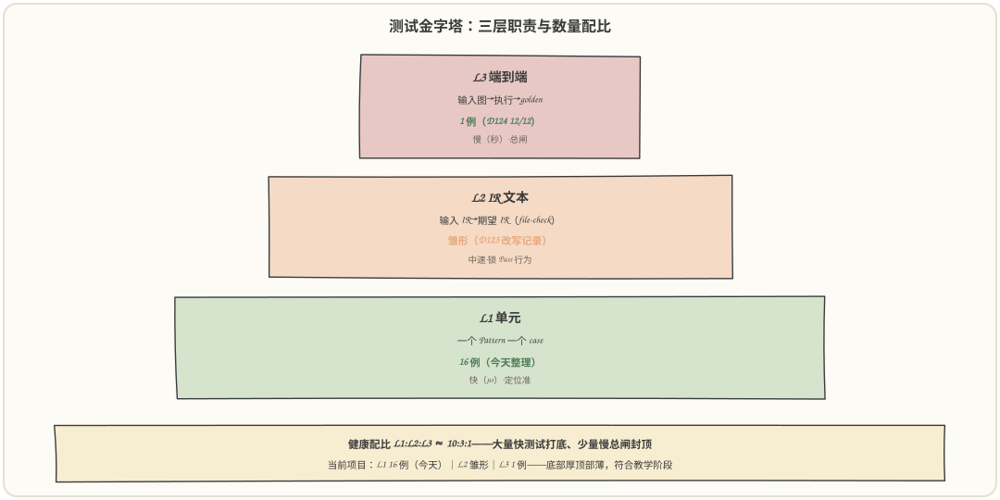
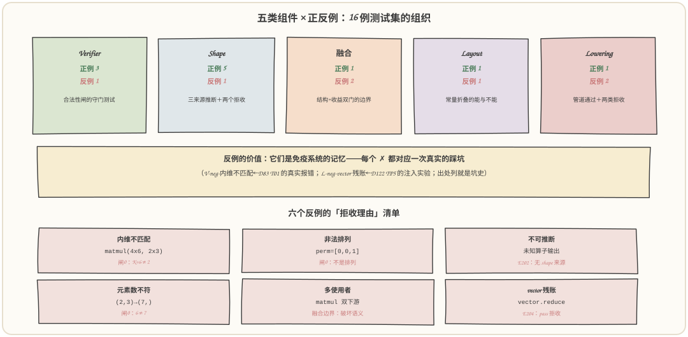
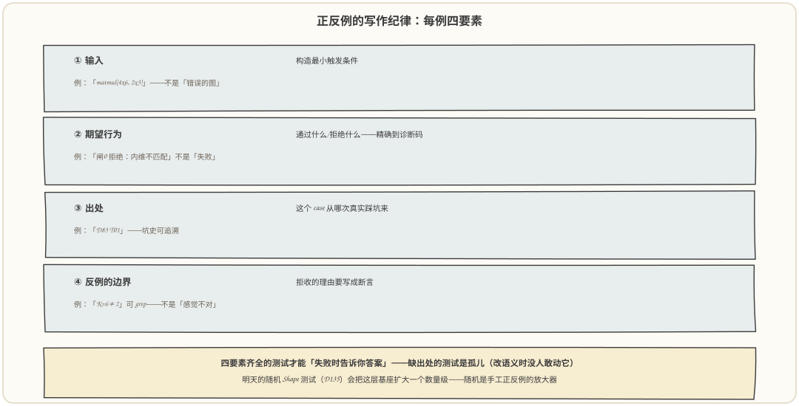

# 第 134 天：IR 与 Pass 测试整理——测试金字塔与 16 例正反集：反例是免疫系统的记忆

> **今日目标**：完成本教程后，你能做到五件事——画出**测试金字塔**（三层职责：L1 单元测试——一个 Pattern 一个 case（µs 级、定位准）／L2 IR 文本测试——输入 IR→期望 IR（file-check 模式、锁 Pass 行为）／L3 端到端测试——输入图→执行→golden（秒级、总闸）；**健康配比 L1:L2:L3 ≈ 10:3:1**——大量快测试打底、少量慢总闸封顶；当前项目 L1 16 例（今天）／L2 雏形（D123 改写记录）／L3 1 例（D124 12/12）——底部厚顶部薄）；整理**五类组件的正反例集**（16 例：Verifier 3（闸0 守门：内维匹配 ✓／内维不匹配 ✗／非法排列 ✗）／Shape 5（三来源推断 ✓✓✓＋不可推断 ✗＋元素数不符 ✗）／融合 3（单链 ✓＋多使用者 ✗＋非 const bias ✗）／Layout 2（转置常量折叠 ✓＋转置动态 ✗）／Lowering 3（七 pass 通过 ✓＋vector 残账 ✗＋胶水残留 ✗）——**每例四要素**：输入（最小触发）＋期望（精确到诊断码）＋出处（哪次踩坑）＋拒收理由（可断言））；说出**反例的价值**（它们是**免疫系统的记忆**——每个 ✗ 对应一次真实踩坑：V-neg-内维不匹配←D83 T01 的真实报错、L-neg-vector 残账←D122 TP5 的注入实验、L-neg-胶水残留←D117 errors-3——出处列就是坑史）；总结**正反例的写作纪律**（①输入构造最小触发条件（"matmul(4x6,2x3)"不是"错误的图"）②期望精确到诊断码（"闸0 拒绝：内维不匹配"不是"失败"）③出处可追溯（改语义时知道该问谁）④拒收理由写成断言（可 grep）——**四要素齐全的测试才能"失败时告诉你答案"；缺出处的测试是孤儿**）；预告**随机测试是手工正反例的放大器**（D135 的随机 Shape 会把这层基座扩大一个数量级——随机发现手工没想到的组合）。
> **预计时间**：学习 30 分钟＋实践 40 分钟
> **前置准备**：D121~D125 的测试实践（今天整理的对象——五闸的正反例散在各天）、D83 的 12 个测试用例（第三阶段的测试雏形）、D124 的端到端（L3 层唯一代表）。工具：python3。本文环境：Python 3.9.6，macOS arm64，2026-11-14。
> **今日产出**：`code/test_pyramid.py`（16 例测试集生成器＋金字塔框架＋自检）、`code/outputs/test-suite.txt`（**主产出：分类测试集**——五类×正反×四要素）、`code/run_all.sh`＋本文 3 张手绘图。

## 1. 今天解决什么问题？

第 18~19 周攒了 148 项测试判定（108＋40）——但它们散在 13 天的 outputs/ 里：D121 的开关矩阵、D122 的失败诊断、D124 的端到端、D130 的四路径……**测试很多、体系没有**。计划第 20 周第一天的任务："补齐 Verifier、Shape、融合、Layout 和 Lowering 的正反例；产出分类清晰的 IR 测试集"——把散装测试组织成金字塔。

组织的第一步是**分层**：单元（快、定位准）、IR 文本（中、锁行为）、端到端（慢、总闸）——三层各有职责不能互相替代（单元测试再多也不能证明端到端对；端到端挂了还是要靠单元测试定位）。第二步是**正反例配平**：16 例里 6 个反例——每个反例都是一次真实踩坑的化石（出处列），它们防止"同一个坑摔两次"。

## 2. 先看全貌：测试金字塔



**图 1**：看**三层金字塔＋配比金框**——顶层 L3 端到端（红·1 例：输入图→执行→golden——慢（秒）、总闸）；中层 L2 IR 文本（橙·雏形：输入 IR→期望 IR（file-check 模式）——中速、锁 Pass 行为；D123 的改写记录是雏形）；底层 L1 单元（绿·16 例今天整理：一个 Pattern 一个 case——快（µs）、定位准）；**金框**：健康配比 L1:L2:L3 ≈ 10:3:1（大量快测试打底、少量慢总闸封顶）；当前项目底部厚顶部薄——符合教学阶段（先广覆盖再深锁行为）。

## 3. 核心概念

### 3.1 三层职责：不可互相替代

**一句话**：单元测试（一个 Pattern 一个 case）回答"**这个零件对不对**"；IR 文本测试（输入→期望 IR）回答"**这层转换锁不锁得住行为**"；端到端测试（图→执行→golden）回答"**整台机器算不算得对**"——三层各答一问，任何一层都不能替另一层背书。

**类比**：体检体系。血常规（单元——单项指标）、影像对照（IR 文本——前后片对比锁变化）、全身体检（端到端——总体结论）——血常规再正常也不能说"没病"，全身体检异常还是要靠单项复查定位。**类比边界**：体检的层次是医学分工，测试的层次是**速度×精度权衡**——金字塔形状是自然生长的（快测试写着便宜所以多、慢测试维护贵所以少）；强行倒金字塔（大量端到端、少单元）的团队会陷入"红灯不知道哪里坏"的泥潭。**技术对应**：本项目的现状——L1 今天 16 例、L2 的雏形是 D123 改写记录（"canonicalize: 16→3 op（arith.constant -9...）"——锁的就是 Pass 行为）、L3 是 D124 的 12/12。

**当天实测证据**：test-suite.txt 的金字塔段＋三层现状统计。

### 3.2 反例：免疫系统的记忆

**一句话**：正例证明"功能在"；反例证明"**边界守得住**"——每个反例对应一次真实踩坑（出处列），修复之后把坑写成永久测试——同一个坑不会摔第二次；**反例是测试集里的疫苗**。

**类比**：免疫系统。病毒入侵（bug）→生病（踩坑）→产生抗体（反例测试）→下次同类病毒直接灭（回归守护）。**类比边界**：生物抗体只能防"同一株"病毒（变异就失效）；测试反例防的是**同一类**错误（内维不匹配的反例防的是"所有形状校验的疏忽"这一类——但新的错误类别需要新的反例）——所以反例集要随踩坑持续扩充（D136 的注入实验就是主动"接种"）。**技术对应**：六个反例的出处——V-neg-内维不匹配（D83 T01 的真实报错）、V-neg-非法排列（D83 T03）、S-neg-元素数不符（D83 T02）、F-neg-多使用者（D83 T10）、L-neg-vector 残账（D122 TP5 注入）、L-neg-胶水残留（D117 errors-3）——**出处列就是坑史**。

**当天实测证据**：test-suite.txt 的反例统计（6/16＝38%，健康配比 ≈40%）。

### 3.3 四要素写作纪律

**一句话**：一条合格的测试要四要素齐全——**输入**（最小触发条件：`matmul(4x6, 2x3)` 而不是"错误的图"）、**期望**（精确到诊断码："闸0 拒绝：内维不匹配"而不是"失败"）、**出处**（哪次踩坑：D83 T01——改语义时知道该问谁）、**拒收理由**（可断言："K=6≠2"可 grep）——**四要素齐全的测试才能"失败时告诉你答案"**。

**类比**：菜谱的四要素。食材（输入——精确到克）、步骤（期望——精确到火候）、来源（出处——这家餐厅的招牌）、失败征兆（拒收理由——"糊了=火超过 180°"）。缺来源的菜谱改起来没人敢动（不知道原味是什么）。**类比边界**：菜谱失败靠经验判断（主观），测试失败靠断言（客观）——"感觉不对"不是断言，`assert "内维不匹配" in err` 才是。**技术对应**：test-suite.txt 每例的四行结构（输入/期望/出处/拒收理由——后两者是今天强调的增量）。

**当天实测证据**：自检"每例带出处"——16/16 全带（无孤儿测试）。

## 4. 图解核心机制



**图 2**：看**五卡＋六反例**——上部五张组件卡（Verifier 3 例（3 正 1 反·绿·合法性闸守门）／Shape 5 例（4 正 1 反·蓝·三来源推断＋拒收）／融合 3 例（1 正 2 反·橙·结构+收益双门边界）／Layout 2 例（1 正 1 反·紫·常量折叠的能与不能）／Lowering 3 例（1 正 2 反·红·管道通过＋拒收））；中部金框：**反例的价值＝免疫系统的记忆——每个 ✗ 对应一次真实踩坑**（出处列就是坑史）；下部六个反例卡（内维不匹配 matmul(4x6,2x3)→闸0 K=6≠2／非法排列 perm=[0,0,1]→不是排列／不可推断→E202 无 shape 来源／元素数不符 (2,3)→(7,)→6≠7／多使用者→融合边界破坏语义／vector 残账→E204 pass 拒收）。

## 5. 动手实践



**图 3**：看**四要素卡＋金框**——①输入（构造最小触发条件——"matmul(4x6, 2x3)"不是"错误的图"）②期望行为（通过什么/拒绝什么——精确到诊断码——"闸0 拒绝：内维不匹配"不是"失败"）③出处（哪次踩坑——D83 T01，坑史可追溯）④反例的边界（拒收理由写成断言——"K=6≠2"可 grep）；**金框**：四要素齐全的测试才能"失败时告诉你答案"——缺出处的测试是孤儿（改语义时没人敢动它）；预告：明天的随机 Shape 测试会把这层基座扩大一个数量级——**随机是手工正反例的放大器**。

### 5.1 准备文件

```text
tutorials/day-134/
├── README.md / images/（3 图）
└── code/
    ├── test_pyramid.py          # 16 例测试集生成
    ├── gen_images.py / run_all.sh
    └── outputs/
        ├── test-suite.txt       # 主产出：分类测试集
        └── report.txt           # 自检 4/4
```

一键复现：`cd tutorials/day-134/code && ./run_all.sh`（约 2 秒）。

### 5.2 运行与观察

自检 4/4（五类齐全／16 例／反例 ≥6／每例带出处）；test-suite.txt 按五类组织、每类标注正反计数、每例四行四要素。

### 5.3 修改一个参数再观察

**实验 A（补第七类）**：给测试集加"分发器"类（D129/D130 的正反例：命中 ✓／miss ✓／E301 校验 ✗／E302 回退 ✗）——五类变六类；**实验 B（反例接种）**：主动想一个还没踩过的坑（如"shape 是负数"）写反例——它是疫苗（先于疾病）；**实验 C（金字塔自查）**：数一下本项目 L1/L2/L3 各几例——画自己的金字塔与 10:3:1 对照。

## 6. 常见错误与排查

**错误 1：只有正例没有反例**。现象：测试全绿但边界裸奔——非法输入进来不是拒收而是崩溃/静默算错。原因：写测试只想"验证功能"忘了"守住边界"。定位：数反例占比（<20% 警报）。修复：每个 Verifier/Pass 至少配一个反例——从坑史里挖（出处列）。**教训**：正例证明"做了什么"，反例证明"不会做什么"——后者才是安全感的来源。

**错误 2：期望写成"不崩溃"**。现象：反例的期望是"调用不抛异常"——但静默算错也不抛（更糟）。原因：期望不精确——"失败"有很多种（好的失败=结构化拒收；坏的失败=静默错误）。定位：期望里有没有诊断码/具体行为。修复：精确到"闸0 拒绝：内维不匹配"级别（E301/E202 的代码级）。**教训**：D130 的教训重演——**无声崩溃是系统的耻辱，含糊的期望是测试的耻辱**。

**错误 3：测试没有出处（孤儿测试）**。现象：某条测试改语义时没人敢动（不知道为什么存在——删了怕漏、留着怕过时）。原因：写的时候没记出处。定位：review 时问"这条测试防的是什么坑？"答不上就是孤儿。修复：补出处（哪次踩坑/哪个 issue）；真找不到出处且解释不了用途的——删（死测试比没测试更糟——它给人虚假的安全感）。

## 7. 今日练习

**必做**：1. 实验 A（补分发器类）：从 D129/D130 的实测里提炼 6 例（正 2 反 4）；2. 金字塔自查：数本项目的 L1/L2/L3 现状画成金字塔；3. 四要素抽查：随机挑三条已有测试按四要素打分。

**选做**：4. 实验 B（疫苗反例）：想三个"还没踩过的坑"各写反例（负 shape/超界常量/环依赖图）；5. 研究 MLIR 的 lit＋FileCheck 工具链（真实的 L2 层基础设施）——与本项目的改写记录对照。

## 8. 今日验收

- [ ] 我能画出测试金字塔与三层职责（单元=零件对不对／IR 文本=行为锁不锁得住／端到端=算不算得对）＋健康配比 10:3:1
- [ ] 我能背出 16 例的分布（Verifier 3/Shape 5/融合 3/Layout 2/Lowering 3）与六个反例的拒收理由
- [ ] 我能说出反例的价值（免疫系统的记忆——每个 ✗ 对应一次踩坑、出处列就是坑史）与配比（≈40%）
- [ ] 我能复述四要素纪律（最小输入/诊断码级期望/出处可追溯/理由可断言）——缺出处的测试是孤儿
- [ ] 我知道明天随机 Shape 测试会把 L1 基座放大一个数量级——随机是手工正反例的放大器

## 9. 一句话总结与明天预告

今天的闭环：**组织**——148 项散装测试升级为体系：金字塔三层（L1 单元 µs 级定位准／L2 IR 文本锁 Pass 行为／L3 端到端总闸——配比 10:3:1、底部厚顶部薄符合教学阶段）；**整理**——五类组件 16 例正反集（正 10／反 6——反例占比 38%）：每例四要素（最小输入/诊断码期望/出处/可断言理由）；**价值**——反例是免疫系统的记忆（六个 ✗ 各对应 D83/D117/D122 的真实坑史）；**纪律**——四要素齐全才能"失败时告诉你答案"、缺出处的测试是孤儿。明天 D135 随机 Shape 正确性测试：随机 M/N/K/Tile 的生成器（固定种子可复现）＋"先验证正确性再记录性能"的顺序纪律＋失败用例自动保存——**随机是手工正反例的放大器**：16 例手工基座即将变成数百例的自动军团。

> **第 20 周积分卡**：**D134 测试整理（4/4，16 例正反集）** → D135 随机 Shape → D136 Pass 二分定位 → D137 最小失败用例 → D138 性能回归 → D139 完整回归与冻结 → D140 复盘。
