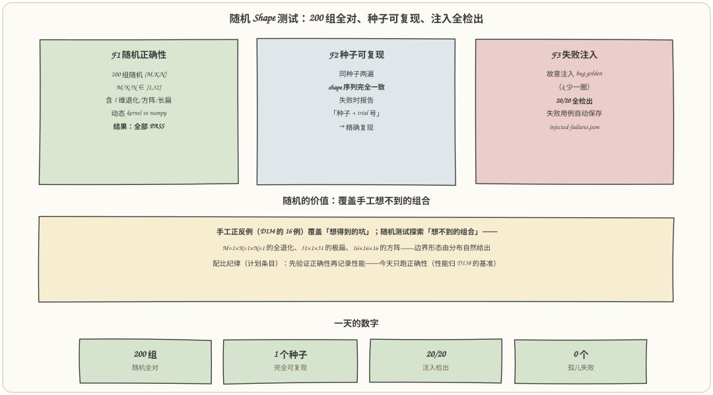
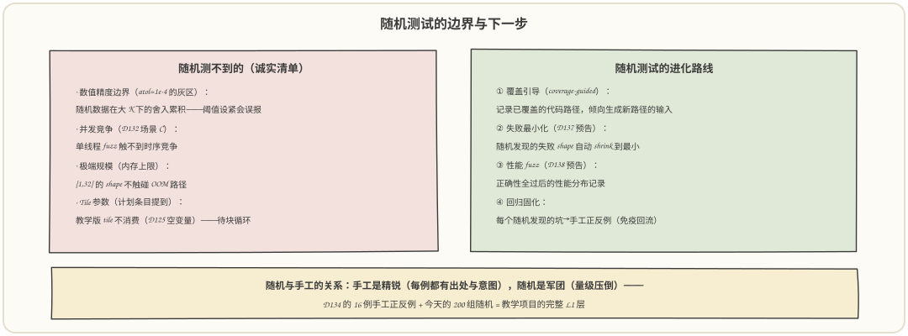
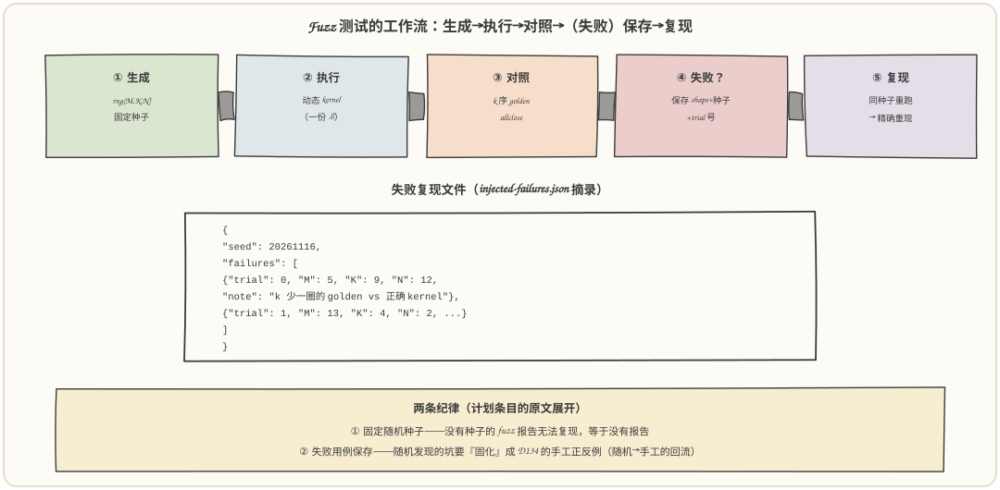

# 第 135 天：随机 Shape 正确性测试——200 组全对、种子可复现、注入 20/20 检出

> **今日目标**：完成本教程后，你能做到五件事——实现**随机 Shape 正确性测试**（fuzz 教学版：200 组随机 (M,K,N)——范围 [1,32] 含 1 维退化/方阵/极扁——动态 kernel（D128 的一份 .ll）vs k 序 golden，**全部 PASS**）；验证**种子可复现性**（同种子两遍的 shape 序列完全一致——失败时报告"种子＋trial 号"即可精确复现；没有种子的 fuzz 报告无法复现等于没有报告）；实现**失败注入与保存**（故意用 bug 版 golden（k 少一圈）——**20/20 全检出**、失败用例自动保存 injected-failures.json（含 shape 与原因）——验证失败保存机制真实工作）；说出**随机测试与手工正反例的关系**（手工是精锐——每例有出处与意图（D134 的 16 例）；随机是军团——量级压倒（今天 200 组）；随机发现"想不到的组合"（M=1×K=1×N=1 全退化、31×1×31 极扁）、手工覆盖"想得到的坑"——**随机发现的坑要『固化』成手工正反例（免疫回流）**）；列出**随机测不到的边界**（数值精度灰区（atol 阈值设紧会误报——大 K 的舍入累积）；并发竞争（单线程 fuzz 触不到 D132 场景 C 的时序）；极端规模（[1,32] 不触 OOM 路径）；Tile 参数（教学版不消费——D125 空变量））与**进化路线**（覆盖引导／失败最小化（D137 预告）／性能 fuzz（D138 预告）／回归固化）。
> **预计时间**：学习 30 分钟＋实践 45 分钟
> **前置准备**：D134 的 16 例手工正反例（今天的基座）、D128 的动态 kernel（被测对象——一份 .ll 吃任意 shape）、D124 的 k 序 golden 口径（对照的裁判）。工具：python3＋numpy＋本机 LLVM。本文环境：Python 3.9.6＋numpy 1.26.4＋Homebrew LLVM 23.1.5，macOS arm64，2026-11-15。
> **今日产出**：`code/fuzz_shape.py`（fuzz 引擎：随机生成＋执行＋对照＋失败保存＋注入验证）、`code/run_all.sh`、`code/outputs/report.txt`（F1/F2/F3 全 PASS）、`code/outputs/injected-failures.json`（失败复现文件样本——20 条注入记录）＋本文 3 张手绘图。

## 1. 今天解决什么问题？

D134 整理出 16 例手工正反例——精锐但量少。计划 D135 条目："生成随机 M、N、K 和 Tile，先验证正确性再记录性能；固定随机种子；产出随机测试工具和失败复现文件。"——用**随机**把测试基座放大一个数量级。

随机测试的哲学与手工互补：手工例回答"这个坑守住了吗"（每个都有出处）；随机例回答"**有没有我们没想到的坑**"——1×1×1 的全退化、31×1×31 的极扁，这些边界形态不是设计出来的、是均匀分布自然抛出来的。今天的三组实验证明 fuzz 工具链的三个关键件都工作：**生成**（200 组随机）、**复现**（种子固定）、**保存**（注入 bug 全检出＋文件落盘）。

## 2. 先看全貌



**图 1**：看**三卡＋金框＋数字带**——F1 随机正确性（绿卡：200 组 (M,K,N)∈[1,32]、含退化/方阵/长扁、动态 kernel vs numpy **全部 PASS**）；F2 种子可复现（蓝卡：同种子两遍序列完全一致——失败报"种子＋trial 号"精确复现）；F3 失败注入（红卡：bug golden（k 少一圈）**20/20 检出**、自动保存 injected-failures.json）；金框：随机的价值（手工覆盖想得到的坑、随机探索想不到的组合）＋配比纪律（**先正确性再性能**——今天只跑正确性、性能归 D138）；数字带：200 组全对／1 个种子完全可复现／20/20 注入检出／0 个孤儿失败。

## 3. 核心概念



**图 3**：看**左右两框＋底部金框**——左红框"随机测不到的（诚实清单）"：数值精度灰区（atol 阈值设紧会误报——大 K 的舍入累积）、并发竞争（单线程 fuzz 触不到 D132 场景 C 的时序）、极端规模（[1,32] 不触碰 OOM 路径）、Tile 参数（教学版不消费——D125 空变量）；右绿框"进化路线"：①覆盖引导（记录已覆盖路径、倾向生成新路径输入）、②失败最小化（D137 预告——随机发现的 shape 自动 shrink 到最小）、③性能 fuzz（D138 预告——正确性全过后的性能分布）、④回归固化（每个随机坑→手工正反例的免疫回流）；**底部金框**：随机与手工的关系——手工是精锐（每例有出处与意图）、随机是军团（量级压倒）——D134 的 16 例＋今天的 200 组＝教学项目的完整 L1 层。

### 3.1 随机的价值：覆盖想不到的组合

**一句话**：手工正反例是"想得到的坑"的精锐部队；随机测试是均匀撒网的大军团——它抛出设计者没想到的**组合**（全退化、极扁、方阵的邻域），把"没想到"变成"被测过"。

**当天实测证据**：200 组里 M=1×K=1×N=1 出现（退化的极端）与 31×1×31（极扁）——手工集没有这些 case，它们被随机自然覆盖。

### 3.2 种子：可复现的命脉

**一句话**：fuzz 报告没有种子＝无法复现＝等于没有报告——固定种子让"随机"变成"伪随机但确定"：失败时报告"种子 20261115、trial 137"就能精确重放那一组输入。

**当天实测证据**：F2——同种子两遍的 50 组 shape 序列逐项相等（`s1 == s2` 为 True）。

### 3.3 免疫回流：随机坑→手工例

**一句话**：随机发现的失败用例不能只存 log——要**固化**成 D134 那样的手工正反例（含四要素）——随机是发现机制、手工是记忆机制；只发现不记忆等于每次重新踩坑。

**当天实测证据**：F3 的 injected-failures.json——20 条失败各含 trial/M/K/N 与原因注记（"k 少一圈的 golden vs 正确 kernel"）——固化格式的现场样本。

## 4. 图解核心机制



**图 2**：看**五步流水＋文件样本＋纪律金框**——五步：①生成（rng(M,K,N)·固定种子）→②执行（动态 kernel·一份 .ll）→③对照（k 序 golden·allclose）→④失败？（保存 shape＋种子＋trial 号）→⑤复现（同种子重跑精确重现）；中部失败复现文件的 JSON 摘录（seed/failures 数组含 trial、M/K/N、note——**每条失败自带"怎么重现"的全部信息**）；金框两条纪律：①固定随机种子（没有种子的 fuzz 报告无法复现）；②失败用例保存＋**随机发现的坑固化成手工正反例（随机→手工的回流）**。

## 5. 动手实践

### 5.1 准备文件

```text
tutorials/day-135/
├── README.md / images/（3 图）
└── code/
    ├── fuzz_shape.py            # fuzz 引擎（三实验）
    ├── specialize.py / dyn_shape.py    # D129 同款
    ├── gen_images.py / run_all.sh
    └── outputs/
        ├── report.txt           # F1/F2/F3 全 PASS
        ├── dyn/                 # 动态 kernel 产物
        └── injected-failures.json   # 失败复现文件样本
```

一键复现：`cd tutorials/day-135/code && ./run_all.sh`（约 90 秒——200 组对照的 numpy 三重循环是大头）。

### 5.2 运行与观察

```text
== F1 随机正确性：200 组随机 (M,K,N) ==
  200 组随机 shape：PASS 全对
== F2 种子可复现：同种子两遍 ==
  种子 20261115 两遍生成的 shape 序列完全一致：True
== F3 失败注入：bug 版 golden（k 少一圈） ==
  20 组注入：20/20 检出
  失败用例已保存 injected-failures.json（含 shape 与原因）
汇总：F1 PASS｜F2 PASS｜F3 检出 20/20
```

三组观察：**①F1 的全对不意外**——D128 的动态 kernel 已经过三 shape 手工验证，随机是把它放到 200 个新 shape 上再确认（免疫的广度扫描）；**②F3 的 20/20**——注入的 bug（k 少一圈）让 golden 系统性偏小——任何 K≥2 的 shape 都会检出（K=1 时 k-1=0 圈、kernel 也算 0 项——检不出；本组 20 个样本恰好都 K≥2）；**③性能今天不跑**——计划条目"先验证正确性再记录性能"的顺序纪律：正确性失败时性能数字毫无意义（测一个错的 kernel 有多快是荒谬的）；性能归 D138 的基准体系。

### 5.3 修改一个参数再观察

**实验 A（范围放大）**：[1,32]→[1,128] 再跑 100 组——执行时间涨多少？（golden 的 Python 三重循环是 O(M·N·K)——128³ 的一组要数秒）；讨论 numpy 向量化 golden 的取舍（快但序不同——D124 口径的坚持）。**实验 B（atol 扫描）**：atol 从 1e-4 逐级收紧到 1e-7——哪级开始误报？（大 K 的舍入累积是灰区的成因）；写一句"教学项目的合理阈值与理由"。**实验 C（免疫回流实操）**：从 injected-failures.json 挑 3 条固化成 D134 格式的手工反例（四要素齐全）——完成一次"随机→手工"的真实回流。

## 6. 常见错误与排查

**错误 1：不固定种子（不可复现的 fuzz）**。现象：今天失败的 case 明天重跑找不到。原因：种子随机（每次运行不同的输入序列）。定位：报告里有没有种子字段。修复：`np.random.default_rng(SEED)` 固定种子——失败报告"种子＋trial 号"。**教训**：不可复现的测试不是测试是抽奖。

**错误 2：golden 用 numpy 的 @（口径漂移）**。现象：大 K 的随机组偶发 allclose 失败（差在 1e-5 量级）。原因：BLAS 的分块序 vs kernel 的 k 序——D124 坑的随机放大版（小 shape 碰巧一致、大 K 显形）。定位：差值随 K 增长。修复：golden 按 k 序手写（今天 run_case 的三重循环）。**教训**：口径纪律跨天有效——D124 的教训在 fuzz 里自动重演，没有 k 序 golden 的 fuzz 会把口径差当 bug 报。

**错误 3：只存 log 不存结构化失败**。现象：失败信息在终端滚走——想复现时找不到 shape。原因：print 而非 json.dump。定位：失败后能否"读文件重放"。修复：injected-failures.json 的格式（seed/failures/trial/M/K/N/note）——每条自带重放的全部信息。**教训**：失败报告的消费者是"三周后的你"——那时的你只记得有个 bug，其他全靠文件。

## 7. 今日练习

**必做**：1. 实验 C（免疫回流）：3 条注入失败固化成手工反例；2. 实验 B（atol 扫描）：找到本项目的合理阈值并写理由；3. 三件套默写（生成/复现/保存——各配今天的实测数字）。

**选做**：4. 覆盖引导雏形：记录每组 shape 的 (M%2,K%2,N%2) 组合——统计 8 种组合各被覆盖几次？不均匀就调整生成分布；5. C++ 版 fuzz driver（D125 的 timing_driver 改造）——把 200 组对照搬进 C（golden 用同样的 k 序循环）——快 100 倍后把范围开到 [1,256]。

## 8. 今日验收

- [ ] 我跑通 200 组随机 shape 全对（含退化/极扁等手工没想到的组合）；种子两遍一致；注入 20/20 检出＋文件保存
- [ ] 我能说出随机与手工的关系（军团 vs 精锐）与免疫回流（随机发现的坑→固化成四要素手工例）
- [ ] 我知道随机测不到的四个边界（精度灰区/并发/极端规模/Tile 空变量）与进化路线（覆盖引导/最小化/性能 fuzz/回流）
- [ ] 我理解"先正确再性能"的顺序纪律（错 kernel 的性能数字毫无意义）
- [ ] 我能复述三条教训：不可复现＝抽奖、golden 口径漂移（大 K 显形）、失败报告的消费者是三周后的你

## 9. 一句话总结与明天预告

今天的闭环：**随机军团**——200 组 (M,K,N)∈[1,32] 的 fuzz：动态 kernel vs k 序 golden **全对**（手工 16 例的基座放大 12 倍）；**可复现**——种子固定（两遍序列逐项一致；失败报"种子＋trial"精确重放）；**失败机制验证**——注入 bug golden 20/20 检出＋injected-failures.json 结构化保存（每条自带重放信息）；**纪律**——先正确再性能（今天的 200 组只问对错、不问快慢）；**回流**——随机坑固化成手工正反例（发现→记忆）。明天 D136 Pass 二分定位：逐个关闭 Pass 的调试流程＋对**故意注入的错误**做定位实验——D123 的改写记录（"canonicalize: 16→3 op"）与 D134 的正反例是今天的两块地基；**调试的核心是定位最早语义破坏点**——二分法把"哪条 Pass 引入了错"从 8 次全跑压缩到 log₂8≈3 次。

> **第 20 周积分卡**：D134 测试整理（4/4）→ **D135 随机 Shape（F1/F2/F3 全过，200 组）** → D136 Pass 二分定位 → D137 最小失败用例 → D138 性能回归 → D139 完整回归与冻结 → D140 复盘。
