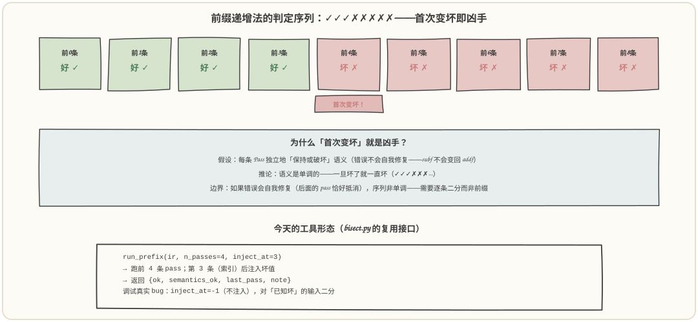

# 第 136 天：Pass 二分定位——注入错误精确指认：首次变坏的 convert-func-to-llvm

> **今日目标**：完成本教程后，你能做到五件事——实现**前缀递增定位法**（run_prefix(ir, n_passes)：跑前 n 条 pass＋语义判定（fadd 是否还在）——九个前缀 0~8 逐一判定，序列 `✓✓✓✓✗✗✗✗✗`——**首次变坏的前缀（第 4 条）就是凶手**）；注入并**精确定位一个错误**（B2：第 4 条 pass（convert-func-to-llvm）后把 `llvm.fadd→llvm.fsub`——模拟该 Pass 的语义破坏；B3：前缀递增判定——前 3 条语义好、前 4 条首次变坏——**定位到 convert-func-to-llvm，与注入点完全一致**）；说出**「首次变坏即凶手」的推理依据**（黄金假设：错误总在某条 Pass 首次引入（最早语义破坏点）；假设每条 Pass 独立保持或破坏语义、错误不自我修复（subf 不会变回 addf）→ 语义判定**单调**（一旦坏就一直坏）→ 首次变坏点唯一；边界：若错误会被后续 Pass 抵消（非单调）则要逐条开关法）；对比**三种定位效率**（暴力逐条全管道 O(n²)＝64 次执行／前缀法（本次）36 次／真二分 log₂ 级 ~24 次——教学规模差距小，**真实编译器几百条 pass 时二分是唯一可行**）；把今天的工具接进**调试链条**（二分定位（今天）→ IR 快照 diff（D123 改写记录——看清改了什么）→ 最小失败用例（明天 D137——把坏 IR 缩到最小好提交）——**调试核心＝定位最早语义破坏点**（计划 D140 的总结句））。
> **预计时间**：学习 30 分钟＋实践 40 分钟
> **前置准备**：D122 的 PASSES 表与失败诊断（今天的被测管道）、D123 的改写记录（调试链条的第二环）、D121 的开关矩阵（逐条开关法的雏形）、D125 的注入方法论（投毒前先验毒真的有毒——D111 教训）。工具：python3＋mlir-opt。本文环境：Python 3.9.6＋Homebrew LLVM 23.1.5，macOS arm64，2026-11-15。
> **今日产出**：`code/pass_bisect.py`（前缀定位引擎：run_prefix＋注入钩子＋语义判定＋效率对比）、`code/run_all.sh`、`code/outputs/report.txt`（B1~B4 全 PASS）＋本文 3 张手绘图。

## 1. 今天解决什么问题？

第 20 周的主题是"调试的核心是定位最早语义破坏点"。计划 D136 条目："实现或脚本化逐个关闭 Pass 的调试流程，对一个故意注入的错误进行定位。"——昨天 D135 用随机测试**发现**错误；今天解决**发现之后**的问题：错误在哪条 Pass？

教学场景设计：一条干净管道（D122 的八条 pass）＋一个注入点（第 4 条 pass 后把 fadd 换成 fsub——模拟"这条 Pass 错误地改了语义"）。定位工具用**前缀递增法**：跑前 0/1/2/.../8 条 pass、每级判定语义好坏——序列 `✓✓✓✓✗✗✗✗✗` 的**首次变坏点**就是凶手。这不是唯一方法（真二分更快、逐条开关更直接），但前缀法的单调性推理最直观——教学首选。

## 2. 先看全貌


**图 1**：看**时间线＋三阶段＋效率对比**——顶部八条 pass 时间线（前三条绿 ✓语义好、第 4 条红 ✗（**注入点·凶手**——convert-func-to-llvm）、后四条橙 ✗（涟漪——坏语义传递））；中部三阶段卡（B1 基线：八条全开不注入语义好——管道干净／B2 注入：第 4 条后 addf→subf、全开语义坏——错误存在／B3 定位：前缀递增、第 4 条首次变坏→凶手=convert-func）；底部效率对比（暴力 O(n²)=64 次／前缀法 36 次／真二分 ~24 次——真实编译器几百条 pass 时二分是唯一）＋金句（**调试的黄金假设：错误总在某条 Pass 首次引入——找到它，后面的全是涟漪**）。

## 3. 核心概念

### 3.1 首次变坏即凶手：单调性推理

**一句话**：假设每条 Pass 独立地保持或破坏语义且错误不自我修复（fsub 不会变回 fadd）→ 语义判定沿前缀**单调**（一旦坏就一直坏）→ `✓✓✓✗✗...` 的**首次变坏点唯一且就是凶手**。

**当天实测证据**：九级前缀的判定序列（前 3 条好、前 4 条起坏）——首次变坏与注入点完全一致。

### 3.2 三种定位方法与效率

**一句话**：**暴力**（逐条全管道重跑）O(n²)；**前缀递增**（本次）Σn 次；**真二分**（好/坏判定二分搜索）log₂(n) 次判定——教学规模三者差距小（64/36/24），真实规模（几百条 pass）二分是唯一可行；**逐条开关**（关这条还坏吗）最直接但要 n 次全管道。

### 3.3 调试链条：定位→看清→缩小

**一句话**：今天的二分**定位**凶手；D123 的改写记录帮你看清它**改了什么**（"canonicalize: 16→3 op（arith.constant -9...）"——逐 pass 的 IR 前后对比）；明天 D137 把它的用例**缩到最小**（shrink）好提交——三件工具构成"发现→定位→看清→缩小"的完整调试链条。

## 4. 图解核心机制



**图 2**：看**判定序列＋推理框＋工具接口**——顶部九格判定序列（前 0~3 条绿"好 ✓"、前 4~8 条红"坏 ✗"、第 4 条标注"首次变坏！"）；中部蓝框三条推理（假设独立保持/破坏→单调→首次变坏唯一；边界：若错误会被后续 pass 抵消（非单调）则需逐条开关）；底部工具接口（run_prefix(ir, n_passes, inject_at) 的签名与返回值——调试真实 bug 时 inject_at=-1、对已知坏的输入二分）。

## 5. 动手实践

### 5.1 准备文件

```text
tutorials/day-136/
├── README.md / images/（3 图）
└── code/
    ├── pass_bisect.py          # 前缀定位引擎（注意：不叫 bisect.py——避免遮蔽标准库！）
    ├── loop_lower.py / graph_passes.py   # D122 同款
    ├── gen_images.py / run_all.sh
    └── outputs/report.txt      # B1~B4 全 PASS
```

一键复现：`cd tutorials/day-136/code && ./run_all.sh`（约 10 秒）。

### 5.2 运行与观察

```text
== B1 全开基线（不注入——确认干净）==
  八条全开：前 8 条跑完，语义好
== B2 注入错误（第 4 条 pass 后 addf→subf）==
  八条全开＋注入：前 8 条跑完，语义坏——错误存在（fsub 冒充 fadd）
== B3 二分定位（前缀递增法）==
  前 0~3 条：语义 ✓好
  前 4 条（convert-func-to-llvm）：语义 ✗坏 ← 首次
  前 5~8 条：语义 ✗坏（涟漪）
  定位结果：凶手 = convert-func-to-llvm（与注入点一致——定位正确！）
== B4 定位效率对比 ==
  暴力 O(n²)=64 次｜前缀法 36 次｜真二分 ~24 次
结论：注入的错误被精确定位到「convert-func-to-llvm」——PASS
```

三组观察：**①注入前先验基线**（B1）——管道本身干净（不注入语义好），错误的存在性由 B2 确认——D111"投毒前先验毒真的有毒"的复现；**②涟漪的诚实呈现**——前 5~8 条也"坏"，但那是**传递的坏**（subf 一路带到底），不是新错误——定位只看首次变坏点；**③效率数字的教学边界**——64/36/24 差距小到无感，但公式差距是平方级——真实规模（如 LLVM 的 -O2 有上百个 pass）时只有 log₂ 级可存活。

### 5.3 修改一个参数再观察

**实验 A（注入点搬家）**：INJECT_AT 改成 6（第 7 条 pass）——重跑定位（首次变坏应在前 7 条）；验证工具与注入点无关。**实验 B（非单调场景）**：在第 4 条注入 fadd→fsub、再在第 6 条注入 subf→fadd（自我修复）——观察判定序列（✓✓✓✗✗✓✓✓？）——首次变坏仍指认第 4 条、但"坏"不持续——讨论：这种情况下逐条开关法怎么定位"谁引入又谁修复"？**实验 C（真二分实现）**：把前缀递增改成二分搜索（lo=0, hi=8；先测中点 4——坏则 hi=4、好则 lo=4）——数一数判定次数（应为 3~4 次 vs 前缀法的 9 次）。

## 6. 常见错误与排查

**错误 1：脚本命名遮蔽标准库**。现象：`import random` 报 `ImportError: cannot import name 'bisect' from 'bisect'`。原因：今天的脚本叫 `bisect.py`——Python 的 random 模块内部 `from bisect import bisect`，被同目录的 bisect.py 遮蔽！定位：import 链报错指向自己的文件。修复：改名 `pass_bisect.py`。**教训**：脚本命名避开标准库名（bisect/json/random/test...）——这个坑今天真实踩到，与教程主题（定位）自嘲呼应：**定位自己的 bug 也用同一套方法**（报错信息→最小复现→修复）。

**错误 2：语义判定只看"跑通"**。现象：判定函数只查 pass 执行成功（returncode==0）——注入的 fsub 让语义坏了但管道照跑——判定全"好"、凶手找不到。原因：判定指标错了——"能跑"≠"语义对"。定位：注入一个必坏的错误（如 fadd→fsub）而判定仍全绿。修复：判定查**语义指纹**（fadd 在不在——addf/subf 计数）。**教训**：定位的前提是有一个能区分好坏的**语义判据**——判据不灵，二分就是瞎子摸象。

**错误 3：把涟漪当凶手**。现象：看到前 5~8 条都"坏"，报告"有五条 pass 都有错"。原因：混淆**首次引入**与**后续传递**——subf 一路带到底，但源头只有一个。定位：找判定序列的**跳变点**（✓→✗ 的边界）而非所有 ✗。修复：报告"首次变坏的前缀长度"＋后续坏是涟漪的说明。**教训**：修一个 bug 只修源头——涟漪会随源头修复自动消失（在源头 pass 后删注入，全序列恢复 ✓）。

## 7. 今日练习

**必做**：1. 实验 A（注入搬家）：INJECT_AT=0/6 两跑——定位均正确即工具无关性验证；2. 实验 C（真二分）：实现二分版并数判定次数——对比 9（前缀）vs 3~4（二分）；3. 调试链条默写：定位（今天）→看清（D123 改写记录）→缩小（D137）——各配一件工具名。

**选做**：4. 实验 B（非单调）：双重注入的自我修复场景——写出逐条开关版的定位逻辑；5. 研究 LLVM 的 `opt -debug-only` 与 MLIR 的 `--mlir-pass-statistics`——真实工具链的定位基础设施对照。

## 8. 今日验收

- [ ] 我能跑通注入定位：第 4 条 pass 后 fadd→fsub、前缀递增判定 `✓✓✓✗✗...`、首次变坏=convert-func-to-llvm＝注入点
- [ ] 我能解释"首次变坏即凶手"的单调性推理（独立保持/破坏＋不自我修复→单调→跳变点唯一）与非单调边界（自我修复需逐条开关）
- [ ] 我能对比三种效率（暴力 O(n²)/前缀 Σn/二分 log₂）并说出教学规模 vs 真实规模的结论
- [ ] 我知道调试链条三件工具（二分定位/IR diff/最小用例）与黄金假设（错误总在某条 Pass 首次引入——找到它后面全是涟漪）
- [ ] 我踩过并记住了脚本遮蔽标准库的坑（bisect.py 的 ImportError——定位自己的 bug 也用定位法）

## 9. 一句话总结与明天预告

今天的闭环：**注入**——干净管道（八条 pass）的第 4 条后 fadd→fsub（模拟 Pass 语义破坏），B1 基线干净/B2 全开语义坏确认错误存在；**定位**——前缀递增法九级判定 `✓✓✓✗✗✗✗✗`，**首次变坏点（convert-func-to-llvm）＝注入点**——单调性推理（独立保持/破坏＋不自我修复）保证跳变点唯一；**效率**——暴力 64/前缀 36/二分 ~24 次，真实规模只有 log₂ 级可存活；**链条**——二分定位（今天）→改写记录看清（D123）→最小用例（明天）。**彩蛋**——脚本命名遮蔽标准库（bisect.py）的真实坑当天踩当天修：定位方法用于定位自己的 bug。明天 D137 最小失败用例还原：**Reduce 思想**——把复杂失败用例缩减为最小 IR（删无关节点/缩 shape/简化类型）、确认仍触发同一问题、修复后写成回归测试——D136 定位到"哪条 Pass"、D137 给它配一个"能进 bug 报告的最小标本"。

> **第 20 周积分卡**：D134 测试整理（4/4）→ D135 随机 Shape（200 组全对）→ **D136 Pass 二分定位（B1~B4 全过）** → D137 最小失败用例 → D138 性能回归 → D139 完整回归与冻结 → D140 复盘。
