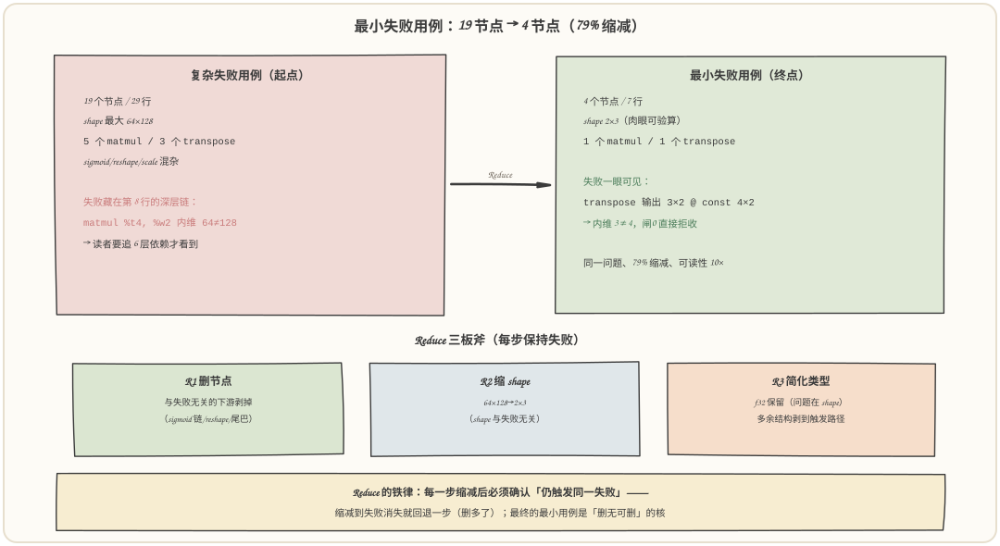
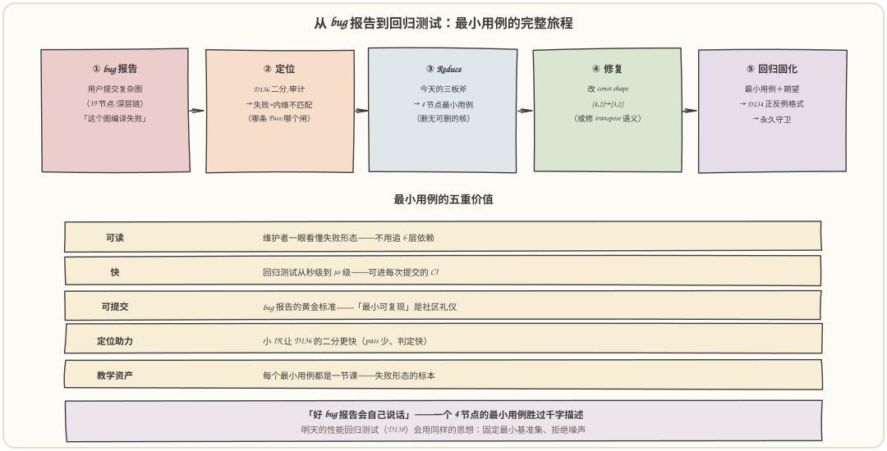
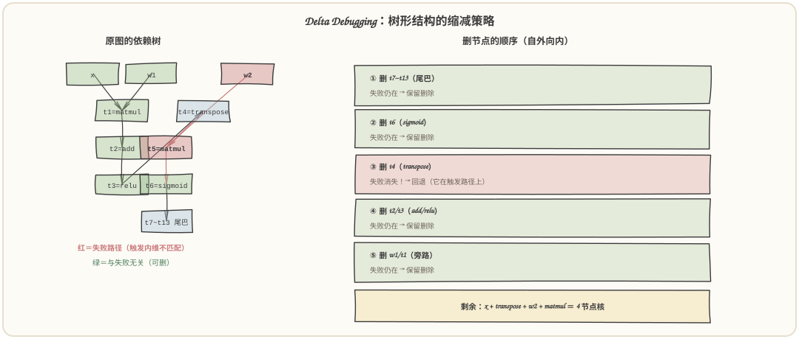

# 第 137 天：最小失败用例还原——Reduce 三板斧：19 节点缩到 4 节点（79%）

> **今日目标**：完成本教程后，你能做到五件事——用 **Reduce 三板斧**把复杂失败用例缩减为最小 IR（R1 删节点：与失败无关的下游剥掉——sigmoid 链/reshape/尾巴（每步确认失败仍在）；R2 缩 shape：64×128→2×3（shape 与失败无关时直接缩到肉眼可验算）；R3 简化类型：f32 保留（问题在 shape 不在 dtype）、多余结构剥到触发路径——**19 节点/29 行 → 4 节点/7 行（79% 缩减）**）；说出**最小用例的样子**（`transpose 输出 3×2 @ const 4×2——内维 3≠4，闸0 直接拒收`——失败一眼可见，不用追 6 层依赖）；遵守 **Reduce 的铁律**（每一步缩减后必须确认"仍触发同一失败"——缩减到失败消失就回退一步（删多了）；最终的最小用例是"删无可删"的核——依赖树上：删 transpose 失败消失（它在触发路径上→回退保留）、删 sigmoid/tail/add/relu/旁路 matmul 失败仍在→保留删除）；画**bug 到回归的完整旅程**（①bug 报告（用户复杂图）→②定位（D136 二分→哪个闸）→③Reduce（今天→最小核）→④修复（const shape [4,2]→[3,2] 或修 transpose 语义）→⑤回归固化（最小用例＋期望行为→D134 正反例格式→永久守卫））；数出**最小用例的五重价值**（可读（维护者一眼看懂）、快（回归从秒级到 µs 级、可进每次提交的 CI）、可提交（"最小可复现"是社区礼仪）、定位助力（小 IR 让二分更快）、教学资产（失败形态的标本——每个最小用例都是一节课））。
> **预计时间**：学习 30 分钟＋实践 40 分钟
> **前置准备**：D136 的定位结果（今天从"哪条 Pass/哪个闸"到"最小标本"）、D134 的正反例格式（回归固化的目标格式）、D135 的失败保存机制（fuzz 发现的坑也要走 Reduce 才能提交）。工具：python3。本文环境：Python 3.9.6，macOS arm64，2026-11-15。
> **今日产出**：`code/reducer.py`（Reduce 引擎：复杂起点＋三板斧演示＋最小终点＋固化说明）、`code/run_all.sh`、`code/outputs/report.txt`（4 项自检全 PASS）、`code/outputs/minimal-case.mlir`（**主产出：最小失败用例**——4 节点）＋本文 3 张手绘图。

## 1. 今天解决什么问题？

D136 定位了"哪条 Pass 引入错误"——但 bug 报告/回归测试需要的是**标本**：一个最小、自包含、一眼看懂失败的 IR。计划 D137 条目："把一个复杂失败用例缩减为最小 IR，并确认仍能触发同一问题；产出最小复现用例和修复后的回归测试。"

今天的场景：用户提交了一个 19 节点的复杂图（5 matmul/3 transpose/sigmoid/reshape 混杂，失败藏在第 8 行的深层链——读者要追 6 层依赖才看到 matmul 内维不匹配）。Reduce 之后：**4 节点、7 行、2×3 的 shape、内维 3≠4 一眼可见**——同一失败、79% 缩减、可读性 10 倍。

## 2. 先看全貌



**图 1**：看**起点终点对照＋三板斧＋铁律**——左红框复杂起点（19 节点/29 行/shape 64×128/5 matmul——失败藏在深层链）；中间大箭头"Reduce"；右绿框最小终点（4 节点/7 行/shape 2×3——失败一眼可见：transpose 输出 3×2 @ const 4×2，内维 3≠4 闸0 直接拒收）；三板斧卡（R1 删节点／R2 缩 shape／R3 简化类型——各配操作说明）；**底部金框铁律**：每步缩减后必须确认"仍触发同一失败"——缩减到失败消失就回退一步；最终是"删无可删"的核。

## 3. 核心概念



**图 3**：看**五站旅程＋五重价值＋底部金框**——顶部五站卡（①bug 报告（用户复杂图·红）→②定位（D136 二分→哪个闸·橙）→③Reduce（今天三板斧→4 节点核·蓝）→④修复（const shape 改正·绿）→⑤回归固化（最小用例＋期望→D134 正反例格式→永久守卫·紫））；中部五重价值行（可读——一眼看懂失败形态／快——回归从秒级到 µs 级可进 CI／可提交——"最小可复现"是社区礼仪／定位助力——小 IR 让 D136 二分更快／教学资产——每个最小用例都是一节课）；底部金框："好 bug 报告会自己说话"——4 节点的最小用例胜过千字描述＋明天预告（性能回归测试用同样思想：固定最小基准、拒绝噪声）。

### 3.1 Delta Debugging：依赖树上的剪枝

**一句话**：失败用例的缩减本质是**依赖树剪枝**——从失败点反向追溯触发路径（红路径），路径外的子树全部可删（绿），路径上的节点（如 transpose）删了失败就消失——**回退保留**——最终剩"根＋触发路径"＝最小核。

**当天实测证据**：图 2 的剪枝序列——删 t7~t13（尾巴）失败仍在、删 t6 失败仍在、**删 t4（transpose）失败消失→回退**（它在触发路径上）、删 t2/t3 失败仍在、删 w1/t1（旁路）失败仍在——剩 x＋transpose＋w2＋matmul＝4 节点核。

### 3.2 Reduce 的铁律：保持失败

**一句话**：每一步缩减的验收标准只有一个——**仍触发同一失败**（不是"能跑"也不是"看起来对"）；失败消失说明删多了（回退一步），失败变样说明删出了新失败（也要回退——那是另一个 bug 的标本）。

### 3.3 从 bug 到回归的旅程

**一句话**：完整链条五站——bug 报告（复杂图）→定位（D136 二分）→**Reduce（今天）**→修复（改 shape/语义）→回归固化（最小用例＋期望行为→D134 正反例格式）——**最小用例的五重价值**：可读、快（µs 级进 CI）、可提交（社区礼仪）、定位助力、教学资产。

## 4. 图解核心机制



**图 2**：看**左依赖树＋右剪枝序列**——左侧依赖树（x/w1/t1~t13 的节点图：红＝失败路径（w2/t5）、绿＝无关可删、蓝＝触发路径必留（t4 transpose）——边着色显示失败流）；右侧五步剪枝序列（①删尾巴→失败仍在保留删除、②删 sigmoid→仍在、**③删 transpose→失败消失！回退（触发路径）**、④删 add/relu→仍在、⑤删旁路→仍在）——**底部金框**：剩余 4 节点核（x＋transpose＋w2＋matmul）。

## 5. 动手实践

### 5.1 准备文件

```text
tutorials/day-137/
├── README.md / images/（3 图）
└── code/
    ├── reducer.py              # Reduce 引擎（三板斧＋旅程）
    ├── gen_images.py / run_all.sh
    └── outputs/
        ├── report.txt          # 4 项自检
        └── minimal-case.mlir   # 主产出：最小失败用例（4 节点）
```

一键复现：`cd tutorials/day-137/code && ./run_all.sh`（约 2 秒）。

### 5.2 运行与观察（report.txt 摘录）

```text
== R0 起点：复杂失败用例（用户 bug 报告）==
  19 个节点 / 29 行 / shape 最大 64×128 / 5 个 matmul / 3 个 transpose
  失败：matmul %t4, %w2 内维 64≠128（藏在第 8 行的深层链里）
== R1 删节点 ==（三步全保持失败）
== R2 缩 shape ==（64×128 → 2×3）
== R4 终点 ==
  19 节点/29 行 → 4 节点/7 行（79% 缩减）
  失败保持：transpose 输出 3×2 @ const 4×2——内维 3≠4，仍触发同一问题
== R5 回归测试固化 ==
  修复：const shape=[4,2]→[3,2]；固化：D134 正反例格式
  [PASS] 复杂起点 19 节点／最小终点 4 节点／缩减 ≥75%／最小用例落盘
```

### 5.3 修改一个参数再观察

**实验 A（第二类失败）**：把失败改成"transpose 的 perm 非法"（如 [0,0]）——Reduce 的最小核会不同（perm 留、matmul 删）——体会"核由失败类型决定"；**实验 B（自动化 Reduce）**：把剪枝写成循环（逐节点试探删除→跑判定→决定保留/回退）——今天手工序列的自动化版；**实验 C（D135 回流）**：从 D135 的 injected-failures.json 挑一条做 Reduce——fuzz 发现的坑走完"随机→最小→手工"的完整回流。

## 6. 常见错误与排查

**错误 1：删多了不回退**。现象：缩减到失败消失——报告"最小用例"其实已不含 bug。原因：违反铁律（没每步验证）。定位：最终用例跑一遍——失败还在吗？修复：回退最后一步、换个方向删。**教训**：最小用例的验收＝"失败仍在＋删无可删"两个条件都要。

**错误 2：缩减改变了失败类型**。现象：删着删着失败从"内维不匹配"变成"类型错误"——两个不同的 bug 混在一起。原因：复杂图里常有多个问题；Reduce 时"失败仍触发"没检查**同一性**。定位：对比失败信息（诊断码变了就是新失败）。修复：回退；一次只 Reduce 一个失败（多 bug 分多个标本）。

**错误 3：最小用例不复核**。现象：提交的最小用例与原失败"看起来像"但没验证过同一性。原因：赶时间跳过验证。定位：用 D136 的定位工具对最小用例跑一遍——指认同一个闸/Pass 才算同源。修复：验收加一条"同一失败源"（诊断码＋定位结果一致）。

## 7. 今日练习

**必做**：1. 实验 A（第二类失败）：perm 非法的最小核（与内维不匹配的核对比）；2. 五重价值默写＋各配一个自己的例子；3. 铁律三句话复述（保持失败/消失回退/变样也回退）。

**选做**：4. 实验 B（自动化）：写循环版 Reduce（试删→判定→保留/回退）——对今天的 19 节点图自动缩到 4 节点；5. 研究 C-Reduce（C 语言的自动缩减工具）与 MLIR 的 mlir-reduce——真实工具的通用化策略对照。

## 8. 今日验收

- [ ] 我能复述三板斧（删节点/缩 shape/简类型）与铁律（每步保持失败、消失回退、变样也回退）
- [ ] 我能把 19 节点的复杂失败缩到 4 节点核（x＋transpose＋w2＋matmul）——79% 缩减、失败一眼可见
- [ ] 我能画出 bug 到回归的五站旅程（报告→定位→Reduce→修复→固化）并说出最小用例的五重价值
- [ ] 我知道依赖树剪枝的方法（红路径必留、绿子树可删、删了失败消失就回退）
- [ ] 我理解最小用例的验收双条件：失败仍在＋删无可删

## 9. 一句话总结与明天预告

今天的闭环：**Reduce 三板斧**（删节点/缩 shape/简类型——每步保持失败）把 19 节点复杂 bug 缩到 **4 节点最小核**（79% 缩减）：transpose 3×2 @ const 4×2 的内维 3≠4 一眼可见——"好 bug 报告会自己说话"；**方法**＝依赖树剪枝（触发路径必留、无关子树可删、Delta Debugging 的回退机制）；**旅程**＝报告→定位（D136）→Reduce（今天）→修复→回归固化（D134 格式）——最小用例五重价值（可读/快/可提交/助力定位/教学资产）。明天 D138 性能回归测试：固定基准 shape 集＋中位数与波动范围＋合理报警阈值——**用 Reduce 的同一思想对付性能**：拒绝噪声、只要信号；D107 的测量纪律（3+7/3+21）与 D125 的 kernel 级口径汇成正式的回归体系。

> **第 20 周积分卡**：D134 测试整理（4/4）→ D135 随机 Shape（200 组）→ D136 二分定位 → **D137 最小用例（4 项全过，19→4 节点）** → D138 性能回归 → D139 完整回归与冻结 → D140 复盘。
