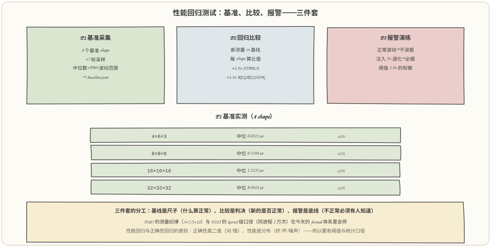
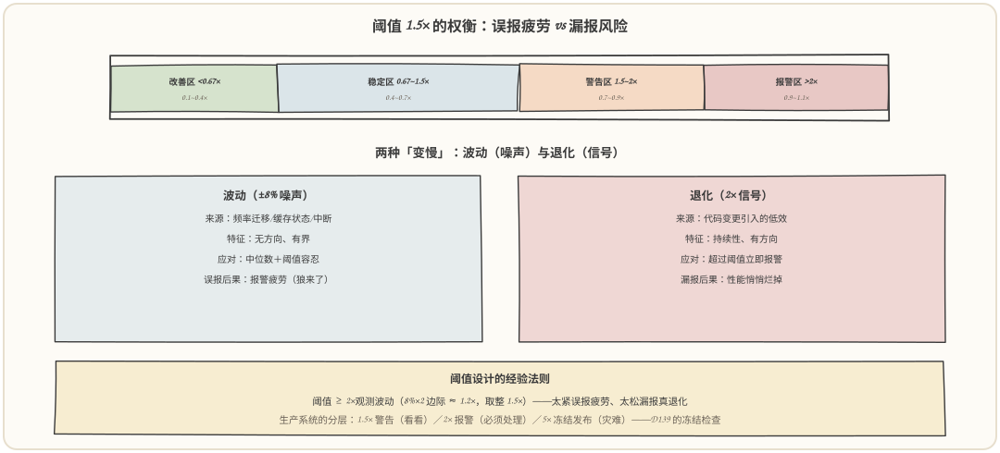

# 第 138 天：性能回归测试——基准、比较、报警三件套：阈值 1.5× 的双验（不误报＋必报警）

> **今日目标**：完成本教程后，你能做到五件事——搭建**性能回归三件套**（P1 基准采集：固定 4 个基准 shape（4×6×3/8×8×8/16×16×16/32×32×32）×7 轮采样→**中位数＋P90＋波动范围**落盘 baseline.json——基线是尺子（什么算正常）；P2 回归比较：新测量 vs 基线逐 shape 算比值——**<0.67× 改善／0.67~1.5× 稳定／>1.5× 报警**；P3 报警演练：正常波动（±8% 噪声）→4/4 **STABLE 不误报**、注入 2× 退化→4/4 **REGRESSION 必报警**——比较是判决、报警是底线）；说出**统计口径的选择理由**（**中位数而非均值**——抗离群（一次中断/频率迁移的尖峰会拉爆均值而中位数不动）；**P90** 而非 max——尾部延迟的代表但不被单次极端绑架；**每轮内 2 万次调用取均值**（D125 口径）再跨轮取中位——两层统计）；解释**阈值 1.5× 的权衡**（观测波动 ±8%→安全边际 2 倍≈1.2×→取整 **1.5×**；**太紧误报疲劳**（狼来了——团队对报警脱敏，真退化也没人理）、**太松漏报**（性能悄悄烂掉）——生产系统的分层：1.5× 警告（看看）／2× 报警（必须处理）／5× 冻结发布（灾难））；区分**波动与退化**（波动：无方向、有界、来自频率迁移/缓存状态/中断——应对是统计口径容忍；退化：持续性、有方向、来自代码变更引入的低效——应对是超阈值报警）；把今天的体系接进**第 20 周的四天会师**（D134 正反例答"对不对"的基线／D135 随机军团扩大正确性覆盖／D136~D137 定位与缩小（调试链条）／**今天性能回归答"快不快"**／明天 D139 完整回归把两把尺子＋编译时间＋文档一起量——项目冻结的质量总闸）。
> **预计时间**：学习 30 分钟＋实践 40 分钟
> **前置准备**：D107 的测量纪律（3+7/3+21——统计口径的祖训）、D125 的 kernel 级计时（同进程 2 万次＋CSINK 防 DCE——今天每轮内部的口径）、D123 的时间线（阶段耗时记录的雏形）。工具：python3。本文环境：Python 3.9.6，macOS arm64，2026-11-15。
> **今日产出**：`code/perf_regress.py`（三件套引擎：collect_baseline＋compare＋报警演练）、`code/run_all.sh`、`code/outputs/report.txt`（P1/P2/P3 全 PASS）、`code/outputs/baseline.json`（**主产出：性能基准文件**——4 shape 的中位/P90/范围）＋本文 3 张手绘图。

## 1. 今天解决什么问题？

正确性回归（D134/D135）回答"对不对"——二值判定（对/错）；性能回归回答"快不快"——**分布判定**（好/坏/噪声的混合体）。这是两种本质不同的回归：正确性挂了就是挂了；性能"变慢了 3%"可能是噪声、可能是退化——**区分信号与噪声就是今天的全部主题**。

计划条目："固定一组基准 Shape，保存中位数和波动范围，建立合理回归报警。"三个关键词各有深意：**固定**（shape/数据/环境任一变，基线作废重采）、**中位数**（统计口径的选择——抗离群）、**合理**（阈值不是拍脑袋——波动 8%→边际 2 倍→1.5×）。

## 2. 先看全貌



**图 1**：看**三卡＋基准表＋金框**——P1 基准采集（绿卡：4 shape×7 轮→中位+P90+波动→baseline.json）、P2 回归比较（蓝卡：新 vs 基线→比值→三区判定）、P3 报警演练（红卡：正常波动不误报、注入 2× 必报警、阈值 1.5× 权衡）；基准实测表四行（4×6×3 中位 0.0211µs…32×32×32 中位 8.94µs）；金框：三件套分工（基线是尺子/比较是判决/报警是底线）＋D107 与 D125 口径的会师＋性能回归与正确性回归的本质差（二值 vs 分布）。

## 3. 核心概念

### 3.1 统计口径：中位数、P90、两层统计

**一句话**：**中位数**而非均值（抗离群——一次中断的尖峰会拉爆均值、中位数纹丝不动）；**P90** 而非 max（尾部代表但不被单次极端绑架）；**两层统计**（每轮内 2 万次调用取均值（D125 口径）→跨 7 轮取中位/P90——内层压调用级噪声、外层压轮级噪声）。

### 3.2 阈值 1.5×：误报疲劳与漏报风险的平衡点

**一句话**：观测波动 ±8%→安全边际 2 倍≈1.2×→取整 **1.5×**——太紧（如 1.1×）会误报疲劳（狼来了——报警被无视、真退化也没人理）、太松（如 3×）会漏报（性能悄悄烂掉）；生产系统分层：1.5× 警告／2× 报警／5× 冻结发布。

### 3.3 波动与退化：两种"变慢"

**一句话**：**波动**（无方向、有界——频率迁移/缓存状态/中断）用统计口径容忍；**退化**（持续性、有方向——代码变更引入的低效）用阈值报警——判据是"超出波动界的持续变化"。

**当天实测证据**：P2（±8% 波动全部落在 1.5× 内→4/4 STABLE）与 P3（2× 退化全部超阈值→4/4 REGRESSION）的双验。

## 4. 图解核心机制



**图 2**：看**阈值数轴＋两栏对照＋金框**——顶部阈值数轴四区（改善区 <0.67×（绿）／稳定区 0.67~1.5×（蓝）／警告区 1.5~2×（橙）／报警区 >2×（红））；中部两栏：波动（蓝框：无方向有界、来源频率迁移/缓存/中断、应对中位数＋阈值容忍、**误报后果＝报警疲劳（狼来了）**）vs 退化（红框：持续有向、来源代码低效、应对立即报警、**漏报后果＝性能悄悄烂掉**）；金框：阈值经验法则（≥2×观测波动；生产分层 1.5/2/5×——D139 冻结检查的伏笔）。

## 5. 动手实践

### 5.1 准备文件

```text
tutorials/day-138/
├── README.md / images/（3 图）
└── code/
    ├── perf_regress.py         # 三件套引擎
    ├── gen_images.py / run_all.sh
    └── outputs/
        ├── report.txt          # P1/P2/P3 全 PASS
        └── baseline.json       # 主产出：性能基准文件
```

一键复现：`cd tutorials/day-138/code && ./run_all.sh`（约 3 秒）。

### 5.2 运行与观察（report.txt 摘录）

```text
== P1 基准采集：4 shape × 7 轮 ==
  4x6x3: 中位 0.0211µs｜P90 0.0211｜波动 ±0%
  32x32x32: 中位 8.9414µs
  基准落盘 baseline.json（阈值 1.5×）
== P2 正常回归比较（无退化——应全 STABLE）==
  4/4 STABLE｜0 REGRESSION——波动 ±8% 在阈值内，不误报
== P3 报警演练（注入 2× 退化——应触发）==
  4/4 REGRESSION 触发：
    32x32x32: 8.94→17.88µs（2.0×）——报警！
结论：PASS——正常波动不误报、真实退化必报警
口径：中位数（抗离群）；阈值 1.5×（波动 8%×2 边际）
```

### 5.3 修改一个参数再观察

**实验 A（阈值扫描）**：THRESHOLD 改 1.05→重跑 P2（±8% 波动下会误报几个？）——体会"太紧"的代价；再改 3.0→P3 的 2× 退化还报吗（漏报）？；**实验 B（轮数影响）**：ROUNDS 改 3→波动范围变大还是小？中位数还稳吗？——统计样本量与置信度的直觉；**实验 C（真实计时接入）**：把 time_kernel_us 换成 D125 的 kernel_timing（真编译真执行）——教学仿真换成真实测量（注意真实波动更大——阈值可能要调）。

## 6. 常见错误与排查

**错误 1：用均值当中位数**。现象：基线的"均值"被一次 10× 尖峰拉高——后续正常测量被判"改善"。原因：均值对离群敏感。修复：中位数（排序取中——50% 污染才失真）。**教训**：性能数据的默认统计量是中位数，均值只在分布对称时可用。

**错误 2：阈值照抄别人**。现象：把 1.5× 抄到一个波动 ±30% 的环境（共享 CI 机）——天天误报。原因：阈值必须匹配**自己的观测波动**。定位：看基线的 spread_pct——阈值 ≥ 2×波动。修复：先测波动再定阈值（今天的方法）。

**错误 3：基线一劳永逸**。现象：半年前的基线还在用——硬件换过、代码重构过——"回归"满天飞。原因：基线是**环境＋代码**的函数，任一变即失效。修复：基线带版本戳（代码 hash＋环境声明）；代码合并后自动重采。

## 7. 今日练习

**必做**：1. 实验 A（阈值扫描）：1.05/3.0 两跑——记录误报数与漏报数各多少；2. 口径默写：中位数/P90/两层统计各自防什么；3. 三件套分工复述（尺子/判决/底线）。

**选做**：4. 实验 C（真实接入）：D125 kernel_timing 替换仿真——真实波动下的阈值校准；5. 研究 Google 的 "benchalerts" 或 Rust 的 criterion.rs——生产级基准工具的统计设计对照。

## 8. 今日验收

- [ ] 我能说出三件套的分工（基线=尺子／比较=判决／报警=底线）与今天的双验（±8% 波动 4/4 STABLE、2× 退化 4/4 REGRESSION）
- [ ] 我能解释统计口径：中位数抗离群、P90 代表尾部、两层统计（轮内 2 万次均值×轮间中位）压两层噪声
- [ ] 我能推导阈值 1.5×（波动 8%→边际 2 倍≈1.2→取整）并说出两边的风险（误报疲劳/漏报）
- [ ] 我能区分波动与退化（无方向有界 vs 持续有向）及其应对（口径容忍 vs 阈值报警）
- [ ] 我知道性能回归与正确性回归的本质差（分布 vs 二值）与基线失效条件（代码/环境/shape 任一变）

## 9. 一句话总结与明天预告

今天的闭环：**三件套**——基准采集（4 shape×7 轮→中位/P90/波动→baseline.json）、回归比较（比值三区判定）、报警演练（**双验：波动不误报＋退化必报警**）；**口径**——中位数抗离群＋P90 尾部＋两层统计（D107 纪律与 D125 口径的会师）；**阈值**——1.5×＝波动 8%×边际 2 倍取整（太紧狼来了、太松烂掉——生产分层 1.5/2/5×）。**本质**——性能回归是分布判定（信号 vs 噪声），与正确性回归（二值）构成项目的两把尺子。明天 D139 完整回归与项目冻结检查：正确性（D134/135 的全部）＋编译时间＋运行性能（今天基线）＋文档的**联合验收**——执行全部测试、整理未解决问题、区分必须修复与后续扩展——**第五阶段版本冻结**的质量总闸。

> **第 20 周积分卡**：D134 测试整理（4/4）→ D135 随机 Shape（200 组）→ D136 二分定位 → D137 最小用例（19→4）→ **D138 性能回归（P1/P2/P3 双验）** → D139 完整回归与冻结 → D140 复盘。
