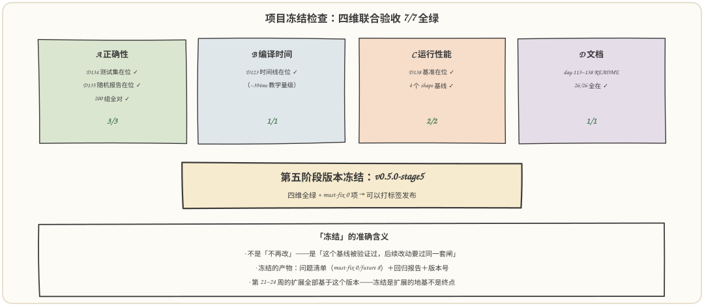
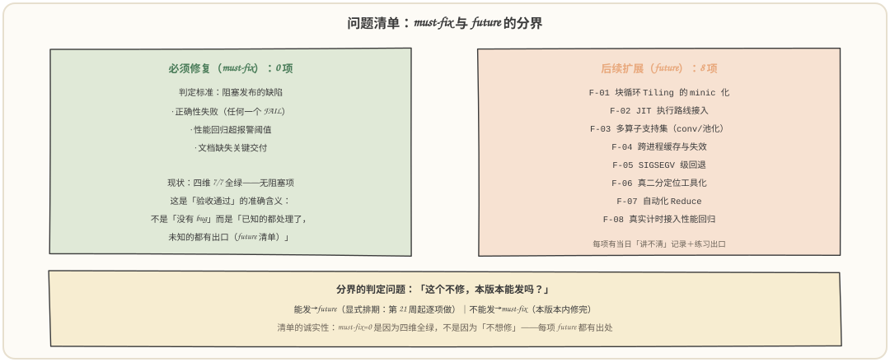

# 第 139 天：完整回归与项目冻结检查——四维联合验收 7/7：v0.5.0-stage5 冻结

> **今日目标**：完成本教程后，你能做到五件事——执行**四维联合验收**（A 正确性：D134 测试集在位＋D135 随机报告在位＋200 组全对（3/3）／B 编译时间：D123 时间线在位（~394ms 教学量级）（1/1）／C 运行性能：D138 基准在位＋4 shape 基线（2/2）／D 文档：day-113~138 的 README **26/26 全在**（1/1）——**合计 7/7 全绿**）；发布**问题清单**并说清 **must-fix 与 future 的分界**（判定问题："这个不修，本版本能发吗？"——能发→future（显式排期）；不能发→must-fix（本版本内修完）——今天 must-fix **0 项**（四维全绿）、future **8 项**（块循环 Tiling/JIT 接入/多算子/跨进程缓存/SIGSEGV 回退/真二分/自动 Reduce/真实计时——每项有当日"讲不清"记录与练习出口）；解释**"冻结"的准确含义**（不是"不再改"——是"**这个基线被验证过，后续改动要过同一套闸**"；冻结的产物＝问题清单＋回归报告＋版本号 v0.5.0-stage5；第 21~24 周的扩展全部基于此版本——**冻结是扩展的地基不是终点**）；总结**"验收通过"的准确含义**（不是"没有 bug"而是"**已知的都处理了、未知的都有出口**（future 清单）"——must-fix=0 是因为四维全绿，不是因为"不想修"）；预览**冻结之后的四周路线**（第 21 周扩展方向（从 future 清单选主目标）→第 22 周性能归因（慢用例→分解→瓶颈→有依据的优化→反例）→第 23 周项目整理（架构图/Pass 文档/Lowering 文档/测试文档/性能材料/复现）→第 24 周面试转化（六天标准回答＋20 分钟模拟讲解＋最终验收））。
> **预计时间**：学习 25 分钟＋实践 35 分钟
> **前置准备**：第 17~19 周的全部产物（四维验收的引用链）、D134~D138 的五天测试建设（今天总闸的对象）、D126 的干净重建经验（引用冻结产物的口径）。工具：python3。本文环境：Python 3.9.6，macOS arm64，2026-11-15。
> **今日产出**：`code/freeze_check.py`（四维验收引擎：correctness/compile_time/performance/docs 四检）、`code/run_all.sh`、`code/outputs/report.txt`（**7/7 全绿**）、`code/outputs/issue-list.txt`（**主产出：问题清单**——must-fix 0／future 8）＋本文 3 张手绘图。

## 1. 今天解决什么问题？

第 20 周前五天建完了质量体系（正反集/随机/定位/最小用例/性能回归）——计划 D139 条目要求"执行全部测试，整理未解决问题，区分必须修复和后续扩展；产出回归报告、问题清单和第五阶段版本"——**质量总闸日**。

总闸的设计：四维各查"有没有＋过没过"（正确性 3 项/编译时间 1 项/性能 2 项/文档 1 项）——维度不全的验收是偏科的（只查正确性会放过性能衰退、只查性能会放过文档缺失）。结果 7/7 全绿、must-fix 为空——**冻结发布 v0.5.0-stage5**。

## 2. 先看全貌



**图 1**：看**四卡＋冻结条＋金框**——A 正确性（绿卡 3/3：D134 测试集/D135 报告/200 组全对）、B 编译时间（蓝卡 1/1：D123 时间线）、C 运行性能（橙卡 2/2：D138 基准＋4 shape）、D 文档（紫卡 1/1：26/26 README）；中部金条"**第五阶段版本冻结：v0.5.0-stage5**——四维全绿＋must-fix 0 项→可以打标签发布"；底部金框"冻结"的准确含义（不是不再改——是基线被验证过、后续改动要过同一套闸；第 21~24 周的扩展全部基于此版本——**冻结是扩展的地基不是终点**）。

## 3. 核心概念

### 3.1 四维验收：缺一不可的质量观

**一句话**：正确性（对不对）＋编译时间（构建体验）＋运行性能（快不快）＋文档（能不能被他人理解）——四个维度各有裁判、任何一维缺失的验收都是偏科（真实的发布事故常在"没查的那一维"）。

### 3.2 must-fix 与 future：一个判定问题

**一句话**：每条待办问一句"**这个不修，本版本能发吗？**"——能发→future（显式排期：第 21 周起逐项做）；不能发→must-fix（本版本内修完）——**清单的诚实性**：must-fix=0 是因为四维全绿，不是因为"不想修"；每项 future 都有出处（当天的"讲不清"记录）。

### 3.3 冻结：验证过的基线，不是终点

**一句话**：冻结的含义是"**这个基线被验证过，后续改动要过同一套闸**"——冻结产物（问题清单＋回归报告＋版本号）是第 21~24 周扩展的地基；扩展期间发现的新问题按同一分界进清单。

## 4. 图解核心机制



**图 2**：看**左右两框＋金框**——左绿框 must-fix（0 项）：判定标准（阻塞发布的缺陷：正确性失败/性能超阈值/文档缺关键交付）＋现状（四维 7/7 全绿无阻塞）＋"验收通过"的准确含义（**不是没有 bug 而是已知的都处理了、未知的都有出口**）；右橙框 future（8 项）：F-01 块循环 Tiling／F-02 JIT 接入／F-03 多算子／F-04 跨进程缓存／F-05 SIGSEGV 回退／F-06 真二分／F-07 自动 Reduce／F-08 真实计时——每项注明"有当日讲不清记录＋练习出口"；金框：分界判定问题＋清单诚实性。

## 5. 动手实践

### 5.1 准备文件

```text
tutorials/day-139/
├── README.md / images/（3 图）
└── code/
    ├── freeze_check.py         # 四维验收引擎
    ├── gen_images.py / run_all.sh
    └── outputs/
        ├── report.txt          # 7/7 全绿
        └── issue-list.txt      # 主产出：问题清单
```

一键复现：`cd tutorials/day-139/code && ./run_all.sh`（约 3 秒）。

### 5.2 运行与观察

```text
第 139 天：完整回归与项目冻结检查——四维联合验收
[A 正确性]  [PASS] D134 测试集在位／D135 随机报告在位／200 组全对
[B 编译时间]  [PASS] D123 时间线在位（总 ~394ms 教学量级）
[C 运行性能]  [PASS] D138 基准文件在位／基准含 4 个 shape
[D 文档]  [PASS] README 覆盖 day-113~138：26/26
四维合计：7/7
问题清单已生成 issue-list.txt（must-fix 0 项 / future 8 项）
第五阶段版本冻结：v0.5.0-stage5（质量总闸通过）
```

三组观察：**①引用式验收**——四维不重跑测试而是引用上游冻结产物（D134/D135/D123/D138 的 outputs/）——总闸验证"证据链完整"而非重做实验（重跑是 D126 干净重建的活）；**②must-fix=0 的来之不易**——第 19 周的 40 项＋第 20 周的连续建设才有今天的零阻塞；**③future 8 项的出处**——每项都能指到某天的"讲不清"清单——**已知未知是路线图不是负债表**。

### 5.3 修改一个参数再观察

**实验 A（故意破坏一维）**：删掉 day-135 的 outputs/report.txt 再跑总闸——D 维度应 FAIL（7→6/7）——体会"总闸真的会拦"；**实验 B（must-fix 演练）**：往项目里注入一个已知 bug（如 D136 的 fadd→fsub）不修——按判定问题它该进 must-fix 还是 future？（must-fix——正确性阻塞）；**实验 C（版本号语义）**：给 v0.5.0 写一行 changelog（本周新增了什么）——版本号冻结的配套物。

## 6. 常见错误与排查

**错误 1：验收维度偏科**。现象：只跑正确性就宣称"验收通过"——性能早烂了没人知道。修复：四维齐查（今天的框架）；**教训**：事故常在没查的那一维。

**错误 2：future 清单变垃圾场**。现象：什么不想做都丢 future——三个月后清单 50 项没人看。修复：future 也要有出处与排期（今天的 8 项各配"哪天的讲不清＋哪周做"）；**教训**：清单的价值在**可信**——每项都能答"为什么还没做、什么时候做"。

**错误 3：冻结后随意改**。现象：冻结标签打了、第二天直接 push 一个"小改动"——闸门形同虚设。修复：冻结后的改动要走同一套四维（改动→重跑总闸→绿了才合入）；**教训**：冻结是流程不是仪式。

## 7. 今日练习

**必做**：1. 实验 A（破坏一维）：删一个上游产物看总闸拦截；2. must-fix/future 的判定问题复述＋两个自造例子各归哪类；3. future 8 项与出处的对应默写（挑 4 项）。

**选做**：4. 实验 C（changelog）：给 v0.5.0 写五行变更日志；5. 研究 Git tag＋Release 的工作流（真实项目的冻结操作）。

## 8. 今日验收

- [ ] 我能说出四维验收的维度与今天的 7/7（正确性 3/编译时间 1/性能 2/文档 1）＋每维的裁判
- [ ] 我能解释 must-fix 与 future 的判定问题（"这个不修能发吗"）与今天的 0/8 分布及其诚实性
- [ ] 我知道冻结的准确含义（基线被验证过、后续改动过同一套闸）与产物三件（清单/报告/版本号）
- [ ] 我能复述"验收通过"的含义（已知的都处理了、未知的都有出口——不是没有 bug）
- [ ] 我能预览第 21~24 周路线（扩展方向/性能归因/项目整理/面试转化）与 future 清单的对接

## 9. 一句话总结与明天预告

今天的闭环：**四维联合验收**——正确性（D134/D135 引用链 3/3）＋编译时间（D123 时间线 1/1）＋性能（D138 基准 2/2）＋文档（26/26 README 1/1）＝**7/7 全绿**；**问题清单**——must-fix 0（四维全绿无阻塞）＋future 8（每项有出处与排期）；**冻结**——v0.5.0-stage5：基线被验证过、后续改动过同一套闸——**冻结是第 21~24 周扩展的地基不是终点**。明天 D140 第 20 周复盘：按计划"脱稿演示一次失败→Dump IR→关闭 Pass→最小复现→修复的流程"——本周五天（金字塔/随机/二分/最小用例/回归）串成一条**调试流水线**的完整演示＋每周模板账本。

> **第 20 周积分卡**：D134 测试整理（4/4）→ D135 随机 Shape（200 组）→ D136 二分定位 → D137 最小用例（19→4）→ D138 性能回归（双验）→ **D139 完整回归与冻结（7/7，v0.5.0）** → D140 复盘（明天）。
