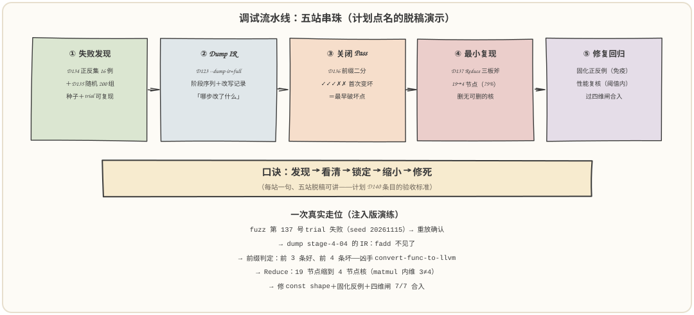
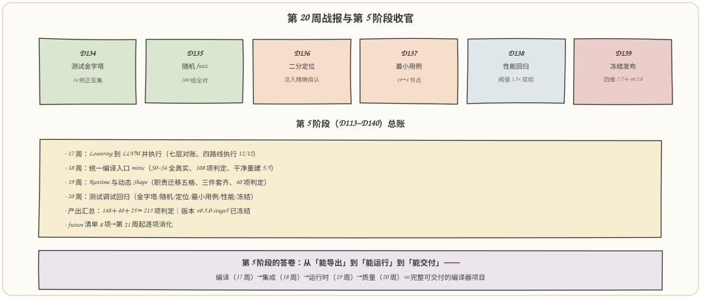

# 第 140 天：第 20 周复盘——调试流水线五站串珠：发现→看清→锁定→缩小→修死

> **今日目标**：完成本教程后，你能做到五件事——**脱稿演示调试流水线**（计划条目原话："失败→Dump IR→关闭 Pass→最小复现→修复"——五站串珠：①失败发现（D134 正反集＋D135 随机军团；种子＋trial 可复现）→②Dump IR（D123 的 --dump-ir=full：阶段序列＋改写记录——"哪步改了什么"一眼可查）→③关闭 Pass／二分定位（D136：判定序列 ✓✓✓✗✗ 的首次变坏点＝最早语义破坏点）→④最小复现（D137 Reduce 三板斧：19→4 节点、删无可删的核）→⑤修复回归（固化正反例免疫＋性能复核＋过四维闸合入）——**口诀：发现→看清→锁定→缩小→修死**）；用**一次真实走位**串五站（注入版演练：fuzz 第 137 号 trial 失败（seed 20261115）→重放确认→dump stage-4-04 发现 fadd 不见→前缀判定前 3 好/前 4 坏锁定 convert-func-to-llvm→Reduce 到 4 节点核（内维 3≠4）→修 const shape＋固化反例＋四维 7/7 合入）；出**第 20 周账本**（每周模板十问——核心问题"调试的核心是什么：怎么从一个失败走到一条可提交的修复"；根因：失败是表象（深层链里的 matmul 错）、修复要根源——中间隔着看清→锁定→缩小三步）；总结**第 5 阶段（D113~D140）四周总账**（17 周 Lowering 到执行（七层对账、四路线 12/12）／18 周统一入口 minic（S0~S6 全真实、108 项）／19 周 Runtime 与动态 Shape（五格迁移、三件套、40 项）／20 周质量体系（金字塔/随机/定位/最小用例/性能/冻结）——**总计 ≈213 项判定、版本 v0.5.0-stage5 冻结、future 8 项待第 21 周消化**——第 5 阶段的答卷：**从"能导出"到"能运行"到"能交付"**）；预告**第 21 周扩展方向**（默认选择"动态 Shape＋自动调度"轻量组合——承接 D128 动态签名＋D129 特化分发＋future F-01 块循环 Tiling 这最后一块；纪律："只选择一个主目标，写清输入、输出、完成标准和**明确不做的内容**——范围失控是扩展周的第一死因"）。
> **预计时间**：学习 25 分钟＋实践 35 分钟
> **前置准备**：本周六天的全部产出（五站各自的工具）、D139 的冻结版本（扩展的地基）、每周复盘模板。工具：python3。本文环境：Python 3.9.6，macOS arm64，2026-11-15。
> **今日产出**：`code/week20_review.py`（流水线文本＋账本生成＋自检）、`code/outputs/debug-pipeline.txt`（**主产出：调试流程图文本版**——五站各配工具与口诀）、`code/outputs/week-ledger.txt`（每周模板账本）＋本文 3 张手绘图。

## 1. 今天解决什么问题？

第 20 周六天各造了一件工具（金字塔/随机/定位/最小用例/回归/冻结）——复盘日的任务是把它们**串成一条线**：计划 D140 条目点名"脱稿演示一次失败→Dump IR→关闭 Pass→最小复现→修复的流程"。单独看每件工具都会用不难；难的是**知道什么时机用哪件、上一件的输出怎么接下一件的输入**——流水线视角正是为此。

串好之后的第二件事是**第 5 阶段收官**：四周（17~20 周）从 Lowering 到执行、到统一入口、到 Runtime、到质量体系——一个完整可交付的编译器项目长成了；版本冻结 v0.5.0。第三件事是**预演第 21 周**：扩展方向的选择与"范围失控是第一死因"的警告。

## 2. 先看全貌：调试流水线



**图 1**：看**五站卡＋口诀条＋走位演示**——五站：①失败发现（D134 正反集 16 例＋D135 随机 200 组——种子＋trial 可复现）→②Dump IR（D123 --dump-ir=full——阶段序列＋改写记录）→③关闭 Pass（D136 前缀二分——✓✓✓✗✗ 首次变坏＝最早破坏点）→④最小复现（D137 Reduce——19→4 节点、删无可删）→⑤修复回归（固化免疫＋性能复核＋四维闸合入）；金条口诀：**发现→看清→锁定→缩小→修死**（每站一句、五站脱稿可讲）；底部走位演示五行（注入版真实串联：fuzz 137 号→dump 见 fadd 消失→前缀锁定 convert-func→Reduce 到 4 节点→修＋固化＋合入）。

## 3. 核心概念

### 3.1 流水线思维：工具的时机与接口

**一句话**：五件工具单独都会用≠会调试——**调试能力是"知道什么时机用哪件、上件的输出怎么接下件的输入"**：失败发现给出"种子＋trial"→Dump 用它重放并定位可疑阶段→二分在该阶段内锁定凶手 pass→Reduce 把凶手的用例缩到核→修复把核固化成免疫——**每站的输出恰好是下一站的输入**（流水线的接口设计）。

### 3.2 第 5 阶段的答卷：能导出→能运行→能交付

**一句话**：四周的能力台阶——17 周"能导出"（七层 Lowering＋四路线执行 12/12）、18 周"能集成"（minic 一条命令 S0~S6）、19 周"能运行时"（动态 Shape＋三件套）、20 周"能交付"（质量体系＋冻结）——**≈213 项判定背书、v0.5.0 冻结、future 8 项显式排期**。

## 4. 图解核心机制



**图 2**：看**六天卡＋阶段总账＋底部金框**——六天卡（D134 金字塔 16 例/D135 随机 200 组/D136 定位注入指认/D137 最小 19→4/D138 回归双验/D139 冻结 v0.5.0）；总账六行（17 周 Lowering 到执行／18 周统一入口 108 项／19 周 Runtime 五格迁移 40 项／20 周质量体系／合计 ≈213 项判定＋v0.5.0 冻结／future 8 项→第 21 周消化）；金框：**第 5 阶段的答卷——从"能导出"到"能运行"到"能交付"**（编译→集成→运行时→质量＝完整可交付的编译器项目）。

## 5. 动手实践

### 5.1 准备文件

```text
tutorials/day-140/
├── README.md / images/（3 图）
└── code/
    ├── week20_review.py        # 流水线＋账本
    ├── gen_images.py / run_all.sh
    └── outputs/
        ├── debug-pipeline.txt  # 主产出：调试流程图（五站文本版）
        ├── week-ledger.txt     # 每周账本
        └── report.txt          # 自检 3/3
```

一键复现：`cd tutorials/day-140/code && ./run_all.sh`（约 2 秒）。

### 5.2 修改一个参数再观察

**实验 A（脱稿测试）**：合上全部材料，对着白板讲五站（每站一句作用＋一件工具名＋一个本周实测数字）——卡壳的站重读当天 README；**实验 B（阶段复盘）**：四周各用一句话总结"这周把什么从不能变成了能"（17 周：IR 从文件变进程；18 周：零件从散装变整机器；19 周：shape 从常量变参数；20 周：质量从口号变闸门）。

## 6. 常见错误与排查

**错误 1：复盘只列工具不串流程**。现象：周报六天各一段（工具说明书复读）——没有"什么时机用哪件"的主线。修复：先写口诀再填站（今天的方法——主线先行）。

**错误 2：阶段总结写成数字堆砌**。现象：'213 项判定、26 个 README……'——数字多但说不出"能力台阶"。修复：每阶段一句"把什么从不能变成能"（图 2 底部金框的四句）。

## 7. 今日练习

**必做**：1. 实验 A（脱稿五站）：白板讲一遍＋每站配数字；2. 四周"从不能到能"四句默写；3. 第 21 周纪律三问（唯一目标是什么/完成标准是什么/明确不做什么）。

**选做**：4. 给流水线画时序版流程图（一个 bug 从发现到合入的时间轴）；5. 预写第 21 周的"明确不做清单"（范围失控的防火墙）。

## 8. 今日验收

- [ ] 我能脱稿讲五站流水线（发现→看清→锁定→缩小→修死）＋每站的工具与本周实测数字
- [ ] 我能用一次走位（fuzz 137→dump→前缀→Reduce→修复）把五站串成故事
- [ ] 我能说出第 5 阶段四周各自"把什么从不能变成能"＋总账（≈213 项、v0.5.0、future 8）
- [ ] 我知道第 21 周的默认扩展方向（动态 Shape＋自动调度）与范围纪律（唯一目标/完成标准/明确不做）

## 9. 一句话总结与明天预告

今天的闭环：**五站串珠**——调试流水线脱稿可讲（发现（金字塔＋随机）→看清（dump）→锁定（二分）→缩小（Reduce）→修死（免疫＋回归＋闸）——**每站的输出是下一站的输入**）；**第 5 阶段收官**——四周能力台阶（能导出→能集成→能运行时→能交付）＋≈213 项判定＋v0.5.0 冻结＋future 8 项；**下周预告**——第 21 周扩展方向：冻结之上的第一个迭代（默认"动态 Shape＋自动调度"轻量组合），纪律三问开路（唯一目标/完成标准/明确不做——**范围失控是扩展周的第一死因**）。明天 D141 确定唯一扩展目标：比较动态 Shape、INT8、Conv、自动调优的岗位相关性与实现成本——**只选一个**、写清输入/输出/完成标准/明确不做——扩展周的第一天先学会说"不"。

> **第 5 阶段收官**：17 周 Lowering（四路线 12/12）→ 18 周 minic（108 项）→ 19 周 Runtime（40 项）→ 20 周质量（冻结 v0.5.0）。下一站：第 21 周扩展方向。
