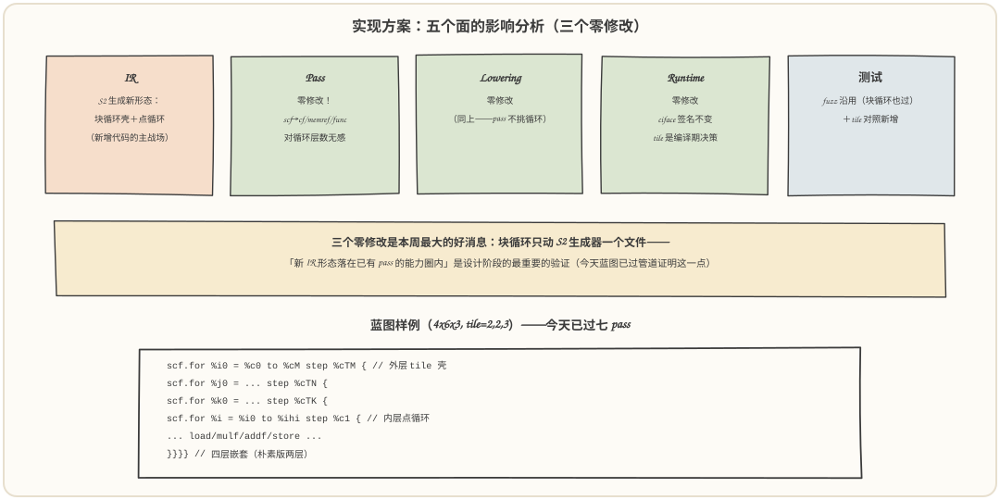
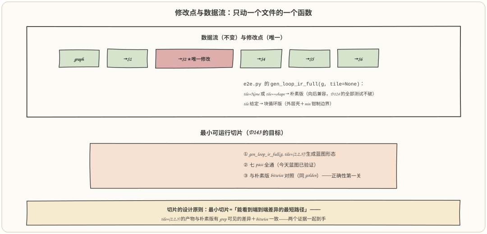

# 第 142 天：设计实现方案——三个零修改：块循环只动 S2 一个文件（蓝图已过管道）

> **今日目标**：完成本教程后，你能做到五件事——完成**五面影响分析**（IR：S2 生成新形态（块循环壳＋点循环）——新增代码的主战场；**Pass：零修改**（scf→cf/memref/func 对循环层数无感）；**Lowering：零修改**（同上）；**Runtime：零修改**（ciface 签名不变——tile 是编译期决策不进运行时）；测试：fuzz 沿用＋tile 对照新增——**三个零修改是本周最大的好消息**：新 IR 形态落在已有 pass 的能力圈内）；**验证蓝图合法性**（手写块循环 IR 样例（4×6×3、tile=2,2,3：外层 i0/j0/k0 步长=tile 的三层壳＋内层点循环）→**七 pass 全通**——"设计阶段的最重要的验证：形态合法才能进施工"）；画出**修改点与数据流**（数据流不变（graph→S1→S2→S4→S5→S6）；**唯一修改点**：e2e.py 的 `gen_loop_ir_full(g, tile=None)`——tile=None 或 tile==shape 走朴素版（**向后兼容，D124 的全部测试不破**）、tile 给定走块循环版（外层壳＋min 钳制边界））；定义**最小可运行切片**（①gen_loop_ir_full 生成蓝图形态→②七 pass 全通（今天已验）→③与朴素版 bitwise 对照——**最小切片＝能看到端到端差异的最短路径**：tile 版产物与朴素版有 grep 可见的差异＋bitwise 一致——两个证据一起到手）；定好**三线测试计划**（正确性线（D135 fuzz 沿用——任何 tile 组合与朴素版等价；不过不谈性能）；边界线（三个极端：tile=(1,1,1) 退化＝朴素／tile=shape 单块／tile>shape 钳制生效——**极端 tile 不许崩**）；性能线（D146 验收：kernel_timing 对照——教学规模预期差异小、**反例是合法结果**（D153 伏笔）））。
> **预计时间**：学习 25 分钟＋实践 40 分钟
> **前置准备**：D141 的一页设计（今天展开成施工图）、D124 的朴素版生成器（修改的基线）、D90 的 min 钳制语义（块循环边界的出处）、D117 的七 pass（蓝图验证的管道）。工具：python3＋mlir-opt。本文环境：Python 3.9.6＋Homebrew LLVM 23.1.5，macOS arm64，2026-11-15。
> **今日产出**：`code/design_impl.py`（五面分析＋蓝图验证＋施工图）、`code/run_all.sh`、`code/outputs/report.txt`（4 项自检全 PASS）、`code/outputs/plan.txt`（**主产出：实现方案施工图**）、`code/outputs/blueprint.mlir`（块循环蓝图——**已过七 pass**）＋本文 3 张手绘图。

## 1. 今天解决什么问题？

D141 选定了块循环 Tiling——今天把它从一页设计展开成**施工图**：影响哪些文件、数据流怎么走、最小切片是什么、测试怎么排。计划条目："分析扩展对 IR、Pass、Lowering、Runtime 和测试的影响；画出修改点和数据流，先定义最小可运行切片。"

今天最重要的发现是**三个零修改**（Pass/Lowering/Runtime 全不用动）——这不是运气是设计红利：块循环用的还是 scf.for（只是多两层），全部已有 pass 对循环层数无感。**验证方式不是推理而是实测**：手写蓝图 IR 跑七 pass——全通——"新形态落在已有能力圈内"的设计验证完成。这意味着本周的全部新代码集中在 **S2 生成器一个文件的一个函数**——修改面最小化是扩展周的黄金开局。

## 2. 先看全貌：五个面的影响



**图 1**：看**五卡＋金框＋蓝图**——IR（橙：S2 新形态——主战场）；Pass／Lowering／Runtime（三绿卡：**零修改**——pass 对循环层数无感、ciface 签名不变）；测试（蓝：fuzz 沿用＋对照新增）；金框：三个零修改＝"新 IR 形态落在已有 pass 的能力圈内"（今天蓝图已过管道证明）；底部蓝图代码框（四层嵌套的块循环样例——外层 tile 壳三层＋内层点循环，今天已过七 pass）。

## 3. 核心概念

### 3.1 蓝图先行：形态合法才施工

**一句话**：扩展设计的第一步不是写代码——是**手写目标形态的 IR 样例并跑通管道**（蓝图验证）：形态合法（pass 吃得下）才有施工资格；蓝图跑不通说明设计要改（比如需要新 pass——成本翻倍）。

**当天实测证据**：blueprint.mlir 过七 pass 全通——块循环形态合法、施工放行。

### 3.2 修改面最小化：一个文件一个函数

**一句话**：三个零修改的代价结构——本周全部新代码在 `gen_loop_ir_full(g, tile)` 一个函数里；tile=None 走旧路径（**向后兼容**：D124 的测试一行不改照跑）、tile 给定走新路径——**新旧路径同函数、旧路径零风险**。

### 3.3 最小切片：两个证据一起到手

**一句话**：最小可运行切片的标准——**能看到端到端差异的最短路径**：tile=(2,2,3) 的产物与朴素版有 grep 可见的差异（证明"tile 生效了"）＋bitwise 一致（证明"没改错"）——**差异与正确性两个证据一次拿到**。

## 4. 图解核心机制



**图 2**：看**数据流＋切片卡＋金框**——顶部数据流（graph→S1→**S2 ★唯一修改**（红框高亮）→S4→S5→S6——其余全绿零修改）；中部函数签名（`gen_loop_ir_full(g, tile=None)`：tile=None 或 ==shape →朴素版（向后兼容）／tile 给定→块循环版（外层壳＋min 钳制））；切片卡三行（①生成蓝图形态→②七 pass 全通（已验）→③与朴素版 bitwise 对照）；金框：切片设计原则——**最小切片＝"差异可 grep＋正确性 bitwise"两个证据的最短路径**。

## 5. 动手实践

### 5.1 准备文件

```text
tutorials/day-142/
├── README.md / images/（3 图）
└── code/
    ├── design_impl.py         # 五面分析＋蓝图验证
    ├── e2e.py 等（D124 同款，明天的修改对象）
    ├── gen_images.py / run_all.sh
    └── outputs/
        ├── report.txt / plan.txt（施工图）
        └── blueprint.mlir（蓝图——已过七 pass）＋ s0~s7 中间产物
```

一键复现：`cd tutorials/day-142/code && ./run_all.sh`（约 5 秒——含蓝图过管道）。

### 5.2 运行与观察

```text
== 蓝图验证：块循环 IR 能否过七 pass 管道 ==
  PASS：蓝图形态合法，七 pass 全通
施工图已生成 plan.txt
  [PASS] 蓝图过管道／五面影响分析／修改点明确／测试计划三类
```

### 5.3 修改一个参数再观察

**实验 A（蓝图变形）**：把蓝图的内层点循环边界写死（不做钳制）——还能过管道吗？（能——但正确性在边界 tile 时崩——**形态合法≠语义正确**，蓝图只验前者）；**实验 B（tile 参数扫描）**：蓝图的 %cTM 改 1/4/8——七 pass 都过（形态与 tile 值无关——**参数合法性独立于具体值**，D143 的生成器因此可以自由参数化）。

## 6. 常见错误与排查

**错误 1：跳过蓝图直接写生成器**。现象：生成器写完才发现某形态 pass 不吃——返工半天。修复：**手写蓝图先过管道**（今天的方法——五分钟的前置验证省半天的返工）。

**错误 2：破坏向后兼容**。现象：改了 gen_loop_ir_full 的默认行为——D124 的测试悄悄变红。修复：tile=None 走旧路径（签名加默认参数——**旧调用零变化**）。

**错误 3：测试计划只有正确性**。现象：周三发现 tile=(1,1,1) 崩了没测、周五发现性能没法对照。修复：今天定三线（正确性/边界/性能）——**计划先于实现**。

## 7. 今日练习

**必做**：1. 实验 A（蓝图变形）：不钳制的蓝图过管道但语义错——写两句"形态合法与语义正确的分界"；2. 三线测试计划默写＋各自的一票否决权（正确性否决一切/边界不许崩/性能反例合法）；3. 修改面清单背出（一个文件一个函数＋三个零修改）。

**选做**：4. 给蓝图加 bias/relu 尾巴（完整复刻 D124 语义）——D143 的完整版预习；5. 比较 TVM 的 TensorIR tile 语法与今天的 scf.for 壳——真实 DSL 的表达力对照。

## 8. 今日验收

- [ ] 我能背出五面影响（IR 动／Pass·Lowering·Runtime 零修改／测试沿用＋新增）与"零修改"的验证方式（蓝图过管道）
- [ ] 我知道蓝图先行的意义：形态合法才施工——五分钟验证省半天返工
- [ ] 我能画出修改点数据流（S2 ★唯一修改＋tile=None 向后兼容）与最小切片的三步
- [ ] 我能复述三线测试计划（正确性门/边界墙/性能窗——反例是合法结果）
- [ ] 我理解"形态合法≠语义正确"（蓝图验前者、bitwise 验后者）

## 9. 一句话总结与明天预告

今天的闭环：**五面分析**——IR 动（S2 新形态）／**Pass·Lowering·Runtime 三个零修改**（pass 对循环层数无感——新形态落在已有能力圈内）；**蓝图验证**——手写块循环样例过七 pass 全通（形态合法、施工放行）；**修改面**——`gen_loop_ir_full(g, tile=None)` 一个函数（tile=None 向后兼容、D124 测试零破坏）；**最小切片**——差异可 grep＋bitwise 一致（两个证据一次到手）；**三线测试**——正确性门/边界墙/性能窗。明天 D143 实现最小正向路径：把今天的蓝图变成**生成器代码**（gen_loop_ir_full 的 tile 分支：外层壳＋min 钳制＋内层点循环）——跑通"tile=(2,2,3) 生成→七 pass→与朴素版 bitwise 对照"的完整切片。

> **第 21 周积分卡**：D141 唯一目标（4/4）→ **D142 实现方案（4/4，蓝图过管道）** → D143 最小正向 → D144 约束与失败 → D145 集成 → D146 验收 → D147 复盘。
