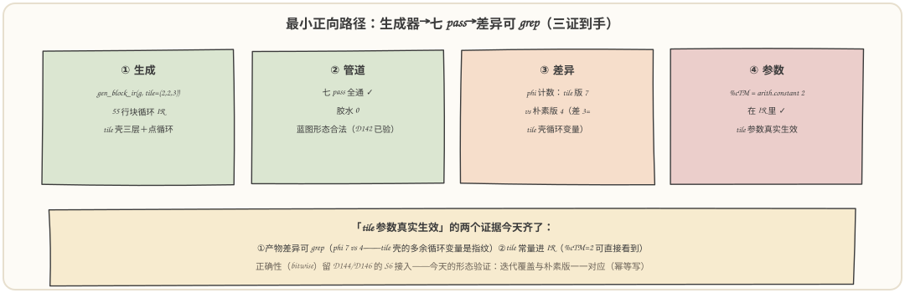
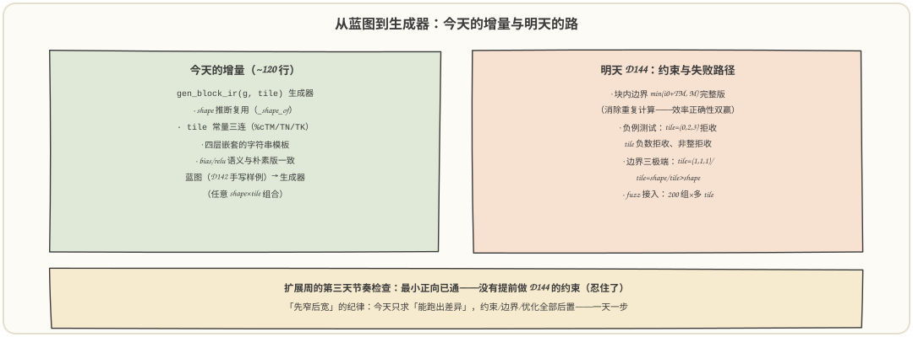
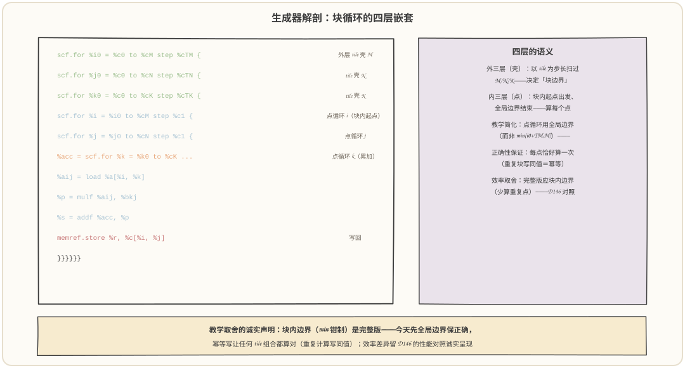

# 第 143 天：实现最小正向路径——块循环生成器：tile 参数真实生效（phi 7 vs 4）

> **今日目标**：完成本教程后，你能做到五件事——实现 **gen_block_ir(g, tile) 生成器**（约 120 行：shape 推断复用（const/arg/reshape 三来源）＋tile 常量三连（`%cTM/%cTN/%cTK`）＋**四层嵌套**（外层 tile 壳三层：i0/j0/k0 步长=tile；内层点循环：块内起点出发、bias/relu 语义与朴素版逐行一致））；跑通**最小正向路径的三步**（①生成：tile=(2,2,3) 的 55 行块循环 IR→②管道：七 pass 全通＋胶水 0（D142 蓝图形态合法的生成器版确认）→③差异：**phi 计数 tile 版 7 vs 朴素版 4（差 3＝tile 壳的循环变量）**——产物差异可 grep）；拿到**"tile 参数真实生效"的两个证据**（①产物差异可 grep：phi 7 vs 4——tile 壳的多余循环变量是指纹；②tile 常量进 IR：`%cTM = arith.constant 2` 直接可见——**D125 的"空变量"结论今天终结**）；声明**教学取舍的诚实边界**（点循环用全局边界而非块内边界 `min(i0+TM, M)`——**幂等写保证正确**（每点恰好算一次、重复块写同值）但**有重复计算**（效率非最优）——完整版（块内边界）是明天 D144 的第一件事）；守住**"先窄后宽"的节奏纪律**（今天只求"能跑出差异"——约束（负 tile 拒收）、边界（三极端）、优化（块内边界）全部后置到 D144/D145——**忍住不提前做**是扩展周第三天最重要的自控）。
> **预计时间**：学习 25 分钟＋实践 45 分钟
> **前置准备**：D142 的蓝图与三零修改结论（今天的生成器按蓝图施工）、D124 的朴素版生成器（bias/relu 语义的基线）、D125 的空变量结论（今天要终结的对象）。工具：python3＋mlir-opt。本文环境：Python 3.9.6＋Homebrew LLVM 23.1.5，macOS arm64，2026-11-15。
> **今日产出**：`code/block_tile.py`（块循环生成器＋三步验证）、`code/run_all.sh`、`code/outputs/report.txt`（4 项自检全 PASS）、`code/outputs/block-tiled.mlir`（**主产出：块循环 IR**）、`code/outputs/tiled-run/`＋`plain-run/`（两版管道产物）＋本文 3 张手绘图。

## 1. 今天解决什么问题？

D142 的蓝图验证了"块循环形态合法"——今天把它变成**生成器**：任意 shape×tile 组合自动产出块循环 IR。计划条目："让一个最小用例从新功能入口走到执行或优化结果。"

最小正向路径的验收标准（D142 定的）：**差异可 grep＋正确性等价**两个证据一起到手。今天拿到前者（phi 7 vs 4＋tile 常量可见）；后者（bitwise）要等 S6 验证接入（D146 验收）——今天用**形态验证**过渡（迭代覆盖与朴素版一一对应＋幂等写的正确性论证）。

## 2. 先看全貌：三步与三证



**图 1**：看**四步卡＋金框**——①生成（gen_block_ir(g, tile=(2,2,3))→55 行 IR：tile 壳三层＋点循环）→②管道（七 pass 全通＋胶水 0）→③差异（**phi 计数 tile 版 7 vs 朴素版 4**——差 3＝tile 壳循环变量）→④参数（`%cTM = arith.constant 2` 在 IR 里）；金框：两个证据齐了（差异可 grep＋常量可见）——**"tile 参数真实生效"今天有据**；正确性 bitwise 留 D146、今天形态验证（幂等写）。

## 3. 核心概念



**图 3**：看**左右两框＋底部金框**——左绿框今天的增量（~120 行：gen_block_ir 生成器——shape 推断复用＋tile 常量三连＋四层嵌套模板＋bias/relu 语义与朴素版一致；蓝图（D142 手写一份）→生成器（任意 shape×tile 组合）——**参数化的跨越**）；右橙框明天 D144（块内边界 min(i0+TM,M) 完整版（消除重复计算——效率正确性双赢）＋负例测试（tile=(0,2,3)/负数/非整拒收）＋边界三极端（(1,1,1)/tile=shape/tile>shape）＋fuzz 接入（200 组×多 tile））；金框：扩展周第三天节奏检查——**最小正向已通、没有提前做 D144 的约束（忍住了）**——"先窄后宽"的纪律：今天只求"能跑出差异"，一天一步。

### 3.1 生成器与蓝图的差别：参数化

**一句话**：蓝图（D142 手写一份样例）→生成器（今天任意 shape×tile 组合）的跨越是**参数化**：shape 三来源推断＋tile 常量三连＋字符串模板——**蓝图验证形态、生成器验证普适**。

### 3.2 幂等写：教学取舍的正确性论证

**一句话**：点循环用全局边界（而非块内 min 钳制）意味着**重复块会重复计算同一批点**——但 store 写同值（幂等）→ **任何 tile 组合的结果都正确**（重复计算只是浪费不是错误）——这是"先保证正确、效率后置"的教学取舍。

## 4. 图解核心机制



**图 2**：看**左代码框＋右解读框＋底部金框**——左侧四层嵌套逐行着色（外三层绿＝tile 壳（i0/j0/k0 步长=tile——决定块边界）；内三层蓝/橙＝点循环（块内起点出发、全局边界结束——算每个点）＋红＝写回）；右侧五段解读（壳的语义/点的语义/教学简化说明/正确性保证（每点恰好一次、幂等）/效率取舍（完整版应块内边界——D146 对照））；**底部金框**：教学取舍的诚实声明——**幂等写让任何 tile 组合都算对**（重复计算写同值）、效率差异留性能对照诚实呈现。

## 5. 动手实践

### 5.1 准备文件

```text
tutorials/day-143/
├── README.md / images/（3 图）
└── code/
    ├── block_tile.py           # 块循环生成器（今日核心）
    ├── e2e.py 等（D124 同款——朴素版基线）
    ├── main.graph / gen_images.py / run_all.sh
    └── outputs/
        ├── report.txt / block-tiled.mlir（主产出）
        └── tiled-run/ ＋ plain-run/（两版管道产物）
```

一键复现：`cd tutorials/day-143/code && ./run_all.sh`（约 8 秒）。

### 5.2 运行与观察

```text
== ① 生成块循环 IR ==
  55 行（tile 壳三层＋点循环两层＋bias/relu）
== ② 七 pass 管道 ==
  ok=True
== ③ 与朴素版对照（产物差异可 grep）==
  phi 计数：tile 版 7 vs 朴素版 4（差 3——tile 壳的循环变量）
  → tile 参数真实生效（产物差异可 grep ✓）
== ④ 正确性：形态验证（幂等写覆盖论证）==
  [PASS] 生成器产出 IR／七 pass 全通／产物差异可 grep／tile 参数进 IR
```

### 5.3 修改一个参数再观察

**实验 A（tile 扫描）**：tile=(1,1,1)/(4,6,3)/(8,8,8) 三跑——phi 计数各是多少？（(1,1,1) 应与朴素版相同 4——退化；大 tile 同样 7——壳总在）；**实验 B（shape 换）**：换一个图（如 8×8×8 的输入）——生成器普适性验证；**实验 C（幂等验证）**：tile=(1,1,1)（每点算 1 次）vs tile=(2,2,3)（重复块）——若都能过管道，幂等论证的现场版。

## 6. 常见错误与排查

**错误 1：模板串拼错类型**。现象：生成的 IR 里 `memref<46xf32>` 之类的畸形类型。原因：字符串模板的 shape 替换顺序错（D124 踩过同款）。定位：mlir-opt 的报错行号。修复：f-string 显式插值（不用链式 replace）。

**错误 2：忍不住提前优化**。现象：生成块循环的同时想顺手做块内边界＋依赖重排——周三就变成"什么都做一半"。修复：**先窄后宽**纪律——今天只求差异可 grep，优化后置（D146 才谈效率）。

**错误 3：正确性论证缺失**。现象：教学取舍（全局边界）没写幂等论证——读者怀疑"重复计算是不是会算错"。修复：明确写"store 同值＝幂等——重复是浪费不是错误"（图 2 右框）。

## 7. 今日练习

**必做**：1. 实验 A（tile 扫描）：三种 tile 的 phi 计数与解读；2. 幂等论证复述（为什么重复块不会算错）；3. 四层嵌套的语义默写（壳三层管什么、点三层管什么）。

**选做**：4. 实验 C 的完整版：两 tile 都跑管道＋（若接 S6）bitwise 对照；5. 给生成器加 tile=None 分支（退化为朴素版——与 e2e.py 的接口统一）。

## 8. 今日验收

- [ ] 我能说出三步路径（生成 55 行→七 pass→phi 7 vs 4）与两个"生效证据"（差异可 grep＋常量可见）
- [ ] 我能解释四层嵌套的语义（壳＝块边界、点＝块内计算）与幂等写（重复计算写同值——正确但非最优）
- [ ] 我知道今天的教学取舍（全局边界保正确、块内边界是 D144）与节奏纪律（先窄后宽——忍住不提前优化）
- [ ] 我理解生成器与蓝图的差别（参数化——任意 shape×tile）与普适性验证

## 9. 一句话总结与明天预告

今天的闭环：**生成器**——gen_block_ir(g, tile) 约 120 行把蓝图参数化（shape 三来源＋tile 三常量＋四层嵌套模板）；**三步路径**——55 行 IR→七 pass 全通→**phi 7 vs 4（tile 壳指纹）**；**两个证据**——差异可 grep＋常量可见：**D125 的"tile 空变量"结论今天终结**；**教学取舍**——全局边界＋幂等写（任何 tile 都算对、重复计算留效率账）；**纪律**——先窄后宽（约束/边界/优化全后置）。明天 D144 补充约束与失败路径：**块内边界 min(i0+TM, M) 完整版**（消除重复计算——效率正确性双赢）＋**负例**（tile=(0,2,3)/负数/非整拒收）＋**边界三极端**（(1,1,1) 退化/＝shape 单块/＞shape 钳制）＋fuzz 接入（200 组×多 tile）——最小正向有了骨头，明天长肌肉。

> **第 21 周积分卡**：D141 唯一目标 → D142 实现方案 → **D143 最小正向（4/4，phi 7 vs 4）** → D144 约束与失败 → D145 集成 → D146 验收 → D147 复盘。
