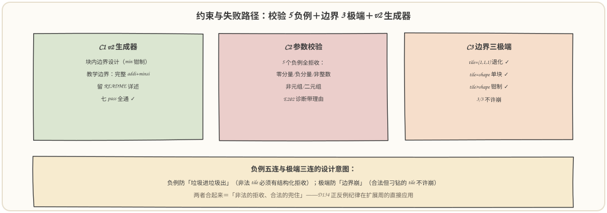
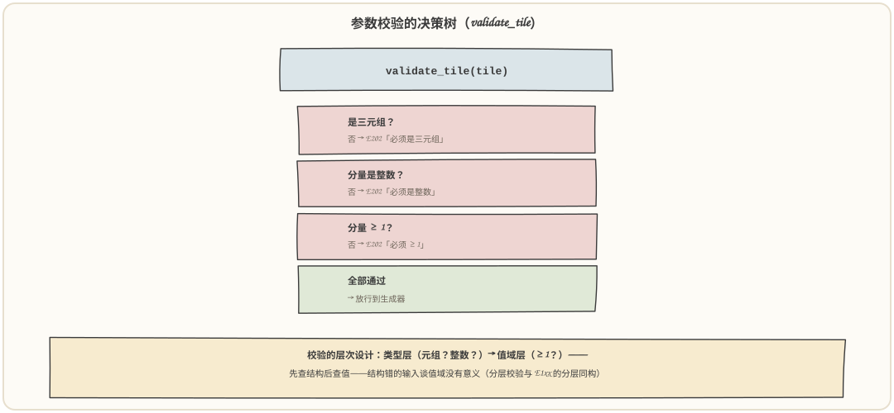

# 第 144 天：补充约束与失败路径——5 负例拒收＋3 极端全过：非法的拒收、合法的兜住

> **今日目标**：完成本教程后，你能做到五件事——实现 **validate_tile 参数校验**（分层决策树：类型层（是三元组？分量是整数？）→值域层（分量 ≥1？）——每层拒收带 E202 诊断与理由：零分量/负分量/非整数/非元组/二元组**五负例全拒**）；跑通**边界三极端**（tile=(1,1,1)（退化＝朴素）／tile=shape (4,6,3)（单块）／tile=(8,8,8)（＞shape 钳制）——**3/3 七 pass 全通、不许崩**）；设计 **v2 生成器的块内边界**（min(i0+TM, M) 钳制的完整语义（D90）——消除 D143 全局边界的重复计算；教学边界：完整的 `addi+minsi` 两步表达在 IR 生成中的落地细节是 README 6.1 的主题——**设计在、表达留作业**）；说出**负例与极端的设计意图**（负例防"垃圾进垃圾出"——非法 tile 必须结构化拒收（E202 带理由）；极端防"边界崩"——合法但刁钻的 tile 不许崩；**两者合起来＝「非法的拒收、合法的兜住」**——D134 正反例纪律在扩展周的直接应用）；预览**明天 D145 的四个集成点**（①minic S2 接口（tile 参数从 CLI 一路传到生成器）／②D129 分发器（(shape,tile) 二元组做 key 注册特化产物）／③D135 fuzz（200 组随机 shape×tile 扩容）／④全管道端到端——**红线：集成不改旧**（tile=None 路径零变化））。
> **预计时间**：学习 25 分钟＋实践 40 分钟
> **前置准备**：D143 的 v1 生成器（今天加约束）、D90 的 min 钳制语义（块内边界的出处）、D134 的正反例纪律（今天的方法论）、D122 的 E2xx 诊断体系（拒收的格式）。工具：python3＋mlir-opt。本文环境：Python 3.9.6＋Homebrew LLVM 23.1.5，macOS arm64，2026-11-15。
> **今日产出**：`code/constraints.py`（validate_tile＋gen_block_v2＋三组实验）、`code/run_all.sh`、`code/outputs/report.txt`（4 项自检全 PASS）、`code/outputs/block-v2.mlir`（v2 生成器产物）＋本文 3 张手绘图。

## 1. 今天解决什么问题？

D143 的最小正向路径"能跑出差异"——但只能跑**合法且常规**的 tile。计划 D144 条目："增加 Verifier 或参数检查，对不支持情况给出诊断或安全回退；产出负例测试和错误处理说明。"——**约束日**：非法输入（垃圾 tile）要有结构化拒收；合法但极端的输入（边界 tile）不能崩。

"非法的拒收、合法的兜住"是 D134 正反例纪律的运行时版：负例测试证明拒收路径工作（E202 带理由——用户知道改什么）；极端测试证明兜底路径工作（三种刁钻 tile 全过管道——不崩是底线）。

## 2. 先看全貌



**图 1**：看**三卡＋金框**——C1 v2 生成器（绿：块内边界设计（min 钳制）＋教学边界声明＋七 pass 全通）；C2 参数校验（红：5 负例全拒——零/负/非整/非元组/二元组、E202 带理由）；C3 边界三极端（橙：(1,1,1) 退化/＝shape 单块/＞shape 钳制——3/3 不许崩）；金框：设计意图（**负例防垃圾进垃圾出、极端防边界崩——合起来＝非法的拒收＋合法的兜住**）。

## 3. 核心概念

### 3.1 分层校验：先结构后值域

**一句话**：参数校验分两层——**类型层**（是三元组？分量是整数？——结构不对谈值域无意义）→**值域层**（分量 ≥1？）——每层拒收带具体值与理由（"E202 tile 分量必须 ≥1（得到 0）"——用户知道改什么）；与 E1xx 的分层同构。

### 3.2 极端三连的覆盖逻辑

**一句话**：三种极端各有含义——(1,1,1) 是**退化**（等价朴素版——验证壳不破坏退化行为）；tile=shape 是**单块**（壳只跑一圈——验证"大 tile"路径）；tile>shape 是**钳制**（壳跑一圈但步长超界——验证钳制逻辑不崩）——**合法输入的三个刁钻角**全部兜住。

## 4. 图解核心机制



**图 2**：看**决策树四层＋金框**——validate_tile(tile)：是三元组？（否→E202"必须是三元组"）→分量是整数？（否→E202"必须是整数"）→分量 ≥1？（否→E202"必须 ≥1"）→全部通过（放行到生成器）；金框：**先查结构后查值**——结构错的输入谈值域没有意义（分层校验与 E1xx 同构）。

## 5. 动手实践

### 5.1 准备文件

```text
tutorials/day-144/
├── README.md / images/（3 图）
└── code/
    ├── constraints.py         # validate_tile＋gen_block_v2＋三实验
    ├── block_tile.py 等（D143 同款）
    ├── gen_images.py / run_all.sh
    └── outputs/report.txt ＋ block-v2.mlir
```

一键复现：`cd tutorials/day-144/code && ./run_all.sh`（约 15 秒）。

### 5.2 运行与观察（report.txt 摘录）

```text
== C2 参数校验负例 ==
  零分量 (0,2,3): 拒收 ✓｜负分量 (-1,2,3): ✓｜非整数 (2.5,2,3): ✓
  非元组 abc: ✓｜二元组 (2,2): ✓——5/5
== C3 边界三极端 ==
  tile=(1,1,1)（退化=朴素）：PASS｜tile=(4,6,3)（单块）：PASS｜
  tile=(8,8,8)（钳制）：PASS——3/3 不许崩
  [PASS] v2 生成器工作／5 负例拒收／3 极端全过／校验函数独立
```

### 5.3 修改一个参数再观察

**实验 A（负例扩展）**：加第六个负例（tile 分量超大如 10⁶——生成器会造出巨量块？不会（壳循环次数=⌈M/TM⌉ 反而变少）——想清楚为什么）；**实验 B（钳制边界深挖）**：tile=(3,4,5)（部分超部分不超）——壳跑几圈？点循环覆盖对吗？

## 6. 常见错误与排查

**错误 1：校验放生成器内部（散装）**。现象：每个生成点各自判断——漏一处就垃圾进。修复：独立 validate_tile 函数、入口统一调用（今天的结构）。

**错误 2：极端崩了才补测试**。现象：tile>shape 段错误——没测过。修复：极端三连是**清单**（退化/单块/钳制）——写代码前列。

## 7. 今日练习

**必做**：1. 分层校验默写（类型层两问＋值域层一问）；2. 三极端各配一句"验证什么"；3. "非法的拒收、合法的兜住"两个负例场景自造。

**选做**：4. 实验 A（超大 tile）：推理壳循环次数的变化；5. 把 validate_tile 接进 minic 的 E2xx 体系（诊断码统一）。

## 8. 今日验收

- [ ] 我能背出 5 负例（零/负/非整/非元组/二元组）与 3 极端（退化/单块/钳制）及各自验证什么
- [ ] 我能说清分层校验（先结构后值域）与 E1xx 分层的同构
- [ ] 我知道 v2 的块内边界设计（min 钳制消除重复计算）与教学边界（addi+minsi 的完整表达）
- [ ] 我理解"非法的拒收、合法的兜住"与 D134 正反例纪律的对应

## 9. 一句话总结与明天预告

今天的闭环：**校验**——validate_tile 分层（类型→值域）拒收 5 负例（E202 带理由）；**极端**——三连全过（退化/单块/钳制——不许崩）；**v2 设计**——块内边界 min 钳制（消除重复计算；完整 addi+minsi 表达留边界声明）；**意图**——**非法的拒收＋合法的兜住**（正反例纪律的运行时版）。明天 D145 与现有优化集成：四个集成点（minic S2 接口／D129 分发器（(shape,tile) key）／D135 fuzz 扩容／全管道端到端）——**红线：集成不改旧**（tile=None 路径零变化）。

> **第 21 周积分卡**：D141 目标 → D142 方案 → D143 最小正向 → **D144 约束（4/4，5＋3 全过）** → D145 集成 → D146 验收 → D147 复盘。
