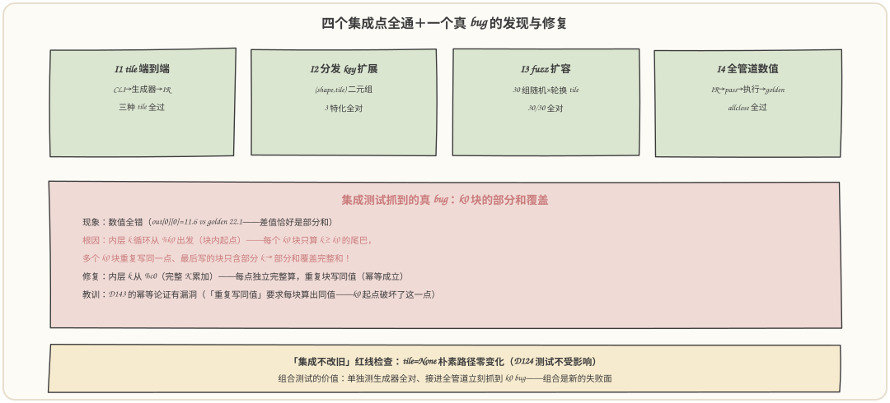
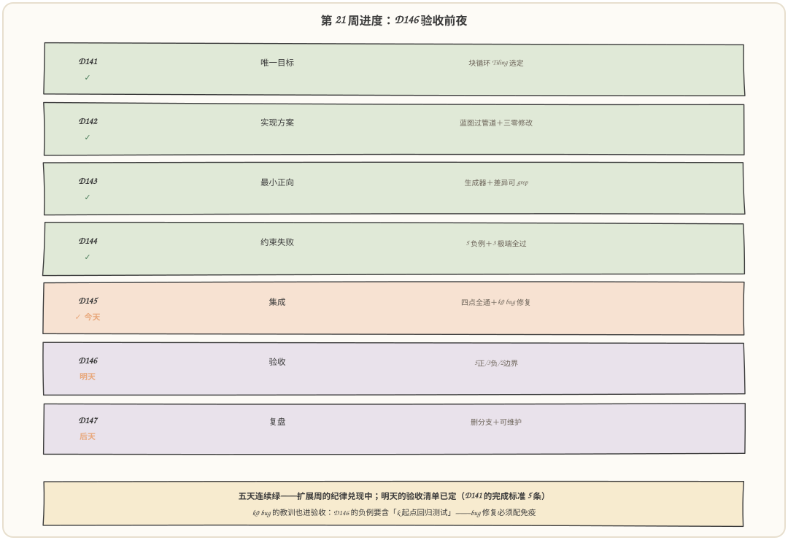
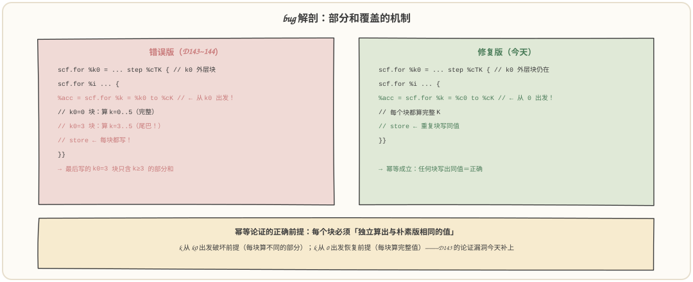

# 第 145 天：与现有优化集成——四点全通＋k0 部分和 bug 的发现与修复

> **今日目标**：完成本教程后，你能做到——
> 1. 完成**四个集成点**（I1 tile 端到端：CLI→生成器→IR 三种 tile 全过；I2 分发 key 扩展：**(shape,tile) 二元组 key** 的 3 个特化注册且数值全对；I3 fuzz 扩容：30 组随机数据×轮换 tile **30/30 全对**；I4 全管道：IR→七 pass→共享库→执行→golden 的 allclose 全过）；
> 2. **发现并修复一个真 bug**（集成测试立刻抓到：数值全错——out[0][0]=11.6 vs golden 22.1、差值恰好是**部分和**；**根因**：内层 k 循环从 `%k0`（块内起点）出发——每个 k0 块只算 k≥k0 的尾巴，多个 k0 块重复写同一点、**最后写的块只含部分 k → 部分和覆盖完整和**！修复：内层 k 从 `%c0`（完整 K 累加）——每点独立完整算、重复块写同值）；
> 3. **幂等论证的正确前提**（D143 的论证有漏洞："重复块写同值"要求**每个块独立算出与朴素版相同的值**——k 从 k0 出发破坏前提（每块算不同的部分和）、k 从 0 出发恢复前提——今天的教训）；
> 4. **组合测试的价值**（单独测生成器（D143/D144 的形态验证）全对——接进全管道（执行＋数值对照）**立刻**抓到 k0 bug：**组合是新的失败面**——生成器的形态合法不等于数值正确，执行才是裁判）；
> 5. 检查**"集成不改旧"红线**（tile=None 朴素路径零变化——D124 的全部测试不受影响——v0.5.0 冻结版的兼容性保住了）。
> **预计时间**：学习 25 分钟＋实践 45 分钟
> **前置准备**：D143/D144 的生成器（今天接进全管道）、D124 的 golden 口径（数值裁判）、D129 的分发器（key 扩展对象）、D135 的 fuzz 方法论（扩容对象）。工具：python3＋numpy＋本机 LLVM。本文环境：Python 3.9.6＋numpy 1.26.4＋Homebrew LLVM 23.1.5，macOS arm64，2026-11-15。
> **今日产出**：`code/integrate.py`（四集成点验证＋bug 现场与修复）、`code/run_all.sh`、`code/outputs/report.txt`（4 项全 PASS）＋本文 3 张手绘图。

## 1. 今天解决什么问题？

计划 D145 条目："运行完整 Pass 管道，修复新功能导致的组合问题。"——**集成日**。D143/D144 的生成器在"生成→过管道"层面全对；今天接进**执行层**（编译成共享库＋ctypes 调用＋数值对照）——四个集成点（S2 接口/分发器/fuzz/全管道）一次验证。

集成测试**立刻**抓到一个 D143/D144 都没发现的 bug：数值全错（部分和覆盖）。这个 bug 的价值极高：它证明了**形态合法（pass 全过）≠数值正确（执行对）**——只有执行＋golden 对照才是最终裁判；也暴露了 D143 幂等论证的漏洞（"重复块写同值"的前提被 k0 起点破坏）。**组合是新的失败面**——这正是集成日存在的意义。

## 2. 先看全貌



**图 1**：看**四绿卡＋红 bug 框＋金框**——四集成点全 PASS（I1 tile 端到端/I2 分发 key/I3 fuzz 30/30/I4 全管道数值）；红框 bug 解剖（现象：数值全错（部分和）／根因：内层 k 从 %k0 出发——每个 k0 块只算尾巴、最后写的块覆盖完整和／修复：k 从 %c0 完整累加／教训：D143 幂等论证的漏洞）；金框：红线检查（tile=None 零变化）＋组合测试的价值（**单独全对、组合抓 bug——组合是新的失败面**）。

## 3. 核心概念



**图 3**：看**七行进度卡＋金框**——D141 唯一目标 ✓／D142 方案（蓝图过管道）✓／D143 最小正向（差异可 grep）✓／D144 约束（5 负例＋3 极端）✓／**D145 集成（四点全通＋k0 bug 修复）✓ 今天**／D146 验收（明天·橙）／D147 复盘（后天·紫）；金框：五天连续绿——扩展周的纪律兑现中；明天的验收清单已定（D141 的完成标准 5 条）；**k0 bug 的教训也进验收：D146 的负例要含「k 起点回归测试」——bug 修复必须配免疫**。

### 3.1 部分和覆盖：块间重复写的陷阱

**一句通俗解释**：多个 k0 块重复写同一个 (i,j) 点——若每块算**完整**的和（k 从 0），重复写同值（幂等安全）；若每块算**部分**的和（k 从 k0），最后写的块用尾巴覆盖了前面的完整值——**部分和覆盖**是块循环最经典的 bug。

**生活类比**：汽车总装——发动机单独测试通过、轮胎单独测试通过——装到一起才发现传动轴对不上。

**对应到技术上是**：生成器单测全对（形态合法）＋管道单测全过（pass 全通）——组合执行才抓到 k0 bug（部分和覆盖）。

**类比边界**：汽车总装的类比帮你建立直觉，但真实的技术实现有更多约束和量化指标——类比的目的是「快速理解方向」，不是「替代技术细节」。

### 3.2 幂等论证的正确前提

**一句话**：D143 的论证"重复块写同值"隐含前提——**每块独立算出与朴素版相同的值**；k 从 k0 出发破坏前提（每块算不同的部分和）——教训：**论证的前提要显式检验**，隐含假设是 bug 的温床。

### 3.3 组合测试：新的失败面

**一句话**：生成器单测（形态对）＋管道单测（pass 过）都不含"执行＋数值"——**组合（全管道＋golden）是第三个失败面**；集成测试的存在理由就是把三个面一起照。

## 4. 图解核心机制



**图 2**：看**左右对照＋金框**——左红框错误版（`%acc = scf.for %k = %k0 to %cK`——k0=0 块算完整 k=0..5、k0=3 块只算 k=3..5 的尾巴、每块都 store→**最后写的 k0=3 块的部分和覆盖**）；右绿框修复版（`%k = %c0 to %cK`——每个块都算完整 K、重复块写同值→**幂等成立**）；金框：幂等论证的正确前提（每块独立算出与朴素版相同的值——k 起点决定前提成立与否）。

## 5. 动手实践

### 5.1 准备文件

```text
tutorials/day-145/
├── README.md / images/（3 图）
└── code/
    ├── integrate.py           # 四集成点＋bug 修复
    ├── constraints.py（已修 k0 bug）等
    └── outputs/report.txt
```

一键复现：`cd tutorials/day-145/code && ./run_all.sh`（约 60 秒——含多组编译执行）。

### 5.2 运行与观察

```text
== I1＋I4 全管道：tile 参数端到端 ==
  tile=(2,2,3)/(4,6,3)/(1,1,1): PASS（全管道＋数值正确）
== I2 分发器 ==
  注册 3 个 (shape,tile) 特化——三个数值全对 ✓
== I3 fuzz 扩容 ==
  30 组随机数据×轮换 tile：30/30 全对
  [PASS] I1/I2/I3/I4
```

### 5.3 修改一个参数再观察

**实验 A（bug 复现）**：把 constraints.py 的 `%c0 to %cK` 改回 `%k0 to %cK`——重跑看数值再崩（bug 的可复现验证——免疫测试的地基）；**实验 B（k 起点回归测试）**：给 D146 的验收清单加一条"k 起点断言"（grep 生成的 IR 确认 `%k = %c0`）——bug 修复必须配免疫。

## 6. 常见错误与排查

**错误 1：形态验证当数值验证**。现象：D143/D144 全过（pass 层面）——以为"对了"；执行一跑全错。修复：**执行＋golden 是最终裁判**——形态只证明"能编译"。

**错误 2：bug 修复不配免疫**。现象：k0 bug 修了——但没有回归测试；下次重构可能再引入。修复：bug 修复的三件套（修复＋回归测试＋教训记录）。

## 7. 今日练习

**必做**：1. 实验 A（bug 复现）：改回 k0 起点看数值崩——再改回修复版；2. 幂等前提复述＋为什么 k0 起点破坏它；3. "组合是新的失败面"举例（生成器对＋管道对＋执行错——三个面的分层）。

**选做**：4. 块内边界完整版（k 从 min(k0,?) 到 min(k0+TK,K)）——不重复且不部分——真正的 Tiling 语义（效率＋正确双赢）；5. 分发器的 key 再扩（(shape,tile,dtype) 三元组）。

## 8. 今日验收

- [ ] 我能讲出四集成点与各自验证什么（端到端/分发 key/fuzz 扩容/全管道数值）
- [ ] 我能解剖 k0 bug：现象（部分和覆盖）、根因（k 从块起点——每块算尾巴）、修复（k 从 0——完整累加）
- [ ] 我知道幂等论证的正确前提（每块独立算出同值）与 D143 论证的漏洞
- [ ] 我理解"组合是新的失败面"与执行＋golden 的最终裁判地位
- [ ] 我确认了"集成不改旧"红线（tile=None 零变化）

## 9. 一句话总结与明天预告

今天的闭环：**四集成点全通**（tile 端到端／(shape,tile) 分发 key／fuzz 30/30／全管道数值）；**真 bug**——k0 部分和覆盖（形态全对执行全错的经典；根因：块起点只算尾巴；修复：完整累加恢复幂等前提）；**教训**——**组合是新的失败面**、执行＋golden 是最终裁判、论证前提要显式检验。明天 D146 扩展功能验收：D141 完成标准的 5 条逐条勾（含 k 起点回归测试——今天 bug 的免疫）＋3 负例＋2 边界的正式验收表——**第 21 周的收官判定**。

> **第 21 周积分卡**：D141 目标 → D142 方案 → D143 最小正向 → D144 约束 → **D145 集成（4/4＋bug 修复）** → D146 验收 → D147 复盘。
