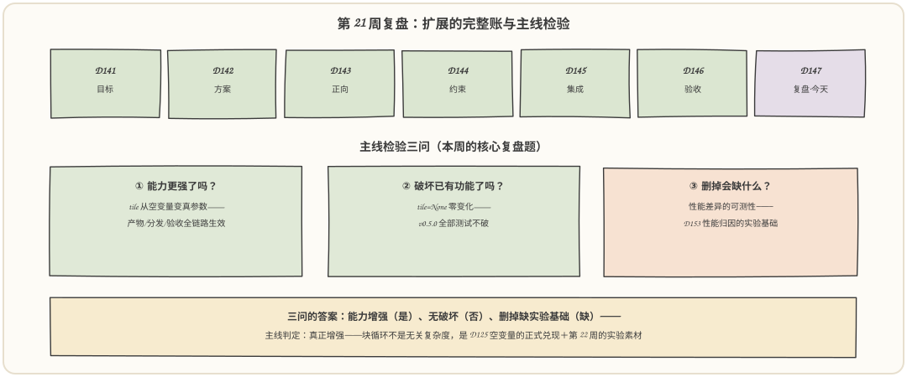
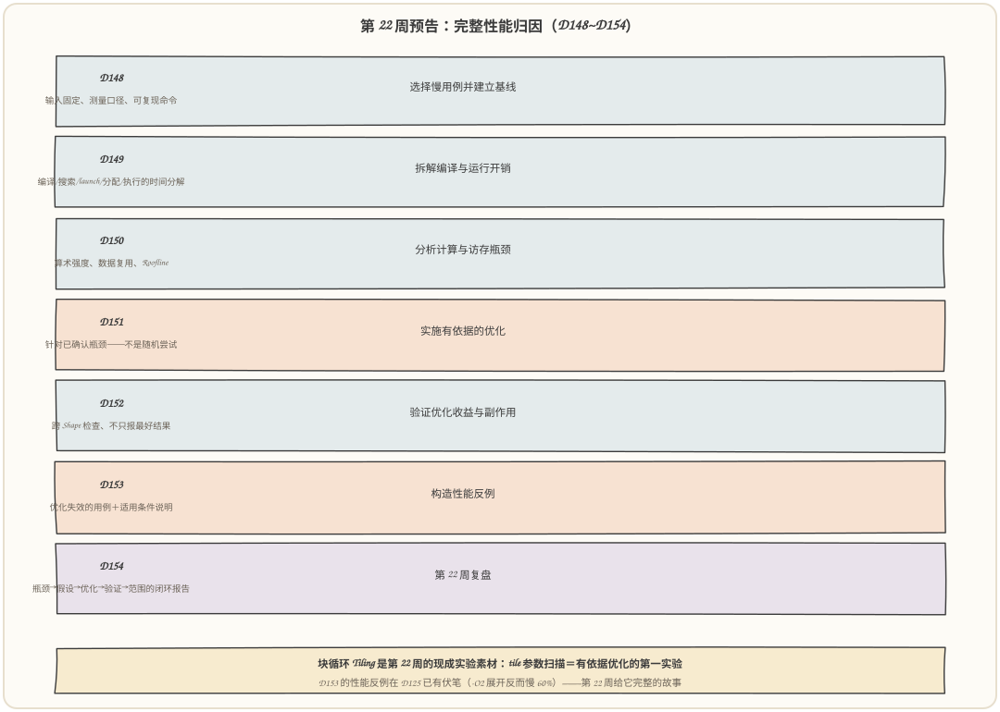
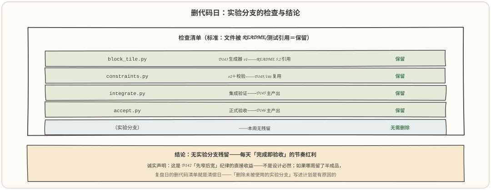

# 第 147 天：第 21 周复盘——主线检验三问全过：扩展的完整账与删代码日

> **今日目标**：完成本教程后，你能做到五件事——回答**主线检验三问**（①能力更强了吗？——tile 从 D125 的空变量变真参数（产物/分发/验收全链路生效）＝**是**；②破坏已有功能了吗？——tile=None 零变化、v0.5.0 全部测试不破＝**否**；③删掉会缺什么？——性能差异的可测性（D153 性能归因的实验基础）＝**缺**——**主线判定：真正增强**——块循环不是无关复杂度，是空变量的正式兑现＋第 22 周的实验素材）；执行**删代码日检查**（标准：文件被 README/测试引用＝保留——本周四个主文件（block_tile/constraints/integrate/accept）全部被引用、**无实验分支残留**——诚实声明：这是 D142"先窄后宽"纪律的节奏红利不是设计必然，如果哪周留了半成品、复盘日就是清偿日）；出**第 21 周账本**（每周模板十问：目标（块循环 Tiling·future F-01）／产出（gen_block_v2 ~300 行＋四集成点＋验收 10/10）／测试（48 项新增）／核心问题（扩展是否真正增强主线）／一个对照（D125 空变量→今天真参数）／讲清与讲不清（块内边界完整版/自动搜索接入/双缓冲可测性）／下周目标（性能归因——块循环是现成实验素材））；总结**本周的三条可复用纪律**（选型判据（衔接＞相关性＞成本）／蓝图先行（形态合法才施工）／标准先行（周一清单周五勾）——扩展周的完整方法论）；预览**第 22 周路线**（D148 慢用例基线→D149 编译/运行开销拆解→D150 Roofline 瓶颈→D151 有依据的优化→D152 跨 Shape 验证→D153 性能反例（D125 的 -O2 伏笔兑现）→D154 闭环报告——**瓶颈→假设→优化→验证→范围的完整归因链**）。
> **预计时间**：学习 20 分钟＋实践 30 分钟
> **前置准备**：本周六天的全部产出（账本证据）、D139 的冻结版本（兼容性检查对象）、每周复盘模板。工具：python3。本文环境：Python 3.9.6，macOS arm64，2026-11-15。
> **今日产出**：`code/week21_review.py`（账本＋删代码清单＋自检）、`code/outputs/week-ledger.txt`（每周模板账本）、`code/outputs/cleanup.txt`（删代码日清单）＋本文 3 张手绘图。

## 1. 今天解决什么问题？

第 21 周收官。计划 D147 条目："评估新功能是否真正增强项目主线，而非增加无关复杂度；删除未被使用的实验分支和临时代码；更新文档。"——三个动作：**主线判定**（三问）、**删代码**（清偿检查）、**文档更新**（账本）。

主线三问是本周最有分量的复盘题：扩展的诱惑是"顺便多做点"——判断标准是**它让已有能力更强还是让系统更乱**。三问的答案（是/否/缺）给了块循环 Tiling 一个明确的"增强"判定——扩展周的合法性确认。

## 2. 先看全貌



**图 1**：看**七天卡＋三问卡＋金框**——七天全绿（D141 目标→…→D147 复盘·今天）；主线三问（①能力更强（tile 空变量→真参数·绿）／②无破坏（tile=None 零变化·绿）／③删掉缺实验基础（D153 素材·橙））；金框：**三问答案（是/否/缺）→主线判定：真正增强**——块循环不是无关复杂度。

## 3. 核心概念



**图 3**：看**七行路线卡＋金框**——D148 慢用例基线（输入固定、测量口径、可复现命令）→D149 编译/运行开销拆解（编译/搜索/launch/分配/执行的时间分解）→D150 计算与访存瓶颈（算术强度、数据复用、Roofline）→D151 有依据的优化（橙——针对已确认瓶颈不是随机尝试）→D152 跨 Shape 验证（不只报最好结果）→D153 性能反例（橙——优化失效的用例＋适用条件）→D154 闭环报告（瓶颈→假设→优化→验证→范围）；金框：**块循环 Tiling 是第 22 周的现成实验素材**（tile 参数扫描＝有依据优化的第一实验）；D125 的 -O2 反例伏笔（展开反而慢 60%）在 D153 兑现完整故事。

### 3.1 主线检验三问

**一句话**：判断扩展合法性的三个问题——**能力更强了吗**（正向贡献）、**破坏已有了吗**（负向检查）、**删掉会缺什么**（不可替代性）——三问齐答才判定"增强"还是"复杂度"。

### 3.2 删代码日：节奏红利的清算

**一句话**：复盘日检查实验分支残留（未被引用的文件＝删除候选）——本周零残留是"先窄后宽"纪律的红利（每天完成即验收、不留半成品）；**这不是必然**——半成品的累积是渐进的，清偿日就是为它准备的。

## 4. 图解核心机制



**图 2**：看**五行检查＋金框**——block_tile.py（D143 引用·保留）／constraints.py（D145/146 复用·保留）／integrate.py（D145 主产出·保留）／accept.py（D146 主产出·保留）／实验分支（**无残留·无需删除**）；金框：结论（无残留）＋诚实声明（节奏红利非设计必然——"删除未被使用的实验分支"写进计划是有原因的）。

## 5. 动手实践

### 5.1 准备文件

```text
tutorials/day-147/
├── README.md / images/（3 图）
└── code/
    ├── week21_review.py / run_all.sh
    └── outputs/（week-ledger.txt＋cleanup.txt＋report.txt）
```

一键复现：`cd tutorials/day-147/code && ./run_all.sh`（约 2 秒）。

### 5.2 修改一个参数再观察

**实验 A（三问自查）**：给"如果选了 INT8"做三问——②破坏已有（可能——QDQ 路径要改）／③删掉缺什么（量化岗位故事）——判定还稳吗？**实验 B（删代码演练）**：故意留一个 dead.py 在某目录——下周复盘日应该抓到它。

## 6. 常见错误与排查

**错误 1：三问只答"是"**。现象：只说"能力更强了"——不查破坏、不问不可替代性。修复：三问缺一不可（②是红线、③是价值证明）。

**错误 2：删代码日走过场**。现象："看起来都很重要"全保留——三个月后仓库里十个 dead 文件。修复：引用检查（grep 文件名）——没被 README/测试引用的就是候选。

## 7. 今日练习

**必做**：1. 三问默写＋本周答案；2. 三条纪律复述（选型/蓝图/标准先行）；3. 第 22 周七天主题速背。

**选做**：4. 实验 A（INT8 三问）；5. 给自己的项目写删代码清单模板。

## 8. 今日验收

- [ ] 我能答主线三问并给出本周判定（是/否/缺→真正增强）
- [ ] 我知道删代码日的标准（引用检查）与本周零残留的原因（纪律红利）
- [ ] 我能背本周三条纪律（衔接＞相关性＞成本／蓝图先行／标准先行）
- [ ] 我能预览第 22 周的归因链（瓶颈→假设→优化→验证→范围）

## 9. 一句话总结与明天预告

今天的闭环：**主线三问**——能力更强（空变量→真参数）／无破坏（tile=None 零变化）／删掉缺基础（D153 素材）——**判定：真正增强**；**删代码日**——四文件全被引用、零残留（"先窄后宽"的红利）；**账本**——48 项新测试、~300 行代码、1 个真 bug（k0 部分和）、防火墙未破；**三条纪律**——衔接＞相关性＞成本／蓝图先行／标准先行（扩展周的完整方法论）。明天进入第 22 周：D148 选择慢用例并建立基线——**性能归因的第一步是"定义问题"**：选哪个用例、固定什么输入、用什么口径——D107 的测量纪律升级为完整归因链的起点。

> **第 21 周收官**：D141 目标→D142 方案→D143 正向→D144 约束→D145 集成→D146 验收（10/10）→ **D147 复盘（主线判定：增强）**。下一站：第 22 周性能归因。
