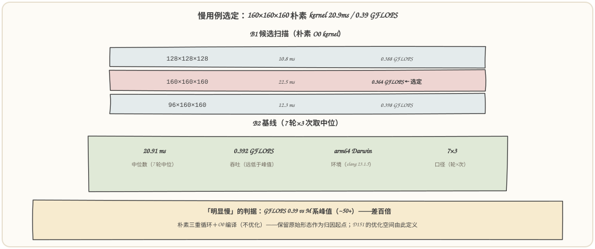
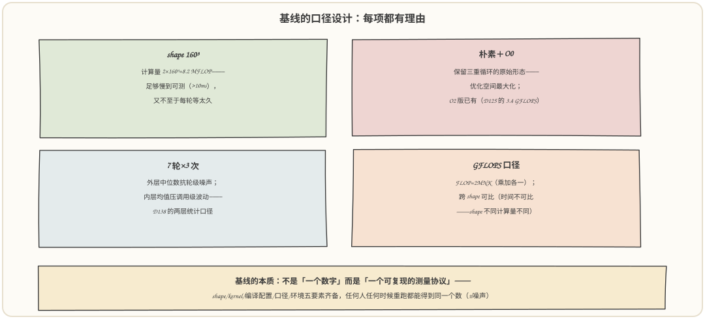

# 第 148 天：选择慢用例并建立基线——160³ 朴素 kernel：20.9ms / 0.39 GFLOPS 的归因起点

> **今日目标**：完成本教程后，你能做到五件事——完成**慢用例的选型**（B1 候选扫描：128³（10.8ms/0.388GF）、**160³（22.5ms/0.364GF ← 选定）**、96×160×160（12.3ms/0.398GF）——判据：**GFLOPS 0.39 vs M 系峰值 ~50+，差百倍**——"明显慢"有数字背书）；建立**基线的完整协议**（shape 160×160×160（计算量 2×160³=8.2 MFLOP——够慢可测又不太久）＋kernel 形态（朴素三重循环＋bias/relu＋**O0 编译不优化**——保留原始形态让优化空间最大化；O2 版已有 D125 的 3.4GF 对照）＋口径（7 轮×3 次的内层均值外层中位——D138 两层统计）＋环境（arm64 Darwin/clang 23.1.5/时间戳）——**五要素齐备的 baseline.json**）；给出**可复现命令**（`cd tutorials/day-148/code && python3 baseline.py`——任何人任何时候重跑同一数字 ±噪声）；说出**基线的本质**（不是"一个数字"而是"**一个可复现的测量协议**"——五要素缺一则复现失败：shape 变了数字不可比、口径变了对不上、环境变了要重采）；理解**GFLOPS 口径的价值**（FLOP=2MNK（乘加各一）——跨 shape 可比（时间不可比：不同 shape 计算量不同）、跨平台可比（峰值归一）——**性能问题的通用语言**）；预览**第 22 周的归因路线**（基线（今天·定义问题）→D149 时间分解（找嫌疑）→D150 Roofline（定性质：计算 or 访存）→D151 有依据优化（验证假设）→D152 跨 Shape（界定范围）→D153 反例（诚实边界）→D154 闭环报告——**每一步都从上一步的结论出发，没有一步是"感觉应该"**）。
> **预计时间**：学习 25 分钟＋实践 40 分钟
> **前置准备**：D138 的统计口径（中位数/P90/两层统计——今天直接沿用）、D125 的 kernel 计时（CSINK 防死码——今天复用）、D107 的测量纪律（祖训）。工具：python3＋numpy＋本机 LLVM。本文环境：Python 3.9.6＋numpy 1.26.4＋Homebrew LLVM 23.1.5，macOS arm64，2026-11-15。
> **今日产出**：`code/baseline.py`（选型扫描＋基线协议＋bench 引擎）、`code/run_all.sh`、`code/outputs/report.txt`、`code/outputs/baseline.json`（**主产出：基线性能表**）＋本文 3 张手绘图。

## 1. 今天解决什么问题？

第 22 周是性能归因周——计划 D148 条目："选择一个明显较慢的 Shape，记录基线时间、GFLOPS、编译配置和运行环境。"——**归因的第一步是定义问题**："慢"不是感觉是数字：今天选出 160³ 朴素 kernel（**0.39 GFLOPS——离峰值差百倍**），建立五要素基线（shape/形态/口径/环境/复现命令）——第 22 周剩余六天全部工作都从这个基线出发。

选型的教学细节：第一版用默认优化（O2）——128³ 只 0.2ms（LLVM 把朴素循环优化得太好——"慢用例"不慢了）；修正为 **O0 编译**（保留三重循环原始形态）＋更大 shape——160³ 到 20.9ms 且 GFLOPS 掉到 0.39——**归因对象成立**。这个"第一版不慢"的插曲本身是教学素材：性能测量的第一条纪律是**确认测的是你想测的东西**（D107 的"测谁就要保证谁活着"的变体）。

## 2. 先看全貌



**图 1**：看**选型表＋基线卡＋金框**——B1 三候选（128³ 10.8ms／**160³ 22.5ms ← 选定（红）**／96×160×160 12.3ms）；B2 基线四格（**20.91ms 中位数**／**0.392 GFLOPS**／arm64 Darwin 环境／7×3 口径）；金框判据（GFLOPS 0.39 vs 峰值 ~50+ 差百倍——"明显慢"有数字背书；朴素+O0 保留原始形态——优化空间最大化、O2 版已有对照）。

## 3. 核心概念

### 3.1 基线的本质：协议不是数字

**一句话**：基线不是"20.91ms"这个数——是**五要素的测量协议**（shape/kernel 形态/编译配置/口径/环境）——五者齐备才能"任何人任何时候重跑得到同一个数（±噪声）"；缺一个要素的基线是**轶事**不是基线。

### 3.2 GFLOPS：性能的通用语言

**一句话**：时间不可跨 shape 比（计算量不同）也不可跨平台比（峰值不同）——**GFLOPS**（FLOP/时间，FLOP=2MNK）归一了两者：0.39GF 在任何地方都"离峰值差百倍"——性能问题的通用度量。

## 4. 图解核心机制



**图 2**：看**四卡＋金框**——shape 160³（8.2 MFLOP——够慢可测又不太久·绿）；朴素＋O0（保留三重循环原始形态、优化空间最大；O2 版已有 D125 对照·红）；7 轮×3 次（外层中位抗轮级噪声＋内层均值压调用波动——D138 口径·蓝）；GFLOPS 口径（跨 shape/跨平台可比·橙）；金框：**基线的本质＝可复现的测量协议——五要素齐备**。

## 5. 动手实践

### 5.1 准备文件

```text
tutorials/day-148/
├── README.md / images/（3 图）
└── code/
    ├── baseline.py            # 选型＋基线引擎
    ├── gen_images.py / run_all.sh
    └── outputs/
        ├── report.txt / baseline.json（主产出）
        └── naive-*/（各候选的编译产物）
```

一键复现：`cd tutorials/day-148/code && ./run_all.sh`（约 3 分钟——含多 shape 编译与 7 轮计时）。

### 5.2 运行与观察

```text
B1 候选：128³ 10.8ms｜160³ 22.5ms ←｜96×160×160 12.3ms
B2 基线：20.91 ms 中位｜0.3919 GFLOPS｜arm64 Darwin｜clang 23.1.5
B3 复现：cd tutorials/day-148/code && python3 baseline.py
判定：选定成立（GFLOPS 0.39 << 峰值 ~50——差百倍）
```

### 5.3 修改一个参数再观察

**实验 A（O0 vs O2 对照）**：把 llc 的 `-O0` 改 `-O2`——GFLOPS 涨到多少？（预期 ~3.4GF——D125 数字的重现：**LLVM 的循环优化值 8 倍**——这本身就是 D149 时间分解的第一手素材）；**实验 B（shape 缩放）**：80³ vs 160³——时间涨 8 倍（体³）还是线性？GFLOPS 稳定吗？（预期 GFLOPS 稳定——朴素 kernel 的强度不随 shape 变——Roofline 的伏笔）。

## 6. 常见错误与排查

**错误 1：默认优化测"慢"**。现象：O2 编译的朴素 kernel 只 0.2ms——"慢用例"不慢。原因：LLVM 优化把循环做得太好——测的不是"朴素形态"而是"优化后形态"。修复：O0 编译＋声明配置（基线五要素之一）。**教训**：**确认测的是你想测的东西**。

**错误 2：基线只记时间**。现象：baseline 只有 "20.91ms"——换机器/换 shape 全作废。修复：五要素协议（shape/形态/配置/口径/环境）——json 落盘。

## 7. 今日练习

**必做**：1. 实验 A（O0/O2 对照）：两组 GFLOPS 数字＋一句结论（LLVM 优化的价值量化）；2. 五要素默写＋各配今天实例；3. GFLOPS 手算验证（2×160³÷20.91ms÷10⁹）。

**选做**：4. 实验 B（shape 缩放）；5. 给基线加 P90 与波动范围（D138 完整口径）。

## 8. 今日验收

- [ ] 我能背出基线五要素与今天的值（160³/朴素+O0/7×3 中位/arm64 Darwin/复现命令）
- [ ] 我能解释 GFLOPS 口径的价值（跨 shape/跨平台——时间不可比它可比）与今天的 0.39 vs 峰值差百倍
- [ ] 我知道第一版"不慢"的插曲与教训（默认优化——确认测的是想测的）
- [ ] 我能复述第 22 周七天的归因路线（每步从上一步结论出发）

## 9. 一句话总结与明天预告

今天的闭环：**选型**——三候选扫描、160³ 胜出（22.5ms/0.364GF——离峰值百倍的"明显慢"）；**协议**——五要素基线（shape/朴素+O0/7×3 中位/环境/复现命令）落盘 baseline.json——**基线的本质是可复现的测量协议不是数字**；**插曲**——第一版默认 O2 太快（0.2ms），改 O0 恢复"慢"——测谁就要保证谁活着；**GFLOPS**——性能的通用语言（跨 shape/跨平台）。明天 D149 拆解编译与运行开销：把"20.91ms"拆成编译时间/搜索时间/launch/内存分配/kernel 执行五段——**主要开销在哪**的初步判断——时间分解图＋嫌疑排序（第 22 周的"找嫌疑"环节）。

> **第 22 周积分卡**：**D148 基线（20.9ms/0.39GF）** → D149 时间分解 → D150 Roofline → D151 有依据优化 → D152 跨 Shape → D153 反例 → D154 闭环。
