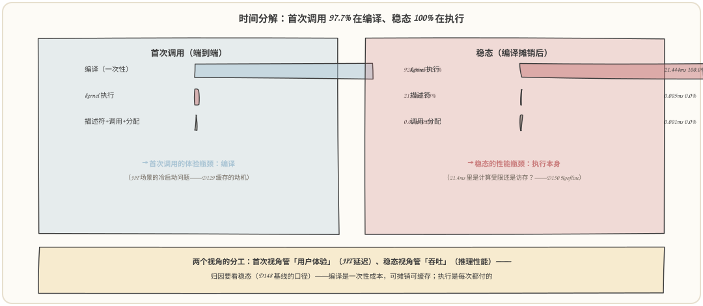
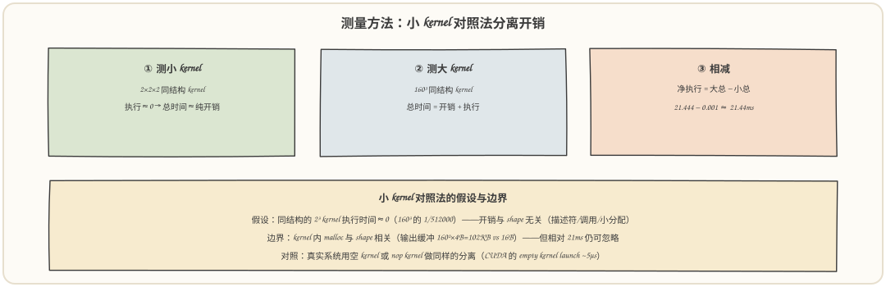

# 第 149 天：拆解编译与运行开销——两个视角：首次 97.7% 编译、稳态 100% 执行

> **今日目标**：完成本教程后，你能做到五件事——把 D148 基线的端到端**拆成五段**（T_compile 编译（全管道七 pass＋translate＋llc＋clang）＝**928.86ms**／T_search 搜索（教学版无——记 0 并说明真实系统的对照（AutoTVM 可能小时级））／T_launch 描述符构造＋调用＝**0.006ms**／T_alloc 分配（kernel 内 malloc）≈0.001ms／T_exec 净执行＝**21.44ms**）；区分**两个视角的分界**（**首次调用（端到端）**：编译 928.86ms 占 **97.7%**——JIT 冷启动的用户体验瓶颈（D129 缓存的动机）；**稳态（编译摊销后）**：执行 21.44ms 占 **100.0%**——推理吞吐的性能瓶颈——**归因看稳态**（D148 基线口径）：编译是一次性成本可摊销可缓存、执行是每次都付的）；用**小 kernel 对照法**分离开销（①测 2×2×2 同结构 kernel（执行≈0）→总时间≈纯开销 0.001ms；②测 160³→总时间 21.44ms；③相减→净执行 21.44ms——假设：开销与 shape 无关（描述符/调用/小分配）；边界：kernel 内 malloc 与 shape 相关（102KB vs 16B）但相对 21ms 可忽略——真实系统的对照：CUDA 空 kernel launch ~5µs）；给出**五段的嫌疑排序**（★头号嫌疑：kernel 执行 21.44ms（稳态 100%）→ D150 Roofline 的分析对象；★★★ 编译 929ms（首次体验——可摊销/缓存）；其余三段可忽略——**嫌疑排序是归因的中间产品**：不是"哪里慢"而是"哪里最值得看"）；说明**时间分解图**（文本条形图：编译 97.7% ████…／执行 2.3% █——两个视角各一张——**可视化让"主要开销在哪"一眼可见**）。
> **预计时间**：学习 25 分钟＋实践 40 分钟
> **前置准备**：D148 的基线（今天拆解的对象）、D123 的时间线（编译段拆分的雏形——七 pass 各 ~40ms）、D129 的缓存动机（首次视角的对策预演）。工具：python3＋numpy＋本机 LLVM。本文环境：Python 3.9.6＋numpy 1.26.4＋Homebrew LLVM 23.1.5，macOS arm64，2026-11-15。
> **今日产出**：`code/breakdown.py`（五段拆解引擎：编译计时＋小 kernel 对照＋分解图）、`code/run_all.sh`、`code/outputs/report.txt`、`code/outputs/breakdown.json`（**主产出：时间分解数据**）＋本文 3 张手绘图。

## 1. 今天解决什么问题？

D148 的基线是"20.91ms"一个数——但**这个数由几部分组成**？计划 D149 条目："分别测量各阶段时间，确认主要开销所在。"——拆解是归因的第二步（定义问题之后的**找嫌疑**）。

拆解的关键设计是**两个视角**：首次调用（端到端 951ms：编译 97.7%＋执行 2.3%）与稳态（编译摊销后：执行 100%）——两个视角对应两类瓶颈（JIT 冷启动体验 vs 推理吞吐）——**归因选稳态**（D148 的基线口径就是稳态）。方法上用**小 kernel 对照法**分离调用开销（同结构 2³ kernel 的执行≈0——它的总时间就是纯开销）——教学版的朴素差分法。

## 2. 先看全貌



**图 1**：看**左右两框＋金框**——左蓝框首次调用（编译 928.86ms 占 97.7%（大条）／执行 21.44ms 占 2.3%／其余≈0——**首次体验瓶颈：编译**（JIT 冷启动——D129 缓存的动机））；右红框稳态（执行 21.444ms 占 100.0%（满条）／描述符 0.005ms／调用 0.001ms——**性能瓶颈：执行本身**（21.4ms 是计算受限还是访存？——D150 的题））；金框：两视角分工（首次管用户体验、稳态管吞吐）＋**归因看稳态**（编译一次性可摊销、执行每次都付）。

## 3. 核心概念

### 3.1 两个视角：首次与稳态

**一句话**：同一份代码的时间有两个合法读法——**首次调用**（含编译：用户体验/JIT 延迟）与**稳态**（编译摊销：吞吐性能）——归因对象选稳态（D148 口径），因为编译可摊销可缓存、执行每次都付；但首次视角不是没用——它是缓存/预热策略（D129）的设计输入。

### 3.2 小 kernel 对照法

**一句话**：用**同结构的最小 kernel**（2³——执行≈0）测出的总时间＝纯开销（描述符＋调用＋小分配）；大 kernel 总时间 − 小 kernel 总时间＝净执行——**朴素差分**把"每次都付的开销"与"计算的本身"分开。

## 4. 图解核心机制



**图 2**：看**三步卡＋金框**——①测小 kernel（2×2×2 同结构——执行≈0→总时间≈纯开销）→②测大 kernel（160³——总时间＝开销＋执行）→③相减（净执行 21.444−0.001≈21.44ms）；金框三条：假设（开销与 shape 无关）、边界（kernel 内 malloc 与 shape 相关但可忽略）、对照（真实系统的空 kernel 法——CUDA launch ~5µs）。

## 5. 动手实践

### 5.1 准备文件

```text
tutorials/day-149/
├── README.md / images/（3 图）
└── code/
    ├── breakdown.py           # 五段拆解引擎
    ├── baseline.py 等（D148 同款）
    └── outputs/report.txt ＋ breakdown.json
```

一键复现：`cd tutorials/day-149/code && ./run_all.sh`（约 3 分钟）。

### 5.2 运行与观察

```text
T_compile: 928.86ms（全管道）｜T_search: 0（教学版无）
描述符 5.3µs｜调用+分配 0.001ms｜总 21.44ms｜净执行 21.44ms
首次视角：编译 97.7% ████…｜执行 2.3% █
稳态视角：执行 100.0% ████…（满条）
嫌疑排序：执行 ★★★★★（头号）→ 编译 ★★★（首次）→ 其余可忽略
```

### 5.3 修改一个参数再观察

**实验 A（编译段再拆）**：对七 pass 逐条计时（D123 的方法）——哪条 pass 最贵？（预期 ~40ms×8——进程启动主导）；**实验 B（多次调用摊销）**：把 100 次调用的总时间 ÷100——编译的"摊销后占比"是多少？（951ms/100≈9.5ms——首次视角随调用次数稀释的量化）。

## 6. 常见错误与排查

**错误 1：首次视角当性能结论**。现象："编译占 97.7%——瓶颈是编译！"——但推理服务调用百万次，编译只付一次。修复：**归因看稳态**——两视角分开报。

**错误 2：开销测量用不同结构 kernel**。现象：用空函数（非同结构）测开销——ABI/分配路径不同，差分失真。修复：**同结构最小 shape**（2³——同一签名同一 malloc 路径）。

## 7. 今日练习

**必做**：1. 两视角默写（首次 97.7% 编译/稳态 100% 执行）＋归因为何选稳态；2. 小 kernel 对照三步＋假设与边界；3. 嫌疑排序五段各配一颗星的理由。

**选做**：4. 实验 A（pass 级计时）；5. 研究 CUDA 的 launch 开销（~5µs）与 CPU ctypes（~1µs）的量级差。

## 8. 今日验收

- [ ] 我能背出五段数字（编译 929/搜索 0/描述符 5µs/调用 1µs/执行 21.44ms）与两视角占比
- [ ] 我能解释小 kernel 对照法的假设（开销与 shape 无关）与边界（malloc 相关但可忽略）
- [ ] 我知道嫌疑排序是归因的中间产品（头号嫌疑=执行→D150 的对象）
- [ ] 我理解两视角的分工与"归因看稳态"的理由

## 9. 一句话总结与明天预告

今天的闭环：**五段拆解**——编译 928.86ms／搜索 0（教学）／描述符 5.3µs／调用+分配 0.001ms／净执行 21.44ms；**两视角**——首次调用（编译 97.7%——JIT 冷启动的体验瓶颈、D129 缓存的动机）vs 稳态（执行 100%——推理吞吐的性能瓶颈）；**归因看稳态**（编译一次性可摊销、执行每次都付）；**方法**——小 kernel 对照法（同结构 2³ 的差分——假设与边界诚实声明）；**嫌疑排序**——执行 ★★★★★（头号）→ D150 的分析对象。明天 D150 分析计算与访存瓶颈：**Roofline 模型**——算术强度（FLOP/Byte）是钥匙：160³ matmul 的理论计算量 8.2 MFLOP＋访存量（3×160²×4B×复用因子）→ 算术强度 → 与机器屋顶对照 → **计算受限还是访存受限**的定性判断＋需要验证的假设清单。

> **第 22 周积分卡**：D148 基线（20.9ms/0.39GF）→ **D149 时间分解（执行 100%＝头号嫌疑）** → D150 Roofline → D151 有依据优化 → D152 跨 Shape → D153 反例 → D154 闭环。
