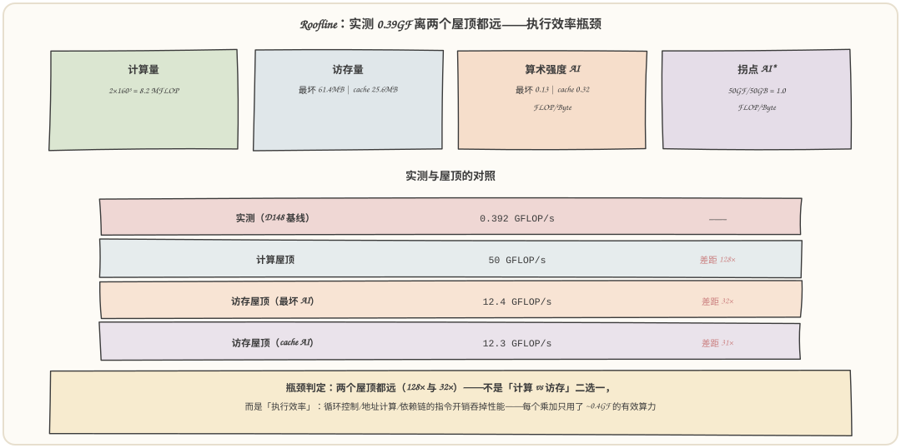
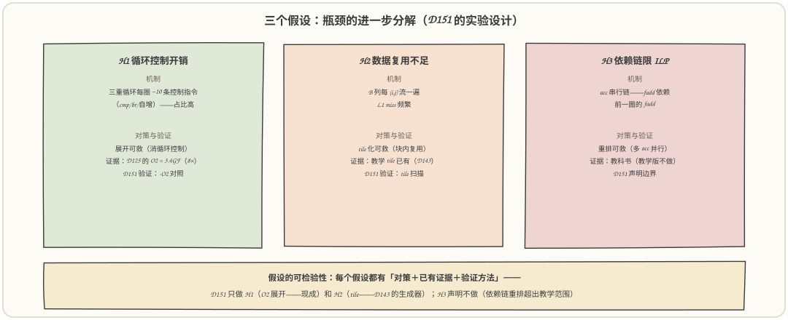

# 第 150 天：分析计算与访存瓶颈——Roofline：实测离两个屋顶都远，三个假设待验

> **今日目标**：完成本教程后，你能做到五件事——计算 **160³ 用例的理论量**（计算量 2×160³＝**8.2 MFLOP**；访存量：最坏（无 cache，A 行读 N 次＋B 列读 M 次）**61.4 MB**／L1 命中估算 **25.6 MB**；算术强度 AI＝FLOP/Byte：最坏 **0.13**／cache **0.32** FLOP/Byte）；建立**教学 Roofline**（机器屋顶（M 系教学估算·诚实声明）：峰值算力 50 GFLOP/s＋峰值带宽 50 GB/s→**拐点 AI\*＝1.0 FLOP/Byte**——AI＜AI\* 访存受限、AI＞AI\* 计算受限的经典分界）；完成**实测与屋顶的对照**（实测 0.392 GF——离**计算屋顶 128×**、离**访存屋顶（最坏 AI）32×**——**两个屋顶都远**：瓶颈不是"计算 vs 访存"二选一，而是**执行效率**（循环控制/地址计算/依赖链的指令开销吞掉性能——每个乘加只用了 ~0.4GF 的有效算力））；提出**三个可检验假设**（**H1 循环控制开销**（三重循环每圈 ~10 条控制指令——展开可救；证据：D125 的 O2＝3.4GF（8×）；D151 验证：-O2 对照）／**H2 数据复用不足**（B 列每 (i,j) 流一遍、L1 miss 频繁——tile 化可救；证据：D143 生成器已有；D151 验证：tile 扫描）／**H3 依赖链限 ILP**（acc 串行链——重排可救；**声明不做**（超出教学范围）——边界诚实））；画出**文本版 Roofline 图**（GFLOP/s 对数纵轴×AI 横轴——屋顶线 min(峰值, AI×带宽) 与实测点的位置关系可视化——**图是归因的通用语言**）。
> **预计时间**：学习 30 分钟＋实践 35 分钟
> **前置准备**：D148 基线（实测 0.39GF——对照的起点）、D149 的时间分解（执行 100%——今天的分析对象）、D125 的 O2 证据（H1 的既有证据）、D109 的 Roofline 分析器（第三阶段的同款思想）。工具：python3。本文环境：Python 3.9.6，macOS arm64，2026-11-15。
> **今日产出**：`code/roofline.py`（理论量＋AI＋屋顶＋对照＋假设＋文本图）、`code/run_all.sh`、`code/outputs/report.txt`、`code/outputs/roofline.json`（**主产出：瓶颈分析＋三假设**）＋本文 3 张手绘图。

## 1. 今天解决什么问题？

D149 锁定头号嫌疑：执行 21.4ms——但这 21.4ms 里**是什么在慢**？计划 D150 条目："计算当前用例的理论计算量、访存量和算术强度，与实测性能对照。"——Roofline 是定性工具：**计算受限还是访存受限**（或者都不是）。

今天的答案有点意外：**两个屋顶都远**（128× 与 32×）——说明朴素 kernel 的瓶颈不在"计算 or 访存"的经典二分，而在**执行效率**（每条乘加被大量非计算指令（循环控制/地址计算）稀释）。这个"第三种瓶颈"的判定把优化方向指向 H1（展开消控制流）与 H2（tile 提复用）——D151 的实验设计由此而来。

## 2. 先看全貌



**图 1**：看**四卡＋对照表＋金框**——理论量四卡（计算 8.2 MFLOP／访存 61.4MB（最坏）｜25.6MB（cache）／AI 0.13｜0.32／拐点 1.0）；对照表四行（**实测 0.392GF（红）**／计算屋顶 50GF 差 128×／访存屋顶（最坏）12.4GF 差 32×／（cache）12.3GF 差 31×）；金框判定：**两个屋顶都远——不是二选一而是执行效率瓶颈**（循环控制/地址计算/依赖链的指令开销）。

## 3. 核心概念

### 3.1 Roofline：算术强度的分界

**一句话**：性能上限＝min(峰值算力，AI×峰值带宽)——**AI（FLOP/Byte）是分界钥匙**：AI＜拐点（峰值算力/带宽）时访存受限（搬运是瓶颈）、AI＞拐点时计算受限（乘加是瓶颈）；实测离哪条屋顶近就受限于哪边。

### 3.2 第三种瓶颈：执行效率

**一句话**：当实测离**两个屋顶都远**（128× 与 32×）——瓶颈既不是纯计算也不是纯访存，而是**执行效率**：非计算指令（循环控制/地址计算）稀释了有效算力——优化方向是"消除开销"（展开/tile）而不是"提带宽或提算力"。

### 3.3 假设的可检验性

**一句话**：每个假设配三件套——**对策**（怎么救）、**已有证据**（D125 的 O2＝8×；D143 的生成器）、**验证方法**（D151 的对照实验）——**失败也 informative**（假设被证伪同样是结论）；H3 声明不做（教学边界诚实）。

## 4. 图解核心机制



**图 2**：看**三卡×两段**——H1 循环控制开销（机制：每圈 ~10 条控制指令；对策：展开可救；证据：D125 O2＝3.4GF（8×）；验证：D151 的 -O2 对照·绿）／H2 数据复用不足（机制：B 列每 (i,j) 流一遍、L1 miss；对策：tile 块内复用；证据：D143 生成器已有；验证：tile 扫描·橙）／H3 依赖链限 ILP（机制：acc 串行；对策：重排多 acc；**声明不做**·红）；金框：假设的可检验性＋D151 只做 H1/H2（H3 超出教学范围——边界诚实）。

## 5. 动手实践

### 5.1 准备文件

```text
tutorials/day-150/
├── README.md / images/（3 图）
└── code/
    ├── roofline.py            # Roofline 分析引擎
    ├── baseline.py 等（D148 同款）
    └── outputs/report.txt ＋ roofline.json
```

一键复现：`cd tutorials/day-150/code && ./run_all.sh`（约 3 秒——纯分析无编译）。

### 5.2 运行与观察

```text
计算量 8.2 MFLOP｜访存 61.4MB（最坏）/25.6MB（cache）｜AI 0.13/0.32
拐点 AI* = 1.0｜实测 0.392 GF
离计算屋顶 128×｜离访存屋顶 32×——两个都远
判定：执行效率瓶颈——H1 循环开销/H2 复用不足/H3 依赖链（不做）
```

### 5.3 修改一个参数再观察

**实验 A（AI 对 shape 的不变性）**：80³ 与 160³ 的 AI 各多少？（matmul 的 AI=2K/(4×(1+K/M+K/N))≈K/2——随 K 增长——**大 K 更接近计算受限**）；**实验 B（屋顶敏感性）**：峰值带宽改 100GB/s（L2 假设）——访存屋顶翻倍、判定变吗？

## 6. 常见错误与排查

**错误 1：屋顶用营销数字**。现象：峰值算力用 M 系的 GPU 核总数（~2TF）——实测"离屋顶 5000×"——结论失真。修复：**用同口径的可达峰值**（本教学用单核朴素序下界 50GF——诚实声明是估算）。

**错误 2：假设不可检验**。现象："可能是 cache 的问题"——没有对策/证据/验证方法。修复：假设三件套（对策＋证据＋验证）——不可检验的假设是猜测不是假设。

## 7. 今日练习

**必做**：1. AI 手算（2×160³÷61.4MB）；2. 三假设三件套默写；3. "第三种瓶颈"（执行效率）与经典二分的区别。

**选做**：4. 实验 A（AI 随 K）；5. 画真正的坐标系 Roofline（对数-对数）——屋顶线的折线形状。

## 8. 今日验收

- [ ] 我能算 AI（FLOP/Byte）并说出拐点含义（AI*＝算力/带宽——分界钥匙）
- [ ] 我能背出实测对照（0.39GF vs 计算屋顶 128× vs 访存屋顶 32×——都远）
- [ ] 我能解释"第三种瓶颈"（执行效率——非计算指令稀释有效算力）
- [ ] 我能复述三假设三件套（H1 展开/H2 tile/H3 不做——各配对策/证据/验证）
- [ ] 我知道屋顶数字的诚实声明（教学估算——口径一致性优先于精确）

## 9. 一句话总结与明天预告

今天的闭环：**理论量**——8.2 MFLOP／61.4MB（最坏）／AI 0.13；**Roofline**——拐点 1.0、实测 0.39GF **离计算屋顶 128×、离访存屋顶 32×（都远）**；**判定**——不是经典二分而是**执行效率瓶颈**（循环控制/地址计算的指令开销稀释有效算力）；**三假设**——H1 循环开销（展开可救·D125 O2＝8× 证据）／H2 复用不足（tile 可救·D143 工具就位）／H3 依赖链（声明不做）——各配三件套（对策/证据/验证）。明天 D151 实施有依据的优化：**实验 A（-O2 展开——验 H1：预期 0.39→3.4GF）＋实验 B（tile 扫描——验 H2：块内复用的实测收益）＋实验 C（组合——正交性的检验）**——每个实验从今天的假设出发：**不是"试试看"而是"假设→预测→验证"的完整推理链，失败也 informative**。

> **第 22 周积分卡**：D148 基线 → D149 分解（执行 100%）→ **D150 Roofline（三假设）** → D151 有依据优化 → D152 跨 Shape → D153 反例 → D154 闭环。
