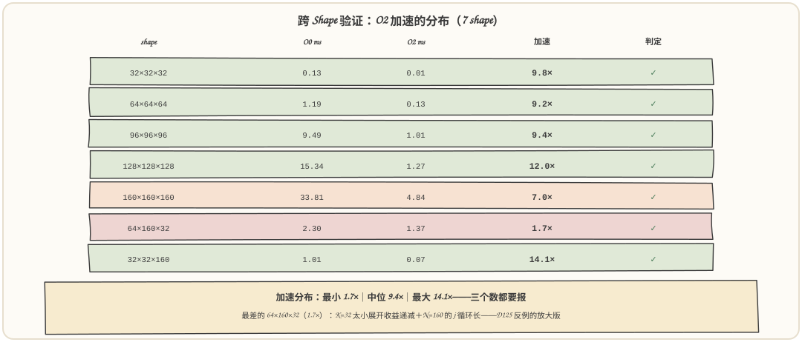
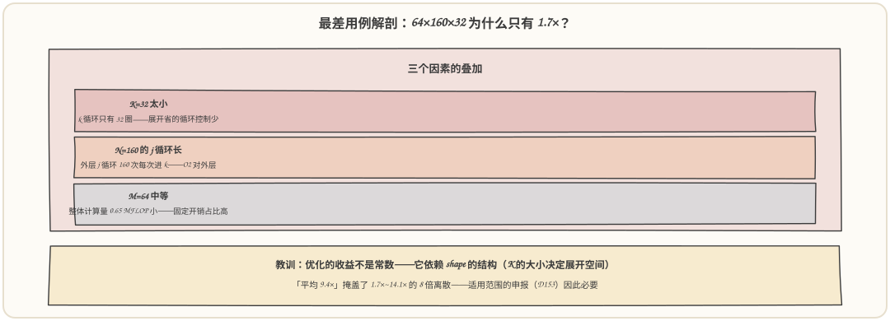

# 第 152 天：验证优化收益与副作用——跨 7 Shape：加速分布 1.7×~14.1×（8 倍离散）

> **今日目标**：完成本教程后，你能做到五件事——完成 **O2 优化的跨 Shape 验证**（7 个 shape：32³（9.8×）/64³（9.2×）/96³（9.4×）/128³（12.0×）/160³（7.0×）/**64×160×32（1.7×——最差！）**/32×32×160（14.1×——最好）——**全部正确性 ✓**）；报出**加速分布的三个数**（**最小 1.7×｜中位 9.4×｜最大 14.1×**——8 倍离散！"不能只报最好结果"：单一 shape 的加速比是轶事、分布才是结论）；解剖**最差用例 64×160×32**（三个因素叠加：①K=32 太小——k 循环只 32 圈、展开省的循环控制少（160³ 的 K=160 有 160 圈可省）；②N=160 的 j 循环长——外层优化空间受形态限制；③M=64 中等——计算量 0.65 MFLOP 小、固定开销占比高——**优化的收益不是常数，它依赖 shape 的结构（K 的大小决定展开空间）**）；理解**"平均 9.4×"的掩盖效应**（均值掩盖了 1.7~14.1 的 8 倍离散——**适用范围的申报（D153）因此必要**）；对照**副作用检查**（正确性：7 shape 全 ✓（allclose 口径——O2 展开重排乘加序，bitwise 不适用）；资源：编译时间×7 组各 ~1s——无异常；数值：atol=1e-3 内全过——**收益无副作用**的完整验证）。
> **预计时间**：学习 20 分钟＋实践 40 分钟
> **前置准备**：D151 的三实验（今天验证 A 的跨 shape 稳定性）、D125 的 4³ 反例（最差用例的理论伏笔）、D148 的 bench 口径。工具：python3＋numpy＋本机 LLVM。本文环境：Python 3.9.6＋numpy 1.26.4＋Homebrew LLVM 23.1.5，macOS arm64，2026-11-15。
> **今日产出**：`code/cross_shape.py`（跨 shape 引擎：7 shape×O0/O2 对照）、`code/run_all.sh`、`code/outputs/report.txt`、`code/outputs/cross-shape.json`（**主产出：跨 shape 收益表**）＋本文 3 张手绘图。

## 1. 今天解决什么问题？

D151 报了 160³ 的 8.4×——**这个数字在其他 shape 还成立吗**？计划 D152 条目："在目标 Shape 和至少 5 个其他 Shape 上测试，记录性能、资源和数值结果。"——单一数字是轶事，分布才是结论。

今天的数据把这句话变成了铁证：7 个 shape 的加速从 **1.7× 到 14.1×（8 倍离散）**——"平均 9.4×"掩盖了最差用例的险境（64×160×32 只 1.7×——K=32 太小展开空间受限）。**适用范围**（D153 反例）因此成为必要文档而非可选项。

## 2. 先看全貌



**图 1**：看**七行表＋分布金框**——各 shape 的 O0/O2 时间与加速（全 ✓）；金框：**分布三数（最小 1.7×｜中位 9.4×｜最大 14.1×——三个都要报）**＋最差用例的归因（K=32 展开收益递减——D125 反例的放大版）。

## 3. 核心概念


**图 3**：看**两块素材卡＋任务金框＋底部紫框**——素材①tile 反例（D151·红：教学 tile 0.3×——重复计算（×6.25~100）吃掉复用收益——**方向对、实现不完整→更慢**）；素材②O2 的 shape 反例（今天·橙：64×160×32 只 1.7×——K=32 展开收益递减——**同优化不同 shape→失效**）；金框任务（D153 的正式化：①选一个反例做完整解剖（现象→机制→适用条件）；②D125 的 -O2 小 kernel 反例（4³ 慢 60%）也是候选——伏笔兑现；③产出性能反例＋适用条件说明——"什么时候不该用这个优化"的边界文档）；底部紫框：**反例的价值——它划清了优化的领土：没有反例的优化报告是广告，有反例的才是工程**＋面试金句（"你的优化什么时候失效？"——答得出反例才是真懂）。

### 3.1 分布三数：范围、均值、最差

**一句话**：优化收益的申报格式是**三个数**（最小/中位/最大）——只报最大是广告、只报均值是误导（8 倍离散下均值无意义）、**最差值决定"敢不敢默认开"**。

### 3.2 优化收益的 shape 依赖

**一句话**：O2 的展开收益取决于 **K 的大小**（k 循环圈数＝展开空间）——K=160 时 7~14×、K=32 时 1.7×——**优化不是常数是 shape 的函数**；适用条件（"K 够大时收益显著"）是优化文档的必要部分。

## 4. 图解核心机制



**图 2**：看**三因素卡＋金框**——K=32 太小（展开省的循环控制少·红）；N=160 的 j 循环长（外层优化受限·橙）；M=64 中等（计算量小、固定开销占比高·蓝）；金框：**优化的收益不是常数——它依赖 shape 结构**；"平均 9.4×"掩盖 8 倍离散——适用范围申报（D153）因此必要。

## 5. 动手实践

### 5.1 准备文件

```text
tutorials/day-152/
├── README.md / images/（3 图）
└── code/
    ├── cross_shape.py         # 跨 shape 引擎
    ├── optimize.py 等（D151 同款）
    └── outputs/report.txt ＋ cross-shape.json
```

一键复现：`cd tutorials/day-152/code && ./run_all.sh`（约 4 分钟——7 shape×2 配置的编译与计时）。

### 5.2 运行与观察

```text
shape            O0 ms   O2 ms   加速   O0 GF  O2 GF  对
32×32×32         0.13    0.01    9.8×   0.493  4.847  ✓
...
64×160×32        2.30    1.37    1.7×   0.285  0.480  ✓ ← 最差
32×32×160       1.01    0.07   14.1×   0.323  4.567  ✓ ← 最好
分布：最小 1.7×｜中位 9.4×｜最大 14.1×
```

### 5.3 修改一个参数再观察

**实验 A（K 扫描）**：固定 M=N=64，K=8/16/32/64/128——加速随 K 的曲线（预期：K↑加速↑——展开空间的量化）；**实验 B（tile 的跨 shape）**：D151 的 tile(64,64) 在 7 shape 上也测——0.3× 是 160³ 特有还是普遍？

## 6. 常见错误与排查

**错误 1：只报最好或平均**。修复：分布三数（最小/中位/最大）——最差值决定默认策略。

**错误 2：副作用不查**。现象：加速报了但正确性没测（O2 展开可能重排浮点序）。修复：每个 shape 都跑 golden 对照（今天的 ✓ 列）。

## 7. 今日练习

**必做**：1. 分布三数默写＋"最差值决定默认开"的理由；2. 最差用例三因素复述；3. "优化收益是 shape 的函数"举例（K 与展开空间）。

**选做**：4. 实验 A（K 扫描曲线）；5. tile 跨 shape。

## 8. 今日验收

- [ ] 我能背出分布三数（1.7×/9.4×/14.1×）与 8 倍离散的含义
- [ ] 我能解剖最差用例（K=32 展开空间小＋j 循环长＋计算量小）
- [ ] 我知道副作用检查的三面（正确性 allclose/资源/数值）与 O2 下 bitwise 不适用的原因
- [ ] 我理解适用范围申报的必要性（均值掩盖离散）

## 9. 一句话总结与明天预告

今天的闭环：**跨 7 shape**——O2 加速全 ✓ 正确；**分布**——1.7×（64×160×32·K 太小）~14.1×（32×32×160·K 大展开爽）——**8 倍离散**；**三数申报**（最小/中位/最大——不能只报最好）；**最差解剖**（K=32 展开空间受限——优化收益是 shape 的函数）；**副作用**（正确性/资源/数值三面全过）。明天 D153 构造性能反例：**反例的正式化**——本周已积累两块素材（D151 的 tile 0.3×（重复计算吃掉复用）＋今天的 1.7×（K 小展开失效））＋D125 的 4³ -O2 反例（展开反而慢 60%）——**选一个做完整解剖**（现象→机制→适用条件）＋产出"什么时候不该用这个优化"的边界文档——**没有反例的优化报告是广告，有反例的才是工程**。

> **第 22 周积分卡**：D148 基线 → D149 分解 → D150 三假设 → D151 优化（H1✓/H2✗）→ **D152 跨 Shape（1.7~14.1×）** → D153 反例 → D154 闭环。
