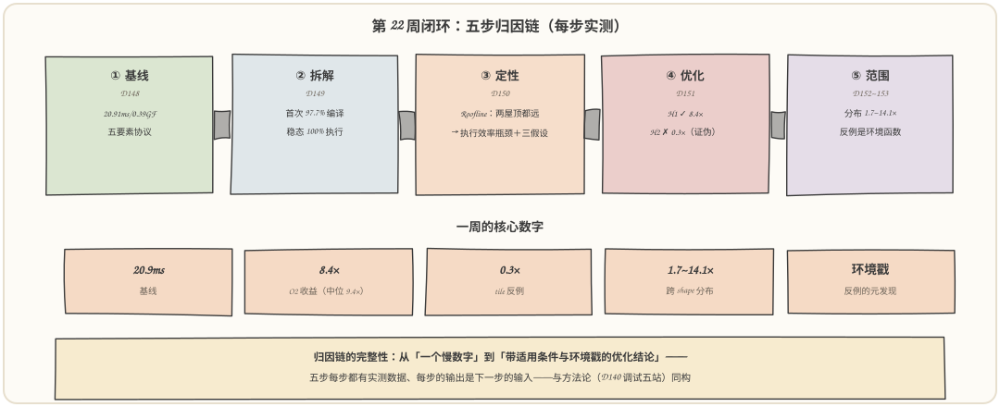
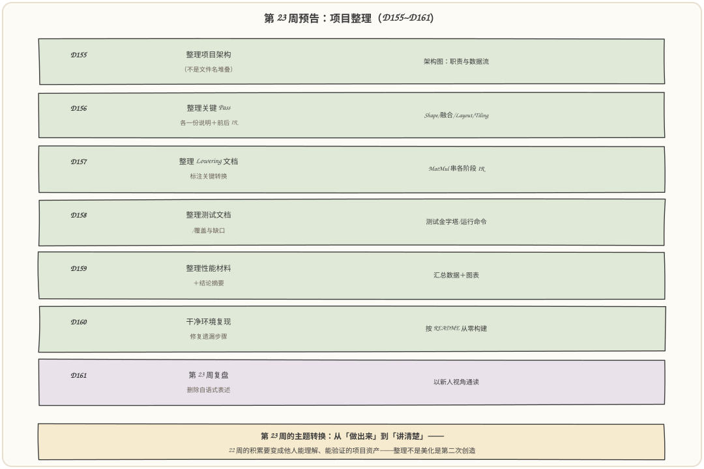
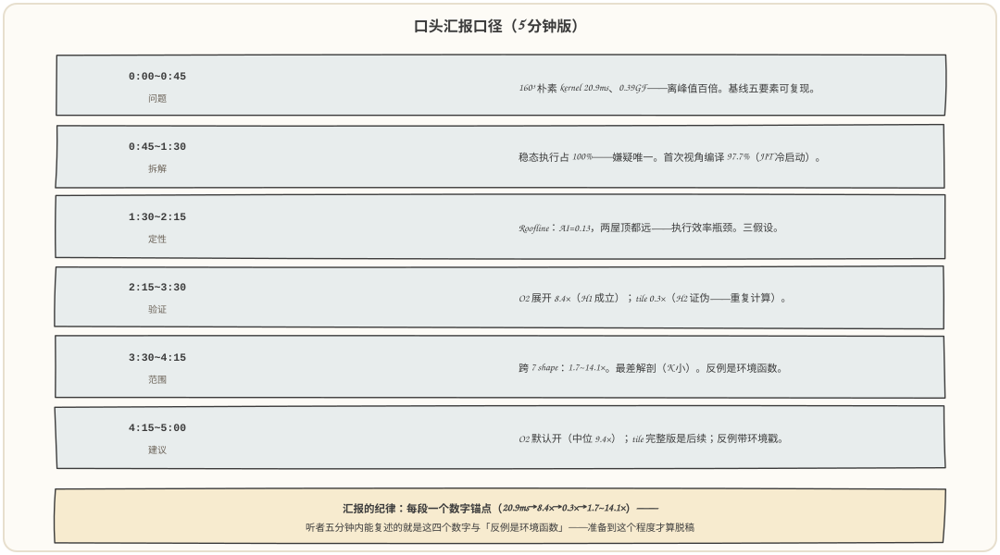

# 第 154 天：第 22 周复盘——性能归因闭环：五步链每步实测，从 20.9ms 到环境戳

> **今日目标**：完成本教程后，你能做到——
> 1. 写出**性能归因的闭环报告**（五步链每步实测：①基线（D148：20.91ms/0.39GF＋五要素协议）→②拆解（D149：首次 97.7% 编译/稳态 100% 执行）→③定性（D150：Roofline 两屋顶都远→执行效率瓶颈＋三假设）→④优化（D151：H1 ✓ 8.4×/H2 ✗ 0.3× 证伪）→⑤范围（D152~153：分布 1.7~14.1×＋反例环境函数）——**每步的输出是下一步的输入**）；
> 2. **一周的核心数字**（20.9ms 基线／8.4× O2 收益（中位 9.4×）／0.3× tile 反例／1.7~14.1× 跨 shape 分布／**环境戳**（反例的元发现）——五个数字就是全部故事）；
> 3. 准备**5 分钟口头汇报**（0:00~0:45 问题（基线百倍差距）→0:45~1:30 拆解（稳态 100% 嫌疑唯一）→1:30~2:15 定性（Roofline＋三假设）→2:15~3:30 验证（8.4×/0.3×）→3:30~4:15 范围（分布＋环境函数）→4:15~5:00 建议（O2 默认开/tile 完整版后续/反例带戳）——**每段一个数字锚点**、听者五分钟能复述四个数字＋"反例是环境函数"）；
> 4. **第 22 周账本**（每周模板十问——核心问题"性能问题怎么从一个慢数字走到带适用条件的优化结论"；根因：慢是表象、归因要五步且每步有暗区；对照：20.91→3.00ms＝8.4× 但 64×160×32 只 1.7×、tile 0.3×——"8.4×"只是分布的一个点）；
> 5. 预览**第 23 周路线**（项目整理 D155~D161：架构图（职责与数据流）→Pass 文档→Lowering 文档→测试文档→性能材料→干净环境复现→新人视角复盘——**主题转换：从"做出来"到"讲清楚"——整理不是美化是第二次创造**）。
> **预计时间**：学习 20 分钟＋实践 30 分钟
> **前置准备**：本周六天的全部产出（闭环报告的证据链）、D140 的调试五站（同构的方法论）、每周复盘模板。工具：python3。本文环境：Python 3.9.6，macOS arm64，2026-11-15。
> **今日产出**：`code/week22_review.py`（闭环报告＋账本＋自检）、`code/outputs/perf-report.txt`（**主产出：性能归因闭环报告**）、`code/outputs/week-ledger.txt`（每周账本）＋本文 3 张手绘图。

## 1. 今天解决什么问题？

第 22 周收官。计划 D154 条目："形成一份 2~3 页性能报告，包含数据、图和结论；产出完整性能报告和 5 分钟口头汇报。"——闭环日的两件事：**书面报告**（五步链的完整叙述）与**口头口径**（5 分钟的时间轴）。

闭环的意义在于**完整性检查**：五步是否首尾相接（基线的口径→拆解用同口径→定性解释拆解结果→优化验证定性→范围界定优化）——每一步的输出是下一步的输入（与 D140 调试五站同构）。

## 2. 先看全貌



**图 1**：看**五步卡＋数字带＋金框**——①基线（20.91ms/0.39GF·五要素·绿）→②拆解（首次 97.7% 编译/稳态 100% 执行·蓝）→③定性（Roofline 两屋顶都远→执行效率＋三假设·橙）→④优化（H1 ✓ 8.4×/H2 ✗ 0.3×·红）→⑤范围（分布 1.7~14.1×＋环境函数·紫）；数字带五张（20.9ms／8.4×／0.3×／1.7~14.1×／环境戳）；金框：**从"一个慢数字"到"带适用条件与环境戳的优化结论"——五步每步实测、与调试五站同构**。

## 3. 核心概念



**图 3**：看**七行路线卡＋金框**——D155 项目架构（架构图：职责与数据流——不是文件名堆叠）→D156 关键 Pass（Shape/融合/Layout/Tiling 各一份说明＋前后 IR）→D157 Lowering 文档（MatMul 串各阶段 IR＋关键转换标注）→D158 测试文档（金字塔/命令/覆盖与缺口）→D159 性能材料（数据＋图表＋结论摘要）→D160 干净环境复现（按 README 从零构建、修遗漏）→D161 复盘（新人视角通读、删自语式表述·紫）；金框：**第 23 周的主题转换——从「做出来」到「讲清楚」：22 周的积累要变成他人能理解、能验证的项目资产——整理不是美化是第二次创造**。

### 3.1 归因链的完整性

**一句通俗解释**：五步闭环的验收不是"每步都做了"——是**首尾相接**（基线口径→拆解用同口径→定性解释拆解→优化验证定性→范围界定优化）——断链的归因（如跳过定性直接优化）是"碰运气"不是归因。

**生活类比**：法庭结案——法官不只说「有罪」——展示证据链（动机→手段→时间线→物证）——每个环节可查证。

**对应到技术上是**：性能归因五步闭环（基线→拆解→定性→优化→范围）每步实测——报告的数据可复现、结论可追溯。

**类比边界**：法庭结案的类比帮你建立直觉，但真实的技术实现有更多约束和量化指标——类比的目的是「快速理解方向」，不是「替代技术细节」。

### 3.2 汇报的数字锚点纪律

**一句话**：5 分钟汇报的每一分钟都要有一个数字锚点（20.9→100%→两屋顶→8.4×/0.3×→1.7~14.1×）——**听者能复述的就是这些数字**；没有数字的汇报是散文。

## 4. 图解核心机制



**图 2**：看**六段时间轴＋金框**——每段（时间戳＋主题＋一句内容＋数字锚点）：0:00 问题（基线百倍差）→0:45 拆解（稳态 100%）→1:30 定性（Roofline 三假设）→2:15 验证（8.4×/0.3×）→3:30 范围（分布/环境函数）→4:15 建议（默认开/后续/带戳）；金框：**每段一个数字锚点——听者五分钟能复述四个数字＋"反例是环境函数"——准备到这个程度才算脱稿**。

## 5. 动手实践

### 5.1 准备文件

```text
tutorials/day-154/
├── README.md / images/（3 图）
└── code/
    ├── week22_review.py / run_all.sh
    └── outputs/（perf-report.txt＋week-ledger.txt＋report.txt）
```

一键复现：`cd tutorials/day-154/code && ./run_all.sh`（约 2 秒）。

### 5.2 修改一个参数再观察

**实验 A（脱稿演练）**：对着计时器讲 5 分钟——卡壳的段落重读对应天；**实验 B（报告瘦身）**：把 perf-report.txt 压到一页——哪些段落能删？（保留五步各一句＋四个数字＋一句建议）。

## 6. 常见错误与排查

**错误 1：闭环断链**。现象：报告里"Roofline 说访存受限"→但优化做的是展开（针对计算）——定性没接上优化。修复：五步首尾检查（今天的闭环验收）。

**错误 2：汇报无数字**。现象："我们做了一些优化、效果不错"——没有锚点。修复：每段一个数字。

## 7. 今日练习

**必做**：1. 五个核心数字默写；2. 5 分钟口径对空气讲一遍；3. 闭环五步与调试五站的同构对照。

**选做**：4. 报告瘦身到一页；5. 给第 23 周的架构图预画草稿（模块职责）。

## 8. 今日验收

- [ ] 我能背出五个核心数字（20.9ms/8.4×/0.3×/1.7~14.1×/环境戳）并讲成完整故事
- [ ] 我能说清闭环五步的首尾相接（每步输出＝下步输入）与断链的危害
- [ ] 我能按 5 分钟口径脱稿汇报（每段一个数字锚点）
- [ ] 我知道第 23 周的主题转换（做出来→讲清楚——整理是第二次创造）

## 9. 一句话总结与明天预告

今天的闭环：**报告**——五步链完整叙述（基线 20.9ms→拆解 100%→Roofline 三假设→优化 8.4×/0.3×→范围 1.7~14.1×＋环境戳）每步实测；**口径**——5 分钟六段、每段一个数字锚点；**账本**——核心问题（慢数字→带条件的结论）＋五个数字＋同构方法论（调试五站）；**预告**——第 23 周项目整理：架构图/Pass 文档/Lowering 文档/测试文档/性能材料/干净复现/新人视角——**从"做出来"到"讲清楚"：整理不是美化是第二次创造**。明天 D155 整理项目架构：**架构图应表达职责和数据流，而不是堆叠文件名**——前端输入/图 IR/优化/循环 IR/LLVM/Runtime 六层的总架构图＋模块职责表。

> **第 22 周收官**：D148 基线 → D149 拆解 → D150 Roofline → D151 优化（✓/✗）→ D152 分布 → D153 反例（环境函数）→ **D154 闭环报告＋5 分钟口径**。下一站：第 23 周项目整理。
