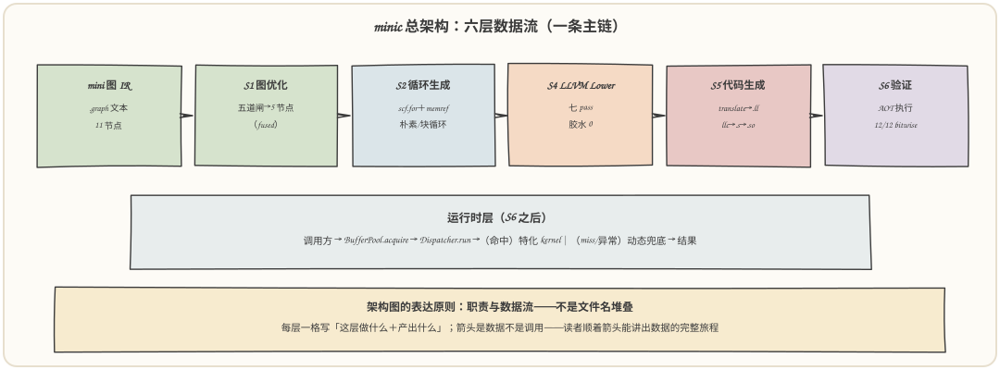
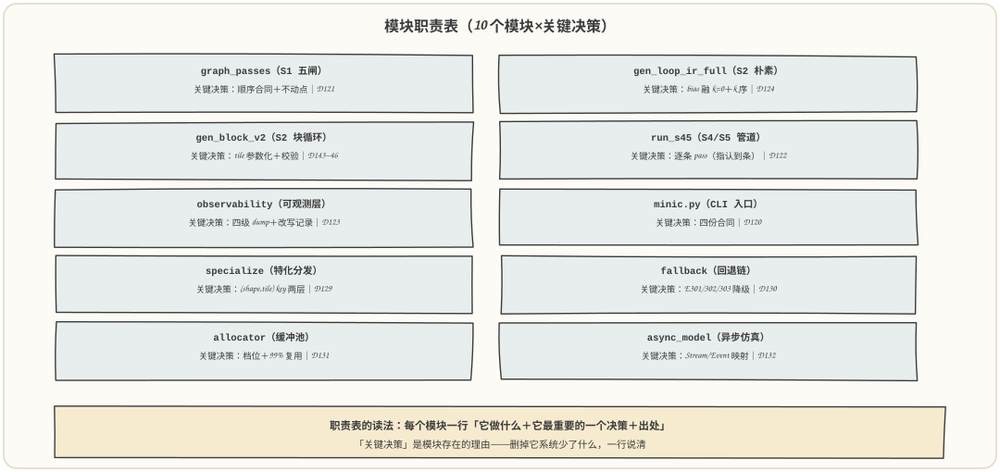

# 第 155 天：整理项目架构——架构图（职责与数据流）＋十模块职责表＋三份合同

> **今日目标**：完成本教程后，你能做到五件事——画出 **minic 总架构图**（六层数据流一条主链：mini 图 IR（.graph·11 节点）→S1 图优化（五道闸→5 节点 fused）→S2 循环生成（scf.for＋memref·朴素/块循环）→S4 LLVM Lowering（七 pass·胶水 0）→S5 代码生成（translate→.ll→llc→.so）→S6 验证（AOT 执行 12/12 bitwise）——**每层一格写"这层做什么＋产出什么"、箭头是数据不是调用**——读者顺着箭头能讲出数据的完整旅程）；配**运行时层**（调用方→BufferPool.acquire→Dispatcher.run→（命中）特化 kernel｜（miss/异常）动态兜底→结果——四级降级链的完整路径）；列**十模块职责表**（每模块一行"它做什么＋**它最重要的一个决策**＋出处"——graph_passes（S1 五闸·顺序合同＋不动点·D121）／gen_loop_ir_full（S2 朴素·bias 融 k=0·D124）／gen_block_v2（块循环·tile 参数化·D143~46）／run_s45（S4/S5·逐条 pass·D122）／observability（四级 dump·D123）／minic.py（CLI·四份合同·D120）／specialize（(shape,tile) 分发·D129）／fallback（E301/302/303·D130）／allocator（档位池·D131）／async_model（Stream/Event·D132）——**关键决策是模块存在的理由**）；点出**三份合同**（C 合同（`_mlir_ciface(out,a,b,bias)`＋56B 描述符——D115 定→D116 手写→D117 真工具三次验证）／manifest 合同（version/input/tile/stages/exit_code——机器可读回执）／诊断合同（E1xx/E2xx/E3xx/W1xx 四层全覆盖））；说出**架构图的表达原则**（**职责与数据流——不是文件名堆叠**；合同是架构的宪法——22 周里模块改了无数次、三份合同从未破坏——"合同先行"（D120 第一课）的回报：**接口稳定让内部演化无牵连**）。
> **预计时间**：学习 25 分钟＋实践 30 分钟
> **前置准备**：22 周的全部代码（今天整理的对象）、D119 的七层对账（架构图的 Lowering 部分蓝本）、D127 的职责审计（运行时层的蓝本）。工具：python3。本文环境：Python 3.9.6，macOS arm64，2026-11-15。
> **今日产出**：`code/arch_doc.py`（架构文档生成器＋自检）、`code/outputs/architecture.txt`（**主产出：架构文档**——数据流＋职责表＋合同）＋本文 3 张手绘图。

## 1. 今天解决什么问题？

第 23 周第一天。计划 D155 条目："绘制前端输入、图 IR、优化、循环 IR、LLVM、Runtime 的架构图；产出一张项目总架构图和模块职责表。"——从"做出来"到"讲清楚"的转换日。

架构图的最大陷阱是**文件名堆叠**（画一堆框写文件名＋箭头连调用关系——看似专业实则没人看得懂）；正确的画法是**职责与数据流**：每格写"这层做什么＋产出什么"、箭头是数据的旅程——一张图讲完"输入怎么变成输出"。

## 2. 先看全貌



**图 1**：看**六层主链＋运行时层＋金框**——六格数据流（图 IR→S1→S2→S4→S5→S6，每格标注做什么＋产出什么）；运行时层（BufferPool→Dispatcher→特化/兜底）；金框：**架构图的表达原则——职责与数据流不是文件名堆叠**（读者顺着箭头能讲出数据的完整旅程）。

## 3. 核心概念

### 3.1 架构图：职责与数据流

**一句话**：架构图的每格回答"这层做什么＋产出什么"、箭头回答"数据从哪来到哪去"——**不是文件名堆叠**（文件名目录就能查到，架构图要给目录给不了的东西：**系统的形状**）。

### 3.2 合同是架构的宪法

**一句话**：模块可以重写（朴素→块循环/单层→分发/裸 malloc→池），**合同不能轻易动**（C 合同/manifest/诊断——22 周零破坏）——接口稳定让内部演化无牵连——这是 D120"合同先行"的回报。

## 4. 图解核心机制



**图 2**：看**十张模块卡＋金框**——每卡三行（模块名＋职责／关键决策＋出处）；金框：职责表的读法——**"关键决策"是模块存在的理由**（删掉它系统少了什么、一行说清）。

## 5. 动手实践

### 5.1 准备文件

```text
tutorials/day-155/
├── README.md / images/（3 图）
└── code/
    ├── arch_doc.py / run_all.sh
    └── outputs/architecture.txt（主产出）
```

一键复现：`cd tutorials/day-155/code && ./run_all.sh`（约 2 秒）。

### 5.2 修改一个参数再观察

**实验 A（新人测试）**：把 architecture.txt 给一个没读过本项目的人（或想象）——TA 能五分钟讲出"数据怎么流动"吗？卡在哪补哪；**实验 B（模块删除演练）**：职责表里删掉任一模块——系统缺什么？（缺的回答就是"关键决策"列的验证）。

## 6. 常见错误与排查

**错误 1：架构图画成文件树**。修复：每格写职责与产出——文件名放目录里。

**错误 2：职责表只写"做什么"不写"关键决策"**。修复：加一列"删掉它系统少了什么"——存在理由一行说清。

## 7. 今日练习

**必做**：1. 六层主链脱稿讲一遍（每层一句"做什么＋产出什么"）；2. 三份合同各配一句"它锁住了什么"；3. 十模块里挑三个复述关键决策。

**选做**：4. 给架构图画时序版（一次调用的时序图）；5. 对照 TVM 的架构图——异同各一条。

## 8. 今日验收

- [ ] 我能画六层主链（每层职责＋产出）＋运行时层（分发/兜底/池）
- [ ] 我能说出架构图的原则（职责与数据流不是文件名堆叠）
- [ ] 我能背三份合同（C/manifest/诊断）与"合同是宪法"的含义（22 周零破坏）
- [ ] 我能挑三个模块说清关键决策（存在的理由）

## 9. 一句话总结与明天预告

今天的闭环：**架构图**——六层数据流（图 IR→S1→S2→S4→S5→S6，每格职责＋产出）＋运行时层（池→分发→特化/兜底）；**职责表**——十模块各配"关键决策"（存在的理由）＋出处；**合同**——C/manifest/诊断三份是架构的宪法（22 周模块无数改、合同零破坏——合同先行的回报）；**原则**——职责与数据流不是文件名堆叠。明天 D156 整理关键 Pass：为 Shape 推导、融合、Layout 优化、Tiling 各写一份简要说明＋**优化前后 IR 示例**——Pass 文档的五要素（输入/输出/合法性/收益/限制）。

> **第 23 周积分卡**：**D155 架构（4/4）** → D156 Pass 文档 → D157 Lowering 文档 → D158 测试文档 → D159 性能材料 → D160 干净复现 → D161 复盘。
