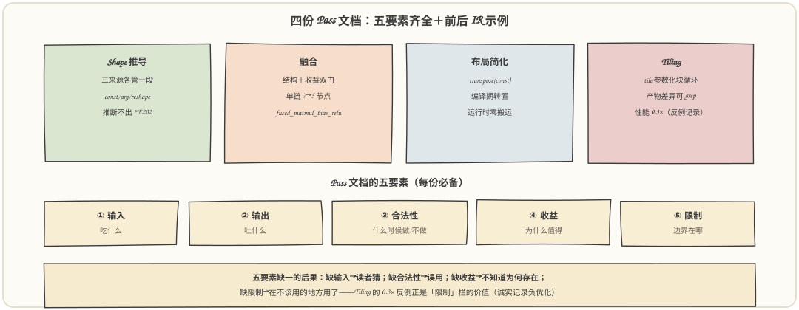
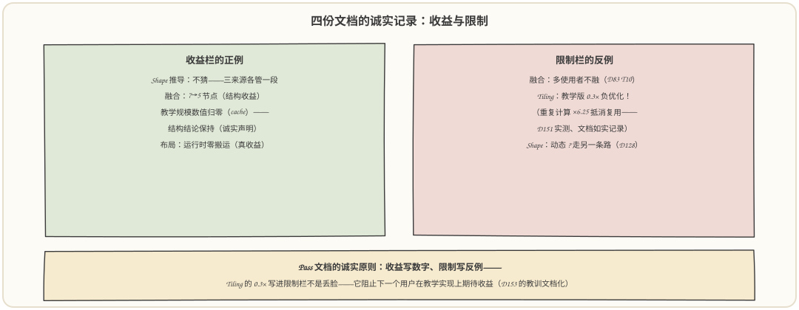
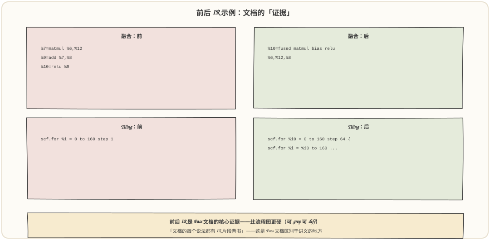

# 第 156 天：整理关键 Pass——四份文档五要素齐全：收益写数字、限制写反例

> **今日目标**：完成本教程后，你能做到——
> 1. 写出**四份 Pass 文档**（Shape 推导（三来源各管一段——const.shape 属性/arg.tensor 类型正则/reshape.new_shape；推断不出→E202）／融合（结构＋收益双门——单链 7→5 节点·fused_matmul_bias_relu）／布局简化（transpose(const) 编译期转置——运行时零搬运）／Tiling（tile 参数化块循环——产物差异可 grep·**性能 0.3× 反例如实记录**））；
> 2. 遵守**五要素纪律**（每份必备：①输入（吃什么）②输出（吐什么）③合法性（什么时候做/不做）④收益（为什么值得）⑤限制（边界在哪）——**缺一的后果**：缺输入→读者猜、缺合法性→误用、缺收益→不知道为何存在、缺限制→在不该用的地方用了）；
> 3. 配**前后 IR 示例**（融合的前（`%7=matmul %6,%12｜%9=add %7,%8｜%10=relu %9`）→后（`%10=fused_matmul_bias_relu %6,%12,%8`）／Tiling 的前（`scf.for %i=0 to 160 step 1`）→后（`scf.for %i0=0 to 160 step 64 { scf.for %i=%i0 ...`）——**IR 片段比流程图更硬（可 grep 可 diff）**——文档的每个说法都有证据背书）；
> 4. 坚持**诚实原则**（收益栏写数字（7→5 节点／运行时零搬运）、**限制栏写反例**（Tiling 的 0.3× 负优化写进限制栏不是丢脸——它阻止下一个用户在教学实现上期待收益（D153 的教训文档化）；融合的多使用者不融（D83 T10））；说出**Pass 文档与讲义的区别**（讲义教你理解、文档帮你**安全使用**——五要素全是为了"用对"而不是"看懂"）。
> **预计时间**：学习 20 分钟＋实践 30 分钟
> **前置准备**：D155 的架构图（今天细化 Pass 层）、D121 的五道闸语义（融合/布局的蓝本）、D143~D151 的 Tiling 全程（含反例）、D83 的融合测试用例。工具：python3。本文环境：Python 3.9.6，macOS arm64，2026-11-15。
> **今日产出**：`code/pass_docs.py`（四份文档生成＋五要素断言）、`code/outputs/pass-{shape-inference,fusion,layout,tiling}.md`（**主产出：四份 Pass 文档**）＋本文 3 张手绘图。

## 1. 今天解决什么问题？

第 23 周第二天。计划 D156 条目："为 Shape 推导、融合、Layout 优化、Tiling 各写一份简要说明。"——Pass 层的文档化。架构图（昨天）给了系统形状；今天给每个关键 Pass 一份"**使用说明书**"——五要素齐全＋前后 IR 证据。

文档的诚实原则是今天的重点：**收益栏写数字、限制栏写反例**——Tiling 的 0.3×（负优化）写进限制栏——这不是丢脸是**保护下一个用户**（D153 的教训文档化）。

## 2. 先看全貌



**图 1**：看**四 Pass 卡＋五要素条＋金框**——Shape 推导（三来源·绿）／融合（双门 7→5·橙）／布局（编译期转置·蓝）／Tiling（tile 参数化·红·性能 0.3× 反例记录）；五要素（输入/输出/合法性/收益/限制）；金框：**缺一的后果**（缺限制→在不该用的地方用了——Tiling 反例正是限制栏的价值）。

## 3. 核心概念



**图 3**：看**左右两框＋金框**——左绿框收益栏的正例（Shape 不猜——三来源各管一段／融合 7→5 节点（结构收益；教学规模数值归零——**结构结论保持的诚实声明**）／布局运行时零搬运（真收益））；右红框限制栏的反例（融合多使用者不融（D83 T10）／**Tiling 教学 0.3× 负优化**（重复计算 ×6.25 抵消复用——D151 实测、文档如实记录）／Shape 动态 ? 走另一条路）；金框：**Pass 文档的诚实原则——收益写数字、限制写反例**；Tiling 的 0.3× 写进限制栏不是丢脸——它阻止下一个用户在教学实现上期待收益（D153 的教训文档化）。

### 3.1 五要素：使用说明书不是讲义

**一句通俗解释**：Pass 文档的五个必备栏（输入/输出/合法性/收益/限制）全为"**用对**"服务——讲义帮你理解、文档帮你安全使用；缺任何一栏都会导致误用。

**生活类比**：药品说明书——好说明书写「适应症/用法/禁忌/副作用/注意事项」——不是只写「治什么」。

**对应到技术上是**：Pass 文档五要素：输入/输出/合法性/收益/限制——限制栏写反例是保护下一个用户。

**类比边界**：药品说明书的类比帮你建立直觉，但真实的技术实现有更多约束和量化指标——类比的目的是「快速理解方向」，不是「替代技术细节」。

### 3.2 诚实原则：收益写数字、限制写反例

**一句话**：收益栏要量化（7→5 节点／零搬运）不写"提升性能"；限制栏要有反例（0.3×／多使用者不融）不写"有边界"——**数字与反例是文档的肌肉**。

## 4. 图解核心机制



**图 2**：看**两组前后对照**——融合（前三行→后一行）；Tiling（单层循环→双层壳＋内层）；金框：**前后 IR 是 Pass 文档的核心证据——比流程图更硬（可 grep 可 diff）**。

## 5. 动手实践

### 5.1 准备文件

```text
tutorials/day-156/
├── README.md / images/（3 图）
└── code/
    ├── pass_docs.py / run_all.sh
    └── outputs/pass-*.md ×4（主产出）
```

一键复现：`cd tutorials/day-156/code && ./run_all.sh`（约 2 秒）。

### 5.2 修改一个参数再观察

**实验 A（五要素自检）**：拿一份真实 MLIR pass 文档（如 memref-to-llvm 的官方文档）对照五要素——缺了哪栏？（官方文档常缺"限制"——反例栏是项目文档可以胜过官方的地方）；**实验 B（补第五份）**：给 S1 的 QDQ 清理闸写五要素文档（D82 规则表是蓝本）。

## 6. 常见错误与排查

**错误 1：文档写成讲义**。现象：通篇"什么是融合、为什么要融合"——没有输入/输出/合法性。修复：五要素框架——使用说明书不是教材。

**错误 2：限制栏空着或含糊**。现象："有使用限制"——没说什么限制。修复：写具体反例（0.3×/多使用者）。

## 7. 今日练习

**必做**：1. 五要素默写＋各配一条后果；2. Tiling 文档的限制栏复述（为什么 0.3× 也要写）；3. 前后 IR 的"证据"价值（vs 流程图）。

**选做**：4. 实验 B（第五份文档）；5. 对照官方 MLIR pass 文档的要素覆盖。

## 8. 今日验收

- [ ] 我能背出五要素（输入/输出/合法性/收益/限制）与缺一的后果
- [ ] 我能说出诚实原则（收益写数字、限制写反例）与 Tiling 0.3× 写进文档的意义
- [ ] 我能举前后 IR 示例（融合三变一／Tiling 单变双层）
- [ ] 我知道 Pass 文档与讲义的区别（安全使用 vs 理解）

## 9. 一句话总结与明天预告

今天的闭环：**四份 Pass 文档**——Shape 推导/融合/布局/Tiling 各配五要素（输入/输出/合法性/收益/限制）＋前后 IR 证据（融合三变一、Tiling 单变双层的可 grep 片段）；**诚实原则**——收益写数字（7→5/零搬运）、限制写反例（Tiling 0.3× 负优化如实记录——保护下一个用户）；**区别**——文档是使用说明书不是讲义。明天 D157 整理 Lowering 文档：**用一个 MatMul 示例串联各阶段 IR**（图→循环→cf→LLVM 方言→.ll→汇编——六阶段快照＋关键转换标注）——"抽象如何逐级消失、语义如何保持"的主线叙述。

> **第 23 周积分卡**：D155 架构（4/4）→ **D156 Pass 文档（4/4）** → D157 Lowering 文档 → D158 测试文档 → D159 性能材料 → D160 干净复现 → D161 复盘。
