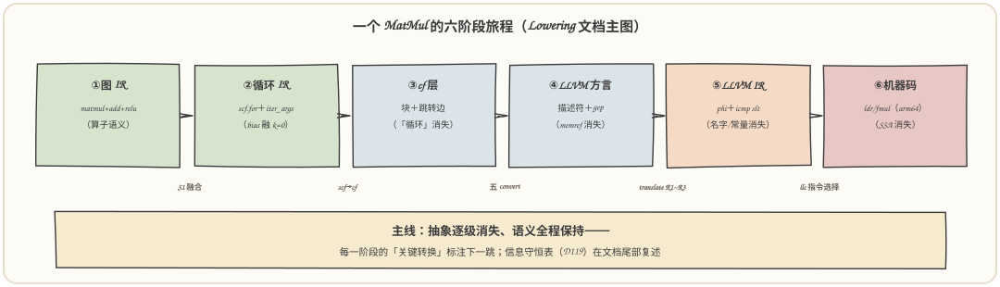
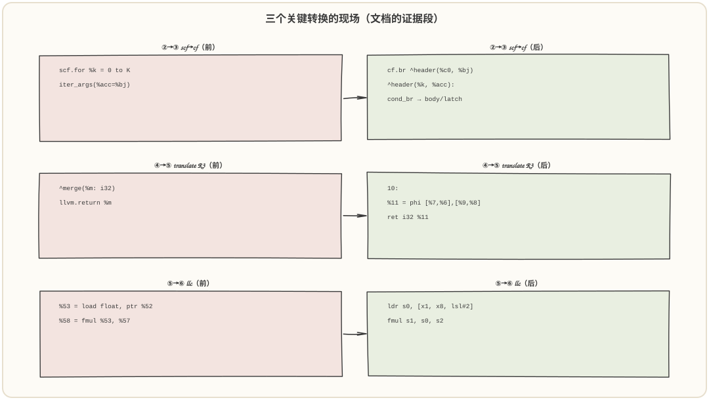

# 第 157 天：整理 Lowering 文档——一个 MatMul 的六阶段旅程：抽象逐级消失、语义全程保持

> **今日目标**：完成本教程后，你能做到五件事——写出 **Lowering 文档的主线**（**抽象逐级消失、语义全程保持**——一个 MatMul（main.graph）从图 IR 到机器码的六阶段旅程，每阶段标注"什么在场/什么消失"＋**关键转换**（下一跳的 pass 名））；串起**六阶段快照**（①图 IR（`matmul+add+relu`——算子语义在场）→②循环 IR（`scf.for＋iter_args(%acc=%bj)`——bias 融 k=0、k 序乘加、cmpf+select）→③cf 层（块＋跳转边——"循环"的结构语义消失）→④LLVM 方言（描述符＋gep——memref 消失、56B 契约新增）→⑤LLVM IR（phi＋`icmp slt`——名字/常量消失、C 合同定形）→⑥机器码（`ldr/fmul` arm64——SSA 消失、12/12 bitwise 总验））；配**三个关键转换的现场证据**（②→③ scf→cf：`iter_args(%acc=%bj)` 变 `^header(%k,%acc)` 块参数；④→⑤ translate R3：`^merge(%m)` 变 `%11=phi`；⑤→⑥ llc：`load/fmul` 变 `ldr s0/fmul s1`——**每跳都有前后 IR 片段**）；复述**信息守恒表**（算子语义：② 消失（三层 for 不再"是"MatMul）／shape 决策：⑤ 内联成常量（`icmp slt ..., 4` 的 4=M）／描述符合同：④ 新增（D115 的 56B）／正确性裁判：⑥ 总验（执行＋golden）——D119 的结论在新证据下复述）；说出**文档的两类读者**（新人——顺着六阶段读懂"数据怎么变"；维护者——debug 时查"哪个转换动了哪层"的地图——**每阶段的关键转换标注就是 debug 的路标**）。
> **预计时间**：学习 20 分钟＋实践 30 分钟
> **前置准备**：D119 的七层对账（今天文档的理论蓝本）、D122~D124 的 stage 产物（证据来源）、D155/D156 的架构与 Pass 文档（同系列的姊妹篇）。工具：python3。本文环境：Python 3.9.6，macOS arm64，2026-11-15。
> **今日产出**：`code/lowering_doc.py`（文档生成＋六阶段断言）、`code/outputs/lowering-doc.md`（**主产出：Lowering 文档**）＋本文 3 张手绘图。

## 1. 今天解决什么问题？

第 23 周第三天。计划 D157 条目："用一个 MatMul 示例串联各阶段 IR，标注关键转换。"——Lowering 层的文档化。架构图（D155）给了形状、Pass 文档（D156）给了零件说明——今天给**整条 Lowering 链的旅程叙述**：一个 MatMul 怎么从图变成机器码、每一跳发生了什么。

主线是 D119 的结论："抽象逐级消失、语义全程保持"——但今天的版本**升级了证据**：六阶段快照不再是理论推导，而是 D122~D124 管道的真实产物（stage-1-graph-opt.graph→stage-2-loop.mlir→s4-*.mlir→stage-5.ll→.s）。

## 2. 先看全貌



**图 1**：看**六格阶梯＋转换标注＋金框**——六阶段（图 IR→循环→cf→LLVM 方言→LLVM IR→机器码）各配"什么在场/什么消失"；转换标注（S1 融合／scf→cf／五 convert／translate R1~R3／llc 指令选择）在格子之间；金框：**主线——抽象逐级消失、语义全程保持**。

## 3. 核心概念


**图 3**：看**四行守恒表＋读者金框**——算子语义（阶段② 消失——三层 for 不再"是"MatMul·红）；shape 决策（阶段⑤ 内联成常量——`icmp slt ..., 4` 的 4=M·橙）；描述符合同（阶段④ 新增——D115 的 56B 契约·绿）；正确性裁判（阶段⑥ 总验——执行＋golden 12/12·蓝）；金框：**Lowering 文档的两类读者——新人（顺着六阶段读懂"数据怎么变"）＋维护者（debug 时查"哪个转换动了哪层"的地图）**。

### 3.1 旅程叙述：每跳都有证据

**一句话**：Lowering 文档的核心形态是"旅程"——每阶段一张快照（什么在场/什么消失）＋每跳一个关键转换（哪个 pass）——**读者顺着旅程能讲出数据的完整变形**；跳的证据是前后 IR 片段（可 grep）。

### 3.2 信息守恒：文档的哲学层

**一句话**：六阶段的快照串起来就是信息守恒表（什么消失/什么保留/什么新增）——D119 的七层对账在今天以"文档"的形式沉淀——**新证据（真实 stage 产物）下的复述让理论落地**。

## 4. 图解核心机制



**图 2**：看**三组前后对照**——②→③（`iter_args(%acc=%bj)`→`^header(%k,%acc)` 块参数——phi 前身）；④→⑤（`^merge(%m)`→`%11=phi`——R3 兑现）；⑤→⑥（`load/fmul`→`ldr s0/fmul s1`——指令选择）——**每跳的前后 IR 是文档最硬的证据**。

## 5. 动手实践

### 5.1 准备文件

```text
tutorials/day-157/
├── README.md / images/（3 图）
└── code/
    ├── lowering_doc.py / run_all.sh
    └── outputs/lowering-doc.md（主产出）
```

一键复现：`cd tutorials/day-157/code && ./run_all.sh`（约 2 秒）。

### 5.2 修改一个参数再观察

**实验 A（新读者测试）**：把 lowering-doc.md 给新人读——五分钟能讲出六阶段吗？卡哪补哪；**实验 B（补动态版）**：给 D128 的动态签名（`memref<?x?x>`）写一段"旅程变体"——同样的六阶段、shape 的载体从类型变描述符。

## 6. 常见错误与排查

**错误 1：文档变成 pass 清单**。现象：罗列七条 pass 的名字与 flag——没有"数据怎么变"的主线。修复：旅程叙述——每阶段快照＋关键转换。

**错误 2：快照没有 IR 片段**。现象：文字描述"此阶段 memref 变描述符"——没有代码证据。修复：前后 IR 片段（可 grep）。

## 7. 今日练习

**必做**：1. 六阶段脱稿讲（每阶段一句"在场/消失"）；2. 三个关键转换现场复述；3. 信息守恒表四行默写。

**选做**：4. 实验 B（动态版旅程变体）；5. 给文档加时序（每阶段的耗时——D123 时间线的引用）。

## 8. 今日验收

- [ ] 我能脱稿讲六阶段旅程（每阶段什么在场/什么消失＋关键转换）
- [ ] 我能举三个转换现场（scf→cf 的块参数／R3 的 phi／llc 的指令选择）
- [ ] 我能复述信息守恒表（算子语义②消失/shape⑤常量/描述符④新增/裁判⑥总验）
- [ ] 我知道文档的两类读者（新人读懂旅程／维护者 debug 查地图）

## 9. 一句话总结与明天预告

今天的闭环：**主线**——抽象逐级消失、语义全程保持（一个 MatMul 的六阶段旅程）；**快照**——每阶段"在场/消失"＋关键转换（S1 融合/scf→cf/五 convert/R1~R3/llc）；**证据**——三个转换现场的前后 IR（可 grep）；**守恒表**——D119 结论在真实 stage 产物下的复述；**读者**——新人（旅程）＋维护者（debug 地图）。明天 D158 整理测试文档：测试金字塔（L1/L2/L3）＋分类运行命令＋覆盖范围与当前缺口——**"怎么验证这个项目是对的"的一页答案**。

> **第 23 周积分卡**：D155 架构 → D156 Pass 文档 → **D157 Lowering 文档（4/4）** → D158 测试文档 → D159 性能材料 → D160 干净复现 → D161 复盘。
