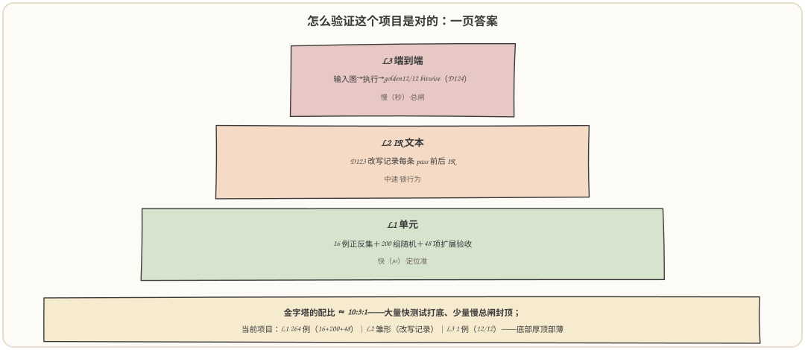
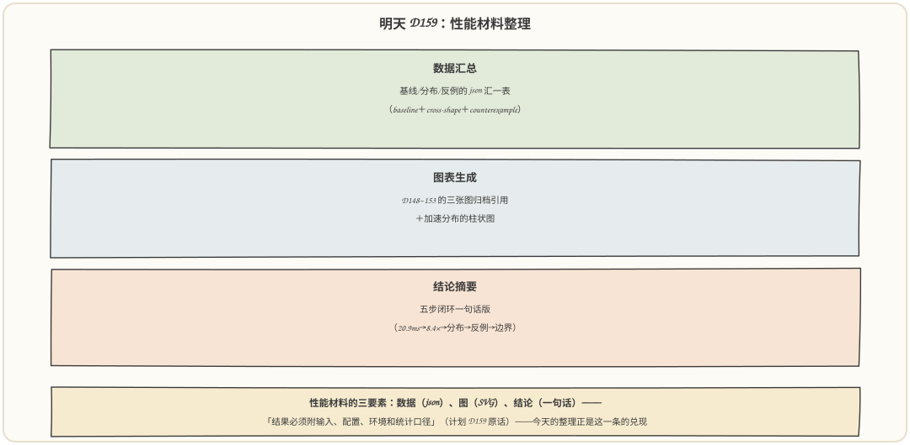
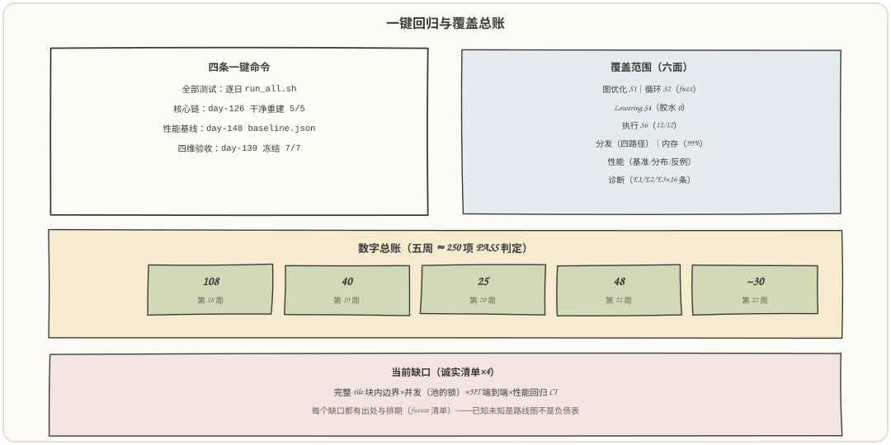

# 第 158 天：整理测试文档——金字塔＋一键回归＋覆盖总账 ≈250 项与四个缺口

> **今日目标**：完成本教程后，你能做到——
> 1. 写出**"怎么验证这个项目是对的"的一页答案**（测试金字塔三层：L3 端到端（输入图→执行→golden——12/12 bitwise·总闸）／L2 IR 文本（D123 改写记录——锁 Pass 行为）／L1 单元（16 例正反集＋200 组随机＋48 项扩展——快·定位准）——**配比 ≈10:3:1**）；
> 2. **四条一键回归命令**（全部测试：逐日 run_all.sh／核心链：day-126 干净重建 5/5／性能基线：day-148 baseline.json／四维验收：day-139 冻结 7/7——**新人照着跑就能验证整个项目**）；
> 3. 盘出**覆盖范围的六面**（图优化 S1（五闸正反例）｜循环 S2（fuzz 200 组×7 tile）｜Lowering S4（胶水 0）｜执行 S6（12/12）｜分发（命中/miss/回退四路径）｜内存（99% 复用）＋性能（基准/分布/反例）＋诊断（E1/E2/E3×16 条）——**每面可指到具体测试**）；
> 4. 报出**数字总账**（第 18 周 108＋19 周 40＋20 周 25＋21 周 48＋22 周 ~30＝**≈250 项 PASS 判定**）；
> 5. 诚实列出**当前缺口×4**（完整 tile 块内边界（future F-01 后续）／并发（BufferPool 的锁——D131 练习）／JIT 端到端（四路线只接了 AOT）／性能回归 CI（引擎在、无定时触发）——**每个缺口有出处与排期：已知未知是路线图不是负债表**）。
> **预计时间**：学习 20 分钟＋实践 25 分钟
> **前置准备**：D134 的金字塔与正反集（今天的蓝本）、五周的测试数据（总账来源）、D139 的验收框架。工具：python3。本文环境：Python 3.9.6，macOS arm64，2026-11-15。
> **今日产出**：`code/test_doc.py`＋`code/outputs/test-doc.md`（**主产出：测试文档**）＋本文 3 张手绘图。

## 1. 今天解决什么问题？

第 23 周第四天。计划 D158 条目："列出测试分类、运行命令、覆盖范围和当前缺口。"——测试层的文档化。新人问"这个项目怎么验证是对的"——今天的文档就是一页答案：金字塔（三层）＋命令（四条）＋覆盖（六面）＋总账（250 项）＋缺口（四个，诚实）。

## 2. 先看全貌



**图 1**：看**三层金字塔＋金框**——L3（端到端 12/12·红）／L2（IR 文本·橙）／L1（单元 264 例·绿）；金框：配比 10:3:1＋当前项目的三层现状（底部厚顶部薄——教学阶段的健康形态）。

## 3. 核心概念



**图 3**：看**三行任务卡＋金框**——数据汇总（基线/分布/反例的 json 归一表·绿）；图表生成（D148~153 的三张图归档引用＋加速分布柱状图·蓝）；结论摘要（五步闭环一句话版：20.9ms→8.4×→分布→反例→边界·橙）；金框：**性能材料的三要素——数据（json）、图（SVG）、结论（一句话）**；"结果必须附输入、配置、环境和统计口径"（计划 D159 原话）——今天的整理正是这一条的兑现。

### 3.1 一页答案：新人的验证入口

**一句通俗解释**：测试文档的首要读者是**新人**（"我想验证这个项目"）——四条命令覆盖全部场景、六面覆盖给出"验证了什么"、缺口给出"还没验证什么"——**一页读完就能动手**。

**生活类比**：医院分诊——急诊分级（一级送抢救室、二级观察、三级排队）——不是所有人都进抢救室。

**对应到技术上是**：L1 单元（快·定位准）打底、L2 IR 文本（锁行为）中层、L3 端到端（总闸）封顶——配比 10:3:1。

**类比边界**：医院分诊的类比帮你建立直觉，但真实的技术实现有更多约束和量化指标——类比的目的是「快速理解方向」，不是「替代技术细节」。

### 3.2 缺口的诚实

**一句话**：缺口清单不是失败记录——四个缺口各配出处与排期（future/练习/后续）——**已知未知是路线图**；藏着缺口才是负债。

## 4. 图解核心机制



**图 2**：看**命令框＋覆盖框＋总账带＋缺口框**——四条命令（可复制执行）；六面覆盖（每面可指到测试）；五周总账（108+40+25+48+30＝≈250）；缺口四条（红框＋"已知未知是路线图"）。

## 5. 动手实践

### 5.1 准备文件

```text
tutorials/day-158/
├── README.md / images/（3 图）
└── code/
    ├── test_doc.py / run_all.sh
    └── outputs/test-doc.md（主产出）
```

一键复现：`cd tutorials/day-158/code && ./run_all.sh`（约 2 秒）。

### 5.2 修改一个参数再观察

**实验 A（新人走查）**：按 test-doc.md 的四条命令逐条跑——哪条卡壳修哪条（文档的可用性实测）；**实验 B（缺口收窄）**：挑一个缺口（如并发）写它的测试草案——缺口变成待办。

## 6. 常见错误与排查

**错误 1：测试文档写成测试清单**。现象：罗列 250 项的名字——没有"怎么跑"与"覆盖了什么"。修复：一页答案结构（金字塔/命令/覆盖/缺口）。

**错误 2：缺口不写**。修复：诚实四条＋各配出处。

## 7. 今日练习

**必做**：1. 四条命令背出；2. 六面覆盖各配一个数字；3. 缺口四条＋"路线图不是负债表"复述。

**选做**：4. 实验 A（新人走查）；5. 把 250 项按类型重新统计（正确性/性能/诊断的占比）。

## 8. 今日验收

- [ ] 我能背出金字塔三层与四条一键命令
- [ ] 我能说出六面覆盖各配的数字（16/200/胶水0/12/12/99%）
- [ ] 我知道总账 ≈250 与缺口四条（各配出处）
- [ ] 我理解测试文档的首要读者是新人（一页答案）

## 9. 一句话总结与明天预告

今天的闭环：**一页答案**——金字塔（L3 总闸/L2 锁行为/L1 快定位·10:3:1）＋四条命令（全部/核心链/基线/验收）＋六面覆盖（图/循环/Lowering/执行/分发/内存＋性能＋诊断）＋**总账 ≈250 项**＋**缺口四条**（诚实清单——已知未知是路线图）。明天 D159 整理性能材料：数据汇总（三份 json 归一表）＋图表归档＋结论摘要（五步闭环一句话版）——**"性能结果必须附输入、配置、环境和统计口径"**（计划条目原话）的兑现。

> **第 23 周积分卡**：D155 架构 → D156 Pass → D157 Lowering → **D158 测试（4/4）** → D159 性能材料 → D160 干净复现 → D161 复盘。
