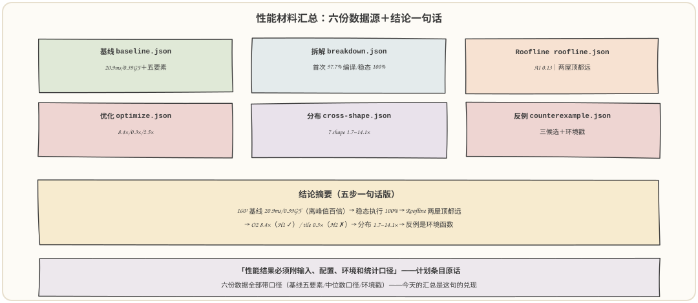
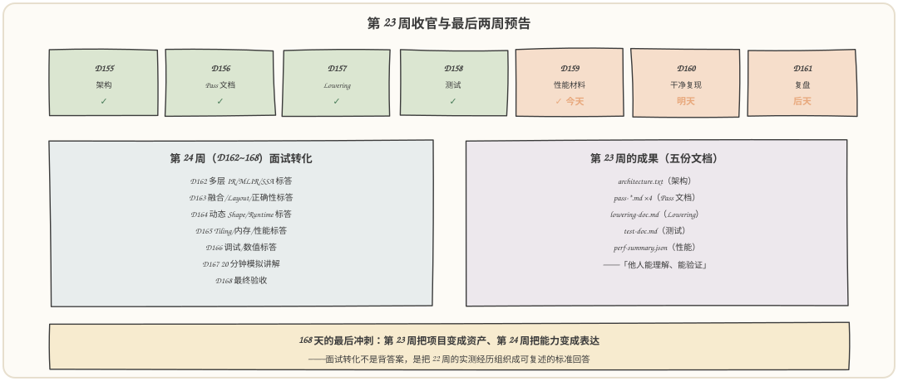
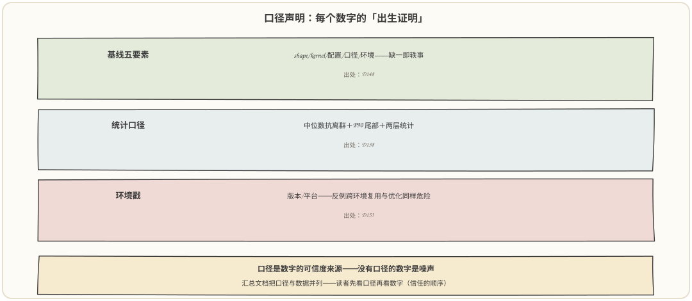

# 第 159 天：整理性能材料——六份数据源汇总＋口径声明：每个数字的出生证明

> **今日目标**：完成本教程后，你能做到五件事——汇总**六份性能数据源**（基线 baseline.json（20.9ms/0.39GF＋五要素）／拆解 breakdown.json（首次 97.7% 编译/稳态 100%）／Roofline roofline.json（AI 0.13＋两屋顶都远）／优化 optimize.json（8.4×/0.3×/2.5×）／分布 cross-shape.json（7 shape 1.7~14.1×）／反例 counterexample.json（三候选＋环境戳）——**6/6 在位**，汇总为 perf-summary.json）；写出**结论摘要的五步一句话版**（"160³ 基线 20.9ms/0.39GF（离峰值百倍）→稳态执行 100% → Roofline 两屋顶都远 → O2 8.4×（H1 ✓）/tile 0.3×（H2 ✗）→ 分布 1.7~14.1× → 反例是环境函数"——**一段话讲完第 22 周**）；附上**口径声明**（基线五要素（shape/kernel/配置/口径/环境——缺一即轶事）＋统计口径（中位数抗离群＋P90 尾部＋两层统计——D138）＋**环境戳**（版本/平台——反例跨环境复用与优化同样危险——D153）——**口径是数字的可信度来源，没有口径的数字是噪声**）；归档**图表引用**（D148~153 的三张图（基线/分布/反例）＋加速分布的柱状图——图是数据的第二视角）；兑现计划条目原话（**"性能结果必须附输入、配置、环境和统计口径"**——今天的汇总把口径与数据并列：读者先看口径再看数字（**信任的顺序**））。
> **预计时间**：学习 20 分钟＋实践 25 分钟
> **前置准备**：D148~D153 的六份 json（今天的数据源）、D154 的闭环报告（结论摘要的蓝本）、D138/D153 的口径纪律。工具：python3。本文环境：Python 3.9.6，macOS arm64，2026-11-15。
> **今日产出**：`code/perf_materials.py`（数据汇总＋结论＋口径）、`code/outputs/perf-summary.json`（**主产出：性能材料汇总**）＋本文 3 张手绘图。

## 1. 今天解决什么问题？

第 23 周第五天。计划 D159 条目："汇总 Tile、融合、Shape 特化和最终优化的性能数据，生成图表。"——性能层的文档化（本周第四份文档）。六份 json 散在六天的 outputs/——今天归一表＋附口径＋一句话结论。

整理的核心纪律是**口径与数据并列**：每个数字旁边写"怎么测的"（五要素/中位数/环境戳）——读者先看口径再信数字。这是计划条目"性能结果必须附输入、配置、环境和统计口径"的直接兑现。

## 2. 先看全貌



**图 1**：看**六源卡＋结论框＋紫框**——六份 json 各配一行要点；结论框（五步一句话版——一段话讲完第 22 周）；紫框：口径与数据并列的纪律。

## 3. 核心概念



**图 3**：看**七行进度＋两框＋金框**——第 23 周七天（D155~D159 全 ✓＋D160 明天＋D161 后天）；左蓝框第 24 周（D162~168 面试转化：多层 IR/融合/动态 Shape/Tiling/调试五天标答＋20 分钟模拟＋最终验收）；右紫框第 23 周成果（五份文档：architecture/pass-*/lowering-doc/test-doc/perf-summary——**"他人能理解、能验证"**）；金框：168 天最后冲刺——第 23 周把项目变成资产、第 24 周把能力变成表达——**面试转化不是背答案，是把 22 周的实测经历组织成可复述的标准回答**。

### 3.1 口径：数字的出生证明

**一句话**：每个性能数字都要能回答"怎么测的"（shape/配置/统计/环境）——**口径是可信度的来源**；汇总文档把口径与数据并列——读者先看口径再看数字。

## 4. 图解核心机制



**图 2**：看**三行口径卡＋金框**——基线五要素（缺一即轶事·D148）；统计口径（中位数/P90/两层·D138）；环境戳（版本/平台·D153）；金框：**口径是数字的可信度来源——没有口径的数字是噪声**。

## 5. 动手实践

### 5.1 准备文件

```text
tutorials/day-159/
├── README.md / images/（3 图）
└── code/
    ├── perf_materials.py / run_all.sh
    └── outputs/perf-summary.json（主产出）
```

一键复现：`cd tutorials/day-159/code && ./run_all.sh`（约 3 秒——引用上游 json）。

### 5.2 修改一个参数再观察

**实验 A（汇总瘦身）**：把 perf-summary.json 转成 Markdown 表（六行×四列：源/核心数字/口径/出处）——哪个格式更好找？

## 6. 常见错误与排查

**错误 1：汇总只搬数字不带口径**。修复：口径与数据并列（今天的格式）。

## 7. 今日练习

**必做**：1. 六源各配一行要点；2. 五步一句话复述；3. 三件口径各配出处。

**选做**：4. Markdown 表版汇总；5. 给汇总加趋势图（六源的时间线）。

## 8. 今日验收

- [ ] 我能背出六份数据源与各自核心数字
- [ ] 我能复述五步一句话结论
- [ ] 我知道三件口径（五要素/统计/环境戳）与"口径是出生证明"的含义

## 9. 一句话总结与明天预告

今天的闭环：**六源汇总**（基线/拆解/Roofline/优化/分布/反例——6/6 在位归一表）；**结论**（五步一句话：20.9ms→100%→两屋顶→8.4×/0.3×→1.7~14.1×→环境函数）；**口径**（五要素＋中位数＋环境戳——与数据并列、读者先看口径）；**兑现**——"性能结果必须附输入、配置、环境和统计口径"。明天 D160 干净环境复现：**按 README 从干净目录执行构建、测试、编译和 Benchmark**（修复遗漏步骤）——第 23 周的收口动作：五份文档写好了，**新人能不能照着跑通**？——干净复现是文档可用性的终极测试。

> **第 23 周积分卡**：D155 架构 → D156 Pass → D157 Lowering → D158 测试 → **D159 性能材料（6/6）** → D160 干净复现 → D161 复盘。
