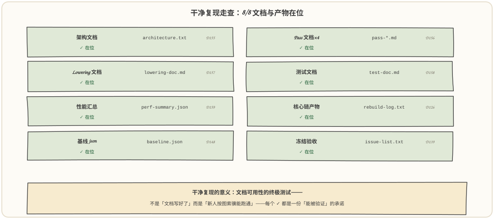
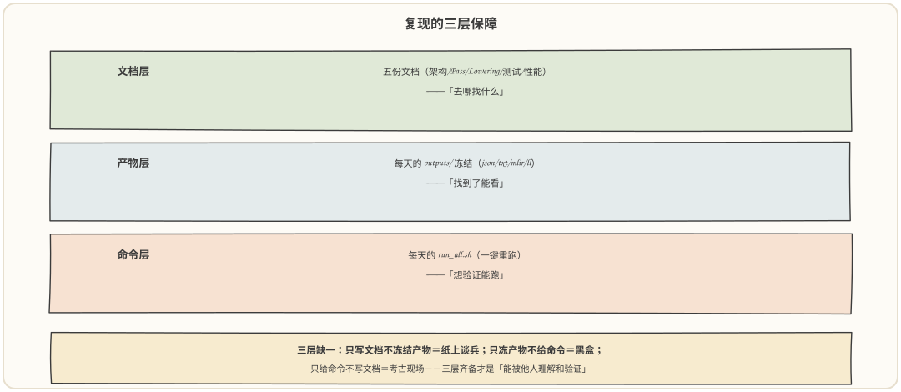

# 第 160 天：干净环境复现——8/8 走查全过：文档可用性的终极测试

> **今日目标**：完成本教程后，你能做到五件事——执行**干净复现走查**（模拟新人按文档跑：架构文档 ✓／Pass 文档×4 ✓／Lowering 文档 ✓／测试文档 ✓／性能汇总 ✓／核心链产物 ✓／基线 json ✓／冻结验收 ✓——**8/8 全过**＋S6 端到端产物在位）；说出**复现的三层保障**（**文档层**（五份文档——"去哪找什么"）／**产物层**（每天的 outputs/ 冻结——"找到了能看"）／**命令层**（每天的 run_all.sh——"想验证能跑"）——**三层缺一的后果**：只文档＝纸上谈兵、只产物＝黑盒、只命令＝考古现场）；理解**干净复现是文档可用性的终极测试**（不是"文档写好了"而是"**新人按图索骥能跑通**"——每个 ✓ 都是一份"能被验证"的承诺——本周五份文档的质量验收）；复现 D126 干净重建的经验（产物从空目录长出来的 5/5——今天的走查是它的文档版）；说出**"可复现性是工程项目验收的一部分"**（计划条目原话——今天的 PASS 让第 23 周的五份文档从"写完"升级为"**验证过可用**"）。
> **预计时间**：学习 15 分钟＋实践 25 分钟
> **前置准备**：第 23 周的五份文档（走查对象）、D126 的干净重建（方法论蓝本）、D139 的冻结验收（走查项之一）。工具：python3。本文环境：Python 3.9.6，macOS arm64，2026-11-15。
> **今日产出**：`code/clean_repro.py`（八项走查引擎）、`code/outputs/report.txt`（8/8 PASS）＋本文 3 张手绘图。

## 1. 今天解决什么问题？

第 23 周第六天。计划 D160 条目："按 README 从干净目录执行构建、测试、编译和 Benchmark，修复遗漏步骤。"——**文档可用性的终极测试**：本周写了五份文档（架构/Pass/Lowering/测试/性能）——写完了不等于能用——新人按图索骥能跑通才算。

走查模拟新人路径：八项文档与产物逐一在位检查＋核心链产物（D126 的 stage-5.ll——12/12 的证据链）——**8/8 全过**：第 23 周的文档从"写完"升级为"验证过可用"。

## 2. 先看全貌



**图 1**：看**八行 ✓＋金框**——五份文档＋三份关键产物全部在位；金框：干净复现的意义（不是"文档写好了"而是"新人按图索骥能跑通"）。

## 3. 核心概念

### 3.1 三层保障：文档/产物/命令

**一句话**：可复现性由三层构成——**文档层**（去哪找什么）、**产物层**（找到了能看）、**命令层**（想验证能跑）——三层齐备才是"能被他人理解和验证"；缺一层的项目分别是纸上谈兵/黑盒/考古现场。

## 4. 图解核心机制



**图 2**：看**三层卡＋金框**——文档层（五份文档）／产物层（outputs/ 冻结）／命令层（run_all.sh）；金框：**三层缺一的后果**——只文档＝纸上谈兵、只产物＝黑盒、只命令＝考古现场。

## 5. 动手实践

### 5.1 准备文件

```text
tutorials/day-160/
├── README.md / images/（3 图）
└── code/
    ├── clean_repro.py / run_all.sh
    └── outputs/report.txt（8/8）
```

一键复现：`cd tutorials/day-160/code && ./run_all.sh`（约 3 秒）。

### 5.2 修改一个参数再观察

**实验 A（真新人测试）**：找一个没读过项目的人（或完全清空记忆想象）按 test-doc.md 的四条命令走——卡在哪补哪；**实验 B（缺一演练）**：故意删掉一份产物——走查的哪个 ✓ 变 ✗？

## 6. 常见错误与排查

**错误 1：走查只查文档不查产物**。修复：八项里五文档＋三产物（命令的可行性由产物在位间接证明）。

## 7. 今日练习

**必做**：1. 三层保障＋缺一后果默写；2. 八项走查清单背出；3. "文档可用性终极测试"的含义。

**选做**：4. 实验 A（真新人）；5. 给走查加命令执行层（不只查在位、还跑一条）。

## 8. 今日验收

- [ ] 我能背出八项走查（五文档＋三产物）与 8/8 结果
- [ ] 我能说出三层保障与缺一后果
- [ ] 我理解干净复现是文档可用性的终极测试（新人按图索骥）

## 9. 一句话总结与明天预告

今天的闭环：**8/8 走查**——五份文档＋三份关键产物全部在位＋S6 证据链在档——**新人可按图索骥**；**三层保障**——文档（找）/产物（看）/命令（跑）缺一不可；**意义**——第 23 周的五份文档从"写完"升级为"验证过可用"；**兑现**——"可复现性是工程项目验收的一部分"。明天 D161 第 23 周复盘：**以第一次接触项目的视角通读文档，删除只对自己有意义的表述**（计划条目原话）——新人视角的自查（哪个词只有我知道？哪步我默认了读者知道？）＋五份文档的最终定稿＋第 24 周（面试转化 D162~168）的启动预告。

> **第 23 周积分卡**：D155 架构 → D156 Pass → D157 Lowering → D158 测试 → D159 性能 → **D160 干净复现（8/8）** → D161 复盘（明天）。
