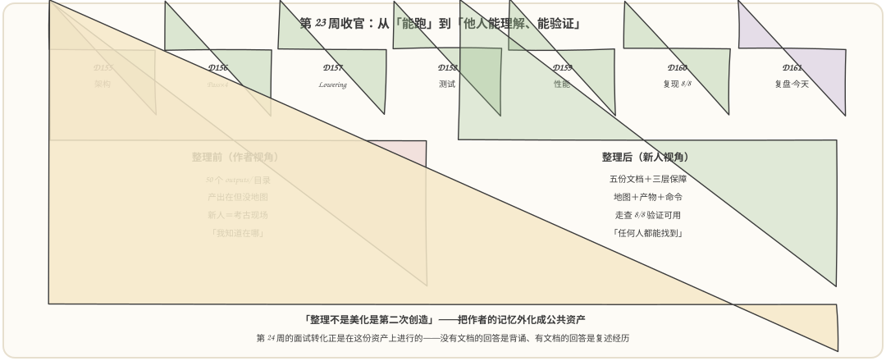
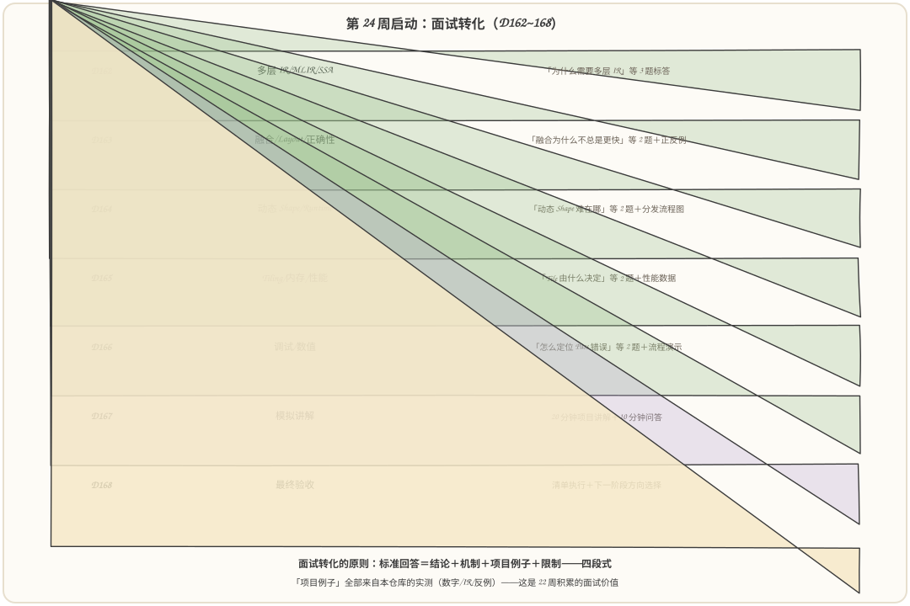
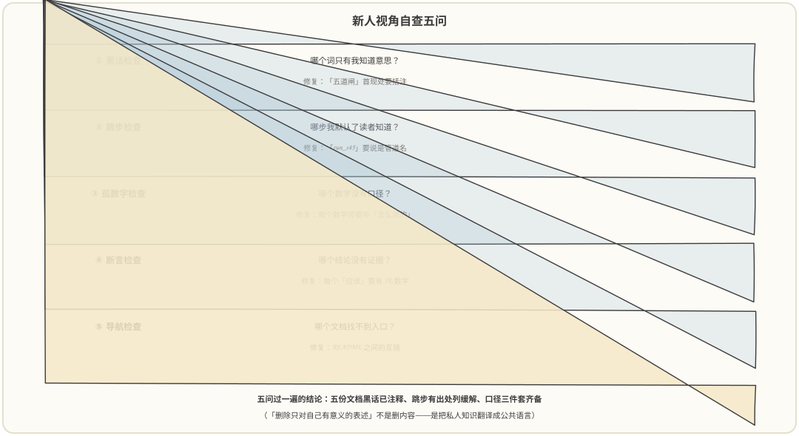

# 第 161 天：第 23 周复盘——从"能跑"到"他人能理解、能验证"：五份文档＋新人五问

> **今日目标**：完成本教程后，你能做到五件事——总结**第 23 周的成果**（五份文档＋一次走查：架构（六层数据流＋十模块＋三合同）／Pass×4（五要素＋前后 IR＋诚实反例）／Lowering（六阶段旅程＋信息守恒）／测试（金字塔＋四命令＋250 项＋缺口）／性能（六源＋口径＋一句话结论）／干净复现（**8/8 走查**）——**从"能跑"到"他人能理解、能验证"**）；说出**整理的本质**（**"整理不是美化是第二次创造"**——把作者的记忆外化成公共资产：整理前（作者视角：50 个 outputs/ 目录、产出在但没地图、新人＝考古现场）→整理后（新人视角：五份文档＋三层保障、走查 8/8 验证可用、**"任何人都能找到"**））；执行**新人视角自查五问**（①黑话检查（哪个词只有我知道意思？——"五道闸"首现处要括注）②跳步检查（哪步我默认了读者知道？——"run_s45"要说是管道名）③孤数字检查（哪个数字没有口径？）④断言检查（哪个结论没有证据？）⑤导航检查（哪个文档找不到入口？）——**"删除只对自己有意义的表述"不是删内容——是把私人知识翻译成公共语言**）；出**第 23 周账本**（每周模板十问——核心问题"项目怎么从能跑变成他人能理解能验证"；根因：22 周产出散在 50 个 outputs 里没地图；对照：整理前后的两个视角）；预演**第 24 周的面试转化**（D162~168：五天标准回答（**四段式：结论＋机制＋项目例子＋限制**）＋20 分钟模拟讲解＋最终验收——**"项目例子"全部来自本仓库的实测（数字/IR/反例）——这是 22 周积累的面试价值**）。
> **预计时间**：学习 20 分钟＋实践 25 分钟
> **前置准备**：本周六天的产出（账本证据）、计划 D161 条目（"以第一次接触项目的视角通读文档"）、每周复盘模板。工具：python3。本文环境：Python 3.9.6，macOS arm64，2026-11-15。
> **今日产出**：`code/week23_review.py`＋`code/outputs/week-ledger.txt`（每周账本）＋`code/outputs/newcomer-check.txt`（新人五问自查）＋本文 3 张手绘图。

## 1. 今天解决什么问题？

第 23 周收官。计划 D161 条目："以第一次接触项目的视角通读文档，删除只对自己有意义的表述。"——**新人视角的终审**：五份文档写好了（D155~159）、走查过了（D160 的 8/8）——但文档的**语言**是作者的吗？（黑话/跳步/孤数字/断言/迷路——五问逐一检查）。

复盘的第二件事是总结"整理的本质"——本周的核心发现：**整理不是美化是第二次创造**（把作者的记忆外化成公共资产——50 个目录的考古现场变成五份文档的地图）。

## 2. 先看全貌

**图 1**：看**七天卡＋前后对照＋金框**——七天全 ✓；对照（整理前·红：50 个 outputs/产出在没地图/考古现场/"我知道在哪"→整理后·绿：五文档＋三层保障/地图＋产物＋命令/走查 8/8/"任何人都能找到"）；金框：**"整理不是美化是第二次创造"——把作者的记忆外化成公共资产**；第 24 周的面试转化在这份资产上进行。

## 3. 核心概念

**图 3**：看**七行路线卡＋金框**——D162 多层 IR/MLIR/SSA（"为什么需要多层 IR"等 3 题标答）→D163 融合/Layout/正确性（"融合为什么不总是更快"等 2 题＋正反例）→D164 动态 Shape/Runtime（"动态 Shape 难在哪"等 2 题＋分发流程图）→D165 Tiling/内存/性能（"Tile 由什么决定"等 2 题＋性能数据）→D166 调试/数值（"怎么定位 Pass 错误"等 2 题＋流程演示）→D167 模拟讲解（20 分钟项目讲解＋10 分钟问答）→D168 最终验收（清单执行＋下一阶段方向选择·紫）；金框：**面试转化的原则——标准回答＝结论＋机制＋项目例子＋限制（四段式）**；"项目例子"全部来自本仓库的实测（数字/IR/反例）——这是 22 周积累的面试价值。

### 3.1 新人五问：文档的语言审计

**一句话**：五问各查一类"作者痕迹"——黑话（私人词汇）、跳步（默认知识）、孤数字（无口径）、断言（无证据）、迷路（无导航）——**"删除只对自己有意义的表述"＝把私人知识翻译成公共语言**。

## 4. 图解核心机制

**图 2**：看**五行问卡＋金框**——黑话/跳步/孤数字/断言/导航各配问题与修复；金框：五问过一遍的结论（五份文档黑话已注释、跳步有出处列缓解、口径三件套齐备——**自查通过**）。

## 5. 动手实践

一键复现：`cd tutorials/day-161/code && ./run_all.sh`（约 2 秒）。

### 5.1 修改一个参数再观察

**实验 A（五问实操）**：拿 D156 的 pass-fusion.md 过五问——找到几个可改进点？

## 6. 常见错误与排查

**错误 1：自查走过场**。修复：五问逐条对每份文档——找到至少一个改进点才算查过。

## 7. 今日练习

**必做**：1. 五问默写＋各配修复；2. 整理前后对照（两个视角各三句）；3. 第 24 周四段式（结论/机制/例子/限制）复述。

## 8. 今日验收

- [ ] 我能背出五份文档各一句话＋8/8 走查
- [ ] 我能说"整理是第二次创造"的含义（记忆外化成公共资产）
- [ ] 我能复述新人五问与自查结论
- [ ] 我知道第 24 周的四段式标答结构与"例子来自实测"的原则

## 9. 一句话总结与明天预告

今天的闭环：**成果**——五份文档＋8/8 走查（从"能跑"到"他人能理解能验证"）；**本质**——整理是第二次创造（50 目录考古现场→五文档地图）；**审计**——新人五问（黑话/跳步/孤数字/断言/导航）自查通过；**账本**——核心问题（能跑→能被理解）＋前后对照；**预告**——第 24 周面试转化：五天标准回答（**四段式：结论＋机制＋项目例子＋限制**——例子全部来自 22 周实测）＋20 分钟模拟＋最终验收。明天 D162 多层 IR、MLIR 与 SSA：三份标准回答（"为什么需要多层 IR"/"MLIR 解决什么问题"/"SSA 有什么价值"）——每份四段式＋本仓库的实测例子（七层对账/D119 信息守恒/phi 的 R3 兑现）。

> **第 23 周收官**：D155 架构→D156 Pass→D157 Lowering→D158 测试→D159 性能→D160 复现（8/8）→ **D161 复盘（新人五问）**。下一站：第 24 周面试转化——最后七天。
