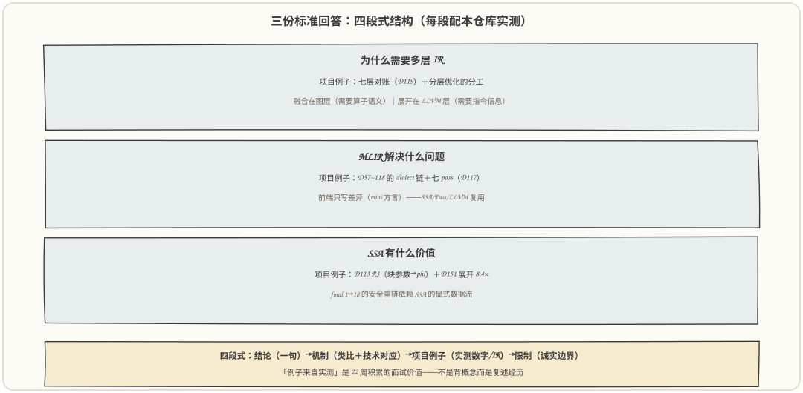
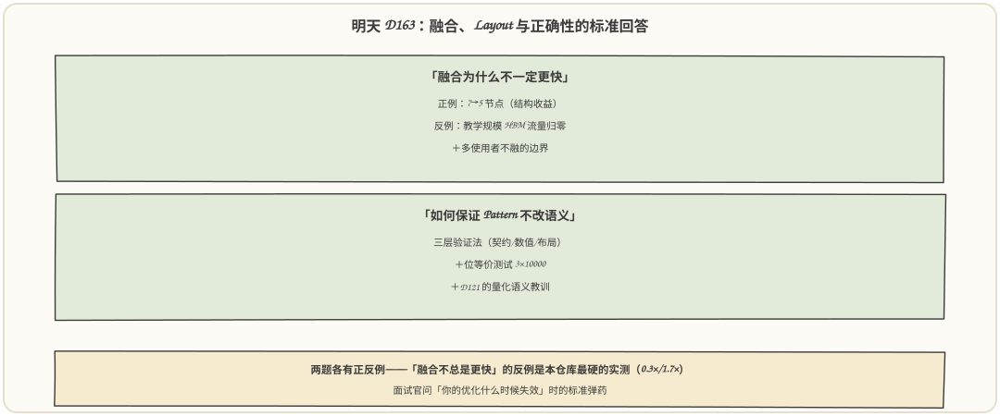
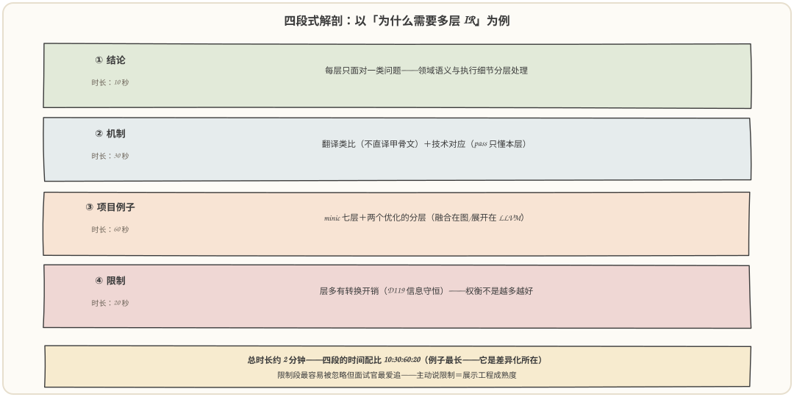

# 第 162 天：多层 IR、MLIR 与 SSA——三份标准回答：四段式＋本仓库实测

> **今日目标**：完成本教程后，你能做到五件事——写出**三份标准回答**（**"为什么需要多层 IR"**：每层只面对一类问题（领域语义与执行细节分层）——例子：minic 七层＋两个优化的分层（融合在图层（需要算子语义·D121）/展开在 LLVM 层（需要指令信息·D151 的 8.4×）——**两个优化都不可能在对的层做对的事**）；**"MLIR 解决什么问题"**：给造 DSL 编译器提供基础设施（Dialect/Pass/Conversion 框架——新语言只写差异、通用部分复用）——例子：mini 前端（D57~112 自己的方言）＋七 pass（D117 的 MLIR 框架）＋LLVM 对接（D118）；**"SSA 有什么价值"**：数据流显式化让优化分析简单且正确——例子：D113 的 R3（块参数→phi——同一 SSA 语义的两种语法）＋D151 的 O2 展开（fmul 1→18 的**安全重排依赖 SSA**））；遵守**四段式结构**（①结论（一句——10 秒）②机制（类比＋技术对应——30 秒）③**项目例子（实测数字/IR——60 秒·最长——它是差异化所在）**④限制（诚实边界——20 秒）——总时长约 2 分钟、配比 10:30:60:20）；说出**"例子来自实测"的价值**（不是背概念而是**复述经历**——面试官追问时你能给出 IR 片段/具体数字/反例——这是 22 周积累的面试竞争力）；理解**限制段的战略意义**（最容易被忽略但面试官最爱追——**主动说限制＝展示工程成熟度**：多层 IR 的转换开销（D119 信息守恒）/MLIR 的学习曲线（D113~119 一整周）/SSA 的表达膨胀（62 SSA 值 vs 21 op））。
> **预计时间**：学习 25 分钟＋实践 30 分钟
> **前置准备**：D119 的七层对答（多层 IR 的项目例子）、D113~118 的 dialect 链（MLIR 的例子）、D151 的展开实测（SSA 的例子）、D161 的四段式原则。工具：python3。本文环境：Python 3.9.6，macOS arm64，2026-11-15。
> **今日产出**：`code/std_answers.py`（三份四段式生成＋断言）、`code/outputs/answer-{0,1,2}.md`（**主产出：三份标准回答**）＋本文 3 张手绘图。

## 1. 今天解决什么问题？

第 24 周第一天。计划 D162 条目："分别回答'为什么需要多层 IR''MLIR 解决什么问题''SSA 有什么价值'。"——**面试转化的开始**：把 22 周的实测经历组织成可复述的标准回答。

四段式（结论/机制/例子/限制）的核心纪律：**例子必须来自本仓库的实测**（七层对账/dialect 链/R3 兑现/8.4× 展开）——背概念的人给不出 IR 片段和具体数字，复述经历的人可以——**这是 22 周积累的面试竞争力**。

## 2. 先看全貌

**图 1**：看**三行问答卡＋金框**——每题配项目例子（七层对账/dialect 链/R3＋展开）与一句要点；金框：四段式结构＋**"例子来自实测"是面试价值**。

## 3. 核心概念

**图 3**：看**两行问答卡＋金框**——"融合为什么不一定更快"（正例：7→5 节点（结构收益）／反例：教学规模 HBM 流量归零＋多使用者不融的边界）；"如何保证 Pattern 不改语义"（三层验证法（契约/数值/布局）＋位等价测试 3×10000＋D121 的量化语义教训）；金框：两题各有正反例——**"融合不总是更快"的反例是本仓库最硬的实测（0.3×/1.7×）——面试官问"你的优化什么时候失效"时的标准弹药**。

### 3.1 四段式：例子最长、限制最险

**一句话**：四段的时间配比 10:30:60:20——**例子段最长**（差异化所在：别人背概念你给数字）；**限制段最险也最值**（面试官最爱追——主动说限制＝工程成熟度的展示）。

## 4. 图解核心机制

**图 2**：看**四段卡＋金框**——结论（10 秒·绿）/机制（30 秒·类比＋技术对应·蓝）/项目例子（60 秒·最长·橙）/限制（20 秒·红）；金框：总时长 2 分钟＋**限制段最容易被忽略但面试官最爱追**。

## 5. 动手实践

一键复现：`cd tutorials/day-162/code && ./run_all.sh`（约 2 秒）。

### 5.1 修改一个参数再观察

**实验 A（脱稿计时）**：对空气讲"为什么需要多层 IR"——计时＋四段完整度自查；**实验 B（追问演练）**：每份回答后自问一个追问（如"那层多了转换开销怎么办？"）——限制段就是为追问准备的。

## 6. 常见错误与排查

**错误 1：例子用别人的项目**。修复：全部换成本仓库的实测（D 编号＋数字）。

**错误 2：限制段省略**。修复：每份回答必须有——没有限制的回答是广告。

## 7. 今日练习

**必做**：1. 三题四段式脱稿（各 2 分钟）；2. 每题的例子段复述（含具体数字）；3. 追问演练各一。

**选做**：4. 写英文版；5. 录音自查（语速/停顿/术语清晰度）。

## 8. 今日验收

- [ ] 我能脱稿讲三题（各 2 分钟、四段完整、例子含数字）
- [ ] 我能背出四段式配比（10:30:60:20）与例子最长的理由
- [ ] 我知道限制段的战略意义（主动说＝成熟度展示）
- [ ] 我的例子全部来自本仓库实测（能给出 D 编号与数字）

## 9. 一句话总结与明天预告

今天的闭环：**三份标答**——多层 IR（七层对账＋分层优化的分工）/MLIR（dialect 链＋框架复用）/SSA（R3 兑现＋展开的安全重排）——四段式齐全、例子全部实测；**纪律**——例子最长（差异化）、限制最值（成熟度）；**价值**——**复述经历而非背概念**。明天 D163 融合、Layout 与正确性：两份标答（"融合为什么不一定更快"（正例 7→5 节点＋**反例教学规模归零与多使用者边界**）/"如何保证 Pattern 不改语义"（三层验证法＋位等价 3×10000＋D121 的量化语义教训））——**本仓库最硬的反例实测（0.3×/1.7×）是面试的差异化弹药**。

> **第 24 周积分卡**：**D162 多层 IR/MLIR/SSA（三份四段式）** → D163 融合/Layout/正确性 → D164 动态 Shape/Runtime → D165 Tiling/内存/性能 → D166 调试/数值 → D167 模拟讲解 → D168 最终验收。
