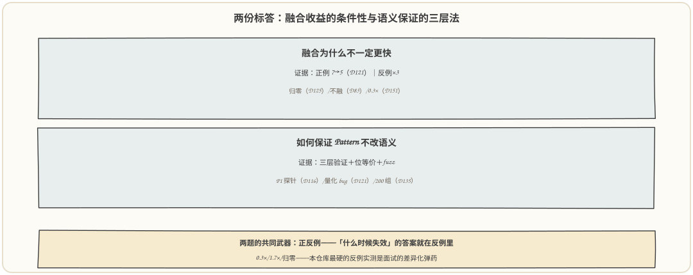
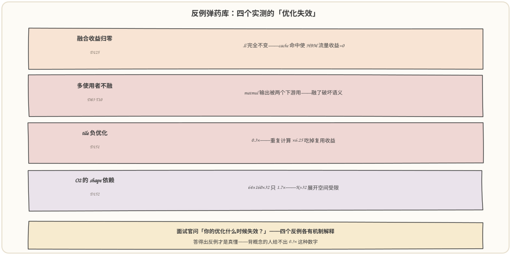
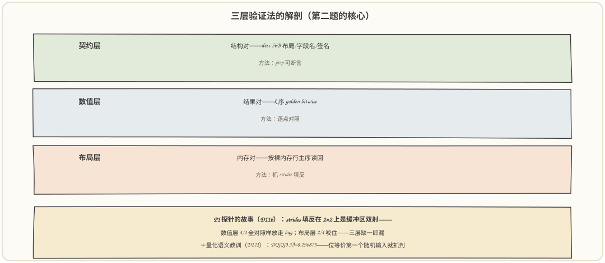

# 第 163 天：融合、Layout 与正确性——两份标答：反例弹药库与三层验证法

> **今日目标**：完成本教程后，你能做到——
> 1. 写出**两份标准回答**（**"融合为什么不一定更快"**：融合省的是中间结果的搬运不是计算——当搬运不是瓶颈（cache 命中）或融合破坏其他优化时不带来收益——正例 7→5 节点（D121）＋**反例×3**（归零（D125 的 .ll 不变）/多使用者不融（D83 T10）/tile 负优化 0.3×（D151））；**"如何保证 Pattern 不改变语义"**：三层验证＋位等价＋fuzz——契约层（结构对·grep 可断言）/数值层（结果对·k 序 g…；
> 2. **反例弹药库四发**（融合收益归零（D125：cache 命中使 HBM 流量=0）／多使用者不融（D83 T10：融了破坏语义）／tile 负优化（D151：0.3×——重复计算 ×6.25）／O2 的 shape 依赖（D152：64×160×32 只 1.7×——K=32 展开空间受限）——**面试官问"你的优化什么时候失效"时的四发弹药，每发有机制解释**）；
> 3. **P1 探针的故事**（strides 填反在 2×2 上是缓冲区双射——数值层全对照样放走 bug、布局层咬住——**三层法的必要性不是理论是踩坑**）＋**量化语义教训**（D121：`DQ(Q(0.3))=0.296875≠0.3`——位等价第一个随机输入就抓到）；
> 4. **"答得出反例才是真懂"**（背概念的人给不出 0.3× 这种数字——**反例是 22 周积累的差异化弹药**）。
> **预计时间**：学习 20 分钟＋实践 30 分钟
> **前置准备**：D121/D125/D151 的融合全程（反例证据）、D116 的三层验证法与 P1 探针（第二题的蓝本）、D162 的四段式纪律。工具：python3。本文环境：Python 3.9.6，macOS arm64，2026-11-15。
> **今日产出**：`code/answers.py`＋`code/outputs/answer-{0,1}.md`（**主产出：两份标准回答**）＋本文 3 张手绘图。

## 1. 今天解决什么问题？

计划 D163 条目："回答'融合为什么不一定更快''如何保证 Pattern 不改变语义'。"——面试转化的第二天。两题的共同武器是**正反例**：融合题的正例（7→5）+三个反例（归零/不融/负优化）；语义题的三层法+两个踩坑故事（P1 探针/量化语义）——**"什么时候失效"的答案就在反例里**。

## 2. 先看全貌

**图 1**：看**两行问答卡＋金框**——融合题（正例 D121＋反例×3：D125/D83/D151）；语义题（三层验证＋位等价＋fuzz：D116/D121/D135）；金框：**两题的共同武器＝正反例——反例是差异化弹药**。

## 3. 核心概念

### 3.1 反例弹药库

**一句通俗解释**：四个实测的"优化失效"（归零/不融/0.3×/1.7×）各配机制解释——**面试官问"什么时候失效"时的四发弹药**；答得出反例才是真懂（背概念给不出数字）。

**生活类比**：空手道高手——只会打拳不够——要知道什么情况不能出拳（对方拿刀/背后有墙）——限制条件才是高手的标志。

**对应到技术上是**：四发反例弹药（归零/不融/0.3×/1.7×）各配机制——面试官问「什么时候失效」时的答案。

**类比边界**：空手道高手的类比帮你建立直觉，但真实的技术实现有更多约束和量化指标——类比的目的是「快速理解方向」，不是「替代技术细节」。

## 4. 图解核心机制

**图 2**：看**四发弹药卡＋金框**——每发（名字＋D 编号＋机制一句）；金框：**答得出反例才是真懂**。

## 5. 图解三层验证法

**图 3**：看**三层卡＋金框**——契约（结构对·grep）/数值（结果对·bitwise）/布局（内存对·裸读回）；金框：P1 探针的故事（数值层放过、布局层咬住——三层缺一即漏）＋量化语义教训（第一个随机输入就抓到）。

## 6. 动手实践

一键复现：`cd tutorials/day-163/code && ./run_all.sh`（约 2 秒）。

### 6.1 修改一个参数再观察

**实验 A（追问演练）**："那你们怎么发现 P1 的？"——答案：教学版的探针设计（故意填反——三层验证的自检）。

## 7. 常见错误与排查

**错误 1：融合题只答"减少访存"**。现象：没有反例——面试官追问"有没有不快的时候"答不上。修复：三反例常备（归零/不融/负优化）——每个有数字。

**错误 2：语义题只答"测试"**。现象："我们做了很多测试"——没有方法论。修复：三层法＋P1 探针的故事——方法＋踩坑双证。

## 8. 今日练习

**必做**：1. 两题四段式脱稿；2. 四发弹药各配机制一句；3. P1 探针的故事复述。

## 9. 今日验收

- [ ] 我能脱稿讲两题（四段式＋正反例）
- [ ] 我能背出四发弹药（归零/不融/0.3×/1.7×）与机制
- [ ] 我能讲 P1 探针的故事（三层缺一即漏）
- [ ] 我知道"答得出反例才是真懂"

## 10. 一句话总结与明天预告

今天的闭环：**两份标答**——融合的条件性（收益＝中间结果×访存代价——cache 命中归零/多使用者不融/tile 负优化）与语义保证的三层法（契约/数值/布局＋P1 探针与量化 bug 的踩坑故事）；**反例弹药库**——四发各配机制（0.3× 是最硬的一发）；**纪律**——答得出反例才是真懂。明天 D164 动态 Shape 与 Runtime：两份标答（"动态 Shape 难在哪里"（六件事＋三件套——D128/D133 的标准回答）/"哪些决策应放到运行期"（职责审计的判定框架——D127 的 11 决策点））＋项目分发流程图。

> **第 24 周积分卡**：D162 多层 IR/MLIR/SSA → **D163 融合/Layout/正确性（两份＋弹药库）** → D164 动态 Shape/Runtime → D165 Tiling/内存/性能 → D166 调试/数值 → D167 模拟讲解 → D168 最终验收。
