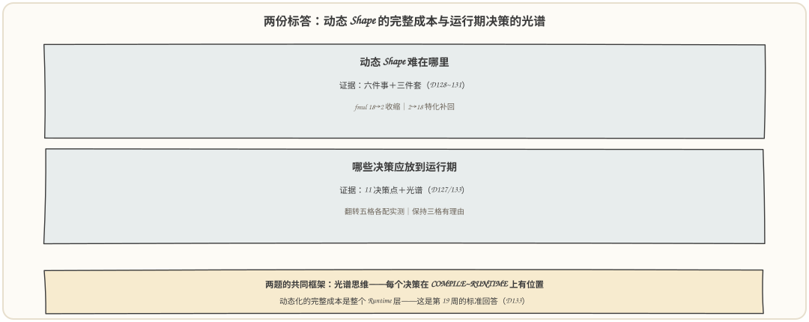
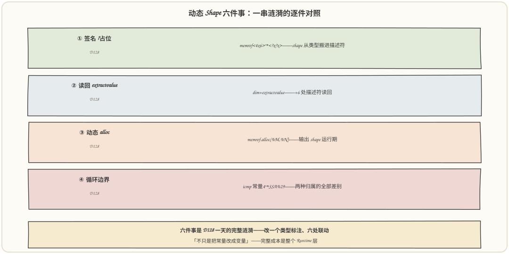
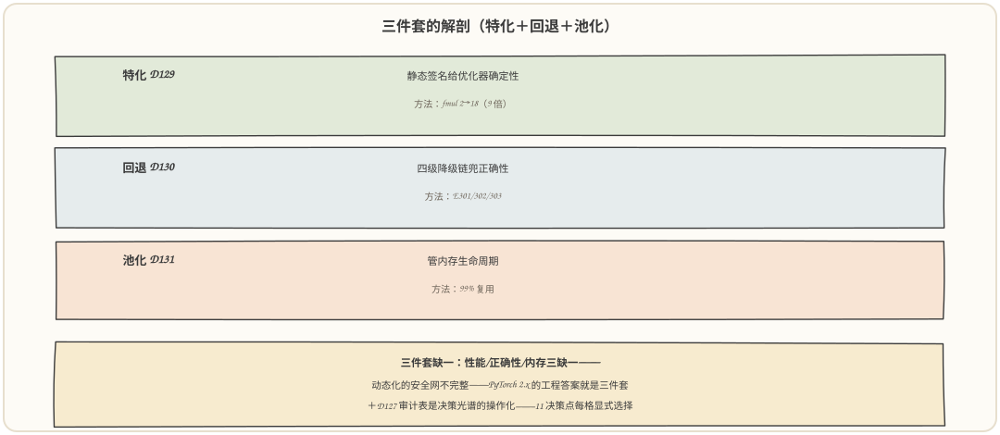

# 第 164 天：动态 Shape 与 Runtime——两份标答：六件事＋三件套与决策光谱

> **今日目标**：完成本教程后，你能做到——
> 1. 写出**两份标准回答**（**"动态 Shape 难在哪里"**：不只是把常量改成变量——是**一串涟漪（六件事）＋三件配套**——签名 ?占位/shape 读回/动态 alloc/循环边界/验证参数化/**性能语义收缩（fmul 18→2 的实测）**＋特化（补性能 2→18）/回退（兜正确）/池化（管内存）——**动态化的完整成本是整个 Runtime 层**（D133 的标准回答）；**"哪些决策应放到运行期"**：没有标准答案只有**显式选择**——每个…；
> 2. **六件事的逐件对照**（①签名 `memref<4x6>`→`<?x?x>`（shape 从类型搬进描述符）②读回 dim＋extractvalue（+6 处）③动态 alloc(%M,%N)（输出 shape 运行期）④循环边界 `icmp 常量4→SSA%29`（两种归属的全部差别）⑤验证参数化（三 shape golden）⑥性能语义收缩（fmul 18→2——优化器失去确定性））；
> 3. **三件套的分工**（特化（D129：静态签名给优化器确定性——fmul 2→18 九倍）/回退（D130：四级降级链兜正确性）/池化（D131：管内存生命周期 99% 复用）——**三缺一＝性能/正确性/内存的安全网不完整**（PyTorch 2.x 的工程答案））；
> 4. **决策光谱的操作化**（D127 的审计表——11 决策点每格显式选择＋证据；翻转五格各配实测（D128 三 shape/D129 的 2→18/D131 的 99%）；**保持三格也是决策**（教学取舍的显式记录））。
> **预计时间**：学习 20 分钟＋实践 30 分钟
> **前置准备**：D133 的标准回答（第一题的蓝本——今天四段式化）、D127 的审计表（第二题的蓝本）、D162/163 的四段式纪律。工具：python3。本文环境：Python 3.9.6，macOS arm64，2026-11-15。
> **今日产出**：`code/answers.py`＋`code/outputs/answer-{0,1}.md`（**主产出：两份标准回答**）＋本文 3 张手绘图。

## 1. 今天解决什么问题？

计划 D164 条目："回答'动态 Shape 难在哪里''哪些决策应放到运行期'。"——面试转化第三天。两题正好是第 19 周的浓缩：第一题的答案 D133 已经写成过"标准回答"（今天升级为四段式）；第二题的框架来自 D127 的审计（光谱思维）。

## 2. 先看全貌

**图 1**：看**两行问答卡＋金框**——动态 Shape 题（六件事＋三件套：D128~131）；运行期决策题（11 决策点＋光谱：D127/133）；金框：**两题的共同框架＝光谱思维——动态化的完整成本是整个 Runtime 层**。

## 3. 核心概念

### 3.1 光谱思维：每个决策有位置

**一句通俗解释**：Compiler/Runtime 不是二分而是光谱——每个决策点（Shape/Kernel/内存/同步...）都有自己的位置；**没有标准答案只有显式选择**——判据是性能/灵活性权衡＋配套成本（翻转一格的涟漪与三件套）。

**生活类比**：自动挡 vs 手动挡——不是二选一——是刻度盘：全自动（COMPILE）←→全手动（RUNTIME）中间有无数档位。

**对应到技术上是**：11 决策点每格在光谱上有位置——翻转要配三件套（特化/回退/池化）——「保持也是决策」。

**类比边界**：自动挡 vs 手动挡的类比帮你建立直觉，但真实的技术实现有更多约束和量化指标——类比的目的是「快速理解方向」，不是「替代技术细节」。

## 4. 图解核心机制

**图 2**：看**六件事卡＋金框**——签名/读回/alloc/边界/验证/性能收缩各配 D128 实测；金框：**改一个类型标注、六处联动——"不只是把常量改成变量"**。

## 5. 图解三件套

**图 3**：看**三件卡＋金框**——特化（fmul 2→18）/回退（E301/302/303）/池化（99% 复用）；金框：**三缺一＝安全网不完整——PyTorch 2.x 的工程答案就是三件套**＋D127 审计表是光谱的操作化。

## 6. 常见错误与排查

**错误 1：第一题只答"签名改 ?"**。修复：六件事全列＋性能收缩的实测数字（fmul 18→2）——**涟漪才是难点**。

**错误 2：第二题答"看情况"**。修复：光谱框架＋D127 的 11 决策点与翻转五格的实测——"看情况"要有操作化的看板。

## 7. 今日练习

**必做**：1. 两题四段式脱稿；2. 六件事＋三件套各配数字；3. "光谱思维"一段话复述。

## 8. 今日验收

- [ ] 我能脱稿讲两题（四段式＋六件事/11 决策点）
- [ ] 我能背出六件事与三件套（各配实测数字）
- [ ] 我能说"完整成本是整个 Runtime 层"的含义
- [ ] 我知道光谱思维与"保持也是决策"

## 9. 一句话总结与明天预告

今天的闭环：**两份标答**——动态 Shape（六件事＋三件套＝完整成本是 Runtime 层）与运行期决策（光谱思维＋11 决策点审计）；**数字**——fmul 18→2（收缩）与 2→18（特化补回）互为镜像；**框架**——光谱不是二分、每格显式选择。明天 D165 Tiling、内存与性能：两份标答（"Tile 由什么决定"（片上容量/复用/边界的三角＋D101 的五项记账）/"如何判断计算或访存瓶颈"（Roofline 的 AI＋拐点＋实测对照——D150 的完整方法））＋性能数据示例。

> **第 24 周积分卡**：D162 多层 IR → D163 融合/正确性 → **D164 动态 Shape/Runtime（六件事＋光谱）** → D165 Tiling/内存/性能 → D166 调试/数值 → D167 模拟讲解 → D168 最终验收。
