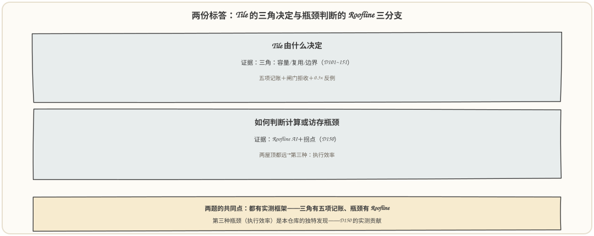
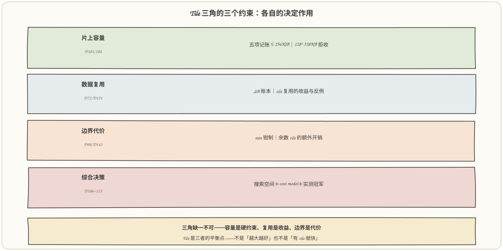
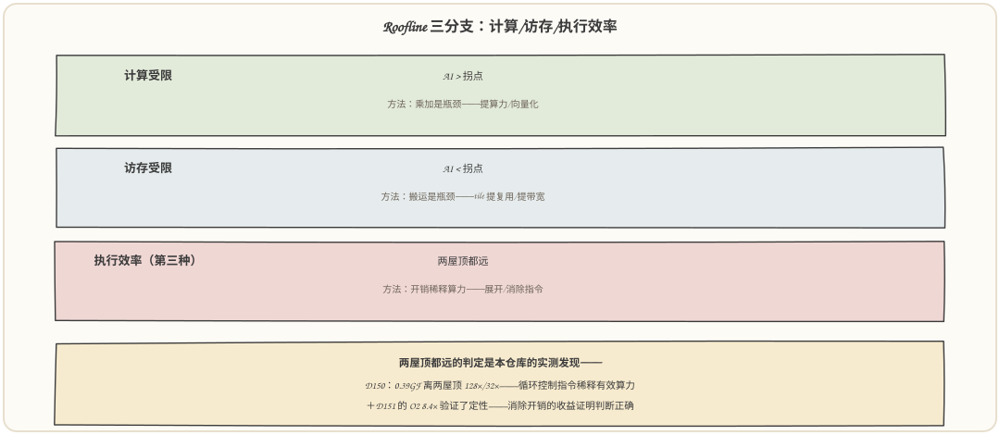

# 第 165 天：Tiling、内存与性能——两份标答：Tile 三角与 Roofline 三分支

> **今日目标**：完成本教程后，你能做到——
> 1. 写出**两份标准回答**（**"Tile 由什么决定"**：三个约束的三角——片上容量（装不装得下：D101 五项记账＋D104 闸门（128³ 328KB＞256KiB 拒收））/数据复用（省多少搬运：D72 的 ΔB 账本＋D151 的复用反例）/边界代价（余数 tile 的额外开销：D90 min 钳制）——**Tile 是三者的平衡点**（不是"越大越好"也不是"有 tile 就快"）；**"如何判断计算或访存瓶颈"**：Roofline 的 AI 与拐…；
> 2. **五项记账的口径**（A/B×2（DMA 流入是唯一 ×2 的——乒乓要两个槽）＋C（累加器恒 ×1）＋bias——D101 的遗产）；
> 3. **第三种瓶颈的故事**（实测离两个屋顶都远——不是经典二分而是执行效率；**O2 展开 8.4× 是定性的验证**（消除开销的收益证明判断正确）——这是本仓库的独特发现）；
> 4. **两题的实测框架**（三角有五项记账＋闸门＋反例；瓶颈有 Roofline＋拐点＋对照——**每题都有可操作的工具不是纯概念**）。
> **预计时间**：学习 20 分钟＋实践 30 分钟
> **前置准备**：D101/D104 的五项记账与闸门（Tile 三角的证据）、D150~151 的 Roofline 与验证（瓶颈判断的证据）、D162~164 的四段式纪律。工具：python3。本文环境：Python 3.9.6，macOS arm64，2026-11-15。
> **今日产出**：`code/answers.py`＋`code/outputs/answer-{0,1}.md`（**主产出：两份标准回答**）＋本文 3 张手绘图。

## 1. 今天解决什么问题？

计划 D165 条目："回答'Tile 由什么决定''如何判断计算或访存瓶颈'。"——面试转化第四天。两题分别对应第 15 周（内存约束）与第 22 周（性能归因）的浓缩——**每题都有可操作的实测框架**（三角有记账、瓶颈有 Roofline）。

## 2. 先看全貌

**图 1**：看**两行问答卡＋金框**——Tile 题（三角：容量/复用/边界——D101~151）；瓶颈题（Roofline AI＋拐点——D150）；金框：**两题的共同点＝都有实测框架——第三种瓶颈是本仓库的独特发现**。

## 3. 核心概念

### 3.1 Tile 三角与 Roofline 三分支

**一句通俗解释**：Tile 由三个约束的**平衡点**决定（容量硬约束/复用收益/边界代价）；瓶颈判断有**三分支**（计算/访存/执行效率——第三个是"两屋顶都远"时的本仓库发现）。

**生活类比**：三脚凳——凳子要稳需要三条腿等长——缺一条或长短不齐就晃——不是哪条腿最重要，是平衡。

**对应到技术上是**：Tile 三角（容量硬约束/复用收益/边界代价）——平衡点不是「越大越好」也不是「有就快」。

**类比边界**：三脚凳的类比帮你建立直觉，但真实的技术实现有更多约束和量化指标——类比的目的是「快速理解方向」，不是「替代技术细节」。

## 4. 图解核心机制

**图 2**：看**四行三角卡＋金框**——片上容量（五项记账＋闸门拒收）/数据复用（ΔB 账本＋反例）/边界代价（min 钳制）/综合决策（搜索＋模型＋实测）；金框：**三角缺一不可——Tile 不是"有就快"**。

## 5. 图解 Roofline 三分支

**图 3**：看**三分支卡＋金框**——计算受限（AI＞拐点——提算力）/访存受限（AI＜拐点——提复用）/执行效率（两屋顶都远——消除指令开销）；金框：**D150 的实测发现＋D151 的 8.4× 验证**。

## 6. 常见错误与排查

**错误 1：Tile 题答"越大越好"或"32×32 常用"**。修复：三角框架＋五项记账——**平衡点**不是常数。

**错误 2：瓶颈题只答二分**。修复：三分支＋"两屋顶都远"的实测故事（0.39GF/128×/32×）。

## 7. 今日练习

**必做**：1. 两题四段式脱稿；2. 五项记账的口径（×2 只在哪项）；3. 第三种瓶颈的故事＋8.4× 验证。

## 8. 今日验收

- [ ] 我能脱稿讲两题（四段式＋三角/三分支）
- [ ] 我能背出五项记账与 ×2 的位置（DMA 流入）
- [ ] 我能讲"第三种瓶颈"的发现与验证故事
- [ ] 我知道"平衡点"与"有 tile 不等于快"（0.3× 反例）

## 9. 一句话总结与明天预告

今天的闭环：**两份标答**——Tile 三角（容量/复用/边界的平衡点——五项记账＋闸门＋0.3× 反例）与 Roofline 三分支（计算/访存/**执行效率**——第三种是 D150 的实测发现＋D151 的 8.4× 验证）；**框架**——每题有可操作工具（记账/Roofline）不是纯概念。明天 D166 调试与数值问题：两份标答（"如何定位一个 Pass 引入的错误"（五站流水线——D140 的口诀）/"数值差异是否都能归因于浮点误差"（口径与序差——D78~80/D124 的教训））＋调试流程演示。

> **第 24 周积分卡**：D162 多层 IR → D163 融合/正确性 → D164 动态 Shape → **D165 Tiling/性能（三角＋三分支）** → D166 调试/数值 → D167 模拟讲解 → D168 最终验收。
