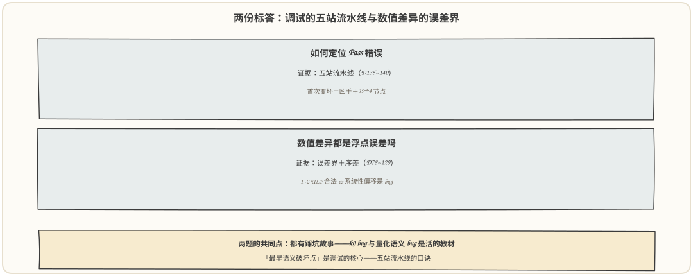
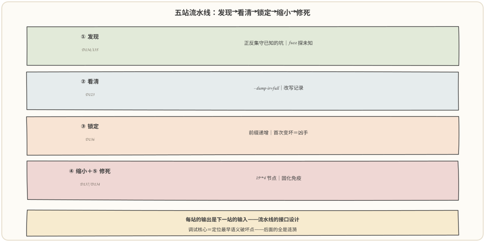
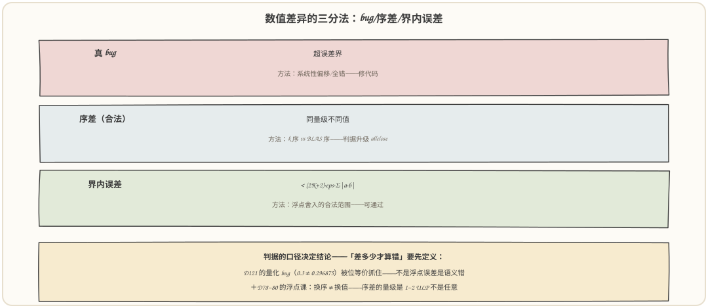

# 第 166 天：调试与数值问题——两份标答：五站流水线与误差界的三分法

> **今日目标**：完成本教程后，你能做到五件事——写出**两份标准回答**（**"如何定位一个 Pass 引入的错误"**：五站流水线（发现→看清→锁定→缩小→修死）——核心是定位**最早语义破坏点**（首次变坏的 pass＝凶手——D136 的注入定位实测：✓✓✓✗✗✗ 的跳变点与注入点完全一致）；**"数值差异是否都能归因于浮点误差"**：不能——浮点误差有**可计算的界**（(2K+2)·eps·Σ|a·b|）；超界是 bug、界内要区分**序差（合法）与真错**——D78~80 的课（换序≠换值：k 序 vs BLAS 序的 24.625 vs 24.25 实测）＋D121 的量化 bug（DQ(Q(0.3))=0.296875——**位等价第一个随机输入抓到——不是浮点误差是语义错**））；背出**五站口诀与各自的工具**（发现（正反集＋fuzz·D134/135）→看清（dump＋改写记录·D123）→锁定（前缀二分·D136）→缩小（Reduce 19→4·D137）→修死（固化免疫·D134 格式）——**每站的输出是下一站的输入**）；讲出**数值三分法**（真 bug（超误差界——系统性偏移/全错：修代码）/序差（同量级不同值：k 序 vs BLAS——**判据升级 allclose**（D129 的教训））/界内误差（＜(2K+2)·eps·Σ|a·b|：浮点舍入的合法范围——可通过））；说出**两题的共同踩坑故事**（k0 bug（D145：形态对执行错——组合是新的失败面）与量化语义 bug（D121：位等价抓到）——**活的教材胜过十条规则**）。
> **预计时间**：学习 20 分钟＋实践 30 分钟
> **前置准备**：D136~140 的调试五站（第一题的蓝本）、D78~80/D121/D124/D129 的浮点与口径全程（第二题的蓝本）、D162~165 的四段式纪律。工具：python3。本文环境：Python 3.9.6，macOS arm64，2026-11-15。
> **今日产出**：`code/answers.py`＋`code/outputs/answer-{0,1}.md`（**主产出：两份标准回答**）＋本文 3 张手绘图。

## 1. 今天解决什么问题？

计划 D166 条目："回答'如何定位一个 Pass 引入的错误''数值差异是否都能归因于浮点误差'。"——面试转化第五天。两题是第 20 周的浓缩：调试的方法论（五站）与数值的判断力（误差界）。

## 2. 先看全貌

**图 1**：看**两行问答卡＋金框**——调试题（五站流水线＋最早破坏点：D135~140）；数值题（误差界＋序差：D78~129）；金框：**两题的共同点＝都有踩坑故事**（k0 bug 与量化语义 bug 是活的教材）。

## 3. 核心概念

### 3.1 最早语义破坏点

**一句话**：调试的黄金假设——错误总在某条 Pass 首次引入；**找到它、后面的全是涟漪**（修源头涟漪自动消失）；判定靠前缀递增的单调性（✓✓✓✗✗ 的跳变点唯一）。

### 3.2 误差界的三分法

**一句话**：数值差异分三类——**真 bug**（超界：修代码）/ **序差**（合法：判据升级）/ **界内误差**（浮点舍入：通过）——判据先于结论（"差多少才算错"要先定义）。

## 4. 图解核心机制

**图 2**：看**五站卡＋金框**——发现/看清/锁定/缩小/修死各配工具与 D 编号；金框：**每站的输出是下一站的输入——调试核心＝定位最早语义破坏点**。

## 5. 图解三分法

**图 3**：看**三分类卡＋金框**——真 bug（超界·修代码·红）/序差（合法·allclose·蓝）/界内（通过·绿）；金框：**判据的口径决定结论**＋量化 bug 的故事＋换序≠换值。

## 6. 常见错误与排查

**错误 1：调试题答"打日志"**。修复：五站框架＋首次变坏的推理——方法论不是工具罗列。

**错误 2：数值题答"都差不多就行"**。修复：误差界公式＋三分法——"差不多"没有判据。

## 7. 今日练习

**必做**：1. 两题四段式脱稿；2. 五站口诀＋各站工具；3. 三分法各配一个本仓库实例。

## 8. 今日验收

- [ ] 我能脱稿讲两题（四段式＋五站/三分法）
- [ ] 我能背出五站口诀与各站工具＋"最早破坏点"的含义
- [ ] 我能说出误差界公式与三类差异的判据
- [ ] 我能讲 k0 bug 与量化 bug 的故事（活的教材）

## 9. 一句话总结与明天预告

今天的闭环：**两份标答**——调试（五站流水线＋最早语义破坏点——每站有工具、接口相接）与数值（误差界三分法——真 bug/序差/界内各有判据）；**故事**——k0 bug（形态对执行错）与量化 bug（位等价抓到）是活的教材。明天 D167 完整项目模拟讲解：**20 分钟项目讲解＋10 分钟问答**——五天标答的汇演：讲解提纲（问题背景→个人工作→技术难点→量化结果→限制）＋被卡住的问题清单＋补充材料——**面试转化的实战演习**。

> **第 24 周积分卡**：D162 多层 IR → D163 融合/正确性 → D164 动态 Shape → D165 Tiling/性能 → **D166 调试/数值（五站＋三分法）** → D167 模拟讲解 → D168 最终验收。
