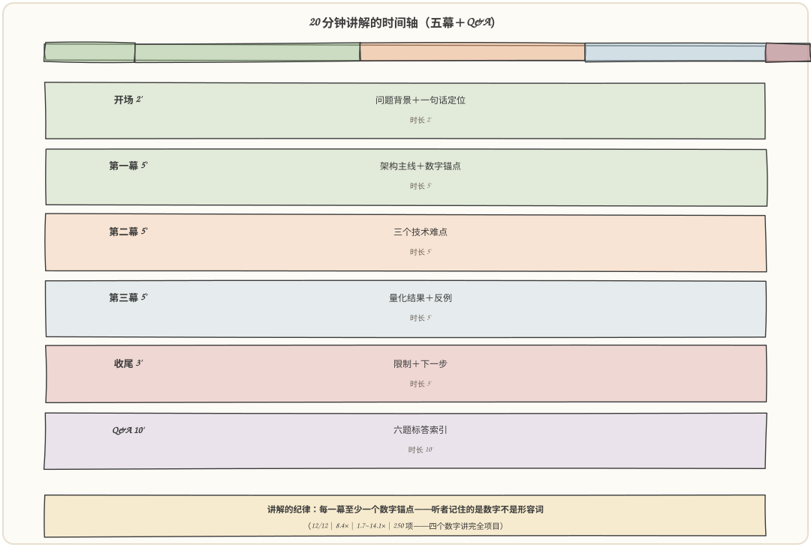
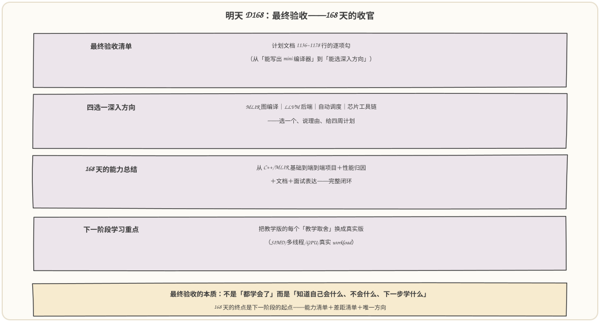
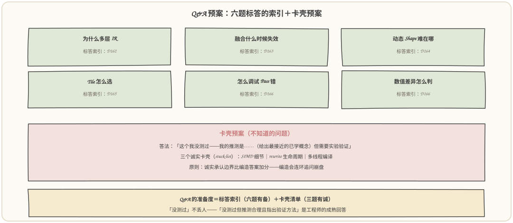

# 第 167 天：完整项目模拟讲解——20 分钟五幕＋10 分钟 Q&A：数字锚点纪律

> **今日目标**：完成本教程后，你能做到五件事——准备**20 分钟讲解的五幕时间轴**（开场 2'（问题背景＋一句话定位："把 AI 编译器的核心链路在教学尺度走了一遍——≈250 项测试判定背书"）→第一幕 5'（架构主线：六层数据流＋三份合同＋运行时三件套——指着架构图讲＋数字锚点（12/12 bitwise/合同 25 项/胶水 0））→第二幕 5'（三个技术难点：动态 Shape 的六件事＋三件套（fmul 18→2/2→18）/Roofline 第三种瓶颈（两屋顶都远＋O2 8.4× 验证）/k0 bug 的发现（形态对执行错））→第三幕 5'（量化结果：200 组 fuzz/分布 1.7~14.1×/**反例 0.3×/环境函数（诚实边界）**/250 项测试＋8/8 走查）→收尾 3'（限制：教学 CPU 规模/tile 负优化/单机单线程＋下一步四选一））；准备**Q&A 预案**（六题标答索引（D162~166 各就各位）＋**卡壳预案**（"这个我没测过——我的推测是……但需要实验验证"——诚实比编造加分）＋三个诚实卡壳（SIMD 细节/rewrite 生命周期/多线程编译——stuck-list 存档））；遵守**数字锚点纪律**（每一幕至少一个数字——**听者记住的是数字不是形容词**（12/12｜8.4×｜1.7~14.1×｜250 项——四个数字讲完全项目））；完成**讲解的结构检查**（问题背景→个人工作→技术难点→量化结果→限制——计划条目要求的五要素各有落点）；说出**"没测过"的答法**（承认边界＋给推测（指出最接近的已学概念）＋指出验证方法——**工程师的成熟回答**；编造会连环追问崩盘）。
> **预计时间**：学习 25 分钟＋实践 35 分钟
> **前置准备**：D162~166 的十份标答（Q&A 弹药库）、D155 的架构图（第一幕的道具）、D161 的五份文档（收尾的"可验证"背书）。工具：python3。本文环境：Python 3.9.6，macOS arm64，2026-11-15。
> **今日产出**：`code/mock_talk.py`＋`code/outputs/talk-outline.md`（**主产出：讲解提纲**）＋`code/outputs/stuck-list.txt`（卡壳清单）＋本文 3 张手绘图。

## 1. 今天解决什么问题？

计划 D167 条目："进行一次 20 分钟项目讲解，再用 10 分钟回答本周全部问题。"——五天标答的**汇演**：把 22 周的项目讲成一个 20 分钟的故事＋接住 10 分钟的追问。

讲解的纪律是**数字锚点**：每一幕至少一个数字（12/12→8.4×→1.7~14.1×→250 项）——听者记住数字不是形容词；Q&A 的纪律是**诚实预案**：六题有备（标答索引）、三题有诚（卡壳清单）——"没测过＋推测＋验证方法"胜过编造。

## 2. 先看全貌

**图 1**：看**时间轴＋六幕卡＋金框**——五幕＋Q&A 的时间分配；金框：**每一幕至少一个数字锚点——四个数字讲完全项目**。

## 3. 核心概念

**图 3**：看**四行收官卡＋金框**——最终验收清单（计划文档 1136~1178 行的逐项勾——从"能写出 mini 编译器"到"能选深入方向"）；四选一深入方向（MLIR 图编译｜LLVM 后端｜自动调度｜芯片工具链——选一个说理由给四周计划）；168 天能力总结（从 C++/MLIR 基础到端到端项目＋性能归因＋文档＋面试表达——完整闭环）；下一阶段学习重点（把教学版的每个"教学取舍"换成真实版（SIMD/多线程/GPU/真实 workload））；金框：**最终验收的本质——不是"都学会了"而是"知道自己会什么、不会什么、下一步学什么"——168 天的终点是下一阶段的起点**。

### 3.1 数字锚点纪律

**一句话**：讲解的每一幕至少一个数字（12/12、8.4×、1.7~14.1×、250 项）——**听者记住的是数字不是形容词**；"效果不错"是零信息，"分布 1.7~14.1×"是完整故事。

### 3.2 卡壳预案

**一句话**：不知道的问题答"没测过＋推测＋验证方法"——**诚实承认边界比编造加分**（编造会连环追问崩盘）；三个诚实卡壳预存（SIMD/rewrite 生命周期/多线程）。

## 4. 图解核心机制

**图 2**：看**六题索引卡＋红框卡壳预案＋金框**——六题各有 D 编号（D162~166 的十份标答就位）；红框三条（诚实答法/三个卡壳/原则）；金框：**Q&A 的准备度＝标答索引（六题有备）＋卡壳清单（三题有诚）**。

## 5. 动手实践

一键复现：`cd tutorials/day-167/code && ./run_all.sh`（约 2 秒）。

### 5.1 修改一个参数再观察

**实验 A（计时演练）**：对空气讲五幕（手机计时）——哪幕超时？（常见：第二幕技术难点超——三选二）；**实验 B（追问演练）**：请人随机挑六题追问——卡壳的进 stuck-list。

## 6. 常见错误与排查

**错误 1：讲解全是形容词**。修复：每幕一个数字——数字是记忆锚。

**错误 2：Q&A 编答案**。修复：卡壳预案——"没测过"＋推测＋验证。

## 7. 今日练习

**必做**：1. 五幕脱稿计时（20±2 分钟）；2. 四个数字锚点默写；3. 卡壳三题的诚实答法演练。

## 8. 今日验收

- [ ] 我能 20 分钟讲完五幕（每幕一个数字锚点）
- [ ] 我能背出 Q&A 六题索引与三个卡壳的诚实答法
- [ ] 我知道"数字不是形容词"与"诚实比编造加分"两条纪律

## 9. 一句话总结与明天预告

今天的闭环：**五幕时间轴**（开场定位→架构主线→三个难点→量化结果→限制与下一步——20 分钟四数字）；**Q&A 预案**（六题标答索引＋三题卡壳诚实——"没测过＋推测＋验证"是成熟回答）；**纪律**——数字锚点（听者记数字）＋诚实预案（编造崩盘）。明天 D168 最终验收与下一阶段计划：**执行计划文档的最终验收清单**（从"能写出 mini 编译器"到"能选深入方向"的逐项勾）＋**四选一**（MLIR 图编译/LLVM 后端/自动调度/芯片工具链——选一个说理由给四周计划）＋**168 天能力总结**（从 C++/MLIR 基础到端到端项目＋性能归因＋文档＋面试表达的完整闭环——**终点是下一阶段的起点**）。

> **第 24 周积分卡**：D162 → D163 → D164 → D165 → D166 → **D167 模拟讲解（五幕＋Q&A）** → D168 最终验收（明天·最后一天）。
