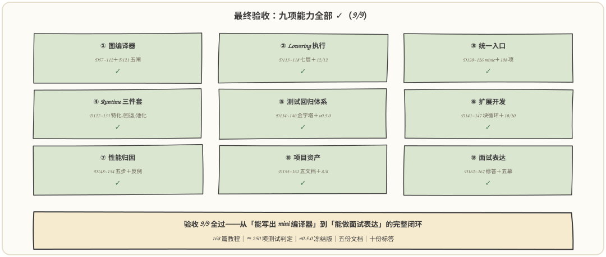
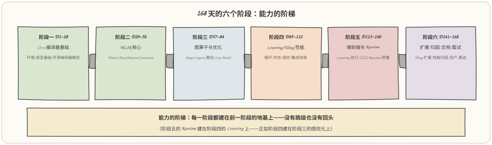
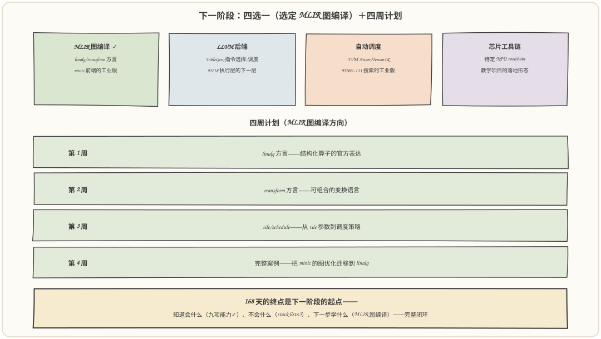

# 第 168 天：最终验收与下一阶段计划——九项能力 9/9：168 天完整闭环

> **今日目标**：完成本教程后，你能做到——
> 1. 执行**最终验收清单**（九项能力逐项勾：①图编译器（D57~112＋D121 五闸）✓／②Lowering 执行（D113~118 七层＋四路线 12/12）✓／③统一入口（D120~126 minic S0~S6＋108 项）✓／④Runtime 三件套（D127~133 特化/回退/池化＋40 项）✓／⑤测试回归体系（D134~140 金字塔＋v0.5.0 冻结）✓／⑥扩展开发（D141~147 块循环 Tiling＋10/10）✓／⑦性能归因（D148~…；
> 2. 总结**168 天的六个阶段**（阶段一 D1~28（C++/编译器基础）→阶段二 D29~56（MLIR 核心）→阶段三 D57~84（图算子与优化）→阶段四 D85~112（Lowering/Tiling/性能）→阶段五 D113~140（端到端与 Runtime）→阶段六 D141~168（扩展/归因/文档/面试）——**能力的阶梯：每一阶段建在前一阶段的地基上，没有跳级也没有回头**）；
> 3. **四选一的深入方向选择**（MLIR 图编译 ✓（选定——与 minic 前端衔接最紧（D57~D112 的工业版））／LLVM 后端（TableGen/指令选择——D118 的下一层）／自动调度（TVM Ansor——D106~111 的工业版）／芯片工具链（NPU toolchain——教学项目的落地形态）——**选定配理由＋四周计划**（linalg 方言→transform 方言→tile/schedule→完整案例））；
> 4. 报出**项目总账**（**168 篇教程｜≈250 项测试判定｜v0.5.0 冻结版｜五份项目文档｜十份面试标答**——从计划文档到仓库的完整落地）；
> 5. **最终验收的本质**（不是"都学会了"而是"**知道自己会什么（九项✓）、不会什么（stuck-list×3）、下一步学什么（MLIR 图编译）**"——**168 天的终点是下一阶段的起点**）。
> **预计时间**：学习 30 分钟＋实践 30 分钟
> **前置准备**：计划文档的最终验收清单（1136~1178 行——今天逐项勾）、167 天的全部积累（验收证据链）、D167 的五幕讲解（面试能力的证明）。工具：python3。本文环境：Python 3.9.6，macOS arm64，2026-11-15。
> **今日产出**：`code/final_check.py`（九项验收＋方向选择＋能力总结）、`code/outputs/final-summary.json`（**主产出：最终验收总结**）＋本文 3 张手绘图。

## 1. 今天解决什么问题？

168 天的最后一天。计划 D168 条目："回顾 168 天形成的能力，识别距离真实 AI 芯片编译器岗位仍有差距的部分；执行最终验收清单，选择未来 4 周唯一深入方向。"——**收官**：验收（九项能力逐勾）＋选向（四选一＋四周计划）＋总结（六阶段能力阶梯＋项目总账）。

最终验收的本质不是"都学会了"——是**三个清单**：会什么（九项 ✓ 的证据链）、不会什么（stuck-list 的诚实清单）、下一步学什么（选定的方向与计划）——**知道自己在哪里，比到达更重要**。

## 2. 先看全貌

**图 1**：看**九格 ✓＋金框**——九项能力（图编译器/Lowering/入口/Runtime/测试/扩展/归因/资产/表达）各配证据（D 编号＋数字）；金框：**9/9 全过＋项目总账**（168 篇/250 项/v0.5.0/五文档/十标答）。

## 3. 核心概念

### 3.1 能力的阶梯：没有跳级没有回头

**一句通俗解释**：六阶段依次建地基（基础→MLIR→图优化→Lowering→端到端→收口）——阶段五的 Runtime 建在阶段四的 Lowering 上，正如阶段四建在阶段三的图优化上——**每一阶段都曾是下一阶段的前置准备**，回头看这条阶梯比任何单点知识更有价值。

**生活类比**：毕业答辩——毕业不是「什么都学会了」——是知道自己会什么（论文）、不会什么（答辩时被问住的）、下一步学什么（研究方向）。

**对应到技术上是**：九项能力✓（会什么）＋stuck-list×3（不会什么）＋四周计划（学什么）——完整的自我认知。

**类比边界**：毕业答辩的类比帮你建立直觉，但真实的技术实现有更多约束和量化指标——类比的目的是「快速理解方向」，不是「替代技术细节」。

### 3.2 最终验收的本质：三个清单

**一句话**：会什么（九项 ✓）、不会什么（stuck-list×3：SIMD 细节/rewrite 生命周期/多线程）、下一步学什么（MLIR 图编译＋四周计划）——**完整的自我认知比"都学会了"更成熟**——168 天的终点是下一阶段的起点。

## 4. 图解核心机制

**图 2**：看**六格阶梯＋金框**——六阶段从左到右上升（各配主题与内容）；金框：**每一阶段建在前一阶段的地基上——没有跳级也没有回头**。

## 5. 图解下一阶段

**图 3**：看**四方向卡＋四周计划＋金框**——四方向（MLIR 图编译 ✓ 选定（绿）/LLVM 后端/自动调度/芯片工具链）；四周计划（linalg→transform→tile/schedule→完整案例）；金框：**终点是起点——会什么/不会什么/学什么的完整闭环**。

## 6. 动手实践

一键复现：`cd tutorials/day-168/code && ./run_all.sh`（约 2 秒）。

### 6.1 修改一个参数再观察

**实验 A（验收自查）**：对九项各写一句"我能拿出什么证据"——写不出的项就是虚勾；**实验 B（方向答辩）**：给选定的方向写三句理由＋四周计划各一句——说不出理由的选择是随大流。

## 7. 常见错误与排查

**错误 1：验收只打勾不配证据**。修复：每项 ✓ 配 D 编号＋数字——**证据链是验收的实质**。

**错误 2：选向随大流**。修复：理由三句（衔接/兴趣/岗位）＋计划四周——说得出理由的选择才可持续。

## 8. 今日练习

**必做**：1. 九项能力各配一句证据；2. 六阶段阶梯脱稿讲；3. 三个清单（会/不会/学什么）写出自己的版本。

## 9. 今日验收

- [ ] 我能背出九项能力与各自的证据（D 编号＋数字）
- [ ] 我能讲六阶段阶梯（每阶段一句主题）
- [ ] 我能说出选定的方向＋三条理由＋四周计划
- [ ] 我知道最终验收的本质（三个清单的完整自我认知）

## 10. 一句话总结：168 天的完整闭环

今天的闭环：**验收 9/9**——九项能力全过（从图编译器到面试表达——每项配证据链）；**阶梯**——六阶段依次建地基（基础→MLIR→图优化→Lowering→端到端→收口——没有跳级没有回头）；**选向**——MLIR 图编译（衔接最紧＋四周计划）；**总账**——168 篇教程｜≈250 项测试判定｜v0.5.0 冻结版｜五份文档｜十份标答；**本质**——会什么（九✓）/不会什么（三卡壳）/学什么（四周计划）——**168 天的终点是下一阶段的起点**。

> **168 天毕业**。从 day-001 的编译器环境搭建到 day-168 的最终验收——六个阶段、24 周、168 天：**计划文档的每一行都变成了仓库里的一个目录**。下一站：MLIR 图编译（linalg → transform → tile/schedule → 完整案例）。
